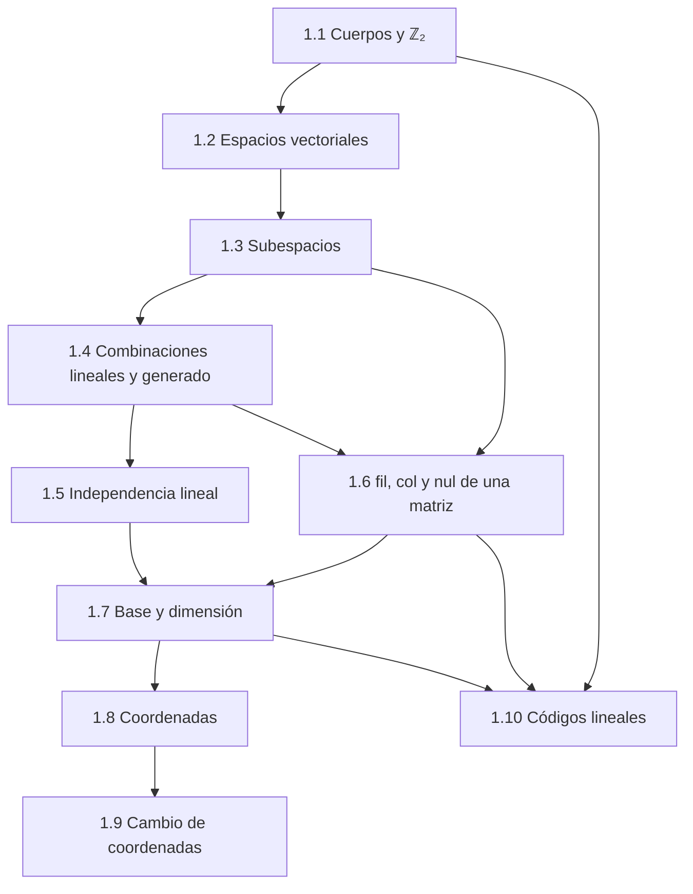

## Para qué sirve esta unidad

En Álgebra I los vectores eran flechas del plano o del espacio, o columnas de números. En informática los
datos casi nunca tienen esa forma, pero **se combinan de la misma manera**: se suman y se escalan.
Una señal de audio muestreada en $n$ instantes es un vector de $\mathbb{R}^n$; una imagen en escala de
grises de $m\times n$ píxeles es una matriz de $\mathbb{R}^{m\times n}$; un polinomio de grado a lo
sumo $2$ se guarda como un arreglo de tres coeficientes; una palabra de $n$ bits es un vector de
$\mathbb{Z}_2^n$, donde la suma es el **o exclusivo** bit a bit. Un **espacio vectorial** es la estructura
mínima que tienen en común todos esos objetos: un conjunto con una suma y un producto por escalares que
cumplen diez axiomas.

Lo que se gana con esa abstracción es poder usar un único lenguaje (subespacios, generadores,
independencia, bases, dimensión, coordenadas) para problemas muy distintos:

- **Señales y datos.** Elegir una base adecuada para representar una señal con pocos coeficientes es la
  idea de fondo de las transformadas y de la compresión; cambiar de base es cambiar de representación
  sin perder información.
- **Bits y redundancia.** Un bloque de paridad que permite reconstruir un disco roto es una combinación
  lineal en $\mathbb{Z}_2^n$. Un código corrector de errores es un **subespacio** de $\mathbb{Z}_2^n$:
  su dimensión dice cuántos mensajes distintos hay ($2^k$) y su matriz de control detecta y corrige bits
  invertidos. La lección final de la unidad lo desarrolla hasta el código de Hamming $(7,4)$.
- **Sistemas de ecuaciones.** Que un sistema tenga solución es que un vector pertenezca a un subespacio
  (el espacio columna de la matriz); que sea determinado es una cuestión de independencia lineal.

Además, la unidad introduce el cuerpo de escalares $K$ como variable: todo se hace sobre $\mathbb{R}$ y
sobre $\mathbb{Z}_2$, y se aprende a decir cuándo un resultado depende del cuerpo (un conjunto puede ser
independiente en $\mathbb{R}^3$ y dependiente en $\mathbb{Z}_2^3$).

## Objetivos

Siguiendo el programa 2023 de la asignatura, al terminar la unidad deberías poder:

1. Decidir si una estructura es un cuerpo y operar en $\mathbb{R}$, $\mathbb{Z}_2$ y $\mathbb{Z}_p$.
2. Verificar los axiomas de espacio vectorial (o refutar uno con un contraejemplo) y reconocer los
   espacios usuales: $\mathbb{R}^n$, $\mathbb{Z}_2^n$, $\mathbb{R}^{m\times n}$, $P_n[\mathbb{R}]$ y espacios
   de funciones.
3. Probar o refutar que un subconjunto es un subespacio con el criterio de tres condiciones, e
   interpretar los subespacios de $\mathbb{R}^2$ y $\mathbb{R}^3$ como rectas y planos por el origen.
4. Decidir si un vector es combinación lineal de otros, hallar el subespacio generado y pasar de
   generadores a ecuaciones implícitas y viceversa.
5. Decidir la independencia lineal por sistemas, rango o determinante, con su interpretación geométrica en
   el plano y el espacio.
6. Calcular bases y dimensiones de $\operatorname{fil}(A)$, $\operatorname{col}(A)$ y $\operatorname{nul}(A)$
   y aplicar el teorema rango–nulidad, sobre $\mathbb{R}$ y sobre $\mathbb{Z}_2$.
7. Hallar bases y dimensiones de subespacios, extender un conjunto independiente a una base y contar los
   elementos de un subespacio de $\mathbb{Z}_2^n$.
8. Calcular coordenadas respecto de una base ordenada, demostrar su unicidad y trabajar con bases
   abstractas.
9. Calcular y usar la matriz de cambio de coordenadas $C_{BB'}$ y su inversa.
10. Describir un código lineal $(n,k)$ con matrices $G$ y $H$, calcular síndromes, pesos y distancias, y
    aplicar el código de Hamming a la detección y corrección de errores.

## Conocimientos previos

- **Vectores y matrices:** operaciones, producto de matrices, transpuesta e inversa. Ver
  [vectores y matrices](/algebra-ii/repaso/vectores-y-matrices/).
- **Sistemas lineales:** escalonamiento, rango, sistemas homogéneos y discusión con parámetros. Es la
  herramienta de cálculo de toda la unidad. Ver [sistemas lineales](/algebra-ii/repaso/sistemas-lineales/).
- **Determinantes:** cálculo y la equivalencia "$A$ inversible si y solo si $\det(A)\neq0$". Ver
  [determinantes](/algebra-ii/repaso/determinantes/).
- **Rectas y planos:** ecuaciones vectorial e implícita, producto vectorial; sirven para interpretar
  geométricamente subespacios y generados. Ver [rectas y planos](/algebra-ii/repaso/rectas-y-planos/).

## Las lecciones

1. [1.1 Cuerpos y ℤ₂](/algebra-ii/unidad-1/teoria/cuerpos-y-z2/). Axiomas de cuerpo, ejemplos y
   no ejemplos, el cuerpo $\mathbb{Z}_2$ con la aritmética de bits y $\mathbb{Z}_n$ cuerpo si y solo si
   $n$ es primo.
2. [1.2 Espacios vectoriales](/algebra-ii/unidad-1/teoria/espacios-vectoriales/). Los diez axiomas,
   espacios usuales, operaciones no usuales y propiedades elementales demostradas.
3. [1.3 Subespacios](/algebra-ii/unidad-1/teoria/subespacios/). Criterio de subespacio, rectas y planos
   por el origen, intersección y unión, y todos los subespacios de $\mathbb{Z}_2^2$ y $\mathbb{Z}_2^3$.
4. [1.4 Combinaciones lineales](/algebra-ii/unidad-1/teoria/combinaciones-lineales/). El generado como
   menor subespacio que contiene a un conjunto, pertenencia por sistemas, generadores y ecuaciones
   implícitas, e igualdad de generados.
5. [1.5 Independencia lineal](/algebra-ii/unidad-1/teoria/independencia-lineal/). Generadores
   redundantes, criterios por sistema, determinante y rango, interpretación geométrica y propiedades.
6. [1.6 Subespacios de una matriz](/algebra-ii/unidad-1/teoria/subespacios-de-una-matriz/). $\operatorname{fil}$,
   $\operatorname{col}$ y $\operatorname{nul}$, sus bases por escalonamiento, rango y teorema rango–nulidad.
7. [1.7 Base y dimensión](/algebra-ii/unidad-1/teoria/base-y-dimension/). Bases, invariancia de la
   cantidad de vectores, extracción y extensión de bases, y conteo en $\mathbb{Z}_2^n$.
8. [1.8 Coordenadas](/algebra-ii/unidad-1/teoria/coordenadas/). Existencia y unicidad de coordenadas,
   linealidad y estudio de independencia y generación a través de coordenadas.
9. [1.9 Cambio de coordenadas](/algebra-ii/unidad-1/teoria/cambio-de-coordenadas/). La matriz
   $C_{BB'}$, sus propiedades, tres métodos de cálculo y bases adaptadas.
10. [1.10 Códigos lineales](/algebra-ii/unidad-1/teoria/codigos-lineales/). Paridad y repetición,
    matriz generadora y de control, síndrome, distancia de Hamming y el código de Hamming $(7,4)$.

## Mapa conceptual

La cadena central es: **subespacio, generadores, independencia, base, coordenadas**. Cada eslabón agrega una
condición sobre el anterior: un generador cubre el subespacio; si además no tiene redundancias es una base; y
una base permite codificar cada vector con una columna de números. Los códigos lineales cierran la
unidad usando casi todo lo anterior sobre $\mathbb{Z}_2$.

## Práctica

La práctica de la unidad está organizada en cuatro páginas de dificultad creciente:

- [Nivel inicial](/algebra-ii/unidad-1/practica/nivel-inicial/): cálculos directos y verificaciones de
  definiciones.
- [Nivel intermedio](/algebra-ii/unidad-1/practica/nivel-intermedio/): bases, dimensiones,
  coordenadas y cambio de coordenadas, sobre $\mathbb{R}$ y $\mathbb{Z}_2$.
- [Nivel avanzado](/algebra-ii/unidad-1/practica/nivel-avanzado/): demostraciones, verdadero o falso,
  contraejemplos, parámetros y aplicaciones.
- [Guía integradora](/algebra-ii/unidad-1/practica/guia-integradora/): problemas de varios ítems con el
  formato de un parcial.

## Qué se evalúa

Según el programa 2023, el **primer parcial** (semana 8, dos horas) incluye, de esta unidad: espacios
vectoriales y subespacios sobre $\mathbb{R}$ y sobre $\mathbb{Z}_2$; base, dimensión y cambio de
coordenadas; subespacios asociados a una matriz (rango y nulidad); y la aplicación a **códigos de
Hamming**. Se completa con transformaciones lineales ([unidad 2](/algebra-ii/unidad-2/)). Cada parcial
combina ejercicios prácticos con preguntas teóricas o conceptuales. Ver el [programa](/algebra-ii/programa/)
y los [simulacros](/algebra-ii/integradores/).

En la práctica, los ejercicios típicos de la unidad son:

- probar que un subconjunto de $\mathbb{R}^n$, $\mathbb{R}^{m\times n}$ o $P_n[\mathbb{R}]$ es un
  subespacio (o refutarlo con un contraejemplo), hallar una base y la dimensión, y calcular coordenadas;
- calcular bases de $\operatorname{fil}$, $\operatorname{col}$ y $\operatorname{nul}$ de una matriz, a veces
  con un parámetro, y verificar rango–nulidad;
- hallar $C_{BB'}$ con bases dadas de manera numérica o abstracta (por ejemplo, $w_1=v_1+v_2$), o
  recuperar una base desconocida a partir de la matriz de cambio;
- dado un código de Hamming, a partir de $H$ hallar una base del código, la matriz $G$, codificar un
  mensaje y corregir una palabra recibida con un error;
- preguntas de verdadero o falso con justificación y breves demostraciones.

## Bibliografía de la unidad

- D. Poole, *Álgebra lineal. Una introducción moderna*, 3.ª ed., Cengage, 2011: sección 1.1, "Vectores
  binarios y aritmética modular" (p. 13); 1.4, "Vectores código" (p. 53); 2.3, "Conjuntos generadores e
  independencia lineal" (p. 94); 3.5, "Subespacios, bases, dimensión y rank" (p. 197); 3.7, "Códigos de
  corrección de error" (p. 251); 6.1, "Espacios y subespacios vectoriales" (p. 447); 6.2, "Independencia
  lineal, bases y dimensión" (p. 461); 6.3, "Cambio de base" (p. 481); 6.7, "Códigos lineales" (p. 543).
  El programa pide la 4.ª edición, cuya numeración no se verificó.
- D. Lay, *Álgebra lineal y sus aplicaciones*, 5.ª ed., Pearson, 2016: capítulo de espacios vectoriales
  (subespacios, conjuntos independientes y bases, dimensión, coordenadas y cambio de base).
- G. Nakos y D. Joyner, *Álgebra lineal con aplicaciones*, Thomson, 1999: teoría de códigos.
- E. Hernández, M. J. Vázquez y M. Á. Zurro, *Álgebra lineal y Geometría*, 3.ª ed., Pearson, 2012:
  capítulo 4, espacios vectoriales (bibliografía complementaria).

La notación que usamos está resumida en [notación](/algebra-ii/notacion/). Poole y Lay escriben
$P_{B'\leftarrow B}$ para la matriz de cambio de base, con los subíndices en orden inverso al de
$C_{BB'}$.

## Laboratorio

El [laboratorio de transformaciones del plano](/algebra-ii/laboratorio/) permite ver, para una matriz
$2\times2$, dónde van los vectores canónicos (las columnas) y cómo se deforma la grilla. Está pensado para
las unidades 2 y 3, pero ya sirve acá: cuando las dos columnas son **dependientes**, el plano se aplasta
sobre una recta, que es $\operatorname{col}(A)$, y eso es lo que mide el rango.
