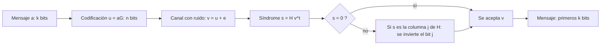

## Para qué sirve

Los bits no se transmiten ni se almacenan sin errores: una interferencia en un cable, un rayo cósmico que
cambia una celda de memoria o un sector dañado de un disco invierten bits. La solución es agregar
**redundancia** de manera ordenada, para que el receptor pueda detectar y, si hace falta, corregir los
bits invertidos. Esa redundancia es el contenido de la teoría de códigos, y el álgebra lineal sobre
$\mathbb{Z}_2$ la describe con muy pocos objetos: un subespacio de $\mathbb{Z}_2^n$ (el código), una base
(que da la matriz generadora) y un sistema de ecuaciones (que da la matriz de control).

Esta lección reúne casi toda la unidad: cuerpos y $\mathbb{Z}_2$, subespacios, generadores, independencia,
base y dimensión, rango–nulidad y coordenadas. Todo vale con la aritmética de bits de
[cuerpos y ℤ₂](/algebra-ii/unidad-1/teoria/cuerpos-y-z2/), donde $1+1=0$ y restar es sumar.

## Dos ideas elementales

**Bit de paridad (detectar).** A una palabra de $k$ bits se le agrega un bit más, igual a la suma de los
anteriores en $\mathbb{Z}_2$, de modo que la palabra de $n=k+1$ bits tenga una cantidad **par** de unos.
Si durante la transmisión se invierte un bit, la cantidad de unos pasa a ser impar y el receptor lo
nota. Si se invierten dos bits, la paridad vuelve a ser par y el error pasa inadvertido. Además, el
receptor sabe *que* hubo un error pero no *dónde*.

**Repetición (corregir).** Cada bit se envía varias veces: $0\mapsto000$ y $1\mapsto111$. El receptor
elige el valor mayoritario. Un solo bit invertido se corrige ($010\mapsto0$); dos errores engañan al
receptor. El costo es alto: se transmiten tres bits por cada bit de información.

Ambos son casos de una misma estructura.

## Código lineal

:::note[Definición]
Un **código lineal $(n,k)$** (sobre $\mathbb{Z}_2$) es un subespacio $\mathcal C$ de $\mathbb{Z}_2^n$ de
dimensión $k$. Sus elementos son las **palabras código** (o palabras codificadas); $n$ es la
**longitud** y $k$ la **dimensión** del código.
:::

Por el teorema de conteo de [base y dimensión](/algebra-ii/unidad-1/teoria/base-y-dimension/), $\mathcal C$
tiene exactamente $2^k$ palabras: son los $2^k$ mensajes distintos que se pueden enviar con $k$ bits de
información, y se usan $n$ bits para enviarlos. Los $n-k$ bits restantes son la redundancia. Que $\mathcal C$
sea un subespacio significa que **la suma de dos palabras código es una palabra código**: el código no es
una lista arbitraria de palabras.

## La matriz generadora

Sea $B=\{g_1,\dots,g_k\}$ una base de $\mathcal C$. Todo $u\in\mathcal C$ se escribe de forma única como
$u=a_1g_1+\dots+a_kg_k$ con $a_i\in\mathbb{Z}_2$: los $a_i$ son las coordenadas de $u$ en $B$
([coordenadas](/algebra-ii/unidad-1/teoria/coordenadas/)). Ordenando los $g_i$ como filas,

$$
G=\begin{pmatrix}g_1\\ \vdots\\ g_k\end{pmatrix}\in\mathbb{Z}_2^{k\times n},\qquad u=aG,\quad a=(a_1,\dots,a_k)\in\mathbb{Z}_2^k .
$$

$G$ es la **matriz generadora**: sus **filas** son una base de $\mathcal C$, es decir,
$\mathcal C=\operatorname{fil}(G)$. **Codificar** es pasar del mensaje $a$ (los $k$ bits de información)
a la palabra $u=aG$ de $n$ bits, y es la función coordenadas leída al revés.

**Forma sistemática.** Si $G=(I_k\mid A)$ con $A\in\mathbb{Z}_2^{k\times(n-k)}$, entonces
$aG=(a\mid aA)$: los primeros $k$ bits de la palabra son el mensaje y los $n-k$ restantes son los bits
de redundancia (de paridad). Decodificar, una vez corregidos los errores, es leer los primeros $k$ bits.
Cualquier $G$ cuyas $k$ primeras columnas sean independientes se lleva a esta forma escalonando por
filas.

## La matriz de control de paridad

Un código también puede describirse por **ecuaciones**: $\mathcal C$ es el conjunto de las soluciones de
un sistema homogéneo. Sea $H\in\mathbb{Z}_2^{(n-k)\times n}$ y

$$
\mathcal C=\operatorname{nul}(H)=\{v\in\mathbb{Z}_2^n:\ Hv^t=0\}.
$$

$H$ es la **matriz de control de paridad** (o de comprobación de paridad): cada fila es una ecuación de
paridad que toda palabra código debe cumplir. Como $\operatorname{rango}(H)+\dim\operatorname{nul}(H)=n$,
si las $n-k$ filas de $H$ son independientes, $\dim\mathcal C=k$.

:::note[Teorema (de $G$ a $H$)]
Sea $G=(I_k\mid A)$ y $H=(A^t\mid I_{n-k})$. Entonces $GH^t=0$ y
$\mathcal C=\operatorname{fil}(G)=\operatorname{nul}(H)$.
:::

**Demostración.** Como $H^t=\begin{pmatrix}A\\ I_{n-k}\end{pmatrix}$ (una matriz de $n\times(n-k)$), el
producto por bloques da

$$
GH^t=I_k\,A+A\,I_{n-k}=A+A=0,
$$

donde $A+A=0$ porque en $\mathbb{Z}_2$ todo elemento es su propio opuesto. Trasponiendo, $HG^t=0$: cada
fila $g_i$ de $G$ cumple $Hg_i^t=0$, así que $g_i\in\operatorname{nul}(H)$ y, por ser subespacio,
$\mathcal C=\operatorname{fil}(G)\subseteq\operatorname{nul}(H)$. Por otro lado, $H$ contiene a $I_{n-k}$,
de modo que $\operatorname{rango}(H)=n-k$ y, por rango–nulidad, $\dim\operatorname{nul}(H)=n-(n-k)=k=\dim\mathcal C$.
Un subespacio contenido en otro de igual dimensión es igual a él: $\mathcal C=\operatorname{nul}(H)$.
$\blacksquare$

Recíprocamente, de $H=(A^t\mid I_{n-k})$ se recupera $G=(I_k\mid A)$ trasponiendo la parte izquierda.
Pasar de una descripción a otra es el mismo cálculo de
[combinaciones lineales](/algebra-ii/unidad-1/teoria/combinaciones-lineales/) entre generadores y
ecuaciones, pero acá es especialmente simple. Para un $H$ cualquiera, una base de $\operatorname{nul}(H)$
se obtiene por variables libres (ver
[subespacios de una matriz](/algebra-ii/unidad-1/teoria/subespacios-de-una-matriz/)).

## Síndrome y detección de errores

Se transmite una palabra $u\in\mathcal C$ y se recibe $v=u+e$, donde $e\in\mathbb{Z}_2^n$ es el **vector
error**: tiene un $1$ en cada posición en la que se invirtió un bit. Se define el **síndrome** de $v$ como

$$
s=Hv^t .
$$

Por linealidad, $s=H(u+e)^t=Hu^t+He^t=He^t$: el síndrome **no depende de la palabra enviada, solo del
error**. Por lo tanto:

- si $s\neq0$, entonces $v\notin\mathcal C$ y **hubo error** (detección);
- si $s=0$, entonces $v\in\mathcal C$: o no hubo error, o el error $e$ es él mismo una palabra código
  (y no se puede detectar).

Si el error afecta a un único bit, $e=e_j$ (el vector con un $1$ en la posición $j$), entonces $He_j^t$ es
la **$j$-ésima columna de $H$**. Si las columnas de $H$ son no nulas y distintas entre sí, el síndrome
revela la posición $j$ y el error se corrige invirtiendo ese bit. Esto es la base del código de Hamming.

### Ejemplo 1 · El código de paridad $(4,3)$
<!-- check: U1.T10.E1 -->

Describir con $G$ y $H$ el código que agrega un bit de paridad a palabras de $3$ bits y analizar sus
errores.

**Matrices.** Con $A=\begin{pmatrix}1\\1\\1\end{pmatrix}$:

$$
G=\left(\begin{array}{ccc|c}1&0&0&1\\0&1&0&1\\0&0&1&1\end{array}\right),\qquad
H=\left(\begin{array}{cccc}1&1&1&1\end{array}\right).
$$

Cada fila de $G$ tiene dos unos, de modo que $GH^t=0$; $H$ tiene rango $1$ y $\dim\operatorname{nul}(H)=4-1=3$.
La única ecuación de paridad es $v_1+v_2+v_3+v_4=0$: las palabras código son las de peso par.

**Palabras.** Codificando los $2^3=8$ mensajes con $u=aG$: $000\mapsto0000$, $100\mapsto1001$,
$010\mapsto0101$, $001\mapsto0011$, $110\mapsto1100$, $101\mapsto1010$, $011\mapsto0110$ y
$111\mapsto1111$. Son las $8$ palabras de $\mathbb{Z}_2^4$ de peso par.

**Detección.** Si se envía $1010$ (mensaje $101$) y se recibe $v=1011$, el síndrome es
$s=1+0+1+1=1\neq0$: hay un error. Pero las cuatro columnas de $H$ son iguales a $(1)$: el síndrome no
dice **dónde** está. Invertir cualquiera de los cuatro bits da una palabra código: $0011$, $1111$, $1001$
y $1010$. El código no puede corregir.

**Dos errores.** Si se recibe $0110$ (se invirtieron los bits $1$ y $2$ de $1010$), $s=0+1+1+0=0$ y el
receptor acepta una palabra código que no es la enviada.

:::tip[Resultado]
$\mathcal C$ es un código $(4,3)$ con $8$ palabras: detecta cualquier cantidad impar de errores, no
corrige ninguno y no detecta dos errores.
:::

## Peso y distancia de Hamming

Para medir "cuántos bits cambiaron" se usan dos nociones.

:::note[Definición]
El **peso** de $v\in\mathbb{Z}_2^n$, $w(v)$, es la cantidad de componentes no nulas. La **distancia de
Hamming** entre $u,v\in\mathbb{Z}_2^n$ es la cantidad de posiciones en que difieren:

$$
d_H(u,v)=w(u+v)\qquad(\text{y en }\mathbb{Z}_2,\ u+v=u-v).
$$
:::

Por ejemplo, $w(1011010)=4$ y $d_H(1011010,\ 1001010)=w(0010000)=1$. La distancia de Hamming es una
distancia: $d_H(u,v)=0$ si y solo si $u=v$, es simétrica y cumple la desigualdad triangular
$d_H(u,w)\le d_H(u,v)+d_H(v,w)$ (porque $w(a+b)\le w(a)+w(b)$). Si se transmite $u$ y se recibe $v$, la
cantidad de bits invertidos es $d_H(u,v)=w(e)$.

La **distancia mínima** de un código $\mathcal C$ es
$d(\mathcal C)=\min\{d_H(u,v):\ u,v\in\mathcal C,\ u\neq v\}$.

:::note[Propiedad]
Si $\mathcal C$ es lineal, $d(\mathcal C)$ es el **menor peso de una palabra no nula**.
:::

**Demostración.** Si $u\neq v$ están en $\mathcal C$, entonces $u+v\in\mathcal C$ es no nula y
$d_H(u,v)=w(u+v)$; luego $d(\mathcal C)\ge$ (menor peso no nulo). Recíprocamente, si $c\in\mathcal C$ es no
nula de peso mínimo, $d_H(c,0)=w(c)$ con $0\in\mathcal C$. $\blacksquare$

Para un código lineal basta entonces mirar los pesos de las $2^k-1$ palabras no nulas, no los pares. (Ojo:
**no** alcanza con mirar los pesos de las filas de $G$; ver errores frecuentes.)

:::note[Capacidad de detección y corrección]
Un código con distancia mínima $d$ **detecta** hasta $d-1$ errores (toda palabra a distancia entre $1$ y
$d-1$ de una palabra código no es palabra código) y **corrige** hasta $\left\lfloor\frac{d-1}{2}\right\rfloor$
errores (la palabra código más cercana a lo recibido es única y es la enviada).
:::

Se enuncia sin demostración; la prueba (con "bolas" alrededor de las palabras código) se hace en
[códigos y ℤ₂](/algebra-ii/unidad-4/teoria/codigos-y-z2/), cuando se dispone de la noción de distancia
en el contexto del producto interno. Con ella: el código de paridad $(4,3)$ tiene $d=2$, detecta $1$ y
corrige $0$ errores.

### Ejemplo 2 · Repetición $(5,1)$
<!-- check: U1.T10.E2 -->

Estudiar el código $\mathcal C=\{00000,\ 11111\}\subseteq\mathbb{Z}_2^5$.

**Matrices.** $\mathcal C=\operatorname{gen}\{(1,1,1,1,1)\}$, de dimensión $k=1$. Con $A=(1\ 1\ 1\ 1)$:

$$
G=(1\ 1\ 1\ 1\ 1),\qquad
H=\left(\begin{array}{c|cccc}1&1&0&0&0\\1&0&1&0&0\\1&0&0&1&0\\1&0&0&0&1\end{array}\right).
$$

Las filas de $H$ dicen $v_1=v_2$, $v_1=v_3$, $v_1=v_4$ y $v_1=v_5$ (en $\mathbb{Z}_2$, $v_1+v_j=0$ es
$v_1=v_j$): todas las componentes son iguales, y se recupera $\operatorname{nul}(H)=\mathcal C$. Se
verifica $GH^t=(1+1\ \ 1+1\ \ 1+1\ \ 1+1)=0$.

**Distancia.** La única palabra no nula es $11111$, de peso $5$: $d=5$. Entonces el código detecta
hasta $4$ errores y corrige hasta $\lfloor 4/2\rfloor=2$.

**Decodificación.** Se elige la palabra código más cercana, es decir, el valor mayoritario. Si se envía
$11111$ y se recibe $10110$ (errores en las posiciones $2$ y $5$), hay tres unos: se decodifica $11111$,
correcto. Con tres errores, por ejemplo $10010$ (errores en $2$, $3$ y $5$), hay solo dos unos y se
decodifica $00000$: incorrecto, y sin aviso.

**Comparación.** La tasa $k/n=1/5$ es muy baja: se transmiten cinco bits por cada bit de información
para corregir dos errores. El código de Hamming $(7,4)$ de más abajo transmite $7$ bits por cada $4$ de
información, pero corrige solo uno.

:::tip[Resultado]
$d=5$: detecta $4$ errores y corrige $2$. Su matriz de control es $H=(A^t\mid I_4)$ con $A=(1\ 1\ 1\ 1)$.
:::

### Ejemplo 3 · Un código $(6,3)$: de $H$ a $G$ y corrección de un error
<!-- check: U1.T10.E3 -->

Sea $\mathcal C=\operatorname{nul}(H)\subseteq\mathbb{Z}_2^6$ con

$$
H=\left(\begin{array}{ccc|ccc}0&1&1&1&0&0\\1&0&1&0&1&0\\1&1&0&0&0&1\end{array}\right).
$$

Hallar $G$, listar las palabras, calcular $d$ y decodificar $v=110100$.

**Dimensión.** Las columnas de $H$ son $h_1=(0,1,1)$, $h_2=(1,0,1)$, $h_3=(1,1,0)$, $h_4=(1,0,0)$,
$h_5=(0,1,0)$ y $h_6=(0,0,1)$: son seis vectores no nulos y **distintos**. $H$ contiene a $I_3$ en las
últimas columnas, así que $\operatorname{rango}(H)=3$ y $\dim\mathcal C=6-3=3$: es un código $(6,3)$ con
$2^3=8$ palabras.

**Matriz generadora.** $H=(A^t\mid I_3)$ con $A^t=\begin{pmatrix}0&1&1\\1&0&1\\1&1&0\end{pmatrix}$; trasponiendo,
$A=A^t$ (es simétrica). Entonces

$$
G=(I_3\mid A)=\left(\begin{array}{ccc|ccc}1&0&0&0&1&1\\0&1&0&1&0&1\\0&0&1&1&1&0\end{array}\right).
$$

**Palabras.** Con $u=aG$, y sumando filas de $G$ en $\mathbb{Z}_2$:

| mensaje $a$ | palabra $u$ | peso | mensaje $a$ | palabra $u$ | peso |
|---|---|---|---|---|---|
| $000$ | $000000$ | $0$ | $110$ | $110110$ | $4$ |
| $100$ | $100011$ | $3$ | $101$ | $101101$ | $4$ |
| $010$ | $010101$ | $3$ | $011$ | $011011$ | $4$ |
| $001$ | $001110$ | $3$ | $111$ | $111000$ | $3$ |

El menor peso no nulo es $3$: $d=3$. El código detecta $2$ errores y corrige $1$.

**Decodificación.** Si se recibe $v=110100$, el síndrome es

$$
s=Hv^t=\begin{pmatrix}v_2+v_3+v_4\\v_1+v_3+v_5\\v_1+v_2+v_6\end{pmatrix}
=\begin{pmatrix}1+0+1\\1+0+0\\1+1+0\end{pmatrix}=\begin{pmatrix}0\\1\\0\end{pmatrix}=h_5 .
$$

El síndrome es la columna $5$ de $H$: el error está en la posición $5$. Invertimos ese bit y obtenemos
$110110$, que es la palabra del mensaje $110$. (Se enviaba $110110$ y se invirtió el quinto bit.)

**Dos errores.** Si se recibe $000110$ (errores en las posiciones $1$ y $2$ de $110110$), $s=h_1+h_2=(1,1,0)=h_3$:
el síndrome es no nulo, así que el error **se detecta**. Pero si se intentara "corregir" invirtiendo el
bit $3$ se obtendría $001110$, otra palabra código (la del mensaje $001$): la corrección automática
fallaría sin avisar. Un código con $d=3$ corrige uno o detecta dos, pero no ambas cosas a la vez.

**Comprobación.** $GH^t=0$ (cada fila de $G$ satisface las tres ecuaciones), y las $8$ palabras de la tabla
cumplen $Hu^t=0$.

:::tip[Resultado]
Código $(6,3)$ con $d=3$; $v=110100$ se corrige a $110110$ (mensaje $110$).
:::

## El código de Hamming $(7,4)$

Las columnas de $H$ del ejemplo anterior eran no nulas y distintas, y por eso un solo error se corregía.
El **código de Hamming** lleva esa idea al límite: $H$ tiene como columnas **todos** los vectores no nulos
de $\mathbb{Z}_2^r$. Para $r=3$ hay $2^3-1=7$ de ellos, así que $n=7$ y $H$ es de $3\times7$:

$$
H=\left(\begin{array}{cccc|ccc}1&1&0&1&1&0&0\\1&0&1&1&0&1&0\\0&1&1&1&0&0&1\end{array}\right).
$$

Las columnas son $(1,1,0)$, $(1,0,1)$, $(0,1,1)$, $(1,1,1)$, $(1,0,0)$, $(0,1,0)$ y $(0,0,1)$: los siete
vectores no nulos de $\mathbb{Z}_2^3$, sin repetir. Se ordenaron de modo que $H=(A^t\mid I_3)$.

**Dimensión.** $H$ contiene a $I_3$, así que $\operatorname{rango}(H)=3$ y, por rango–nulidad,
$\dim\operatorname{nul}(H)=7-3=4$. Es un código $(7,4)$ con $2^4=16$ palabras. En general, el código de
Hamming para $r$ filas es un código $(2^r-1,\ 2^r-1-r)$: $(3,1)$, $(7,4)$, $(15,11)$, $(31,26)$, ...

**Base y matriz generadora.** Resolvemos $Hx^t=0$ con $x_1,x_2,x_3,x_4$ libres:
$x_5=x_1+x_2+x_4$, $x_6=x_1+x_3+x_4$ y $x_7=x_2+x_3+x_4$. Dando a cada variable libre el valor $1$
y a las otras $0$ se obtiene la base de $\mathcal C$, y las filas forman $G=(I_4\mid A)$:

$$
G=\left(\begin{array}{cccc|ccc}1&0&0&0&1&1&0\\0&1&0&0&1&0&1\\0&0&1&0&0&1&1\\0&0&0&1&1&1&1\end{array}\right),\qquad
A=\begin{pmatrix}1&1&0\\1&0&1\\0&1&1\\1&1&1\end{pmatrix}.
$$

**Pesos.** De las $16$ palabras, $1$ tiene peso $0$, $7$ tienen peso $3$, $7$ tienen peso $4$ y $1$ tiene
peso $7$ (la palabra $1111111$). No hay palabras de peso $1$ ni $2$: $d=3$.

### Por qué $d=3$ y por qué corrige un error

:::note[Propiedad]
Sea $\mathcal C=\operatorname{nul}(H)$ con $H$ de columnas $h_1,\dots,h_n$.

1. Un error simple $e_j$ produce el síndrome $He_j^t=h_j$.
2. Si las columnas son **no nulas y distintas**, un único error se detecta (síndrome $\neq0$) y se localiza
   (la columna $h_j$ identifica a $j$), de modo que se corrige.
3. En ese caso $d(\mathcal C)\ge3$.
:::

**Demostración.** (1) $He_j^t$ es la columna $j$ de $H$. (2) Si $s=h_j\neq0$, el receptor sabe que hubo error;
como las columnas son distintas, $h_j$ aparece en una sola posición, que es $j$; invirtiendo el bit $j$ se
recupera $v+e_j=u$. (3) Una palabra de peso $1$, $e_j$, no está en $\mathcal C$ porque $He_j^t=h_j\neq0$. Una de
peso $2$, $e_i+e_j$ con $i\neq j$, tampoco: $H(e_i+e_j)^t=h_i+h_j\neq0$ porque $h_i\neq h_j$ (en
$\mathbb{Z}_2$, $h_i+h_j=0$ equivale a $h_i=h_j$). Luego todo peso no nulo es al menos $3$. $\blacksquare$

En Hamming vale además que $h_i+h_j$ es no nulo y, como están **todos** los vectores no nulos, es
exactamente otra columna $h_k$ con $k\neq i,j$. Entonces $h_i+h_j+h_k=0$ y $e_i+e_j+e_k\in\mathcal C$ es
una palabra de peso $3$: por eso $d=3$ exactamente.

### Ejemplo 4 · Codificar, corregir y fallar con dos errores en Hamming $(7,4)$
<!-- check: U1.T10.E4 -->

Codificar el mensaje $a=(1,0,1,1)$, transmitir con un error en la posición $3$ y corregirlo; luego
analizar qué pasa con dos errores.

**Codificación.** $u=aG=g_1+g_3+g_4$:

$$
(1,0,0,0,1,1,0)+(0,0,1,0,0,1,1)+(0,0,0,1,1,1,1)=(1,0,1,1,\ 1+0+1,\ 1+1+1,\ 0+1+1)=(1,0,1,1,0,1,0).
$$

Los primeros cuatro bits son el mensaje y los tres últimos, los de paridad. Comprobación, fila por
fila de $H$: $u_1+u_2+u_4+u_5=1+0+1+0=0$, $u_1+u_3+u_4+u_6=1+1+1+1=0$ y $u_2+u_3+u_4+u_7=0+1+1+0=0$;
es decir, $Hu^t=0$.

**Error simple.** Se invierte el bit $3$: $v=(1,0,0,1,0,1,0)$. El síndrome es

$$
s=Hv^t=\begin{pmatrix}v_1+v_2+v_4+v_5\\v_1+v_3+v_4+v_6\\v_2+v_3+v_4+v_7\end{pmatrix}
=\begin{pmatrix}1+0+1+0\\1+0+1+1\\0+0+1+0\end{pmatrix}=\begin{pmatrix}0\\1\\1\end{pmatrix}.
$$

Coincide con la columna $3$ de $H$, $(0,1,1)^t$. Invertimos el bit $3$: $(1,0,1,1,0,1,0)=u$. El mensaje son
los primeros $4$ bits: $(1,0,1,1)$. Esto funciona para cualquiera de las $16$ palabras y de las $7$
posiciones.

**Dos errores.** Se invierten los bits $1$ y $2$: $v=(0,1,1,1,0,1,0)$. El síndrome es
$h_1+h_2=(1,1,0)+(1,0,1)=(0,1,1)=h_3$. El decodificador cree que hubo un único error en la posición $3$,
invierte ese bit y entrega $(0,1,0,1,0,1,0)$, que **es una palabra código** (la del mensaje $0101$), pero
no la enviada. El receptor no sospecha nada: la palabra obtenida difiere de $u$ en
$u+(0,1,0,1,0,1,0)=(1,1,1,0,0,0,0)=g_1+g_2+g_3$, una palabra de peso $3$. Con dos errores, el
decodificador siempre produce otra palabra código; con $d=3$ no hay forma de evitarlo.

**Comprobación.** El síndrome de un error doble es la suma de dos columnas distintas, que por la
estructura de $H$ siempre es una tercera columna: los $\binom{7}{2}=21$ pares de errores se corrigen mal
de esta manera.

:::tip[Resultado]
Hamming $(7,4)$: $u=1011010$ se recibe como $1001010$, el síndrome $(0,1,1)^t$ localiza la posición
$3$ y se recupera el mensaje $1011$. Con dos errores, la corrección falla.
:::

**Para mejorar.** Si se agrega a cada palabra un bit de paridad global, se obtiene el **código de Hamming
extendido** $(8,4)$, con $d=4$: corrige un error y detecta dos. Con ese esquema (en versión $(72,64)$)
funcionan las memorias con corrección de errores (ECC) de los servidores: una celda invertida se corrige
al leer y una doble se informa como error irrecuperable.

### Flujo completo

## Usos y alcance

- **Memorias ECC** y controladores de almacenamiento: códigos de Hamming extendidos o más potentes
  protegen cada palabra de memoria.
- **Transmisión y almacenamiento masivo:** códigos con la misma estructura lineal, pero sobre cuerpos más
  grandes que $\mathbb{Z}_2$ (Reed–Solomon), protegen discos ópticos y códigos QR. Quedan fuera del
  programa; se apoyan en la misma idea: un subespacio, una matriz generadora y una de control.
- **Códigos de dígito de control** (ISBN, UPC): usan una ecuación de control $c\cdot v=0$ sobre $\mathbb{Z}_m$,
  un caso de una única fila de control.

Más adelante, con producto interno en $\mathbb{Z}_2^n$, la unidad 4 estudia el **código dual**
$\mathcal C^{\perp}=\{x:\ c\cdot x=0\ \forall c\in\mathcal C\}$ y los códigos autoduales
([códigos y ℤ₂](/algebra-ii/unidad-4/teoria/codigos-y-z2/)); con la notación de esta lección, $H$ es una
matriz generadora de $\mathcal C^\perp$.

:::caution[Notación de los libros]
En Poole, el código se genera con una matriz $G$ de $n\times k$ que actúa sobre vectores **columna**
($x\mapsto Gx$, con $x\in\mathbb{Z}_2^k$) y las palabras código son las **columnas** de $G$ combinadas; la
matriz de control de paridad se llama $P$ y se escribe $Pc=0$. En forma estándar,
$G=\begin{pmatrix}I_k\\ A\end{pmatrix}$ y $P=(A\mid I_{n-k})$, con $A$ de $(n-k)\times k$.

En esta materia usamos filas: $G$ de **$k\times n$** con filas una base del código y $u=aG$. La
equivalencia es $G_{\text{nuestra}}=G_{\text{Poole}}^{\,t}$, $H=P$, y la matriz $A$ de esta lección
(de $k\times(n-k)$) es la traspuesta de la de Poole. Poole tampoco usa la palabra "síndrome": calcula
directamente $Pc'$. Ver [notación](/algebra-ii/notacion/).
:::

:::caution[Errores frecuentes]
- **Multiplicar del lado equivocado.** Con $G$ de $k\times n$ y $a$ fila, $u=aG$. El producto $Ga$ no
  tiene sentido de tamaños (salvo $n=k$).
- **Creer que cualquier conjunto de palabras es un código lineal.** $\{000,110,011\}$ no es un código
  lineal: $110+011=101$ no está. Un código lineal es **cerrado para la suma** y contiene a la palabra nula.
- **Concluir "no hubo error" cuando $s=0$.** El síndrome es nulo también si $e$ es una palabra código:
  con paridad $(4,3)$, dos errores pasan inadvertidos.
- **Pensar que Hamming corrige dos errores.** Corrige uno; con dos, el decodificador entrega otra palabra
  código sin avisar (ejemplo 4).
- **Calcular $d$ con los pesos de las filas de $G$.** Las filas $(1,1,1,0)$ y $(0,1,1,1)$ pesan $3$, pero su
  suma $(1,0,0,1)$ pesa $2$: el código que generan tiene $d=2$. Hay que mirar **todas** las palabras no
  nulas.
- **Usar $H$ con columnas nulas o repetidas y esperar corrección.** Una columna nula deja pasar errores sin
  síndrome; columnas repetidas (como en la paridad $(4,3)$) no permiten localizar el bit.
- **Confundir $n$ con $k$.** $n$ es la longitud de las palabras y $k$ la cantidad de bits de mensaje: hay
  $2^k$ palabras, no $2^n$.
- **Olvidar que $-1=1$.** En $\mathbb{Z}_2$, $A+A=0$ y restar es sumar; por eso $GH^t=0$ con $H=(A^t\mid I)$
  y no hace falta cambiar ningún signo.
:::

## Autoevaluación

**1.** ¿Cuántas palabras tiene un código lineal $(10,6)$? ¿Cuántas filas y columnas tiene su $G$ y su $H$?

Respuesta

$2^6=64$ palabras. $G$ es de $6\times10$ y $H$ de $4\times10$ (con filas independientes).

**2.** Un código lineal tiene distancia mínima $4$. ¿Cuántos errores detecta y cuántos corrige?

Respuesta

Detecta $d-1=3$ y corrige $\lfloor 3/2\rfloor=1$.

**3.** ¿Es $\mathcal C=\{000,\ 101,\ 011,\ 110\}$ un código lineal? ¿Qué $(n,k)$ tiene y cuál es su $d$?

Respuesta

Sí: contiene al $000$ y la suma de dos palabras distintas no nulas da la tercera
($101+011=110$). Es un código $(3,2)$ (el de paridad), con $d=2$.

:::tip[En resumen]
- Un **código lineal $(n,k)$** es un subespacio de $\mathbb{Z}_2^n$ de dimensión $k$; tiene $2^k$ palabras.
- **$G$ de $k\times n$** (filas = base), codificación $u=aG$. En forma sistemática $G=(I_k\mid A)$ y
  $H=(A^t\mid I_{n-k})$, con $GH^t=0$ y $\mathcal C=\operatorname{nul}(H)$.
- **Síndrome** $s=Hv^t=He^t$: no depende de la palabra enviada. Un error simple en $j$ da la columna $j$
  de $H$; con columnas no nulas y distintas se localiza y corrige.
- **Peso** $w(v)$ y **distancia** $d_H(u,v)=w(u+v)$. En un código lineal, $d$ es el menor peso no nulo.
  Con distancia mínima $d$: detecta $d-1$ y corrige $\lfloor(d-1)/2\rfloor$.
- **Hamming $(7,4)$:** las columnas de $H$ son los siete vectores no nulos de $\mathbb{Z}_2^3$;
  $\dim=7-3=4$, $d=3$; corrige un error y falla con dos.
:::

## Para profundizar

- Poole, *Álgebra lineal. Una introducción moderna*, 3.ª ed., sección 1.4, "Vectores código" (pp. 53–57);
  sección 3.7, "Códigos de corrección de error" (p. 251); sección 6.7, "Códigos lineales" (p. 543);
  sección 7.5, "Códigos de corrección de error" (p. 640), para la distancia mínima.
- Nakos y Joyner, *Álgebra lineal con aplicaciones*, Thomson, 1999: capítulo de teoría de códigos, al que
  remite el programa.
- Poole, 3.ª ed., sección 5.5, "Códigos duales" (p. 419), como adelanto de la unidad 4.
- **Para seguir:** los códigos de Reed–Solomon y los códigos cíclicos no forman parte del programa.

Lección anterior: [cambio de coordenadas](/algebra-ii/unidad-1/teoria/cambio-de-coordenadas/). Esta es la
última lección de la unidad; siguen la [práctica de la unidad](/algebra-ii/unidad-1/practica/nivel-inicial/) y, en
la unidad 4, [códigos y ℤ₂](/algebra-ii/unidad-4/teoria/codigos-y-z2/). Repaso relacionado:
[sistemas lineales](/algebra-ii/repaso/sistemas-lineales/).
