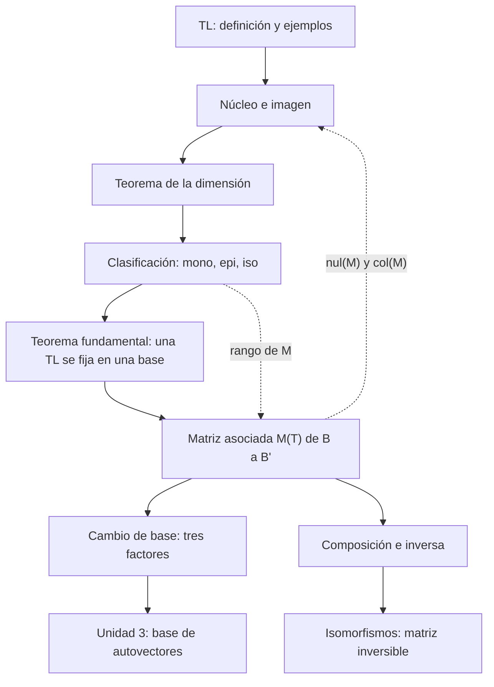

## Para qué sirve esta unidad

Un espacio vectorial es un conjunto con estructura; una **transformación lineal** (TL) es una función entre espacios que respeta esa estructura: transforma sumas en sumas y múltiplos en múltiplos. Son las funciones que el álgebra lineal sabe estudiar por completo, y aparecen en todos lados en informática:

- **Gráficos por computadora.** Girar, escalar, reflejar o inclinar una figura en pantalla son TL del plano o del espacio. Una escena se mueve aplicando sucesivamente matrices, y la composición de varias transformaciones es el producto de sus matrices. Mover (trasladar) no es lineal, pero se vuelve lineal con coordenadas homogéneas, un truco que se muestra en la primera lección.
- **Códigos correctores de errores.** Codificar un mensaje $a\in\mathbb{Z}_2^k$ como $a\mapsto aG$ es una TL de $\mathbb{Z}_2^k$ en $\mathbb{Z}_2^n$ con $n>k$. Que sea inyectiva garantiza que se puede decodificar; que no sea sobreyectiva es lo que deja lugar a detectar errores.
- **Cálculo simbólico.** Derivar polinomios, evaluar en un punto o tomar la traza de una matriz son TL entre espacios de polinomios o de matrices. Saber que son lineales permite traducirlas a matrices y resolver con las técnicas de sistemas de ecuaciones.
- **Representación.** Elegir una base es elegir un sistema de coordenadas. Toda la unidad responde una pregunta práctica: *si cambio de base, ¿cómo cambia la matriz de una transformación?* La respuesta es el puente hacia los autovalores de la unidad siguiente.

## Objetivos

El programa de la asignatura (año académico 2023) pide, para esta unidad, definir transformaciones lineales, hallar su núcleo e imagen, aplicar los teoremas de la dimensión y fundamental, representarlas con matrices en bases convenientes, y operar con composición e inversa. Al terminar deberías poder:

1. Decidir si una función entre espacios vectoriales es lineal y justificarlo con la definición o con un contraejemplo.
2. Calcular bases de $\operatorname{Nu}(T)$ y de $\operatorname{Im}(T)$ y describir las preimágenes de un vector.
3. Enunciar, demostrar y usar el teorema de la dimensión $\dim V=\dim\operatorname{Nu}(T)+\dim\operatorname{Im}(T)$.
4. Clasificar una TL como monomorfismo, epimorfismo o isomorfismo, con las dimensiones y con la matriz.
5. Enunciar y demostrar el teorema fundamental; **construir una TL** con condiciones dadas sobre una base, con núcleo o imagen prescritos, o decidir que no existe.
6. Hallar $M(T)_{BB'}$ para bases cualesquiera, y recuperar núcleo, imagen y fórmula a partir de ella.
7. Cambiar de bases con $M(T)_{B_1B_1'}=C_{B'B_1'}\,M(T)_{BB'}\,C_{B_1B}$ y elegir bases adaptadas (simetrías, proyecciones).
8. Calcular la matriz de una composición y de una inversa, y decidir cuándo una composición es isomorfismo.

## Conocimientos previos

- **Base y dimensión**: independencia lineal, generadores, el teorema de extensión de un conjunto LI a una base y que un subespacio de igual dimensión coincide con el espacio. Ver [base y dimensión](/algebra-ii/unidad-1/teoria/base-y-dimension/).
- **Coordenadas** de un vector en una base ordenada, con la unicidad que las hace posibles. Ver [coordenadas](/algebra-ii/unidad-1/teoria/coordenadas/).
- **Cambio de coordenadas**: la matriz $C_{BB'}$ con $C_{BB'}[v]_B=[v]_{B'}$ y $C_{B'B}=C_{BB'}^{-1}$. Ver [cambio de coordenadas](/algebra-ii/unidad-1/teoria/cambio-de-coordenadas/).
- **Subespacios de una matriz**: $\operatorname{nul}(A)$, $\operatorname{col}(A)$, $\operatorname{fil}(A)$ y $\operatorname{rango}(A)+\dim\operatorname{nul}(A)=n$. Ver [subespacios de una matriz](/algebra-ii/unidad-1/teoria/subespacios-de-una-matriz/).
- Operaciones con matrices, determinantes y resolución de sistemas por Gauss-Jordan (repaso de [sistemas lineales](/algebra-ii/repaso/sistemas-lineales/)).

## Las lecciones

1. [2.1 Definición y ejemplos](/algebra-ii/unidad-2/teoria/definicion-y-ejemplos/). La definición, el test del vector nulo, el catálogo (matriciales, derivación, evaluación, traza, codificación en $\mathbb{Z}_2$), no ejemplos y una aplicación a gráficos por computadora.
2. [2.2 Núcleo e imagen](/algebra-ii/unidad-2/teoria/nucleo-e-imagen/). Núcleo e imagen como subespacios, cómo calcular sus bases y la estructura $v_p+\operatorname{Nu}(T)$ de las preimágenes.
3. [2.3 Teorema de la dimensión](/algebra-ii/unidad-2/teoria/teorema-de-la-dimension/). La relación $\dim V=\dim\operatorname{Nu}(T)+\dim\operatorname{Im}(T)$, su demostración y su uso para decidir existencias.
4. [2.4 Clasificación](/algebra-ii/unidad-2/teoria/clasificacion/). Monomorfismo, epimorfismo e isomorfismo; el papel de las dimensiones; las coordenadas como isomorfismo con $K^n$.
5. [2.5 Teorema fundamental](/algebra-ii/unidad-2/teoria/teorema-fundamental/). Existencia y unicidad de una TL con imágenes dadas sobre una base; núcleo e imagen prescritos; datos sobre vectores LD.
6. [2.6 Matriz asociada](/algebra-ii/unidad-2/teoria/matriz-asociada/). La matriz $M(T)_{BB'}$, la identidad $M(T)_{BB'}[v]_B=[T(v)]_{B'}$ y el cálculo de núcleo e imagen desde la matriz.
7. [2.7 Cambio de base](/algebra-ii/unidad-2/teoria/cambio-de-base/). La fórmula de tres factores, endomorfismos y semejanza, bases adaptadas para simetrías y proyecciones.
8. [2.8 Composición e inversa](/algebra-ii/unidad-2/teoria/composicion-e-inversa/). La matriz de la composición como producto, la inversa lineal y su matriz, y el error de las composiciones que pasan por menor dimensión.

## Mapa conceptual

## Práctica

La práctica de la unidad está organizada en cuatro páginas de dificultad creciente. Cada una indica qué lecciones presupone y cómo usarla:

- [Nivel inicial](/algebra-ii/unidad-2/practica/nivel-inicial/): reconocer TL, calcular núcleos, imágenes y matrices con bases canónicas.
- [Nivel intermedio](/algebra-ii/unidad-2/practica/nivel-intermedio/): teorema fundamental, bases no canónicas, cambio de base, composición e inversa.
- [Nivel avanzado](/algebra-ii/unidad-2/practica/nivel-avanzado/): demostraciones, verdadero o falso, contraejemplos, parámetros y aplicaciones.
- [Guía integradora](/algebra-ii/unidad-2/practica/guia-integradora/): problemas de varios ítems con el formato de un parcial.

Para explorar numéricamente las transformaciones del plano (aplicar una matriz a una grilla, componer dos de ellas), está el [laboratorio](/algebra-ii/laboratorio/).

## Qué se evalúa

Según el programa 2023, las transformaciones lineales se evalúan en los **dos parciales**:

- En el **primer parcial** entran la determinación de una TL por el teorema fundamental, núcleo e imagen, transformaciones inversibles, composición y los cálculos con la matriz de una TL, junto con la aplicación de $\mathbb{Z}_2$ a los códigos.
- En el **segundo parcial**, de carácter integrador, vuelven las transformaciones lineales junto con el cambio de coordenadas, y se suman autovalores, espacios con producto interno y aplicaciones.

Los ejercicios típicos combinan: construir una TL con datos dados (a veces con un parámetro) y decidir si existe o es única; hallar bases de núcleo e imagen; clasificar la TL con el teorema de la dimensión; calcular $M(T)_{BB'}$ con bases no canónicas; y un ítem teórico breve (verdadero o falso, o una demostración corta) sobre dimensiones, composición o inversa. Ver también el [programa](/algebra-ii/programa/).

## Bibliografía de la unidad

- D. Poole, *Álgebra lineal. Una introducción moderna*, 3.ª ed., Cengage, 2011: capítulo 6, secciones 6.4 (Transformaciones lineales, p. 490), 6.5 (El kernel y el rango de una transformación lineal, p. 499) y 6.6 (La matriz de una transformación lineal, p. 515). El programa pide la 4.ª edición, cuya numeración no se verificó.
- D. Lay, *Álgebra lineal y sus aplicaciones*, 5.ª ed., Pearson, 2016: los capítulos sobre transformaciones lineales y sobre espacios vectoriales.
- E. Hernández, M. J. Vázquez y M. Á. Zurro, *Álgebra lineal y Geometría*, 3.ª ed., Pearson, 2012: capítulo 5, aplicaciones lineales (bibliografía complementaria).
- Los códigos de la lección 2.1 y de la unidad siguiente se complementan con Nakos y Joyner, *Álgebra lineal con aplicaciones* (Thomson, 1999).

Poole escribe $[T]_{B'\leftarrow B}$ y $P_{B'\leftarrow B}$ (Lay usa la misma notación para el cambio de coordenadas), con los subíndices en orden inverso al nuestro ($M(T)_{BB'}$, $C_{BB'}$); Poole llama "kernel" al núcleo y "rango" a la imagen. La tabla de equivalencias completa está en [notación](/algebra-ii/notacion/).
