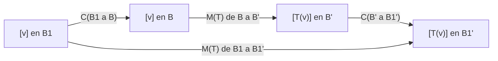

## Para qué sirve

Una misma TL tiene una matriz distinta para cada par de bases. Cuando $T$ es una simetría o una proyección, esa libertad se puede aprovechar: **hay bases en las que la matriz es diagonal y la TL se entiende de un vistazo**, y la fórmula en la base canónica se obtiene después, cambiando de base. Esta lección da la regla que conecta las matrices de una misma TL en bases diferentes y la usa de dos maneras:

- *Hacia lo simple:* partir de la matriz canónica y obtener una matriz sencilla en una base elegida.
- *Hacia lo útil:* partir de la matriz sencilla en la base adaptada y obtener la fórmula en la base canónica.

Es el mecanismo de fondo de la diagonalización de la [Unidad 3](/algebra-ii/unidad-3/): diagonalizar una matriz es buscar una base en la que el endomorfismo sea diagonal.

## La fórmula de tres factores

Sea $T:V\to W$ una TL. Tomamos dos bases de $V$, $B$ y $B_1$, y dos bases de $W$, $B'$ y $B_1'$. Conocemos $M(T)_{BB'}$ y queremos $M(T)_{B_1B_1'}$. Recordemos de [cambio de coordenadas](/algebra-ii/unidad-1/teoria/cambio-de-coordenadas/) que $C_{BB'}$ es la matriz de cambio de $B$ a $B'$: sus columnas son $[b_j]_{B'}$ y cumple $C_{BB'}[v]_B=[v]_{B'}$.

:::note[Teorema · Cambio de bases en la matriz de una TL]
$$
M(T)_{B_1B_1'}=C_{B'B_1'}\ M(T)_{BB'}\ C_{B_1B}.
$$
:::

**Demostración.** Sea $v\in V$. Aplicamos las tres matrices del miembro derecho de derecha a izquierda a $[v]_{B_1}$:

$$
C_{B_1B}[v]_{B_1}=[v]_B,\qquad M(T)_{BB'}[v]_B=[T(v)]_{B'},\qquad C_{B'B_1'}[T(v)]_{B'}=[T(v)]_{B_1'}.
$$

Entonces $\big(C_{B'B_1'}M(T)_{BB'}C_{B_1B}\big)[v]_{B_1}=[T(v)]_{B_1'}$ para todo $v$. Pero $M(T)_{B_1B_1'}$ es la única matriz con la propiedad $M[v]_{B_1}=[T(v)]_{B_1'}$ (teorema de [2.6](/algebra-ii/unidad-2/teoria/matriz-asociada/)), así que son iguales. $\blacksquare$

**Cómo se lee: de derecha a izquierda.** El factor de la derecha recibe coordenadas en la base de salida *nueva* $B_1$; el del medio es la matriz que ya conocemos; el de la izquierda devuelve coordenadas en la base de llegada *nueva* $B_1'$.

La regla mnemotécnica es que los subíndices contiguos se "encadenan": $C_{B'B_1'}\,M(T)_{BB'}\,C_{B_1B}$ tiene $B_1\to B\to B'\to B_1'$ y el resultado es $B_1\to B_1'$. El producto de matrices de cambio de base es la regla $C_{BB''}=C_{B'B''}C_{BB'}$ de la unidad anterior.

:::caution[Notación de los libros]
Poole y Lay escriben el cambio de base como $P_{B'\leftarrow B}$ y la matriz de la TL como $[T]_{B'\leftarrow B}$, con los subíndices en el orden contrario al nuestro. En esa notación la fórmula se lee $[T]_{B_1'\leftarrow B_1}=P_{B_1'\leftarrow B'}\,[T]_{B'\leftarrow B}\,P_{B\leftarrow B_1}$, que es **exactamente la misma igualdad** que la de arriba. Ver [notación](/algebra-ii/notacion/).
:::

### El caso habitual: desde la matriz canónica

Si $V=K^n$ y $W=K^m$, la matriz canónica $A=M(T)_{EE'}$ se obtiene directamente de la fórmula de $T$. Si $B$ es una base de $K^n$ y $B'$ una de $K^m$, entonces $C_{BE}$ tiene por columnas los vectores de $B$ (porque $[b_j]_E=b_j$) y $C_{E'B'}=C_{B'E'}^{-1}$. Resulta

$$
M(T)_{BB'}=C_{E'B'}\,A\,C_{BE}=C_{B'E'}^{-1}\,A\,C_{BE}.
$$

Hay que invertir **solo la matriz de la llegada**. Y para volver: $A=C_{B'E'}\,M(T)_{BB'}\,C_{BE}^{-1}$.

### Ejemplo 1 · Dos caminos para $M(T)_{BB'}$
<!-- check: U2.T07.E1 -->

Sea $T:\mathbb{R}^3\to\mathbb{R}^2$, $T(x,y,z)=(x+2y-z,\ y+z)$, de matriz canónica $A=\begin{pmatrix}1&2&-1\\0&1&1\end{pmatrix}$, con $B=\{(1,0,1),(0,1,1),(1,1,0)\}$ y $B'=\{(1,1),(1,2)\}$ (los mismos de [2.6](/algebra-ii/unidad-2/teoria/matriz-asociada/)). Hallar $M(T)_{BB'}$ con la fórmula y compararla con el cálculo directo.

**Matrices de cambio.**

$$
C_{BE}=\begin{pmatrix}1&0&1\\0&1&1\\1&1&0\end{pmatrix},\qquad C_{B'E'}=\begin{pmatrix}1&1\\1&2\end{pmatrix},\qquad C_{E'B'}=C_{B'E'}^{-1}=\begin{pmatrix}2&-1\\-1&1\end{pmatrix}.
$$

La inversa se obtiene de $\det C_{B'E'}=2-1=1$ y la fórmula de la inversa $2\times 2$ (se intercambian los elementos de la diagonal, se cambian de signo los otros y se divide por el determinante).

**Producto, de derecha a izquierda.** Primero $A\,C_{BE}$, que tiene por columnas $T(b_j)$:

$$
A\,C_{BE}=\begin{pmatrix}1&2&-1\\0&1&1\end{pmatrix}\begin{pmatrix}1&0&1\\0&1&1\\1&1&0\end{pmatrix}=\begin{pmatrix}0&1&3\\1&2&1\end{pmatrix}.
$$

Luego

$$
M(T)_{BB'}=C_{E'B'}\,(A\,C_{BE})=\begin{pmatrix}2&-1\\-1&1\end{pmatrix}\begin{pmatrix}0&1&3\\1&2&1\end{pmatrix}=\begin{pmatrix}-1&0&5\\1&1&-2\end{pmatrix}.
$$

**Cálculo directo.** En 2.6 (ejemplo 2), con la ampliada múltiple, obtuvimos la misma matriz $\begin{pmatrix}-1&0&5\\1&1&-2\end{pmatrix}$. Los dos caminos coinciden.

**Camino de vuelta.** $C_{B'E'}\,M(T)_{BB'}\,C_{BE}^{-1}$ debe devolver $A$: en efecto, $C_{B'E'}M=\begin{pmatrix}0&1&3\\1&2&1\end{pmatrix}=A\,C_{BE}$ y multiplicando a la derecha por $C_{BE}^{-1}$ resulta $A$.

## Endomorfismos: una sola base

Cuando $T:V\to V$ se usa la misma base en la salida y en la llegada. Si $B$ y $B_1$ son dos bases de $V$, tomando en el teorema $B'=B$ y $B_1'=B_1$:

$$
M(T)_{B_1}=C_{BB_1}\ M(T)_B\ C_{B_1B},\qquad C_{BB_1}=C_{B_1B}^{-1}.
$$

Llamando $C=C_{B_1B}$ (las columnas son los vectores de $B_1$ escritos en $B$), la fórmula es $M(T)_{B_1}=C^{-1}\,M(T)_B\,C$, o, despejando, $M(T)_B=C\,M(T)_{B_1}\,C^{-1}$. Cuando $B$ es la canónica de $K^n$:

$$
M(T)_{E}=C_{B_1E}\ M(T)_{B_1}\ C_{B_1E}^{-1}.
$$

Es la forma $A=CDC^{-1}$ de la diagonalización cuando $M(T)_{B_1}=D$ es diagonal. Dos matrices $A$ y $A'$ del mismo tamaño tales que $A'=C^{-1}AC$ para alguna $C$ inversible se llaman **semejantes**: son las matrices de un mismo endomorfismo en distintas bases. En la lección [matrices semejantes](/algebra-ii/unidad-3/teoria/matrices-semejantes/) de la unidad siguiente se estudia qué conservan (rango, determinante, traza, entre otros); aquí lo comprobaremos en un ejemplo.

## Bases adaptadas

La idea para una simetría o una proyección es elegir una base cuyos vectores el endomorfismo "reconoce": cada uno va a un múltiplo de sí mismo. Entonces la matriz en esa base es diagonal y la conclusión se transporta a la base canónica con la fórmula del párrafo anterior.

### Ejemplo 2 · Simetría respecto de una recta
<!-- check: U2.T07.E2 -->

Sea $S:\mathbb{R}^2\to\mathbb{R}^2$ la simetría (reflexión) respecto de la recta $L=\operatorname{gen}\{(1,2)\}$. Hallar su matriz canónica.

**Base adaptada.** Tomamos $b_1=(1,2)$, sobre la recta, y $b_2=(-2,1)$, perpendicular a $L$ (su producto escalar con $b_1$ es $-2+2=0$). Geométricamente, una reflexión fija los puntos de $L$ e invierte los perpendiculares:

$$
S(b_1)=b_1,\qquad S(b_2)=-b_2.
$$

Como $B=\{b_1,b_2\}$ es base (el determinante $1\cdot1-(-2)\cdot2=5\neq 0$), el teorema fundamental dice que esos datos definen $S$ por completo, y

$$
M(S)_B=D=\begin{pmatrix}1&0\\0&-1\end{pmatrix}.
$$

**Cambio a la canónica.** $C_{BE}=\begin{pmatrix}1&-2\\2&1\end{pmatrix}$, de determinante $5$, y $C_{EB}=C_{BE}^{-1}=\dfrac15\begin{pmatrix}1&2\\-2&1\end{pmatrix}$. Entonces

$$
M(S)_E=C_{BE}\,D\,C_{EB}=\begin{pmatrix}1&2\\2&-1\end{pmatrix}\cdot\frac15\begin{pmatrix}1&2\\-2&1\end{pmatrix}=\frac15\begin{pmatrix}-3&4\\4&3\end{pmatrix},
$$

donde $C_{BE}D$ se calculó multiplicando la segunda columna de $C_{BE}$ por $-1$. Así, $S(x,y)=\tfrac15(-3x+4y,\ 4x+3y)$.

**Comprobaciones.** (i) Los vectores de la base: $S(1,2)=\tfrac15(-3+8,\ 4+6)=(1,2)$ y $S(-2,1)=\tfrac15(6+4,\ -8+3)=(2,-1)$. (ii) $S\circ S$ es la identidad: la matriz canónica elevada al cuadrado da $\tfrac1{25}\begin{pmatrix}25&0\\0&25\end{pmatrix}=I$. (iii) Un vector concreto por dos caminos: $S(3,1)=\tfrac15(-9+4,\ 12+3)=(-1,3)$; por coordenadas, $[(3,1)]_B=C_{EB}(3,1)=\tfrac15(5,-5)=(1,-1)$, $D(1,-1)=(1,1)$ y $b_1+b_2=(1,2)+(-2,1)=(-1,3)$. (iv) $S(5,0)=\tfrac15(-15,\ 20)=(-3,4)$: el punto $(5,0)$ y su imagen $(-3,4)$ equidistan del origen (ambos a distancia $5$).

### Ejemplo 3 · Proyección sobre un plano
<!-- check: U2.T07.E3 -->

Sea $\Pi=\{(x,y,z):\ x+y-z=0\}$ y sea $P:\mathbb{R}^3\to\mathbb{R}^3$ la proyección sobre $\Pi$ en la dirección de la normal $n=(1,1,-1)$: cada vector se descompone como (vector de $\Pi$) más (múltiplo de $n$) y $P$ conserva la primera parte. Hallar su matriz canónica y $P(1,2,0)$.

**Base adaptada.** Dos vectores de $\Pi$ LI: $u_1=(1,0,1)$ y $u_2=(0,1,1)$ (cumplen $x+y-z=0$). Con $n$, $B=\{u_1,u_2,n\}$ es una base de $\mathbb{R}^3$: la matriz $C_{BE}$ con esas columnas tiene determinante $-3\neq 0$. La proyección fija los vectores del plano y aplasta la normal:

$$
P(u_1)=u_1,\quad P(u_2)=u_2,\quad P(n)=0,\qquad M(P)_B=\begin{pmatrix}1&0&0\\0&1&0\\0&0&0\end{pmatrix}.
$$

**Cambio a la canónica.**

$$
C_{BE}=\begin{pmatrix}1&0&1\\0&1&1\\1&1&-1\end{pmatrix},\qquad C_{EB}=C_{BE}^{-1}=\frac13\begin{pmatrix}2&-1&1\\-1&2&1\\1&1&-1\end{pmatrix}.
$$

Verificamos la inversa en la primera fila: $(1,0,1)\cdot\tfrac13(2,-1,1)=1$, $(1,0,1)\cdot\tfrac13(-1,2,1)=0$ y $(1,0,1)\cdot\tfrac13(1,1,-1)=0$. Entonces, con $C_{BE}\,\operatorname{diag}(1,1,0)=\begin{pmatrix}1&0&0\\0&1&0\\1&1&0\end{pmatrix}$ (se anula la tercera columna),

$$
M(P)_E=C_{BE}\,M(P)_B\,C_{EB}=\frac13\begin{pmatrix}2&-1&1\\-1&2&1\\1&1&2\end{pmatrix}.
$$

**Imagen de $(1,2,0)$.** $P(1,2,0)=\tfrac13(2-2+0,\ -1+4+0,\ 1+2+0)=(0,1,1)$, que está en $\Pi$ ($0+1-1=0$), y $(1,2,0)-(0,1,1)=(1,1,-1)=n$ es un múltiplo de la normal. Por coordenadas: $[(1,2,0)]_B=C_{EB}(1,2,0)=(0,1,1)$, o sea $(1,2,0)=0\,u_1+1\,u_2+1\,n$; $P$ conserva la parte en $\Pi$, $u_2=(0,1,1)$ y elimina $n$.

**Comprobaciones.** $P(n)=\tfrac13(2-1-1,\ -1+2-1,\ 1+1-2)=(0,0,0)$, $P(u_1)=\tfrac13(2+1,\ -1+1,\ 1+2)=(1,0,1)=u_1$ y $P\circ P=P$ (proyectar dos veces es proyectar una; se comprueba al multiplicar la matriz por sí misma). Aquí el cálculo directo "con fórmulas" sería mucho más largo que el cambio de base.

### Ejemplo 4 · Un endomorfismo de polinomios
<!-- check: U2.T07.E4 -->

Para $T(p)=(x+1)p'-p$ en $P_2[\mathbb{R}]$ (el de [2.6](/algebra-ii/unidad-2/teoria/matriz-asociada/)), la matriz en la base canónica $E=\{1,x,x^2\}$ es $M(T)_E=\begin{pmatrix}-1&1&0\\0&0&2\\0&0&1\end{pmatrix}$. Hallar $M(T)_{B}$ para $B=\{1+x,\ x,\ x^2\}$.

$C_{BE}$ tiene por columnas las coordenadas de $B$ en la canónica, y $C_{EB}$ es su inversa:

$$
C_{BE}=\begin{pmatrix}1&0&0\\1&1&0\\0&0&1\end{pmatrix},\qquad C_{EB}=\begin{pmatrix}1&0&0\\-1&1&0\\0&0&1\end{pmatrix}.
$$

Por el caso de endomorfismos, $M(T)_B=C_{EB}\,M(T)_E\,C_{BE}$:

$$
M(T)_E\,C_{BE}=\begin{pmatrix}0&1&0\\0&0&2\\0&0&1\end{pmatrix},\qquad M(T)_B=C_{EB}\begin{pmatrix}0&1&0\\0&0&2\\0&0&1\end{pmatrix}=\begin{pmatrix}0&1&0\\0&-1&2\\0&0&1\end{pmatrix}.
$$

**Comprobación directa.** Columnas $[T(b_j)]_B$: $T(1+x)=0\to(0,0,0)$; $T(x)=1=(1+x)-x\to(1,-1,0)$; $T(x^2)=2x+x^2=0\,(1+x)+2\,x+1\,x^2\to(0,2,1)$. Son las columnas de la matriz obtenida.

**Qué se conserva.** $\det M(T)_E=0=\det M(T)_B$ y $\operatorname{tr}M(T)_E=-1+0+1=0=0-1+1=\operatorname{tr}M(T)_B$. Las dos matrices, aunque distintas, tienen el mismo rango (2), el mismo determinante y la misma traza: son propiedades del endomorfismo, no de la base.

:::caution[Errores frecuentes]
- **Invertir el orden de los factores.** El producto es $C_{B'B_1'}\,M\,C_{B_1B}$, con la base de **salida** a la **derecha**. Si se escribe $C_{B_1B}\,M\,C_{B'B_1'}$ los tamaños casi nunca coinciden y, cuando coinciden, el resultado es otra matriz.
- **Usar $C$ donde corresponde $C^{-1}$.** Si $B$ es una base de $K^n$, $C_{BE}$ tiene por columnas los vectores de $B$ (no hace falta invertir), y $C_{EB}$ es su inversa. En el ejemplo 2, $M(S)_E=C_{BE}\,D\,C_{EB}$: la inversa va a la **derecha**, no a la izquierda.
- **Cambiar solo una base.** Si $T:V\to W$ y se cambian ambas bases hay dos matrices de cambio distintas ($C_{B_1B}$ de $V$ y $C_{B'B_1'}$ de $W$); en general ni siquiera tienen el mismo tamaño.
- **Creer que $M(T)_E$ y $M(T)_B$ son iguales por ser de la misma TL.** Representan lo mismo pero son matrices distintas; lo que no cambia son las propiedades del endomorfismo (rango, determinante, traza).
- **Olvidar que la base adaptada tiene que ser base.** En el ejemplo 3, $\{u_1,u_2,n\}$ es base porque $\det C_{BE}=-3\neq0$; si se hubiera elegido otro vector del plano en lugar de la normal, el determinante se anularía.
:::

## Autoevaluación

1. Si $M(T)_B=\begin{pmatrix}2&0\\0&3\end{pmatrix}$ y $B=\{(1,1),(1,-1)\}$, ¿cuánto vale $T(2,0)$?

Respuesta

$(2,0)=(1,1)+(1,-1)$, así que $T(2,0)=2(1,1)+3(1,-1)=(5,-1)$.

2. ¿Cuánto vale $M(T)_{B_1B_1'}$ si $B_1=B$ y $B_1'=B'$?

Respuesta

Es la misma matriz $M(T)_{BB'}$: las dos matrices de cambio son la identidad.

3. Si $M(T)_E$ tiene determinante 5 y $M(T)_B$ es la matriz del mismo endomorfismo en otra base, ¿cuánto vale $\det M(T)_B$?

Respuesta

También 5: $\det(C^{-1}MC)=\det(C)^{-1}\det(M)\det(C)=\det M$.

:::tip[En resumen]
- $M(T)_{B_1B_1'}=C_{B'B_1'}\,M(T)_{BB'}\,C_{B_1B}$: se lee de derecha a izquierda ($B_1\to B\to B'\to B_1'$).
- Desde las canónicas: $M(T)_{BB'}=C_{E'B'}\,A\,C_{BE}$, con $C_{E'B'}=C_{B'E'}^{-1}$ y $C_{BE}$ con los vectores de $B$ en columnas.
- Endomorfismo: $M(T)_{B_1}=C_{B_1B}^{-1}M(T)_BC_{B_1B}$; las matrices de un mismo endomorfismo son **semejantes**.
- Simetrías y proyecciones se vuelven diagonales en una base adaptada y se pasan a la canónica con $M(T)_E=C_{BE}\,D\,C_{BE}^{-1}$.
:::

## Para profundizar

- Poole, *Álgebra lineal. Una introducción moderna*, 3.ª ed.: sección 6.6 (p. 515), el efecto del cambio de base sobre la matriz de una transformación; en la notación de Poole, $P_{B'\leftarrow B}$.
- Lay, *Álgebra lineal y sus aplicaciones*, 5.ª ed.: la parte sobre la matriz de una transformación respecto de bases y sobre matrices semejantes.
- Hernández, Vázquez y Zurro, *Álgebra lineal y Geometría*, 3.ª ed.: sección 5.3, "Aplicaciones lineales y cambio de base" (p. 189).
- Antes: [2.6 Matriz asociada](/algebra-ii/unidad-2/teoria/matriz-asociada/) y [cambio de coordenadas](/algebra-ii/unidad-1/teoria/cambio-de-coordenadas/).
- Después: [2.8 Composición e inversa](/algebra-ii/unidad-2/teoria/composicion-e-inversa/) y, en la unidad siguiente, [matrices semejantes](/algebra-ii/unidad-3/teoria/matrices-semejantes/).
