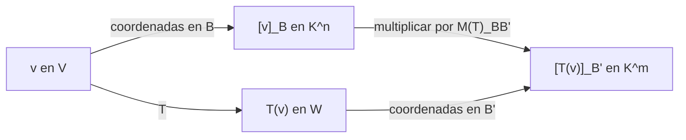

## Para qué sirve

Toda matriz $A\in K^{m\times n}$ define una TL $T_A(x)=Ax$. Esta lección prueba la recíproca: **toda TL entre espacios de dimensión finita se comporta, tras elegir bases, como una multiplicación por una matriz**. Ya sea que $V$ sea de polinomios, de matrices o de palabras binarias, una vez fijadas las bases la TL se vuelve una matriz y todo lo que sabemos de matrices (escalonar, rango, núcleo, inversa) se aplica.

Hay un precio: la matriz depende de las bases elegidas. Con la elección adecuada la matriz es muy simple (diagonal, por ejemplo), y el cambio entre bases es el tema de [2.7](/algebra-ii/unidad-2/teoria/cambio-de-base/) y de la [Unidad 3](/algebra-ii/unidad-3/).

## Definición

Sea $T:V\to W$ una TL, $B=\{b_1,\dots,b_n\}$ una base ordenada de $V$ (**salida**) y $B'=\{b_1',\dots,b_m'\}$ una base ordenada de $W$ (**llegada**).

:::note[Definición · Matriz de una TL respecto de bases]
La **matriz asociada** a $T$ respecto de $B$ y $B'$ es la matriz $M(T)_{BB'}\in K^{m\times n}$ cuya columna $j$ son las coordenadas en $B'$ del transformado del $j$-ésimo vector de $B$:

$$
M(T)_{BB'}=\Big(\ [T(b_1)]_{B'}\ \Big|\ [T(b_2)]_{B'}\ \Big|\ \cdots\ \Big|\ [T(b_n)]_{B'}\ \Big).
$$

Si $V=W$ y se usa la misma base en la salida y en la llegada, se escribe $M(T)_B$.
:::

Tamaño: **tiene tantas columnas como $\dim V$ y tantas filas como $\dim W$**, es decir $\dim W\times\dim V$. Dos aspectos para fijar:

- Las columnas son **coordenadas en la base de llegada $B'$**, de los transformados de los vectores de la base de **salida** $B$. No son los vectores de $B$ ni los de $B'$.
- Si $B$ y $B'$ son las bases canónicas de $K^n$ y $K^m$, $M(T)_{EE'}$ es la matriz habitual con columnas $T(e_j)$. En particular $M(T_A)_{EE'}=A$.

:::caution[Notación de los libros]
Poole escribe la matriz de $T$ respecto de $B$ (salida) y $C$ (llegada) como $[T]_{C\leftarrow B}$, con los subíndices en orden inverso. En este curso, $M(T)_{BB'}$ lleva primero la base de salida y después la de llegada, y es **la misma matriz**. Lo mismo ocurre con el cambio de coordenadas: $C_{BB'}$ es $P_{B'\leftarrow B}$ en los libros. La tabla completa está en [notación](/algebra-ii/notacion/).
:::

## La identidad fundamental

:::note[Teorema]
Para todo $v\in V$,

$$
M(T)_{BB'}\,[v]_B=[T(v)]_{B'}.
$$

Además, $M(T)_{BB'}$ es la **única** matriz con esta propiedad.
:::

**Demostración.** Sea $[v]_B=(x_1,\dots,x_n)$, o sea $v=x_1b_1+\cdots+x_nb_n$. Por linealidad de $T$, $T(v)=x_1T(b_1)+\cdots+x_nT(b_n)$. Las coordenadas respecto de $B'$ son lineales (2.4), así que

$$
[T(v)]_{B'}=x_1[T(b_1)]_{B'}+\cdots+x_n[T(b_n)]_{B'}=M(T)_{BB'}\,\begin{pmatrix}x_1\\\vdots\\x_n\end{pmatrix}=M(T)_{BB'}[v]_B,
$$

porque una combinación lineal de columnas con los escalares $x_j$ es el producto de la matriz por el vector de los $x_j$. *Unicidad:* si $A[v]_B=[T(v)]_{B'}$ para todo $v$, tomando $v=b_j$ (con $[b_j]_B=e_j$) resulta $Ae_j=[T(b_j)]_{B'}$, que es la columna $j$ de $M(T)_{BB'}$. $\blacksquare$

La identidad dice que el siguiente diagrama conmuta: se llega al mismo lugar pasando a coordenadas, multiplicando por la matriz y volviendo a vectores, o aplicando directamente $T$.

## Cómo se calcula

**Paso 1.** Calcular $T(b_1),\dots,T(b_n)$ (vectores de $W$).
**Paso 2.** Expresar cada uno en la base $B'$: hay que resolver $m$ ecuaciones por cada columna.

Como todas las columnas se hallan con el mismo conjunto de vectores $B'$, se resuelven **a la vez** con una matriz ampliada múltiple. Cuando $W=K^m$, sea $C_{B'E'}=(b_1'\mid\cdots\mid b_m')$ la matriz con los vectores de $B'$ en columnas (es la matriz de cambio de coordenadas de $B'$ a la canónica $E'$): la columna $j$ de $M=M(T)_{BB'}$ cumple $C_{B'E'}\,[T(b_j)]_{B'}=T(b_j)$. Entonces

$$
\big(\,C_{B'E'}\ \big|\ T(b_1)\ \cdots\ T(b_n)\,\big)\ \xrightarrow{\text{Gauss-Jordan}}\ \big(\,I_m\ \big|\ M(T)_{BB'}\,\big).
$$

Si $W$ es de polinomios o de matrices, primero se pasan todos los vectores a coordenadas en una base canónica, y se aplica lo mismo.

### Ejemplo 1 · En bases canónicas
<!-- check: U2.T06.E1 -->

Sea $T:\mathbb{R}^3\to\mathbb{R}^2$, $T(x,y,z)=(x+2y-z,\ y+z)$. Hallar $M(T)_{EE'}$ y usarla para calcular $T(2,1,3)$.

Transformamos la base canónica: $T(e_1)=(1,0)$, $T(e_2)=(2,1)$, $T(e_3)=(-1,1)$. Como las bases son canónicas, las coordenadas de cada vector son el vector mismo y

$$
A=M(T)_{EE'}=\begin{pmatrix}1&2&-1\\0&1&1\end{pmatrix}\in\mathbb{R}^{2\times 3}.
$$

Tiene 2 filas ($\dim\mathbb{R}^2$) y 3 columnas ($\dim\mathbb{R}^3$). Por la identidad fundamental, $T(2,1,3)=A\,(2,1,3)^t=(2+2-3,\ 1+3)=(1,4)$, que coincide con evaluar la fórmula.

### Ejemplo 2 · Bases no canónicas y matriz ampliada múltiple
<!-- check: U2.T06.E2 -->

Con la misma $T$ del ejemplo 1, sean $B=\{(1,0,1),(0,1,1),(1,1,0)\}$ base de $\mathbb{R}^3$ y $B'=\{(1,1),(1,2)\}$ base de $\mathbb{R}^2$. Hallar $M(T)_{BB'}$ y verificar la identidad con $v=(2,1,3)$.

**Transformados de $B$.**

$$
T(1,0,1)=(1+0-1,\ 0+1)=(0,1),\quad T(0,1,1)=(2-1,\ 1+1)=(1,2),\quad T(1,1,0)=(1+2,\ 1)=(3,1).
$$

**Coordenadas en $B'$ de los tres, a la vez.** Ampliamos $C_{B'E'}=\begin{pmatrix}1&1\\1&2\end{pmatrix}$ con los tres transformados:

$$
\left(\begin{array}{cc|ccc}1&1&0&1&3\\1&2&1&2&1\end{array}\right)\xrightarrow{F_2-F_1\to F_2}\left(\begin{array}{cc|ccc}1&1&0&1&3\\0&1&1&1&-2\end{array}\right)\xrightarrow{F_1-F_2\to F_1}\left(\begin{array}{cc|ccc}1&0&-1&0&5\\0&1&1&1&-2\end{array}\right).
$$

Entonces

$$
M(T)_{BB'}=\begin{pmatrix}-1&0&5\\1&1&-2\end{pmatrix}.
$$

**Comprobación de las columnas.** Columna 1: $-1\,(1,1)+1\,(1,2)=(0,1)=T(b_1)$. Columna 2: $0\,(1,1)+1\,(1,2)=(1,2)=T(b_2)$. Columna 3: $5\,(1,1)-2\,(1,2)=(3,1)=T(b_3)$.

**Identidad con $v=(2,1,3)$.** Resolviendo $a(1,0,1)+b(0,1,1)+c(1,1,0)=(2,1,3)$: $a+c=2$, $b+c=1$, $a+b=3$, de donde $a=2$, $b=1$, $c=0$. Entonces $[v]_B=(2,1,0)$ y

$$
[T(v)]_{B'}=\begin{pmatrix}-1&0&5\\1&1&-2\end{pmatrix}\begin{pmatrix}2\\1\\0\end{pmatrix}=\begin{pmatrix}-2\\3\end{pmatrix}.
$$

Reconstruimos el vector: $-2\,(1,1)+3\,(1,2)=(1,4)$, igual al resultado del ejemplo 1. **Las dos matrices, $A$ y $M(T)_{BB'}$, representan la misma TL:** difieren en las bases usadas para "medir" salida y llegada.

## Núcleo e imagen desde la matriz

Sea $M=M(T)_{BB'}$. Como $\Phi_B:v\mapsto[v]_B$ y $\Phi_{B'}:w\mapsto[w]_{B'}$ son isomorfismos, la identidad fundamental traduce las preguntas de $T$ a preguntas de $M$.

:::note[Teorema · Núcleo e imagen desde la matriz]
Sea $M=M(T)_{BB'}$.

1. $v\in\operatorname{Nu}(T)\iff[v]_B\in\operatorname{nul}(M)$. Es decir, $\operatorname{Nu}(T)=\{x_1b_1+\cdots+x_nb_n:\ (x_1,\dots,x_n)\in\operatorname{nul}(M)\}$ y $\dim\operatorname{Nu}(T)=\dim\operatorname{nul}(M)$.
2. $w\in\operatorname{Im}(T)\iff[w]_{B'}\in\operatorname{col}(M)$. Es decir, $\operatorname{Im}(T)=\{y_1b_1'+\cdots+y_mb_m':\ (y_1,\dots,y_m)\in\operatorname{col}(M)\}$ y $\dim\operatorname{Im}(T)=\operatorname{rango}(M)$.
:::

**Demostración.**

1. $T(v)=0_W\iff[T(v)]_{B'}=0\iff M[v]_B=0\iff[v]_B\in\operatorname{nul}(M)$; la primera equivalencia vale porque el único vector con coordenadas nulas es $0_W$.
2. Si $w=T(v)$, entonces $[w]_{B'}=M[v]_B\in\operatorname{col}(M)$. Recíprocamente, si $[w]_{B'}=Mx$ para algún $x\in K^n$, tomamos $v=x_1b_1+\cdots+x_nb_n$ (de modo que $[v]_B=x$): resulta $[T(v)]_{B'}=Mx=[w]_{B'}$, y como las coordenadas determinan al vector, $w=T(v)$. $\blacksquare$

La dimensión de $\operatorname{Im}(T)$ es el rango de **cualquier** matriz asociada; por eso el teorema de la dimensión de $T$ es el teorema "rango + nulidad" de $M$:
$\dim V=n=\operatorname{rango}(M)+\dim\operatorname{nul}(M)$.

:::caution[Coordenadas versus vectores]
Los vectores de $\operatorname{nul}(M)$ y de $\operatorname{col}(M)$ son **coordenadas**, no vectores de $V$ o de $W$. Para obtener un vector del núcleo hay que **armar la combinación lineal con los vectores de la base de salida $B$**. Para obtener un vector de la imagen, con los de la base de llegada $B'$. Solo cuando la base es la canónica de $K^n$ las coordenadas y el vector coinciden.
:::

### Ejemplo 3 · Núcleo e imagen con bases no canónicas
<!-- check: U2.T06.E3 -->

Con $M=M(T)_{BB'}=\begin{pmatrix}-1&0&5\\1&1&-2\end{pmatrix}$ del ejemplo 2, hallar bases de $\operatorname{Nu}(T)$ y de $\operatorname{Im}(T)$.

**Núcleo.** Resolvemos $Mx=0$: la primera fila da $x_1=5x_3$ y la segunda $x_2=2x_3-x_1=-3x_3$. Entonces $\operatorname{nul}(M)=\operatorname{gen}\{(5,-3,1)\}$. Esa terna son **coordenadas en $B$**; el vector del núcleo es

$$
v=5\,(1,0,1)-3\,(0,1,1)+1\,(1,1,0)=(6,-2,2).
$$

**Comprobación.** $T(6,-2,2)=(6-4-2,\ -2+2)=(0,0)$. En cambio, la terna misma, $(5,-3,1)$, **no** está en el núcleo: $T(5,-3,1)=(5-6-1,\ -3+1)=(-2,-2)\neq0$. Una base de $\operatorname{Nu}(T)$ es $\{(6,-2,2)\}$ y $\dim\operatorname{Nu}(T)=1$.

**Imagen.** $\operatorname{rango}(M)=2$ (las dos filas no son proporcionales), así que $\dim\operatorname{Im}(T)=2=\dim\mathbb{R}^2$ y $T$ es epimorfismo: $\operatorname{Im}(T)=\mathbb{R}^2$. Para ver el mecanismo, las columnas $(-1,1)$ y $(0,1)$ son LI y son coordenadas en $B'$: dan los vectores $-1\,(1,1)+1\,(1,2)=(0,1)$ y $(1,2)$, una base de la imagen. Si el rango hubiera sido menor, los vectores de $\operatorname{Im}(T)$ se obtendrían del mismo modo, combinando $B'$.

**Verificación con el teorema de la dimensión:** $1+2=3=\dim\mathbb{R}^3$.

### Ejemplo 4 · Un endomorfismo de polinomios, con bases distintas
<!-- check: U2.T06.E4 -->

Sea $T:P_2[\mathbb{R}]\to P_2[\mathbb{R}]$, $T(p)=(x+1)\,p'-p$. Hallar $M(T)_{BB'}$ con $B=\{1+x,\ x,\ x^2\}$ en la salida y $B'=\{1,\ x,\ 1+x^2\}$ en la llegada, y deducir núcleo e imagen.

Con $p=a+bx+cx^2$, $p'=b+2cx$ y

$$
T(p)=(x+1)(b+2cx)-a-bx-cx^2=(b-a)+2c\,x+c\,x^2.
$$

**Transformados.** $T(1+x)=(1-1)+0\,x+0\,x^2=0$, $T(x)=1$, $T(x^2)=2x+x^2$.

**Coordenadas en $B'$.** El cero tiene coordenadas $(0,0,0)$. El polinomio $1$ es el primer vector de $B'$: $(1,0,0)$. Para $2x+x^2$ planteamos $2x+x^2=\alpha\cdot1+\beta x+\gamma(1+x^2)$; comparando $x^2$: $\gamma=1$; $x$: $\beta=2$; término independiente: $\alpha+\gamma=0$, $\alpha=-1$. Entonces

$$
M(T)_{BB'}=\begin{pmatrix}0&1&-1\\0&0&2\\0&0&1\end{pmatrix}.
$$

**Núcleo.** $\operatorname{nul}(M)=\operatorname{gen}\{(1,0,0)\}$ (la primera columna es nula y las otras dos son LI). Estas son coordenadas **en $B$**: el vector del núcleo es $1\cdot(1+x)=1+x$. Comprobación: $T(1+x)=(x+1)\cdot1-(1+x)=0$. Luego $\operatorname{Nu}(T)=\operatorname{gen}\{1+x\}$.

**Imagen.** Rango 2 (columnas 2 y 3 LI). Como coordenadas en $B'$ son $(1,0,0)$ y $(-1,2,1)$, los polinomios son $1$ y $-1+2x+(1+x^2)=2x+x^2$. Luego $\operatorname{Im}(T)=\operatorname{gen}\{1,\ 2x+x^2\}$, de dimensión 2. Se cumple $1+2=3=\dim P_2[\mathbb{R}]$.

**Comprobación de una columna con la fórmula.** $T(x^2)=2x+x^2$ y la columna 3 de $M$ combina $B'$ como $-1\cdot1+2\cdot x+1\cdot(1+x^2)=2x+x^2$. Dato adicional: como $T$ no es mono ni epi ($\operatorname{rango}(M)=2<3$), no es automorfismo.

## De la matriz a la fórmula

La identidad fundamental también corre al revés: dada $M(T)_{BB'}$ y las bases, se recupera $T(v)$ para un $v$ cualquiera: **(1)** coordenadas $[v]_B$; **(2)** multiplicar por $M$; **(3)** armar el vector con $B'$:

$$
T(v)=y_1b_1'+\cdots+y_mb_m',\qquad y=M(T)_{BB'}[v]_B.
$$

Cuando $V=K^n$ y $W=K^m$ también se obtiene la matriz canónica $A=C_{B'E'}\,M(T)_{BB'}\,C_{BE}^{-1}$, que es un caso del cambio de base de la lección siguiente.

### Ejemplo 5 · Recuperar la TL
<!-- check: U2.T06.E5 -->

Sea $T:\mathbb{R}^2\to\mathbb{R}^2$ con $M(T)_{BB'}=\begin{pmatrix}1&2\\0&-1\end{pmatrix}$, $B=\{(1,1),(1,2)\}$ y $B'=\{(1,0),(1,1)\}$. Hallar $T(x,y)$.

**Coordenadas en $B$.** De $(x,y)=\alpha(1,1)+\beta(1,2)$ sale $\alpha+\beta=x$, $\alpha+2\beta=y$, o sea $\beta=y-x$ y $\alpha=2x-y$: $[(x,y)]_B=(2x-y,\ y-x)$.

**Multiplicar.**

$$
\begin{pmatrix}1&2\\0&-1\end{pmatrix}\begin{pmatrix}2x-y\\y-x\end{pmatrix}=\begin{pmatrix}2x-y+2y-2x\\-(y-x)\end{pmatrix}=\begin{pmatrix}y\\x-y\end{pmatrix}.
$$

**Armar con $B'$.** $T(x,y)=y\,(1,0)+(x-y)\,(1,1)=(x,\ x-y)$.

**Comprobación.** Por las columnas de la matriz: $T(1,1)=1\cdot(1,0)+0\cdot(1,1)=(1,0)$ y la fórmula da $T(1,1)=(1,0)$; $T(1,2)=2(1,0)-(1,1)=(1,-1)$ y la fórmula da $(1,-1)$. La matriz canónica es $\begin{pmatrix}1&0\\1&-1\end{pmatrix}$, y se obtiene también como $C_{B'E'}\,M\,C_{BE}^{-1}=\begin{pmatrix}1&1\\0&1\end{pmatrix}\begin{pmatrix}1&2\\0&-1\end{pmatrix}\begin{pmatrix}2&-1\\-1&1\end{pmatrix}$.

## Cuadro de síntesis

Sea $M=M(T)_{BB'}\in K^{m\times n}$, con $n=\dim V$ y $m=\dim W$.

| Pregunta sobre $T$ | Respuesta en $M$ |
|---|---|
| Tamaño de $M$ | $m\times n$: filas = $\dim W$, columnas = $\dim V$ |
| $\dim\operatorname{Im}(T)$ | $\operatorname{rango}(M)$ |
| $\dim\operatorname{Nu}(T)$ | $n-\operatorname{rango}(M)=\dim\operatorname{nul}(M)$ |
| $T$ monomorfismo | $\operatorname{nul}(M)=\{0\}$: las **columnas** son LI, $\operatorname{rango}(M)=n$ |
| $T$ epimorfismo | $\operatorname{col}(M)=K^m$: las **filas** son LI, $\operatorname{rango}(M)=m$ |
| $T$ isomorfismo | $M$ cuadrada ($m=n$) e inversible |
| Vectores de $\operatorname{Nu}(T)$ | combinaciones de $B$ (salida) con coeficientes en $\operatorname{nul}(M)$ |
| Vectores de $\operatorname{Im}(T)$ | combinaciones de $B'$ (llegada) con coeficientes en $\operatorname{col}(M)$ |

:::caution[Errores frecuentes]
- **Dar como núcleo el $\operatorname{nul}(M)$ sin armar los vectores.** En el ejemplo 3 la terna $(5,-3,1)$ no está en el núcleo de $T$; el vector es $(6,-2,2)$.
- **Invertir filas y columnas en el cuadro.** Monomorfismo es "columnas LI" (cada columna es la imagen de un vector de la base de salida; si fueran LD, algún vector no nulo iría al $0$). Epimorfismo es "las columnas generan $K^m$", o sea rango igual al número de filas.
- **Usar $B$ donde va $B'$.** Las columnas de $M(T)_{BB'}$ son coordenadas **en $B'$** de los transformados de los vectores de $B$. Con $B$ en el rol equivocado se obtiene otra matriz.
- **Olvidar el orden de las bases.** Cambiar el orden de $B$ permuta las columnas de $M$; cambiar el de $B'$ permuta las filas.
- **Escribir las coordenadas de $T(b_j)$ como filas.** En el ejemplo 2 resultaría una matriz de $3\times 2$, la transpuesta de $M(T)_{BB'}$, que tiene el tamaño equivocado ($M$ es $2\times3$) y representa otra cosa.
- **Creer que $M$ determina a $T$ sin las bases.** La matriz $\begin{pmatrix}1&2\\0&-1\end{pmatrix}$ del ejemplo 5 representa a $T(x,y)=(x,x-y)$ solo respecto de $B$ y $B'$.
:::

## Autoevaluación

1. Si $T:P_3[\mathbb{R}]\to\mathbb{R}^{2\times 2}$, ¿de qué tamaño es cualquier $M(T)_{BB'}$?

Respuesta

$\dim\mathbb{R}^{2\times2}=4$ filas y $\dim P_3[\mathbb{R}]=4$ columnas: es $4\times4$.

2. $M(T)_{BB'}$ es de $3\times 5$ y tiene rango 3. ¿Qué se puede decir de $T$?

Respuesta

$T:V\to W$ con $\dim V=5$ y $\dim W=3$. Como $\operatorname{rango}(M)=3=\dim W$, es epimorfismo; $\dim\operatorname{Nu}(T)=5-3=2$, así que no es mono.

3. Si $M(T)_B=I$ para una base $B$, ¿quién es $T$?

Respuesta

La identidad: $T(b_j)=b_j$ para todo $j$ de la base, y por el teorema fundamental $T=\operatorname{id}_V$.

:::tip[En resumen]
- $M(T)_{BB'}$ tiene por columnas $[T(b_j)]_{B'}$; tamaño $\dim W\times\dim V$.
- $M(T)_{BB'}[v]_B=[T(v)]_{B'}$; es la única matriz con esa propiedad.
- Se calcula con la ampliada $(C_{B'E'}\mid T(b_1)\ \cdots\ T(b_n))\to(I\mid M)$.
- $\operatorname{nul}(M)$ da **coordenadas en $B$** del núcleo; $\operatorname{col}(M)$ da **coordenadas en $B'$** de la imagen; $\dim\operatorname{Im}(T)=\operatorname{rango}(M)$.
- De la matriz a la fórmula: coordenadas, multiplicar y armar con $B'$.
:::

## Para profundizar

- Poole, *Álgebra lineal. Una introducción moderna*, 3.ª ed.: sección 6.6, "La matriz de una transformación lineal" (p. 515). Poole escribe $[T]_{C\leftarrow B}$.
- Lay, *Álgebra lineal y sus aplicaciones*, 5.ª ed.: la parte sobre la matriz de una transformación lineal respecto de bases.
- Hernández, Vázquez y Zurro, *Álgebra lineal y Geometría*, 3.ª ed.: sección 5.2, "Matriz de una aplicación lineal y operaciones" (p. 182).
- Antes: [2.5 Teorema fundamental](/algebra-ii/unidad-2/teoria/teorema-fundamental/), [coordenadas](/algebra-ii/unidad-1/teoria/coordenadas/) y [subespacios de una matriz](/algebra-ii/unidad-1/teoria/subespacios-de-una-matriz/).
- Después: [2.7 Cambio de base](/algebra-ii/unidad-2/teoria/cambio-de-base/).
