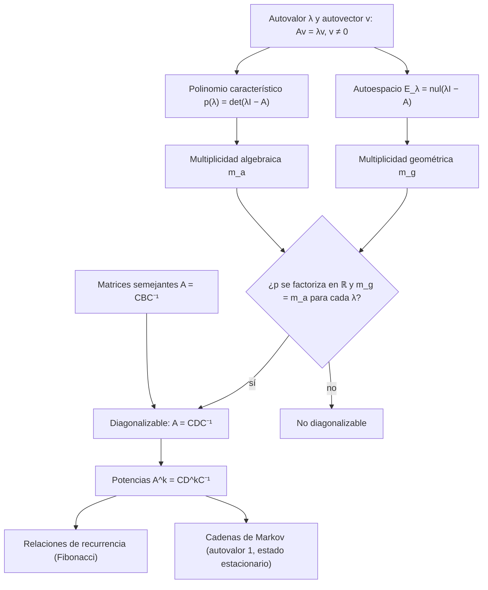

## Para qué sirve esta unidad

Una transformación lineal $T:\mathbb{R}^n\to\mathbb{R}^n$ puede deformar el espacio de maneras
complicadas: gira, inclina y estira a la vez. Sin embargo, muchas transformaciones tienen
**direcciones privilegiadas** en las que solo estiran, encogen o invierten el sentido de los
vectores. Sobre una de esas rectas, $T$ actúa como la multiplicación por un número. Esos
números son los **autovalores** y los vectores no nulos de esas rectas son los **autovectores**.

Si encontramos suficientes direcciones de ese tipo como para formar una base, la matriz de la
transformación en esa base es **diagonal**: el problema se desacopla en $n$ problemas de una sola
variable. Esa es la idea de la **diagonalización**, y su consecuencia más útil es que las potencias
$A^k$ se calculan casi sin esfuerzo.

Calcular potencias de una matriz es exactamente lo que hace falta para estudiar **sistemas que
evolucionan en pasos discretos**, donde el estado siguiente depende linealmente del actual:
$x_{k+1}=Ax_k$, y por lo tanto $x_k=A^kx_0$. En informática aparecen en muchos lugares:

- **Algoritmos recursivos.** El costo de una recursión como $T(n)=T(n-1)+T(n-2)$, la cantidad de
  cadenas binarias que cumplen una restricción o la cantidad de maneras de teselar un tablero se
  describen con **relaciones de recurrencia lineal**; la diagonalización da su fórmula cerrada.
- **Cadenas de Markov.** El estado de un servidor (activo, saturado, caído), el plan de un usuario
  (gratuito o pago) o la página que visita un navegante cambian al azar con probabilidades fijas.
  El comportamiento a largo plazo lo decide el autovalor $1$ de la matriz de transición.
- **Ranking de páginas web.** El algoritmo PageRank ordena páginas según el vector estacionario de
  una cadena de Markov definida por los enlaces: un autovector.

## Objetivos

Al terminar la unidad deberías poder:

1. Definir autovalor, autovector y autoespacio de una matriz cuadrada real y de un endomorfismo, e
   interpretarlos geométricamente.
2. Calcular el polinomio característico $p_A(\lambda)=\det(\lambda I-A)$, sus raíces reales y los
   autoespacios $E_\lambda(A)=\operatorname{nul}(\lambda I-A)$; distinguir multiplicidad algebraica
   $m_a(\lambda)$ y geométrica $m_g(\lambda)$.
3. Demostrar y usar las propiedades básicas: independencia lineal de autovectores de autovalores
   distintos, autovalores de $A^k$, $A^{-1}$, $A^t$ y $p(A)$, relación con la traza y el determinante.
4. Reconocer matrices semejantes y los invariantes de la semejanza.
5. Decidir si una matriz es diagonalizable (incluso con parámetros) y, cuando lo es, escribir
   $A=CDC^{-1}$.
6. Calcular potencias positivas y negativas, decidir la inversibilidad de expresiones polinomiales
   en $A$ y estudiar el límite de $A^k$.
7. Resolver relaciones de recurrencia lineal de orden 2 (incluida la sucesión de Fibonacci) y
   modelar problemas de conteo con ellas.
8. Modelar un proceso con una cadena de Markov, hallar su vector de estado estacionario y explicar
   cuándo la cadena converge.

## Conocimientos previos

- **Determinantes**: desarrollo por cofactores, propiedades, $\det(AB)=\det(A)\det(B)$ y la
  equivalencia "$A$ inversible $\iff\det(A)\neq0$". Ver
  [determinantes](/algebra-ii/repaso/determinantes/).
- **Polinomios**: raíces, multiplicidad, regla de Ruffini, raíces racionales candidatas y
  fórmula resolvente. Ver [polinomios](/algebra-ii/repaso/polinomios/).
- **Base y dimensión**, subespacio nulo de una matriz y la relación
  $\operatorname{rango}(A)+\dim\operatorname{nul}(A)=n$. Ver
  [base y dimensión](/algebra-ii/unidad-1/teoria/base-y-dimension/).
- **Cambio de base** de la matriz de un endomorfismo:
  $M(T)_{B}=C_{EB}\,M(T)_E\,C_{BE}$. Ver
  [cambio de base](/algebra-ii/unidad-2/teoria/cambio-de-base/).

## Las lecciones

1. [3.1 Autovalores y autovectores](/algebra-ii/unidad-3/teoria/autovalores-y-autovectores/).
   Definición para matrices y endomorfismos, direcciones invariantes, ejemplos geométricos
   (proyección, simetría, rotación), el autoespacio como subespacio y el autovalor $0$.
2. [3.2 Polinomio característico](/algebra-ii/unidad-3/teoria/polinomio-caracteristico/).
   De $Av=\lambda v$ a $\det(\lambda I-A)=0$; cálculo de autovalores y autoespacios en
   $2\times2$ y $3\times3$; multiplicidades y la desigualdad $1\le m_g\le m_a$; traza y
   determinante en los coeficientes.
3. [3.3 Propiedades](/algebra-ii/unidad-3/teoria/propiedades/). Autovectores de autovalores
   distintos son linealmente independientes; autovalores de $A^k$, $A^{-1}$, $A^t$, $A+cI$ y
   $p(A)$; filas de suma constante; traza como suma y determinante como producto de autovalores.
4. [3.4 Matrices semejantes](/algebra-ii/unidad-3/teoria/matrices-semejantes/). La relación
   $A=CBC^{-1}$, sus invariantes, su significado como cambio de base y un contraejemplo
   instructivo.
5. [3.5 Diagonalización](/algebra-ii/unidad-3/teoria/diagonalizacion/). Base de autovectores,
   criterio $m_g=m_a$, procedimiento completo, casos con parámetros y matrices simétricas
   $2\times2$.
6. [3.6 Potencias de una matriz](/algebra-ii/unidad-3/teoria/potencias/). $A^k=CD^kC^{-1}$,
   potencias negativas, inversibilidad de $p(A)$, límites y costo computacional.
7. [3.7 Relaciones de recurrencia](/algebra-ii/unidad-3/teoria/relaciones-de-recurrencia/).
   Matriz compañera, término general, Fibonacci y el número áureo, raíz doble y aplicaciones de
   conteo y de análisis de algoritmos.
8. [3.8 Cadenas de Markov](/algebra-ii/unidad-3/teoria/cadenas-de-markov/). Matrices
   estocásticas, el autovalor $1$, vector estacionario, convergencia y un PageRank en miniatura.

## Mapa conceptual

## Práctica

La práctica de la unidad está organizada en cuatro páginas de dificultad creciente:

- [Nivel inicial](/algebra-ii/unidad-3/practica/nivel-inicial/): cálculo directo de autovalores,
  autovectores y verificación de definiciones.
- [Nivel intermedio](/algebra-ii/unidad-3/practica/nivel-intermedio/): diagonalización,
  multiplicidades, parámetros y propiedades.
- [Nivel avanzado](/algebra-ii/unidad-3/practica/nivel-avanzado/): demostraciones, verdadero o
  falso, potencias y aplicaciones.
- [Guía integradora](/algebra-ii/unidad-3/practica/guia-integradora/): problemas de varios
  ítems con el formato de un parcial.

## Qué se evalúa

Según el programa 2023 de la asignatura, el **segundo parcial** tiene carácter integrador, dura
tres horas e incluye, entre otros temas, autovalores y autovectores, diagonalización de matrices
y las aplicaciones a ecuaciones lineales recurrentes (junto con transformaciones lineales,
cambio de coordenadas y la Unidad 4). Los **trabajos prácticos** obligatorios son sobre
aplicaciones; uno de ellos es la aplicación de autovalores y autovectores a las ecuaciones de
recurrencia, con el caso de la sucesión de Fibonacci, que se desarrolla completo en la
lección [3.7](/algebra-ii/unidad-3/teoria/relaciones-de-recurrencia/).

En la práctica, los ejercicios de esta unidad suelen combinar: una matriz $3\times3$ con un
parámetro que se determina a partir de un autovector o un autovalor dado; la decisión de si es
diagonalizable comparando $m_a$ y $m_g$; la factorización $A=CDC^{-1}$ y el cálculo de una potencia;
y un ítem teórico breve (verdadero o falso, o una demostración corta) sobre autovalor nulo,
inversa, semejanza o potencias. Ver también el [programa](/algebra-ii/programa/).

## Bibliografía de la unidad

- D. Poole, *Álgebra lineal. Una introducción moderna*, 3.ª ed., Cengage, 2011: sección 4.1
  (Introducción, p. 265), 4.2 (Determinantes, p. 274), 4.3
  (Eigenvalores y eigenvectores de matrices $n\times n$, p. 303), 4.4 (Semejanza y
  diagonalización, p. 312), 4.6 (Aplicaciones: cadenas de Markov, p. 336; relaciones de
  recurrencia lineal, p. 346), 3.7 (cadenas de Markov, p. 236) y 6.0 (Fibonacci en el espacio
  vectorial, p. 445). El programa pide la 4.ª edición, cuya numeración no se verificó.
- D. Lay, *Álgebra lineal y sus aplicaciones*, 5.ª ed., Pearson, 2016: capítulo de valores
  propios y vectores propios (ecuación característica, diagonalización) y la aplicación a
  cadenas de Markov.
- E. Hernández, M. J. Vázquez y M. Á. Zurro, *Álgebra lineal y Geometría*, 3.ª ed., Pearson,
  2012: capítulo 6, valores y vectores propios (bibliografía complementaria).

La notación que usamos (por ejemplo $A^t$, $\operatorname{tr}(A)$, $C$ para la matriz de
autovectores) está resumida en la página de [notación](/algebra-ii/notacion/). Poole y Lay
escriben "eigenvalor" o "valor propio" y usan $P$ donde nosotros usamos $C$.
