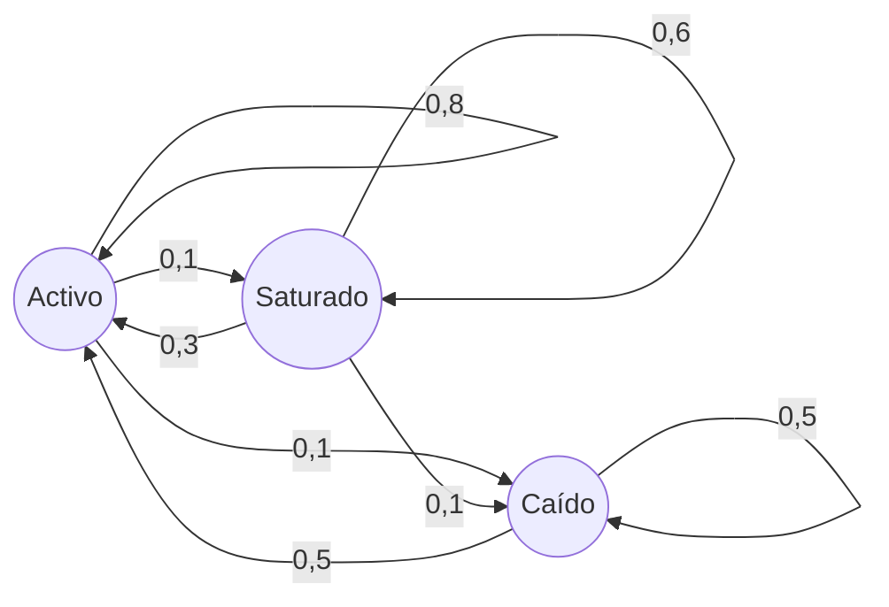

## Para qué sirve

Muchos sistemas pasan de un **estado** a otro al azar, con probabilidades que dependen solo del
estado actual: un servidor que cada hora está activo, saturado o caído; un usuario que cada mes
usa el plan gratuito o el pago; un navegante que salta de página en página. Si las probabilidades
no cambian con el tiempo, el sistema es una **cadena de Markov**. La pregunta típica es: *después
de muchos pasos, ¿qué fracción del tiempo pasa el sistema en cada estado?* La respuesta es un
autovector de la matriz de transición, el correspondiente al autovalor $1$.

## El modelo

Un sistema tiene $n$ estados numerados $1,\dots,n$. En cada paso, si está en el estado $j$, pasa al
estado $i$ con probabilidad $p_{ij}$, que depende solo de $i$ y $j$.

:::note[Definición]
La **matriz de transición** es $P=(p_{ij})\in\mathbb{R}^{n\times n}$, donde $p_{ij}$ es la
probabilidad de pasar del estado $j$ al estado $i$. Cumple:

- $p_{ij}\ge0$ para todo $i,j$;
- **cada columna suma $1$**: $\sum_{i=1}^np_{ij}=1$ (desde el estado $j$ se pasa a algún estado).

Una matriz con estas propiedades se llama **estocástica por columnas**. Un **vector de
probabilidad** es un $x\in\mathbb{R}^n$ con $x_i\ge0$ y $x_1+\dots+x_n=1$; su coordenada $x_i$ es la
probabilidad de estar en el estado $i$.
:::

:::caution[Convención de filas y columnas]
Usamos la convención de Poole: la columna $j$ de $P$ describe **desde** el estado $j$ y el estado
evoluciona con $x_{k+1}=Px_k$. Otros textos arman la matriz por **filas** (cada fila suma $1$) y
escriben $x_{k+1}=x_kP$ con $x_k$ fila; esa matriz es la transpuesta de la nuestra. Todo lo de esta
lección se traduce cambiando $P$ por $P^t$.
:::

Si $x_k$ es el vector de probabilidad en el instante $k$, entonces $x_{k+1}=Px_k$: la componente
$i$ es $\sum_jp_{ij}x_{k,j}$, la probabilidad total de llegar a $i$ desde cualquier $j$. Por
inducción,

$$
x_k=P^kx_0 .
$$

Además, $x_{k+1}$ es de nuevo un vector de probabilidad: sus coordenadas son no negativas y, con
$\mathbf 1=(1,\dots,1)$, $\mathbf 1^tPx_k=\mathbf 1^tx_k=1$, porque $\mathbf 1^tP=\mathbf 1^t$ expresa que
las columnas de $P$ suman $1$.

### Diagrama de estados

Un diagrama de estados dibuja cada estado como un nodo y cada probabilidad positiva como una
flecha. Para un servidor con estados activo, saturado y caído, y probabilidades horarias de
transición:

Las flechas que **salen** de un nodo suman $1$: es la columna de ese nodo en $P$. La matriz está
en el ejemplo 2.

## El autovalor 1

:::note[Teorema]
Sea $P$ una matriz estocástica por columnas. Entonces:

1. $1$ es autovalor de $P$.
2. Todo autovalor $\lambda$ de $P$ cumple $|\lambda|\le1$.
:::

**Demostración.**

1. Las columnas de $P$ suman $1$, es decir, las filas de $P^t$ suman $1$: $P^t\mathbf 1=\mathbf 1$.
   Entonces $1$ es autovalor de $P^t$ y, por tener $P$ y $P^t$ el mismo polinomio característico
   ([lección 3.3](/algebra-ii/unidad-3/teoria/propiedades/)), también de $P$.
2. Como $P$ y $P^t$ tienen los mismos autovalores, basta probarlo para $P^t$. Sea
   $P^tw=\lambda w$ con $w\neq0$ y sea $i$ un índice con $|w_i|$ máximo. La fila $i$ de $P^t$ tiene
   entradas $\ge0$ que suman $1$, así que

   $$
   |\lambda||w_i|=\Big|\sum_j(P^t)_{ij}w_j\Big|\le\sum_j(P^t)_{ij}|w_j|\le|w_i|\sum_j(P^t)_{ij}=|w_i|,
   $$

   y como $|w_i|>0$, $|\lambda|\le1$. $\blacksquare$

El autovector $\mathbf 1$ es de $P^t$, no de $P$. El autovector de $P$ para el autovalor $1$ hay que
calcularlo.

## Vector de estado estacionario

:::note[Definición]
Un **vector de estado estacionario** de $P$ es un vector de probabilidad $q$ con $Pq=q$. Si el
sistema parte de $q$, la distribución no cambia nunca: $x_k=q$ para todo $k$.
:::

Un estacionario es un autovector de autovalor $1$ que además es de probabilidad, así que se halla
resolviendo el sistema homogéneo $(I-P)x=0$ y **normalizando**: se divide un autovector no nulo por
la suma de sus coordenadas, $q=v/(v_1+\dots+v_n)$ (y no por su norma). Sirve cualquier autovector
cuyas coordenadas no tengan signos opuestos; si todas son negativas, el cociente por la suma las
vuelve positivas. Que exista uno con coordenadas no negativas lo garantiza el teorema de
Perron–Frobenius (Poole, sección 4.6); no hace falta usarlo para los ejemplos, donde se comprueba
directamente.

## Matrices regulares y convergencia

:::note[Definición]
$P$ es **regular** si alguna potencia $P^m$ tiene **todas** sus entradas estrictamente positivas.
:::

Que $P$ sea regular significa que, tras $m$ pasos, se puede llegar de cualquier estado a cualquier
otro con probabilidad positiva.

:::note[Teorema (convergencia de cadenas regulares)]
Sea $P$ una matriz estocástica regular. Entonces:

1. $1$ es autovalor de multiplicidad algebraica $1$ y todos los demás autovalores cumplen
   $|\lambda|<1$.
2. Existe un único vector de probabilidad estacionario $q$, con $q_i>0$ para todo $i$.
3. $P^k\to L$, donde $L$ es la matriz cuyas **columnas son todas iguales a $q$**.
4. Para **todo** vector de probabilidad inicial $x_0$, $x_k=P^kx_0\to q$.
:::

La demostración completa usa el teorema de Perron–Frobenius y no la desarrollamos; el enunciado es
el de Poole, sección 4.6 (p. 336 y siguientes, teoremas 4.31, 4.33 y 4.34 de la 3.ª edición). Sí
podemos ver por qué ocurre cuando $P$ es **diagonalizable**.

**Por qué (caso diagonalizable).** Sea $P=CDC^{-1}$ con $D=\operatorname{diag}(1,\lambda_2,\dots,\lambda_n)$,
$|\lambda_j|<1$ para $j\ge2$, y $C=(q\mid v_2\mid\cdots\mid v_n)$ con primer autovector $q$ de
probabilidad. Entonces $D^k\to\operatorname{diag}(1,0,\dots,0)$ y $P^k\to L=C\operatorname{diag}(1,0,\dots,0)C^{-1}$. Escribimos
$x_0=\beta_1q+\beta_2v_2+\dots+\beta_nv_n$; por la
[lección 3.6](/algebra-ii/unidad-3/teoria/potencias/), $x_k=\beta_1q+\sum_{j\ge2}\beta_j\lambda_j^kv_j\to\beta_1q$.
Falta ver $\beta_1=1$. Para $j\ge2$, $\lambda_j\,\mathbf 1^tv_j=\mathbf 1^tPv_j=\mathbf 1^tv_j$, y como
$\lambda_j\neq1$, resulta $\mathbf 1^tv_j=0$. Sumando las coordenadas de $x_0$:
$1=\mathbf 1^tx_0=\beta_1\mathbf 1^tq=\beta_1$. Así que $x_k\to q$ para todo $x_0$ de probabilidad.
$\blacksquare$

El **ritmo** de convergencia lo da el segundo autovalor de mayor módulo: el error decae como
$|\lambda_2|^k$.

## Ejemplos resueltos

### Ejemplo 1 · Usuarios gratuitos y suscriptores

<!-- check: U3.T08.E1 -->

Una plataforma tiene usuarios en el plan gratuito (estado 1) o suscriptores (estado 2). Cada mes, el
$20\,\%$ de los usuarios gratuitos se suscribe y el $30\,\%$ de los suscriptores se da de baja y
vuelve al plan gratuito. Estudiar la evolución a largo plazo.

**Matriz de transición.** Columna 1: desde gratuito, $0{,}8$ se queda y $0{,}2$ se suscribe; columna 2:
desde suscriptor, $0{,}3$ vuelve y $0{,}7$ se queda.

$$
P=\begin{pmatrix}\frac45&\frac3{10}\\[2pt]\frac15&\frac7{10}\end{pmatrix}.
$$

Las columnas suman $1$. Si hoy todos son gratuitos, $x_0=(1,0)^t$:
$x_1=Px_0=(\tfrac45,\tfrac15)^t$ y $x_2=Px_1=(\tfrac7{10},\tfrac3{10})^t$.

**Autovalores.** $p_P(\lambda)=\lambda^2-\tfrac32\lambda+\tfrac12=(\lambda-1)(\lambda-\tfrac12)$ (traza
$\tfrac32$, determinante $\tfrac12$).

**Estado estacionario.** Resolvemos $(I-P)x=0$:

$$
I-P=\begin{pmatrix}\frac15&-\frac3{10}\\-\frac15&\frac3{10}\end{pmatrix}\ \Rightarrow\ x_1=\tfrac32x_2
\ \Rightarrow\ v=(3,2),\qquad q=\tfrac15(3,2)=(\tfrac35,\tfrac25).
$$

**Potencias.** El autovector de $\tfrac12$ es $(1,-1)$: $P(1,-1)^t=(\tfrac12,-\tfrac12)^t$. Con
$C=\begin{pmatrix}3&1\\2&-1\end{pmatrix}$, $C^{-1}=\tfrac15\begin{pmatrix}1&1\\2&-3\end{pmatrix}$ y
$D=\operatorname{diag}(1,\tfrac12)$,

$$
P^k=CD^kC^{-1}=\frac15\begin{pmatrix}3+2h&3-3h\\2-2h&2+3h\end{pmatrix},\qquad h=\left(\tfrac12\right)^k .
$$

Como $h\to0$,

$$
P^k\to L=\begin{pmatrix}\frac35&\frac35\\\frac25&\frac25\end{pmatrix},\qquad P^k-L=\frac{h}{5}\begin{pmatrix}2&-3\\-2&3\end{pmatrix}.
$$

**Comprobación.** $0{,}8\cdot0{,}6+0{,}3\cdot0{,}4=0{,}60$ y $0{,}2\cdot0{,}6+0{,}7\cdot0{,}4=0{,}40$, es decir,
$Pq=q$. Para $k=1$, la fórmula de $P^k$ da $P$.

:::tip[Resultado]
A largo plazo el $60\,\%$ de los usuarios es gratuito y el $40\,\%$ suscriptor, sin importar la
distribución inicial. $P$ es regular (ya es positiva) y el error decae como $(\tfrac12)^k$.
:::

### Ejemplo 2 · Servidor: activo, saturado, caído

<!-- check: U3.T08.E2 -->

Con el diagrama de arriba (estados $1$: activo, $2$: saturado, $3$: caído), la matriz de transición
horaria es

$$
P=\frac1{10}\begin{pmatrix}8&3&5\\1&6&0\\1&1&5\end{pmatrix}.
$$

Hallar el estado estacionario, justificar la convergencia y obtener $x_k$ si el servidor está
activo en $k=0$.

**Estacionario.** $I-P=\tfrac1{10}\begin{pmatrix}2&-3&-5\\-1&4&0\\-1&-1&5\end{pmatrix}$. De la segunda fila,
$x_1=4x_2$; de la tercera, $5x_3=x_1+x_2=5x_2$, es decir $x_3=x_2$; la primera se satisface:
$2\cdot4x_2-3x_2-5x_2=0$. Entonces $v=(4,1,1)$ y, dividiendo por la suma $6$,

$$
q=\left(\tfrac23,\tfrac16,\tfrac16\right).
$$

**Regularidad.** $P$ tiene un cero (transición saturado $\leftarrow$ caído) pero
$P^2=\begin{pmatrix}0{,}72&0{,}47&0{,}65\\0{,}14&0{,}39&0{,}05\\0{,}14&0{,}14&0{,}30\end{pmatrix}$ es positiva: $P$ es
regular, así que $x_k\to q$ desde cualquier inicio.

**Diagonalización.** $p_P(\lambda)=(\lambda-1)(\lambda-\tfrac12)(\lambda-\tfrac25)$ (traza
$0{,}8+0{,}6+0{,}5=1{,}9$). Autovectores: $(4,1,1)$ para $1$, $(-1,1,0)$ para $\tfrac12$ y $(-2,1,1)$ para
$\tfrac25$. Con $C=\begin{pmatrix}4&-1&-2\\1&1&1\\1&0&1\end{pmatrix}$ ($\det C=6$) y
$C^{-1}=\begin{pmatrix}\frac16&\frac16&\frac16\\0&1&-1\\-\frac16&-\frac16&\frac56\end{pmatrix}$:

$$
C^{-1}x_0=C^{-1}\begin{pmatrix}1\\0\\0\end{pmatrix}=\begin{pmatrix}\frac16\\0\\-\frac16\end{pmatrix}
\ \Rightarrow\
x_k=\tfrac16\begin{pmatrix}4\\1\\1\end{pmatrix}-\tfrac16\left(\tfrac25\right)^k\begin{pmatrix}-2\\1\\1\end{pmatrix}.
$$

Es decir, $x_k=\Big(\tfrac23+\tfrac13t_k,\ \tfrac16-\tfrac16t_k,\ \tfrac16-\tfrac16t_k\Big)$ con $t_k=(\tfrac25)^k$.

**Comprobación.** $k=0$: $t_0=1$ da $(1,0,0)$. $k=1$: $t_1=\tfrac25$ da $(0{,}8,0{,}1,0{,}1)$, que
es la primera columna de $P$. $k=3$: $t_3=\tfrac8{125}$ da $x_3=(\tfrac{86}{125},\tfrac{39}{250},\tfrac{39}{250})=(0{,}688;\,0{,}156;\,0{,}156)$.
Como el autovalor de $\tfrac12$ no interviene (su coeficiente es $0$ para este $x_0$), el error decae
como $(\tfrac25)^k$.

:::tip[Resultado]
A largo plazo el servidor está activo $\tfrac23\approx66{,}7\,\%$ del tiempo y saturado o caído
$\tfrac16\approx16{,}7\,\%$ cada uno, con independencia del estado inicial. $P^k\to L$ con las tres
columnas iguales a $(\tfrac23,\tfrac16,\tfrac16)^t$.
:::

### Ejemplo 3 · Un PageRank en miniatura

<!-- check: U3.T08.E3 -->

Cuatro páginas se enlazan así: la $1$ enlaza a la $2$ y a la $3$; la $2$, a la $3$ y a la $4$; la $3$,
a la $1$; la $4$, a la $1$. Un navegante en la página $j$ elige al azar, con la misma probabilidad,
uno de sus enlaces salientes. La **importancia** de una página es la fracción del tiempo que el
navegante pasa en ella a largo plazo.

**Matriz.** La columna $j$ reparte $1$ entre los enlaces de la página $j$:

$$
P=\begin{pmatrix}0&0&1&1\\\frac12&0&0&0\\\frac12&\frac12&0&0\\0&\frac12&0&0\end{pmatrix}.
$$

**Estacionario.** $Pq=q$ equivale a $q_1=q_3+q_4$, $q_2=\tfrac12q_1$, $q_3=\tfrac12q_1+\tfrac12q_2$ y
$q_4=\tfrac12q_2$. Con $q_1=t$: $q_2=\tfrac t2$, $q_3=\tfrac t2+\tfrac t4=\tfrac{3t}4$,
$q_4=\tfrac t4$, y la primera ecuación se cumple ($\tfrac{3t}4+\tfrac t4=t$). La suma es $\tfrac52t=1$,
así que $t=\tfrac25$:

$$
q=\left(\tfrac25,\ \tfrac15,\ \tfrac3{10},\ \tfrac1{10}\right).
$$

**Regularidad y convergencia.** $P$ no es positiva, pero hay ciclos de longitud $2$ ($1\to3\to1$) y
$3$ ($1\to2\to3\to1$), con máximo común divisor $1$, y $P^6$ es la primera potencia
positiva: $P$ es regular. El polinomio característico es $\lambda(\lambda-1)(\lambda^2+\lambda+\tfrac12)$,
con autovalores $1$, $0$ y $\tfrac{-1\pm i}2$, de módulo $\tfrac{\sqrt2}2<1$. Aunque $P$ no sea
diagonalizable sobre $\mathbb{R}$, el teorema de convergencia se aplica. Desde la distribución uniforme
$x_0=(\tfrac14,\tfrac14,\tfrac14,\tfrac14)$:
$x_1=(\tfrac12,\tfrac18,\tfrac14,\tfrac18)$, $x_2=(\tfrac38,\tfrac14,\tfrac5{16},\tfrac1{16})$,
y $x_{20}\approx(0{,}4001;\,0{,}2000;\,0{,}2999;\,0{,}1000)$.

**Amortiguación.** Para que la cadena sea regular aunque haya páginas sin enlaces o grupos
aislados, se usa $G=dP+\tfrac{1-d}4J$, con $J$ la matriz de unos y, por ejemplo, $d=0{,}85$. $G$ es
positiva y estocástica, y su estacionario es aproximadamente $(0{,}3869;\,0{,}2020;\,0{,}2878;\,0{,}1233)$:
el orden es el mismo.

:::tip[Resultado]
Ranking de importancia: página $1$ ($40\,\%$), página $3$ ($30\,\%$), página $2$ ($20\,\%$) y página
$4$ ($10\,\%$). La página $1$ es la más importante porque recibe los enlaces de las páginas $3$ y
$4$, que no tienen otra salida.
:::

### Ejemplo 4 · Cadenas que no convergen o no son regulares

<!-- check: U3.T08.E4 -->

Sea $S=\begin{pmatrix}0&1\\1&0\end{pmatrix}$: dos estados que se alternan con probabilidad $1$. Sus
autovalores son $1$ y $-1$, y

$$
S^k\begin{pmatrix}1\\0\end{pmatrix}=\begin{pmatrix}0\\1\end{pmatrix}\ (k\text{ impar}),\qquad
S^k\begin{pmatrix}1\\0\end{pmatrix}=\begin{pmatrix}1\\0\end{pmatrix}\ (k\text{ par}).
$$

No hay límite: la cadena es **periódica** y $S$ no es regular (sus potencias alternan entre $S$ e
$I$, nunca positivas). Tiene estacionario $q=(\tfrac12,\tfrac12)$, pero solo se alcanza si se parte
de él. Con $I_2$ (la cadena que nunca cambia) el autoespacio de $1$ tiene dimensión $2$ y **todo**
vector de probabilidad es estacionario: no hay unicidad.

<!-- check: U3.T08.E5 -->

Un tercer caso es el de un **estado absorbente**: $P=\begin{pmatrix}1&\frac12\\0&\frac12\end{pmatrix}$ (del
estado $1$ no se sale). Sus autovalores son $1$ y $\tfrac12$, $P^k=\begin{pmatrix}1&1-2^{-k}\\0&2^{-k}\end{pmatrix}$
y $P^k\to\begin{pmatrix}1&1\\0&0\end{pmatrix}$: converge a $q=(1,0)$ aunque $P$ **no** es regular
(la entrada $(2,1)$ de toda potencia vale $0$). La regularidad es una condición suficiente, no
necesaria.

:::caution[Errores frecuentes]
- **Armar $P$ por filas y usar $x_{k+1}=Px_k$.** Con nuestra convención las columnas suman $1$; si
  las filas suman $1$, la matriz es la transpuesta.
- **Normalizar por la norma en lugar de por la suma.** El estacionario debe sumar $1$:
  $q=v/(v_1+\dots+v_n)$.
- **Confundir autovalor $1$ con autovector $\mathbf 1$.** $\mathbf 1$ es autovector de $P^t$, no de
  $P$: $P\mathbf 1\neq\mathbf 1$ en general.
- **Suponer que toda cadena converge.** Una cadena periódica ($S$ del ejemplo 4) no converge; se
  necesita regularidad (o un argumento aparte).
- **Creer que el estacionario es único siempre.** Con $P=I$ todo vector lo es.
- **Olvidar que $x_0$ es un vector de probabilidad.** $P^k\to L$ vale para $P$, pero los límites de
  $x_k$ se leen de $Lx_0$ solo si $x_0$ suma $1$.
- **Usar probabilidades negativas o columnas que no suman $1$.** Verificar siempre que $P$ sea
  estocástica antes de aplicar los teoremas.
- **Leer "estacionario" como "estado final" de una realización.** El sistema sigue cambiando de
  estado; lo que se estabiliza es la *distribución*.
:::

## Autoevaluación

1. ¿Es estocástica por columnas la matriz [[0,5; 0,2], [0,5; 0,8]]?

Sí: entradas no negativas y las dos columnas suman $1$.

2. Si P es estocástica 3 × 3, ¿qué se puede decir de det(I − P)?

$1$ es autovalor, así que $I-P$ es singular: $\det(I-P)=0$.

3. Hallar el estacionario de [[0,9; 0,4], [0,1; 0,6]].

$I-P=\begin{pmatrix}0{,}1&-0{,}4\\-0{,}1&0{,}4\end{pmatrix}$ da $x_1=4x_2$: $v=(4,1)$ y $q=(0{,}8;\,0{,}2)$.

:::tip[En resumen]
- $P$ es estocástica por columnas: entradas $\ge0$ y columnas de suma $1$; $x_{k+1}=Px_k$ y
  $x_k=P^kx_0$.
- $1$ es siempre autovalor (por $P^t\mathbf 1=\mathbf 1$) y todos los autovalores cumplen $|\lambda|\le1$.
- El estacionario se obtiene resolviendo $(I-P)x=0$ y normalizando por la suma de coordenadas.
- Si $P$ es regular, existe un único estacionario $q>0$ y $x_k\to q$ para todo $x_0$ de
  probabilidad; $P^k\to L$ con todas las columnas iguales a $q$.
- Las cadenas periódicas o no regulares requieren análisis aparte.
:::

## Para profundizar

- Poole, *Álgebra lineal. Una introducción moderna*, 3.ª ed.: sección 3.7, Cadenas de Markov
  (p. 236), y sección 4.6, Cadenas de Markov (p. 336), con el teorema de Perron–Frobenius.
- Lay, *Álgebra lineal y sus aplicaciones*, 5.ª ed.: sección sobre cadenas de Markov y vectores de
  estado estacionario.
- Anterior: [3.7 Relaciones de recurrencia](/algebra-ii/unidad-3/teoria/relaciones-de-recurrencia/).
  Para practicar: [guía integradora de la unidad](/algebra-ii/unidad-3/practica/guia-integradora/).
