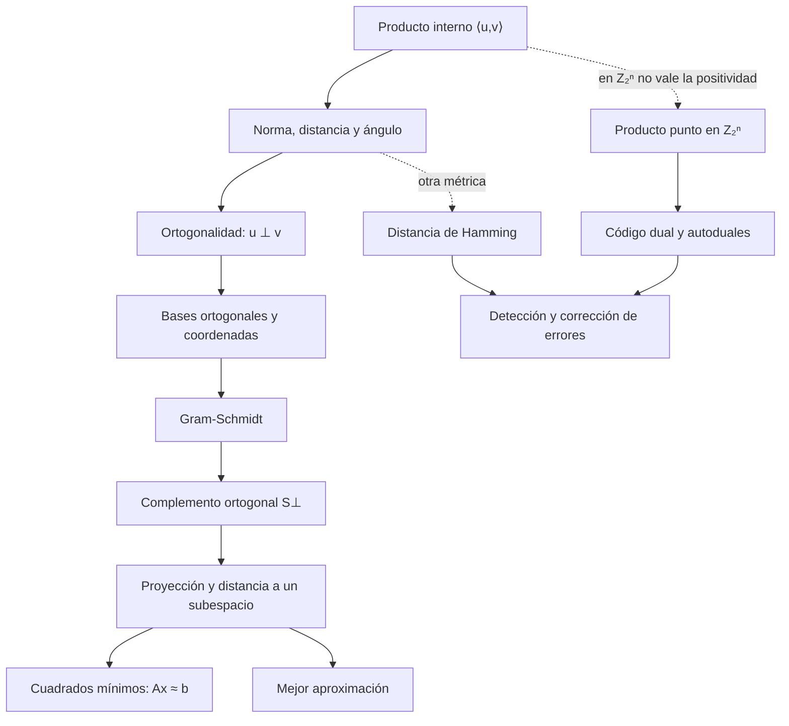

## Para qué sirve esta unidad

Hasta ahora, un espacio vectorial nos permitía sumar vectores y multiplicarlos por escalares, pero no **medir**: no sabíamos qué es la longitud de un polinomio, el ángulo entre dos matrices ni cuán lejos está un vector de un subespacio. Un **producto interno** agrega esa estructura a cualquier espacio vectorial real. Con él se definen norma, distancia, ángulo y perpendicularidad en $\mathbb{R}^n$ con cualquier producto, en $\mathbb{R}^{2\times2}$ y en $P_n[\mathbb{R}]$, no solo con el producto punto de siempre.

La perpendicularidad es la herramienta que da el resto de la unidad:

- **La mejor aproximación.** Si $S$ es un subespacio y $v$ no pertenece a él, el vector de $S$ más cercano a $v$ es la **proyección ortogonal** de $v$ sobre $S$. Esta idea simple resuelve muchos problemas distintos.
- **Ajuste de datos.** Cuando un sistema $Ax=b$ no tiene solución (más ecuaciones que incógnitas, datos con ruido), buscamos el $x$ que hace mínimo el error $\lVert b-Ax\rVert$. Es el método de **cuadrados mínimos**, y se reduce a proyectar $b$ sobre $\operatorname{col}(A)$. Se usa para ajustar una recta o una parábola a mediciones, por ejemplo el tiempo de ejecución de un programa en función del tamaño de la entrada.
- **Similitud entre documentos.** En recuperación de información cada documento es un vector de frecuencias de palabras y se compara con otro por el coseno del ángulo entre ambos (la **similitud coseno**), que ignora la longitud del texto.
- **Códigos que corrigen errores.** En $\mathbb{Z}_2^n$ se define un producto punto, el **código dual** es un complemento ortogonal, y la **distancia de Hamming** mide cuántos bits cambiaron: de ahí sale cuántos errores corrige o detecta un código.

## Objetivos

Siguiendo el programa 2023, al terminar la unidad deberías poder:

1. Verificar si una función es un producto interno y calcular productos, normas, distancias y ángulos en un espacio euclídeo, incluso con productos no usuales (matricial $u^tMv$, traza en matrices, evaluación en polinomios).
2. Demostrar y usar la desigualdad de Cauchy-Schwarz, la desigualdad triangular y el teorema de Pitágoras.
3. Reconocer y construir bases ortogonales y ortonormales, y calcular coordenadas con ellas.
4. Aplicar el método de Gram-Schmidt a una base y completar bases ortogonales.
5. Hallar el complemento ortogonal de un subespacio y usar $\dim S+\dim S^\perp=\dim V$.
6. Calcular la proyección ortogonal sobre un subespacio y la distancia de un vector a él, con los tres métodos, y demostrar que la proyección es la mejor aproximación.
7. Resolver problemas de cuadrados mínimos (ecuaciones normales) y ajustar rectas y parábolas a datos.
8. Trabajar en $\mathbb{Z}_2^n$: producto punto, código dual, códigos autoduales, distancia de Hamming, distancia mínima, y decodificar por síndrome un código de Hamming.

## Conocimientos previos

- **Vectores y matrices**: producto punto, norma usual, transpuesta y producto de matrices. Ver [vectores y matrices](/algebra-ii/repaso/vectores-y-matrices/).
- **Base y dimensión**: coordenadas, completar una base y el teorema de rango y nulidad. Ver [base y dimensión](/algebra-ii/unidad-1/teoria/base-y-dimension/).
- **Subespacios de una matriz**: $\operatorname{fil}(A)$, $\operatorname{col}(A)$ y $\operatorname{nul}(A)$ y sus bases, porque el complemento ortogonal se calcula con ellos. Ver [subespacios de una matriz](/algebra-ii/unidad-1/teoria/subespacios-de-una-matriz/).
- **Códigos lineales**: matrices $G$ y $H$, síndrome y peso (para la lección 4.8). Ver [códigos lineales](/algebra-ii/unidad-1/teoria/codigos-lineales/).

## Las lecciones

1. [4.1 Producto interno](/algebra-ii/unidad-4/teoria/producto-interno/). Los cuatro axiomas, productos no usuales y cómo reconocerlos (forma $u^tMv$, traza, evaluación) y espacio euclídeo.
2. [4.2 Norma, distancia y ángulo](/algebra-ii/unidad-4/teoria/norma-distancia-angulo/). Medidas inducidas, Cauchy-Schwarz, desigualdad triangular, Pitágoras y similitud coseno.
3. [4.3 Ortogonalidad](/algebra-ii/unidad-4/teoria/ortogonalidad/). Conjuntos ortogonales y ortonormales, independencia lineal, coordenadas sin resolver sistemas y matrices con $Q^tQ=I$.
4. [4.4 Gram-Schmidt](/algebra-ii/unidad-4/teoria/gram-schmidt/). Construcción de bases ortogonales, reescalado, conjuntos dependientes y completado de bases.
5. [4.5 Complemento ortogonal](/algebra-ii/unidad-4/teoria/complemento-ortogonal/). Definición, $\dim S+\dim S^\perp=\dim V$, $(S^\perp)^\perp=S$ y su cálculo con y sin producto usual.
6. [4.6 Proyección y distancia](/algebra-ii/unidad-4/teoria/proyeccion-y-distancia/). Descomposición ortogonal, tres métodos de cálculo, mejor aproximación y distancia a un subespacio.
7. [4.7 Cuadrados mínimos](/algebra-ii/unidad-4/teoria/cuadrados-minimos/). Ecuaciones normales, ajuste de rectas y parábolas y una aplicación al tiempo de ejecución.
8. [4.8 Códigos y $\mathbb{Z}_2^n$](/algebra-ii/unidad-4/teoria/codigos-y-z2/). Producto punto en $\mathbb{Z}_2^n$, código dual, autoduales, distancia de Hamming y decodificación por síndrome.

## Mapa conceptual

## Práctica

La práctica de la unidad está organizada en cuatro páginas de dificultad creciente:

- [Nivel inicial](/algebra-ii/unidad-4/practica/nivel-inicial/): verificación de axiomas, cálculo de normas, ángulos, bases ortogonales y ecuaciones normales.
- [Nivel intermedio](/algebra-ii/unidad-4/practica/nivel-intermedio/): Gram-Schmidt, complemento ortogonal, proyecciones y distancias con productos no usuales.
- [Nivel avanzado](/algebra-ii/unidad-4/practica/nivel-avanzado/): demostraciones, verdadero o falso, cuadrados mínimos aplicados y códigos.
- [Guía integradora](/algebra-ii/unidad-4/practica/guia-integradora/): problemas de varios ítems con el formato de un parcial.

## Qué se evalúa

Según el programa 2023, el **segundo parcial** es integrador y dura tres horas: incluye espacios con producto interno, ortogonalización, proyección ortogonal y aplicación a la corrección de errores en códigos, junto con transformaciones lineales, cambio de coordenadas, autovalores y diagonalización. En el cronograma del programa, los temas de la unidad se reparten entre las semanas 11 a 13 (espacios euclídeos, ortogonalización, complemento ortogonal, proyección y distancia) y la semana 15 (aplicación a códigos). Esa semana es posterior al segundo parcial en el cronograma, de modo que conviene confirmar con la cátedra qué parte de la aplicación a códigos se evalúa en cada instancia.

Los **trabajos prácticos** obligatorios son sobre aplicaciones. Uno de ellos usa los espacios con producto interno aplicados al código de Hamming; la lección [4.8](/algebra-ii/unidad-4/teoria/codigos-y-z2/) reúne las herramientas para resolverlo. La aplicación de cuadrados mínimos a datos experimentales figura entre los temas de la unidad en el programa.

En la práctica, los ejercicios de la unidad suelen combinar un producto interno **no usual** (una suma de productos de formas lineales, uno ponderado o $u^tMv$) con alguna de estas tareas: calcular una norma, un ángulo o un vector ortogonal; ortogonalizar una base; hallar el complemento ortogonal de un subespacio; y calcular una proyección ortogonal y la distancia a un subespacio. Siguen preguntas teóricas breves sobre Pitágoras, Cauchy-Schwarz o propiedades del complemento. Ver también el [programa](/algebra-ii/programa/).

## Bibliografía de la unidad

- D. Poole, *Álgebra lineal. Una introducción moderna*, 3.ª ed., Cengage, 2011: sección 5.1 (Ortogonalidad en $\mathbb{R}^n$, p. 379), 5.2 (Complementos y proyecciones ortogonales, p. 389), 5.3 (El proceso de Gram-Schmidt y la factorización QR, p. 399), 5.5 (Aplicaciones: códigos duales, p. 419–425), 7.1 (Espacios con producto interno, p. 554), 7.2 (Normas y funciones de distancia, p. 575–578), 7.3 (Aproximación por mínimos cuadrados, p. 591–613) y 7.5 (Aplicaciones: códigos de corrección de error, p. 640–645). El programa pide la 4.ª edición, cuya numeración no se verificó.
- D. Lay, *Álgebra lineal y sus aplicaciones*, 5.ª ed., Pearson, 2016: capítulo de ortogonalidad y mínimos cuadrados (conjuntos ortogonales, proyecciones, Gram-Schmidt, mínimos cuadrados y espacios con producto interno).
- G. Nakos y D. Joyner, *Álgebra lineal con aplicaciones*, Thomson, 1999: teoría de códigos, libro al que remite el programa.
- E. Hernández, M. J. Vázquez y M. Á. Zurro, *Álgebra lineal y Geometría*, 3.ª ed., Pearson, 2012: bibliografía complementaria.

La notación (por ejemplo $\langle u,v\rangle$, $\lVert v\rVert$, $S^\perp$, $\operatorname{proy}_S(v)$ y los símbolos de códigos) está resumida en la página de [notación](/algebra-ii/notacion/). Poole llama $P$ a la matriz de control de paridad y escribe la matriz generadora de $n\times k$; nosotros usamos $H$ y una matriz $G$ de $k\times n$.
