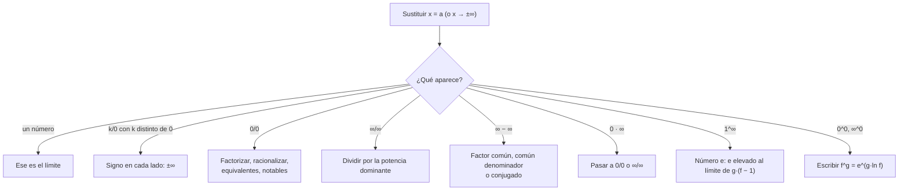

## Qué vas a aprender

- Reconocer las formas indeterminadas y elegir la técnica: factorización, racionalización, división por la potencia dominante, infinitésimos equivalentes, límites notables y número $e$.
- Justificar cada paso y distinguir las expresiones que **no** son indeterminadas.

**Antes de empezar.** [Infinitésimos](/analisis-matematico-i/unidad-2/teoria/infinitesimos/) y [Límites infinitos y en el infinito](/analisis-matematico-i/unidad-2/teoria/limites-infinitos/).

## Primero, sustituir

Con un límite delante, el primer paso es **sustituir** $x$ por el valor al que tiende y mirar qué expresión resulta. Hay tres desenlaces:

1. **Un número.** Si las funciones son continuas ahí (polinomios, racionales con denominador no nulo, raíces, exponenciales, trigonométricas en su dominio), el límite es ese número (la justificación está en [Continuidad](/analisis-matematico-i/unidad-2/teoria/continuidad/)).
2. **$\dfrac{k}{0}$ con $k\neq0$** (o $\dfrac k{\pm\infty}$, etc.). No es indeterminada: da $\pm\infty$ o $0$; se estudia el signo en cada lado.
3. **Una forma indeterminada**: $\dfrac00$, $\dfrac\infty\infty$, $\infty-\infty$, $0\cdot\infty$, $1^\infty$, $0^0$, $\infty^0$. Acá hay que trabajar.

:::caution[Cómo se escribe]
Se escribe «al sustituir se obtiene la forma $\frac00$», **no** «$=\frac00$». Una forma indeterminada no es un valor: es una advertencia de que el resultado depende de las funciones. «Indeterminada» tampoco significa que el límite no exista: significa que todavía no sabemos.
:::

## Técnicas para cada forma

| Forma | Técnicas habituales |
|---|---|
| $\dfrac00$ | factorizar (Ruffini, diferencia de cuadrados), racionalizar con el conjugado, infinitésimos equivalentes, límites notables |
| $\dfrac\infty\infty$ | dividir numerador y denominador por la potencia (o exponencial) dominante |
| $\infty-\infty$ | factor común, común denominador, multiplicar y dividir por el conjugado |
| $0\cdot\infty$ | reescribir como cociente: $0\cdot\infty=\frac{0}{1/\infty}$ o $\frac\infty{1/0}$ |
| $1^\infty$ | el número $e$ (más abajo) |
| $0^0$, $\infty^0$ | $f^g=e^{g\ln f}$ y se calcula el límite del exponente |

### Ejemplo 1 · $\frac00$ factorizando

<!-- check: U2.T.CAL.1 -->

$\displaystyle\lim_{x\to3}\frac{x^3-27}{x^2-9}$. Al sustituir se obtiene $\frac00$. Factorizamos con la diferencia de cubos y la de cuadrados:

$$
\frac{x^3-27}{x^2-9}=\frac{(x-3)(x^2+3x+9)}{(x-3)(x+3)}=\frac{x^2+3x+9}{x+3}\quad(x\ne3).
$$

La simplificación es válida porque en un límite $x\neq3$. Ahora sí se puede sustituir: $\dfrac{9+9+9}{6}=\dfrac92$.

### Ejemplo 2 · $\frac00$ racionalizando

<!-- check: U2.T.CAL.2 -->

$\displaystyle\lim_{x\to4}\frac{\sqrt{x+5}-3}{x-4}$. Forma $\frac00$. Multiplicamos y dividimos por el conjugado del numerador:

$$
\frac{\sqrt{x+5}-3}{x-4}\cdot\frac{\sqrt{x+5}+3}{\sqrt{x+5}+3}=\frac{(x+5)-9}{(x-4)(\sqrt{x+5}+3)}=\frac{1}{\sqrt{x+5}+3}\longrightarrow\frac16 .
$$

### Ejemplo 3 · $\frac\infty\infty$ con una raíz

<!-- check: U2.T.CAL.3 -->

$\displaystyle\lim_{x\to\pm\infty}\frac{\sqrt{4x^2+1}}{x+3}$. Forma $\frac\infty\infty$. Dividimos por $x$, recordando que $\sqrt{x^2}=\lvert x\rvert$:

- $x\to+\infty$: $\dfrac{\sqrt{4+1/x^2}}{1+3/x}\to\dfrac{2}{1}=2$.
- $x\to-\infty$: $\sqrt{4x^2+1}=\lvert x\rvert\sqrt{4+1/x^2}=-x\sqrt{4+1/x^2}$, y el cociente es $\dfrac{-\sqrt{4+1/x^2}}{1+3/x}\to-2$.

### Ejemplo 4 · $\infty-\infty$ con conjugado

<!-- check: U2.T.CAL.4 -->

$\displaystyle\lim_{x\to\pm\infty}\left(\sqrt{x^2+3x}-x\right)$.

- $x\to+\infty$: forma $\infty-\infty$. Con el conjugado,
  $$
  \sqrt{x^2+3x}-x=\frac{(x^2+3x)-x^2}{\sqrt{x^2+3x}+x}=\frac{3x}{\sqrt{x^2+3x}+x}=\frac{3}{\sqrt{1+3/x}+1}\to\frac32 .
  $$
- $x\to-\infty$: **no es indeterminada**. $\sqrt{x^2+3x}\to+\infty$ y $-x\to+\infty$, la suma de dos cantidades que tienden a $+\infty$: el límite es $+\infty$. (Si intentáramos el conjugado, el denominador $\sqrt{x^2+3x}+x$ sí tiene la forma $\infty-\infty$.)

El mismo símbolo $\sqrt{x^2+3x}-x$ se comporta distinto en cada extremo; por eso se estudian por separado.

### Ejemplo 5 · $\infty-\infty$ con común denominador

<!-- check: U2.T.CAL.5 -->

$\displaystyle\lim_{x\to1}\left(\frac1{x-1}-\frac2{x^2-1}\right)$. Al sustituir, cada término tiende a $\pm\infty$: forma $\infty-\infty$. Con $x^2-1=(x-1)(x+1)$:

$$
\frac1{x-1}-\frac2{(x-1)(x+1)}=\frac{(x+1)-2}{(x-1)(x+1)}=\frac{x-1}{(x-1)(x+1)}=\frac1{x+1}\longrightarrow\frac12 .
$$

### Ejemplo 6 · $0\cdot\infty$

<!-- check: U2.T.CAL.6 -->

$\displaystyle\lim_{x\to+\infty}x\operatorname{sen}\frac3x$: forma $\infty\cdot0$. Con $u=\frac3x\to0$: $x=\frac3u$ y la expresión es $3\cdot\frac{\operatorname{sen}u}{u}\to3$.

Otro: $\displaystyle\lim_{x\to0^{+}}x\ln x$, forma $0\cdot\infty$. Con $t=\frac1x\to+\infty$ queda $x\ln x=-\frac{\ln t}{t}\to0$, por la jerarquía $\ln t\ll t$.

## Límites notables y el número $e$

Además de $\displaystyle\lim_{x\to0}\frac{\operatorname{sen}x}{x}=1$, hay un número que aparece en el crecimiento continuo: el **número de Euler** $e\approx2{,}71828$, que se define como

$$
e=\lim_{x\to+\infty}\left(1+\frac1x\right)^{x}=\lim_{x\to-\infty}\left(1+\frac1x\right)^{x}=\lim_{u\to0}(1+u)^{1/u} .
$$

(La existencia del límite se justifica con la monotonía y la acotación de la sucesión $(1+\frac1n)^n$; la aceptamos, igual que el paso de la sucesión a la variable real, a $x\to-\infty$ y a $u\to0$.) Es una forma $1^\infty$ **determinada** por su valor: no es $1$, es $e$.

<!-- check: U2.T.CAL.7 -->

Una verificación numérica: $\left(1+10^{-6}\right)^{10^{6}}\approx2{,}7182805$, muy cerca de $e$.

De ahí salen tres límites notables, que justifican las equivalencias $\ln(1+u)\sim u$ y $e^u-1\sim u$ de [Infinitésimos](/analisis-matematico-i/unidad-2/teoria/infinitesimos/):

<!-- check: U2.T.CAL.8 -->

$$
\lim_{u\to0}\frac{\ln(1+u)}{u}=1,\qquad\lim_{u\to0}\frac{e^{u}-1}{u}=1,\qquad\lim_{u\to0}\frac{a^{u}-1}{u}=\ln a\quad(a>0) .
$$

En las demostraciones que siguen usamos esta propiedad de las funciones continuas: si $f(x)\to L$ y $g$ es continua en $L$, entonces $g(f(x))\to g(L)$. Por ahora la aceptamos; se enuncia y se explica en [Continuidad](/analisis-matematico-i/unidad-2/teoria/continuidad/) («Límite de una composición»), junto con la continuidad de $\ln$ y de $e^x$.

**Demostración.** (1) $\frac{\ln(1+u)}{u}=\ln\left((1+u)^{1/u}\right)\to\ln e=1$, porque $\ln$ es continua en $e$ (lo veremos en [Continuidad](/analisis-matematico-i/unidad-2/teoria/continuidad/)). (2) Con $t=e^u-1$ (que tiende a $0$) es $u=\ln(1+t)$ y $\frac{e^u-1}{u}=\frac{t}{\ln(1+t)}\to1$ por (1). (3) $a^u=e^{u\ln a}$, entonces $\frac{a^u-1}{u}=\ln a\cdot\frac{e^{u\ln a}-1}{u\ln a}\to\ln a$ (si $a\ne1$; si $a=1$ ambos miembros valen $0$). $\blacksquare$

## La forma $1^\infty$

Si $f(x)\to1$ y $g(x)\to\pm\infty$, el límite de $f^g$ **no se puede decidir** con «$1^\infty=1$»: depende de qué tan rápido $f$ se acerca a $1$ y qué tan rápido crece $g$.

:::note[Propiedad · Regla de la forma $1^\infty$]
Si $\lim f=1$, $\lim g=\pm\infty$ y existe (finito o infinito) $\displaystyle\ell=\lim g\,(f-1)$, entonces $\displaystyle\lim f^{\,g}=e^{\ell}$ (con $e^{+\infty}=+\infty$ y $e^{-\infty}=0$).
:::

**Demostración.** Escribimos $f^g=e^{g\ln f}$ y $g\ln f=g(f-1)\cdot\dfrac{\ln(1+(f-1))}{f-1}$ (donde $f=1$ ambos miembros valen $0$). El último factor tiende a $1$ porque $u=f-1\to0$ y $\frac{\ln(1+u)}{u}\to1$. Entonces $g\ln f$ tiene el mismo límite $\ell$ que $g(f-1)$, y por la continuidad de la exponencial $f^g\to e^{\ell}$. $\blacksquare$

### Ejemplo 7 · Varios casos de $1^\infty$

<!-- check: U2.T.CAL.9 -->

a) $\displaystyle\lim_{x\to+\infty}\left(1+\frac3x\right)^{2x}$. Forma $1^\infty$. Aquí $g(f-1)=2x\cdot\frac3x=6$, así que el límite es $e^6$.

<!-- check: U2.T.CAL.10 -->

b) $\displaystyle\lim_{x\to\infty}\left(\frac{x+1}{x-1}\right)^{x}$. Forma $1^\infty$. $f-1=\frac{x+1}{x-1}-1=\frac2{x-1}$ y $g(f-1)=\frac{2x}{x-1}\to2$ (en $+\infty$ y en $-\infty$). El límite es $e^2$.

<!-- check: U2.T.CAL.11 -->

c) $\displaystyle\lim_{x\to0}(\cos x)^{1/x^2}$. Forma $1^\infty$. $g(f-1)=\dfrac{\cos x-1}{x^2}=-\dfrac{1-\cos x}{x^2}\to-\dfrac12$. El límite es $e^{-1/2}=\dfrac1{\sqrt e}$.

<!-- check: U2.T.CAL.12 -->

d) **Exponente más grande.** $\displaystyle\lim_{x\to+\infty}\left(1+\frac1x\right)^{x^2}$. $g(f-1)=x^2\cdot\frac1x=x\to+\infty$: el límite es $e^{+\infty}=+\infty$. No es $e$ ni es $1$.

### Ejemplo 8 · Las otras potencias indeterminadas

<!-- check: U2.T.CAL.13 -->

$\displaystyle\lim_{x\to+\infty}x^{1/x}$ (forma $\infty^0$): $x^{1/x}=e^{\frac{\ln x}{x}}$ y $\frac{\ln x}x\to0$ por la jerarquía, así que el límite es $e^0=1$. Del mismo modo, $\displaystyle\lim_{x\to0^{+}}x^x$ (forma $0^0$) es $e^{\lim x\ln x}=e^{0}=1$.

:::caution[Errores frecuentes]
- **Simplificar sin factorizar:** en $\frac{x^2-9}{x-3}$ se factoriza y recién ahí se cancela; no se «tachan» términos de una suma.
- **Escribir $\frac00=1$, $\infty-\infty=0$ o $1^\infty=1$.** Son formas indeterminadas.
- **Sustituir infinitésimos equivalentes dentro de una suma o resta** (ver [Infinitésimos](/analisis-matematico-i/unidad-2/teoria/infinitesimos/)).
- **Ignorar el módulo al sacar $x$ de una raíz con $x\to-\infty$:** $\sqrt{x^2}=\lvert x\rvert=-x$.
- **Dar por indeterminada una expresión que no lo es:** $\frac{3}{0^{+}}$, $\frac{0}{\infty}$, $\infty+\infty$, o $\left(\frac12\right)^{\infty}$ ($=0$) no necesitan técnica.
- **Aplicar la regla de $1^\infty$ con una base que no tiende a $1$:** si $f\to2$ y $g\to3$, el límite es simplemente $2^3$.
:::

## Ejercicios

### Ejercicio 15 · Indeterminaciones $\frac00$
<!-- ejercicio: U2.15 | nivel: inicial | tipo: calculo | verificacion: sympy -->

:::note[Enunciado]
Calculá, indicando la forma que aparece al sustituir:

a) $\displaystyle\lim_{x\to-2}\frac{x^2+x-2}{x^2+5x+6}$

b) $\displaystyle\lim_{x\to1}\frac{\sqrt{x+8}-3}{x-1}$

c) $\displaystyle\lim_{x\to0}\frac{(x+3)^2-9}{x}$
:::

Resolución

**Estrategia.** En a) factorizar; en b) racionalizar; en c) desarrollar el cuadrado.

**Desarrollo.**

a) Al sustituir se obtiene la forma $\frac00$ (numerador $4-2-2=0$, denominador $4-10+6=0$). Factorizamos: $x^2+x-2=(x+2)(x-1)$ y $x^2+5x+6=(x+2)(x+3)$. Entonces $\frac{x-1}{x+3}\to\frac{-3}{1}=-3$.

b) Forma $\frac00$. Con el conjugado: $\frac{(x+8)-9}{(x-1)(\sqrt{x+8}+3)}=\frac1{\sqrt{x+8}+3}\to\frac16$.

c) Forma $\frac00$. $(x+3)^2-9=x^2+6x=x(x+6)$, y $\frac{x(x+6)}{x}=x+6\to6$.

**Resultado.** a) $-3$; b) $\frac16$; c) $6$.

### Ejercicio 16 · Diferencias de infinitos y exponenciales
<!-- ejercicio: U2.16 | nivel: intermedio | tipo: calculo | verificacion: sympy -->

:::note[Enunciado]
Calculá:

a) $\displaystyle\lim_{x\to+\infty}\left(\sqrt{x^2+6x}-x\right)$

b) $\displaystyle\lim_{x\to-\infty}\left(\sqrt{x^2+6x}-x\right)$

c) $\displaystyle\lim_{x\to\pm\infty}\frac{2^{x+1}+3^x}{3^{x+1}-2^x}$
:::

Resolución

**Estrategia.** a) conjugado; b) analizar si es indeterminada; c) dividir por la exponencial dominante en cada extremo.

**Desarrollo.**

a) Forma $\infty-\infty$. $\sqrt{x^2+6x}-x=\dfrac{6x}{\sqrt{x^2+6x}+x}=\dfrac{6}{\sqrt{1+6/x}+1}\to\dfrac62=3$.

b) Para $x\to-\infty$, $\sqrt{x^2+6x}\to+\infty$ y $-x\to+\infty$: no es indeterminada, la suma tiende a $+\infty$.

c) Para $x\to+\infty$, dividimos por $3^x$: $\dfrac{2(2/3)^x+1}{3-(2/3)^x}\to\dfrac{0+1}{3-0}=\dfrac13$. Para $x\to-\infty$, dividimos por $2^x$: $\dfrac{2+(3/2)^x}{3(3/2)^x-1}$, con $(3/2)^x\to0$: $\dfrac{2+0}{0-1}=-2$.

**Resultado.** a) $3$; b) $+\infty$; c) $\frac13$ en $+\infty$ y $-2$ en $-\infty$.

### Ejercicio 17 · La forma $1^\infty$
<!-- ejercicio: U2.17 | nivel: intermedio | tipo: calculo | verificacion: sympy -->

:::note[Enunciado]
Calculá:

a) $\displaystyle\lim_{x\to+\infty}\left(\frac{2x+1}{2x-3}\right)^{x}$

b) $\displaystyle\lim_{x\to0}(1+3x)^{2/x}$

c) $\displaystyle\lim_{x\to0}(\cos2x)^{1/x^2}$
:::

Resolución

**Estrategia.** Verificar que la base tiende a $1$ y calcular $\ell=\lim g(f-1)$.

**Desarrollo.**

a) La base tiende a $1$ y el exponente a $+\infty$. $f-1=\frac{4}{2x-3}$ y $g(f-1)=\frac{4x}{2x-3}\to2$. El límite es $e^2$.

b) $f-1=3x$ y $g(f-1)=\frac2x\cdot3x=6$. El límite es $e^6$.

c) $f-1=\cos2x-1=-(1-\cos2x)\sim-\frac{(2x)^2}{2}=-2x^2$, y $g(f-1)=\frac{\cos2x-1}{x^2}\to-2$. El límite es $e^{-2}$.

**Resultado.** a) $e^2$; b) $e^6$; c) $e^{-2}$.

### Ejercicio 18 · Parámetros
<!-- ejercicio: U2.18 | nivel: avanzado | tipo: calculo | verificacion: sympy -->

:::note[Enunciado]
a) Hallá $a$ y $b$ tales que $\displaystyle\lim_{x\to+\infty}\left(\sqrt{x^2+4x+7}-ax-b\right)=0$.

b) Hallá $k$ para que $\displaystyle\lim_{x\to0}\frac{\sqrt{1+kx}-1}{\operatorname{sen}3x}=\frac13$.
:::

Resolución

**Estrategia.** En a) $\sqrt{x^2+4x+7}\sim x$, lo que fuerza $a$; después se despeja $b$ con el conjugado. En b) usar equivalentes.

**Desarrollo.**

a) Si $a\ne1$, al dividir por $x$ la expresión tiende a $1-a\neq0$ y el límite no sería $0$ (sería infinito), así que $a=1$. Con $a=1$:

$$
\sqrt{x^2+4x+7}-x=\frac{4x+7}{\sqrt{x^2+4x+7}+x}=\frac{4+7/x}{\sqrt{1+4/x+7/x^2}+1}\to\frac42=2 .
$$

Entonces $\sqrt{x^2+4x+7}-x-b\to2-b$, que vale $0$ si $b=2$.

b) $\sqrt{1+kx}-1\sim\frac{kx}{2}$ (con $u=kx\to0$) y $\operatorname{sen}3x\sim3x$. El límite es $\frac{kx/2}{3x}=\frac k6$. Igualando $\frac k6=\frac13$ resulta $k=2$.

**Resultado.** a) $a=1$, $b=2$; b) $k=2$.

## Autoevaluación

1. ¿Qué forma aparece en $\lim_{x\to0}\dfrac{x^2+x}{x}$ y cómo se resuelve?

Respuesta

$\frac00$. Se saca factor común: $\frac{x(x+1)}x=x+1\to1$.

2. ¿Es $\lim_{x\to+\infty}(1+\frac1{x})^{2x}$ igual a $1$? ¿Y a $e$?

Respuesta

No es $1$ ni $e$: $g(f-1)=2x\cdot\frac1x=2$, así que vale $e^2$.

3. ¿$\lim_{x\to-\infty}(x+\sqrt{x^2+1})$ es de la forma $\infty-\infty$? ¿Cuánto vale?

Respuesta

Sí ($x\to-\infty$ y $\sqrt{x^2+1}\to+\infty$). Con el conjugado: $\frac{(x^2+1)-x^2}{\sqrt{x^2+1}-x}=\frac1{\sqrt{x^2+1}-x}\to\frac1{+\infty}=0$.

:::tip[En resumen]
- Sustituir primero; si da un número o $\frac k0$, no hay indeterminación.
- $\frac00$: factorizar, racionalizar, equivalentes. $\frac\infty\infty$: dividir por la potencia dominante. $\infty-\infty$: conjugado o común denominador. $0\cdot\infty$: pasar a cociente.
- $e=\lim(1+\frac1x)^x=\lim_{u\to0}(1+u)^{1/u}$; $\lim f^g=e^{\lim g(f-1)}$ si $f\to1$ y $g\to\infty$.
- Con raíces y $x\to-\infty$, $\sqrt{x^2}=-x$.
:::

## Para seguir

El límite en el infinito describe el comportamiento de una curva «muy lejos»; ese comportamiento define las rectas que la curva se aproxima: [Asíntotas](/analisis-matematico-i/unidad-2/teoria/asintotas/).
