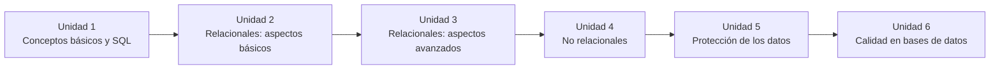

Apuntes, guías de referencia y ejercicios prácticos de la cursada, organizados por unidad según el
programa analítico 2024 de la asignatura (3641).

:::note[Nota]
Este sitio usa una estructura de documentación navegable con búsqueda, anclas por encabezado, tabla de contenidos lateral en páginas extensas y soporte para diagramas Mermaid y fórmulas TeX.
:::

## Contenido

### [Unidad 1 — Conceptos básicos](/bbdd-aplicadas/unidad-1/teoria/)
Qué es una base de datos, motores y licencias, tareas del DBA, despliegue embebido, on premise y cloud. Repaso de SQL: DDL, DML, integridad referencial, subconsultas, vistas, procedimientos, triggers, funciones, window functions, CTE, PIVOT y el valor NULL.

### [Unidad 2 — Bases de datos relacionales: aspectos básicos](/bbdd-aplicadas/unidad-2/teoria/)
Arquitectura, bases de usuario y de sistema, instalación de un motor, collation, almacenamiento en disco y en memoria, conexión, drivers, ODBC y JDBC, formatos de intercambio, APIs e importación de datos.

### [Unidad 3 — Bases de datos relacionales: aspectos avanzados](/bbdd-aplicadas/unidad-3/teoria/)
Control de concurrencia, TCL, bloqueos y esperas, transacciones distribuidas, monitoreo, plan de ejecución, índices, estadísticas, optimización de consultas, rowstore y columnstore.

### [Unidad 4 — Bases de datos no relacionales](/bbdd-aplicadas/unidad-4/teoria/)
Modelos de datos, BASE y ACID, bases clave-valor, columnares y de documentos, MongoDB Query Language, índices, agregación, relación con POO, data lakes, data mining y KDD.

### [Unidad 5 — Protección de los datos](/bbdd-aplicadas/unidad-5/teoria/)
Mínimo privilegio, autenticación y directivas de contraseñas, permisos y DCL, propietarios y roles, alta disponibilidad y réplicas, backups, recuperación y cifrado.

### [Unidad 6 — Calidad en bases de datos](/bbdd-aplicadas/unidad-6/teoria/)
Ley 25.326 de protección de datos personales, Reglamento General de Protección de Datos (RGPD) y modelo de calidad de datos ISO/IEC 25012.

## Mapa de cursada

## Evaluación

Según el programa analítico 2024:

- **Examen parcial** teórico-práctico sobre las unidades 1 a 4, con recuperatorio.
- **Trabajo práctico integrador** grupal, con entregas acumulativas, coloquio y código en un repositorio.
- **Examen final** sobre los contenidos de todas las unidades.

:::caution[Información no oficial]
Las fechas, condiciones y modalidades vigentes son las que publica la cátedra en cada cuatrimestre.
:::

---

## Bibliografía

**Obligatoria**

- Elmasri, Navathe — *Fundamentos de Sistemas de Bases de Datos* · Pearson · 5.ª ed. · 2007
- Silberschatz, Korth, Sudarshan — *Fundamentos de Bases de Datos* · McGraw-Hill · 4.ª ed. · 2002

**Complementaria**

- Gils Carbó, Alejandra M. — *Régimen legal de las bases de datos y hábeas data* · La Ley · 1.ª ed. · 2001

**Recursos obligatorios**

- [Microsoft Learn — Modern Data Warehouse](https://learn.microsoft.com/en-us/training/modules/examine-components-of-modern-data-warehouse/)
- [Microsoft Learn — Azure Data Lake Storage](https://learn.microsoft.com/en-us/training/modules/intro-to-azure-data-lake-storage/)

**Recursos complementarios**

- [MongoDB University — Introduction to MongoDB](https://learn.mongodb.com/learning-paths/introduction-to-mongodb)
