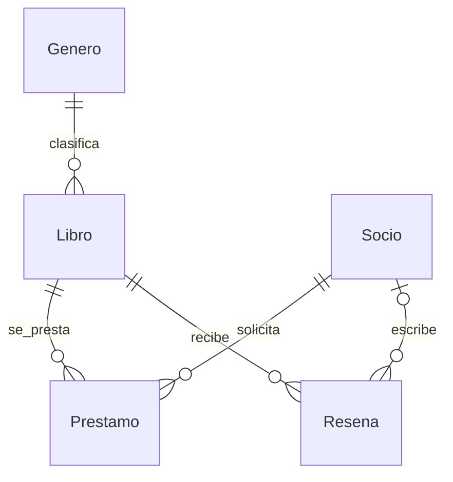

Trabajo práctico propio de repaso de SQL sobre una **biblioteca comunal**: esquema, restricciones, carga de datos, consultas, vistas, funciones, procedimientos, triggers, CTE y `PIVOT`. Es un material original con dominio, tablas y datos sintéticos propios; cubre los mismos objetivos de aprendizaje que un repaso de la unidad. Se resuelve en SQL Server 2019 o 2022, en una base de datos vacía.

:::note[Qué lecciones presupone]
- [Repaso de SQL](/bbdd-aplicadas/unidad-1/teoria/repaso-sql/): DDL, DML, restricciones, vistas, procedimientos, funciones y triggers.
- [Common Table Expressions](/bbdd-aplicadas/unidad-1/teoria/cte/): ejercicios 4, 15 y 16.
- [PIVOT](/bbdd-aplicadas/unidad-1/teoria/pivot/): ejercicio 11.
- [Window functions](/bbdd-aplicadas/unidad-1/teoria/window-functions/): ejercicio 16.
:::

:::note[Cómo usar esta práctica]
Los ejercicios 1 y 2 construyen el modelo; el ejercicio 3 lo prueba. El **script de preparación** reúne esas soluciones más los datos de prueba: ejecutalo para saltear los ejercicios 1 a 3. Cada resolución es autocontenida salvo donde se indica (el ejercicio 13 reutiliza la bitácora del 12). El esquema `biblioteca` va en minúsculas, las tablas en singular y PascalCase, como en el resto del curso. Los datos son ficticios.
:::

## Modelo de datos



## Script de preparación

<!-- check: U1.TP1.00 -->

```sql
CREATE SCHEMA biblioteca;
GO

CREATE TABLE biblioteca.Genero (
    GeneroId INT IDENTITY(1, 1) NOT NULL,
    Nombre   VARCHAR(40)        NOT NULL,
    CONSTRAINT PK_Genero        PRIMARY KEY CLUSTERED (GeneroId),
    CONSTRAINT UQ_Genero_Nombre UNIQUE (Nombre)
);

CREATE TABLE biblioteca.Socio (
    SocioId   INT IDENTITY(1, 1) NOT NULL,
    Codigo    CHAR(6)            NOT NULL,
    Nombre    VARCHAR(60)        NOT NULL,
    Email     VARCHAR(100)       NULL,
    Categoria VARCHAR(10)        NOT NULL CONSTRAINT DF_Socio_Categoria DEFAULT ('General'),
    FechaAlta DATE               NOT NULL CONSTRAINT DF_Socio_FechaAlta DEFAULT (CAST(GETDATE() AS DATE)),
    Activo    BIT                NOT NULL CONSTRAINT DF_Socio_Activo DEFAULT (1),
    CONSTRAINT PK_Socio           PRIMARY KEY CLUSTERED (SocioId),
    CONSTRAINT UQ_Socio_Codigo    UNIQUE (Codigo),
    CONSTRAINT UQ_Socio_Email     UNIQUE (Email),
    CONSTRAINT CK_Socio_Codigo    CHECK (Codigo LIKE 'S[0-9][0-9][0-9][0-9][0-9]'),
    CONSTRAINT CK_Socio_Categoria CHECK (Categoria IN ('Estudiante', 'General', 'Jubilado'))
);
GO

CREATE TABLE biblioteca.Libro (
    LibroId     INT IDENTITY(1, 1) NOT NULL,
    Titulo      VARCHAR(100)       NOT NULL,
    GeneroId    INT                NOT NULL,
    AnioEdicion SMALLINT           NOT NULL,
    Ejemplares  INT                NOT NULL CONSTRAINT DF_Libro_Ejemplares DEFAULT (1),
    Precio      DECIMAL(10, 2)     NOT NULL,
    CONSTRAINT PK_Libro            PRIMARY KEY CLUSTERED (LibroId),
    CONSTRAINT FK_Libro_Genero     FOREIGN KEY (GeneroId) REFERENCES biblioteca.Genero (GeneroId),
    CONSTRAINT CK_Libro_Anio       CHECK (AnioEdicion BETWEEN 1900 AND 2100),
    CONSTRAINT CK_Libro_Ejemplares CHECK (Ejemplares >= 0),
    CONSTRAINT CK_Libro_Precio     CHECK (Precio > 0)
);

CREATE TABLE biblioteca.Prestamo (
    PrestamoId      INT IDENTITY(1, 1) NOT NULL,
    SocioId         INT                NOT NULL,
    LibroId         INT                NOT NULL,
    FechaPrestamo   DATE               NOT NULL,
    FechaDevolucion DATE               NULL,
    CONSTRAINT PK_Prestamo        PRIMARY KEY CLUSTERED (PrestamoId),
    CONSTRAINT FK_Prestamo_Socio  FOREIGN KEY (SocioId) REFERENCES biblioteca.Socio (SocioId),
    CONSTRAINT FK_Prestamo_Libro  FOREIGN KEY (LibroId) REFERENCES biblioteca.Libro (LibroId),
    CONSTRAINT CK_Prestamo_Fechas CHECK (FechaDevolucion IS NULL OR FechaDevolucion >= FechaPrestamo)
);

CREATE TABLE biblioteca.Resena (
    ResenaId   INT IDENTITY(1, 1) NOT NULL,
    LibroId    INT                NOT NULL,
    SocioId    INT                NULL,
    Puntaje    TINYINT            NOT NULL,
    Comentario VARCHAR(200)       NULL,
    CONSTRAINT PK_Resena       PRIMARY KEY CLUSTERED (ResenaId),
    CONSTRAINT FK_Resena_Libro FOREIGN KEY (LibroId) REFERENCES biblioteca.Libro (LibroId)
        ON DELETE CASCADE,
    CONSTRAINT FK_Resena_Socio FOREIGN KEY (SocioId) REFERENCES biblioteca.Socio (SocioId)
        ON DELETE SET NULL,
    CONSTRAINT CK_Resena_Puntaje CHECK (Puntaje BETWEEN 1 AND 5)
);

INSERT INTO biblioteca.Genero (Nombre)
VALUES ('Novela'), ('Ciencia'), ('Historia'), ('Poesia');

INSERT INTO biblioteca.Socio (Codigo, Nombre, Email, Categoria, FechaAlta, Activo)
VALUES ('S00001', 'Socio Uno',    'socio01@ejemplo.test', 'Estudiante', '2024-03-01', 1),
       ('S00002', 'Socio Dos',    'socio02@ejemplo.test', 'General',    '2024-03-15', 1),
       ('S00003', 'Socio Tres',   'socio03@ejemplo.test', 'Estudiante', '2024-04-02', 1),
       ('S00004', 'Socio Cuatro', NULL,                   'Jubilado',   '2024-04-20', 1),
       ('S00005', 'Socio Cinco',  'socio05@ejemplo.test', 'General',    '2024-05-10', 1),
       ('S00006', 'Socio Seis',   'socio06@ejemplo.test', 'Estudiante', '2024-06-01', 0);

INSERT INTO biblioteca.Libro (Titulo, GeneroId, AnioEdicion, Ejemplares, Precio)
VALUES ('Cuentos del Sur',          1, 2015, 3, 2500.00),
       ('La Ciudad Quieta',         1, 2019, 2, 3200.00),
       ('Orbitas y Mareas',         2, 2020, 4, 4100.00),
       ('Atlas de Particulas',      2, 2018, 1, 5200.00),
       ('Manual de Quimica Basica', 2, 2011, 0, 3000.00),
       ('Cronicas del Litoral',     3, 2008, 2, 2800.00),
       ('Rios y Fronteras',         3, 2021, 3, 3600.00),
       ('Memorias de un Puerto',    3, 2016, 1, 2900.00);

INSERT INTO biblioteca.Prestamo (SocioId, LibroId, FechaPrestamo, FechaDevolucion)
VALUES (1, 1, '2025-03-03', '2025-03-10'),
       (1, 3, '2025-03-12', '2025-03-30'),
       (1, 7, '2025-04-02', NULL),
       (2, 1, '2025-03-05', '2025-03-12'),
       (2, 2, '2025-04-07', NULL),
       (3, 3, '2025-03-20', '2025-04-01'),
       (3, 4, '2025-04-15', '2025-04-20'),
       (3, 7, '2025-05-02', '2025-05-09'),
       (3, 6, '2025-05-10', NULL),
       (4, 6, '2025-04-22', '2025-05-01');

INSERT INTO biblioteca.Resena (LibroId, SocioId, Puntaje, Comentario)
VALUES (1, 5, 5, 'Muy buena'),
       (1, 1, 4, NULL),
       (3, 5, 4, 'Clara y breve'),
       (7, 3, 3, NULL);
```

Al terminar hay 4 géneros, 6 socios, 8 libros, 10 préstamos y 4 reseñas.


## Nivel inicial

### Ejercicio 1 · Esquema propio y tablas base
<!-- ejercicio: U1.01 | nivel: inicial | tipo: ddl | verificacion: motor -->

:::note[Enunciado]
Creá el esquema `biblioteca` y, dentro de él, las tablas `Genero` y `Socio` del modelo de la biblioteca comunal.

- `Genero`: identificador autonumérico (clave primaria) y nombre de hasta 40 caracteres, obligatorio y único.
- `Socio`: identificador autonumérico (clave primaria); código de 6 caracteres con el formato `S` seguido de cinco dígitos, único; nombre obligatorio de hasta 60 caracteres; correo opcional y único; categoría (`Estudiante`, `General` o `Jubilado`) con valor por defecto `General`; fecha de alta con valor por defecto la fecha actual; y un indicador `Activo` con valor por defecto 1.
- Nombrá todas las restricciones con la convención del curso y, al final, listá las columnas de las dos tablas con su tipo y si admiten nulos.
:::

<details>
<summary>Resolución</summary>

**Estrategia.** Primero el esquema, en un lote propio (`CREATE SCHEMA` debe ser la primera sentencia de su lote, por eso lleva `GO`). Después una tabla por vez: los tipos se eligen por lo que guardan (`CHAR(6)` para un código de largo fijo, `DATE` para una fecha sin hora, `BIT` para un indicador). Las reglas del enunciado se traducen así: autonumérico con `IDENTITY`, único con `UNIQUE`, formato con `CHECK ... LIKE`, lista cerrada con `CHECK ... IN` y valores por defecto con `DEFAULT`. Para listar columnas se consulta `INFORMATION_SCHEMA.COLUMNS`.

<!-- check: U1.01 -->

```sql
CREATE SCHEMA biblioteca;
GO

CREATE TABLE biblioteca.Genero (
    GeneroId INT IDENTITY(1, 1) NOT NULL,
    Nombre   VARCHAR(40)        NOT NULL,
    CONSTRAINT PK_Genero        PRIMARY KEY CLUSTERED (GeneroId),
    CONSTRAINT UQ_Genero_Nombre UNIQUE (Nombre)
);

CREATE TABLE biblioteca.Socio (
    SocioId   INT IDENTITY(1, 1) NOT NULL,
    Codigo    CHAR(6)            NOT NULL,
    Nombre    VARCHAR(60)        NOT NULL,
    Email     VARCHAR(100)       NULL,
    Categoria VARCHAR(10)        NOT NULL CONSTRAINT DF_Socio_Categoria DEFAULT ('General'),
    FechaAlta DATE               NOT NULL CONSTRAINT DF_Socio_FechaAlta DEFAULT (CAST(GETDATE() AS DATE)),
    Activo    BIT                NOT NULL CONSTRAINT DF_Socio_Activo DEFAULT (1),
    CONSTRAINT PK_Socio           PRIMARY KEY CLUSTERED (SocioId),
    CONSTRAINT UQ_Socio_Codigo    UNIQUE (Codigo),
    CONSTRAINT UQ_Socio_Email     UNIQUE (Email),
    CONSTRAINT CK_Socio_Codigo    CHECK (Codigo LIKE 'S[0-9][0-9][0-9][0-9][0-9]'),
    CONSTRAINT CK_Socio_Categoria CHECK (Categoria IN ('Estudiante', 'General', 'Jubilado'))
);

SELECT TABLE_NAME AS Tabla,
       COLUMN_NAME AS Columna,
       DATA_TYPE AS Tipo,
       IS_NULLABLE AS AdmiteNulos
FROM INFORMATION_SCHEMA.COLUMNS
WHERE TABLE_SCHEMA = 'biblioteca'
ORDER BY TABLE_NAME, ORDINAL_POSITION;
```

**Resultado esperado.**

| Tabla | Columna | Tipo | AdmiteNulos |
|---|---|---|---|
| Genero | GeneroId | int | NO |
| Genero | Nombre | varchar | NO |
| Socio | SocioId | int | NO |
| Socio | Codigo | char | NO |
| Socio | Nombre | varchar | NO |
| Socio | Email | varchar | YES |
| Socio | Categoria | varchar | NO |
| Socio | FechaAlta | date | NO |
| Socio | Activo | bit | NO |

El correo es `NULL`able pero `UNIQUE`: en SQL Server una restricción `UNIQUE` admite **un solo** `NULL` (el ejercicio 3 lo comprueba). El `DEFAULT` de `FechaAlta` usa `GETDATE()` solo como valor por defecto, que es el único lugar donde se tolera una función no determinista en los ejemplos del curso. Ponerles nombre a las restricciones (`PK_Socio`, `UQ_Socio_Codigo`) hace que los mensajes de error y los scripts de cambio sean legibles.

</details>

### Ejercicio 2 · Claves foráneas y acciones referenciales
<!-- ejercicio: U1.02 | nivel: inicial | tipo: ddl | verificacion: motor -->

:::note[Enunciado]
Con `Genero` y `Socio` ya creadas, creá las tablas `Libro`, `Prestamo` y `Resena`.

- `Libro` referencia a `Genero`; `Prestamo` referencia a `Socio` y a `Libro` (sin acciones en cascada).
- `Resena` pertenece a un libro y, opcionalmente, a un socio. Al borrar un libro deben borrarse sus reseñas; al borrar un socio, las reseñas deben conservarse con el socio en `NULL`.
- Agregá las restricciones `CHECK` que correspondan: año de edición entre 1900 y 2100, ejemplares no negativos, precio positivo, puntaje de 1 a 5 y devolución nunca anterior al préstamo.
- Cargá un par de filas y demostrá las tres acciones: borrar un género con libros, borrar un libro con reseñas y borrar un socio con reseñas.
:::

<details>
<summary>Resolución</summary>

**Estrategia.** Las claves foráneas sin cláusula adicional usan `NO ACTION`: impiden borrar al padre mientras tenga hijos. Para el libro se usa `ON DELETE CASCADE` y para el socio `ON DELETE SET NULL`, que exige que `Resena.SocioId` admita `NULL`. La demostración captura el primer caso con `TRY/CATCH` y mide los otros dos con consultas, volcando todo a una variable de tabla para mostrar un único resultado.

<!-- check: U1.02 -->

```sql
CREATE TABLE biblioteca.Libro (
    LibroId     INT IDENTITY(1, 1) NOT NULL,
    Titulo      VARCHAR(100)       NOT NULL,
    GeneroId    INT                NOT NULL,
    AnioEdicion SMALLINT           NOT NULL,
    Ejemplares  INT                NOT NULL CONSTRAINT DF_Libro_Ejemplares DEFAULT (1),
    Precio      DECIMAL(10, 2)     NOT NULL,
    CONSTRAINT PK_Libro            PRIMARY KEY CLUSTERED (LibroId),
    CONSTRAINT FK_Libro_Genero     FOREIGN KEY (GeneroId) REFERENCES biblioteca.Genero (GeneroId),
    CONSTRAINT CK_Libro_Anio       CHECK (AnioEdicion BETWEEN 1900 AND 2100),
    CONSTRAINT CK_Libro_Ejemplares CHECK (Ejemplares >= 0),
    CONSTRAINT CK_Libro_Precio     CHECK (Precio > 0)
);

CREATE TABLE biblioteca.Prestamo (
    PrestamoId      INT IDENTITY(1, 1) NOT NULL,
    SocioId         INT                NOT NULL,
    LibroId         INT                NOT NULL,
    FechaPrestamo   DATE               NOT NULL,
    FechaDevolucion DATE               NULL,
    CONSTRAINT PK_Prestamo        PRIMARY KEY CLUSTERED (PrestamoId),
    CONSTRAINT FK_Prestamo_Socio  FOREIGN KEY (SocioId) REFERENCES biblioteca.Socio (SocioId),
    CONSTRAINT FK_Prestamo_Libro  FOREIGN KEY (LibroId) REFERENCES biblioteca.Libro (LibroId),
    CONSTRAINT CK_Prestamo_Fechas CHECK (FechaDevolucion IS NULL OR FechaDevolucion >= FechaPrestamo)
);

CREATE TABLE biblioteca.Resena (
    ResenaId   INT IDENTITY(1, 1) NOT NULL,
    LibroId    INT                NOT NULL,
    SocioId    INT                NULL,
    Puntaje    TINYINT            NOT NULL,
    Comentario VARCHAR(200)       NULL,
    CONSTRAINT PK_Resena       PRIMARY KEY CLUSTERED (ResenaId),
    CONSTRAINT FK_Resena_Libro FOREIGN KEY (LibroId) REFERENCES biblioteca.Libro (LibroId)
        ON DELETE CASCADE,
    CONSTRAINT FK_Resena_Socio FOREIGN KEY (SocioId) REFERENCES biblioteca.Socio (SocioId)
        ON DELETE SET NULL,
    CONSTRAINT CK_Resena_Puntaje CHECK (Puntaje BETWEEN 1 AND 5)
);

INSERT INTO biblioteca.Genero (Nombre) VALUES ('Novela'), ('Poesia');
INSERT INTO biblioteca.Socio (Codigo, Nombre, Email) VALUES ('S00001', 'Socio Uno', 'socio01@ejemplo.test');
INSERT INTO biblioteca.Libro (Titulo, GeneroId, AnioEdicion, Precio)
VALUES ('Cuentos del Sur', 1, 2015, 2500.00), ('La Ciudad Quieta', 1, 2019, 3200.00);
INSERT INTO biblioteca.Resena (LibroId, SocioId, Puntaje)
VALUES (1, 1, 5), (2, 1, 4);

DECLARE @Resultado TABLE (Orden INT, Caso VARCHAR(60), Resultado VARCHAR(30));

BEGIN TRY
    DELETE FROM biblioteca.Genero WHERE Nombre = 'Novela';
    INSERT INTO @Resultado VALUES (1, 'Borrar genero con libros', 'ok');
END TRY
BEGIN CATCH
    INSERT INTO @Resultado VALUES (1, 'Borrar genero con libros', CONCAT('error ', ERROR_NUMBER()));
END CATCH;

DELETE FROM biblioteca.Libro WHERE Titulo = 'Cuentos del Sur';
INSERT INTO @Resultado
SELECT 2, 'Resenas tras borrar el libro 1', CAST(COUNT(*) AS VARCHAR(30))
FROM biblioteca.Resena;

DELETE FROM biblioteca.Socio WHERE Codigo = 'S00001';
INSERT INTO @Resultado
SELECT 3, 'Resenas con SocioId NULL tras borrar el socio', CAST(COUNT(*) AS VARCHAR(30))
FROM biblioteca.Resena
WHERE SocioId IS NULL;

SELECT Caso, Resultado FROM @Resultado ORDER BY Orden;
```

**Resultado esperado.**

| Caso | Resultado |
|---|---|
| Borrar genero con libros | error 547 |
| Resenas tras borrar el libro 1 | 1 |
| Resenas con SocioId NULL tras borrar el socio | 1 |

El primer caso falla con el error 547 (conflicto con una restricción `FOREIGN KEY`) porque `FK_Libro_Genero` usa `NO ACTION`. Con `CASCADE`, borrar el libro 1 elimina su reseña y queda una. Con `SET NULL`, borrar al socio no toca la reseña restante: queda con `SocioId` en `NULL`. Elegir la acción depende del significado: una reseña no tiene sentido sin su libro, pero sí puede sobrevivir al socio que la escribió. Los `INSERT` de este ejercicio son mínimos; el script de preparación carga el conjunto completo.

</details>

### Ejercicio 3 · Pruebas de restricciones
<!-- ejercicio: U1.03 | nivel: inicial | tipo: ddl | verificacion: motor -->

:::note[Enunciado]
Sobre el modelo ya cargado, escribí una prueba que intente violar cada restricción y registre el número de error de SQL Server: categoría inexistente, código de socio repetido, un segundo correo `NULL`, un libro con género inexistente, un precio igual a cero y una devolución anterior al préstamo. Agregá un caso que compruebe el `DEFAULT` de la categoría. El resultado debe ser una sola tabla de casos.
:::

<details>
<summary>Resolución</summary>

**Estrategia.** Cada intento se encierra en su propio `TRY/CATCH`; si falla, `ERROR_NUMBER()` identifica la restricción violada: 547 para `CHECK` y `FOREIGN KEY`, 2627 para `PRIMARY KEY` y `UNIQUE`. El caso del `DEFAULT` inserta una fila sin categoría y lee lo que quedó guardado. Como el socio 4 ya tiene el correo en `NULL`, un segundo `NULL` choca con `UQ_Socio_Email`.

<!-- check: U1.03 -->

```sql
DECLARE @Resultado TABLE (Orden INT, Caso VARCHAR(40), Resultado VARCHAR(30));

BEGIN TRY
    INSERT INTO biblioteca.Socio (Codigo, Nombre, Email, Categoria)
    VALUES ('S00020', 'Socio Prueba', 'prueba20@ejemplo.test', 'Docente');
    INSERT INTO @Resultado VALUES (1, 'Categoria inexistente', 'ok');
END TRY
BEGIN CATCH
    INSERT INTO @Resultado VALUES (1, 'Categoria inexistente', CONCAT('error ', ERROR_NUMBER()));
END CATCH;

BEGIN TRY
    INSERT INTO biblioteca.Socio (Codigo, Nombre, Email)
    VALUES ('S00001', 'Socio Prueba', 'prueba21@ejemplo.test');
    INSERT INTO @Resultado VALUES (2, 'Codigo repetido', 'ok');
END TRY
BEGIN CATCH
    INSERT INTO @Resultado VALUES (2, 'Codigo repetido', CONCAT('error ', ERROR_NUMBER()));
END CATCH;

BEGIN TRY
    INSERT INTO biblioteca.Socio (Codigo, Nombre, Email)
    VALUES ('S00022', 'Socio Prueba', NULL);
    INSERT INTO @Resultado VALUES (3, 'Segundo correo NULL', 'ok');
END TRY
BEGIN CATCH
    INSERT INTO @Resultado VALUES (3, 'Segundo correo NULL', CONCAT('error ', ERROR_NUMBER()));
END CATCH;

BEGIN TRY
    INSERT INTO biblioteca.Libro (Titulo, GeneroId, AnioEdicion, Precio)
    VALUES ('Libro de prueba', 99, 2020, 1000.00);
    INSERT INTO @Resultado VALUES (4, 'Genero inexistente', 'ok');
END TRY
BEGIN CATCH
    INSERT INTO @Resultado VALUES (4, 'Genero inexistente', CONCAT('error ', ERROR_NUMBER()));
END CATCH;

BEGIN TRY
    INSERT INTO biblioteca.Libro (Titulo, GeneroId, AnioEdicion, Precio)
    VALUES ('Libro de prueba', 1, 2020, 0);
    INSERT INTO @Resultado VALUES (5, 'Precio igual a cero', 'ok');
END TRY
BEGIN CATCH
    INSERT INTO @Resultado VALUES (5, 'Precio igual a cero', CONCAT('error ', ERROR_NUMBER()));
END CATCH;

BEGIN TRY
    INSERT INTO biblioteca.Prestamo (SocioId, LibroId, FechaPrestamo, FechaDevolucion)
    VALUES (1, 1, '2025-06-10', '2025-06-01');
    INSERT INTO @Resultado VALUES (6, 'Devolucion anterior al prestamo', 'ok');
END TRY
BEGIN CATCH
    INSERT INTO @Resultado VALUES (6, 'Devolucion anterior al prestamo', CONCAT('error ', ERROR_NUMBER()));
END CATCH;

INSERT INTO biblioteca.Socio (Codigo, Nombre, Email)
VALUES ('S00023', 'Socio Prueba', 'prueba23@ejemplo.test');
INSERT INTO @Resultado
SELECT 7, 'Categoria por defecto', Categoria
FROM biblioteca.Socio
WHERE Codigo = 'S00023';

SELECT Caso, Resultado FROM @Resultado ORDER BY Orden;
```

**Resultado esperado.**

| Caso | Resultado |
|---|---|
| Categoria inexistente | error 547 |
| Codigo repetido | error 2627 |
| Segundo correo NULL | error 2627 |
| Genero inexistente | error 547 |
| Precio igual a cero | error 547 |
| Devolucion anterior al prestamo | error 547 |
| Categoria por defecto | General |

Los casos 1, 4, 5 y 6 devuelven 547 (`CHECK` y `FOREIGN KEY` comparten número; el mensaje indica cuál). Los casos 2 y 3 devuelven 2627, de `UNIQUE`. El caso 3 es el menos intuitivo: `UNIQUE` considera iguales a dos `NULL`, así que solo se admite uno. Si hiciera falta que muchos socios no tengan correo, la alternativa es un índice único filtrado (`WHERE Email IS NOT NULL`). Probar las restricciones con datos inválidos es la única forma de saber que realmente están activas.

</details>

### Ejercicio 4 · Datos de prueba deterministas
<!-- ejercicio: U1.04 | nivel: inicial | tipo: ddl | verificacion: motor -->

:::note[Enunciado]
Necesitás 24 socios de prueba para medir consultas, pero sin escribir 24 `INSERT` ni usar valores aleatorios. Generalos en una tabla `SocioPrueba` con una expresión recursiva de números: código `S` + cinco dígitos, correo `prueba<n>@ejemplo.test`, categoría que rota entre las tres (`Estudiante`, `General`, `Jubilado`) y una fecha de alta que avanza una semana por fila desde el 1 de enero de 2025. Mostrá cuántos socios hay por categoría y la fecha de alta más reciente de cada una, y borrá la tabla al final.
:::

<details>
<summary>Resolución</summary>

**Estrategia.** Un `WITH` recursivo produce los números 1 a 24. Todo lo demás se deriva de `n` con funciones deterministas: `RIGHT(CONCAT('00000', n), 5)` para completar ceros, `n % 3` con `CASE` para rotar la categoría y `DATEADD` para la fecha. Como nada depende de `NEWID()`, `RAND()` ni de la hora, la carga produce siempre los mismos datos y nunca viola un `UNIQUE`. La consulta que precede al `WITH` termina en `;`.

<!-- check: U1.04 -->

```sql
WITH Numero AS (
    SELECT 1 AS n
    UNION ALL
    SELECT n + 1 FROM Numero WHERE n < 24
)
SELECT CONCAT('S', RIGHT(CONCAT('00000', n), 5)) AS Codigo,
       CONCAT('Socio Prueba ', n) AS Nombre,
       CONCAT('prueba', n, '@ejemplo.test') AS Email,
       CASE n % 3 WHEN 0 THEN 'Estudiante' WHEN 1 THEN 'General' ELSE 'Jubilado' END AS Categoria,
       DATEADD(DAY, 7 * (n - 1), CAST('2025-01-01' AS DATE)) AS FechaAlta
INTO biblioteca.SocioPrueba
FROM Numero;

SELECT Categoria,
       COUNT(*) AS Cantidad,
       MAX(FechaAlta) AS UltimaAlta
FROM biblioteca.SocioPrueba
GROUP BY Categoria
ORDER BY Categoria;

DROP TABLE biblioteca.SocioPrueba;
```

**Resultado esperado.**

| Categoria | Cantidad | UltimaAlta |
|---|---|---|
| Estudiante | 8 | 2025-06-11 |
| General | 8 | 2025-05-28 |
| Jubilado | 8 | 2025-06-04 |

Los 24 números se reparten parejo (8 por categoría) y la última alta de cada categoría es la de su último `n`: el 24 (Estudiante), el 22 (General) y el 23 (Jubilado), con fechas separadas por 7 días. La recursión tiene un límite predeterminado de 100 niveles (`OPTION (MAXRECURSION)`); para volúmenes mayores se usa una tabla de números o `GENERATE_SERIES` (SQL Server 2022). Un generador con `ABS(CHECKSUM(NEWID())) % N` para valores únicos tiene probabilidad de colisión: no sirve donde hay `UNIQUE` y además no es repetible. `SELECT ... INTO` crea la tabla con los tipos del resultado; por eso `FechaAlta` es `DATE`.

</details>

### Ejercicio 5 · UPDATE y DELETE con joins y OUTPUT
<!-- ejercicio: U1.05 | nivel: inicial | tipo: consulta | verificacion: motor -->

:::note[Enunciado]
Sobre el conjunto cargado:

1. Subí un 10 % el precio de los libros del género `Ciencia`, usando un `UPDATE` con `JOIN` a `Genero` (no el identificador numérico).
2. Eliminá los préstamos ya devueltos antes del 1 de abril de 2025 y guardá en una variable de tabla, con `OUTPUT`, los identificadores eliminados.
3. Mostrá en un solo resultado los precios nuevos de los libros de ciencia, los préstamos eliminados (uno por fila) y la cantidad de préstamos que quedan.
:::

<details>
<summary>Resolución</summary>

**Estrategia.** `UPDATE ... FROM ... JOIN` actualiza la tabla alias a partir de otra. `DELETE ... OUTPUT deleted.Columna INTO @Variable` captura lo borrado en la misma sentencia. La condición `FechaDevolucion < '2025-04-01'` descarta sola a los préstamos pendientes, porque comparar `NULL` da desconocido. El resultado final une tres consultas con `UNION ALL` y un `Orden` explícito.

<!-- check: U1.05 -->

```sql
UPDATE l
SET Precio = ROUND(l.Precio * 1.10, 2)
FROM biblioteca.Libro AS l
INNER JOIN biblioteca.Genero AS g ON g.GeneroId = l.GeneroId
WHERE g.Nombre = 'Ciencia';

DECLARE @Eliminado TABLE (PrestamoId INT);

DELETE FROM biblioteca.Prestamo
OUTPUT deleted.PrestamoId INTO @Eliminado (PrestamoId)
WHERE FechaDevolucion < '2025-04-01';

SELECT 1 AS Orden, CONCAT('Precio ', Titulo) AS Concepto, CAST(CAST(Precio AS DECIMAL(10, 2)) AS VARCHAR(20)) AS Valor
FROM biblioteca.Libro
WHERE GeneroId = 2
UNION ALL
SELECT 2, 'Prestamo eliminado', CAST(PrestamoId AS VARCHAR(20))
FROM @Eliminado
UNION ALL
SELECT 3, 'Prestamos restantes', CAST(COUNT(*) AS VARCHAR(20))
FROM biblioteca.Prestamo
ORDER BY Orden, Concepto, Valor;
```

**Resultado esperado.**

| Orden | Concepto | Valor |
|---|---|---|
| 1 | Precio Atlas de Particulas | 5720.00 |
| 1 | Precio Manual de Quimica Basica | 3300.00 |
| 1 | Precio Orbitas y Mareas | 4510.00 |
| 2 | Prestamo eliminado | 1 |
| 2 | Prestamo eliminado | 2 |
| 2 | Prestamo eliminado | 4 |
| 3 | Prestamos restantes | 7 |

Los tres libros de ciencia suben un 10 %. Se eliminan los préstamos 1, 2 y 4 (devueltos el 10, el 30 y el 12 de marzo); el 6 queda porque se devolvió exactamente el 1 de abril y los pendientes (3, 5 y 9) no cumplen la condición. Quedan 7 de los 10. Antes de un `DELETE` o `UPDATE` masivo conviene ejecutar el mismo `WHERE` como `SELECT`; `OUTPUT` deja además evidencia de lo que se tocó.

</details>

## Nivel intermedio

### Ejercicio 6 · Subconsultas: NOT EXISTS, correlacionadas e IN
<!-- ejercicio: U1.06 | nivel: intermedio | tipo: consulta | verificacion: motor -->

:::note[Enunciado]
Escribí tres consultas con subconsultas y mostralas juntas (columnas `Consulta` y `Detalle`):

1. Los códigos de los socios que nunca pidieron un libro.
2. Los títulos de los libros cuyo precio supera el promedio de los libros de su mismo género.
3. Los códigos de los socios que pidieron algún libro del género `Historia`.
:::

<details>
<summary>Resolución</summary>

**Estrategia.** (1) `NOT EXISTS` con una subconsulta correlacionada sobre `Prestamo`: es la forma segura frente a `NULL`, a diferencia de `NOT IN`. (2) Una subconsulta escalar correlacionada que calcula el promedio del género de cada fila externa. (3) `IN` con una subconsulta que recorre `Prestamo`, `Libro` y `Genero`; `IN` ya elimina los repetidos del lado externo porque se evalúa por socio.

<!-- check: U1.06 -->

```sql
SELECT 'sin prestamos' AS Consulta, s.Codigo AS Detalle
FROM biblioteca.Socio AS s
WHERE NOT EXISTS (SELECT 1 FROM biblioteca.Prestamo AS p WHERE p.SocioId = s.SocioId)
UNION ALL
SELECT 'sobre el promedio del genero', l.Titulo
FROM biblioteca.Libro AS l
WHERE l.Precio > (SELECT AVG(x.Precio) FROM biblioteca.Libro AS x WHERE x.GeneroId = l.GeneroId)
UNION ALL
SELECT 'pidio Historia', s.Codigo
FROM biblioteca.Socio AS s
WHERE s.SocioId IN (SELECT p.SocioId
                    FROM biblioteca.Prestamo AS p
                    INNER JOIN biblioteca.Libro AS l ON l.LibroId = p.LibroId
                    INNER JOIN biblioteca.Genero AS g ON g.GeneroId = l.GeneroId
                    WHERE g.Nombre = 'Historia')
ORDER BY Consulta, Detalle;
```

**Resultado esperado.**

| Consulta | Detalle |
|---|---|
| pidio Historia | S00001 |
| pidio Historia | S00003 |
| pidio Historia | S00004 |
| sin prestamos | S00005 |
| sin prestamos | S00006 |
| sobre el promedio del genero | Atlas de Particulas |
| sobre el promedio del genero | La Ciudad Quieta |
| sobre el promedio del genero | Rios y Fronteras |

Los promedios por género son 2850 (Novela), 4100 (Ciencia) y 3100 (Historia): por eso `Orbitas y Mareas`, que vale exactamente 4100, no supera su promedio. Los socios 5 y 6 no registran préstamos. Los que pidieron Historia son los socios 1, 3 y 4 (libros 6 y 7). Si `Prestamo.SocioId` admitiera `NULL`, un `NOT IN` devolvería cero filas; `NOT EXISTS` no tiene ese problema.

</details>

### Ejercicio 7 · Agregados, GROUP BY y HAVING
<!-- ejercicio: U1.07 | nivel: intermedio | tipo: consulta | verificacion: motor -->

:::note[Enunciado]
Para cada socio con **dos o más** préstamos, informá su código, la cantidad de préstamos, cuántos ya se devolvieron, cuántos siguen pendientes y el promedio de días que tardó en devolver (un decimal). Ordená por código.
:::

<details>
<summary>Resolución</summary>

**Estrategia.** Se agrupa por socio. La diferencia entre `COUNT(*)` y `COUNT(FechaDevolucion)` da los pendientes, porque `COUNT(columna)` ignora los `NULL`; `AVG` también los ignora, así que el promedio se calcula solo sobre los devueltos. El filtro sobre el resultado del agregado va en `HAVING` (un `WHERE` se evalúa antes de agrupar y no puede ver `COUNT(*)`).

<!-- check: U1.07 -->

```sql
SELECT s.Codigo,
       COUNT(*) AS Prestamos,
       COUNT(p.FechaDevolucion) AS Devueltos,
       COUNT(*) - COUNT(p.FechaDevolucion) AS Pendientes,
       CAST(AVG(DATEDIFF(DAY, p.FechaPrestamo, p.FechaDevolucion) * 1.0) AS DECIMAL(5, 1)) AS DiasPromedio
FROM biblioteca.Socio AS s
INNER JOIN biblioteca.Prestamo AS p ON p.SocioId = s.SocioId
GROUP BY s.Codigo
HAVING COUNT(*) >= 2
ORDER BY s.Codigo;
```

**Resultado esperado.**

| Codigo | Prestamos | Devueltos | Pendientes | DiasPromedio |
|---|---|---|---|---|
| S00001 | 3 | 2 | 1 | 12.5 |
| S00002 | 2 | 1 | 1 | 7.0 |
| S00003 | 4 | 3 | 1 | 8.0 |

El socio 1 devolvió dos libros en 7 y 18 días (promedio 12,5); el 2, uno en 7; el 3, tres en 12, 5 y 7 (promedio 8,0). El socio 4 tiene un solo préstamo y queda fuera por el `HAVING`. Multiplicar por `1.0` evita la división entera de `AVG` sobre enteros. Mover `COUNT(*) >= 2` a un `WHERE` es un error de sintaxis.

</details>

### Ejercicio 8 · Vista de préstamos pendientes
<!-- ejercicio: U1.08 | nivel: intermedio | tipo: ddl | verificacion: motor -->

:::note[Enunciado]
Creá la vista `biblioteca.PrestamoPendiente` con los préstamos sin devolver: identificador, código del socio, título del libro y fecha del préstamo. Consultala con ordenamiento por fecha y explicá qué ventaja tiene frente a repetir el `JOIN` en cada consulta.
:::

<details>
<summary>Resolución</summary>

**Estrategia.** Una vista es una consulta con nombre: no guarda datos. `CREATE VIEW` debe ser la única sentencia de su lote, por lo que se separa con `GO`. El `ORDER BY` no va dentro de la vista (no está permitido sin `TOP`, y no garantizaría el orden); se aplica al consultarla.

<!-- check: U1.08 -->

```sql
CREATE VIEW biblioteca.PrestamoPendiente
AS
SELECT p.PrestamoId,
       s.Codigo AS CodigoSocio,
       l.Titulo,
       p.FechaPrestamo
FROM biblioteca.Prestamo AS p
INNER JOIN biblioteca.Socio AS s ON s.SocioId = p.SocioId
INNER JOIN biblioteca.Libro AS l ON l.LibroId = p.LibroId
WHERE p.FechaDevolucion IS NULL;
GO

SELECT PrestamoId, CodigoSocio, Titulo, FechaPrestamo
FROM biblioteca.PrestamoPendiente
ORDER BY FechaPrestamo, PrestamoId;
```

**Resultado esperado.**

| PrestamoId | CodigoSocio | Titulo | FechaPrestamo |
|---|---|---|---|
| 3 | S00001 | Rios y Fronteras | 2025-04-02 |
| 5 | S00002 | La Ciudad Quieta | 2025-04-07 |
| 9 | S00003 | Cronicas del Litoral | 2025-05-10 |

Hay tres préstamos pendientes (3, 5 y 9). La vista encapsula la unión de tres tablas y la definición de "pendiente" (`FechaDevolucion IS NULL`): si la regla cambia, se modifica en un solo lugar. Como la vista se expande en el plan de la consulta que la usa, no es más rápida por sí sola.

</details>

### Ejercicio 9 · Vista con SCHEMABINDING
<!-- ejercicio: U1.09 | nivel: intermedio | tipo: ddl | verificacion: motor -->

:::note[Enunciado]
Creá la vista `biblioteca.LibroCatalogo` con `SCHEMABINDING` (identificador, título, género y ejemplares de cada libro). Después intentá: (a) eliminar la columna `Ejemplares`, (b) eliminar la tabla `Genero` y (c) agregar una columna `Idioma` a `Libro`. Registrá el resultado de cada intento.
:::

<details>
<summary>Resolución</summary>

**Estrategia.** `WITH SCHEMABINDING` ata la vista a los objetos que referencia: exige nombres de dos partes y bloquea los cambios que la dejarían inválida. Los intentos (a) y (b) se capturan con `TRY/CATCH` para mostrar el número de error; el (c) no toca nada que la vista use, así que debe prosperar.

<!-- check: U1.09 -->

```sql
CREATE VIEW biblioteca.LibroCatalogo
WITH SCHEMABINDING
AS
SELECT l.LibroId, l.Titulo, g.Nombre AS Genero, l.Ejemplares
FROM biblioteca.Libro AS l
INNER JOIN biblioteca.Genero AS g ON g.GeneroId = l.GeneroId;
GO

DECLARE @Resultado TABLE (Orden INT, Intento VARCHAR(40), Resultado VARCHAR(30));

BEGIN TRY
    ALTER TABLE biblioteca.Libro DROP COLUMN Ejemplares;
    INSERT INTO @Resultado VALUES (1, 'Eliminar Libro.Ejemplares', 'ok');
END TRY
BEGIN CATCH
    INSERT INTO @Resultado VALUES (1, 'Eliminar Libro.Ejemplares', CONCAT('error ', ERROR_NUMBER()));
END CATCH;

BEGIN TRY
    DROP TABLE biblioteca.Genero;
    INSERT INTO @Resultado VALUES (2, 'Eliminar la tabla Genero', 'ok');
END TRY
BEGIN CATCH
    INSERT INTO @Resultado VALUES (2, 'Eliminar la tabla Genero', CONCAT('error ', ERROR_NUMBER()));
END CATCH;

BEGIN TRY
    ALTER TABLE biblioteca.Libro ADD Idioma VARCHAR(20) NULL;
    INSERT INTO @Resultado VALUES (3, 'Agregar Libro.Idioma', 'ok');
END TRY
BEGIN CATCH
    INSERT INTO @Resultado VALUES (3, 'Agregar Libro.Idioma', CONCAT('error ', ERROR_NUMBER()));
END CATCH;

SELECT Intento, Resultado FROM @Resultado ORDER BY Orden;
```

**Resultado esperado.**

| Intento | Resultado |
|---|---|
| Eliminar Libro.Ejemplares | error 4922 |
| Eliminar la tabla Genero | error 3726 |
| Agregar Libro.Idioma | ok |

Con la vista enlazada, el motor rechaza los dos cambios destructivos (el error 4922 al eliminar la columna y el 3726 al eliminar la tabla) y permite el que no la afecta. Sin `SCHEMABINDING` esos cambios habrían tenido éxito y la vista habría quedado rota hasta la próxima consulta. Esta opción es además un requisito para indexar una vista. La contrapartida es que complica las migraciones: para modificar la tabla hay que alterar o eliminar primero la vista.

</details>

### Ejercicio 10 · Funciones escalares y de tabla en línea
<!-- ejercicio: U1.10 | nivel: intermedio | tipo: programabilidad | verificacion: motor -->

:::note[Enunciado]
Creá dos funciones:

- `biblioteca.DiasPrestamo(@FechaPrestamo, @FechaDevolucion, @FechaCorte)`: cantidad de días que duró un préstamo; si todavía no se devolvió, cuenta hasta `@FechaCorte`.
- `biblioteca.PrestamoDeSocio(@SocioId)`: función de tabla en línea con los préstamos de un socio (identificador, título y fechas).

Con ellas, listá los préstamos del socio 3 con su duración al 1 de junio de 2025.
:::

<details>
<summary>Resolución</summary>

**Estrategia.** La escalar resuelve el caso "devuelto o pendiente" con `COALESCE` sobre la fecha de devolución. La de tabla en línea es un único `RETURN (SELECT ...)`: el optimizador la expande como una vista parametrizada, a diferencia de una función de varias sentencias. Cada `CREATE FUNCTION` va en su propio lote. El corte se pasa por parámetro y no con `GETDATE()`, para que el resultado sea repetible.

<!-- check: U1.10 -->

```sql
CREATE FUNCTION biblioteca.DiasPrestamo
(
    @FechaPrestamo   DATE,
    @FechaDevolucion DATE,
    @FechaCorte      DATE
)
RETURNS INT
AS
BEGIN
    RETURN DATEDIFF(DAY, @FechaPrestamo, COALESCE(@FechaDevolucion, @FechaCorte));
END;
GO

CREATE FUNCTION biblioteca.PrestamoDeSocio (@SocioId INT)
RETURNS TABLE
AS
RETURN
(
    SELECT p.PrestamoId, l.Titulo, p.FechaPrestamo, p.FechaDevolucion
    FROM biblioteca.Prestamo AS p
    INNER JOIN biblioteca.Libro AS l ON l.LibroId = p.LibroId
    WHERE p.SocioId = @SocioId
);
GO

SELECT f.PrestamoId,
       f.Titulo,
       biblioteca.DiasPrestamo(f.FechaPrestamo, f.FechaDevolucion, '2025-06-01') AS Dias
FROM biblioteca.PrestamoDeSocio(3) AS f
ORDER BY f.PrestamoId;
```

**Resultado esperado.**

| PrestamoId | Titulo | Dias |
|---|---|---|
| 6 | Orbitas y Mareas | 12 |
| 7 | Atlas de Particulas | 5 |
| 8 | Rios y Fronteras | 7 |
| 9 | Cronicas del Litoral | 22 |

El préstamo 9 sigue abierto y se cuenta hasta el corte (22 días); los demás usan su fecha real (12, 5 y 7 días). Una función escalar se ejecuta fila por fila y puede impedir el paralelismo en consultas grandes; en este volumen no importa, pero en tablas grandes conviene una función de tabla en línea o la expresión directa.

</details>

### Ejercicio 11 · PIVOT simple por categoría de socio
<!-- ejercicio: U1.11 | nivel: intermedio | tipo: consulta | verificacion: motor -->

:::note[Enunciado]
Armá una tabla de doble entrada con la cantidad de préstamos por género (filas) y categoría de socio (columnas `Estudiante`, `General` y `Jubilado`), usando `PIVOT`. Incluí los géneros sin préstamos, si los hubiera, o justificá por qué no aparecen.
:::

<details>
<summary>Resolución</summary>

**Estrategia.** Primero se arma, en una tabla derivada, un conjunto angosto con exactamente las columnas que usa `PIVOT`: el género (queda como fila), la categoría (se transforma en columnas) y el identificador del préstamo (se agrega). `PIVOT` agrupa implícitamente por las columnas que no participan. Las categorías se listan a mano porque `PIVOT` exige valores fijos; para valores desconocidos haría falta SQL dinámico. Como la tabla derivada parte de `Prestamo` con `INNER JOIN`, los géneros sin préstamos no aparecen.

<!-- check: U1.11 -->

```sql
SELECT Genero, Estudiante, General, Jubilado
FROM (
    SELECT g.Nombre AS Genero, s.Categoria, p.PrestamoId
    FROM biblioteca.Prestamo AS p
    INNER JOIN biblioteca.Socio AS s ON s.SocioId = p.SocioId
    INNER JOIN biblioteca.Libro AS l ON l.LibroId = p.LibroId
    INNER JOIN biblioteca.Genero AS g ON g.GeneroId = l.GeneroId
) AS Origen
PIVOT (
    COUNT(PrestamoId)
    FOR Categoria IN (Estudiante, General, Jubilado)
) AS Dinamica
ORDER BY Genero;
```

**Resultado esperado.**

| Genero | Estudiante | General | Jubilado |
|---|---|---|---|
| Ciencia | 3 | 0 | 0 |
| Historia | 3 | 0 | 1 |
| Novela | 1 | 2 | 0 |

`Poesia` no tiene libros ni préstamos y queda fuera por la unión interna; con un `LEFT JOIN` desde `Genero` aparecería, pero con ceros en las tres columnas (`COUNT` devuelve 0, no `NULL`). El mismo resultado se obtiene con agregación condicional (`SUM(CASE WHEN ... THEN 1 ELSE 0 END)`), que es más flexible pero más larga. Para más detalle del operador, ver [PIVOT](/bbdd-aplicadas/unidad-1/teoria/pivot/).

</details>

### Ejercicio 12 · Procedimiento con parámetros y manejo de errores
<!-- ejercicio: U1.12 | nivel: intermedio | tipo: programabilidad | verificacion: motor -->

:::note[Enunciado]
Creá la tabla `biblioteca.Bitacora` (identificador autonumérico, fecha y hora con valor por defecto, módulo y mensaje) y el procedimiento `biblioteca.RegistrarBitacora` con un parámetro de módulo obligatorio, un mensaje opcional y un parámetro de salida con el identificador generado.

- Si el mensaje es `NULL` o está en blanco, debe guardarse el texto `Sin detalle`.
- Si el módulo es `NULL` o está en blanco, el procedimiento debe lanzar un error propio (número 50001).

Probalo con un mensaje, con uno en blanco y con un módulo inválido (capturando el error), y mostrá el contenido de la bitácora sin la fecha.
:::

<details>
<summary>Resolución</summary>

**Estrategia.** `COALESCE(NULLIF(LTRIM(RTRIM(@Mensaje)), ''), 'Sin detalle')` resuelve juntos el `NULL` y el texto en blanco. La validación del módulo usa `THROW` con un número mayor que 50000. El parámetro de salida (`OUTPUT`) devuelve `SCOPE_IDENTITY()`. En la prueba, el llamado inválido va en un `TRY/CATCH` cuyo `CATCH` deja registro del error en la propia bitácora.

<!-- check: U1.12 -->

```sql
CREATE TABLE biblioteca.Bitacora (
    BitacoraId INT IDENTITY(1, 1) NOT NULL,
    Fecha      DATETIME2(0)       NOT NULL CONSTRAINT DF_Bitacora_Fecha DEFAULT (SYSDATETIME()),
    Modulo     VARCHAR(40)        NOT NULL,
    Mensaje    VARCHAR(200)       NOT NULL,
    CONSTRAINT PK_Bitacora PRIMARY KEY CLUSTERED (BitacoraId)
);
GO

CREATE PROCEDURE biblioteca.RegistrarBitacora
    @Modulo     VARCHAR(40),
    @Mensaje    VARCHAR(200) = NULL,
    @BitacoraId INT          = NULL OUTPUT
AS
BEGIN
    SET NOCOUNT ON;

    IF NULLIF(LTRIM(RTRIM(@Modulo)), '') IS NULL
        THROW 50001, 'El modulo es obligatorio.', 1;

    INSERT INTO biblioteca.Bitacora (Modulo, Mensaje)
    VALUES (LTRIM(RTRIM(@Modulo)), COALESCE(NULLIF(LTRIM(RTRIM(@Mensaje)), ''), 'Sin detalle'));

    SET @BitacoraId = SCOPE_IDENTITY();
END;
GO

DECLARE @Id INT;

EXEC biblioteca.RegistrarBitacora @Modulo = 'Carga', @Mensaje = 'Inicio de la carga', @BitacoraId = @Id OUTPUT;
EXEC biblioteca.RegistrarBitacora @Modulo = 'Carga', @Mensaje = '   ';
DECLARE @Texto VARCHAR(200) = CONCAT('Primer id: ', @Id);
EXEC biblioteca.RegistrarBitacora @Modulo = 'Prueba', @Mensaje = @Texto;

BEGIN TRY
    EXEC biblioteca.RegistrarBitacora @Modulo = '  ', @Mensaje = 'No deberia guardarse';
END TRY
BEGIN CATCH
    SET @Texto = CONCAT('Numero ', ERROR_NUMBER());
    EXEC biblioteca.RegistrarBitacora @Modulo = 'Error', @Mensaje = @Texto;
END CATCH;

SELECT BitacoraId, Modulo, Mensaje
FROM biblioteca.Bitacora
ORDER BY BitacoraId;
```

**Resultado esperado.**

| BitacoraId | Modulo | Mensaje |
|---|---|---|
| 1 | Carga | Inicio de la carga |
| 2 | Carga | Sin detalle |
| 3 | Prueba | Primer id: 1 |
| 4 | Error | Numero 50001 |

La segunda llamada guarda `Sin detalle` en lugar del texto en blanco, y la cuarta no llega a insertar nada: `THROW` cancela el procedimiento con el error 50001, que el `CATCH` registra. Dos detalles de estilo: el parámetro con valor por defecto permite omitirlo, y el nombre no empieza con `sp_`, prefijo que SQL Server reserva para los procedimientos del sistema. Los argumentos de `EXEC` no pueden ser expresiones, por eso el texto se arma antes en una variable. `THROW` exige que la sentencia anterior termine en `;`.

</details>

## Nivel avanzado

### Ejercicio 13 · Procedimiento transaccional con validaciones
<!-- ejercicio: U1.13 | nivel: avanzado | tipo: programabilidad | verificacion: motor -->

:::note[Enunciado]
Creá `biblioteca.RegistrarPrestamo(@SocioId, @LibroId, @FechaPrestamo)`. Debe, en una única transacción: verificar que el socio exista y esté activo, verificar que el libro exista y tenga ejemplares, descontar un ejemplar e insertar el préstamo. Ante cualquier problema debe deshacer todo, dejar constancia en `Bitacora` y relanzar el error original; si todo sale bien, también deja constancia. Probalo con un préstamo válido, un socio inactivo, un libro sin ejemplares y un libro inexistente (reutilizá la tabla y el procedimiento del ejercicio 12).
:::

<details>
<summary>Resolución</summary>

**Estrategia.** Con `SET XACT_ABORT ON` cualquier error de ejecución cancela la transacción. Las validaciones lanzan errores propios con `THROW` dentro de un `TRY`; el `CATCH` hace `ROLLBACK` si hay transacción abierta (`XACT_STATE()`), registra en la bitácora y relanza con un `THROW` sin argumentos. Se registra **después** del `ROLLBACK`, para que la constancia no se deshaga junto con el resto. La lectura del stock usa `UPDLOCK, HOLDLOCK`: bloquea la fila hasta el final de la transacción e impide que dos sesiones descuenten el mismo último ejemplar.

<!-- check: U1.13 -->

```sql
CREATE PROCEDURE biblioteca.RegistrarPrestamo
    @SocioId       INT,
    @LibroId       INT,
    @FechaPrestamo DATE
AS
BEGIN
    SET NOCOUNT ON;
    SET XACT_ABORT ON;

    DECLARE @Activo     BIT;
    DECLARE @Ejemplares INT;

    BEGIN TRY
        BEGIN TRANSACTION;

        SELECT @Activo = Activo FROM biblioteca.Socio WHERE SocioId = @SocioId;
        IF @Activo IS NULL
            THROW 50010, 'El socio no existe.', 1;
        IF @Activo = 0
            THROW 50011, 'El socio esta inactivo.', 1;

        SELECT @Ejemplares = Ejemplares
        FROM biblioteca.Libro WITH (UPDLOCK, HOLDLOCK)
        WHERE LibroId = @LibroId;
        IF @Ejemplares IS NULL
            THROW 50012, 'El libro no existe.', 1;
        IF @Ejemplares = 0
            THROW 50013, 'No hay ejemplares disponibles.', 1;

        UPDATE biblioteca.Libro SET Ejemplares = Ejemplares - 1 WHERE LibroId = @LibroId;
        INSERT INTO biblioteca.Prestamo (SocioId, LibroId, FechaPrestamo)
        VALUES (@SocioId, @LibroId, @FechaPrestamo);

        COMMIT TRANSACTION;
        EXEC biblioteca.RegistrarBitacora @Modulo = 'Prestamo', @Mensaje = 'Prestamo registrado';
    END TRY
    BEGIN CATCH
        IF XACT_STATE() <> 0
            ROLLBACK TRANSACTION;
        DECLARE @Texto VARCHAR(200) = CONCAT('Error ', ERROR_NUMBER(), ': ', ERROR_MESSAGE());
        EXEC biblioteca.RegistrarBitacora @Modulo = 'Prestamo', @Mensaje = @Texto;
        THROW;
    END CATCH;
END;
GO

DECLARE @Resultado TABLE (Orden INT, Caso VARCHAR(40), Resultado VARCHAR(30));

BEGIN TRY
    EXEC biblioteca.RegistrarPrestamo @SocioId = 1, @LibroId = 2, @FechaPrestamo = '2025-06-02';
    INSERT INTO @Resultado VALUES (1, 'Prestamo valido', 'ok');
END TRY
BEGIN CATCH
    INSERT INTO @Resultado VALUES (1, 'Prestamo valido', CONCAT('error ', ERROR_NUMBER()));
END CATCH;

BEGIN TRY
    EXEC biblioteca.RegistrarPrestamo @SocioId = 6, @LibroId = 2, @FechaPrestamo = '2025-06-02';
    INSERT INTO @Resultado VALUES (2, 'Socio inactivo', 'ok');
END TRY
BEGIN CATCH
    INSERT INTO @Resultado VALUES (2, 'Socio inactivo', CONCAT('error ', ERROR_NUMBER()));
END CATCH;

BEGIN TRY
    EXEC biblioteca.RegistrarPrestamo @SocioId = 1, @LibroId = 5, @FechaPrestamo = '2025-06-02';
    INSERT INTO @Resultado VALUES (3, 'Libro sin ejemplares', 'ok');
END TRY
BEGIN CATCH
    INSERT INTO @Resultado VALUES (3, 'Libro sin ejemplares', CONCAT('error ', ERROR_NUMBER()));
END CATCH;

BEGIN TRY
    EXEC biblioteca.RegistrarPrestamo @SocioId = 1, @LibroId = 99, @FechaPrestamo = '2025-06-02';
    INSERT INTO @Resultado VALUES (4, 'Libro inexistente', 'ok');
END TRY
BEGIN CATCH
    INSERT INTO @Resultado VALUES (4, 'Libro inexistente', CONCAT('error ', ERROR_NUMBER()));
END CATCH;

INSERT INTO @Resultado
SELECT 5, 'Ejemplares del libro 2', CAST(Ejemplares AS VARCHAR(30))
FROM biblioteca.Libro WHERE LibroId = 2;
INSERT INTO @Resultado
SELECT 6, 'Prestamos totales', CAST(COUNT(*) AS VARCHAR(30)) FROM biblioteca.Prestamo;
INSERT INTO @Resultado
SELECT 7, 'Filas en la bitacora', CAST(COUNT(*) AS VARCHAR(30)) FROM biblioteca.Bitacora;

SELECT Caso, Resultado FROM @Resultado ORDER BY Orden;
```

**Resultado esperado.**

| Caso | Resultado |
|---|---|
| Prestamo valido | ok |
| Socio inactivo | error 50011 |
| Libro sin ejemplares | error 50013 |
| Libro inexistente | error 50012 |
| Ejemplares del libro 2 | 1 |
| Prestamos totales | 11 |
| Filas en la bitacora | 4 |

Solo el primer llamado tiene efecto: los ejemplares del libro 2 pasan de 2 a 1 y los préstamos de 10 a 11. Los otros tres devuelven sus errores propios (50011, 50013 y 50012) y no modifican nada, porque la transacción se deshizo. La bitácora tiene cuatro filas: una por el éxito y una por cada fallo. Si el registro se hiciera antes del `ROLLBACK`, desaparecería con él. Nota de diseño: el ejemplar se descuenta y el préstamo se inserta juntos, o ninguno de los dos.

</details>

### Ejercicio 14 · Trigger de auditoría de precios
<!-- ejercicio: U1.14 | nivel: avanzado | tipo: programabilidad | verificacion: motor -->

:::note[Enunciado]
Creá la tabla `biblioteca.LibroAuditoria` y un trigger `biblioteca.TrgLibroAuditoria` sobre `Libro` que, por cada libro afectado, registre: la operación (`U` o `D`), el identificador, el precio anterior y el precio nuevo (`NULL` en un borrado). En las actualizaciones solo debe registrar los libros cuyo **precio** cambió. Debe funcionar bien cuando una sentencia afecta varias filas. Probalo con un `UPDATE` de precio de todos los libros de ciencia, un `UPDATE` que solo cambia el título y el borrado de un libro sin préstamos.
:::

<details>
<summary>Resolución</summary>

**Estrategia.** En un trigger `AFTER` las pseudotablas `inserted` y `deleted` contienen **todas** las filas de la sentencia: nunca se asume una sola. Un `FULL OUTER JOIN` entre ambas por `LibroId` distingue los casos: fila solo en `deleted` es un borrado; en las dos, una actualización, que se filtra con `d.Precio <> i.Precio`. El `ORDER BY` del `INSERT ... SELECT` fija el orden de los identificadores de auditoría. El borrado del libro 8 no choca con `Prestamo`, porque ese libro no tiene préstamos.

<!-- check: U1.14 -->

```sql
CREATE TABLE biblioteca.LibroAuditoria (
    AuditoriaId    INT IDENTITY(1, 1) NOT NULL,
    Fecha          DATETIME2(0)       NOT NULL CONSTRAINT DF_LibroAuditoria_Fecha DEFAULT (SYSDATETIME()),
    Operacion      CHAR(1)            NOT NULL,
    LibroId        INT                NOT NULL,
    PrecioAnterior DECIMAL(10, 2)     NULL,
    PrecioNuevo    DECIMAL(10, 2)     NULL,
    CONSTRAINT PK_LibroAuditoria PRIMARY KEY CLUSTERED (AuditoriaId),
    CONSTRAINT CK_LibroAuditoria_Operacion CHECK (Operacion IN ('U', 'D'))
);
GO

CREATE TRIGGER biblioteca.TrgLibroAuditoria
ON biblioteca.Libro
AFTER UPDATE, DELETE
AS
BEGIN
    SET NOCOUNT ON;

    INSERT INTO biblioteca.LibroAuditoria (Operacion, LibroId, PrecioAnterior, PrecioNuevo)
    SELECT CASE WHEN i.LibroId IS NULL THEN 'D' ELSE 'U' END,
           COALESCE(d.LibroId, i.LibroId),
           d.Precio,
           i.Precio
    FROM deleted AS d
    FULL OUTER JOIN inserted AS i ON i.LibroId = d.LibroId
    WHERE i.LibroId IS NULL
       OR d.Precio <> i.Precio
    ORDER BY COALESCE(d.LibroId, i.LibroId);
END;
GO

UPDATE biblioteca.Libro SET Precio = Precio + 100 WHERE GeneroId = 2;
UPDATE biblioteca.Libro SET Titulo = 'Cuentos del Sur (2da ed.)' WHERE LibroId = 1;
DELETE FROM biblioteca.Libro WHERE LibroId = 8;

SELECT Operacion, LibroId, PrecioAnterior, PrecioNuevo
FROM biblioteca.LibroAuditoria
ORDER BY LibroId, Operacion;
```

**Resultado esperado.**

| Operacion | LibroId | PrecioAnterior | PrecioNuevo |
|---|---|---|---|
| U | 3 | 4100.00 | 4200.00 |
| U | 4 | 5200.00 | 5300.00 |
| U | 5 | 3000.00 | 3100.00 |
| D | 8 | 2900.00 | NULL |

El primer `UPDATE` toca tres libros con una única sentencia y genera tres filas (un trigger escrito con variables escalares habría auditado solo una). El segundo cambia el título y no genera nada, por el filtro sobre el precio. El borrado deja una fila `D` con el precio anterior y el nuevo en `NULL`. Un trigger se ejecuta dentro de la transacción de la sentencia que lo dispara: si falla, deshace también el cambio original. Por eso no deben ponerse en él tareas lentas o ajenas a la auditoría.

</details>

### Ejercicio 15 · Eliminar duplicados con una CTE
<!-- ejercicio: U1.15 | nivel: avanzado | tipo: consulta | verificacion: motor -->

:::note[Enunciado]
Se importó una lista de socios a la tabla `biblioteca.SocioImportado`, sin restricciones, y trae correos repetidos (a veces con otra capitalización o con espacios de más). Considerá duplicados a los registros con el mismo correo, ignorando mayúsculas y espacios en los extremos, y conservá solo el más antiguo de cada grupo (el de menor `Fila`). Eliminá el resto con una CTE y mostrá lo que queda.
:::

<details>
<summary>Resolución</summary>

**Estrategia.** Una CTE asigna `ROW_NUMBER()` dentro de cada grupo de correo normalizado, ordenado por `Fila`; el que recibe 1 es el que se conserva. `DELETE` sobre la CTE borra las filas de la tabla subyacente. Conviene correr antes el `SELECT` de la CTE con `WHERE Orden > 1` para ver qué se va a eliminar. Se define el criterio de duplicado de forma explícita: sin una definición clara, "eliminar duplicados" es ambiguo.

<!-- check: U1.15 -->

```sql
CREATE SCHEMA biblioteca;
GO

CREATE TABLE biblioteca.SocioImportado (
    Fila   INT IDENTITY(1, 1) NOT NULL,
    Nombre VARCHAR(60)        NOT NULL,
    Email  VARCHAR(100)       NOT NULL
);

INSERT INTO biblioteca.SocioImportado (Nombre, Email)
VALUES ('Socio A',  'socio01@ejemplo.test'),
       ('Socio A',  'SOCIO01@ejemplo.test '),
       ('Socio B',  'socio02@ejemplo.test'),
       ('Socio C',  'socio03@ejemplo.test'),
       ('Socio C',  ' Socio03@Ejemplo.Test'),
       ('Socio C2', 'socio03@ejemplo.test'),
       ('Socio D',  'socio04@ejemplo.test');

WITH Numerado AS (
    SELECT Fila,
           ROW_NUMBER() OVER (
               PARTITION BY LOWER(LTRIM(RTRIM(Email)))
               ORDER BY Fila
           ) AS Orden
    FROM biblioteca.SocioImportado
)
DELETE FROM Numerado
WHERE Orden > 1;

SELECT Fila, Nombre, Email
FROM biblioteca.SocioImportado
ORDER BY Fila;
```

**Resultado esperado.**

| Fila | Nombre | Email |
|---|---|---|
| 1 | Socio A | socio01@ejemplo.test |
| 3 | Socio B | socio02@ejemplo.test |
| 4 | Socio C | socio03@ejemplo.test |
| 7 | Socio D | socio04@ejemplo.test |

Quedan las filas 1, 3, 4 y 7: una por correo normalizado. Las filas 2, 5 y 6 se eliminan aunque difieran en capitalización, espacios o en el nombre (`Socio C2`). Las filas conservadas mantienen su valor original: la normalización se usa solo para comparar, no para modificar el dato. Es un criterio razonable para una lista de importación; sobre datos reales conviene un identificador estable (documento, código) en lugar del nombre. Para que no vuelvan a entrar duplicados, la tabla definitiva debe llevar una restricción `UNIQUE`.

</details>

### Ejercicio 16 · CTE y ranking con empates
<!-- ejercicio: U1.16 | nivel: avanzado | tipo: consulta | verificacion: motor -->

:::note[Enunciado]
Obtené, para cada género, el libro (o los libros, si hay empate) más prestado. Incluí los libros sin préstamos como 0 y mostrá género, título y cantidad. Explicá por qué elegís `RANK` y no `ROW_NUMBER`.
:::

<details>
<summary>Resolución</summary>

**Estrategia.** Una CTE cuenta los préstamos por libro con `LEFT JOIN` desde `Libro`, para que los libros sin préstamos cuenten 0 (con `INNER JOIN` desaparecerían). Una segunda CTE aplica `RANK() OVER (PARTITION BY género ORDER BY cantidad DESC)`; los empates reciben la misma posición. El filtro por posición 1 se hace en la consulta final, porque no se puede filtrar por una función de ventana en el mismo `SELECT` donde se calcula.

<!-- check: U1.16 -->

```sql
WITH Cantidad AS (
    SELECT l.LibroId, l.GeneroId, l.Titulo, COUNT(p.PrestamoId) AS Prestamos
    FROM biblioteca.Libro AS l
    LEFT JOIN biblioteca.Prestamo AS p ON p.LibroId = l.LibroId
    GROUP BY l.LibroId, l.GeneroId, l.Titulo
),
Posicion AS (
    SELECT GeneroId,
           Titulo,
           Prestamos,
           RANK() OVER (PARTITION BY GeneroId ORDER BY Prestamos DESC) AS Puesto
    FROM Cantidad
)
SELECT g.Nombre AS Genero, po.Titulo, po.Prestamos
FROM Posicion AS po
INNER JOIN biblioteca.Genero AS g ON g.GeneroId = po.GeneroId
WHERE po.Puesto = 1
ORDER BY g.Nombre, po.Titulo;
```

**Resultado esperado.**

| Genero | Titulo | Prestamos |
|---|---|---|
| Ciencia | Orbitas y Mareas | 2 |
| Historia | Cronicas del Litoral | 2 |
| Historia | Rios y Fronteras | 2 |
| Novela | Cuentos del Sur | 2 |

En Historia, `Cronicas del Litoral` y `Rios y Fronteras` tienen dos préstamos cada uno: `RANK` los deja a ambos en el puesto 1. Con `ROW_NUMBER` solo uno aparecería, elegido por un desempate arbitrario salvo que se agregue otro criterio al `ORDER BY`. `Poesia` no figura porque no tiene libros. Para profundizar en las funciones de ventana, ver [Window functions](/bbdd-aplicadas/unidad-1/teoria/window-functions/).

</details>

:::tip[En resumen]
Con un único dominio recorriste el ciclo completo: definir el esquema y sus reglas, comprobarlas, cargar datos sin azar, consultar con subconsultas y agregados, encapsular con vistas y funciones, programar con transacciones y errores controlados, auditar con triggers y reorganizar resultados con CTE y `PIVOT`.
:::
