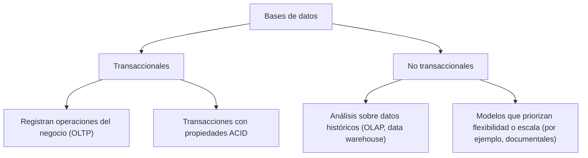

## Para qué sirve

Imaginá el sistema de una facultad: alumnos, materias, inscripciones, exámenes y notas. Si cada área lleva su
propia planilla o archivo, el mismo alumno aparece con el domicilio viejo en un lado y el nuevo en otro, una nota se
carga en un archivo y no en el otro, y nadie sabe cuál es el dato correcto. Una **base de datos** resuelve ese
problema: concentra los datos en un único repositorio, controlado y compartido.

Esta lección fija el vocabulario con el que trabaja el resto de la materia: qué es una base de datos y un DBMS, cómo
se clasifican, cuándo conviene (o no) usar un DBMS, cómo elegir un motor según licencia y despliegue, y qué hace un
DBA frente a un programador de bases de datos.

## Conceptos

:::note[Definición: base de datos]
Una **base de datos** es una colección de datos relacionados entre sí que representa algún aspecto del mundo real.
Es una colección lógica y coherente, con un significado inherente. Se diseña, se construye y se carga con datos para
un propósito específico, y está dirigida a un grupo de usuarios y a aplicaciones previstas de antemano.
:::

No es "un archivo con información": un conjunto de datos sin propósito ni estructura no es una base de datos.

### Por qué necesitamos bases de datos

Frente a la alternativa de archivos individuales por aplicación, una base de datos busca:

- reducir o eliminar la **redundancia** (el mismo dato repetido en varios lugares);
- evitar **inconsistencias** (copias que dejan de coincidir);
- facilitar el **reaprovechamiento** de los datos por distintas aplicaciones.

Para lograrlo, un sistema de bases de datos tiene estas características:

| Característica | Qué significa |
|---|---|
| Repositorio único | Los datos se mantienen en un solo lugar, no en copias por aplicación |
| Naturaleza autodescriptiva | La base guarda, además de los datos, la descripción de su propia estructura (el catálogo del sistema) |
| Aislación entre programas y datos | Los programas no dependen de cómo se almacenan físicamente los datos; esa independencia se apoya en la abstracción de datos |
| Múltiples vistas de los datos | Cada tipo de usuario puede ver o recibir solo la parte que le corresponde |
| Datos compartidos y transacciones multiusuario | Varios usuarios y aplicaciones acceden a la vez sin corromper los datos |

:::note[Definición: DBMS]
Un **DBMS** (*Database Management System*, sistema gestor de bases de datos) es el software que permite crear y
mantener bases de datos. No es la base en sí: es la capa que permite construirla, manipularla y compartirla entre
distintos usuarios y aplicaciones.
:::

Un DBMS debe ser eficiente, confiable, conveniente, seguro, multiusuario y capaz de almacenar cantidades masivas de
datos de forma persistente. Además, protege los datos ante fallos de hardware y software y ante accesos no
autorizados o malintencionados, y permite que el sistema evolucione durante el ciclo de vida del software.
SQL Server, PostgreSQL, MySQL y MongoDB son ejemplos de DBMS.

### Clasificación: transaccionales y no transaccionales

El programa de la materia clasifica las bases de datos en **transaccionales** y **no transaccionales**.

| | Transaccionales | No transaccionales |
|---|---|---|
| Objetivo | Registrar y consultar las operaciones del día a día (altas, bajas, modificaciones) | Analizar grandes volúmenes de datos o almacenar datos con otros modelos |
| Garantías | Transacciones atómicas, consistentes, aisladas y durables (ACID) | Dependen del modelo y del producto |
| Ejemplos de uso | Ventas, inscripciones, cuentas bancarias | Reportes históricos, análisis, catálogos de documentos |

:::caution[La frontera no es el producto]
Transaccional no es sinónimo de "relacional" ni "no transaccional" de "NoSQL". Muchos motores relacionales sirven
cargas analíticas, y varios motores no relacionales admiten transacciones. Lo que se clasifica es el **uso** y las
garantías que se necesitan. Las propiedades ACID y la diferencia entre OLTP y OLAP se desarrollan en
[Bases de datos transaccionales (OLTP)](/bbdd-aplicadas/unidad-2/teoria/bd-transaccionales/) y las bases no
relacionales en la Unidad 4.
:::

### ¿Siempre conviene usar un DBMS?

No. Un DBMS tiene un costo que en ciertos contextos no se justifica:

- una inversión inicial elevada en hardware, software y capacitación;
- el *overhead* de los mecanismos de seguridad, concurrencia, control, recuperación e integridad;
- datos que no van a cambiar durante el ciclo de vida del software;
- capacidad limitada, como en los sistemas embebidos;
- ausencia de necesidad de acceso multiusuario.

La regla práctica: si necesitás concurrencia, integridad, seguridad o escala, usá un DBMS. Si no, puede ser
sobredimensionado.

## Cómo elegir un DBMS

No existe un DBMS universalmente mejor. Los factores de decisión que plantea la cátedra son:

| Factor | Qué evaluar |
|---|---|
| Costo | Licenciamiento y soporte |
| Contexto de uso | Características del software donde se va a usar |
| Despliegue | Embebida, on premise o cloud |
| Equipo | Complejidad, recursos humanos y didácticos disponibles |
| Características avanzadas | Encriptación, alta disponibilidad, alojamiento en la nube, escalabilidad |

### Motores más utilizados

El ranking mensual de [DB-Engines](https://db-engines.com/en/ranking), que mide popularidad y no calidad ni
cuota de mercado, mostraba a marzo de 2025 a Oracle, MySQL, Microsoft SQL Server, PostgreSQL y MongoDB en los
primeros cinco lugares. Para Argentina, la presentación de cátedra muestra entre los motores más usados por los
participantes del DIIT a MySQL, SQL Server, PostgreSQL, MongoDB y MariaDB. Son datos de una fecha y de una
muestra concreta: consultá el ranking vigente antes de citarlos.

### Licenciamiento: pago o código abierto

El modelo de licencia afecta el costo, pero también qué se puede hacer con el motor (modificarlo, redistribuirlo,
usarlo en producción). Los ejemplos siguientes resumen las licencias vigentes al momento de escribir esta página;
verificalas en la documentación de cada producto, porque cambian.

| Motor | Modelo | Licencia o ediciones |
|---|---|---|
| SQL Server | Propietario, con ediciones gratuitas y pagas | **Express**: gratuita, con límites de recursos y de tamaño de base, para aplicaciones chicas. **Developer**: gratuita, solo para desarrollo y pruebas, no para producción. **Standard** y **Enterprise**: de pago, la segunda con las características más avanzadas |
| PostgreSQL | Código abierto | Licencia PostgreSQL, permisiva (similar a BSD/MIT) |
| MySQL | Doble licencia | Edición Community bajo GPL v2 y ediciones comerciales de Oracle |
| MariaDB | Código abierto | GPL v2 |
| SQLite | Dominio público | Biblioteca embebida, sin servidor |
| MongoDB | Código disponible | Community Server bajo SSPL; la versión administrada en la nube es un servicio pago |

:::tip[Gratis no significa sin costo]
Un motor de código abierto no tiene costo de licencia, pero sí costos de operación, soporte y capacitación. Y una
edición gratuita de un motor propietario puede tener restricciones de uso (por ejemplo, la edición Developer de
SQL Server no puede usarse en producción).
:::

### Despliegue: embebido, on premise o cloud

| Modalidad | Dónde corre el motor | Ejemplos | Quién administra |
|---|---|---|---|
| **Embebida** | Dentro de la propia aplicación, sin servidor aparte | SQLite; SQL Server LocalDB, un modo liviano de Express para desarrollo | La aplicación |
| **On premise** | En servidores propios de la organización | SQL Server, PostgreSQL o MySQL instalados en el datacenter | La organización: hardware, sistema operativo, motor, backups |
| **Cloud** | En infraestructura de un proveedor, en alguna de las tres variantes siguientes | Ver abajo | Se reparte con el proveedor |

En la nube se distinguen tres niveles según cuánto administra el proveedor:

- **IaaS**: alquilás una máquina virtual y vos instalás y administrás el motor (por ejemplo, SQL Server en una
  máquina virtual en la nube). Control máximo, trabajo máximo.
- **PaaS**: el proveedor administra el sistema operativo y el motor; vos administrás la base y sus objetos (por
  ejemplo, Azure SQL Database o Amazon RDS).
- **DBaaS** (*Database as a Service*): servicio de base de datos administrado de punta a punta, que se consume
  como un servicio (por ejemplo, MongoDB Atlas). En la práctica el límite con PaaS es difuso y los proveedores
  usan los términos con matices.

:::note[Modelos de licenciamiento en la nube]
En la nube se paga por uso o por capacidad contratada, no por una licencia perpetua. La modalidad on-cloud y
on-premise de SQL Server se vuelve a tratar en [Bases de datos transaccionales (OLTP)](/bbdd-aplicadas/unidad-2/teoria/bd-transaccionales/).
:::

## DBA y programador de base de datos

Son roles distintos que suelen confundirse.

| | DBA | Programador de BD |
|---|---|---|
| Función | Garantizar la continuidad del negocio y respaldar el crecimiento | Crear e implementar bases de datos |
| Recursos a su cargo | Las bases de datos, el DBMS y el software relacionado | La base de datos, los servicios y las APIs relacionadas |
| Tareas | Autoriza y regula el acceso; monitorea y optimiza el uso; adquiere el software y el hardware necesarios; asegura la disponibilidad | Determina el mejor DBMS para un sistema; diseña y crea los objetos; desarrolla componentes (vistas, procedimientos, funciones, triggers); asegura la eficiencia y el rendimiento |
| Perfil | Suele enfocarse en pocas tecnologías | Puede manejar varias tecnologías |

El DBA se asegura de que el sistema *funcione y esté disponible*. El programador, de que *esté bien construido*. En
equipos chicos, una misma persona suele cumplir ambos roles. Respaldos (*backups*) y recuperación son parte
habitual de la tarea del DBA, aunque la presentación de cátedra no los nombra de forma explícita.

## Autoevaluación

1. ¿Qué diferencia hay entre una base de datos y un DBMS?

La base de datos es el conjunto organizado de datos con un propósito. El DBMS es el software que permite crearla,
consultarla, protegerla y mantenerla. SQL Server es un DBMS; la base de alumnos de una facultad es una base de datos
que ese DBMS gestiona.

2. Una aplicación de escritorio monousuario guarda un catálogo fijo de pocas tablas. ¿Qué modalidad de despliegue y qué motor conviene considerar?

Una base embebida, por ejemplo SQLite: no requiere servidor, no tiene costo de licencia y no necesita
concurrencia multiusuario. Un DBMS cliente-servidor agregaría complejidad y costo sin beneficio.

3. ¿Por qué se dice que la edición Developer de SQL Server es gratuita pero no sirve para una tienda online en producción?

Porque su licencia la restringe al desarrollo y las pruebas. Para producción hay que usar Express (con sus
límites) o una edición paga como Standard o Enterprise.

## En resumen

:::tip[En resumen]
- Una base de datos es una colección coherente de datos con un propósito; el DBMS es el software que la gestiona.
- Se usa una base de datos para evitar redundancia e inconsistencias y para compartir los datos de forma segura.
- Se clasifican en transaccionales (operaciones del negocio con garantías ACID) y no transaccionales; la frontera es
  el uso, no el producto.
- La elección del motor combina costo y licencia (pago o código abierto) con el despliegue (embebido, on premise,
  cloud: IaaS, PaaS, DBaaS).
- El DBA cuida el servicio y los datos; el programador diseña y construye la base y su lógica.
:::

:::tip[Para seguir]
Seguí con el [Repaso de SQL](/bbdd-aplicadas/unidad-1/teoria/repaso-sql/).
:::

## Fuentes

- Presentación de cátedra, Unidad 1, parte 1: Conceptos básicos (v1.1.0, marzo 2025).
- Programa analítico de la materia, 2024.
- DB-Engines, [Ranking de motores de bases de datos](https://db-engines.com/en/ranking) (consultado para esta
  página; los valores cambian mes a mes).
- Microsoft Learn, [Ediciones y características admitidas de SQL Server 2022](https://learn.microsoft.com/es-es/sql/sql-server/editions-and-components-of-sql-server-2022).
- Microsoft Learn, [SQL Server Express LocalDB](https://learn.microsoft.com/es-es/sql/database-engine/configure-windows/sql-server-express-localdb).
- Documentación oficial de licencias: [PostgreSQL](https://www.postgresql.org/about/licence/),
  [MySQL](https://www.mysql.com/about/legal/licensing/oem/), [MariaDB](https://mariadb.com/kb/en/mariadb-license/),
  [SQLite](https://www.sqlite.org/copyright.html) y [MongoDB](https://www.mongodb.com/legal/licensing/server-side-public-license).
