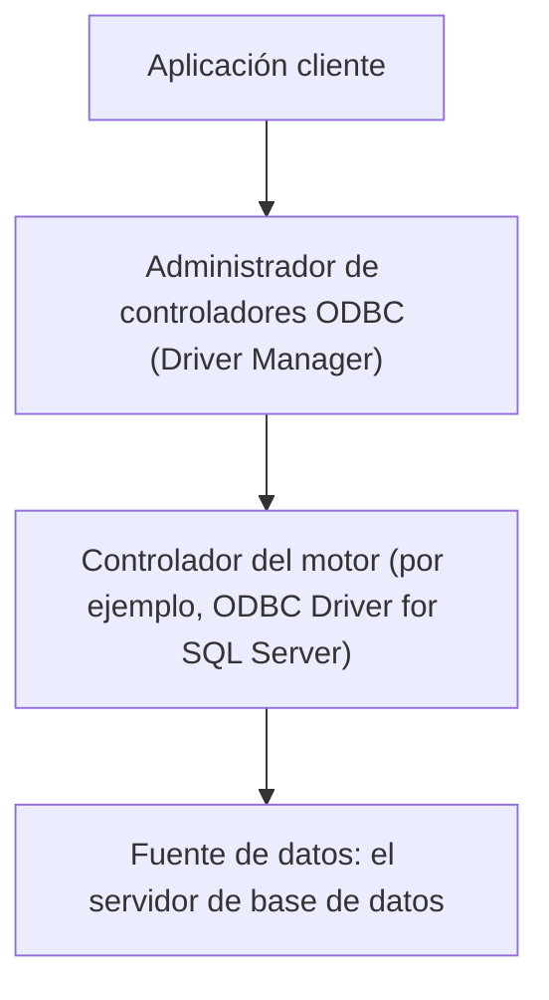

[← Unidad 2](/bbdd-aplicadas/unidad-2/teoria/)

Una aplicación no habla con el motor «directamente»: usa una biblioteca intermedia que sabe armar las peticiones, enviarlas por la red y entender las respuestas. Esa biblioteca es el **driver** (o controlador, o proveedor). Esta página explica qué es, cómo se usan ODBC, JDBC y OLE DB, qué lleva una cadena de conexión y qué hay que configurar del lado del servidor para que una conexión llegue. Los formatos de datos (CSV, XML, JSON, etc.) están en [Formatos de intercambio](/bbdd-aplicadas/unidad-2/teoria/formatos-de-intercambio/), y las llamadas HTTP desde T-SQL en [APIs desde SQL Server](/bbdd-aplicadas/unidad-2/teoria/apis-desde-sql/).

## Qué es un driver

:::note[Definición]
Un **driver** (controlador o proveedor) es el componente que implementa, para un motor concreto, el protocolo de comunicación y expone a la aplicación una interfaz de programación (API) estándar: métodos, objetos y funciones para abrir una conexión, ejecutar sentencias SQL y leer los resultados.
:::

Gracias a una API común, la misma aplicación puede cambiar de motor cambiando el driver y la cadena de conexión, sin reescribir el acceso a datos (siempre que el SQL que use sea compatible). Además, aplicaciones como hojas de cálculo o herramientas de informes pueden leer datos de cualquier motor que tenga un driver. Todas las aplicaciones compatibles reconocen un subconjunto básico de SQL.

## ODBC

**ODBC** (_Open Database Connectivity_) es una API estándar para acceder a bases de datos, definida originalmente para el lenguaje C y utilizable desde muchos lenguajes. Tiene tres piezas:



La aplicación le habla al administrador de controladores; este identifica el controlador adecuado y le delega. Una **fuente de datos** (DSN, _data source name_) guarda en el sistema operativo los parámetros de conexión bajo un nombre, o bien la aplicación los da en una cadena de conexión directa.

<!-- sintaxis -->
```text
Driver={ODBC Driver 18 for SQL Server};
Server=<servidor>,1433;
Database=<base>;
Uid=<usuario>;
Pwd=<contraseña>;
Encrypt=yes;
```

`ODBC Driver 18 for SQL Server` cifra la conexión por defecto; con un certificado no confiable (típico en una instalación de prueba) falla hasta que se agrega `TrustServerCertificate=yes`, que **solo corresponde a desarrollo**: en producción se instala un certificado válido.

## JDBC

**JDBC** (_Java Database Connectivity_) es la API equivalente para Java. Forma parte de la plataforma Java SE (paquetes `java.sql` y `javax.sql`) y cada fabricante entrega su **driver JDBC** como un archivo `.jar`. No hay administrador de controladores ni DSN: la aplicación carga el driver y le pasa una URL de conexión.

<!-- sintaxis -->
```text
jdbc:sqlserver://<servidor>:1433;databaseName=<base>;encrypt=true;trustServerCertificate=false
```

El usuario y la contraseña se pasan como propiedades separadas, de preferencia leídas de una variable de entorno o de un gestor de secretos y no escritas en el código. El driver de Microsoft (`mssql-jdbc`) se obtiene de Maven Central, donde se consulta la versión vigente.

<!-- sintaxis -->
```java
// Esquema de uso (no se ejecuta aquí): las credenciales llegan desde el entorno.
String url = System.getenv("BD_URL");
try (Connection cn = DriverManager.getConnection(url, usuario, clave);
     Statement st = cn.createStatement();
     ResultSet rs = st.executeQuery("SELECT 1")) {
    while (rs.next()) { /* leer columnas */ }
}
```

## OLE DB

**OLE DB** es una API de acceso a datos de Microsoft basada en COM, anterior a la preferencia actual por ODBC. El proveedor actual para SQL Server es **Microsoft OLE DB Driver for SQL Server** (`MSOLEDBSQL`). Los proveedores anteriores (`SQLOLEDB`, `SQLNCLI`) están en desuso. Aparece sobre todo en herramientas de Microsoft; por ejemplo, `OPENROWSET` y los servidores vinculados usan un proveedor OLE DB.

| | ODBC | JDBC | OLE DB |
|---|---|---|---|
| Lenguaje típico | C, C++ y cualquiera con enlace a ODBC | Java | C++, herramientas de Microsoft |
| Origen | Estándar de la industria, con fuerte impulso de Microsoft | Parte de Java SE | Microsoft (COM) |
| Pieza intermedia | Administrador de controladores y DSN | Archivo `.jar` del driver | Proveedor registrado en el sistema |
| Configuración | DSN o cadena de conexión | URL de conexión | Cadena de conexión |

Otros lenguajes tienen sus propias bibliotecas, que por debajo hablan el mismo protocolo del motor: por ejemplo, `Microsoft.Data.SqlClient` en .NET o los paquetes que envuelven a ODBC en Python.

## Qué lleva una cadena de conexión

Cualquiera sea el driver, la cadena responde las mismas preguntas:

| Dato | Ejemplo | Comentario |
|---|---|---|
| Servidor | `<servidor>,1433` o `<servidor>\<instancia>` | Una instancia con nombre se resuelve con SQL Server Browser o con un puerto fijo |
| Base inicial | `Database=<base>` | Si falta, se usa la predeterminada del inicio de sesión |
| Autenticación | `Uid`/`Pwd`, o autenticación integrada de Windows | Nunca se guardan credenciales reales en el código ni en el repositorio |
| Cifrado | `Encrypt=yes` | Los drivers actuales lo activan por defecto |
| Certificado | `TrustServerCertificate` | Solo en desarrollo |

## Protocolos, puerto y conexión local o remota

SQL Server se comunica con los clientes con su protocolo propio (TDS, _tabular data stream_) sobre uno de los **protocolos de red** que habilita Configuration Manager: memoria compartida (solo conexiones locales), canalizaciones con nombre y TCP/IP. En redes, casi siempre es TCP/IP, y la instancia predeterminada escucha en el puerto 1433. La conexión **local** no necesita configuración; la **remota** exige TCP/IP habilitado, el puerto abierto en el firewall y, si la instancia tiene nombre, SQL Server Browser o un puerto fijo. El detalle paso a paso está en [Arquitectura e instalación de un motor relacional](/bbdd-aplicadas/unidad-2/teoria/bd-transaccionales/#conexión-local-y-remota-y-autenticación).

Desde la propia sesión se puede ver cómo llegó con `sys.dm_exec_connections`; se practica en el ejercicio 54.

:::caution[Errores frecuentes]
- Escribir usuario y contraseña reales en la cadena de conexión dentro del código o del repositorio.
- Dejar `TrustServerCertificate=true` en producción: se pierde la verificación de la identidad del servidor.
- Describir JDBC como parte de Java EE: forma parte de Java SE.
- Probar una conexión remota sin haber habilitado TCP/IP o sin abrir el puerto en el firewall.
:::

## Ejercicios

### Ejercicio 53 · Armar cadenas de conexión
<!-- ejercicio: U2.53 | nivel: inicial | tipo: conceptual | verificacion: razonamiento -->

:::note[Enunciado]
Una aplicación debe conectarse a la base `Ventas` de una instancia con nombre `CONTABLE` en el servidor `srv-datos`, con autenticación de SQL Server. Escribí la cadena de conexión ODBC y la URL JDBC con marcadores para las credenciales, y explicá qué driver necesita cada una y qué servicio debe estar activo en el servidor para resolver el nombre de la instancia.
:::

<details>
<summary>Resolución</summary>

**Estrategia.** Se identifican los datos de la tabla anterior (servidor, instancia, base, credenciales, cifrado) y se aplican a cada formato.

- ODBC: `Driver={ODBC Driver 18 for SQL Server};Server=srv-datos\CONTABLE;Database=Ventas;Uid=<usuario>;Pwd=<contraseña>;Encrypt=yes;` Requiere el driver ODBC de SQL Server instalado en el equipo cliente, y el administrador de controladores del sistema operativo.
- JDBC: `jdbc:sqlserver://srv-datos;instanceName=CONTABLE;databaseName=Ventas;encrypt=true`, con el usuario y la contraseña como propiedades. Requiere el `.jar` del driver `mssql-jdbc` en el classpath.
- Una instancia con nombre se resuelve por nombre gracias al servicio **SQL Server Browser**, que informa el puerto; si en cambio se fija un puerto, se puede indicar `srv-datos,<puerto>` y no hace falta el Browser.
- Las credenciales van como marcadores: nunca reales en el código.
</details>

### Ejercicio 54 · ¿Cómo estoy conectado?
<!-- ejercicio: U2.54 | nivel: intermedio | tipo: diagnostico | verificacion: motor -->

:::note[Enunciado]
Escribí una consulta que informe, para la sesión actual, el transporte de red, el tipo de protocolo y el esquema de autenticación con que se conectó.
:::

<details>
<summary>Resolución</summary>

**Estrategia.** `sys.dm_exec_connections` tiene una fila por conexión; la sesión actual se identifica con `@@SPID`.

<!-- check: U2.54 -->
```sql
SELECT
    net_transport AS Transporte,
    protocol_type AS Protocolo,
    auth_scheme   AS Autenticacion
FROM sys.dm_exec_connections
WHERE session_id = @@SPID;
```

**Resultado esperado.**

| Transporte | Protocolo | Autenticacion |
|---|---|---|
| TCP | TSQL | SQL |

La conexión usa TCP, el protocolo de T-SQL (TDS) y autenticación de SQL Server. En una conexión local por memoria compartida el transporte sería `Shared memory`, y con autenticación de Windows el esquema sería `NTLM` o `KERBEROS`. El resultado depende de cómo se conectó quien ejecuta la consulta.
</details>

:::tip[En resumen]
- Un driver implementa el protocolo de un motor y expone una API estándar a la aplicación.
- ODBC usa un administrador de controladores y DSN; JDBC (parte de Java SE) usa un `.jar`; OLE DB es la API de Microsoft basada en COM (proveedor `MSOLEDBSQL`).
- La cadena de conexión indica servidor, base, autenticación, cifrado y certificado, y no lleva credenciales reales en el código.
- SQL Server habla TDS sobre memoria compartida, canalizaciones o TCP/IP (puerto 1433 en la instancia predeterminada).
:::

:::tip[Para seguir]
Seguí con [Formatos de intercambio](/bbdd-aplicadas/unidad-2/teoria/formatos-de-intercambio/).
:::

## Fuentes

- Presentación de cátedra, Unidad 2, parte 1: ODBC y JDBC (normas de API, administrador de controladores, fuente de datos). Silberschatz, Korth y Sudarshan, _Fundamentos de bases de datos_: ODBC y JDBC.
- Microsoft Learn: [Microsoft ODBC Driver for SQL Server](https://learn.microsoft.com/es-es/sql/connect/odbc/microsoft-odbc-driver-for-sql-server), [Microsoft JDBC Driver for SQL Server](https://learn.microsoft.com/es-es/sql/connect/jdbc/microsoft-jdbc-driver-for-sql-server) y [Microsoft OLE DB Driver for SQL Server](https://learn.microsoft.com/es-es/sql/connect/oledb/oledb-driver-for-sql-server).
