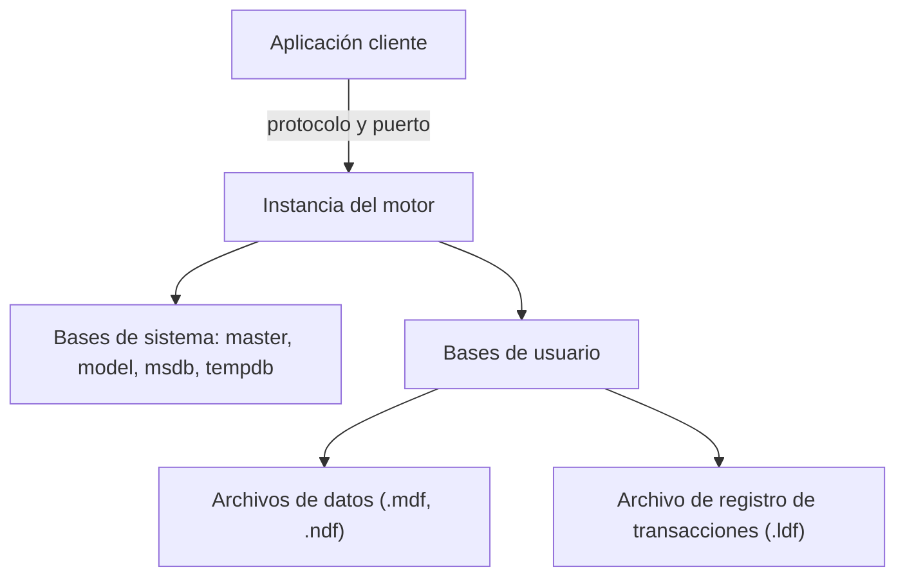

[← Unidad 2](/bbdd-aplicadas/unidad-2/teoria/)

Esta página reúne tres temas del programa 2024 que se apoyan entre sí: qué es una base de datos transaccional, cómo está armado por dentro un motor relacional (instancia, servicios, archivos) y qué decisiones hay que tomar al instalarlo. Los temas vecinos tienen su propia página: [bases de datos de sistema y de usuario](/bbdd-aplicadas/unidad-2/teoria/bases-de-sistema/), [collation](/bbdd-aplicadas/unidad-2/teoria/collation/), [bases de datos en memoria](/bbdd-aplicadas/unidad-2/teoria/bd-en-memoria/) y [conexión, drivers, ODBC y JDBC](/bbdd-aplicadas/unidad-2/teoria/formatos-conectividad/).

Los resultados se obtuvieron con SQL Server 2022. Los ejemplos que crean objetos se ejecutan en una base de práctica (ver [Cómo estudiar · Antes de ejecutar los ejemplos](/bbdd-aplicadas/como-estudiar/#antes-de-ejecutar-los-ejemplos)).

## Bases de datos transaccionales (OLTP)

Una **base de datos transaccional** (OLTP, _online transaction processing_) está pensada para procesar muchas transacciones cortas, en línea y de forma concurrente: altas, modificaciones, bajas y consultas puntuales sobre datos operativos. Su objetivo principal es asegurar la consistencia: o la transacción se completa, o se revierte y la base vuelve al estado original.

:::note[Definición: transacción]
Una **transacción** es una unidad lógica de trabajo formada por una o más operaciones sobre los datos. Se **confirma** con `COMMIT` (los cambios pasan a ser definitivos) o se **deshace** con `ROLLBACK` (ninguno de los cambios queda). Una transferencia bancaria es el ejemplo clásico: se descuenta en la cuenta de origen y se acredita en la de destino, y las dos operaciones valen juntas o no valen.
:::

Los sistemas OLTP aparecen en la banca en línea, el comercio electrónico, las reservas de pasajes y las terminales de punto de venta. Una venta en línea, por ejemplo, registra la venta y el ingreso del dinero: si algo falla en el camino, no se registra ninguna de las dos cosas.

| Ventajas | Desventajas |
|---|---|
| Aseguran la integridad de los datos porque se diseñan con las propiedades ACID | Les cuesta generar informes complejos |
| Permiten modificar la información sin poner en riesgo esa integridad | El historial que ofrecen se limita a datos actuales o recientes |
| Responden rápido y con baja latencia | |
| Permiten replicar o recuperar datos en poco tiempo | |

### Propiedades ACID, a nivel conceptual

Las siglas ACID resumen lo que se le pide a una transacción. En esta unidad alcanza con la idea de cada propiedad:

| Propiedad | Idea |
|---|---|
| **Atomicidad** | La transacción se ejecuta completa o no se ejecuta. No quedan resultados a medias. |
| **Consistencia** | La transacción lleva la base de un estado válido a otro válido: respeta `CHECK`, `FOREIGN KEY`, `NOT NULL` y las demás restricciones. |
| **Aislamiento** (_isolation_) | Las transacciones concurrentes no se interfieren entre sí. |
| **Durabilidad** | Lo confirmado sobrevive a una falla del sistema. |

:::note[Dónde se desarrolla el resto]
Cómo logra el motor el aislamiento (bloqueos, versionado de filas, niveles de aislamiento), las anomalías de concurrencia como la actualización perdida, y el control con `TRY...CATCH` y `XACT_ABORT` se estudian en la Unidad 3: [Transacciones y concurrencia](/bbdd-aplicadas/unidad-3/teoria/transacciones-y-concurrencia/). El registro de transacciones como mecanismo de recuperación (durabilidad) se retoma en la Unidad 5: [Registro de transacciones y recuperación](/bbdd-aplicadas/unidad-5/teoria/log-recuperacion/).
:::

### Confirmar o deshacer

El siguiente ejemplo muestra la atomicidad con dos cuentas. La primera transferencia se confirma. En la segunda, la cuenta B no tiene fondos: la restricción `CK_Cuenta_Saldo` rechaza el segundo `UPDATE` y el `ROLLBACK` deshace también el primero, que sí se había ejecutado.

<!-- check: U2.T.ARQ.02 -->
```sql
CREATE SCHEMA banco;
GO
CREATE TABLE banco.Cuenta (
    CuentaId INT           NOT NULL,
    Titular  VARCHAR(40)   NOT NULL,
    Saldo    DECIMAL(12,2) NOT NULL,
    CONSTRAINT PK_Cuenta PRIMARY KEY (CuentaId),
    CONSTRAINT CK_Cuenta_Saldo CHECK (Saldo >= 0)
);
INSERT banco.Cuenta (CuentaId, Titular, Saldo)
VALUES (1, 'Cuenta de prueba A', 1000), (2, 'Cuenta de prueba B', 200);

-- Transferencia de 500 de A hacia B: las dos operaciones se confirman juntas.
BEGIN TRANSACTION;
    UPDATE banco.Cuenta SET Saldo = Saldo - 500 WHERE CuentaId = 1;
    UPDATE banco.Cuenta SET Saldo = Saldo + 500 WHERE CuentaId = 2;
COMMIT TRANSACTION;

-- Transferencia de 900 de B hacia A: B queda sin fondos y el CHECK rechaza la segunda operación.
BEGIN TRY
    BEGIN TRANSACTION;
        UPDATE banco.Cuenta SET Saldo = Saldo + 900 WHERE CuentaId = 1;
        UPDATE banco.Cuenta SET Saldo = Saldo - 900 WHERE CuentaId = 2;
    COMMIT TRANSACTION;
END TRY
BEGIN CATCH
    IF @@TRANCOUNT > 0 ROLLBACK TRANSACTION;
END CATCH;

SELECT CuentaId, Titular, Saldo
FROM banco.Cuenta
ORDER BY CuentaId;
```

| CuentaId | Titular | Saldo |
|---:|---|---:|
| 1 | Cuenta de prueba A | 500.00 |
| 2 | Cuenta de prueba B | 700.00 |

La cuenta A quedó en 500, no en 1400: el `+ 900` de la segunda transferencia se deshizo junto con la operación que falló.

### OLTP y OLAP

| Característica | OLTP | OLAP |
|---|---|---|
| Propósito | Operaciones del día a día | Análisis e informes |
| Operaciones típicas | `INSERT`, `UPDATE`, `DELETE` y `SELECT` puntual | `SELECT` con agregaciones sobre muchos datos |
| Datos por consulta | Pocas filas | Muchas filas |
| Diseño | Normalizado | Desnormalizado (estrella, copo de nieve) |
| Ejemplos | ERP, banca, comercio electrónico | Data warehouse, inteligencia de negocios |

Los sistemas analíticos se alimentan de los transaccionales. Cómo se construyen (data warehouse, data lake, procesos ETL y ELT) se explica en la Unidad 4: [Datos, data lakes y KDD](/bbdd-aplicadas/unidad-4/teoria/datos-data-lake-kdd/).

## Arquitectura de un motor relacional

Un **motor de base de datos** (RDBMS o SGBD) da acceso controlado a los datos y procesa transacciones rápido, para las aplicaciones que los consumen. Casi todos siguen el modelo cliente-servidor: la aplicación se conecta por red (o de forma local) a un proceso servidor, le envía sentencias SQL y recibe los resultados.

:::note[Definición: instancia]
Una **instancia** es una copia del motor en ejecución: sus procesos (servicios), sus bases de datos, su configuración y los recursos que reclama (memoria, CPU, puerto de red). Un mismo servidor puede alojar varias instancias, y cada una es un servicio independiente que compite por los recursos con las demás.
:::



Cada base de datos se guarda en archivos del sistema operativo. Como mínimo hay un **archivo de datos** (por convención `.mdf`; los secundarios son `.ndf`) y un **archivo de registro de transacciones** (`.ldf`), donde el motor anota cada cambio antes de aplicarlo. La vista `sys.database_files` los muestra para la base actual:

<!-- check: U2.T.ARQ.01 -->
```sql
SELECT
    file_id    AS ArchivoId,
    type_desc  AS Tipo,
    RIGHT(physical_name, 4) AS Extension
FROM sys.database_files
ORDER BY file_id;
```

| ArchivoId | Tipo | Extension |
|---:|---|---|
| 1 | ROWS | .mdf |
| 2 | LOG | .ldf |

Las bases que el propio motor necesita para funcionar (`master`, `model`, `msdb`, `tempdb`) se explican en [Bases de datos de sistema y de usuario](/bbdd-aplicadas/unidad-2/teoria/bases-de-sistema/).

### Bases de datos relacionales populares

SQL Server (Microsoft), Oracle Database (Oracle), MySQL y MariaDB, PostgreSQL y SQLite son motores relacionales ampliamente usados. Comparten el modelo relacional y SQL, y se diferencian en el dialecto (T-SQL en SQL Server, PL/SQL en Oracle), las ediciones, las licencias y las herramientas. La materia trabaja con SQL Server y, para el modelo documental, con MongoDB (Unidad 4).

## Arquitectura distribuida y clústeres

Un sistema distribuido puede verse como un **clúster**: un grupo de servidores independientes que trabajan juntos como un solo sistema. «Unir» servidores significa que comparten recursos de hardware y software y se comportan, de cara al cliente, como una unidad.

La cátedra distingue dos formas de armar el clúster:

- **Clúster en la nube**: servidores virtuales o físicos configurados y desplegados dentro de un entorno de computación en la nube. Puede estar en nubes públicas, privadas o híbridas, según las necesidades de seguridad, regulación y rendimiento de la organización.
- **Clúster de servidores dedicados**: un servidor físico asignado de forma exclusiva a un cliente, una organización o un propósito específico.

En la nube el escalado y la alta disponibilidad suelen gestionarse como servicio y se paga por uso; en servidores propios (_on-premise_) hay control total del hardware y de la configuración, a cambio de una inversión inicial y de administrarlo uno mismo.

:::note[Dónde sigue]
Cómo SQL Server mantiene réplicas y conmuta ante la caída de un nodo (grupos de disponibilidad Always On) es parte de la alta disponibilidad: ver [Alta disponibilidad](/bbdd-aplicadas/unidad-5/teoria/alta-disponibilidad/) en la Unidad 5.
:::

## Instalación de un motor

Instalar un motor es tomar decisiones que después cuestan cambiar. La cátedra las ordena en un análisis previo y en una lista de aspectos clave.

### Análisis previo

Antes de instalar conviene responder:

- ¿Qué hardware se dispone? ¿Es una máquina virtual o hardware dedicado (_bare metal_)? ¿Está en el propio centro de datos (_on premises_) o en la nube?
- ¿Cuánta memoria y cuántos núcleos de CPU tiene el sistema?
- ¿Qué otros servicios compartirá el servidor (web, archivos)? ¿Se usará para ciencia de datos?
- ¿Se van a replicar bases de datos?
- ¿Qué limitaciones tiene la versión y edición del motor que se instala?
- ¿Se harán los respaldos en el mismo sistema?
- ¿Cómo se conectarán las aplicaciones cliente?

### Qué instalar

El instalador ofrece características opcionales: replicación, servicios de aprendizaje automático y extensiones de lenguaje, búsqueda de texto completo, Integration Services, PolyBase, Data Quality Services, componentes de conectividad y herramientas de administración. La recomendación de la cátedra es instalar solo lo necesario: menos es más, porque cada componente agrega servicios, superficie de ataque y actualizaciones. En las versiones actuales SQL Server Management Studio (SSMS) se descarga e instala por separado del motor.

Las **ediciones** determinan límites y funciones. Developer es gratuita, tiene las funciones de la edición más completa y es solo para desarrollo y pruebas; Express es gratuita y limitada (por ejemplo, tamaño máximo por base de datos y sin SQL Server Agent), para aplicaciones pequeñas; Standard y Enterprise son licenciadas. Qué función está en qué edición cambia con cada versión: se consulta en la documentación oficial antes de diseñar.

### Dónde se guardan los archivos

La instalación fija la ubicación de las bases de usuario, de las bases de sistema, de la base temporal (`tempdb`, con su parámetro de crecimiento) y de los respaldos. La cátedra pide planificar:

- almacenamiento rápido para las bases de datos y rapidísimo para `tempdb`, que se usa en cada ordenamiento grande y en cada tabla temporal;
- más capacidad para los respaldos, y no guardarlos solo en el mismo disco que los datos;
- RAID donde sea posible;
- no dejar que las bases crezcan sobre la partición del sistema (la ubicación predeterminada), porque llenarla detiene el servicio.

Qué contiene cada base de sistema y por qué `tempdb` merece su propio almacenamiento se desarrolla en [Bases de datos de sistema y de usuario](/bbdd-aplicadas/unidad-2/teoria/bases-de-sistema/).

### Instancia, servicios, intercalación y seguridad

- **Instancia predeterminada o con nombre.** La predeterminada se identifica solo con el nombre del servidor y corre como el servicio `MSSQLSERVER`. Una con nombre se identifica como `SERVIDOR\INSTANCIA` y corre como `MSSQL$INSTANCIA`. Un servidor puede tener una predeterminada y varias con nombre.
- **Servicios.** Se activan solo los necesarios (por ejemplo, SQL Server Agent para tareas programadas, o SQL Server Browser si hay instancias con nombre).
- **Intercalación.** Se elige con cuidado, porque rige las bases de sistema y es el valor predeterminado de las bases nuevas: ver [collation](/bbdd-aplicadas/unidad-2/teoria/collation/).
- **Seguridad.** Se define el modo de autenticación y las contraseñas, según los métodos que soporten los clientes.

### Conectividad y memoria

Cada motor usa un puerto TCP predeterminado (1433 para la instancia predeterminada de SQL Server) y dos servicios no pueden usar el mismo puerto en el mismo equipo. El tráfico hacia ese puerto debe estar permitido en el firewall.

Con la **memoria** hay una trampa: por defecto el motor puede usar casi toda la que haya, lo que puede dejar sin recursos al resto del sistema. La opción `max server memory (MB)` fija el tope. Su valor predeterminado es 2147483647, es decir, sin límite práctico:

<!-- check: U2.T.INS.01 -->
```sql
SELECT name AS Opcion, value_in_use AS ValorEnUso
FROM sys.configurations
WHERE name = N'max server memory (MB)';
```

| Opcion | ValorEnUso |
|---|---:|
| max server memory (MB) | 2147483647 |

El valor corresponde a una instancia con la configuración por defecto; si en tu instalación alguien ya fijó un tope, verás ese valor. La consulta solo lee: no cambia la configuración.

:::tip[Cuánta memoria dejarle al motor]
Si el servidor comparte tareas con otros servicios, o hay varias instancias, se fija un tope menor a la memoria física para reservar lo que necesitan el sistema operativo y los demás procesos. El valor exacto depende de la carga: no hay una cifra universal, y la documentación oficial de SQL Server describe cómo estimarlo.
:::

### Conexión, local y remota, y autenticación

**SQL Server Configuration Manager** administra los servicios, habilita los protocolos de red (memoria compartida, canalizaciones con nombre, TCP/IP), configura el puerto TCP y los alias. Una conexión **local** no requiere configuración adicional (`.`, `localhost`, `(local)` o el nombre del equipo). Para una conexión **remota**:

1. Habilitar el protocolo TCP/IP en Configuration Manager.
2. Fijar el puerto (1433 en la predeterminada) y abrirlo en el firewall.
3. Si la instancia tiene nombre y no usa puerto fijo, tener activo el servicio SQL Server Browser, que resuelve el nombre al puerto.
4. Comprobar que el servidor acepta conexiones remotas.
5. Crear los inicios de sesión que van a conectarse.

Hay dos modos de **autenticación**: con **Windows** (el motor confía en las credenciales del sistema operativo o de Active Directory) y con **SQL Server** (usuario y contraseña que administra el propio motor). El modo mixto admite ambos. Desde la sesión se puede ver cómo quedó una instalación:

<!-- check: U2.T.INS.02 -->
```sql
SELECT
    CASE WHEN SERVERPROPERTY('InstanceName') IS NULL THEN 'predeterminada' ELSE 'con nombre' END AS Instancia,
    CASE SERVERPROPERTY('IsIntegratedSecurityOnly') WHEN 1 THEN 'solo Windows' ELSE 'mixto' END AS Autenticacion,
    c.net_transport    AS Transporte,
    c.local_tcp_port   AS Puerto
FROM sys.dm_exec_connections AS c
WHERE c.session_id = @@SPID;
```

| Instancia | Autenticacion | Transporte | Puerto |
|---|---|---|---:|
| predeterminada | mixto | TCP | 1433 |

Los drivers, las cadenas de conexión y la diferencia entre ODBC, JDBC y OLE DB están en [Conexión, drivers, ODBC y JDBC](/bbdd-aplicadas/unidad-2/teoria/formatos-conectividad/).

:::caution[Errores frecuentes]
- Dejar `max server memory` sin tope en un servidor que comparte otros servicios.
- Dejar los datos, el log, `tempdb` y los respaldos en la partición del sistema.
- Instalar todas las características opcionales «por si acaso».
- Abrir el puerto en el firewall pero no habilitar TCP/IP en Configuration Manager (o al revés): la conexión remota necesita las dos cosas.
- Confundir atomicidad con consistencia: la atomicidad dice _si_ los cambios se aplican como una unidad; la consistencia dice _qué_ estados son válidos.
:::

## Autoevaluación

**1. ¿Qué diferencia hay entre una instancia y una base de datos?**

<details>
<summary>Respuesta</summary>

La instancia es el motor en ejecución: sus servicios, su configuración y sus recursos. Contiene varias bases de datos (las de sistema y las de usuario). Un servidor puede tener varias instancias, cada una independiente de las otras.
</details>

**2. Una transacción de tres `UPDATE` falla en el tercero. ¿Qué pasa con los dos primeros si se hace `ROLLBACK`? ¿Qué propiedad ACID lo garantiza?**

<details>
<summary>Respuesta</summary>

Se deshacen: la base queda como antes de empezar la transacción. Lo garantiza la atomicidad.
</details>

**3. ¿Por qué conviene fijar `max server memory` cuando el servidor tiene otros servicios?**

<details>
<summary>Respuesta</summary>

Porque por defecto el motor puede reclamar casi toda la memoria disponible y dejar sin recursos al sistema operativo y a los demás servicios, lo que degrada todo el equipo.
</details>

## Ejercicios

### Ejercicio 47 · Transferencia entre tres cuentas
<!-- ejercicio: U2.47 | nivel: intermedio | tipo: consulta | verificacion: motor -->

:::note[Enunciado]
Existen tres cuentas con saldos 300, 100 y 50. Se intenta, en una única transacción, acreditar 100 a la cuenta 1, 100 a la cuenta 2 y debitar 200 a la cuenta 3. Una restricción impide los saldos negativos. Escribí la transacción de modo que, si alguna operación falla, no quede ningún cambio, y mostrá los saldos finales.
:::

<details>
<summary>Resolución</summary>

**Estrategia.** Se agrupan los tres `UPDATE` en una transacción dentro de `TRY...CATCH`. El débito sobre la cuenta 3 viola el `CHECK` (50 - 200 < 0), pasa al `CATCH` y ahí se hace `ROLLBACK`, que deshace también los dos créditos ya ejecutados.

<!-- check: U2.47 -->
```sql
CREATE SCHEMA banco;
GO
CREATE TABLE banco.Cuenta (
    CuentaId INT           NOT NULL,
    Saldo    DECIMAL(12,2) NOT NULL,
    CONSTRAINT PK_Cuenta PRIMARY KEY (CuentaId),
    CONSTRAINT CK_Cuenta_Saldo CHECK (Saldo >= 0)
);
INSERT banco.Cuenta (CuentaId, Saldo) VALUES (1, 300), (2, 100), (3, 50);

-- Se reparten 200 desde la cuenta 3, que solo tiene 50: la tercera operación viola el CHECK.
BEGIN TRY
    BEGIN TRANSACTION;
        UPDATE banco.Cuenta SET Saldo = Saldo + 100 WHERE CuentaId = 1;
        UPDATE banco.Cuenta SET Saldo = Saldo + 100 WHERE CuentaId = 2;
        UPDATE banco.Cuenta SET Saldo = Saldo - 200 WHERE CuentaId = 3;
    COMMIT TRANSACTION;
END TRY
BEGIN CATCH
    IF @@TRANCOUNT > 0 ROLLBACK TRANSACTION;
END CATCH;

SELECT CuentaId, Saldo
FROM banco.Cuenta
ORDER BY CuentaId;
```

**Resultado esperado.**

| CuentaId | Saldo |
|---:|---:|
| 1 | 300.00 |
| 2 | 100.00 |
| 3 | 50.00 |

Los saldos son los iniciales: los dos créditos se deshicieron porque la transacción no pudo completarse. Sin la transacción, las cuentas 1 y 2 habrían quedado con 400 y 200, y el dinero se habría creado de la nada.
</details>

### Ejercicio 55 · Plan de instalación para un servidor compartido
<!-- ejercicio: U2.55 | nivel: avanzado | tipo: diseno | verificacion: razonamiento -->

:::note[Enunciado]
Una empresa instala SQL Server en un servidor con 64 GB de RAM, un disco del sistema, un arreglo de discos rápidos y un disco grande y lento. En el mismo servidor corre la aplicación web que usa la base, que además genera muchas tablas temporales en horas pico. Se hacen respaldos todas las noches y la empresa no tiene otro servidor. Proponé dónde ubicar los datos, el log, `tempdb` y los respaldos, qué hacer con la memoria del motor, qué características opcionales instalar y qué modo de autenticación elegir. Justificá cada decisión.
:::

<details>
<summary>Resolución</summary>

**Estrategia.** Se aplican los criterios de la cátedra (almacenamiento rápido para los datos y rapidísimo para `tempdb`, más capacidad para los respaldos, evitar la partición del sistema, memoria acotada, instalar solo lo necesario) a lo que dice el enunciado.

- **Datos y log.** En el arreglo de discos rápidos, fuera del disco del sistema, para no llenarlo y para tener el mejor rendimiento de E/S. Si el arreglo lo permite, conviene separar el log de los datos: el log se escribe de forma secuencial y los datos se acceden de forma aleatoria.
- **`tempdb`.** También en almacenamiento rápido, con tamaño inicial suficiente y crecimiento fijo configurado, porque las tablas temporales en horas pico lo exigen y es el recurso que más se comparte entre sesiones.
- **Respaldos.** En el disco grande y lento: lo que importa es la capacidad, no la velocidad. Como no hay otro servidor, hay que copiarlos además a un destino fuera del equipo (otro equipo, almacenamiento de red o la nube), porque un respaldo en el mismo disco no protege de la falla de ese disco.
- **Memoria.** El motor comparte el servidor con la aplicación web: se fija `max server memory (MB)` en un valor menor a los 64 GB, para dejar memoria al sistema operativo y a la aplicación. El valor exacto se ajusta observando la carga.
- **Características opcionales.** Solo el motor y las herramientas de administración necesarias; sin replicación, aprendizaje automático ni búsqueda de texto completo, porque nadie las pidió.
- **Autenticación.** Si la aplicación y el servidor están en un dominio de Windows, autenticación de Windows; si la aplicación se conecta con usuario y contraseña, modo mixto con una cuenta de aplicación de permisos mínimos y una contraseña robusta.
- **Red.** TCP/IP habilitado con puerto fijo y regla de firewall solo para el origen de la aplicación (o, si la aplicación está en el mismo equipo, conexión local sin exponer el puerto).

No hay una única respuesta correcta: cuenta que cada decisión esté justificada con una necesidad del enunciado.
</details>

:::tip[En resumen]
- Una base transaccional (OLTP) procesa muchas transacciones cortas y asegura que cada una se confirme completa o se deshaga.
- ACID: atomicidad, consistencia, aislamiento y durabilidad. El aislamiento y el log de transacciones se estudian en las Unidades 3 y 5.
- Una instancia es el motor en ejecución; sus bases se guardan en archivos de datos (`.mdf`, `.ndf`) y de log (`.ldf`).
- Un clúster agrupa servidores independientes que se comportan como uno solo, en la nube o en servidores dedicados.
- Al instalar se decide: análisis previo, ubicación de datos, log, `tempdb` y respaldos, instancia, intercalación, memoria máxima, puerto, características opcionales y modo de autenticación.
:::

## Fuentes

- Presentación de cátedra, Unidad 2, parte 1 («Bases de datos relacionales»): bases de datos transaccionales, arquitectura distribuida, motor de base de datos y aspectos de la instalación.
- Microsoft Learn, documentación de SQL Server: [opciones de configuración de memoria del servidor](https://learn.microsoft.com/es-es/sql/database-engine/configure-windows/server-memory-server-configuration-options), [archivos y grupos de archivos de bases de datos](https://learn.microsoft.com/es-es/sql/relational-databases/databases/database-files-and-filegroups) y [conectarse al motor de base de datos](https://learn.microsoft.com/es-es/sql/database-engine/configure-windows/configure-a-server-to-listen-on-a-specific-tcp-port).
- Silberschatz, Korth y Sudarshan, _Fundamentos de bases de datos_: transacciones y propiedades ACID.
