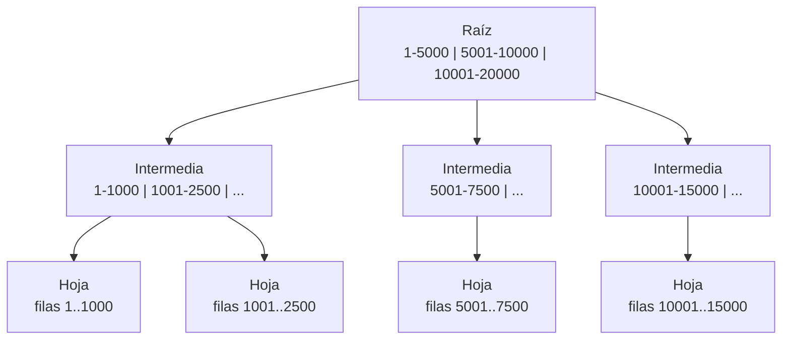

[← Unidad 3](/bbdd-aplicadas/unidad-3/teoria/)

Una consulta puede devolver el resultado correcto y aun así leer cien veces más páginas de las necesarias. Los índices y la forma en que escribimos el `WHERE` deciden cuánto trabajo hace el motor para encontrar las filas. Esta página recorre los índices clúster y no clúster, la cobertura, el mantenimiento, la reescritura de consultas y la diferencia entre rowstore y columnstore. Se apoya en [el plan de ejecución y las estadísticas](/bbdd-aplicadas/unidad-3/teoria/indices-y-planes/), que explican cómo decide el optimizador, y en [las métricas de rendimiento](/bbdd-aplicadas/unidad-3/teoria/metricas-de-rendimiento/), que explican cómo medir el efecto.

:::note[Qué presupone esta lección]
`SELECT`, `JOIN` y restricciones de [Unidad 1](/bbdd-aplicadas/unidad-1/teoria/repaso-sql/), y la arquitectura de páginas de [Unidad 2](/bbdd-aplicadas/unidad-2/teoria/bd-transaccionales/). Los resultados que se muestran se obtuvieron con SQL Server 2022, edición Developer; si usás otra versión o edición, las cifras de lecturas y el plan elegido pueden variar un poco.
:::

## Datos de ejemplo y cómo medimos

Trabajamos con dos tablas de ventas: 520 clientes y 20.000 pedidos generados con una fórmula fija, de modo que cualquiera obtiene los mismos números. `Estado` tiene tres valores muy desparejos (90 % `Entregado`, 9 % `Pendiente`, 1 % `Anulado`) y `Codigo` es único por pedido. Para reproducir los ejemplos, creá una [base de práctica](/bbdd-aplicadas/como-estudiar/#antes-de-ejecutar-los-ejemplos) vacía (los `CREATE SCHEMA` fallan si ya existen) y ejecutá en ella, en orden, el script siguiente y después la función y la vista auxiliares que lo siguen; después, cada ejemplo parte de esos datos. Los que modifican tablas indican cómo restablecerlas.

<!-- check: U3.T.IX.00 -->
```sql
CREATE SCHEMA ventas;
GO
CREATE SCHEMA diag;
GO
CREATE TABLE ventas.Cliente (
    ClienteId INT         NOT NULL,
    Nombre    VARCHAR(40) NOT NULL,
    Provincia VARCHAR(20) NOT NULL,
    CONSTRAINT PK_Cliente PRIMARY KEY CLUSTERED (ClienteId)
);

CREATE TABLE ventas.Pedido (
    PedidoId  INT IDENTITY(1, 1) NOT NULL,
    ClienteId INT                NOT NULL,
    Fecha     DATE               NOT NULL,
    Estado    VARCHAR(10)        NOT NULL,
    Codigo    VARCHAR(12)        NOT NULL,
    Importe   DECIMAL(10, 2)     NOT NULL,
    CONSTRAINT PK_Pedido PRIMARY KEY CLUSTERED (PedidoId)
);
GO
WITH n AS (
    SELECT TOP (520) ROW_NUMBER() OVER (ORDER BY (SELECT NULL)) AS n
    FROM sys.all_columns
)
INSERT INTO ventas.Cliente (ClienteId, Nombre, Provincia)
SELECT n,
       CONCAT('Cliente ', RIGHT(CONCAT('000', n), 3)),
       CHOOSE(n % 4 + 1, 'Buenos Aires', 'Cordoba', 'Santa Fe', 'Mendoza')
FROM n;

WITH n AS (
    SELECT TOP (20000) ROW_NUMBER() OVER (ORDER BY (SELECT NULL)) AS n
    FROM sys.all_columns AS a
    CROSS JOIN sys.all_columns AS b
)
INSERT INTO ventas.Pedido (ClienteId, Fecha, Estado, Codigo, Importe)
SELECT n % 500 + 1,
       DATEADD(DAY, n % 730, '2023-01-01'),
       CASE WHEN n % 100 = 0 THEN 'Anulado' WHEN n % 10 = 0 THEN 'Pendiente' ELSE 'Entregado' END,
       CONCAT('P', RIGHT(CONCAT('00000000', n), 8)),
       n % 1000 + 0.50
FROM n;
GO
```

Para comparar planes usamos dos cosas reproducibles: **los operadores físicos** del plan y **las lecturas lógicas** (la cantidad de páginas que la consulta toca en memoria). Los tiempos y los costos dependen del equipo y no los usamos como evidencia. La función siguiente lee el plan que SQL Server dejó en el caché y devuelve cada operador junto con las lecturas lógicas de la última ejecución de la sentencia. Cada consulta que medimos lleva un comentario marcador (`/*A1*/`) para encontrarla y `OPTION (MAXDOP 1)` para que el plan no dependa de la cantidad de núcleos y la sentencia quede en el caché con su texto original. Esta función solo presenta como tabla lo que podés ver por tu cuenta: el plan gráfico en SSMS (**Incluir plan de ejecución real**, `Ctrl+M`, y después ejecutar la consulta) muestra los mismos operadores, y `SET STATISTICS IO ON` informa las lecturas lógicas (ver la nota «Otra forma de ver las lecturas», más abajo). Si todavía no viste cómo obtener un plan, leé antes [Plan estimado y plan real](/bbdd-aplicadas/unidad-3/teoria/indices-y-planes/#plan-estimado-y-plan-real). La técnica (`sys.dm_exec_text_query_plan` y `.nodes()` sobre el XML) se explica en [el plan de ejecución](/bbdd-aplicadas/unidad-3/teoria/indices-y-planes/#extraer-los-operadores-con-t-sql).

<!-- check: U3.T.IX.00 -->
```sql
CREATE FUNCTION diag.OperadoresDe (@Marca NVARCHAR(40))
RETURNS TABLE
AS RETURN
(
    WITH XMLNAMESPACES (DEFAULT 'http://schemas.microsoft.com/sqlserver/2004/07/showplan')
    SELECT r.o.value('@NodeId', 'INT') AS NodoId,
           CASE WHEN r.o.value('(./*/@Lookup)[1]', 'INT') = 1 THEN N'Key Lookup'
                ELSE r.o.value('@PhysicalOp', 'NVARCHAR(60)') END           AS Operador,
           COALESCE(r.o.value('(./*/Object/@Index)[1]', 'NVARCHAR(128)'),
                    r.o.value('(./*/Object/@Table)[1]', 'NVARCHAR(128)'))   AS Objeto,
           qs.last_logical_reads                                            AS LecturasLogicas
    FROM sys.dm_exec_query_stats AS qs
    CROSS APPLY sys.dm_exec_plan_attributes(qs.plan_handle) AS pa
    CROSS APPLY sys.dm_exec_sql_text(qs.sql_handle) AS t
    CROSS APPLY (SELECT SUBSTRING(t.text, qs.statement_start_offset / 2 + 1,
                     (CASE qs.statement_end_offset WHEN -1 THEN DATALENGTH(t.text)
                      ELSE qs.statement_end_offset END - qs.statement_start_offset) / 2 + 1) AS Sentencia) AS s
    CROSS APPLY sys.dm_exec_text_query_plan(qs.plan_handle, qs.statement_start_offset, qs.statement_end_offset) AS p
    CROSS APPLY (SELECT CAST(p.query_plan AS XML) AS PlanXml) AS x
    CROSS APPLY x.PlanXml.nodes('//RelOp') AS r(o)
    WHERE pa.attribute = 'dbid' AND CAST(pa.value AS INT) = DB_ID()
      AND s.Sentencia LIKE N'%' + @Marca + N'%'
      AND s.Sentencia NOT LIKE N'%OperadoresDe%'
);
GO
```

Para el mantenimiento usamos además una vista que resume el estado físico de cada índice: cantidad de páginas hoja, cuánto está lleno cada una y cuánto desordenadas están.

<!-- check: U3.T.IX.00 -->
```sql
CREATE VIEW diag.EstadoIndice
AS
SELECT OBJECT_NAME(ips.object_id) AS Tabla,
       i.name                     AS Indice,
       ips.page_count             AS Paginas,
       CAST(ips.avg_page_space_used_in_percent AS DECIMAL(5, 1)) AS PctLleno,
       CAST(ips.avg_fragmentation_in_percent  AS DECIMAL(5, 1)) AS PctFragmentacion
FROM sys.dm_db_index_physical_stats(DB_ID(), NULL, NULL, NULL, 'DETAILED') AS ips
INNER JOIN sys.indexes AS i
    ON i.object_id = ips.object_id
   AND i.index_id  = ips.index_id
WHERE ips.index_level = 0;
GO
```

:::note[Otra forma de ver las lecturas]
En SSMS o `sqlcmd` podés usar `SET STATISTICS IO ON` antes de la consulta (en SSMS, la salida está en la pestaña **Messages**): el motor agrega a los mensajes una línea por tabla, `Table 'Pedido'. Scan count 1, logical reads 134, ...`. El número de **logical reads** es el mismo que devuelve `LecturasLogicas`. Con `SET STATISTICS XML ON` se obtiene el plan real junto con el resultado. En este material usamos la función porque las demás cifras de esa línea (*physical reads*, *read-ahead reads*) cambian según qué páginas ya estaban en memoria, y las salidas dejarían de ser estables.
:::

## Cómo se organiza un índice

Un índice es una estructura auxiliar, redundante respecto de la tabla (salvo el índice clúster, que es la tabla misma), que ordena una o más columnas para localizar filas sin recorrerlas todas. La analogía es el índice de un libro. En SQL Server la estructura es un **árbol B+**: una página raíz, páginas intermedias y páginas hoja. El motor baja desde la raíz comparando claves, y la cantidad de niveles crece muy lentamente con la cantidad de filas, por eso buscar una clave toca pocas páginas aunque la tabla sea enorme.



:::note[Definición]
La **selectividad** de un predicado es la fracción de filas de la tabla que lo cumplen. Un predicado es *muy selectivo* cuando devuelve pocas filas (por ejemplo, `Codigo = 'P00000042'` devuelve 1 de 20.000). Un índice ayuda sobre todo cuando el predicado es selectivo.
:::

## Heap e índice clúster

Una tabla sin índice clúster es un **heap** (montón): sus filas están en páginas sin ningún orden. Una tabla con índice clúster guarda **las filas completas en las hojas del árbol**, ordenadas por la clave del índice: la tabla *es* el índice. Solo puede haber un índice clúster por tabla, porque las filas están en un único lugar. El catálogo los distingue por `index_id`: 0 para el heap, 1 para el clúster y 2 o más para los no clúster.

Por defecto, una `PRIMARY KEY` crea un índice clúster **único** (se puede pedir `PRIMARY KEY NONCLUSTERED` si la clave primaria no es la mejor clave de ordenamiento). El orden de las hojas es lógico (una lista enlazada de páginas); en disco las páginas pueden estar dispersas, y eso es justamente la fragmentación que veremos más abajo.

Comparamos buscar el pedido 777 en un heap (una copia de la tabla sin índices) y en la tabla clúster:

<!-- check: U3.T.IX.01 -->
```sql
CREATE TABLE ventas.PedidoHeap (
    PedidoId  INT            NOT NULL,
    ClienteId INT            NOT NULL,
    Estado    VARCHAR(10)    NOT NULL,
    Importe   DECIMAL(10, 2) NOT NULL
);

INSERT INTO ventas.PedidoHeap (PedidoId, ClienteId, Estado, Importe)
SELECT PedidoId, ClienteId, Estado, Importe
FROM ventas.Pedido;
GO
DECLARE @N INT;
SELECT @N = COUNT(*) FROM ventas.PedidoHeap WHERE PedidoId = 777 /*H1*/ OPTION (MAXDOP 1);
SELECT @N = COUNT(*) FROM ventas.Pedido     WHERE PedidoId = 777 /*H2*/ OPTION (MAXDOP 1);
GO
SELECT OBJECT_NAME(object_id) AS Tabla, index_id AS IndexId, type_desc AS Tipo, name AS Indice
FROM sys.indexes
WHERE object_id IN (OBJECT_ID('ventas.Pedido'), OBJECT_ID('ventas.PedidoHeap'))
ORDER BY Tabla;

SELECT 'Heap' AS Tabla, Operador, Objeto, LecturasLogicas
FROM diag.OperadoresDe(N'/*H1*/')
WHERE Objeto IS NOT NULL
UNION ALL
SELECT 'Clúster', Operador, Objeto, LecturasLogicas
FROM diag.OperadoresDe(N'/*H2*/')
WHERE Objeto IS NOT NULL
ORDER BY Tabla;
```

**Resultado esperado.**

| Tabla | IndexId | Tipo | Indice |
|---|---:|---|---|
| Pedido | 1 | CLUSTERED | PK_Pedido |
| PedidoHeap | 0 | HEAP | NULL |

| Tabla | Operador | Objeto | LecturasLogicas |
|---|---|---|---:|
| Clúster | Clustered Index Seek | [PK_Pedido] | 2 |
| Heap | Table Scan | [PedidoHeap] | 101 |

El heap se resuelve con un **Table Scan** (recorre las páginas de la copia), mientras que el clúster hace un **Clustered Index Seek** y lee 2 páginas: la raíz y la hoja. La expresión *Table Scan* se reserva para los heaps; recorrer una tabla con clúster completa se llama **Clustered Index Scan**. En el heap, `Indice` aparece como `NULL` porque no tiene índice.

### La clave del clúster y el uniquifier

El índice clúster siempre identifica de forma única cada fila. Si se crea sobre columnas que **no** son únicas, SQL Server agrega a las filas repetidas un valor interno de 4 bytes, el **uniquifier**, que desempata. Ese costo lo pagan además todos los índices no clúster, porque guardan la clave del clúster como localizador. Lo comprobamos midiendo el tamaño de registro de dos tablas idénticas, una con clúster único y otra con clúster no único y valores repetidos:

<!-- check: U3.T.IX.02 -->
```sql
CREATE TABLE ventas.CodigoUnico    (Cod INT NOT NULL, Detalle CHAR(10) NOT NULL);
CREATE TABLE ventas.CodigoRepetido (Cod INT NOT NULL, Detalle CHAR(10) NOT NULL);
CREATE UNIQUE CLUSTERED INDEX CIX_CodigoUnico_Cod ON ventas.CodigoUnico (Cod);
CREATE CLUSTERED INDEX CIX_CodigoRepetido_Cod     ON ventas.CodigoRepetido (Cod);

INSERT INTO ventas.CodigoUnico (Cod, Detalle)
SELECT TOP (1000) ROW_NUMBER() OVER (ORDER BY (SELECT NULL)), 'x'
FROM sys.all_columns;

INSERT INTO ventas.CodigoRepetido (Cod, Detalle)
SELECT TOP (1000) 1, 'x'
FROM sys.all_columns;
GO
SELECT OBJECT_NAME(object_id)   AS Tabla,
       min_record_size_in_bytes AS Minimo,
       max_record_size_in_bytes AS Maximo
FROM sys.dm_db_index_physical_stats(DB_ID(), NULL, NULL, NULL, 'DETAILED')
WHERE index_level = 0
  AND object_id IN (OBJECT_ID('ventas.CodigoUnico'), OBJECT_ID('ventas.CodigoRepetido'))
ORDER BY Tabla;
```

**Resultado esperado.**

| Tabla | Minimo | Maximo |
|---|---:|---:|
| CodigoRepetido | 21 | 29 |
| CodigoUnico | 21 | 21 |

Con clave única, todos los registros miden 21 bytes. Con clave repetida, la primera fila de cada valor mide igual, pero las repetidas llegan a 29 bytes: el uniquifier y su sobrecosto como columna de longitud variable. De ahí la regla práctica para elegir la clave del clúster: **estrecha, estática, única y creciente**. Un `INT IDENTITY` cumple las cuatro.

### Inserción en un clúster y page splits

Cuando llega un `INSERT`, el motor busca en el árbol la página hoja que le corresponde por clave, modifica la página en memoria y registra el cambio en el [registro de transacciones](/bbdd-aplicadas/unidad-5/teoria/log-recuperacion/) (de ahí salen la durabilidad y la recuperación con REDO y UNDO, que se desarrollan en la Unidad 5). Si la clave crece siempre, la fila entra al final del índice y las páginas se llenan una tras otra. Si las claves llegan desordenadas, la fila debe entrar en el medio; si esa página está llena, el motor hace un **page split**: reserva una página nueva, mueve aproximadamente la mitad de las filas y actualiza los punteros. El resultado es más páginas, páginas medio vacías y un orden físico que ya no sigue al lógico (fragmentación).

Lo medimos con dos tablas idénticas de 10.000 filas de 200 bytes. En `EventoSecuencial` las claves llegan en orden. En `EventoAlterno` primero llegan las claves pares y después las impares, que deben meterse entre las anteriores:

<!-- check: U3.T.IX.03 -->
```sql
CREATE TABLE ventas.EventoSecuencial (
    EventoId INT       NOT NULL,
    Detalle  CHAR(200) NOT NULL CONSTRAINT DF_EventoSecuencial_Detalle DEFAULT ('x'),
    CONSTRAINT PK_EventoSecuencial PRIMARY KEY CLUSTERED (EventoId)
);
CREATE TABLE ventas.EventoAlterno (
    EventoId INT       NOT NULL,
    Detalle  CHAR(200) NOT NULL CONSTRAINT DF_EventoAlterno_Detalle DEFAULT ('x'),
    CONSTRAINT PK_EventoAlterno PRIMARY KEY CLUSTERED (EventoId)
);
GO
WITH n AS (
    SELECT TOP (10000) ROW_NUMBER() OVER (ORDER BY (SELECT NULL)) AS n
    FROM sys.all_columns AS a CROSS JOIN sys.all_columns AS b
)
INSERT INTO ventas.EventoSecuencial (EventoId) SELECT n FROM n;

WITH n AS (
    SELECT TOP (10000) ROW_NUMBER() OVER (ORDER BY (SELECT NULL)) AS n
    FROM sys.all_columns AS a CROSS JOIN sys.all_columns AS b
)
INSERT INTO ventas.EventoAlterno (EventoId) SELECT n FROM n WHERE n % 2 = 0;

WITH n AS (
    SELECT TOP (10000) ROW_NUMBER() OVER (ORDER BY (SELECT NULL)) AS n
    FROM sys.all_columns AS a CROSS JOIN sys.all_columns AS b
)
INSERT INTO ventas.EventoAlterno (EventoId) SELECT n FROM n WHERE n % 2 = 1;
GO
SELECT Tabla, Paginas, PctLleno, PctFragmentacion
FROM diag.EstadoIndice
WHERE Tabla IN ('EventoSecuencial', 'EventoAlterno')
ORDER BY Tabla DESC;
```

**Resultado esperado.**

| Tabla | Paginas | PctLleno | PctFragmentacion |
|---|---:|---:|---:|
| EventoSecuencial | 264 | 99.7 | 0.4 |
| EventoAlterno | 395 | 66.6 | 62.5 |

Las mismas 10.000 filas ocupan 264 páginas llenas al 99,7 % cuando entran en orden, y 395 páginas llenas al 66,6 % (con 62,5 % de fragmentación) cuando entran desordenadas. Cada página adicional es memoria, disco, backup y lectura de más. Una clave `UNIQUEIDENTIFIER DEFAULT NEWID()` produce justamente este patrón, porque cada valor nuevo cae en un lugar aleatorio del árbol; `NEWSEQUENTIALID()` o un `INT IDENTITY` lo evitan.

| Aspecto | `INT IDENTITY` como clúster | `NEWID()` como clúster |
|---|---|---|
| Orden de llegada | Creciente | Aleatorio |
| Página destino | Casi siempre la última | Cualquiera |
| Page splits | Pocos | Muchos |
| Fragmentación | Baja | Alta |
| Tamaño de la clave | 4 bytes | 16 bytes (se copian a cada índice no clúster) |

:::tip[Un matiz sobre IDENTITY]
`IDENTITY` garantiza valores crecientes, no consecutivos: un `ROLLBACK`, un error o un reinicio del servicio dejan huecos. Un identificador técnico no debería depender de que no haya saltos.
:::

## Índices no clúster, key lookup y cobertura

Un índice **no clúster** es una estructura separada con las columnas indexadas, ordenadas por esa clave, más un localizador de la fila: la clave del clúster si la tabla lo tiene, o un identificador de fila (RID) si es un heap. Cada `INSERT`, `DELETE` o `UPDATE` de una columna indexada también modifica el índice, de modo que cada índice agrega costo de escritura.

Si la consulta pide solo columnas que están en el índice, el motor no toca la tabla. Si pide otras, tiene que volver a la tabla por cada fila encontrada: eso es un **Key Lookup** (en un heap, *RID Lookup*). Con 40 pedidos del cliente 42:

<!-- check: U3.T.IX.04 -->
```sql
DECLARE @N INT;
SELECT @N = COUNT(*) FROM ventas.Pedido WHERE ClienteId = 42 /*A1*/ OPTION (MAXDOP 1);
GO
CREATE NONCLUSTERED INDEX IX_Pedido_ClienteId ON ventas.Pedido (ClienteId);
GO
DECLARE @Total DECIMAL(18, 2);
DECLARE @N INT;
SELECT @Total = SUM(Importe) FROM ventas.Pedido WHERE ClienteId = 42 /*A2*/ OPTION (MAXDOP 1);
SELECT @N     = COUNT(*)     FROM ventas.Pedido WHERE ClienteId = 42 /*A3*/ OPTION (MAXDOP 1);
GO
SELECT 'Sin índice' AS Caso, Operador, Objeto, LecturasLogicas
FROM diag.OperadoresDe(N'/*A1*/')
WHERE Objeto IS NOT NULL
UNION ALL
SELECT 'Con índice, pide Importe', Operador, Objeto, LecturasLogicas
FROM diag.OperadoresDe(N'/*A2*/')
WHERE Objeto IS NOT NULL
UNION ALL
SELECT 'Con índice, solo cuenta', Operador, Objeto, LecturasLogicas
FROM diag.OperadoresDe(N'/*A3*/')
WHERE Objeto IS NOT NULL
ORDER BY Caso, Operador;
```

**Resultado esperado.**

| Caso | Operador | Objeto | LecturasLogicas |
|---|---|---|---:|
| Con índice, pide Importe | Index Seek | [IX_Pedido_ClienteId] | 104 |
| Con índice, pide Importe | Key Lookup | [PK_Pedido] | 104 |
| Con índice, solo cuenta | Index Seek | [IX_Pedido_ClienteId] | 2 |
| Sin índice | Clustered Index Scan | [PK_Pedido] | 134 |

Sin índice, la consulta recorre las 134 páginas del clúster. Con el índice, la que solo cuenta usa un **Index Seek** y lee 2 páginas, porque `ClienteId` y la clave del clúster ya están en el índice (el índice *cubre* la consulta). La que pide `Importe` necesita 40 key lookups, uno por fila, y termina leyendo 104 páginas: casi tanto como el recorrido completo.

Para evitar el lookup se agregan al índice las columnas que la consulta necesita con `INCLUDE`. Esas columnas viajan en las hojas pero no ordenan el índice ni forman parte de la clave de búsqueda, y el orden entre ellas es indiferente. Un índice que contiene todas las columnas que una consulta referencia es un **índice de cobertura** para esa consulta:

<!-- check: U3.T.IX.05 -->
```sql
CREATE NONCLUSTERED INDEX IX_Pedido_ClienteId ON ventas.Pedido (ClienteId);
GO
DECLARE @Total DECIMAL(18, 2);
SELECT @Total = SUM(Importe) FROM ventas.Pedido WHERE ClienteId = 42 /*B1*/ OPTION (MAXDOP 1);
GO
CREATE NONCLUSTERED INDEX IX_Pedido_ClienteId ON ventas.Pedido (ClienteId)
    INCLUDE (Importe)
    WITH (DROP_EXISTING = ON);
GO
DECLARE @Total DECIMAL(18, 2);
SELECT @Total = SUM(Importe) FROM ventas.Pedido WHERE ClienteId = 42 /*B2*/ OPTION (MAXDOP 1);
GO
SELECT 'Sin INCLUDE' AS Caso, Operador, Objeto, LecturasLogicas
FROM diag.OperadoresDe(N'/*B1*/')
WHERE Objeto IS NOT NULL
UNION ALL
SELECT 'Con INCLUDE (Importe)', Operador, Objeto, LecturasLogicas
FROM diag.OperadoresDe(N'/*B2*/')
WHERE Objeto IS NOT NULL
ORDER BY Caso DESC, Operador;
```

**Resultado esperado.**

| Caso | Operador | Objeto | LecturasLogicas |
|---|---|---|---:|
| Sin INCLUDE | Index Seek | [IX_Pedido_ClienteId] | 104 |
| Sin INCLUDE | Key Lookup | [PK_Pedido] | 104 |
| Con INCLUDE (Importe) | Index Seek | [IX_Pedido_ClienteId] | 2 |

El `Key Lookup` desapareció y las lecturas bajaron de 104 a 2. Cubrir no es gratis: el índice ocupa más espacio y cada modificación de `Importe` lo actualiza también. No tiene sentido incluir columnas que casi nunca se consultan, ni intentar cubrir con un solo índice todas las consultas (un `SELECT *` solo se cubre duplicando la tabla). Un `UNIQUE` en un índice no clúster también ayuda al optimizador cuando la unicidad es una regla del negocio.

## Selectividad: cuándo el optimizador ignora el índice

Tener un índice no obliga a usarlo. Para devolver columnas que el índice no cubre, el motor paga un lookup por fila; si son muchas, le conviene leer la tabla entera. Con un índice sobre `Estado` (solo tres valores):

<!-- check: U3.T.IX.06 -->
```sql
CREATE NONCLUSTERED INDEX IX_Pedido_Estado ON ventas.Pedido (Estado);
GO
DECLARE @Total DECIMAL(18, 2);
SELECT @Total = SUM(Importe) FROM ventas.Pedido WHERE Estado = 'Entregado' /*S1*/ OPTION (MAXDOP 1);
SELECT @Total = SUM(Importe) FROM ventas.Pedido WHERE Estado = 'Anulado'   /*S2*/ OPTION (MAXDOP 1);
GO
SELECT 'Entregado (90 %)' AS Caso, Operador, Objeto, LecturasLogicas
FROM diag.OperadoresDe(N'/*S1*/')
WHERE Objeto IS NOT NULL
UNION ALL
SELECT 'Anulado (1 %)', Operador, Objeto, LecturasLogicas
FROM diag.OperadoresDe(N'/*S2*/')
WHERE Objeto IS NOT NULL
ORDER BY Caso;
```

**Resultado esperado.**

| Caso | Operador | Objeto | LecturasLogicas |
|---|---|---|---:|
| Anulado (1 %) | Clustered Index Scan | [PK_Pedido] | 134 |
| Entregado (90 %) | Clustered Index Scan | [PK_Pedido] | 134 |

Ni siquiera el 1 % de `Anulado` (200 filas) justifica el índice: 200 lookups cuestan más que las 134 páginas del recorrido completo, y el optimizador lo sabe porque lo calcula con las [estadísticas](/bbdd-aplicadas/unidad-3/teoria/indices-y-planes/#estadísticas). La selectividad útil depende de cuántas filas devuelve el predicado y de si el índice cubre la consulta. Las columnas con pocos valores distintos son malas claves de búsqueda, salvo que se combinen con otras, que el índice sea filtrado (más abajo) o que cubra la consulta.

## Mantenimiento: fill factor, rebuild y reorganize

El **fill factor** es el porcentaje de cada página hoja que se llena al crear o reconstruir un índice. Con 100 % (el valor por defecto) las páginas quedan llenas y cualquier inserción en el medio provoca un page split. Con un valor menor se deja espacio libre para absorber inserciones y modificaciones. Tiene un costo: más páginas, más memoria, backups y verificaciones más lentos, consultas que tocan más páginas. No se usa el mismo valor para todos los índices: si la clave siempre crece, 100 % es adecuado; si no, se baja gradualmente mientras se mide la fragmentación.

Cargamos solo las claves pares con fill factor 100 y con 70, y después insertamos 1.000 claves dispersas (un 20 % más de filas):

<!-- check: U3.T.IX.07 -->
```sql
CREATE TABLE ventas.EventoFF100 (
    EventoId INT       NOT NULL,
    Detalle  CHAR(200) NOT NULL CONSTRAINT DF_EventoFF100_Detalle DEFAULT ('x'),
    CONSTRAINT PK_EventoFF100 PRIMARY KEY CLUSTERED (EventoId) WITH (FILLFACTOR = 100)
);
CREATE TABLE ventas.EventoFF70 (
    EventoId INT       NOT NULL,
    Detalle  CHAR(200) NOT NULL CONSTRAINT DF_EventoFF70_Detalle DEFAULT ('x'),
    CONSTRAINT PK_EventoFF70 PRIMARY KEY CLUSTERED (EventoId) WITH (FILLFACTOR = 70)
);
GO
WITH n AS (
    SELECT TOP (10000) ROW_NUMBER() OVER (ORDER BY (SELECT NULL)) AS n
    FROM sys.all_columns AS a CROSS JOIN sys.all_columns AS b
)
INSERT INTO ventas.EventoFF100 (EventoId) SELECT n FROM n WHERE n % 2 = 0;

WITH n AS (
    SELECT TOP (10000) ROW_NUMBER() OVER (ORDER BY (SELECT NULL)) AS n
    FROM sys.all_columns AS a CROSS JOIN sys.all_columns AS b
)
INSERT INTO ventas.EventoFF70 (EventoId) SELECT n FROM n WHERE n % 2 = 0;

-- El fill factor se aplica al crear o reconstruir el índice, no en cada inserción:
ALTER INDEX PK_EventoFF100 ON ventas.EventoFF100 REBUILD;
ALTER INDEX PK_EventoFF70  ON ventas.EventoFF70  REBUILD;
GO
SELECT 'Antes' AS Momento, Tabla, Paginas, PctLleno, PctFragmentacion
FROM diag.EstadoIndice
WHERE Tabla LIKE 'EventoFF%'
ORDER BY Tabla;

WITH n AS (
    SELECT TOP (10000) ROW_NUMBER() OVER (ORDER BY (SELECT NULL)) AS n
    FROM sys.all_columns AS a CROSS JOIN sys.all_columns AS b
)
INSERT INTO ventas.EventoFF100 (EventoId) SELECT n FROM n WHERE n % 10 = 1;

WITH n AS (
    SELECT TOP (10000) ROW_NUMBER() OVER (ORDER BY (SELECT NULL)) AS n
    FROM sys.all_columns AS a CROSS JOIN sys.all_columns AS b
)
INSERT INTO ventas.EventoFF70 (EventoId) SELECT n FROM n WHERE n % 10 = 1;
GO
SELECT 'Después' AS Momento, Tabla, Paginas, PctLleno, PctFragmentacion
FROM diag.EstadoIndice
WHERE Tabla LIKE 'EventoFF%'
ORDER BY Tabla;
```

**Resultado esperado.**

| Momento | Tabla | Paginas | PctLleno | PctFragmentacion |
|---|---|---:|---:|---:|
| Antes | EventoFF100 | 132 | 99.7 | 0.0 |
| Antes | EventoFF70 | 186 | 70.7 | 0.0 |

| Momento | Tabla | Paginas | PctLleno | PctFragmentacion |
|---|---|---:|---:|---:|
| Después | EventoFF100 | 263 | 60.0 | 99.6 |
| Después | EventoFF70 | 186 | 84.9 | 0.0 |

Con fill factor 100, las 1.000 inserciones partieron prácticamente todas las páginas (de 132 a 263, con 99,6 % de fragmentación). Con 70, el 30 % libre absorbió el aumento: 186 páginas antes y después, sin splits. A cambio, la tabla ocupa 186 páginas y no 132 desde el principio.

### Rebuild y reorganize

Con el tiempo, las inserciones, borrados y actualizaciones desalinean el orden lógico y el físico. Hay dos operaciones que reducen la fragmentación:

| Operación | Qué hace | Impacto | Cuándo |
|---|---|---|---|
| `ALTER INDEX ... REBUILD` | Reconstruye el índice completo, puede cambiar el fill factor y actualiza las estadísticas del índice con `FULLSCAN` | Alto: bloquea la tabla, salvo `ONLINE = ON` | Fragmentación alta (más de 30 %) y hay ventana de mantenimiento |
| `ALTER INDEX ... REORGANIZE` | Reordena las hojas en el lugar y compacta páginas | Bajo, siempre en línea; no cambia el fill factor ni actualiza estadísticas | Fragmentación moderada (entre 10 % y 30 % aproximadamente) |

Los umbrales son la guía habitual de la documentación de Microsoft; la cátedra usa menos de 30 % y más de 30 %. No tiene sentido ejecutar las dos operaciones sobre el mismo índice, y conviene tener un plan de mantenimiento periódico. Sobre una tabla fragmentada como la del ejemplo de page splits:

<!-- check: U3.T.IX.08 -->
```sql
CREATE TABLE ventas.EventoMant (
    EventoId INT       NOT NULL,
    Detalle  CHAR(200) NOT NULL CONSTRAINT DF_EventoMant_Detalle DEFAULT ('x'),
    CONSTRAINT PK_EventoMant PRIMARY KEY CLUSTERED (EventoId)
);
GO
WITH n AS (
    SELECT TOP (10000) ROW_NUMBER() OVER (ORDER BY (SELECT NULL)) AS n
    FROM sys.all_columns AS a CROSS JOIN sys.all_columns AS b
)
INSERT INTO ventas.EventoMant (EventoId) SELECT n FROM n WHERE n % 2 = 0;

WITH n AS (
    SELECT TOP (10000) ROW_NUMBER() OVER (ORDER BY (SELECT NULL)) AS n
    FROM sys.all_columns AS a CROSS JOIN sys.all_columns AS b
)
INSERT INTO ventas.EventoMant (EventoId) SELECT n FROM n WHERE n % 2 = 1;
GO
SELECT 'Fragmentado' AS Momento, Paginas, PctLleno, PctFragmentacion
FROM diag.EstadoIndice
WHERE Tabla = 'EventoMant';

ALTER INDEX PK_EventoMant ON ventas.EventoMant REORGANIZE;

SELECT 'Tras REORGANIZE' AS Momento, Paginas, PctLleno, PctFragmentacion
FROM diag.EstadoIndice
WHERE Tabla = 'EventoMant';

ALTER INDEX PK_EventoMant ON ventas.EventoMant REBUILD WITH (FILLFACTOR = 90, ONLINE = ON);

SELECT 'Tras REBUILD (90)' AS Momento, Paginas, PctLleno, PctFragmentacion
FROM diag.EstadoIndice
WHERE Tabla = 'EventoMant';
```

**Resultado esperado.**

| Momento | Paginas | PctLleno | PctFragmentacion |
|---|---:|---:|---:|
| Fragmentado | 395 | 66.6 | 62.5 |
| Tras REORGANIZE | 264 | 99.7 | 0.4 |
| Tras REBUILD (90) | 286 | 92.0 | 0.3 |

`REORGANIZE` compactó las páginas y bajó la fragmentación casi a cero sin tocar el fill factor. `REBUILD WITH (FILLFACTOR = 90)` reconstruyó el índice dejando el 10 % libre, de ahí las páginas adicionales.

:::caution[ONLINE no está en todas las ediciones]
`WITH (ONLINE = ON)` requiere la edición **Enterprise** (o Developer, la edición con la que se obtuvieron estos resultados) y Azure SQL. En Standard no está disponible, y la reconstrucción sin esa opción bloquea la tabla mientras dura. Antes de programar un `REBUILD` hay que saber cuánto tiempo puede estar fuera de línea la tabla y, si la base usa mirroring, tener en cuenta que la operación genera mucho registro de transacciones.
:::

## Índices filtrados, únicos y no usados

Un **índice filtrado** indexa solo las filas que cumplen un predicado (`WHERE` en el `CREATE INDEX`). Es más chico, se mantiene con menos costo y sirve para consultas que repiten ese predicado, como los pedidos pendientes de un mes.

<!-- check: U3.T.IX.09 -->
```sql
CREATE NONCLUSTERED INDEX IX_Pedido_Fecha ON ventas.Pedido (Fecha);
CREATE NONCLUSTERED INDEX IX_Pedido_Pendiente_Fecha ON ventas.Pedido (Fecha)
    INCLUDE (Importe)
    WHERE Estado = 'Pendiente';
GO
DECLARE @Total DECIMAL(18, 2);
SELECT @Total = SUM(Importe)
FROM ventas.Pedido
WHERE Estado = 'Pendiente'
  AND Fecha >= '2024-01-01' AND Fecha < '2024-02-01' /*F1*/
OPTION (MAXDOP 1);
GO
SELECT i.name AS Indice, i.has_filter AS Filtrado, ps.used_page_count AS Paginas
FROM sys.indexes AS i
INNER JOIN sys.dm_db_partition_stats AS ps
    ON ps.object_id = i.object_id
   AND ps.index_id  = i.index_id
WHERE i.object_id = OBJECT_ID('ventas.Pedido')
  AND i.index_id > 1
ORDER BY i.name;

SELECT Operador, Objeto, LecturasLogicas
FROM diag.OperadoresDe(N'/*F1*/')
WHERE Objeto IS NOT NULL;
```

**Resultado esperado.**

| Indice | Filtrado | Paginas |
|---|---:|---:|
| IX_Pedido_Fecha | 0 | 35 |
| IX_Pedido_Pendiente_Fecha | 1 | 7 |

| Operador | Objeto | LecturasLogicas |
|---|---|---:|
| Index Seek | [IX_Pedido_Pendiente_Fecha] | 3 |

El índice filtrado ocupa 7 páginas contra las 35 del índice completo sobre `Fecha`, y el optimizador lo elige para esta consulta: una búsqueda de 3 lecturas. Para que lo use, el predicado de la consulta tiene que implicar el del índice. Una variante muy útil es el índice **único filtrado**, que permite varios `NULL` en una columna que debe ser única (`CREATE UNIQUE INDEX ... WHERE Email IS NOT NULL`).

### Índices que no se usan

Cada índice se actualiza con cada escritura; uno que nunca se lee es solo costo. `sys.dm_db_index_usage_stats` cuenta, desde el último reinicio del servicio, cuántas veces cada índice se usó para búsquedas (`user_seeks`), recorridos (`user_scans`) y lookups (`user_lookups`), y cuántas veces hubo que actualizarlo (`user_updates`). Un índice sin lecturas y con muchas actualizaciones es candidato a eliminarse, siempre después de observar un período representativo (cierres de mes, procesos nocturnos) y de confirmar que ninguna restricción depende de él.

<!-- check: U3.T.IX.10 -->
```sql
CREATE NONCLUSTERED INDEX IX_Pedido_ClienteId ON ventas.Pedido (ClienteId);
CREATE NONCLUSTERED INDEX IX_Pedido_Codigo    ON ventas.Pedido (Codigo);
CREATE NONCLUSTERED INDEX IX_Pedido_Importe   ON ventas.Pedido (Importe);
GO
DECLARE @N INT;
SELECT @N = COUNT(*) FROM ventas.Pedido WHERE Codigo = 'P00000042' OPTION (MAXDOP 1);
SELECT @N = COUNT(*) FROM ventas.Pedido WHERE Codigo = 'P00000043' OPTION (MAXDOP 1);
SELECT @N = COUNT(*) FROM ventas.Pedido WHERE ClienteId = 7        OPTION (MAXDOP 1);
UPDATE ventas.Pedido SET Importe = Importe + 1 WHERE PedidoId = 100;
GO
SELECT i.name                    AS Indice,
       ISNULL(s.user_seeks, 0)   AS Busquedas,
       ISNULL(s.user_scans, 0)   AS Recorridos,
       ISNULL(s.user_updates, 0) AS Actualizaciones
FROM sys.indexes AS i
LEFT JOIN sys.dm_db_index_usage_stats AS s
    ON s.object_id   = i.object_id
   AND s.index_id    = i.index_id
   AND s.database_id = DB_ID()
WHERE i.object_id = OBJECT_ID('ventas.Pedido')
  AND i.index_id > 1
ORDER BY i.name;
```

**Resultado esperado.**

| Indice | Busquedas | Recorridos | Actualizaciones |
|---|---:|---:|---:|
| IX_Pedido_ClienteId | 1 | 0 | 0 |
| IX_Pedido_Codigo | 2 | 0 | 0 |
| IX_Pedido_Importe | 0 | 0 | 1 |

`IX_Pedido_Codigo` se usó dos veces, `IX_Pedido_ClienteId` una, y `IX_Pedido_Importe` nunca se leyó pero se actualizó cuando cambió el importe del pedido 100: es el candidato a eliminar. Las estadísticas de uso se pierden al reiniciar el servicio, por eso no se decide con una medición corta.

Otras preguntas de revisión de índices, que son las que propone la cátedra: ¿hay índices clúster sobre columnas no únicas (uniquifier)? ¿Hay columnas `INCLUDE` que casi nadie lee, o columnas indexadas que podrían pasar al `INCLUDE`? ¿Se podría declarar `UNIQUE` un índice no clúster? ¿Es apropiado el fill factor? ¿Cuánto cuesta mantener cada índice frente a cuánto ahorra, y con qué frecuencia se ejecutan las consultas que lo usan (no solo cuánto tardan)?

## Optimización de consultas

El optimizador es quien decide cómo se ejecuta la consulta; nuestro trabajo es darle un SQL que pueda resolver bien: enfoque de conjuntos, la menor cantidad de sentencias, solo las columnas y filas necesarias, consultas parametrizadas, estadísticas al día y los índices que las consultas necesitan. Las reescrituras que siguen se miden con las mismas dos herramientas: el operador del plan y las lecturas lógicas.

### Predicados sargables

Un predicado es **sargable** (*search ARGument ABLE*) cuando el motor puede usarlo para navegar el índice. Aplicar una función a la columna indexada lo impide: el motor debe calcular la función para cada fila. Con un índice sobre `Fecha` que incluye `Importe`:

<!-- check: U3.T.IX.11 -->
```sql
CREATE NONCLUSTERED INDEX IX_Pedido_Fecha ON ventas.Pedido (Fecha) INCLUDE (Importe);
GO
DECLARE @Total DECIMAL(18, 2);
SELECT @Total = SUM(Importe)
FROM ventas.Pedido
WHERE YEAR(Fecha) = 2024 AND MONTH(Fecha) = 3 /*N1*/
OPTION (MAXDOP 1);

SELECT @Total = SUM(Importe)
FROM ventas.Pedido
WHERE Fecha >= '2024-03-01' AND Fecha < '2024-04-01' /*N2*/
OPTION (MAXDOP 1);
GO
SELECT 'Función sobre la columna' AS Version, Operador, Objeto, LecturasLogicas
FROM diag.OperadoresDe(N'/*N1*/')
WHERE Objeto IS NOT NULL
UNION ALL
SELECT 'Rango sobre la columna', Operador, Objeto, LecturasLogicas
FROM diag.OperadoresDe(N'/*N2*/')
WHERE Objeto IS NOT NULL
ORDER BY Version;
```

**Resultado esperado.**

| Version | Operador | Objeto | LecturasLogicas |
|---|---|---|---:|
| Función sobre la columna | Index Scan | [IX_Pedido_Fecha] | 57 |
| Rango sobre la columna | Index Seek | [IX_Pedido_Fecha] | 6 |

Los dos devuelven el mismo total, pero la versión con `YEAR` y `MONTH` recorre todo el índice (57 lecturas) y la versión con un rango semiabierto (`>=` y `<`) hace una búsqueda de 6. El patrón general es mover el cálculo al otro lado de la comparación: `WHERE col = f(@parametro)` en lugar de `WHERE f(col) = @parametro`.

### Conversión implícita

Cuando se comparan dos tipos distintos, SQL Server convierte el de **menor precedencia** al de mayor. Si ese es el de la columna, vuelve a ser como aplicar una función a la columna. `Codigo` es `VARCHAR`, y un parámetro `NVARCHAR` (por ejemplo, el que genera un ORM que usa cadenas Unicode) tiene mayor precedencia:

<!-- check: U3.T.IX.12 -->
```sql
CREATE NONCLUSTERED INDEX IX_Pedido_Codigo ON ventas.Pedido (Codigo);
GO
DECLARE @CodigoUnicode NVARCHAR(12) = N'P00000042';
DECLARE @N INT;
SELECT @N = COUNT(*) FROM ventas.Pedido WHERE Codigo = @CodigoUnicode /*C1*/ OPTION (MAXDOP 1);
GO
DECLARE @CodigoVarchar VARCHAR(12) = 'P00000042';
DECLARE @N INT;
SELECT @N = COUNT(*) FROM ventas.Pedido WHERE Codigo = @CodigoVarchar /*C2*/ OPTION (MAXDOP 1);
GO
SELECT 'NVARCHAR contra VARCHAR' AS Parametro, Operador, Objeto, LecturasLogicas
FROM diag.OperadoresDe(N'/*C1*/')
WHERE Objeto IS NOT NULL
UNION ALL
SELECT 'VARCHAR contra VARCHAR', Operador, Objeto, LecturasLogicas
FROM diag.OperadoresDe(N'/*C2*/')
WHERE Objeto IS NOT NULL
ORDER BY Parametro DESC;
```

**Resultado esperado.**

| Parametro | Operador | Objeto | LecturasLogicas |
|---|---|---|---:|
| VARCHAR contra VARCHAR | Index Seek | [IX_Pedido_Codigo] | 2 |
| NVARCHAR contra VARCHAR | Index Scan | [IX_Pedido_Codigo] | 59 |

El parámetro `NVARCHAR` obliga a convertir cada `Codigo` y se recorre el índice (59 lecturas); el parámetro del mismo tipo hace una búsqueda (2). La solución es declarar los parámetros con el tipo de la columna. Con una intercalación de Windows el motor a veces puede resolverlo con una búsqueda, pero con una intercalación SQL como `SQL_Latin1_General_CP1_CI_AS` (la de la instancia con la que se obtuvieron estos resultados; la tuya se consulta con `SELECT SERVERPROPERTY('Collation')`) no, y no conviene depender de eso. En el plan XML la conversión aparece como una advertencia `PlanAffectingConvert`.

### LIKE con comodín inicial

Un `LIKE` con prefijo fijo (`'P0000004%'`) es un rango y se puede buscar en el índice. Un comodín al principio (`'%0042'`) no tiene dónde empezar a buscar:

<!-- check: U3.T.IX.13 -->
```sql
CREATE NONCLUSTERED INDEX IX_Pedido_Codigo ON ventas.Pedido (Codigo);
GO
DECLARE @N INT;
SELECT @N = COUNT(*) FROM ventas.Pedido WHERE Codigo LIKE '%0042'     /*L1*/ OPTION (MAXDOP 1);
SELECT @N = COUNT(*) FROM ventas.Pedido WHERE Codigo LIKE 'P0000004%' /*L2*/ OPTION (MAXDOP 1);
GO
SELECT 'Comodín inicial' AS Predicado, Operador, Objeto, LecturasLogicas
FROM diag.OperadoresDe(N'/*L1*/')
WHERE Objeto IS NOT NULL
UNION ALL
SELECT 'Prefijo fijo', Operador, Objeto, LecturasLogicas
FROM diag.OperadoresDe(N'/*L2*/')
WHERE Objeto IS NOT NULL
ORDER BY Predicado;
```

**Resultado esperado.**

| Predicado | Operador | Objeto | LecturasLogicas |
|---|---|---|---:|
| Comodín inicial | Index Scan | [IX_Pedido_Codigo] | 59 |
| Prefijo fijo | Index Seek | [IX_Pedido_Codigo] | 2 |

Si de verdad se necesita buscar por el final o por el medio del texto, se resuelve con otro diseño (por ejemplo, una columna calculada con el texto invertido y un índice sobre ella, o la búsqueda de texto completo), no con un índice común.

### OR, parámetros opcionales y subconsultas

**El `OR` sobre columnas distintas.** Una regla repetida es "reemplazá el `OR` por `UNION`". Con un índice en cada columna, el optimizador ya resuelve `WHERE ClienteId = 7 OR Codigo = 'P00000042'` con dos búsquedas, y el `UNION` equivalente hace exactamente las mismas, con las mismas lecturas: la reescritura solo ayuda cuando el `OR` impide usar los índices. Una razón más para medir antes de reescribir. El patrón de `OR` que sí lo impide es el **parámetro opcional**, `(@ClienteId IS NULL OR ClienteId = @ClienteId)`: el plan debe ser válido para cualquier valor del parámetro, incluido `NULL`, y termina recorriendo el índice. Una solución es separar los casos, de modo que la rama con valor tenga su propia consulta; otra, `OPTION (RECOMPILE)`, que compila con el valor real a cambio de compilar en cada ejecución (y de no dejar el plan en el caché):

<!-- check: U3.T.IX.14 -->
```sql
CREATE NONCLUSTERED INDEX IX_Pedido_ClienteId ON ventas.Pedido (ClienteId);
GO
DECLARE @ClienteId INT = 7;
DECLARE @N INT;

SELECT @N = COUNT(*)
FROM ventas.Pedido
WHERE (@ClienteId IS NULL OR ClienteId = @ClienteId) /*O1*/
OPTION (MAXDOP 1);

IF @ClienteId IS NULL
    SELECT @N = COUNT(*) FROM ventas.Pedido /*O2*/ OPTION (MAXDOP 1);
ELSE
    SELECT @N = COUNT(*) FROM ventas.Pedido WHERE ClienteId = @ClienteId /*O3*/ OPTION (MAXDOP 1);
GO
SELECT 'Parámetro opcional' AS Version, Operador, Objeto, LecturasLogicas
FROM diag.OperadoresDe(N'/*O1*/')
WHERE Objeto IS NOT NULL
UNION ALL
SELECT 'Casos separados', Operador, Objeto, LecturasLogicas
FROM diag.OperadoresDe(N'/*O3*/')
WHERE Objeto IS NOT NULL
ORDER BY Version;
```

**Resultado esperado.**

| Version | Operador | Objeto | LecturasLogicas |
|---|---|---|---:|
| Casos separados | Index Seek | [IX_Pedido_ClienteId] | 2 |
| Parámetro opcional | Index Scan | [IX_Pedido_ClienteId] | 37 |

**Subconsulta, `JOIN` y `EXISTS`.** "Minimizar subconsultas" tampoco es una regla mecánica: el optimizador las transforma. Para listar los clientes que nunca compraron, `NOT IN`, `NOT EXISTS` y `LEFT JOIN ... IS NULL` se compilan a planes que leen la misma cantidad de páginas:

<!-- check: U3.T.IX.15 -->
```sql
CREATE NONCLUSTERED INDEX IX_Pedido_ClienteId ON ventas.Pedido (ClienteId);
GO
DECLARE @N INT;
SELECT @N = COUNT(*)
FROM ventas.Cliente AS c
WHERE c.ClienteId NOT IN (SELECT p.ClienteId FROM ventas.Pedido AS p) /*E1*/
OPTION (MAXDOP 1);

SELECT @N = COUNT(*)
FROM ventas.Cliente AS c
WHERE NOT EXISTS (SELECT 1 FROM ventas.Pedido AS p WHERE p.ClienteId = c.ClienteId) /*E2*/
OPTION (MAXDOP 1);

SELECT @N = COUNT(*)
FROM ventas.Cliente AS c
LEFT JOIN ventas.Pedido AS p ON p.ClienteId = c.ClienteId
WHERE p.PedidoId IS NULL /*E3*/
OPTION (MAXDOP 1);
GO
SELECT 'NOT IN' AS Version, MAX(LecturasLogicas) AS LecturasLogicas
FROM diag.OperadoresDe(N'/*E1*/')
UNION ALL
SELECT 'NOT EXISTS', MAX(LecturasLogicas)
FROM diag.OperadoresDe(N'/*E2*/')
UNION ALL
SELECT 'LEFT JOIN', MAX(LecturasLogicas)
FROM diag.OperadoresDe(N'/*E3*/')
ORDER BY Version;
```

**Resultado esperado.**

| Version | LecturasLogicas |
|---|---:|
| LEFT JOIN | 42 |
| NOT EXISTS | 42 |
| NOT IN | 42 |

Los tres cuestan lo mismo. La elección entre ellos es entonces de **semántica y legibilidad**, y ahí `NOT IN` tiene una trampa: si la subconsulta devuelve un solo `NULL`, el resultado es vacío, porque `x NOT IN (..., NULL)` nunca es verdadero.

<!-- check: U3.T.IX.16 -->
```sql
CREATE TABLE ventas.Zona (ZonaId INT NOT NULL, Nombre VARCHAR(20) NOT NULL);
CREATE TABLE ventas.Reparto (RepartoId INT NOT NULL, ZonaId INT NULL);

INSERT INTO ventas.Zona (ZonaId, Nombre) VALUES (1, 'Norte'), (2, 'Sur'), (3, 'Este');
INSERT INTO ventas.Reparto (RepartoId, ZonaId) VALUES (1, 1), (2, NULL);

SELECT 'NOT IN' AS Version, COUNT(*) AS ZonasSinReparto
FROM ventas.Zona AS z
WHERE z.ZonaId NOT IN (SELECT r.ZonaId FROM ventas.Reparto AS r)
UNION ALL
SELECT 'NOT EXISTS', COUNT(*)
FROM ventas.Zona AS z
WHERE NOT EXISTS (SELECT 1 FROM ventas.Reparto AS r WHERE r.ZonaId = z.ZonaId)
ORDER BY Version DESC;
```

**Resultado esperado.**

| Version | ZonasSinReparto |
|---|---:|
| NOT IN | 0 |
| NOT EXISTS | 2 |

`NOT IN` devuelve 0 porque el `NULL` de `Reparto` hace desconocida cada comparación, aunque haya dos zonas sin reparto, que `NOT EXISTS` sí informa.

### Tipos de datos

- **Tipos ajustados.** `VARCHAR` ocupa un byte por carácter y `NVARCHAR` dos (con una intercalación común). Si no hacen falta caracteres Unicode, el byte de más se paga en disco, memoria y backups; con intercalaciones UTF-8 o compresión la diferencia cambia, así que se mide antes de decidir. `FLOAT` es aproximado y no debe usarse para importes (`DECIMAL`). `CHAR(n)` evita calcular el largo, pero rellena con espacios.
- **Pruebas antes de modificar.** Un cambio de tipo en producción se prueba antes: no todos los lenguajes de la aplicación tienen tipos equivalentes.

### Variable de tabla o tabla temporal

Una variable de tabla (`DECLARE @t TABLE`) no tiene estadísticas con la distribución de los datos. Con el nivel de compatibilidad 140 o inferior, el optimizador asume 1 fila; según la documentación de Microsoft, desde SQL Server 2019 (nivel 150) la *compilación diferida* usa el número real de filas. Una tabla temporal (`#t`) sí tiene estadísticas. Lo comprobamos con 3.000 filas, emulando el comportamiento anterior con una pista de compatibilidad. La función auxiliar lee del plan real más reciente (`LAST_QUERY_PLAN_STATS`) las filas estimadas y las reales de cada operador:

<!-- check: U3.T.IX.00 -->
```sql
ALTER DATABASE SCOPED CONFIGURATION SET LAST_QUERY_PLAN_STATS = ON;
GO
CREATE FUNCTION diag.FilasEstimadasYReales (@Marca NVARCHAR(40))
RETURNS TABLE
AS RETURN
(
    WITH XMLNAMESPACES (DEFAULT 'http://schemas.microsoft.com/sqlserver/2004/07/showplan')
    SELECT r.o.value('@NodeId', 'INT')                                                           AS NodoId,
           r.o.value('@PhysicalOp', 'NVARCHAR(60)')                                              AS Operador,
           COALESCE(r.o.value('(./*/Object/@Index)[1]', 'NVARCHAR(128)'),
                    r.o.value('(./*/Object/@Table)[1]', 'NVARCHAR(128)'))                        AS Objeto,
           CAST(r.o.value('@EstimateRows', 'FLOAT') AS BIGINT)                                   AS FilasEstimadas,
           r.o.value('(./RunTimeInformation/RunTimeCountersPerThread/@ActualRows)[1]', 'BIGINT') AS FilasReales
    FROM sys.dm_exec_query_stats AS qs
    CROSS APPLY sys.dm_exec_plan_attributes(qs.plan_handle) AS pa
    CROSS APPLY sys.dm_exec_sql_text(qs.sql_handle) AS t
    CROSS APPLY (SELECT SUBSTRING(t.text, qs.statement_start_offset / 2 + 1,
                     (CASE qs.statement_end_offset WHEN -1 THEN DATALENGTH(t.text)
                      ELSE qs.statement_end_offset END - qs.statement_start_offset) / 2 + 1) AS Sentencia) AS s
    CROSS APPLY sys.dm_exec_query_plan_stats(qs.plan_handle) AS p
    CROSS APPLY p.query_plan.nodes('//RelOp') AS r(o)
    WHERE pa.attribute = 'dbid' AND CAST(pa.value AS INT) = DB_ID()
      AND s.Sentencia LIKE N'%' + @Marca + N'%'
      AND s.Sentencia NOT LIKE N'%FilasEstimadasYReales%'
);
GO
```

<!-- check: U3.T.IX.17 -->
```sql
DECLARE @Ids TABLE (PedidoId INT PRIMARY KEY);
INSERT INTO @Ids (PedidoId)
SELECT TOP (3000) PedidoId FROM ventas.Pedido ORDER BY PedidoId;

DECLARE @N INT;
SELECT @N = COUNT(*)
FROM @Ids AS i
INNER JOIN ventas.Pedido AS p ON p.PedidoId = i.PedidoId /*V1*/
OPTION (MAXDOP 1, USE HINT('QUERY_OPTIMIZER_COMPATIBILITY_LEVEL_140'));
GO
CREATE TABLE #Ids (PedidoId INT PRIMARY KEY);
INSERT INTO #Ids (PedidoId)
SELECT TOP (3000) PedidoId FROM ventas.Pedido ORDER BY PedidoId;

DECLARE @N INT;
SELECT @N = COUNT(*)
FROM #Ids AS i
INNER JOIN ventas.Pedido AS p ON p.PedidoId = i.PedidoId /*V2*/
OPTION (MAXDOP 1);
GO
SELECT DISTINCT 'Variable de tabla (nivel 140)' AS Tabla, FilasEstimadas, FilasReales
FROM diag.FilasEstimadasYReales(N'/*V1*/')
WHERE Operador = 'Clustered Index Scan' AND Objeto LIKE '[[]PK[_][_]#%'
UNION ALL
SELECT DISTINCT 'Tabla temporal', FilasEstimadas, FilasReales
FROM diag.FilasEstimadasYReales(N'/*V2*/')
WHERE Operador = 'Clustered Index Scan' AND Objeto LIKE '[[]PK[_][_]#%'
ORDER BY Tabla DESC;
```

**Resultado esperado.**

| Tabla | FilasEstimadas | FilasReales |
|---|---:|---:|
| Variable de tabla (nivel 140) | 1 | 3000 |
| Tabla temporal | 3000 | 3000 |

Con la variable de tabla el optimizador estimó 1 fila y se encontró con 3.000; con la tabla temporal estimó 3.000. Con muchas filas, la estimación errónea cambia el tipo de `JOIN` y la memoria reservada. Las variables de tabla admiten un índice clúster (la `PRIMARY KEY` del ejemplo), sufren menos bloqueos y no se ven afectadas por un `ROLLBACK`, lo que las hace adecuadas para pocos datos. Con las tablas temporales conviene no abusar, insertar solo las columnas y filas necesarias, crearles índices solo si se van a usar, eliminarlas cuando dejan de servir en lugar de esperar al motor, y recordar que `tempdb` es un recurso compartido que se dimensiona y ubica con cuidado.

### Si «mi consulta tarda mucho»

Antes de tocar índices hay que descartar causas externas: la red, los recursos del servidor, una tarea de backup al mismo tiempo, una consulta mal escrita. Con eso descartado, el orden de trabajo habitual es:

1. Mirar el plan: recorridos en tablas grandes, `Key Lookup` repetidos, advertencias, diferencias entre filas estimadas y reales.
2. Actualizar las estadísticas (con `FULLSCAN` si hace falta) y, si la distribución es muy despareja, evaluar una [estadística filtrada](/bbdd-aplicadas/unidad-3/teoria/indices-y-planes/#estadísticas).
3. Revisar índices: crear o ajustar uno de cobertura, regenerar si hay fragmentación.
4. Revisar tipos de datos y conversiones implícitas.
5. Si funciona rápido en SSMS y lento en la aplicación, comparar las opciones `SET` de cada conexión.
6. Recién después, preguntarse si el modelo está demasiado normalizado para ese uso o si hace falta más hardware.

Dos advertencias de la cátedra: `NOLOCK` devuelve lecturas sucias y no se usa para esquivar un problema de diseño; y los cursores casi siempre se reemplazan por una operación de conjuntos (si no se puede, que sean de solo lectura y `FORWARD_ONLY`, y se cierran).

## Rowstore y columnstore

Las tablas se almacenaron siempre **por fila** (*rowstore*): las columnas de una fila están juntas en la página. Las consultas analíticas, en cambio, suelen leer pocas columnas de muchísimas filas para agregarlas. Un índice **columnstore** guarda cada columna por separado y comprimida, en grupos de filas (*row groups*) de hasta 1.048.576 filas; cada columna de un grupo es un *segmento*. Leer solo las columnas necesarias, comprimidas, y procesarlas por lotes (*batch mode*) acelera las agregaciones y las funciones de ventana sobre tablas grandes de un data warehouse.

| Característica | Rowstore (árbol B+) | Columnstore |
|---|---|---|
| Almacenamiento | Fila completa junta | Cada columna por separado, comprimida |
| Se destaca en | Búsquedas puntuales y escrituras frecuentes (OLTP) | Agregados y ventanas sobre muchas filas (analítica, data warehouse) |
| Procesamiento | Fila a fila | Por lotes (*batch mode*) |
| Escrituras | Baratas | Pasan por un delta store; se prefieren cargas por lotes |
| Tipos | Clúster y no clúster | Clúster (`CLUSTERED COLUMNSTORE`) y no clúster |

La sintaxis de las dos variantes:

<!-- sintaxis -->
```sql
-- La tabla entera se almacena por columna (típico de tablas de hechos):
CREATE CLUSTERED COLUMNSTORE INDEX <nombre> ON <esquema>.<tabla>;

-- Un índice columnstore adicional sobre una tabla rowstore (analítica sobre datos operativos):
CREATE NONCLUSTERED COLUMNSTORE INDEX <nombre> ON <esquema>.<tabla> (<columna1>, <columna2>, ...);
```

Probamos con una tabla de hechos de 300.000 filas: la misma agregación antes y después de crear el índice no clúster columnstore.

<!-- check: U3.T.IX.18 -->
```sql
CREATE TABLE ventas.HechoVenta (
    HechoId    INT            NOT NULL,
    ProductoId INT            NOT NULL,
    Fecha      DATE           NOT NULL,
    Cantidad   INT            NOT NULL,
    Importe    DECIMAL(10, 2) NOT NULL,
    CONSTRAINT PK_HechoVenta PRIMARY KEY CLUSTERED (HechoId)
);
GO
WITH n AS (
    SELECT TOP (300000) ROW_NUMBER() OVER (ORDER BY (SELECT NULL)) AS n
    FROM sys.all_columns AS a CROSS JOIN sys.all_columns AS b
)
INSERT INTO ventas.HechoVenta (HechoId, ProductoId, Fecha, Cantidad, Importe)
SELECT n, n % 200 + 1, DATEADD(DAY, n % 365, '2024-01-01'), n % 5 + 1, n % 97 + 10.25
FROM n;
GO
DECLARE @Total DECIMAL(18, 2);
SELECT @Total = SUM(Importe)
FROM (SELECT ProductoId, SUM(Importe) AS Importe FROM ventas.HechoVenta GROUP BY ProductoId) AS x /*K1*/
OPTION (MAXDOP 1);
GO
CREATE NONCLUSTERED COLUMNSTORE INDEX NCCI_HechoVenta
    ON ventas.HechoVenta (ProductoId, Fecha, Cantidad, Importe)
    WITH (MAXDOP = 1);
GO
DECLARE @Total DECIMAL(18, 2);
SELECT @Total = SUM(Importe)
FROM (SELECT ProductoId, SUM(Importe) AS Importe FROM ventas.HechoVenta GROUP BY ProductoId) AS x /*K2*/
OPTION (MAXDOP 1);
GO
SELECT 'Rowstore' AS Version, Operador, Objeto, LecturasLogicas
FROM diag.OperadoresDe(N'/*K1*/')
WHERE Objeto IS NOT NULL
UNION ALL
SELECT 'Con columnstore', Operador, Objeto, LecturasLogicas
FROM diag.OperadoresDe(N'/*K2*/')
WHERE Objeto IS NOT NULL
ORDER BY Version DESC;
```

**Resultado esperado.**

| Version | Operador | Objeto | LecturasLogicas |
|---|---|---|---:|
| Rowstore | Clustered Index Scan | [PK_HechoVenta] | 1231 |
| Con columnstore | Index Scan | [NCCI_HechoVenta] | 342 |

Sin columnstore, la agregación recorre las 1.231 páginas del clúster; con el índice, un **Index Scan** del columnstore lee 342 páginas de datos comprimidos de solo cuatro columnas, y el plan lo ejecuta en modo por lotes (el atributo `EstimatedExecutionMode` del operador vale `Batch`). Las filas se organizan en row groups, y las nuevas se acumulan en un **delta store** (un row group `OPEN`, que es un árbol B+ común) hasta que un proceso en segundo plano, el *tuple mover*, las comprime. Lo vemos en el catálogo:

<!-- check: U3.T.IX.19 -->
```sql
CREATE TABLE ventas.HechoVenta (
    HechoId    INT            NOT NULL,
    ProductoId INT            NOT NULL,
    Fecha      DATE           NOT NULL,
    Cantidad   INT            NOT NULL,
    Importe    DECIMAL(10, 2) NOT NULL,
    CONSTRAINT PK_HechoVenta PRIMARY KEY CLUSTERED (HechoId)
);
GO
WITH n AS (
    SELECT TOP (300000) ROW_NUMBER() OVER (ORDER BY (SELECT NULL)) AS n
    FROM sys.all_columns AS a CROSS JOIN sys.all_columns AS b
)
INSERT INTO ventas.HechoVenta (HechoId, ProductoId, Fecha, Cantidad, Importe)
SELECT n, n % 200 + 1, DATEADD(DAY, n % 365, '2024-01-01'), n % 5 + 1, n % 97 + 10.25
FROM n;
GO
CREATE NONCLUSTERED COLUMNSTORE INDEX NCCI_HechoVenta
    ON ventas.HechoVenta (ProductoId, Fecha, Cantidad, Importe)
    WITH (MAXDOP = 1);
GO
SELECT row_group_id AS Grupo, state_description AS Estado, total_rows AS Filas
FROM sys.column_store_row_groups
WHERE object_id = OBJECT_ID('ventas.HechoVenta')
ORDER BY row_group_id;

INSERT INTO ventas.HechoVenta (HechoId, ProductoId, Fecha, Cantidad, Importe)
VALUES (300001, 1, '2025-01-01', 1, 10.00),
       (300002, 2, '2025-01-02', 2, 20.00),
       (300003, 3, '2025-01-03', 3, 30.00);

SELECT row_group_id AS Grupo, state_description AS Estado, total_rows AS Filas
FROM sys.column_store_row_groups
WHERE object_id = OBJECT_ID('ventas.HechoVenta')
ORDER BY row_group_id;
```

**Resultado esperado.**

| Grupo | Estado | Filas |
|---:|---|---:|
| 0 | COMPRESSED | 300000 |

| Grupo | Estado | Filas |
|---:|---|---:|
| 0 | COMPRESSED | 300000 |
| 1 | OPEN | 3 |

Las 300.000 filas quedaron comprimidas en un solo row group. Las tres filas nuevas fueron a un row group `OPEN` (delta store), sin comprimir. Una consulta que lee un delta store lo hace con el costo de un rowstore: por eso la cátedra señala que el columnstore **se comporta mejor en tablas de solo consulta** o de cargas por lotes grandes (a partir de 102.400 filas por lote la carga se comprime directamente). Conviene en tablas grandes de un data warehouse, con consultas de agregación y ventana (ver [window functions](/bbdd-aplicadas/unidad-1/teoria/window-functions/)) sobre pocas columnas. No conviene para búsquedas puntuales por clave, tablas chicas o con muchas modificaciones de fila.

:::note[Advertencia al consultar el catálogo]
Al leer `sys.column_store_row_groups`, SQL Server puede mostrar en la pestaña de mensajes `Warning: The join order has been enforced because a local join hint is used.`. Es inofensiva: la propia vista de catálogo usa pistas internas.
:::

:::note[Compresión]
La ganancia de espacio depende de los datos (la mucha repetición se comprime mejor). Se mide, por ejemplo con `sys.dm_db_partition_stats`, en lugar de asumir un factor.
:::

## Modelo de recuperación

El modelo de recuperación (`SIMPLE`, `FULL` o `BULK_LOGGED`) controla cómo se retiene el registro de transacciones y, con eso, qué backups se pueden tomar y a qué momento se puede restaurar. No es un tema de índices: su desarrollo está en [Registro de transacciones y modelos de recuperación](/bbdd-aplicadas/unidad-5/teoria/log-recuperacion/), y la comparación breve que pide la cátedra como métrica, en [métricas de rendimiento](/bbdd-aplicadas/unidad-3/teoria/metricas-de-rendimiento/#modelo-de-recuperación).

:::caution[Errores frecuentes]
- **Indexar cada columna "por las dudas".** Cada índice agrega costo a cada escritura y espacio; el de `Importe` del ejemplo nunca se leyó. Se indexa a partir de consultas reales.
- **Esperar que un índice sobre una columna de pocos valores se use.** Ver la sección de selectividad: el optimizador lo ignora si devuelve muchas filas y no cubre.
- **Usar `NOT IN` con una subconsulta que admite `NULL`.** Cualquier `NULL` anula el resultado (ver el ejemplo de las zonas). Se prefiere `NOT EXISTS`.
- **Reconstruir por rutina todos los índices.** Un `REBUILD` indiscriminado consume registro y tiempo, y los índices de pocas páginas no se fragmentan de forma relevante. Se decide con `page_count` y fragmentación.
:::

## Autoevaluación

<details>
<summary>1. ¿Por qué una tabla solo puede tener un índice clúster pero varios no clúster?</summary>

Porque el clúster *es* la tabla: sus hojas contienen las filas completas, que solo pueden estar ordenadas de una manera. Los no clúster son estructuras separadas que apuntan a las filas con la clave del clúster (o el RID en un heap).
</details>

<details>
<summary>2. Una consulta con <code>WHERE Estado = 'Anulado'</code> sobre un índice por <code>Estado</code> hace un recorrido completo. ¿Qué cambio concreto podría convertirlo en una búsqueda?</summary>

Que el índice cubra la consulta (`INCLUDE` de las columnas que se piden) o que sea filtrado (`WHERE Estado = 'Anulado'`). Así se elimina el costo de un lookup por fila, que es lo que hace preferible el recorrido.
</details>

<details>
<summary>3. ¿Qué diferencia hay entre <code>REBUILD</code> y <code>REORGANIZE</code>, y cuál requiere una edición especial para ser en línea?</summary>

`REBUILD` reconstruye el índice, puede cambiar el fill factor y actualiza las estadísticas, pero bloquea la tabla salvo `ONLINE = ON`, que requiere Enterprise (o Developer). `REORGANIZE` compacta en el lugar, siempre en línea, sin cambiar el fill factor ni actualizar las estadísticas.
</details>

<details>
<summary>4. ¿Por qué <code>WHERE YEAR(Fecha) = 2024</code> no usa una búsqueda en el índice por <code>Fecha</code>?</summary>

Porque la función se aplica a cada valor de la columna y el índice está ordenado por `Fecha`, no por `YEAR(Fecha)`. Hay que reescribirlo como un rango (`Fecha >= '2024-01-01' AND Fecha < '2025-01-01'`).
</details>

:::tip[En resumen]
- El clúster es la tabla ordenada por su clave; conviene que sea estrecha, estática, única y creciente. Un heap se recorre con *Table Scan*.
- Un no clúster guarda su clave y el localizador; si la consulta pide más, hay *Key Lookup*. `INCLUDE` cubre la consulta sin ampliar la clave.
- La selectividad y la cobertura deciden si el optimizador usa el índice.
- El fill factor reserva espacio contra los page splits; `REBUILD` (más agresivo) y `REORGANIZE` (más liviano) corrigen la fragmentación; `ONLINE` es de Enterprise.
- Los filtrados sirven para subconjuntos, y `sys.dm_db_index_usage_stats` para encontrar índices que solo cuestan.
- Reescribir: sin funciones ni conversiones sobre la columna, sin comodín inicial, parámetros del mismo tipo. Se mide con el plan y las lecturas lógicas, no con la intuición.
- Columnstore para analítica sobre tablas grandes y poco modificadas; rowstore para OLTP.
:::

:::tip[Para seguir]
Practicá con la [Práctica de rendimiento](/bbdd-aplicadas/unidad-3/practica/rendimiento/) y seguí con [Plan de ejecución y estadísticas](/bbdd-aplicadas/unidad-3/teoria/indices-y-planes/).
:::

## Fuentes

- Presentación de cátedra, Unidad 3, parte 1 (v1.0, agosto 2023): índices, optimización y rowstore/columnstore.
- Microsoft Learn: [Guía de arquitectura y diseño de índices](https://learn.microsoft.com/es-es/sql/relational-databases/sql-server-index-design-guide), [Reorganizar y volver a generar índices](https://learn.microsoft.com/es-es/sql/relational-databases/indexes/reorganize-and-rebuild-indexes), [Índices de almacén de columnas](https://learn.microsoft.com/es-es/sql/relational-databases/indexes/columnstore-indexes-overview), [Procesamiento inteligente de consultas](https://learn.microsoft.com/es-es/sql/relational-databases/performance/intelligent-query-processing) (compilación diferida de variables de tabla), `sys.dm_db_index_physical_stats` y `sys.dm_db_index_usage_stats`.
- Silberschatz, Korth y Sudarshan, *Fundamentos de bases de datos*, capítulo sobre indexación; Elmasri y Navathe, *Fundamentos de sistemas de bases de datos*, estructuras de indexación.
