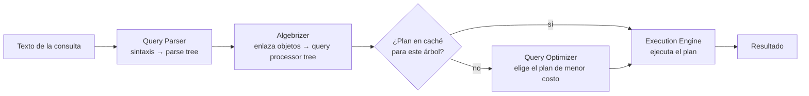

[← Unidad 3](/bbdd-aplicadas/unidad-3/teoria/)

Antes de reescribir una consulta o crear un índice hay que saber **qué hace** el motor con ella. El *plan de ejecución* lo dice: qué tablas e índices toca, en qué orden, con qué algoritmo y con cuántas filas cree que va a trabajar. Esa última cifra sale de las *estadísticas*, y cuando está equivocada el plan también lo está. Esta página explica cómo se genera y reutiliza un plan, cómo leerlo y extraerlo con T-SQL, y cómo se construyen y mantienen las estadísticas. Los índices y las reescrituras están en [Índices y optimización](/bbdd-aplicadas/unidad-3/teoria/indices-optimizacion/), y la medición continua en [métricas de rendimiento](/bbdd-aplicadas/unidad-3/teoria/metricas-de-rendimiento/).

:::note[Qué presupone esta lección]
Conocer qué es un índice clúster y uno no clúster (ver [Índices y optimización](/bbdd-aplicadas/unidad-3/teoria/indices-optimizacion/)) y las consultas de [Unidad 1](/bbdd-aplicadas/unidad-1/teoria/repaso-sql/). Los ejemplos se ejecutaron en SQL Server 2022.
:::

## Datos de ejemplo

Usamos las mismas tablas de [Índices y optimización](/bbdd-aplicadas/unidad-3/teoria/indices-optimizacion/#datos-de-ejemplo-y-cómo-medimos): 520 clientes y 20.000 pedidos generados con una fórmula fija. `Estado` tiene tres valores muy desparejos (90 % `Entregado`, 9 % `Pendiente`, 1 % `Anulado`).

<!-- check: U3.T.PL.00 -->
```sql
CREATE SCHEMA ventas;
GO
CREATE SCHEMA diag;
GO
CREATE TABLE ventas.Cliente (
    ClienteId INT         NOT NULL,
    Nombre    VARCHAR(40) NOT NULL,
    Provincia VARCHAR(20) NOT NULL,
    CONSTRAINT PK_Cliente PRIMARY KEY CLUSTERED (ClienteId)
);

CREATE TABLE ventas.Pedido (
    PedidoId  INT IDENTITY(1, 1) NOT NULL,
    ClienteId INT                NOT NULL,
    Fecha     DATE               NOT NULL,
    Estado    VARCHAR(10)        NOT NULL,
    Codigo    VARCHAR(12)        NOT NULL,
    Importe   DECIMAL(10, 2)     NOT NULL,
    CONSTRAINT PK_Pedido PRIMARY KEY CLUSTERED (PedidoId)
);
GO
WITH n AS (
    SELECT TOP (520) ROW_NUMBER() OVER (ORDER BY (SELECT NULL)) AS n
    FROM sys.all_columns
)
INSERT INTO ventas.Cliente (ClienteId, Nombre, Provincia)
SELECT n,
       CONCAT('Cliente ', RIGHT(CONCAT('000', n), 3)),
       CHOOSE(n % 4 + 1, 'Buenos Aires', 'Cordoba', 'Santa Fe', 'Mendoza')
FROM n;

WITH n AS (
    SELECT TOP (20000) ROW_NUMBER() OVER (ORDER BY (SELECT NULL)) AS n
    FROM sys.all_columns AS a
    CROSS JOIN sys.all_columns AS b
)
INSERT INTO ventas.Pedido (ClienteId, Fecha, Estado, Codigo, Importe)
SELECT n % 500 + 1,
       DATEADD(DAY, n % 730, '2023-01-01'),
       CASE WHEN n % 100 = 0 THEN 'Anulado' WHEN n % 10 = 0 THEN 'Pendiente' ELSE 'Entregado' END,
       CONCAT('P', RIGHT(CONCAT('00000000', n), 8)),
       n % 1000 + 0.50
FROM n;
GO
```

## Qué ocurre cuando se ejecuta una consulta

:::note[Definición]
El **plan de ejecución** es el conjunto de operaciones que el motor realiza para obtener los datos de una consulta: a qué tablas e índices accede, en qué orden, con qué algoritmo (recorrido, búsqueda, tipo de `JOIN`), en qué punto calcula los agregados y los ordenamientos, qué estimaciones usó y cuánta memoria reserva. Es el mejor punto de partida para un problema de rendimiento.
:::

Una consulta pasa por dos fases, **compilación** y **ejecución**, y por cuatro componentes:



| Componente | Qué hace | Qué errores produce |
|---|---|---|
| **Query Parser** | Verifica la sintaxis y genera el *parse tree*, la estructura con los pasos lógicos de la consulta | Errores de sintaxis |
| **Algebrizer** (*query binding*) | Resuelve los nombres de objetos, identifica los tipos de datos y ubica las funciones de agregado; genera el *query processor tree* y un hash del mismo | Objeto o columna inexistente, tipos incompatibles |
| **Query Optimizer** | Analiza alternativas y elige la de menor costo estimado; usa heurísticas, así que busca una buena alternativa y no necesariamente la mejor | |
| **Execution Engine** | Ejecuta el plan, y lo guarda en el caché de planes | Errores de ejecución (división por cero, violación de restricciones) |

El hash del *query processor tree* se usa para saber si ya hay un plan compilado en el caché: si lo hay, se reutiliza y se salta la optimización, salvo que se haya modificado una estructura (por ejemplo, un índice) o actualizado las estadísticas desde que se creó el plan. Los procedimientos almacenados **postergan la resolución de nombres** (*deferred name resolution*): se pueden crear aunque hagan referencia a una tabla que todavía no existe, y el error recién aparece al ejecutarlos. Cada fase se distingue por el error que produce:

<!-- check: U3.T.PL.01 -->
```sql
BEGIN TRY
    EXEC (N'SELECT * FORM ventas.Pedido WHERE');
END TRY
BEGIN CATCH
    SELECT 'Parser (sintaxis)' AS Fase, ERROR_NUMBER() AS Error;
END CATCH;

BEGIN TRY
    EXEC (N'SELECT * FROM ventas.NoExiste');
END TRY
BEGIN CATCH
    SELECT 'Algebrizer (tabla inexistente)' AS Fase, ERROR_NUMBER() AS Error;
END CATCH;

BEGIN TRY
    EXEC (N'SELECT NoExiste FROM ventas.Pedido');
END TRY
BEGIN CATCH
    SELECT 'Algebrizer (columna inexistente)' AS Fase, ERROR_NUMBER() AS Error;
END CATCH;
GO
CREATE PROCEDURE ventas.ListarFuturo
AS
BEGIN
    SELECT * FROM ventas.TablaQueTodaviaNoExiste;
END;
GO
SELECT COUNT(*) AS ProcedimientoCreado
FROM sys.procedures
WHERE name = 'ListarFuturo';

BEGIN TRY
    EXEC ventas.ListarFuturo;
END TRY
BEGIN CATCH
    SELECT 'Ejecución del procedimiento' AS Fase, ERROR_NUMBER() AS Error;
END CATCH;
```

**Resultado esperado.**

| Fase | Error |
|---|---:|
| Parser (sintaxis) | 102 |
| Algebrizer (tabla inexistente) | 208 |
| Algebrizer (columna inexistente) | 207 |

| ProcedimientoCreado |
|---:|
| 1 |

| Fase | Error |
|---|---:|
| Ejecución del procedimiento | 208 |

El error 102 es de sintaxis, el 208 es "nombre de objeto no válido" y el 207 "nombre de columna no válido". Que `ListarFuturo` se cree sin error pero falle al ejecutarse con el 208 es la resolución diferida. Los errores de sintaxis detienen el lote antes de ejecutar nada; para atraparlos con `TRY ... CATCH` hay que ejecutar el texto como lote anidado, que es lo que hace `EXEC (...)`.

## Plan estimado y plan real

- Para una consulta, en un momento dado, hay **un** solo plan. El **plan estimado** es el que genera el optimizador o el que ya está en el caché; no ejecuta la consulta.
- El **plan real** es el mismo plan con la información de tiempo de ejecución: cuántas filas pasaron realmente por cada operador, tiempos y esperas, y la memoria usada.
- La carga del servidor en el momento de ejecutar puede cambiar el plan elegido, por ejemplo por el grado de paralelismo.
- Si una consulta crea y usa una tabla temporal en el mismo lote, el plan estimado puede no obtenerse, porque la tabla todavía no existe al compilar.
- Los costos que muestra el plan estimado y el real son **los mismos**: son estimaciones del optimizador, no mediciones.

| Cómo obtenerlo | Qué da | Ejecuta la consulta |
|---|---|---|
| SSMS, `Ctrl+L` (*Display Estimated Execution Plan*) | Plan estimado, gráfico | No |
| SSMS, `Ctrl+M` (*Include Actual Execution Plan*) y ejecutar | Plan real, gráfico | Sí |
| *Include Live Query Statistics* (menú *Query*) | Plan real en progreso | Sí |
| `SET SHOWPLAN_XML ON` | Plan estimado en XML | No |
| `SET STATISTICS XML ON` | Plan real en XML, junto con el resultado | Sí |
| `sys.dm_exec_query_plan(plan_handle)` | Plan en caché (estimado) | No |
| `sys.dm_exec_query_plan_stats(plan_handle)` | Último plan real (con `LAST_QUERY_PLAN_STATS` activado) | No |

<!-- sintaxis -->
```sql
-- Plan estimado en XML (no se ejecuta la consulta). SET SHOWPLAN_XML debe ir solo en su lote:
SET SHOWPLAN_XML ON;
GO
<consulta>;
GO
SET SHOWPLAN_XML OFF;
GO

-- Plan real en XML, junto con el resultado:
SET STATISTICS XML ON;
<consulta>;
SET STATISTICS XML OFF;
```

### Extraer los operadores con T-SQL

El plan XML es largo y contiene costos y tiempos que cambian entre equipos. Para comparar planes de forma reproducible conviene **extraer** del XML solo lo que importa: los operadores físicos y los objetos que tocan. Cada operador es un elemento `RelOp` con un atributo `PhysicalOp`; los accesos a índices tienen debajo un elemento `Object`. Con `.nodes()` se obtiene una fila por `RelOp` y con `.value()` cada atributo. La sentencia se encuentra en `sys.dm_exec_query_stats` por un comentario marcador (`/*P1*/`), y el plan de esa sentencia con `sys.dm_exec_text_query_plan` y los desplazamientos de la sentencia:

<!-- check: U3.T.PL.02 -->
```sql
DECLARE @N INT;
SELECT @N = COUNT(*)
FROM ventas.Pedido AS p
INNER JOIN ventas.Cliente AS c ON c.ClienteId = p.ClienteId /*P1*/
OPTION (MAXDOP 1);
GO
WITH XMLNAMESPACES (DEFAULT 'http://schemas.microsoft.com/sqlserver/2004/07/showplan')
SELECT r.o.value('@NodeId', 'INT')                        AS NodoId,
       r.o.value('@PhysicalOp', 'NVARCHAR(60)')           AS Operador,
       r.o.value('(./*/Object/@Index)[1]', 'NVARCHAR(128)') AS Indice
FROM sys.dm_exec_query_stats AS qs
CROSS APPLY sys.dm_exec_plan_attributes(qs.plan_handle) AS pa
CROSS APPLY sys.dm_exec_sql_text(qs.sql_handle) AS t
CROSS APPLY sys.dm_exec_text_query_plan(qs.plan_handle, qs.statement_start_offset, qs.statement_end_offset) AS p
CROSS APPLY (SELECT CAST(p.query_plan AS XML) AS PlanXml) AS x
CROSS APPLY x.PlanXml.nodes('//RelOp') AS r(o)
WHERE pa.attribute = 'dbid' AND CAST(pa.value AS INT) = DB_ID()
  AND t.text LIKE N'%/*P1*/%'
  AND t.text NOT LIKE N'%dm_exec_query_stats%'
ORDER BY NodoId;
```

**Resultado esperado.**

| NodoId | Operador | Indice |
|---:|---|---|
| 0 | Compute Scalar | NULL |
| 1 | Stream Aggregate | NULL |
| 2 | Hash Match | NULL |
| 3 | Clustered Index Scan | [PK_Cliente] |
| 4 | Clustered Index Scan | [PK_Pedido] |

El plan tiene cinco operadores y se lee de **derecha a izquierda y de arriba hacia abajo**: las hojas (los dos recorridos de índice clúster) son las primeras en ejecutarse y entregan sus filas al operador de la izquierda. Aquí el motor recorre `PK_Cliente` y `PK_Pedido`, los combina con un `Hash Match` (no hay otro índice que ayude), cuenta con un `Stream Aggregate` y un `Compute Scalar` arma el valor de salida. Los operadores que no acceden a un objeto aparecen con `Indice` en `NULL`.

Para no repetir esa consulta, la empaquetamos en una función que, además, devuelve las lecturas lógicas de la última ejecución (el equivalente programático de `SET STATISTICS IO`); es la misma que usamos en [Índices y optimización](/bbdd-aplicadas/unidad-3/teoria/indices-optimizacion/#datos-de-ejemplo-y-cómo-medimos). `Key Lookup` se distingue porque su `PhysicalOp` es una búsqueda en el clúster con el atributo `Lookup`:

<!-- check: U3.T.PL.00 -->
```sql
CREATE FUNCTION diag.OperadoresDe (@Marca NVARCHAR(40))
RETURNS TABLE
AS RETURN
(
    WITH XMLNAMESPACES (DEFAULT 'http://schemas.microsoft.com/sqlserver/2004/07/showplan')
    SELECT r.o.value('@NodeId', 'INT') AS NodoId,
           CASE WHEN r.o.value('(./*/@Lookup)[1]', 'INT') = 1 THEN N'Key Lookup'
                ELSE r.o.value('@PhysicalOp', 'NVARCHAR(60)') END           AS Operador,
           COALESCE(r.o.value('(./*/Object/@Index)[1]', 'NVARCHAR(128)'),
                    r.o.value('(./*/Object/@Table)[1]', 'NVARCHAR(128)'))   AS Objeto,
           qs.last_logical_reads                                            AS LecturasLogicas
    FROM sys.dm_exec_query_stats AS qs
    CROSS APPLY sys.dm_exec_plan_attributes(qs.plan_handle) AS pa
    CROSS APPLY sys.dm_exec_sql_text(qs.sql_handle) AS t
    CROSS APPLY (SELECT SUBSTRING(t.text, qs.statement_start_offset / 2 + 1,
                     (CASE qs.statement_end_offset WHEN -1 THEN DATALENGTH(t.text)
                      ELSE qs.statement_end_offset END - qs.statement_start_offset) / 2 + 1) AS Sentencia) AS s
    CROSS APPLY sys.dm_exec_text_query_plan(qs.plan_handle, qs.statement_start_offset, qs.statement_end_offset) AS p
    CROSS APPLY (SELECT CAST(p.query_plan AS XML) AS PlanXml) AS x
    CROSS APPLY x.PlanXml.nodes('//RelOp') AS r(o)
    WHERE pa.attribute = 'dbid' AND CAST(pa.value AS INT) = DB_ID()
      AND s.Sentencia LIKE N'%' + @Marca + N'%'
      AND s.Sentencia NOT LIKE N'%OperadoresDe%'
);
GO
```

## Cómo leer un plan

Una lectura ordenada de un plan responde estas preguntas:

1. **¿Hay recorridos (*scans*) sobre tablas grandes?** Table Scan (heap) o Clustered Index Scan son la señal para revisar si falta un índice o un predicado es no sargable.
2. **¿Coinciden las estimaciones con lo real?** Una diferencia grande entre filas estimadas y reales apunta a estadísticas desactualizadas.
3. **¿Dónde están los flujos de datos más grandes?** En el plan gráfico, el grosor de las flechas es la cantidad de filas.
4. **¿Hay derrames a `tempdb`?** Un `Sort` o un `Hash Match` sin memoria suficiente se vuelca al disco; aparece como advertencia en el operador (*spill*).
5. **¿Cuánta memoria se reserva?** El *memory grant* se ve en las propiedades del primer operador a la izquierda.
6. **¿Hay operadores con advertencias** (conversión implícita, estadísticas faltantes, predicado sin índice)?
7. **¿Qué nivel de optimización se logró?** `TRIVIAL` (una consulta con un único plan posible, no se explora nada), `FULL`, o una optimización cortada por tiempo (*Timeout*) o por memoria (*Memory Limit Exceeded*).

Los operadores más frecuentes:

| Operador | Qué indica |
|---|---|
| **Table Scan** | Recorre un heap (tabla sin clúster) |
| **Clustered Index Scan** / **Index Scan** | Recorre todas las hojas de un índice |
| **Clustered Index Seek** / **Index Seek** | Navega el árbol hasta las filas que cumplen el predicado |
| **Key Lookup** (**RID Lookup** en un heap) | Vuelve a la tabla por cada fila para traer columnas que el índice no tiene |
| **Nested Loops** | `JOIN` que por cada fila de la entrada externa busca en la interna; bueno con pocas filas y un índice |
| **Merge Join** | `JOIN` de dos entradas ya ordenadas por la clave |
| **Hash Match** | `JOIN` o agregación con una tabla hash en memoria; típico de entradas grandes sin orden |
| **Sort**, **Stream Aggregate**, **Compute Scalar** | Ordenamientos, agregaciones sobre entrada ordenada y cálculos de columnas |

Con la misma consulta sobre distintos volúmenes, el optimizador elige otro algoritmo de `JOIN`. Lo extraemos del plan, igual que antes, y vemos también el nivel de optimización:

<!-- check: U3.T.PL.03 -->
```sql
CREATE NONCLUSTERED INDEX IX_Pedido_ClienteId ON ventas.Pedido (ClienteId) INCLUDE (Importe);
GO
DECLARE @N INT;
SELECT @N = COUNT(*)
FROM ventas.Pedido AS p
INNER JOIN ventas.Cliente AS c ON c.ClienteId = p.ClienteId
WHERE p.Fecha >= '2024-01-01' AND p.Fecha < '2024-01-03' /*J1*/
OPTION (MAXDOP 1);

SELECT @N = COUNT(*)
FROM ventas.Pedido AS p
INNER JOIN ventas.Cliente AS c ON c.ClienteId = p.ClienteId /*J2*/
OPTION (MAXDOP 1);

SELECT @N = COUNT(*)
FROM ventas.Pedido AS p
INNER JOIN ventas.Cliente AS c ON c.ClienteId = p.ClienteId /*J3*/
OPTION (MAXDOP 1, HASH JOIN);

SELECT @N = COUNT(*) FROM ventas.Pedido WHERE PedidoId = 5 /*J4*/ OPTION (MAXDOP 1);
GO
SELECT 'Pocas filas' AS Consulta, Operador
FROM diag.OperadoresDe(N'/*J1*/')
WHERE Operador LIKE '%Join%' OR Operador LIKE '%Loops%' OR Operador LIKE '%Hash%'
UNION ALL
SELECT 'Todos los pedidos', Operador
FROM diag.OperadoresDe(N'/*J2*/')
WHERE Operador LIKE '%Join%' OR Operador LIKE '%Loops%' OR Operador LIKE '%Hash%'
UNION ALL
SELECT 'Con HASH JOIN forzado', Operador
FROM diag.OperadoresDe(N'/*J3*/')
WHERE Operador LIKE '%Join%' OR Operador LIKE '%Loops%' OR Operador LIKE '%Hash%'
ORDER BY Consulta;
```

**Resultado esperado.**

| Consulta | Operador |
|---|---|
| Con HASH JOIN forzado | Hash Match |
| Pocas filas | Nested Loops |
| Todos los pedidos | Merge Join |

Con pocas filas filtradas el optimizador usa `Nested Loops`; con todas, `Merge Join`, porque ambas entradas se pueden leer ordenadas por `ClienteId`; con la pista `HASH JOIN` se lo obliga a construir una tabla hash. Las pistas (`HASH JOIN`, `FORCE ORDER`, `INDEX(...)`) sirven para experimentar y entender, pero en producción casi siempre empeoran las cosas cuando los datos cambian: se confía primero en las estadísticas y los índices.

La misma extracción puede leer atributos del nivel sentencia, como `StatementOptmLevel`:

<!-- check: U3.T.PL.04 -->
```sql
DECLARE @N INT;
SELECT @N = COUNT(*) FROM ventas.Pedido WHERE PedidoId = 5 /*N1*/ OPTION (MAXDOP 1);

SELECT @N = COUNT(*)
FROM ventas.Pedido AS p
INNER JOIN ventas.Cliente AS c ON c.ClienteId = p.ClienteId
WHERE c.Provincia = 'Cordoba' /*N2*/
OPTION (MAXDOP 1);
GO
WITH XMLNAMESPACES (DEFAULT 'http://schemas.microsoft.com/sqlserver/2004/07/showplan')
SELECT CASE WHEN SUBSTRING(t.text, qs.statement_start_offset / 2 + 1, 400) LIKE N'%/*N1*/%' THEN 'Búsqueda por clave' ELSE 'Join con filtro' END AS Consulta,
       CAST(p.query_plan AS XML).value('(//StmtSimple/@StatementOptmLevel)[1]', 'VARCHAR(20)') AS NivelOptimizacion
FROM sys.dm_exec_query_stats AS qs
CROSS APPLY sys.dm_exec_plan_attributes(qs.plan_handle) AS pa
CROSS APPLY sys.dm_exec_sql_text(qs.sql_handle) AS t
CROSS APPLY sys.dm_exec_text_query_plan(qs.plan_handle, qs.statement_start_offset, qs.statement_end_offset) AS p
WHERE pa.attribute = 'dbid' AND CAST(pa.value AS INT) = DB_ID()
  AND (SUBSTRING(t.text, qs.statement_start_offset / 2 + 1, 400) LIKE N'%/*N1*/%'
    OR SUBSTRING(t.text, qs.statement_start_offset / 2 + 1, 400) LIKE N'%/*N2*/%')
  AND t.text NOT LIKE N'%dm_exec_query_stats%'
ORDER BY Consulta;
```

**Resultado esperado.**

| Consulta | NivelOptimizacion |
|---|---|
| Búsqueda por clave | TRIVIAL |
| Join con filtro | FULL |

La búsqueda por clave primaria tiene un único plan razonable, así que el optimizador la resuelve como `TRIVIAL` sin explorar alternativas; el `JOIN` con filtro necesita una optimización completa (`FULL`).

## Caché de planes y reutilización

Compilar cuesta CPU y memoria, así que el motor guarda el plan en el **caché de planes** y lo reutiliza si llega la misma consulta. `sys.dm_exec_cached_plans` lista los planes (con `usecounts`, la cantidad de veces que se usó, y `objtype`, el tipo) y `sys.dm_exec_sql_text` devuelve el texto. La clave de búsqueda es el texto: dos consultas ad hoc que difieren en un literal son dos entradas, mientras que una consulta parametrizada se compila una vez y se reutiliza con cualquier valor. Por eso la cátedra recomienda procedimientos almacenados y consultas preparadas (`sp_executesql`) en lugar de concatenar literales:

<!-- check: U3.T.PL.05 -->
```sql
DECLARE @N INT;
SELECT @N = COUNT(*) FROM ventas.Pedido AS p INNER JOIN ventas.Cliente AS c ON c.ClienteId = p.ClienteId WHERE p.ClienteId = 10 /*C1*/;
GO
DECLARE @N INT;
SELECT @N = COUNT(*) FROM ventas.Pedido AS p INNER JOIN ventas.Cliente AS c ON c.ClienteId = p.ClienteId WHERE p.ClienteId = 11 /*C1*/;
GO
DECLARE @N INT;
SELECT @N = COUNT(*) FROM ventas.Pedido AS p INNER JOIN ventas.Cliente AS c ON c.ClienteId = p.ClienteId WHERE p.ClienteId = 12 /*C1*/;
GO
EXEC sp_executesql
    N'DECLARE @N INT; SELECT @N = COUNT(*) FROM ventas.Pedido AS p INNER JOIN ventas.Cliente AS c ON c.ClienteId = p.ClienteId WHERE p.ClienteId = @ClienteId /*C2*/;',
    N'@ClienteId INT', @ClienteId = 10;
GO
EXEC sp_executesql
    N'DECLARE @N INT; SELECT @N = COUNT(*) FROM ventas.Pedido AS p INNER JOIN ventas.Cliente AS c ON c.ClienteId = p.ClienteId WHERE p.ClienteId = @ClienteId /*C2*/;',
    N'@ClienteId INT', @ClienteId = 11;
GO
EXEC sp_executesql
    N'DECLARE @N INT; SELECT @N = COUNT(*) FROM ventas.Pedido AS p INNER JOIN ventas.Cliente AS c ON c.ClienteId = p.ClienteId WHERE p.ClienteId = @ClienteId /*C2*/;',
    N'@ClienteId INT', @ClienteId = 12;
GO
SELECT CASE WHEN t.text LIKE N'%/*C1*/%' THEN 'Literales' ELSE 'Parametrizada' END AS Forma,
       cp.objtype AS Tipo,
       cp.usecounts AS Usos
FROM sys.dm_exec_cached_plans AS cp
CROSS APPLY sys.dm_exec_plan_attributes(cp.plan_handle) AS pa
CROSS APPLY sys.dm_exec_sql_text(cp.plan_handle) AS t
WHERE pa.attribute = 'dbid' AND CAST(pa.value AS INT) = DB_ID()
  AND (t.text LIKE N'%/*C1*/%' OR t.text LIKE N'%/*C2*/%')
  AND t.text NOT LIKE N'%dm_exec_cached_plans%'
ORDER BY Forma, Tipo, Usos;
```

**Resultado esperado.**

| Forma | Tipo | Usos |
|---|---|---:|
| Literales | Adhoc | 1 |
| Literales | Adhoc | 1 |
| Literales | Adhoc | 1 |
| Parametrizada | Prepared | 3 |

Los tres literales dejaron tres entradas `Adhoc`, cada una usada una vez; la versión parametrizada dejó una sola entrada `Prepared` usada tres veces. Un caché lleno de planes de un solo uso desperdicia memoria. Un plan sale del caché por presión de memoria, por antigüedad o porque quedó **invalidado**: cambia una estructura que usa (se crea o elimina un índice, se altera una tabla) o se actualizan sus estadísticas con cambios suficientes. Entonces la próxima ejecución recompila, y `plan_generation_num` crece:

<!-- check: U3.T.PL.06 -->
```sql
EXEC sp_executesql N'DECLARE @N INT; SELECT @N = COUNT(*) FROM ventas.Pedido WHERE Importe = 10.5 /*R1*/ OPTION (MAXDOP 1);';
GO
EXEC sp_executesql N'DECLARE @N INT; SELECT @N = COUNT(*) FROM ventas.Pedido WHERE Importe = 10.5 /*R1*/ OPTION (MAXDOP 1);';
GO
EXEC sp_executesql N'DECLARE @N INT; SELECT @N = COUNT(*) FROM ventas.Pedido WHERE Importe = 10.5 /*R1*/ OPTION (MAXDOP 1);';
GO
SELECT 'Antes del índice' AS Momento, qs.execution_count AS Ejecuciones, qs.plan_generation_num AS Generacion
FROM sys.dm_exec_query_stats AS qs
CROSS APPLY sys.dm_exec_plan_attributes(qs.plan_handle) AS pa
CROSS APPLY sys.dm_exec_sql_text(qs.sql_handle) AS t
WHERE pa.attribute = 'dbid' AND CAST(pa.value AS INT) = DB_ID()
  AND t.text LIKE N'DECLARE @N INT; SELECT @N = COUNT(*) FROM ventas.Pedido WHERE Importe = 10.5 /*R1*/%';

CREATE NONCLUSTERED INDEX IX_Pedido_Importe ON ventas.Pedido (Importe);
GO
EXEC sp_executesql N'DECLARE @N INT; SELECT @N = COUNT(*) FROM ventas.Pedido WHERE Importe = 10.5 /*R1*/ OPTION (MAXDOP 1);';
GO
SELECT 'Después del índice' AS Momento, qs.execution_count AS Ejecuciones, qs.plan_generation_num AS Generacion
FROM sys.dm_exec_query_stats AS qs
CROSS APPLY sys.dm_exec_plan_attributes(qs.plan_handle) AS pa
CROSS APPLY sys.dm_exec_sql_text(qs.sql_handle) AS t
WHERE pa.attribute = 'dbid' AND CAST(pa.value AS INT) = DB_ID()
  AND t.text LIKE N'DECLARE @N INT; SELECT @N = COUNT(*) FROM ventas.Pedido WHERE Importe = 10.5 /*R1*/%';
```

**Resultado esperado.**

| Momento | Ejecuciones | Generacion |
|---|---:|---:|
| Antes del índice | 3 | 1 |

| Momento | Ejecuciones | Generacion |
|---|---:|---:|
| Después del índice | 1 | 2 |

(Filtramos por el texto del lote para no mezclar la sentencia con el `EXEC` que la envuelve.) El plan se había usado tres veces; al crear el índice quedó invalidado, la ejecución siguiente generó un plan nuevo y el contador de ejecuciones volvió a 1. `DBCC FREEPROCCACHE` vacía el caché entero y solo corresponde en un entorno de pruebas, nunca en producción.

## Estadísticas

:::note[Definición]
Las **estadísticas** son objetos que describen la distribución de los valores de una o más columnas ("datos sobre los datos"). El optimizador las usa para estimar la **cardinalidad** (cuántas filas devuelve cada operador) y de esa estimación depende todo: el orden de los `JOIN`, el algoritmo, si usa un índice o recorre la tabla, y cuánta memoria reserva.
:::

SQL Server crea y mantiene estadísticas automáticamente. Se crean al crear un índice, y también sobre columnas usadas en un predicado cuando `AUTO_CREATE_STATISTICS` está activo (por defecto lo está). Por defecto no se muestrean todas las filas sino un subconjunto, salvo que se pida `FULLSCAN`. Cada objeto de estadísticas tiene tres partes:

| Componente | Contenido |
|---|---|
| **Encabezado** | Nombre, fecha de la última actualización, filas de la tabla, filas muestreadas, cantidad de pasos del histograma |
| **Vector de densidad** | Densidad de cada prefijo de columnas: `1 / cantidad de valores distintos`. Mide la unicidad (selectividad) de los datos |
| **Histograma** | Hasta **200 pasos** (*steps*) que resumen la distribución de la **primera columna** de las estadísticas |

Cada paso del histograma tiene cinco columnas:

| Columna | Significado |
|---|---|
| `RANGE_HI_KEY` | El valor más alto del paso. El paso abarca los valores mayores que el `RANGE_HI_KEY` anterior hasta este |
| `RANGE_ROWS` | Filas del paso, sin contar las del valor `RANGE_HI_KEY` |
| `EQ_ROWS` | Filas cuyo valor es exactamente `RANGE_HI_KEY` |
| `DISTINCT_RANGE_ROWS` | Valores distintos dentro del paso, sin contar `RANGE_HI_KEY` |
| `AVG_RANGE_ROWS` | Promedio de filas por valor distinto dentro del paso (`RANGE_ROWS / DISTINCT_RANGE_ROWS`) |

Si el valor buscado es un `RANGE_HI_KEY`, el optimizador estima `EQ_ROWS`; si cae dentro de un paso, estima `AVG_RANGE_ROWS`. Creamos un índice sobre `Estado` (que crea sus estadísticas con todas las filas), consultamos por una columna sin índice (`Importe`) para que el motor cree una estadística automática y las listamos con sus propiedades:

<!-- check: U3.T.ST.01 -->
```sql
CREATE NONCLUSTERED INDEX IX_Pedido_Estado ON ventas.Pedido (Estado);
GO
DECLARE @N INT;
SELECT @N = COUNT(*) FROM ventas.Pedido WHERE Importe = 500.50 OPTION (MAXDOP 1);
GO
SELECT CASE WHEN s.auto_created = 1 THEN N'_WA_Sys_... (automática)' ELSE s.name END AS Estadistica,
       c.name                  AS Columna,
       sp.rows                 AS Filas,
       sp.rows_sampled         AS FilasMuestreadas,
       sp.steps                AS Pasos,
       sp.modification_counter AS Modificaciones
FROM sys.stats AS s
INNER JOIN sys.stats_columns AS sc ON sc.object_id = s.object_id AND sc.stats_id = s.stats_id
INNER JOIN sys.columns AS c        ON c.object_id  = sc.object_id AND c.column_id = sc.column_id
CROSS APPLY sys.dm_db_stats_properties(s.object_id, s.stats_id) AS sp
WHERE s.object_id = OBJECT_ID('ventas.Pedido')
  AND s.name <> 'PK_Pedido'
ORDER BY s.auto_created, s.name;
```

**Resultado esperado.**

| Estadistica | Columna | Filas | FilasMuestreadas | Pasos | Modificaciones |
|---|---|---:|---:|---:|---:|
| IX_Pedido_Estado | Estado | 20000 | 20000 | 3 | 0 |
| _WA_Sys_... (automática) | Importe | 20000 | 20000 | 199 | 0 |

La estadística del índice `IX_Pedido_Estado` se construyó al crearlo, con las 20.000 filas y 3 pasos (uno por valor). La automática sobre `Importe` (su nombre real es `_WA_Sys_` más un sufijo) se creó con la primera consulta que filtró por esa columna: con una tabla chica, el muestreo por defecto lee todas las filas. `sys.stats` y `sys.stats_columns` filtradas por tabla muestran a qué columnas corresponde cada una (sin filtrar mezclan los objetos del sistema). El histograma y el vector de densidad se leen con `DBCC SHOW_STATISTICS`, que acepta el nombre de la **estadística o del índice** (no el de una columna):

<!-- check: U3.T.ST.02 -->
```sql
CREATE NONCLUSTERED INDEX IX_Pedido_Estado ON ventas.Pedido (Estado);
GO
DBCC SHOW_STATISTICS ('ventas.Pedido', IX_Pedido_Estado) WITH HISTOGRAM;
DBCC SHOW_STATISTICS ('ventas.Pedido', IX_Pedido_Estado) WITH DENSITY_VECTOR;
```

**Resultado esperado.** Primero el histograma (`RANGE_HI_KEY`, `RANGE_ROWS`, `EQ_ROWS`, `DISTINCT_RANGE_ROWS`, `AVG_RANGE_ROWS`) y después el vector de densidad (`All density`, `Average Length`, `Columns`):

| RANGE_HI_KEY | RANGE_ROWS | EQ_ROWS | DISTINCT_RANGE_ROWS | AVG_RANGE_ROWS |
|---|---:|---:|---:|---:|
| Anulado | 0.0 | 200.0 | 0 | 1.0 |
| Entregado | 0.0 | 18000.0 | 0 | 1.0 |
| Pendiente | 0.0 | 1800.0 | 0 | 1.0 |

| All density | Average Length | Columns |
|---|---:|---|
| 0.33333334 | 8.9799995 | Estado |
| 4.9999999E-5 | 12.98 | Estado, PedidoId |

Los tres valores de `Estado` son `RANGE_HI_KEY` con `EQ_ROWS` 200, 18.000 y 1.800: el optimizador sabe exactamente cuántas filas tiene cada uno. La densidad de `Estado` es 0,333 (1/3) y la de `Estado, PedidoId` es 1/20.000 (5E-05, en notación científica). La segunda fila existe porque un índice no clúster incluye la clave del clúster. Con más de 200 valores distintos el histograma agrupa: si cargamos las estadísticas de `Codigo` (20.000 valores únicos), el histograma queda en 200 pasos como máximo, más uno si hay `NULL`:

<!-- check: U3.T.ST.03 -->
```sql
CREATE NONCLUSTERED INDEX IX_Pedido_Codigo ON ventas.Pedido (Codigo);
GO
SELECT s.name AS Estadistica,
       sp.rows AS Filas,
       sp.steps AS Pasos
FROM sys.stats AS s
CROSS APPLY sys.dm_db_stats_properties(s.object_id, s.stats_id) AS sp
WHERE s.object_id = OBJECT_ID('ventas.Pedido')
  AND s.name = 'IX_Pedido_Codigo';

SELECT COUNT(*) AS PasosEnElHistograma,
       SUM(h.range_rows + h.equal_rows) AS FilasRepresentadas
FROM sys.dm_db_stats_histogram(OBJECT_ID('ventas.Pedido'),
         (SELECT stats_id FROM sys.stats WHERE object_id = OBJECT_ID('ventas.Pedido') AND name = 'IX_Pedido_Codigo')) AS h;
```

**Resultado esperado.**

| Estadistica | Filas | Pasos |
|---|---:|---:|
| IX_Pedido_Codigo | 20000 | 155 |

| PasosEnElHistograma | FilasRepresentadas |
|---:|---:|
| 155 | 20000.0 |

`sys.dm_db_stats_histogram` devuelve el histograma como filas. Aunque haya 20.000 valores distintos, el histograma tiene a lo sumo 200 pasos (acá, 155) y representa las 20.000 filas: cada paso resume un rango.

### Estadísticas desactualizadas

Las estadísticas son una foto. Si los datos cambian y la foto no, el optimizador estima mal. Lo provocamos desactivando la actualización automática, agregando 5.000 pedidos en una fecha nueva (fuera del histograma) y comparando las filas **estimadas** y **reales** de la búsqueda por esa fecha. Las reales salen del último plan real, que `LAST_QUERY_PLAN_STATS` guarda y `sys.dm_exec_query_plan_stats` devuelve:

<!-- check: U3.T.PL.00 -->
```sql
ALTER DATABASE SCOPED CONFIGURATION SET LAST_QUERY_PLAN_STATS = ON;
GO
CREATE FUNCTION diag.FilasEstimadasYReales (@Marca NVARCHAR(40))
RETURNS TABLE
AS RETURN
(
    WITH XMLNAMESPACES (DEFAULT 'http://schemas.microsoft.com/sqlserver/2004/07/showplan')
    SELECT r.o.value('@NodeId', 'INT')                                                           AS NodoId,
           r.o.value('@PhysicalOp', 'NVARCHAR(60)')                                              AS Operador,
           CAST(r.o.value('@EstimateRows', 'FLOAT') AS BIGINT)                                   AS FilasEstimadas,
           r.o.value('(./RunTimeInformation/RunTimeCountersPerThread/@ActualRows)[1]', 'BIGINT') AS FilasReales
    FROM sys.dm_exec_query_stats AS qs
    CROSS APPLY sys.dm_exec_plan_attributes(qs.plan_handle) AS pa
    CROSS APPLY sys.dm_exec_sql_text(qs.sql_handle) AS t
    CROSS APPLY (SELECT SUBSTRING(t.text, qs.statement_start_offset / 2 + 1,
                     (CASE qs.statement_end_offset WHEN -1 THEN DATALENGTH(t.text)
                      ELSE qs.statement_end_offset END - qs.statement_start_offset) / 2 + 1) AS Sentencia) AS s
    CROSS APPLY sys.dm_exec_query_plan_stats(qs.plan_handle) AS p
    CROSS APPLY p.query_plan.nodes('//RelOp') AS r(o)
    WHERE pa.attribute = 'dbid' AND CAST(pa.value AS INT) = DB_ID()
      AND s.Sentencia LIKE N'%' + @Marca + N'%'
      AND s.Sentencia NOT LIKE N'%FilasEstimadasYReales%'
);
GO
```

<!-- check: U3.T.ST.04 -->
```sql
CREATE NONCLUSTERED INDEX IX_Pedido_Fecha ON ventas.Pedido (Fecha);
ALTER DATABASE CURRENT SET AUTO_UPDATE_STATISTICS OFF;
GO
INSERT INTO ventas.Pedido (ClienteId, Fecha, Estado, Codigo, Importe)
SELECT TOP (5000) 1, '2025-06-01', 'Pendiente', 'Z', 10.00
FROM sys.all_columns;
GO
DECLARE @N INT;
SELECT @N = COUNT(*) FROM ventas.Pedido WHERE Fecha = '2025-06-01' /*S1*/ OPTION (MAXDOP 1);
GO
UPDATE STATISTICS ventas.Pedido IX_Pedido_Fecha WITH FULLSCAN;
GO
DECLARE @N INT;
SELECT @N = COUNT(*) FROM ventas.Pedido WHERE Fecha = '2025-06-01' /*S2*/ OPTION (MAXDOP 1);
GO
SELECT 'Estadísticas viejas' AS Momento, FilasEstimadas, FilasReales
FROM diag.FilasEstimadasYReales(N'/*S1*/')
WHERE Operador = 'Index Seek'
UNION ALL
SELECT 'Tras UPDATE STATISTICS', FilasEstimadas, FilasReales
FROM diag.FilasEstimadasYReales(N'/*S2*/')
WHERE Operador = 'Index Seek'
ORDER BY Momento;
```

**Resultado esperado.**

| Momento | FilasEstimadas | FilasReales |
|---|---:|---:|
| Estadísticas viejas | 27 | 5000 |
| Tras UPDATE STATISTICS | 5000 | 5000 |

Con las estadísticas viejas el optimizador creyó que habría 27 filas y encontró 5.000; después de `UPDATE STATISTICS` la estimación coincide. En este ejemplo el plan no cambia (sigue siendo una búsqueda), pero con el mismo desvío en un `JOIN` el optimizador elegiría otro algoritmo y reservaría memoria de menos o de más. La regla práctica: **una diferencia grande entre estimadas y reales es la primera señal de estadísticas desactualizadas** (o de un predicado que el histograma no puede estimar).

### Actualización automática, sincrónica y asincrónica

Con `AUTO_UPDATE_STATISTICS` activo (el valor por defecto), el motor actualiza las estadísticas cuando la cantidad de modificaciones supera un umbral. Para tablas de hasta 25.000 filas el umbral es `500 + 20 %` de las filas; en tablas más grandes, y desde el nivel de compatibilidad 130, decrece en proporción (aproximadamente la raíz cuadrada de `1000 × filas`). El motor revisa el contador al compilar o reutilizar un plan. Sobre una tabla de 20.000 filas:

<!-- check: U3.T.ST.05 -->
```sql
CREATE NONCLUSTERED INDEX IX_Pedido_Fecha ON ventas.Pedido (Fecha);
GO
INSERT INTO ventas.Pedido (ClienteId, Fecha, Estado, Codigo, Importe)
SELECT TOP (4400) 1, '2025-06-01', 'Pendiente', 'Z', 10.00
FROM sys.all_columns;
GO
DECLARE @N INT;
SELECT @N = COUNT(*) FROM ventas.Pedido WHERE Fecha = '2025-06-01' OPTION (MAXDOP 1);
GO
SELECT '4.400 cambios' AS Momento, sp.rows AS Filas, sp.modification_counter AS Modificaciones
FROM sys.stats AS s
CROSS APPLY sys.dm_db_stats_properties(s.object_id, s.stats_id) AS sp
WHERE s.object_id = OBJECT_ID('ventas.Pedido') AND s.name = 'IX_Pedido_Fecha';

INSERT INTO ventas.Pedido (ClienteId, Fecha, Estado, Codigo, Importe)
SELECT TOP (1100) 1, '2025-06-01', 'Pendiente', 'Z', 10.00
FROM sys.all_columns;
GO
DECLARE @N INT;
SELECT @N = COUNT(*) FROM ventas.Pedido WHERE Fecha = '2025-06-01' AND Importe > 0 OPTION (MAXDOP 1);
GO
SELECT '5.500 cambios y una consulta' AS Momento, sp.rows AS Filas, sp.modification_counter AS Modificaciones
FROM sys.stats AS s
CROSS APPLY sys.dm_db_stats_properties(s.object_id, s.stats_id) AS sp
WHERE s.object_id = OBJECT_ID('ventas.Pedido') AND s.name = 'IX_Pedido_Fecha';
```

**Resultado esperado.**

| Momento | Filas | Modificaciones |
|---|---:|---:|
| 4.400 cambios | 20000 | 4400 |

| Momento | Filas | Modificaciones |
|---|---:|---:|
| 5.500 cambios y una consulta | 25500 | 0 |

Con 4.400 modificaciones no se actualizó (`Modificaciones` crece, `Filas` sigue en 20.000). Con 5.500 y una consulta que usa la estadística, el motor la actualizó antes de compilar: ahora refleja 25.500 filas y el contador volvió a cero.

| Modo | Comportamiento | Conviene |
|---|---|---|
| **Sincrónica** (por defecto) | La consulta espera a que se actualicen las estadísticas, y recién después se compila y ejecuta | Operaciones que cambian mucho la distribución (truncados, cargas masivas, actualizaciones de muchas filas): garantiza estadísticas al día |
| **Asincrónica** (`AUTO_UPDATE_STATISTICS_ASYNC ON`) | La consulta se compila con las estadísticas viejas y la actualización ocurre en segundo plano | Cargas con las mismas consultas repetidas y tiempos de respuesta predecibles; evita *timeouts* por esperar la actualización. A cambio, la ejecución en curso usa el plan viejo |

La asincrónica requiere que `AUTO_UPDATE_STATISTICS` esté activo. Se configura por base de datos, y el catálogo lo informa:

<!-- check: U3.T.ST.06 -->
```sql
SELECT 'Por defecto' AS Momento,
       is_auto_create_stats_on       AS AutoCrear,
       is_auto_update_stats_on       AS AutoActualizar,
       is_auto_update_stats_async_on AS AutoActualizarAsincronica
FROM sys.databases
WHERE name = DB_NAME();

ALTER DATABASE CURRENT SET AUTO_UPDATE_STATISTICS_ASYNC ON;

SELECT 'Con ASYNC' AS Momento,
       is_auto_create_stats_on,
       is_auto_update_stats_on,
       is_auto_update_stats_async_on
FROM sys.databases
WHERE name = DB_NAME();
```

**Resultado esperado.**

| Momento | AutoCrear | AutoActualizar | AutoActualizarAsincronica |
|---|---:|---:|---:|
| Por defecto | 1 | 1 | 0 |
| Con ASYNC | 1 | 1 | 1 |

### Crear y actualizar estadísticas a mano

Puede convenir crear estadísticas manualmente cuando el *Database Engine Tuning Advisor* lo sugiere, cuando el predicado de una consulta combina **varias columnas correlacionadas** que no están en el mismo índice, o cuando la consulta trabaja sobre un **subconjunto** de los datos (estadística **filtrada**; típico cuando una columna tiene una distribución muy despareja). Con `CREATE STATISTICS`:

<!-- check: U3.T.ST.07 -->
```sql
-- Estadística de varias columnas: agrega la densidad del par Provincia, Nombre.
CREATE STATISTICS ST_Cliente_Provincia_Nombre ON ventas.Cliente (Provincia, Nombre) WITH FULLSCAN;

-- Estadística filtrada: solo describe los pedidos pendientes.
CREATE STATISTICS ST_Pedido_Pendiente_Importe ON ventas.Pedido (Importe)
    WHERE Estado = 'Pendiente'
    WITH FULLSCAN;
GO
SELECT s.name AS Estadistica,
       s.has_filter AS Filtrada,
       sp.rows AS FilasDeLaTabla,
       sp.unfiltered_rows AS FilasSinFiltro,
       sp.rows_sampled AS FilasMuestreadas
FROM sys.stats AS s
CROSS APPLY sys.dm_db_stats_properties(s.object_id, s.stats_id) AS sp
WHERE s.name IN ('ST_Cliente_Provincia_Nombre', 'ST_Pedido_Pendiente_Importe')
ORDER BY s.name;

DBCC SHOW_STATISTICS ('ventas.Cliente', ST_Cliente_Provincia_Nombre) WITH DENSITY_VECTOR;
```

**Resultado esperado.**

| Estadistica | Filtrada | FilasDeLaTabla | FilasSinFiltro | FilasMuestreadas |
|---|---:|---:|---:|---:|
| ST_Cliente_Provincia_Nombre | 0 | 520 | 520 | 520 |
| ST_Pedido_Pendiente_Importe | 1 | 1800 | 20000 | 1800 |

| All density | Average Length | Columns |
|---|---:|---|
| 0.25 | 8.5 | Provincia |
| 1.9230769E-3 | 19.5 | Provincia, Nombre |

La estadística filtrada describe 1.800 de las 20.000 filas (los pedidos pendientes) y tiene un histograma propio, más preciso para consultas con `Estado = 'Pendiente'`. La de dos columnas da la densidad del par: 1/4 = 0,25 por provincia y 1/520 por provincia y nombre juntos. El optimizador la usa para no asumir que las dos columnas son independientes.

Para actualizar: `UPDATE STATISTICS <tabla> [<estadística>]` con `WITH FULLSCAN` (lee todas las filas: más preciso y más costoso, usar con cuidado en tablas grandes) o `WITH SAMPLE n PERCENT`. `EXEC sp_updatestats` actualiza todas las de la base de datos que lo necesiten. Un script frecuente recorre todas las bases con `sp_MSforeachdb`, un procedimiento **no documentado**, con un error clásico: `IF DB_ID('?') > 4 USE [?]; EXEC sp_updatestats` hace que el `IF` gobierne solo el `USE`, y `EXEC sp_updatestats` se ejecuta siempre, también en las bases de sistema. Conviene un recorrido de `sys.databases`, que sí está documentado. Para poder probarlo sin tocar otras bases, el siguiente script filtra por una base (`@Base`) y, con `NULL`, recorre todas las de usuario; construye el lote y lo mostramos contando las bases involucradas:

<!-- check: U3.T.ST.08 -->
```sql
DECLARE @Base SYSNAME = DB_NAME();   -- NULL = todas las bases de usuario en línea
DECLARE @Lote NVARCHAR(MAX) = N'';

SELECT @Lote += N'USE ' + QUOTENAME(name) + N'; EXEC sp_updatestats;' + CHAR(10)
FROM sys.databases
WHERE database_id > 4
  AND state_desc = 'ONLINE'
  AND is_read_only = 0
  AND (name = @Base OR @Base IS NULL);

-- Para ejecutar el lote: EXEC (@Lote);
SELECT (LEN(@Lote) - LEN(REPLACE(@Lote, N'sp_updatestats', N''))) / LEN(N'sp_updatestats') AS BasesAActualizar,
       CASE WHEN @Lote LIKE N'USE [[]%' THEN 'sí' ELSE 'no' END AS EmpiezaConUse;
```

**Resultado esperado.**

| BasesAActualizar | EmpiezaConUse |
|---:|---|
| 1 | sí |

El lote tiene un `USE` y un `sp_updatestats` por base; los `USE` van dentro del texto ejecutado, de modo que cambian el contexto de ese lote y no el de la sesión. `sp_updatestats` solo actualiza lo que tuvo modificaciones; en mantenimiento nocturno conviene combinarlo con `UPDATE STATISTICS ... WITH FULLSCAN` para las tablas críticas.

:::caution[Errores frecuentes]
- **Llamar "Table Scan" a todo recorrido.** Ese operador se reserva para heaps; en una tabla con clúster el recorrido es un *Clustered Index Scan*. Un `SELECT * FROM dbo.T WHERE col LIKE 'x'` sobre una tabla con clave primaria clúster nunca produce un Table Scan.
- **Creer que un Key Lookup aparece siempre que hay índice.** Si el índice contiene todas las columnas que la consulta pide (la clave del clúster está incluida siempre), no hay lookup; `SELECT COUNT(*) ... WHERE col = x` sobre un índice por `col` no lo produce. Para ver uno hay que pedir una columna fuera del índice (ver [Índices y optimización](/bbdd-aplicadas/unidad-3/teoria/indices-optimizacion/#índices-no-clúster-key-lookup-y-cobertura)).
- **Pedirle a `DBCC SHOW_STATISTICS` una columna.** Acepta el nombre de una estadística o de un índice. Las automáticas se llaman `_WA_Sys_...`; para buscar el nombre se consulta `sys.stats`.
- **Ejecutar `sp_updatestats` por el `IF` equivocado.** Ver el script anterior.
- **Comparar planes por el costo.** El costo es una estimación del optimizador (y el plan estimado y el real muestran el mismo): se compara con operadores, filas reales y lecturas lógicas.
:::

## Autoevaluación

<details>
<summary>1. ¿Por qué un procedimiento almacenado se puede crear con una tabla que todavía no existe, pero una consulta suelta no?</summary>

Por la resolución diferida de nombres: al crear el procedimiento el motor solo verifica la sintaxis (parser) y posterga el enlace de objetos (algebrizer) hasta la ejecución. Una consulta suelta pasa por las dos etapas antes de ejecutarse, de modo que falla con el error 208.
</details>

<details>
<summary>2. El plan real y el estimado de una consulta muestran los mismos costos. ¿Qué agrega el real?</summary>

La información de tiempo de ejecución: filas reales por operador, tiempos, esperas y memoria usada. Los costos siguen siendo estimaciones del optimizador.
</details>

<details>
<summary>3. Una consulta devolvió 5.000 filas y el plan estimaba 27. ¿Qué mirarías primero y qué harías?</summary>

La fecha de actualización y las modificaciones de la estadística que usa el predicado (`sys.dm_db_stats_properties`). Si está vieja, `UPDATE STATISTICS` (con `FULLSCAN` si hace falta) y volver a comparar estimadas y reales. Si la distribución es muy despareja, una estadística filtrada.
</details>

<details>
<summary>4. ¿Qué diferencia hay entre la actualización sincrónica y la asincrónica de estadísticas?</summary>

En la sincrónica la consulta espera la actualización y se compila con estadísticas nuevas; en la asincrónica se compila enseguida con las viejas y la actualización ocurre en segundo plano, con tiempos de respuesta más previsibles pero con un plan posiblemente desactualizado en esa ejecución.
</details>

:::tip[En resumen]
- Una consulta pasa por parser, algebrizer, optimizer y execution engine; el plan se guarda en el caché y se reutiliza mientras no cambien las estructuras ni las estadísticas.
- Plan estimado = el que elige o tiene en caché el optimizador; plan real = ese plan más los datos de ejecución. Se leen de derecha a izquierda, buscando recorridos, lookups, advertencias y diferencias entre filas estimadas y reales.
- Para comparar planes de forma reproducible se extraen del XML los operadores (`.nodes` y `.value`) y las lecturas lógicas; los costos y tiempos no se usan.
- Las estadísticas (encabezado, densidad e histograma de hasta 200 pasos) permiten estimar la cardinalidad. Se actualizan solas por umbrales, de forma sincrónica o asincrónica, y se pueden crear a mano (varias columnas, filtradas).
:::

## Fuentes

- Presentación de cátedra, Unidad 3, parte 1 (v1.0, agosto 2023): plan de ejecución y estadísticas.
- Grant Fritchey, *SQL Server Execution Plans* (3.ª edición), citado por la cátedra.
- Microsoft Learn: [Estadísticas](https://learn.microsoft.com/es-es/sql/relational-databases/statistics/statistics), [Guía de arquitectura de procesamiento de consultas](https://learn.microsoft.com/es-es/sql/relational-databases/query-processing-architecture-guide), `sys.dm_db_stats_properties`, `sys.dm_db_stats_histogram`, `sys.dm_exec_query_plan_stats` y `sys.dm_exec_cached_plans`.
