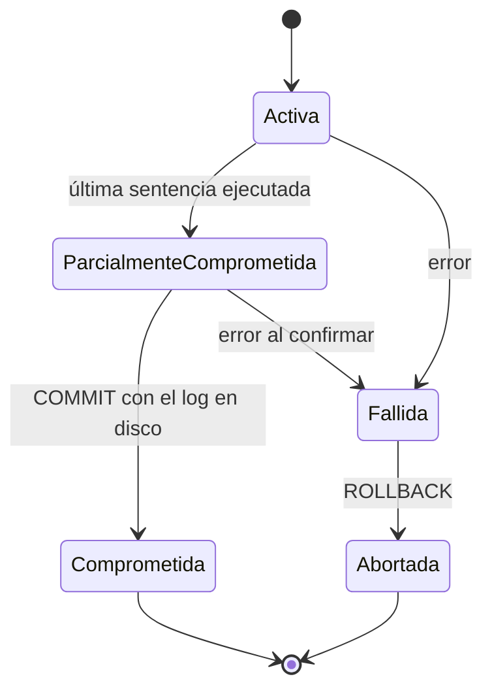

Una **transacción** es una unidad lógica de trabajo: un conjunto de operaciones que el motor trata como una sola, de modo que o se aplican todas o no se aplica ninguna. Sirve para que una operación de negocio que toca varias filas o tablas (una transferencia, una venta con su stock y su asiento contable) nunca quede a medio hacer, ni siquiera si el servidor se cae. El lenguaje que la controla es **TCL** (*Transaction Control Language*): `BEGIN TRANSACTION`, `COMMIT`, `ROLLBACK` y `SAVE TRANSACTION`.

Esta página trata el control de una transacción desde una sesión. Lo que pasa cuando **varias** transacciones se ejecutan a la vez (aislamiento, bloqueos, deadlocks, transacciones distribuidas) está en [Concurrencia, bloqueos y transacciones distribuidas](/bbdd-aplicadas/unidad-3/teoria/transacciones-concurrencia/). Las prácticas están en el [laboratorio TCL](/bbdd-aplicadas/unidad-3/practica/laboratorio-tcl/) y en el [laboratorio de aislamiento](/bbdd-aplicadas/unidad-3/practica/laboratorio-aislamiento/).

## Propiedades ACID

:::note[Definición]
Una transacción cumple cuatro propiedades, conocidas como **ACID**: atomicidad, consistencia, aislamiento y durabilidad.
:::

| Propiedad | Qué garantiza | Cómo lo logra SQL Server |
|---|---|---|
| **Atomicidad** | Todo o nada: si una parte falla, se revierten todas | `ROLLBACK` y el registro de transacciones (log) |
| **Consistencia** | La base pasa de un estado válido a otro estado válido | Restricciones (`CHECK`, `FOREIGN KEY`, `UNIQUE`, `NOT NULL`) y la lógica del programador |
| **Aislamiento** | El resultado de transacciones concurrentes equivale al de ejecutarlas una tras otra en algún orden | Bloqueos o versiones de fila (ver [concurrencia](/bbdd-aplicadas/unidad-3/teoria/transacciones-concurrencia/)) |
| **Durabilidad** | Lo confirmado persiste aunque el sistema falle | El log se escribe en disco antes de confirmar el `COMMIT` |

**Atomicidad.** En una transferencia se debita una cuenta y se acredita otra. Si el sistema falla entre las dos sentencias, sin transacción una cuenta quedaría debitada y la otra sin acreditar. Con una transacción, el motor deshace lo hecho hasta ese punto y ambas cuentas vuelven al estado original.

**Consistencia.** Es la propiedad que más depende de quien programa. Las reglas que declaramos en la base (un saldo no negativo con `CHECK`, un movimiento que referencia una cuenta existente con `FOREIGN KEY`) las verifica el motor y rechaza la sentencia que las viole. Las reglas que viven en la aplicación (por ejemplo, que el total de una factura coincida con la suma de sus ítems) son responsabilidad de quien escribe la transacción: el motor no las conoce.

**Aislamiento.** Dos cajeros que retiran dinero de la misma cuenta al mismo tiempo no deben pisarse. El caso clásico de dos transacciones que leen el mismo saldo y escriben después, perdiendo una de las dos escrituras (*lost update*), se desarrolla en [concurrencia](/bbdd-aplicadas/unidad-3/teoria/transacciones-concurrencia/#actualizacion-perdida).

**Durabilidad.** Se garantiza si (1) las modificaciones de la transacción llegan a disco antes de que se la dé por terminada y (2) lo que quedó en disco alcanza para reconstruirlas después de un fallo. En SQL Server eso lo hace el **registro de transacciones** (archivo `.ldf`): cada cambio se anota en el log antes de aplicarse a las páginas de datos (*write-ahead logging*), y el `COMMIT` solo termina cuando sus registros de log están en disco. Cómo se usa ese log para rehacer y deshacer tras un fallo se explica en [log y recuperación](/bbdd-aplicadas/unidad-5/teoria/log-recuperacion/).

### Estados de una transacción

Desde el punto de vista del modelo teórico, una transacción pasa por estos estados:



Una transacción **activa** está ejecutando sentencias. Queda **parcialmente comprometida** al terminar la última, pero todavía no es durable hasta que su `COMMIT` llega al log. Si algo sale mal pasa a **fallida** y, una vez deshechos sus cambios, a **abortada**.

<a id="modos-de-transaccion"></a>

## Modos de transacción

SQL Server tiene tres modos. Se diferencian por quién decide cuándo empieza y cuándo termina la transacción.

| Modo | Cómo empieza | Cómo termina |
|---|---|---|
| **Autocommit** (por defecto) | Cada sentencia abre su propia transacción | Se confirma sola al terminar la sentencia, o se revierte si falla |
| **Explícito** | `BEGIN TRANSACTION` | `COMMIT` o `ROLLBACK` |
| **Implícito** (`SET IMPLICIT_TRANSACTIONS ON`) | La primera sentencia que lo requiere abre la transacción | `COMMIT` o `ROLLBACK`, siempre explícito |

En **autocommit** cada sentencia es atómica por sí sola, pero dos sentencias seguidas no lo son entre sí: si la segunda falla, la primera ya está confirmada.

En el modo **implícito** el motor abre una transacción cuando se ejecuta una sentencia como `INSERT`, `UPDATE`, `DELETE`, `SELECT` sobre una tabla, `CREATE`, `DROP`, `OPEN` o `FETCH`, y no la cierra hasta que lo pidamos. La opción activa se puede consultar con `@@OPTIONS`: el bit 2 indica `IMPLICIT_TRANSACTIONS`.

Los ejemplos de esta página usan estas dos tablas. Ejecutalos en una base de pruebas propia, no en una de producción.

<!-- check: U3.T.TX.01 -->
```sql
IF SCHEMA_ID('banco') IS NULL
    EXEC ('CREATE SCHEMA banco');
GO
DROP TABLE IF EXISTS banco.Movimiento;
DROP TABLE IF EXISTS banco.Cuenta;
GO
CREATE TABLE banco.Cuenta (
    CuentaId INT           NOT NULL CONSTRAINT PK_Cuenta PRIMARY KEY,
    Titular  VARCHAR(40)   NOT NULL,
    Saldo    DECIMAL(12,2) NOT NULL CONSTRAINT CK_Cuenta_Saldo CHECK (Saldo >= 0)
);
CREATE TABLE banco.Movimiento (
    MovimientoId INT IDENTITY(1, 1) NOT NULL CONSTRAINT PK_Movimiento PRIMARY KEY,
    CuentaId     INT           NOT NULL CONSTRAINT FK_Movimiento_Cuenta REFERENCES banco.Cuenta (CuentaId),
    Tipo         CHAR(1)       NOT NULL CONSTRAINT CK_Movimiento_Tipo CHECK (Tipo IN ('D', 'C')),
    Monto        DECIMAL(12,2) NOT NULL CONSTRAINT CK_Movimiento_Monto CHECK (Monto > 0),
    Descripcion  VARCHAR(100)  NULL
);
GO
INSERT INTO banco.Cuenta (CuentaId, Titular, Saldo) VALUES
    (1, 'Cliente 01', 5000.00),
    (2, 'Cliente 02', 3200.00),
    (3, 'Cliente 03',  800.00);
GO

SELECT CuentaId, Titular, Saldo
FROM banco.Cuenta
ORDER BY CuentaId;
```

**Resultado esperado.**

| CuentaId | Titular | Saldo |
|---:|---|---:|
| 1 | Cliente 01 | 5000.00 |
| 2 | Cliente 02 | 3200.00 |
| 3 | Cliente 03 | 800.00 |

Observación de los modos. Las observaciones se guardan en una variable de tabla porque, a diferencia de una tabla temporal, **no se revierte** con un `ROLLBACK`: sirve para registrar lo que pasa dentro de una transacción.

<!-- check: U3.T.TX.02 -->
```sql
-- Autocommit: cada sentencia es su propia transacción.
DECLARE @Observacion TABLE (Orden INT, Paso VARCHAR(50), Trancount INT, ImplicitasActivas VARCHAR(3));

UPDATE banco.Cuenta SET Saldo = Saldo + 10 WHERE CuentaId = 1;
INSERT INTO @Observacion VALUES (1, 'después de un UPDATE en autocommit', @@TRANCOUNT,
    IIF(@@OPTIONS & 2 = 2, 'ON', 'OFF'));

-- Modo implícito: hasta un SELECT sobre una tabla abre la transacción.
SET IMPLICIT_TRANSACTIONS ON;
DECLARE @Filas INT, @Dentro INT, @Opcion VARCHAR(3);
SELECT @Filas = COUNT(*) FROM banco.Cuenta;
SET @Dentro = @@TRANCOUNT;
SET @Opcion = IIF(@@OPTIONS & 2 = 2, 'ON', 'OFF');
COMMIT TRANSACTION;
DECLARE @Despues INT = @@TRANCOUNT;
SET IMPLICIT_TRANSACTIONS OFF;

INSERT INTO @Observacion VALUES (2, 'después de un SELECT con IMPLICIT_TRANSACTIONS ON', @Dentro, @Opcion);
INSERT INTO @Observacion VALUES (3, 'después del COMMIT', @Despues, 'ON');
INSERT INTO @Observacion VALUES (4, 'con IMPLICIT_TRANSACTIONS OFF', @@TRANCOUNT, IIF(@@OPTIONS & 2 = 2, 'ON', 'OFF'));

SELECT Orden, Paso, Trancount, ImplicitasActivas FROM @Observacion ORDER BY Orden;
```

**Resultado esperado.**

| Orden | Paso | Trancount | ImplicitasActivas |
|---:|---|---:|---|
| 1 | después de un UPDATE en autocommit | 0 | OFF |
| 2 | después de un SELECT con IMPLICIT_TRANSACTIONS ON | 1 | ON |
| 3 | después del COMMIT | 0 | ON |
| 4 | con IMPLICIT_TRANSACTIONS OFF | 0 | OFF |

Un `SELECT` sobre una tabla ya abrió una transacción en modo implícito (`@@TRANCOUNT` = 1), y por eso el `COMMIT` es obligatorio. Cada fila `ImplicitasActivas` refleja el bit de `@@OPTIONS` en ese momento.

:::caution[Errores frecuentes]
Dejar `IMPLICIT_TRANSACTIONS ON` en una conexión es una fuente clásica de bloqueos: una transacción olvidada mantiene sus locks hasta que alguien la cierre. Usá el modo explícito para lo que requiera atomicidad.
:::

:::note[Cuidado al leer variables de sesión]
`@@TRANCOUNT`, `XACT_STATE()` y `@@OPTIONS` se evalúan **dentro** de la sentencia que los usa. Si los pasás directo a un `INSERT`, esa sentencia ya corre en su propia transacción de autocommit y el valor puede distorsionarse (`XACT_STATE()` devolvió 1 sin ninguna transacción abierta en una prueba). Por eso en los ejemplos se copian primero a una variable.
:::

## BEGIN, COMMIT y ROLLBACK

<!-- sintaxis -->
```sql
BEGIN TRANSACTION [ <nombre> ];
    -- sentencias
COMMIT TRANSACTION [ <nombre> ];      -- confirma
-- o
ROLLBACK TRANSACTION [ <nombre> ];    -- deshace
```

`BEGIN TRANSACTION` abre la transacción y suma 1 a `@@TRANCOUNT`. `COMMIT` confirma los cambios y los hace durables. `ROLLBACK` los deshace. El nombre es opcional; abreviar a `BEGIN TRAN` es válido. Referencia: [BEGIN TRANSACTION](https://learn.microsoft.com/es-es/sql/t-sql/language-elements/begin-transaction-transact-sql) en Microsoft Learn.

**Transferencia con `COMMIT`.** Los dos `UPDATE` y los dos movimientos se confirman juntos.

<!-- check: U3.T.TX.03 -->
```sql
DECLARE @Observacion TABLE (Orden INT, Momento VARCHAR(40), CuentaId INT, Saldo DECIMAL(12,2));

BEGIN TRANSACTION;
    UPDATE banco.Cuenta SET Saldo = Saldo - 500 WHERE CuentaId = 1;
    UPDATE banco.Cuenta SET Saldo = Saldo + 500 WHERE CuentaId = 2;
    INSERT INTO banco.Movimiento (CuentaId, Tipo, Monto, Descripcion) VALUES (1, 'D', 500, 'Transferencia a cuenta 2');
    INSERT INTO banco.Movimiento (CuentaId, Tipo, Monto, Descripcion) VALUES (2, 'C', 500, 'Transferencia de cuenta 1');
    INSERT INTO @Observacion SELECT 1, 'dentro de la transacción', CuentaId, Saldo
        FROM banco.Cuenta WHERE CuentaId IN (1, 2);
COMMIT TRANSACTION;

INSERT INTO @Observacion SELECT 2, 'después del COMMIT', CuentaId, Saldo
    FROM banco.Cuenta WHERE CuentaId IN (1, 2);

SELECT Orden, Momento, CuentaId, Saldo FROM @Observacion ORDER BY Orden, CuentaId;
```

**Resultado esperado.**

| Orden | Momento | CuentaId | Saldo |
|---:|---|---:|---:|
| 1 | dentro de la transacción | 1 | 4500.00 |
| 1 | dentro de la transacción | 2 | 3700.00 |
| 2 | después del COMMIT | 1 | 4500.00 |
| 2 | después del COMMIT | 2 | 3700.00 |

**Deshacer con `ROLLBACK`.** Dentro de la transacción vemos el cambio; después del `ROLLBACK` el saldo es el original.

<!-- check: U3.T.TX.04 -->
```sql
DECLARE @Observacion TABLE (Orden INT, Momento VARCHAR(40), CuentaId INT, Saldo DECIMAL(12,2));

BEGIN TRANSACTION;
    UPDATE banco.Cuenta SET Saldo = Saldo - 4000 WHERE CuentaId = 1;
    INSERT INTO @Observacion SELECT 1, 'dentro, antes del ROLLBACK', CuentaId, Saldo
        FROM banco.Cuenta WHERE CuentaId = 1;
ROLLBACK TRANSACTION;

INSERT INTO @Observacion SELECT 2, 'después del ROLLBACK', CuentaId, Saldo
    FROM banco.Cuenta WHERE CuentaId = 1;

SELECT Orden, Momento, CuentaId, Saldo FROM @Observacion ORDER BY Orden;
```

**Resultado esperado.**

| Orden | Momento | CuentaId | Saldo |
|---:|---|---:|---:|
| 1 | dentro, antes del ROLLBACK | 1 | 1000.00 |
| 2 | después del ROLLBACK | 1 | 5000.00 |

## SAVE TRANSACTION: puntos de guardado

Un **savepoint** marca un punto dentro de una transacción al que se puede volver sin cancelarla entera.

<!-- sintaxis -->
```sql
SAVE TRANSACTION <nombre_del_punto>;
ROLLBACK TRANSACTION <nombre_del_punto>;   -- vuelve al punto; la transacción sigue abierta
```

<!-- check: U3.T.TX.05 -->
```sql
DECLARE @Observacion TABLE (Orden INT, Momento VARCHAR(60), Trancount INT, SaldoCuenta3 DECIMAL(12,2));

BEGIN TRANSACTION;
    UPDATE banco.Cuenta SET Saldo = Saldo + 100 WHERE CuentaId = 3;
    SAVE TRANSACTION PuntoA;
    UPDATE banco.Cuenta SET Saldo = Saldo + 200 WHERE CuentaId = 3;
    SAVE TRANSACTION PuntoB;
    UPDATE banco.Cuenta SET Saldo = Saldo + 9999 WHERE CuentaId = 3;
    INSERT INTO @Observacion SELECT 1, 'antes del ROLLBACK a PuntoB', @@TRANCOUNT, Saldo
        FROM banco.Cuenta WHERE CuentaId = 3;

    ROLLBACK TRANSACTION PuntoB;
    INSERT INTO @Observacion SELECT 2, 'después del ROLLBACK a PuntoB', @@TRANCOUNT, Saldo
        FROM banco.Cuenta WHERE CuentaId = 3;
COMMIT TRANSACTION;

INSERT INTO @Observacion SELECT 3, 'después del COMMIT', @@TRANCOUNT, Saldo
    FROM banco.Cuenta WHERE CuentaId = 3;

SELECT Orden, Momento, Trancount, SaldoCuenta3 FROM @Observacion ORDER BY Orden;
```

**Resultado esperado.**

| Orden | Momento | Trancount | SaldoCuenta3 |
|---:|---|---:|---:|
| 1 | antes del ROLLBACK a PuntoB | 1 | 11099.00 |
| 2 | después del ROLLBACK a PuntoB | 1 | 1100.00 |
| 3 | después del COMMIT | 0 | 1100.00 |

El `ROLLBACK` a `PuntoB` deshizo solo el `+9999`: quedaron el `+100` y el `+200` (800 + 100 + 200 = 1100) y la transacción siguió abierta (`@@TRANCOUNT` = 1) hasta el `COMMIT`.

## @@TRANCOUNT y transacciones anidadas

`@@TRANCOUNT` cuenta cuántos `BEGIN TRANSACTION` hay abiertos en la sesión sin cerrar:

- `BEGIN TRANSACTION` suma 1.
- `COMMIT` resta 1. Los cambios solo se confirman de verdad cuando el contador llega a 0.
- `ROLLBACK` sin nombre de savepoint lleva el contador directo a 0 y deshace **todo**, sin importar cuántos `COMMIT` internos hubo.

<!-- check: U3.T.TX.06 -->
```sql
DECLARE @Observacion TABLE (Orden INT, Momento VARCHAR(60), Trancount INT, Detalle VARCHAR(80));

BEGIN TRANSACTION TxExterna;
    INSERT INTO @Observacion VALUES (1, 'BEGIN TRANSACTION TxExterna', @@TRANCOUNT, NULL);
    UPDATE banco.Cuenta SET Saldo = Saldo + 10 WHERE CuentaId = 1;

    BEGIN TRANSACTION TxInterna;
        INSERT INTO @Observacion VALUES (2, 'BEGIN TRANSACTION TxInterna', @@TRANCOUNT, NULL);
        UPDATE banco.Cuenta SET Saldo = Saldo + 20 WHERE CuentaId = 2;

        BEGIN TRY
            ROLLBACK TRANSACTION TxInterna;   -- no es un savepoint: error 6401
        END TRY
        BEGIN CATCH
            INSERT INTO @Observacion VALUES (3, 'ROLLBACK TRANSACTION TxInterna', @@TRANCOUNT,
                CONCAT('error ', ERROR_NUMBER()));
        END CATCH;
    COMMIT TRANSACTION TxInterna;
    INSERT INTO @Observacion VALUES (4, 'COMMIT de la interna', @@TRANCOUNT, 'no confirma nada todavía');
ROLLBACK TRANSACTION TxExterna;
INSERT INTO @Observacion VALUES (5, 'ROLLBACK TRANSACTION TxExterna', @@TRANCOUNT, 'revierte las dos');

INSERT INTO @Observacion
SELECT 6, 'saldos finales', @@TRANCOUNT, CONCAT('cuenta 1 = ', c1.Saldo, ', cuenta 2 = ', c2.Saldo)
FROM banco.Cuenta AS c1
JOIN banco.Cuenta AS c2 ON c2.CuentaId = 2
WHERE c1.CuentaId = 1;

SELECT Orden, Momento, Trancount, Detalle FROM @Observacion ORDER BY Orden;
```

**Resultado esperado.**

| Orden | Momento | Trancount | Detalle |
|---:|---|---:|---|
| 1 | BEGIN TRANSACTION TxExterna | 1 | `NULL` |
| 2 | BEGIN TRANSACTION TxInterna | 2 | `NULL` |
| 3 | ROLLBACK TRANSACTION TxInterna | 2 | error 6401 |
| 4 | COMMIT de la interna | 1 | no confirma nada todavía |
| 5 | ROLLBACK TRANSACTION TxExterna | 0 | revierte las dos |
| 6 | saldos finales | 0 | cuenta 1 = 5000.00, cuenta 2 = 3200.00 |

El `COMMIT` de la transacción interna solo bajó el contador a 1; el `ROLLBACK` externo deshizo las dos modificaciones. Además, `ROLLBACK TRANSACTION TxInterna` falló con el error 6401: el nombre de una transacción anidada **no es un savepoint** y solo se puede usar el nombre de la transacción más externa (o el de un `SAVE TRANSACTION`). Para el anidamiento lógico se usan savepoints, no `BEGIN TRANSACTION` repetidos.

## Control de errores: TRY/CATCH y XACT_STATE

Si una sentencia falla dentro de `BEGIN TRY`, la ejecución salta a `BEGIN CATCH`. Lo que ocurre con la transacción depende del error, y para saberlo se usa `XACT_STATE()`:

| `XACT_STATE()` | Significado | Qué se puede hacer |
|---|---|---|
| `1` | Hay una transacción activa y confirmable | `COMMIT` o `ROLLBACK` |
| `0` | No hay transacción | Nada que confirmar ni revertir |
| `-1` | Hay una transacción **condenada** (*uncommittable*) | Solo `ROLLBACK`; un `COMMIT` da el error 3930 |

`@@TRANCOUNT > 0` y `XACT_STATE() <> 0` se usan para decidir si hay algo que revertir. `XACT_STATE()` agrega la información de si la transacción todavía se puede confirmar.

<!-- check: U3.T.TX.07 -->
```sql
DECLARE @Observacion TABLE (Orden INT, Momento VARCHAR(60), Valor VARCHAR(80));

DECLARE @EstadoInicial INT = XACT_STATE();   -- se lee en una variable: dentro de un INSERT ya hay una transacción
INSERT INTO @Observacion VALUES (1, 'XACT_STATE() sin transacción', CAST(@EstadoInicial AS VARCHAR(10)));

BEGIN TRANSACTION;
BEGIN TRY
    UPDATE banco.Cuenta SET Saldo = Saldo - 6000 WHERE CuentaId = 3;   -- viola CK_Cuenta_Saldo
    INSERT INTO banco.Movimiento (CuentaId, Tipo, Monto, Descripcion) VALUES (3, 'D', 6000, 'Débito grande');
    COMMIT TRANSACTION;
END TRY
BEGIN CATCH
    DECLARE @Estado INT = XACT_STATE(), @Error INT = ERROR_NUMBER(), @Severidad INT = ERROR_SEVERITY(),
            @Anidamiento INT = @@TRANCOUNT;
    INSERT INTO @Observacion VALUES (2, 'ERROR_NUMBER()', CAST(@Error AS VARCHAR(10)));
    INSERT INTO @Observacion VALUES (3, 'ERROR_SEVERITY()', CAST(@Severidad AS VARCHAR(10)));
    INSERT INTO @Observacion VALUES (4, 'XACT_STATE() dentro del CATCH', CAST(@Estado AS VARCHAR(10)));
    INSERT INTO @Observacion VALUES (5, '@@TRANCOUNT dentro del CATCH', CAST(@Anidamiento AS VARCHAR(10)));
    IF @Estado <> 0
        ROLLBACK TRANSACTION;
END CATCH;

INSERT INTO @Observacion VALUES (6, '@@TRANCOUNT al final', CAST(@@TRANCOUNT AS VARCHAR(10)));
INSERT INTO @Observacion SELECT 7, 'saldo de la cuenta 3', CAST(Saldo AS VARCHAR(20)) FROM banco.Cuenta WHERE CuentaId = 3;
INSERT INTO @Observacion SELECT 8, 'movimientos registrados', CAST(COUNT(*) AS VARCHAR(10)) FROM banco.Movimiento;

SELECT Orden, Momento, Valor FROM @Observacion ORDER BY Orden;
```

**Resultado esperado.**

| Orden | Momento | Valor |
|---:|---|---|
| 1 | XACT_STATE() sin transacción | 0 |
| 2 | ERROR_NUMBER() | 547 |
| 3 | ERROR_SEVERITY() | 16 |
| 4 | XACT_STATE() dentro del CATCH | 1 |
| 5 | @@TRANCOUNT dentro del CATCH | 1 |
| 6 | @@TRANCOUNT al final | 0 |
| 7 | saldo de la cuenta 3 | 800.00 |
| 8 | movimientos registrados | 0 |

Una violación de `CHECK` (547, severidad 16) con `XACT_ABORT OFF` terminó solo la sentencia: la transacción quedó activa (`XACT_STATE()` = 1) y el `CATCH` decidió revertirla.

El `BEGIN TRANSACTION` puede ir antes o dentro del `TRY`: ambas formas son válidas. Lo que importa es que el `CATCH` decida con `XACT_STATE()` si hay algo que revertir, porque puede ejecutarse sin transacción abierta (por ejemplo, si el error ocurrió antes del `BEGIN`).

### Funciones de error disponibles en CATCH

| Función | Devuelve |
|---|---|
| `ERROR_NUMBER()` | Número del error |
| `ERROR_MESSAGE()` | Texto del error |
| `ERROR_SEVERITY()` | Severidad (1 a 25) |
| `ERROR_STATE()` | Estado del error |
| `ERROR_LINE()` | Línea donde ocurrió |
| `ERROR_PROCEDURE()` | Procedimiento o trigger donde ocurrió, o `NULL` |

Solo devuelven valores dentro del bloque `CATCH`. Para relanzar el error original sin perder información, `THROW;` sin argumentos (SQL Server 2012 o posterior).

## XACT_ABORT

`SET XACT_ABORT ON` hace que un error en tiempo de ejecución termine el lote y revierta la transacción abierta, en lugar de terminar solo la sentencia. Con `XACT_ABORT ON` y un `TRY/CATCH`, el error salta al `CATCH` y la transacción queda condenada (`XACT_STATE() = -1`).

| Error dentro de una transacción explícita | `XACT_ABORT OFF` *(defecto)* | `XACT_ABORT ON` |
|---|---|---|
| Violación de restricción (547) o desbordamiento aritmético (220) | Termina **solo la sentencia**: la transacción sigue activa y lo hecho antes se puede confirmar (`XACT_STATE() = 1`) | La transacción queda condenada y se revierte (`XACT_STATE() = -1`) |
| Error de conversión (245) | La transacción queda condenada (`XACT_STATE() = -1`) | La transacción queda condenada (`XACT_STATE() = -1`) |
| Ejecución posterior | Sin `TRY/CATCH`, el lote sigue con la sentencia siguiente si el error solo terminó la sentencia | El lote se interrumpe |

Con `OFF`, una violación de restricción **no** revierte la transacción: si el código no controla el error y confirma, queda guardada la parte que sí se ejecutó. Por eso conviene `SET XACT_ABORT ON` en los procedimientos que abren transacciones.

### Comprobación

El siguiente experimento provoca cada error dentro de `TRY/CATCH` y registra `XACT_STATE()` y si la fila válida insertada antes del error quedó confirmada.

<!-- check: U3.XA.01 -->
```sql
CREATE TABLE dbo.Cuenta
(
    CuentaId INT          NOT NULL PRIMARY KEY,
    Saldo    DECIMAL(9,2) NOT NULL CONSTRAINT CK_Cuenta_Saldo CHECK (Saldo >= 0),
    Nivel    TINYINT      NULL,
    Caso     VARCHAR(20)  NOT NULL
);
CREATE TABLE dbo.Observacion
(
    Caso VARCHAR(20), XactAbort VARCHAR(3), Error INT, XactState INT, FilaValidaConfirmada INT
);
GO
CREATE PROCEDURE dbo.Probar
    @Caso VARCHAR(20),
    @XactAbort BIT
AS
BEGIN
    IF @XactAbort = 1 SET XACT_ABORT ON ELSE SET XACT_ABORT OFF;
    BEGIN TRY
        BEGIN TRANSACTION;
        INSERT dbo.Cuenta VALUES (1, 100, NULL, @Caso);
        IF @Caso = 'restriccion' INSERT dbo.Cuenta VALUES (2, -5, NULL, @Caso);
        IF @Caso = 'desbordamiento' INSERT dbo.Cuenta VALUES (2, 100, 300, @Caso);
        IF @Caso = 'conversion' INSERT dbo.Cuenta VALUES (CAST('ocho' AS INT), 100, NULL, @Caso);
        COMMIT;
    END TRY
    BEGIN CATCH
        DECLARE @Estado INT = XACT_STATE(), @Error INT = ERROR_NUMBER();
        IF @Estado = 1 COMMIT;      -- la fila válida se confirma
        IF @Estado = -1 ROLLBACK;   -- transacción condenada: solo se puede revertir
        INSERT dbo.Observacion (Caso, XactAbort, Error, XactState)
        VALUES (@Caso, IIF(@XactAbort = 1, 'ON', 'OFF'), @Error, @Estado);
    END CATCH;
    UPDATE dbo.Observacion
    SET FilaValidaConfirmada = (SELECT COUNT(*) FROM dbo.Cuenta WHERE Caso = @Caso)
    WHERE Caso = @Caso AND XactAbort = IIF(@XactAbort = 1, 'ON', 'OFF');
    DELETE dbo.Cuenta;
END;
GO
EXEC dbo.Probar 'restriccion', 0;
EXEC dbo.Probar 'restriccion', 1;
EXEC dbo.Probar 'desbordamiento', 0;
EXEC dbo.Probar 'desbordamiento', 1;
EXEC dbo.Probar 'conversion', 0;
EXEC dbo.Probar 'conversion', 1;
GO
SELECT Caso, XactAbort, Error, XactState, FilaValidaConfirmada
FROM dbo.Observacion
ORDER BY Caso, XactAbort;
```

**Resultado esperado** (SQL Server 2022):

| Caso | XactAbort | Error | XactState | FilaValidaConfirmada |
|---|---|---:|---:|---:|
| conversion | OFF | 245 | -1 | 0 |
| conversion | ON | 245 | -1 | 0 |
| desbordamiento | OFF | 220 | 1 | 1 |
| desbordamiento | ON | 220 | -1 | 0 |
| restriccion | OFF | 547 | 1 | 1 |
| restriccion | ON | 547 | -1 | 0 |

:::note[Qué cambia `XACT_ABORT`]
Con `OFF`, una violación de restricción o un desbordamiento aritmético terminan solo la sentencia y la transacción sigue abierta: si el código sigue y confirma, queda guardada la parte que sí se ejecutó. Con `ON`, esos mismos errores condenan la transacción. El error de conversión de tipos (245) la condena en ambos casos. Por eso conviene `SET XACT_ABORT ON` en los procedimientos que abren transacciones.
:::

**Una transacción condenada no se confirma.** Después de un error con `XACT_ABORT ON`, el `CATCH` recibe `XACT_STATE() = -1`. Un `COMMIT` falla con el error 3930 y solo queda `ROLLBACK`.

<!-- check: U3.T.TX.09 -->
```sql
DECLARE @Observacion TABLE (Orden INT, Momento VARCHAR(60), Valor VARCHAR(80));
DECLARE @Estado INT, @Error INT;

SET XACT_ABORT ON;
BEGIN TRY
    BEGIN TRANSACTION;
    INSERT INTO banco.Movimiento (CuentaId, Tipo, Monto, Descripcion) VALUES (1, 'C', 10, 'válido');
    INSERT INTO banco.Movimiento (CuentaId, Tipo, Monto, Descripcion) VALUES (99, 'C', 10, 'cuenta inexistente');
    COMMIT TRANSACTION;
END TRY
BEGIN CATCH
    SET @Estado = XACT_STATE();
    SET @Error = ERROR_NUMBER();
    INSERT INTO @Observacion VALUES (1, 'error original', CAST(@Error AS VARCHAR(10)));
    INSERT INTO @Observacion VALUES (2, 'XACT_STATE()', CAST(@Estado AS VARCHAR(10)));

    -- Con XACT_STATE() = -1 la transacción no admite COMMIT ni escrituras.
    BEGIN TRY
        COMMIT TRANSACTION;
    END TRY
    BEGIN CATCH
        INSERT INTO @Observacion VALUES (3, 'COMMIT sobre transacción condenada', CAST(ERROR_NUMBER() AS VARCHAR(10)));
    END CATCH;

    IF XACT_STATE() = -1
        ROLLBACK TRANSACTION;
    INSERT INTO @Observacion VALUES (4, 'movimientos después del ROLLBACK',
        CAST((SELECT COUNT(*) FROM banco.Movimiento) AS VARCHAR(10)));
END CATCH;
SET XACT_ABORT OFF;

SELECT Orden, Momento, Valor FROM @Observacion ORDER BY Orden;
```

**Resultado esperado.**

| Orden | Momento | Valor |
|---:|---|---|
| 1 | error original | 547 |
| 2 | XACT_STATE() | -1 |
| 3 | COMMIT sobre transacción condenada | 3930 |
| 4 | movimientos después del ROLLBACK | 0 |

## Patrón de procedimiento transaccional

Reúne lo anterior en un procedimiento con una forma fija:

1. `SET XACT_ABORT ON`, para que ningún error deje la transacción a medias.
2. Validar los parámetros **antes** de abrir la transacción.
3. `BEGIN TRY` / `BEGIN TRANSACTION`, el trabajo, `COMMIT`.
4. `BEGIN CATCH`: `IF XACT_STATE() <> 0 ROLLBACK`, y `THROW;` para que el llamador vea el error original.

El ejemplo valida solo la cuenta **de origen** (un chequeo global sobre toda la tabla cancelaría la transferencia por el saldo de otra cuenta) y lee ese saldo con `UPDLOCK`, para que nadie lo modifique entre la lectura y el débito. Después prueba cuatro llamadas; el procedimiento auxiliar `Probar` solo registra el error de cada una.

<!-- check: U3.T.TX.08 -->
```sql
CREATE OR ALTER PROCEDURE banco.TransferirSaldo
    @Origen  INT,
    @Destino INT,
    @Monto   DECIMAL(12, 2)
AS
BEGIN
    SET NOCOUNT ON;
    SET XACT_ABORT ON;

    IF @Monto <= 0
        THROW 50001, 'El monto debe ser mayor que cero.', 1;

    BEGIN TRY
        BEGIN TRANSACTION;

        IF NOT EXISTS (SELECT 1 FROM banco.Cuenta WHERE CuentaId = @Destino)
            THROW 50002, 'La cuenta destino no existe.', 1;

        IF (SELECT Saldo FROM banco.Cuenta WITH (UPDLOCK) WHERE CuentaId = @Origen) < @Monto
            THROW 50003, 'Saldo insuficiente en la cuenta origen.', 1;

        UPDATE banco.Cuenta SET Saldo = Saldo - @Monto WHERE CuentaId = @Origen;
        UPDATE banco.Cuenta SET Saldo = Saldo + @Monto WHERE CuentaId = @Destino;

        INSERT INTO banco.Movimiento (CuentaId, Tipo, Monto, Descripcion)
        VALUES (@Origen, 'D', @Monto, CONCAT('Transferencia a cuenta ', @Destino)),
               (@Destino, 'C', @Monto, CONCAT('Transferencia de cuenta ', @Origen));

        COMMIT TRANSACTION;
    END TRY
    BEGIN CATCH
        IF XACT_STATE() <> 0
            ROLLBACK TRANSACTION;
        THROW;
    END CATCH;
END;
GO
DROP TABLE IF EXISTS banco.Resultado;
GO
CREATE TABLE banco.Resultado (Orden INT, Llamada VARCHAR(40), Error INT, Trancount INT);
GO
CREATE OR ALTER PROCEDURE banco.Probar @Orden INT, @Llamada VARCHAR(40), @Origen INT, @Destino INT, @Monto DECIMAL(12, 2)
AS
BEGIN
    DECLARE @Error INT = 0, @Anidamiento INT;
    BEGIN TRY
        EXEC banco.TransferirSaldo @Origen, @Destino, @Monto;
    END TRY
    BEGIN CATCH
        SET @Error = ERROR_NUMBER();
    END CATCH;
    SET @Anidamiento = @@TRANCOUNT;   -- se lee antes del INSERT
    INSERT INTO banco.Resultado VALUES (@Orden, @Llamada, @Error, @Anidamiento);
END;
GO
EXEC banco.Probar 1, 'cuenta 1 a 2, 200',      1, 2, 200;
EXEC banco.Probar 2, 'cuenta 3 a 1, 5000',     3, 1, 5000;
EXEC banco.Probar 3, 'cuenta 1 a 99, 100',     1, 99, 100;
EXEC banco.Probar 4, 'cuenta 1 a 2, monto -50', 1, 2, -50;

SELECT Orden, Llamada, Error, Trancount FROM banco.Resultado ORDER BY Orden;

SELECT CuentaId, Saldo FROM banco.Cuenta ORDER BY CuentaId;

SELECT COUNT(*) AS Movimientos FROM banco.Movimiento;
```

**Resultado esperado.**

Llamadas (error 0 significa que terminó bien):

| Orden | Llamada | Error | Trancount |
|---:|---|---:|---:|
| 1 | cuenta 1 a 2, 200 | 0 | 0 |
| 2 | cuenta 3 a 1, 5000 | 50003 | 0 |
| 3 | cuenta 1 a 99, 100 | 50002 | 0 |
| 4 | cuenta 1 a 2, monto -50 | 50001 | 0 |

Saldos finales (solo la primera transferencia se aplicó):

| CuentaId | Saldo |
|---:|---:|
| 1 | 4800.00 |
| 2 | 3400.00 |
| 3 | 800.00 |

Movimientos registrados (dos, los de la transferencia que salió bien):

| Movimientos |
|---:|
| 2 |

:::tip[THROW y RAISERROR]
`THROW` sin argumentos dentro de `CATCH` relanza el error original, con su número, mensaje, severidad y estado. Con `RAISERROR` hay que reconstruir esos datos a mano. En código nuevo, `THROW` es lo habitual; `RAISERROR` sigue siendo válido.
:::

### Un procedimiento llamado dentro de otra transacción

Si el procedimiento puede llamarse desde otro que ya abrió una transacción, un `ROLLBACK` incondicional adentro revertiría también el trabajo del llamador. La alternativa es ver el `@@TRANCOUNT` de entrada: abrir una transacción propia si es 0 y, si no, usar un savepoint. Se resuelve en el ejercicio [U3.10](/bbdd-aplicadas/unidad-3/practica/laboratorio-tcl/).

## Errores frecuentes

:::caution[Errores frecuentes]
- **`ROLLBACK` sin comprobar si hay transacción.** Si el error ocurrió antes del `BEGIN TRANSACTION`, el `ROLLBACK` falla con el error 3903 y tapa el error original. Se resuelve con `IF XACT_STATE() <> 0` antes del `ROLLBACK`. Se muestra ejecutado en el ejercicio [U3.08](/bbdd-aplicadas/unidad-3/practica/laboratorio-tcl/).
- **Creer que el `COMMIT` interno confirma.** Solo baja `@@TRANCOUNT`; confirma el último.
- **Usar el nombre de una transacción interna en `ROLLBACK`.** Da el error 6401.
- **`ROLLBACK TO` después de un error que condenó la transacción.** Con `XACT_STATE() = -1` no hay vuelta atrás parcial.
- **Transacciones largas o con interacción del usuario adentro.** Mantienen locks mucho tiempo (ver [bloqueos](/bbdd-aplicadas/unidad-3/teoria/transacciones-concurrencia/#bloqueos-y-esperas)).
:::

## Autoevaluación

<details>
<summary>1. En autocommit, ¿dos `UPDATE` seguidos son atómicos entre sí?</summary>

No. Cada sentencia es su propia transacción: si el segundo falla, el primero ya está confirmado. Para atomicidad entre sentencias hace falta una transacción explícita.
</details>

<details>
<summary>2. Con `@@TRANCOUNT = 2`, ¿qué pasa al ejecutar `ROLLBACK TRANSACTION` sin nombre?</summary>

Deshace todo y el contador pasa a 0, aunque haya habido un `COMMIT` interno.
</details>

<details>
<summary>3. ¿Qué diferencia hay entre `XACT_STATE() = 1` y `-1` en un `CATCH`?</summary>

Con 1 la transacción sigue siendo confirmable (por ejemplo, tras un error que solo terminó la sentencia con `XACT_ABORT OFF`). Con -1 está condenada: solo se puede revertir.
</details>

<details>
<summary>4. ¿Por qué se valida el saldo antes de abrir la transacción o con `UPDLOCK` dentro de ella?</summary>

Una validación previa evita abrir una transacción que se sabe que va a fallar. Si la validación depende de datos que otra sesión puede modificar, hay que leerlos dentro de la transacción con un bloqueo que impida el cambio entre la lectura y el débito (`UPDLOCK`).
</details>

:::tip[En resumen]
- ACID: atomicidad (todo o nada), consistencia (estado válido a estado válido), aislamiento (como si se ejecutaran en serie) y durabilidad (lo confirmado persiste, gracias al log).
- Modos: autocommit (por sentencia), explícito (`BEGIN`/`COMMIT`/`ROLLBACK`) e implícito (`IMPLICIT_TRANSACTIONS ON`, que obliga a cerrar).
- `@@TRANCOUNT` cuenta los `BEGIN`; solo el `COMMIT` que lo lleva a 0 confirma, y un `ROLLBACK` sin nombre lo deshace todo.
- `SAVE TRANSACTION` permite revertir parcialmente sin cerrar la transacción.
- En `CATCH`, `XACT_STATE()` indica si hay transacción y si se puede confirmar. Con `XACT_ABORT ON` los errores condenan la transacción.
- Procedimiento transaccional: `XACT_ABORT ON`, validar antes, `TRY/CATCH`, `ROLLBACK` condicionado y `THROW;`.
:::

## Fuentes

- Presentación de cátedra, Unidad 3, transacciones (TCL), v1.0, 2023.
- Microsoft Learn: [Transacciones (Transact-SQL)](https://learn.microsoft.com/es-es/sql/t-sql/language-elements/transactions-transact-sql), [SET XACT_ABORT](https://learn.microsoft.com/es-es/sql/t-sql/statements/set-xact-abort-transact-sql), [XACT_STATE](https://learn.microsoft.com/es-es/sql/t-sql/functions/xact-state-transact-sql), [TRY...CATCH](https://learn.microsoft.com/es-es/sql/t-sql/language-elements/try-catch-transact-sql), [SET IMPLICIT_TRANSACTIONS](https://learn.microsoft.com/es-es/sql/t-sql/statements/set-implicit-transactions-transact-sql).
- Silberschatz, Korth y Sudarshan, *Fundamentos de bases de datos*, capítulo de transacciones.
