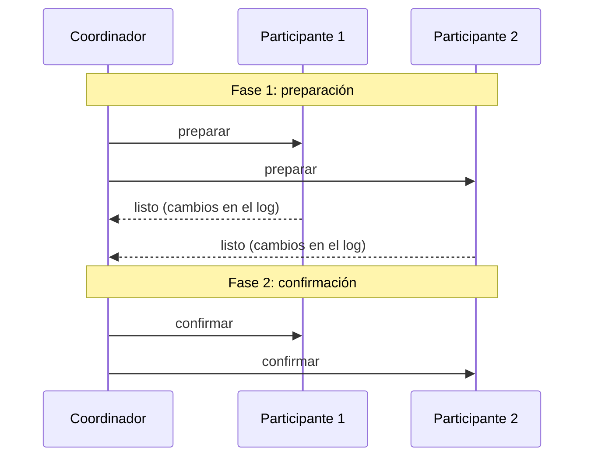

Un servidor de base de datos atiende muchas sesiones a la vez. Si cada una trabajara sobre sus propios datos no habría problema, pero casi siempre varias leen y modifican las mismas filas. El **control de concurrencia** es el conjunto de reglas con que el motor decide quién espera y qué ve cada transacción, para que el resultado siga siendo correcto. Esta página trata ese control, los **bloqueos y esperas** que produce y las **transacciones distribuidas**, que abarcan más de un servidor.

Cómo se abre, se confirma y se deshace una transacción desde una sesión está en [Control de transacciones (TCL)](/bbdd-aplicadas/unidad-3/teoria/transacciones-y-concurrencia/). Los experimentos con dos sesiones están en el [laboratorio de aislamiento](/bbdd-aplicadas/unidad-3/practica/laboratorio-aislamiento/) y en el [laboratorio TCL](/bbdd-aplicadas/unidad-3/practica/laboratorio-tcl/).

:::note[Qué está verificado en motor y qué no]
Los ejemplos de **una sola sesión** (locks propios, versiones de fila, `SET TRANSACTION ISOLATION LEVEL` dentro de un procedimiento) se ejecutaron en SQL Server 2022 y su resultado esperado es el real. Los que necesitan **dos sesiones** (bloqueos entre sesiones, deadlocks, lectura sucia, fantasmas) o un **servidor vinculado con MS DTC** se presentan como guiones paso a paso: el comportamiento que se describe es el que garantiza la documentación de Microsoft, pero esos guiones no se ejecutan en la verificación automática y figuran como pendientes de verificación específica.
:::

Los ejemplos usan las tablas `banco.Cuenta` y `banco.Movimiento` de [TCL](/bbdd-aplicadas/unidad-3/teoria/transacciones-y-concurrencia/#modos-de-transaccion) (la definición completa está en el [laboratorio de aislamiento](/bbdd-aplicadas/unidad-3/practica/laboratorio-aislamiento/#entorno)).

## Planificaciones: serie y serializable

Cuando varias transacciones se ejecutan a la vez, sus operaciones de lectura y escritura se **intercalan**. El orden de esa intercalación es una **planificación**.

:::note[Definición]
- Una planificación es **en serie** (secuencial) si ejecuta cada transacción completa antes de empezar la siguiente.
- Una planificación es **serializable** si es equivalente a alguna planificación en serie: produce el mismo estado final y las mismas lecturas.
:::

La propiedad de aislamiento de ACID pide exactamente eso: que el resultado de ejecutar transacciones en forma concurrente equivalga al de ejecutarlas una tras otra en algún orden. Los esquemas de control de concurrencia que siguen (bloqueos y versiones de fila) buscan producir planificaciones serializables, o acercarse a ellas con un costo menor según el nivel de aislamiento elegido.

Dos operaciones de transacciones distintas **entran en conflicto** si acceden al mismo dato y al menos una es una escritura. El orden de las operaciones en conflicto es el que importa: dos planificaciones con los mismos pares conflictivos en el mismo orden son equivalentes.

Sean dos transacciones que leen y escriben `A` y `B`: `T1 = R(A) W(A) R(B) W(B)` y `T2 = R(A) W(A) R(B) W(B)`.

| Planificación | Orden de operaciones | ¿Serializable? |
|---|---|---|
| S1 | `T1` completa, luego `T2` completa | Sí: es en serie |
| S2 | `R1(A) W1(A) R2(A) W2(A) R1(B) W1(B) R2(B) W2(B)` | Sí: sobre `A` y sobre `B` siempre va primero `T1`, equivale a `T1; T2` |
| S3 | `R1(A) W1(A) R2(A) W2(A) R2(B) W2(B) R1(B) W1(B)` | No: sobre `A` va primero `T1` y sobre `B` va primero `T2`; no equivale a ninguna de las dos series |

En S3 hay un ciclo: `T1` debe ir antes que `T2` por `A` y `T2` antes que `T1` por `B`. Ninguna ejecución en serie reproduce ese resultado, así que el motor debe impedirla (con bloqueos, `T2` esperaría a `T1` en `A`).

<a id="actualizacion-perdida"></a>

### Un caso no serializable: la actualización perdida

Dos cajeros atienden la misma cuenta, con saldo 1000. A retira 700 y B retira 600. Ambos leen el saldo antes de que el otro escriba:

| Paso | Cajero A | Cajero B |
|---|---|---|
| 1 | Lee el saldo: 1000 | |
| 2 | | Lee el saldo: 1000 |
| 3 | Calcula 1000 − 700 = 300 | |
| 4 | | Calcula 1000 − 600 = 400 |
| 5 | Escribe 300 | |
| 6 | | Escribe 400 (pisa el paso 5) |

El saldo final es 400. En cualquier ejecución en serie habría quedado −300 o, con una validación, uno de los retiros rechazado. Se perdió el retiro de A. A este fenómeno se lo llama **actualización perdida** (*lost update*). No es uno de los tres fenómenos que define el estándar (lectura sucia, no repetible y fantasma), pero es el efecto de una planificación no serializable. Se previene tomando un lock de actualización al leer (`UPDLOCK`), con `REPEATABLE READ` o más, con `SNAPSHOT` (el segundo escritor recibe el error 3960) o con control optimista, como se muestra en el ejercicio [U3.18](/bbdd-aplicadas/unidad-3/practica/laboratorio-aislamiento/).

## Bloqueos: S y X y su duración

El mecanismo clásico para lograr serializabilidad es el **bloqueo** (*lock*). Un dato solo se lee o se escribe después de obtener un lock sobre él. Los dos modos básicos son:

| Modo | Se pide para | Qué permite |
|---|---|---|
| **Compartido** (`S`; en la bibliografía en español se lo denota `C`) | Leer | La transacción puede leer el dato pero no escribirlo. Varias pueden tener `S` sobre el mismo dato |
| **Exclusivo** (`X`) | Escribir | La transacción puede leer y escribir el dato. Nadie más puede tener un lock sobre él |

Reglas de compatibilidad: `S` es compatible con `S`; `X` no es compatible con nada. Si una transacción pide un lock incompatible con uno ya concedido, **espera** hasta que se libere.

**Duración.** Cuánto tiempo se mantiene un lock depende de su modo y del nivel de aislamiento:

- El lock **exclusivo** que toma una modificación se mantiene **hasta que la transacción termina**, con `COMMIT` o `ROLLBACK`, **cualquiera sea el nivel de aislamiento**, incluido `READ UNCOMMITTED`. Elegir un nivel de aislamiento no afecta a los locks que protegen las modificaciones.
- El lock **compartido** de una lectura es lo que cambia entre niveles: en `READ COMMITTED` se suelta apenas se lee la fila; en `REPEATABLE READ` y `SERIALIZABLE` se mantiene hasta el final de la transacción.

Se puede ver con `sys.dm_tran_locks`, que lista los locks concedidos y solicitados. El ejemplo hace un `UPDATE` sin confirmar, lista los locks de **esta** sesión y repite la consulta después del `COMMIT`.

<!-- check: U3.T.CC.01 -->
```sql
DECLARE @Candado TABLE (Orden INT, Momento VARCHAR(50), Recurso VARCHAR(20), Modo VARCHAR(10), Cantidad INT);
DECLARE @Dato DECIMAL(12,2);

BEGIN TRANSACTION;
    UPDATE banco.Cuenta SET Saldo = Saldo + 1 WHERE CuentaId = 1;
    SELECT @Dato = Saldo FROM banco.Cuenta WHERE CuentaId = 2;      -- lectura en READ COMMITTED

    INSERT INTO @Candado
    SELECT 1, 'antes del COMMIT', resource_type, request_mode, COUNT(*)
    FROM sys.dm_tran_locks
    WHERE request_session_id = @@SPID AND resource_database_id = DB_ID() AND resource_type <> 'DATABASE'
    GROUP BY resource_type, request_mode;
COMMIT TRANSACTION;

INSERT INTO @Candado
SELECT 2, 'después del COMMIT', resource_type, request_mode, COUNT(*)
FROM sys.dm_tran_locks
WHERE request_session_id = @@SPID AND resource_database_id = DB_ID() AND resource_type <> 'DATABASE'
GROUP BY resource_type, request_mode;

SELECT Orden, Momento, Recurso, Modo, Cantidad FROM @Candado ORDER BY Orden, Recurso, Modo;
SELECT COUNT(*) AS LocksDespuesDelCommit FROM @Candado WHERE Orden = 2;
```

**Resultado esperado.**

Locks antes del `COMMIT`:

| Orden | Momento | Recurso | Modo | Cantidad |
|---:|---|---|---|---:|
| 1 | antes del COMMIT | KEY | X | 1 |
| 1 | antes del COMMIT | OBJECT | IX | 1 |
| 1 | antes del COMMIT | PAGE | IX | 1 |

Filas de locks que quedan después del `COMMIT`:

| LocksDespuesDelCommit |
|---:|
| 0 |

Hay un lock `X` sobre la **fila** (`KEY`) y locks de intención `IX` sobre la página y la tabla (`OBJECT`), que avisan que hay un lock exclusivo más abajo en la jerarquía. Todos desaparecen con el `COMMIT`. La lectura de la cuenta 2 en `READ COMMITTED` no dejó ningún lock `S`.

### Qué mantiene cada nivel

El siguiente ejemplo lee las cuentas 1 y 2 en tres niveles y lista los locks que quedan **mientras la transacción sigue abierta**.

<!-- check: U3.T.CC.02 -->
```sql
DECLARE @Candado TABLE (Orden INT, Nivel VARCHAR(20), Recurso VARCHAR(20), Modo VARCHAR(10), Cantidad INT);
DECLARE @Total DECIMAL(12,2);

SET TRANSACTION ISOLATION LEVEL READ COMMITTED;
BEGIN TRANSACTION;
    SELECT @Total = SUM(Saldo) FROM banco.Cuenta WHERE CuentaId BETWEEN 1 AND 2;
    INSERT INTO @Candado
    SELECT 1, 'READ COMMITTED', resource_type, request_mode, COUNT(*) FROM sys.dm_tran_locks
    WHERE request_session_id = @@SPID AND resource_database_id = DB_ID() AND resource_type <> 'DATABASE'
    GROUP BY resource_type, request_mode;
COMMIT TRANSACTION;

SET TRANSACTION ISOLATION LEVEL REPEATABLE READ;
BEGIN TRANSACTION;
    SELECT @Total = SUM(Saldo) FROM banco.Cuenta WHERE CuentaId BETWEEN 1 AND 2;
    INSERT INTO @Candado
    SELECT 2, 'REPEATABLE READ', resource_type, request_mode, COUNT(*) FROM sys.dm_tran_locks
    WHERE request_session_id = @@SPID AND resource_database_id = DB_ID() AND resource_type <> 'DATABASE'
    GROUP BY resource_type, request_mode;
COMMIT TRANSACTION;

SET TRANSACTION ISOLATION LEVEL SERIALIZABLE;
BEGIN TRANSACTION;
    SELECT @Total = SUM(Saldo) FROM banco.Cuenta WHERE CuentaId BETWEEN 1 AND 2;
    INSERT INTO @Candado
    SELECT 3, 'SERIALIZABLE', resource_type, request_mode, COUNT(*) FROM sys.dm_tran_locks
    WHERE request_session_id = @@SPID AND resource_database_id = DB_ID() AND resource_type <> 'DATABASE'
    GROUP BY resource_type, request_mode;
COMMIT TRANSACTION;
SET TRANSACTION ISOLATION LEVEL READ COMMITTED;

IF NOT EXISTS (SELECT 1 FROM @Candado WHERE Orden = 1)
    INSERT INTO @Candado VALUES (1, 'READ COMMITTED', '(ninguno)', '', 0);

SELECT Nivel, Recurso, Modo, Cantidad FROM @Candado ORDER BY Orden, Recurso, Modo;
```

**Resultado esperado.**

| Nivel | Recurso | Modo | Cantidad |
|---|---|---|---:|
| READ COMMITTED | (ninguno) |  | 0 |
| REPEATABLE READ | KEY | S | 2 |
| REPEATABLE READ | OBJECT | IS | 1 |
| REPEATABLE READ | PAGE | IS | 1 |
| SERIALIZABLE | KEY | RangeS-S | 3 |
| SERIALIZABLE | OBJECT | IS | 1 |
| SERIALIZABLE | PAGE | IS | 1 |

- En `READ COMMITTED` los locks `S` ya se soltaron: no queda ninguno.
- En `REPEATABLE READ` quedan locks `S` sobre las dos filas leídas, hasta el final: ninguna otra transacción puede modificarlas, pero podría **insertar** una fila nueva en el rango.
- En `SERIALIZABLE` los locks son de **rango** (`RangeS-S`) y cubren las dos filas leídas y la clave siguiente: nadie puede insertar filas dentro del rango. Es lo que evita los fantasmas.

## Fenómenos de concurrencia

Cuando dos transacciones acceden al mismo dato, pueden darse estas situaciones:

| Fenómeno | Qué pasa |
|---|---|
| **Lectura sucia** (*dirty read*) | Una transacción lee datos que otra escribió y todavía no confirmó. Si la otra hace `ROLLBACK`, se leyó un dato que nunca existió |
| **Lectura no repetible** (*non-repeatable read*) | Una transacción vuelve a leer una fila y descubre que otra transacción **confirmada** la modificó o la eliminó |
| **Lectura fantasma** (*phantom read*) | Una transacción repite una consulta con un criterio de búsqueda y descubre que otra transacción confirmada **insertó** filas que lo cumplen |
| **Actualización perdida** (*lost update*) | Dos transacciones leen el mismo valor y ambas lo actualizan a partir de lo leído: una de las escrituras se pierde |

Cronologías, con `T1` y `T2` como transacciones concurrentes:

| Fenómeno | `T1` | `T2` |
|---|---|---|
| Lectura sucia | | `UPDATE` saldo = 1500 (sin `COMMIT`) |
| | `SELECT` saldo devuelve 1500 | |
| | | `ROLLBACK` |
| Lectura no repetible | `SELECT` saldo devuelve 1000 | |
| | | `UPDATE` saldo = 500, `COMMIT` |
| | `SELECT` saldo devuelve 500 | |
| Lectura fantasma | `SELECT COUNT(*)` devuelve 10 | |
| | | `INSERT` de una fila que cumple el criterio, `COMMIT` |
| | `SELECT COUNT(*)` devuelve 11 | |

La diferencia entre no repetible y fantasma está en lo que cambia: en la primera, el **valor de una fila ya leída**; en la segunda, el **conjunto de filas** que cumple el criterio.

## Niveles de aislamiento

Los niveles de aislamiento definen cuánto debe aislarse una transacción de las modificaciones de las demás. El estándar SQL define cuatro, y SQL Server agrega `SNAPSHOT`:

| Nivel | Lectura sucia | No repetible | Fantasma | Cómo se logra en SQL Server |
|---|:---:|:---:|:---:|---|
| `READ UNCOMMITTED` | Posible | Posible | Posible | No toma locks `S` al leer |
| `READ COMMITTED` (por defecto) | Evitada | Posible | Posible | Lock `S` mientras se lee la fila; con RCSI, versiones de fila |
| `REPEATABLE READ` | Evitada | Evitada | Posible | Locks `S` hasta el final de la transacción |
| `SERIALIZABLE` | Evitada | Evitada | Evitada | Locks de rango hasta el final de la transacción |
| `SNAPSHOT` | Evitada | Evitada | Evitada | Versiones de fila: lee la instantánea del inicio de la transacción |

`READ UNCOMMITTED` y `READ COMMITTED` no evitan la actualización perdida cuando la lectura y la escritura son sentencias separadas, porque el lock `S` de la lectura ya se soltó. `REPEATABLE READ` y `SERIALIZABLE` la evitan, con riesgo de deadlock de conversión si dos transacciones intentan escribir; `SNAPSHOT` la detecta con el error 3960.

:::note[El valor por defecto]
En una instancia de SQL Server el nivel por defecto es `READ COMMITTED` con la opción `READ_COMMITTED_SNAPSHOT` en `OFF`, es decir, con locks compartidos. En **Azure SQL Database** esa opción viene en `ON`, y entonces `READ COMMITTED` usa versiones de fila.
:::

### Cambiar el nivel

<!-- sintaxis -->
```sql
SET TRANSACTION ISOLATION LEVEL
    { READ UNCOMMITTED | READ COMMITTED | REPEATABLE READ | SNAPSHOT | SERIALIZABLE };
```

Algunas reglas del comando, de la documentación de SQL Server:

- Se aplica en **tiempo de ejecución**, no de análisis. Solo se puede fijar un nivel a la vez y queda activo en la conexión hasta que se lo cambie.
- Las lecturas de la transacción siguen las reglas del nivel, salvo que una sugerencia de tabla (`WITH (NOLOCK)`, `WITH (HOLDLOCK)`) indique otro comportamiento para esa tabla.
- Si se cambia el nivel **a mitad de una transacción**, lo leído antes del cambio sigue protegido con las reglas del nivel anterior y lo leído después, con las del nuevo.
- Si el comando se ejecuta **dentro de un procedimiento o un trigger**, al volver el control se restablece el nivel que había cuando se lo invocó.

Esto último se comprueba con una función que lee el nivel de la sesión. El lote fija `REPEATABLE READ`; el procedimiento cambia a `SERIALIZABLE` y, al volver, el lote sigue en `REPEATABLE READ`.

<!-- check: U3.T.CC.04 -->
```sql
CREATE OR ALTER FUNCTION banco.NivelActual()
RETURNS VARCHAR(20)
AS
BEGIN
    RETURN (SELECT CASE transaction_isolation_level
                       WHEN 1 THEN 'READ UNCOMMITTED' WHEN 2 THEN 'READ COMMITTED'
                       WHEN 3 THEN 'REPEATABLE READ'  WHEN 4 THEN 'SERIALIZABLE'
                       WHEN 5 THEN 'SNAPSHOT'
                   END
            FROM sys.dm_exec_sessions
            WHERE session_id = @@SPID);
END;
GO
CREATE OR ALTER PROCEDURE banco.ContarEnSerializable
    @Nivel VARCHAR(20) OUTPUT
AS
BEGIN
    SET TRANSACTION ISOLATION LEVEL SERIALIZABLE;
    SET @Nivel = banco.NivelActual();
END;
GO
DECLARE @Observacion TABLE (Orden INT, Momento VARCHAR(50), Nivel VARCHAR(20));
DECLARE @Dentro VARCHAR(20), @Antes VARCHAR(20), @Despues VARCHAR(20);

SET TRANSACTION ISOLATION LEVEL REPEATABLE READ;
SET @Antes = banco.NivelActual();
EXEC banco.ContarEnSerializable @Nivel = @Dentro OUTPUT;
SET @Despues = banco.NivelActual();
SET TRANSACTION ISOLATION LEVEL READ COMMITTED;

INSERT INTO @Observacion VALUES (1, 'en el lote, antes de llamar', @Antes);
INSERT INTO @Observacion VALUES (2, 'dentro del procedimiento', @Dentro);
INSERT INTO @Observacion VALUES (3, 'en el lote, después de la llamada', @Despues);

SELECT Orden, Momento, Nivel FROM @Observacion ORDER BY Orden;
```

**Resultado esperado.**

| Orden | Momento | Nivel |
|---:|---|---|
| 1 | en el lote, antes de llamar | REPEATABLE READ |
| 2 | dentro del procedimiento | SERIALIZABLE |
| 3 | en el lote, después de la llamada | REPEATABLE READ |

## SNAPSHOT y READ_COMMITTED_SNAPSHOT

Las dos opciones usan **versiones de fila** en lugar de locks `S`: cuando una transacción modifica una fila, el motor guarda la versión anterior en el *version store* de `tempdb`. Un lector que necesita el dato lee esa versión sin esperar al escritor, y el escritor no espera a los lectores.

| | `SNAPSHOT` | `READ_COMMITTED_SNAPSHOT` (RCSI) |
|---|---|---|
| Se activa | `ALTER DATABASE ... SET ALLOW_SNAPSHOT_ISOLATION ON` y, en la sesión, `SET TRANSACTION ISOLATION LEVEL SNAPSHOT` | `ALTER DATABASE ... SET READ_COMMITTED_SNAPSHOT ON`: afecta a todas las conexiones |
| Qué versión lee | La confirmada al **inicio de la transacción** | La confirmada al **inicio de cada sentencia** |
| Lecturas repetibles | Sí | No: cada sentencia ve lo último confirmado |
| Conflicto de escritura | Si dos transacciones modifican la misma fila, la segunda en confirmar recibe el error 3960 y se aborta | Sin error especial: el escritor espera al X del otro |
| Cambios en el código | Hay que pedir el nivel en cada sesión | Ninguno |
| Transacciones distribuidas | No las admite | |

<!-- sintaxis -->
```sql
ALTER DATABASE <base> SET ALLOW_SNAPSHOT_ISOLATION ON;
ALTER DATABASE <base> SET READ_COMMITTED_SNAPSHOT ON WITH ROLLBACK IMMEDIATE;
```

Con `READ_COMMITTED_SNAPSHOT ON`, el comando espera a que no haya otras conexiones activas en la base; con `WITH ROLLBACK IMMEDIATE` se desconecta a las demás. Referencia: [ALTER DATABASE SET](https://learn.microsoft.com/es-es/sql/t-sql/statements/alter-database-transact-sql-set-options).

El siguiente ejemplo, de una sola sesión, muestra tres cosas: pedir `SNAPSHOT` sin habilitar la opción en la base falla con el error 3952 al primer acceso a datos; con la opción habilitada, la sesión aparece en `sys.dm_tran_active_snapshot_database_transactions`; y la modificación de una fila genera una versión en `sys.dm_tran_version_store`.

<!-- check: U3.T.CC.03 -->
```sql
DECLARE @Observacion TABLE (Orden INT, Momento VARCHAR(70), Valor VARCHAR(60));
DECLARE @Dato DECIMAL(12,2), @Error INT, @Versiones INT, @Activas INT, @Anidamiento INT;

-- 1) Sin ALLOW_SNAPSHOT_ISOLATION, el primer acceso a datos falla.
SET TRANSACTION ISOLATION LEVEL SNAPSHOT;
BEGIN TRY
    BEGIN TRANSACTION;
    SELECT @Dato = Saldo FROM banco.Cuenta WHERE CuentaId = 1;
    COMMIT TRANSACTION;
END TRY
BEGIN CATCH
    SET @Error = ERROR_NUMBER();
    IF XACT_STATE() <> 0 ROLLBACK TRANSACTION;
END CATCH;
INSERT INTO @Observacion VALUES (1, 'SNAPSHOT con la opción en OFF: error', CAST(@Error AS VARCHAR(10)));
SET TRANSACTION ISOLATION LEVEL READ COMMITTED;

-- 2) Se habilita la opción en la base.
ALTER DATABASE CURRENT SET ALLOW_SNAPSHOT_ISOLATION ON;

INSERT INTO @Observacion
SELECT 2, 'snapshot_isolation_state_desc', snapshot_isolation_state_desc
FROM sys.databases WHERE database_id = DB_ID();

-- 3) Ahora la transacción SNAPSHOT funciona y su modificación genera una versión de la fila.
SET TRANSACTION ISOLATION LEVEL SNAPSHOT;
BEGIN TRANSACTION;
    SELECT @Dato = Saldo FROM banco.Cuenta WHERE CuentaId = 1;        -- fija el momento de la instantánea
    UPDATE banco.Cuenta SET Saldo = Saldo + 1 WHERE CuentaId = 1;

    SELECT @Activas = COUNT(*) FROM sys.dm_tran_active_snapshot_database_transactions WHERE session_id = @@SPID;
    SELECT @Versiones = COUNT(*) FROM sys.dm_tran_version_store WHERE database_id = DB_ID();
    SET @Anidamiento = @@TRANCOUNT;
COMMIT TRANSACTION;
SET TRANSACTION ISOLATION LEVEL READ COMMITTED;

INSERT INTO @Observacion VALUES (3, 'transacciones SNAPSHOT activas de esta sesión', CAST(@Activas AS VARCHAR(10)));
INSERT INTO @Observacion VALUES (4, 'versiones de fila en el version store (>= 1)', IIF(@Versiones >= 1, 'sí', 'no'));
INSERT INTO @Observacion VALUES (5, 'saldo leído al empezar la transacción', CAST(@Dato AS VARCHAR(20)));

SELECT Orden, Momento, Valor FROM @Observacion ORDER BY Orden;
```

**Resultado esperado.**

| Orden | Momento | Valor |
|---:|---|---|
| 1 | SNAPSHOT con la opción en OFF: error | 3952 |
| 2 | snapshot_isolation_state_desc | ON |
| 3 | transacciones SNAPSHOT activas de esta sesión | 1 |
| 4 | versiones de fila en el version store (>= 1) | sí |
| 5 | saldo leído al empezar la transacción | 5000.00 |

El conflicto 3960 y la diferencia entre `SNAPSHOT` y RCSI se observan con dos sesiones en el [laboratorio de aislamiento](/bbdd-aplicadas/unidad-3/practica/laboratorio-aislamiento/).

:::caution[Costos de las versiones de fila]
Las versiones de fila no son gratis: usan `tempdb`, agregan 14 bytes a cada fila modificada y una transacción `SNAPSHOT` de larga duración impide que el motor limpie versiones viejas. Activar RCSI también puede cambiar el comportamiento de código que dependía de que una lectura esperara a un escritor. Conviene probarlo antes de activarlo en una base existente.
:::

### Guía de selección

Es un criterio práctico, no una regla de la cátedra:

| Nivel | Cuándo | Advertencia |
|---|---|---|
| `READ UNCOMMITTED` | Reportes aproximados donde un dato inexacto no importa | Puede leer datos que nunca existieron. Nunca en operaciones transaccionales |
| `READ COMMITTED` | Uso general | Permite lecturas no repetibles y fantasmas |
| `REPEATABLE READ` | Varias lecturas consistentes de las mismas filas | Locks `S` más largos; riesgo de deadlock |
| `SERIALIZABLE` | "Insertar si no existe" que debe ser atómico | Locks de rango; evitar en tablas de mucho tráfico |
| `SNAPSHOT` | Lectores que no deben bloquear escritores y necesitan una vista fija | Error 3960 en conflictos; costo en `tempdb` |
| RCSI | Reducir bloqueos lector-escritor sin tocar el código | Costo en `tempdb`; probar el efecto en el código existente |

<a id="bloqueos-y-esperas"></a>

## Bloqueos y esperas

### Granularidad y modos de lock

El motor puede bloquear un recurso a distinta granularidad: una **fila** (`KEY` o `RID`), una **página** (`PAGE`) o la **tabla** (`OBJECT`). Para poder bloquear una tabla sin recorrer todas sus filas, antes de tomar un lock de fila pone **locks de intención** sobre los niveles superiores. Los modos más comunes:

| Modo | Significado |
|---|---|
| `S` | Compartido: lectura |
| `U` | De actualización: lectura con intención de modificar. Evita el deadlock de conversión de dos lectores que quieren escribir |
| `X` | Exclusivo: escritura |
| `IS`, `IX` | De intención: hay locks `S` o `X` en un nivel inferior |
| `RangeS-S`, `RangeI-N` y otros | De rango, para `SERIALIZABLE` |
| `Sch-S`, `Sch-M` | De estabilidad y de modificación de esquema |

Matriz de compatibilidad entre un lock ya concedido (filas) y uno solicitado (columnas):

| Concedido \ Solicitado | `IS` | `IX` | `S` | `U` | `X` |
|---|:---:|:---:|:---:|:---:|:---:|
| `IS` | Sí | Sí | Sí | Sí | No |
| `IX` | Sí | Sí | No | No | No |
| `S` | Sí | No | Sí | Sí | No |
| `U` | Sí | No | Sí | No | No |
| `X` | No | No | No | No | No |

Si la solicitud es incompatible, la sesión **espera** y el motor le asigna un tipo de espera (*wait type*): `LCK_M_S` si espera un `S`, `LCK_M_U`, `LCK_M_X`, `LCK_M_IS`, `LCK_M_IX`, y `LCK_M_RS_S` y afines para los de rango. Ese tipo de espera aparece en `sys.dm_exec_requests` y en `sys.dm_os_waiting_tasks`. Referencia: [Guía de bloqueo de transacciones](https://learn.microsoft.com/es-es/sql/relational-databases/sql-server-transaction-locking-and-row-versioning-guide).

### Diagnosticar un bloqueo

Un **bloqueo** (*blocking*) es la espera normal de una sesión que pidió un lock incompatible con el de otra. Se resuelve solo cuando la primera termina; es un problema si la transacción que bloquea dura demasiado. Se diagnostica con tres vistas:

- `sys.dm_tran_locks`: locks concedidos (`GRANT`) y solicitados que esperan (`WAIT`, columna `request_status`).
- `sys.dm_exec_requests`: para cada solicitud en curso, `blocking_session_id` (quién bloquea), `wait_type`, `wait_time` y `wait_resource`.
- `sys.dm_exec_sessions` y `sys.dm_tran_session_transactions`: quién tiene transacciones abiertas.

Sin otra sesión, la consulta de solicitudes bloqueadas no devuelve nada. Este es el valor de una instancia sin contención:

<!-- check: U3.T.CC.06 -->
```sql
-- Perfil de bloqueos: no hay sesiones esperando (una sola conexión).
SELECT COUNT(*) AS SolicitudesBloqueadas
FROM sys.dm_exec_requests AS r
WHERE r.blocking_session_id <> 0
  AND r.database_id = DB_ID();
```

**Resultado esperado.**

| SolicitudesBloqueadas |
|---:|
| 0 |

El guion de dos sesiones para provocar un bloqueo y diagnosticarlo:

**Sesión A** (se deja abierta):

<!-- check: U3.T.CC.15 -->
```sql
BEGIN TRANSACTION;
    UPDATE banco.Cuenta SET Saldo = Saldo + 1 WHERE CuentaId = 1;
    -- no se confirma todavía
```

**Sesión B** (queda esperando porque `READ COMMITTED` necesita un `S` sobre una fila con `X`):

<!-- check: U3.T.CC.15 -->
```sql
SELECT CuentaId, Saldo FROM banco.Cuenta WHERE CuentaId = 1;
```

**Sesión C** (diagnóstico):

<!-- check: U3.T.CC.15 -->
```sql
SELECT r.session_id, r.blocking_session_id, r.wait_type, r.wait_time, r.wait_resource
FROM sys.dm_exec_requests AS r
WHERE r.blocking_session_id <> 0;

SELECT request_session_id, resource_type, request_mode, request_status
FROM sys.dm_tran_locks
WHERE resource_database_id = DB_ID()
  AND resource_type <> 'DATABASE'
ORDER BY request_session_id, request_status;
```

**Qué garantiza el motor** (según la documentación): la consulta de `r` devuelve una fila con `session_id` igual al de B, `blocking_session_id` igual al de A y `wait_type` = `LCK_M_S`. En `sys.dm_tran_locks`, A figura con `X` en `KEY` y `IX` en página y tabla (`GRANT`), y B con `S` en la misma `KEY` en estado `WAIT`. Al ejecutar `COMMIT` en A, B se completa con el saldo ya confirmado. Los números de sesión y de `wait_time` varían en cada ejecución.

### LOCK_TIMEOUT

Por defecto una sesión espera **indefinidamente** (`@@LOCK_TIMEOUT` = −1). `SET LOCK_TIMEOUT <milisegundos>` fija un máximo: si la espera lo supera, la sentencia se cancela con el **error 1222** (*Lock request time out period exceeded*). Con `0` no espera nada: falla enseguida si el lock no está disponible. La transacción **no** se revierte sola por este error (salvo con `XACT_ABORT ON`): el código debe decidir si reintenta o hace `ROLLBACK`.

El valor se puede configurar y leer en una sola sesión; para ver el error 1222 hace falta otra sesión que mantenga el lock (en el guion anterior, con `SET LOCK_TIMEOUT 2000` en B). Un bloqueo autoinfligido no es posible: una sesión nunca espera un lock que ella misma tiene.

La misma prueba comprueba la prioridad de deadlock (ver más abajo):

<!-- check: U3.T.CC.05 -->
```sql
DECLARE @Observacion TABLE (Orden INT, Parametro VARCHAR(60), Valor VARCHAR(20));
DECLARE @PorDefecto INT = @@LOCK_TIMEOUT, @Configurado INT, @Prioridad INT;

SET LOCK_TIMEOUT 5000;
SET @Configurado = @@LOCK_TIMEOUT;

SET DEADLOCK_PRIORITY LOW;
SELECT @Prioridad = deadlock_priority FROM sys.dm_exec_sessions WHERE session_id = @@SPID;

INSERT INTO @Observacion VALUES (1, '@@LOCK_TIMEOUT por defecto', CAST(@PorDefecto AS VARCHAR(20)));
INSERT INTO @Observacion VALUES (2, '@@LOCK_TIMEOUT tras SET LOCK_TIMEOUT 5000', CAST(@Configurado AS VARCHAR(20)));
INSERT INTO @Observacion VALUES (3, 'deadlock_priority tras SET ... LOW', CAST(@Prioridad AS VARCHAR(20)));

SET DEADLOCK_PRIORITY HIGH;
SELECT @Prioridad = deadlock_priority FROM sys.dm_exec_sessions WHERE session_id = @@SPID;
INSERT INTO @Observacion VALUES (4, 'deadlock_priority tras SET ... HIGH', CAST(@Prioridad AS VARCHAR(20)));

SET DEADLOCK_PRIORITY NORMAL;
SET LOCK_TIMEOUT -1;

SELECT Orden, Parametro, Valor FROM @Observacion ORDER BY Orden;
```

**Resultado esperado.**

| Orden | Parametro | Valor |
|---:|---|---|
| 1 | @@LOCK_TIMEOUT por defecto | -1 |
| 2 | @@LOCK_TIMEOUT tras SET LOCK_TIMEOUT 5000 | 5000 |
| 3 | deadlock_priority tras SET ... LOW | -5 |
| 4 | deadlock_priority tras SET ... HIGH | 5 |

### Deadlock

Un **deadlock** (interbloqueo) ocurre cuando dos o más transacciones forman un ciclo de esperas: `A` tiene un lock que `B` necesita, y `B` tiene uno que `A` necesita. Ninguna puede avanzar, y esperar no lo resuelve. SQL Server tiene un monitor que detecta el ciclo, elige una **víctima**, revierte su transacción y le devuelve el **error 1205**; la otra continúa.

La víctima se elige así: primero según `SET DEADLOCK_PRIORITY` (`LOW`, `NORMAL`, `HIGH` o un valor entre −10 y 10); entre sesiones con la misma prioridad, la transacción que sea **menos costosa de revertir** (la que escribió menos en el log). La prioridad se configura y se lee en una sola sesión (ver el ejemplo anterior: `LOW` es −5 y `HIGH` es 5).

Guion de dos sesiones con orden de acceso inverso. Se ejecuta A y, dentro de los 5 segundos, B:

**Sesión A**:

<!-- check: U3.T.CC.16 -->
```sql
BEGIN TRANSACTION;
    UPDATE banco.Cuenta SET Saldo = Saldo + 1 WHERE CuentaId = 1;   -- lock X sobre la fila 1
    WAITFOR DELAY '00:00:05';
    UPDATE banco.Cuenta SET Saldo = Saldo + 1 WHERE CuentaId = 2;   -- espera la fila 2
COMMIT TRANSACTION;
```

**Sesión B**:

<!-- check: U3.T.CC.16 -->
```sql
BEGIN TRANSACTION;
    UPDATE banco.Cuenta SET Saldo = Saldo + 1 WHERE CuentaId = 2;   -- lock X sobre la fila 2
    WAITFOR DELAY '00:00:05';
    UPDATE banco.Cuenta SET Saldo = Saldo + 1 WHERE CuentaId = 1;   -- espera la fila 1: ciclo
COMMIT TRANSACTION;
```

**Qué garantiza el motor**: al cerrarse el ciclo, el monitor de deadlocks (que revisa cada pocos segundos) elige una víctima entre A y B con la misma prioridad: la que haya escrito menos en el log. La víctima recibe el mensaje 1205 (*Transaction (Process ID n) was deadlocked on lock resources with another process and has been chosen as the deadlock victim. Rerun the transaction.*) y su transacción se revierte. La otra termina su `UPDATE` y su `COMMIT`. Si las dos tuvieran la misma prioridad y costo, la elección no está especificada.

Los deadlocks quedan registrados en la sesión de eventos extendidos `system_health`. Esta consulta lee el `ring_buffer` (requiere `VIEW SERVER STATE`; en una instancia sin deadlocks no devuelve filas):

<!-- check: U3.T.CC.08 -->
```sql
SELECT xdr.value('@timestamp', 'datetime2') AS FechaDeadlock,
       xdr.query('.')                       AS Detalle
FROM (SELECT CAST(t.target_data AS XML) AS DatosDestino
      FROM sys.dm_xe_session_targets AS t
      JOIN sys.dm_xe_sessions AS s ON s.address = t.event_session_address
      WHERE s.name = 'system_health'
        AND t.target_name = 'ring_buffer') AS d
CROSS APPLY d.DatosDestino.nodes('//RingBufferTarget/event[@name="xml_deadlock_report"]') AS x(xdr)
ORDER BY FechaDeadlock DESC;
```

**Resultado esperado.** Sin deadlocks registrados, ninguna fila.

**Prevención.**

1. Acceder a los objetos siempre en el **mismo orden** en todas las transacciones (con el orden invertido del guion no habría ciclo).
2. Mantener las transacciones **cortas** y sin esperas del usuario adentro.
3. Usar **índices** adecuados, para que cada sentencia bloquee solo las filas que necesita.
4. Considerar `SNAPSHOT` o RCSI, que sacan los locks de lectura del ciclo.
5. Usar `SET DEADLOCK_PRIORITY` para decidir quién cede.

Como un deadlock no se puede evitar del todo, la aplicación debe estar preparada para el error 1205: reintentar la transacción completa. Un procedimiento con reintentos acotados (aquí se ejecuta sin deadlock, por eso hace un solo intento):

<!-- check: U3.T.CC.07 -->
```sql
CREATE OR ALTER PROCEDURE banco.AcreditarConReintento
    @CuentaId INT,
    @Monto    DECIMAL(12, 2),
    @Intentos INT OUTPUT
AS
BEGIN
    SET NOCOUNT ON;
    SET XACT_ABORT ON;
    DECLARE @Maximo INT = 3;
    SET @Intentos = 0;

    WHILE @Intentos < @Maximo
    BEGIN
        SET @Intentos += 1;
        BEGIN TRY
            BEGIN TRANSACTION;
                UPDATE banco.Cuenta SET Saldo = Saldo + @Monto WHERE CuentaId = @CuentaId;
            COMMIT TRANSACTION;
            RETURN;                                   -- terminó bien
        END TRY
        BEGIN CATCH
            IF XACT_STATE() <> 0
                ROLLBACK TRANSACTION;

            IF ERROR_NUMBER() = 1205 AND @Intentos < @Maximo   -- fue víctima de un deadlock
                WAITFOR DELAY '00:00:00.100';             -- pausa breve y reintento
            ELSE
                THROW;                                    -- otro error, o se agotaron los intentos
        END CATCH;
    END;
END;
GO
DECLARE @Intentos INT;
EXEC banco.AcreditarConReintento @CuentaId = 1, @Monto = 10, @Intentos = @Intentos OUTPUT;

SELECT @Intentos AS Intentos, Saldo FROM banco.Cuenta WHERE CuentaId = 1;
```

**Resultado esperado.**

| Intentos | Saldo |
|---:|---:|
| 1 | 5010.00 |

## Transacciones distribuidas

Una **transacción distribuida** afecta a varios recursos: otras instancias de SQL Server u otros gestores. Para confirmarla, todos los participantes deben garantizar que sus cambios serán permanentes aunque haya fallos. Si alguno no puede, la transacción falla y se revierten los cambios en todos.

### Commit en dos fases

Para lograr eso se usa el protocolo de **commit en dos fases** (*two-phase commit*, 2PC) coordinado por un **coordinador** de transacciones:



1. **Preparación.** El coordinador pide a cada participante que se prepare. Cada uno escribe sus cambios de forma durable en su log y responde si puede confirmar.
2. **Confirmación.** Si **todos** respondieron que sí, el coordinador ordena el `COMMIT` a todos. Si alguno respondió que no, o no respondió, ordena el `ROLLBACK`.

En la fase 1 un participante que respondió "listo" no puede decidir solo: queda esperando al coordinador, con sus locks tomados. Por eso las transacciones distribuidas son más lentas y más sensibles a fallos de red.

### MS DTC y BEGIN DISTRIBUTED TRANSACTION

En SQL Server el coordinador es **MS DTC** (*Microsoft Distributed Transaction Coordinator*). La instancia que ejecuta `BEGIN DISTRIBUTED TRANSACTION` es el **originador**: controla la transacción y, cuando la sesión ejecuta `COMMIT` o `ROLLBACK`, le pide a MS DTC que la lleve a cabo entre todas las instancias participantes.

<!-- sintaxis -->
```sql
BEGIN DISTRIBUTED { TRAN | TRANSACTION }
    [ <nombre_transaccion> | @<variable_nombre> ] [ ; ]
```

- `<nombre_transaccion>`: nombre definido por el usuario que sirve para seguir la transacción en las utilidades de MS DTC. Debe cumplir las reglas de identificadores y tener como máximo 32 caracteres.
- `@<variable_nombre>`: una variable `char`, `varchar`, `nchar` o `nvarchar` con ese nombre.

Las instancias remotas se incorporan principalmente cuando una sesión ya incluida en la transacción distribuida ejecuta una **consulta distribuida** que referencia un **servidor vinculado** (*linked server*). Un servidor vinculado se define una vez por instancia:

<!-- sintaxis -->
```sql
EXEC sp_addlinkedserver
    @server     = N'<nombre_local_del_vinculo>',
    @srvproduct = N'',
    @provider   = N'MSOLEDBSQL',
    @datasrc    = N'<host_o_instancia_remota>';
```

Ejemplo con dos instancias: se borra un registro local y uno en el servidor remoto, y ambos se confirman o se revierten juntos. Las bases y tablas son ilustrativas. El nombre del servidor remoto se reemplaza por el vínculo propio; la documentación indica que, para modificar datos en servidores vinculados dentro de una transacción distribuida, `XACT_ABORT` debe estar en `ON` con la mayoría de los proveedores OLE DB.

<!-- check: U3.T.CC.17 -->
```sql
SET XACT_ABORT ON;

BEGIN DISTRIBUTED TRANSACTION TransferenciaEntreNodos;
    -- Instancia local
    DELETE FROM banco.Movimiento WHERE MovimientoId = 13;
    -- Instancia remota, a través del servidor vinculado
    DELETE FROM ServidorRemoto.BancoRemoto.banco.Movimiento WHERE MovimientoId = 13;
COMMIT TRANSACTION;
```

Esta página no puede ejecutar el ejemplo: requiere una segunda instancia, un servidor vinculado y MS DTC configurado y accesible entre los dos equipos. En una instancia sola, sin vínculo, `BEGIN DISTRIBUTED TRANSACTION` abre la transacción igual (ver el ejercicio [U3.20](/bbdd-aplicadas/unidad-3/practica/laboratorio-aislamiento/)), lo que verifica la sintaxis y el manejo de `@@TRANCOUNT`, pero no la participación remota.

:::caution[Limitaciones]
- El aislamiento `SNAPSHOT` **no admite** transacciones distribuidas.
- La transacción distribuida incluye todo lo que la sesión toca en los servidores vinculados hasta el `COMMIT`: cuanto más larga, más tiempo mantienen locks los participantes.
- Un fallo de red entre la fase 1 y la fase 2 deja a los participantes "en duda" hasta que se restablezca la comunicación con el coordinador.
:::

## Errores frecuentes

:::caution[Errores frecuentes]
- **Creer que `READ UNCOMMITTED` evita los locks de escritura.** El `X` de un `UPDATE` se mantiene hasta el fin de la transacción en cualquier nivel (ejercicio [U3.13](/bbdd-aplicadas/unidad-3/practica/laboratorio-aislamiento/)).
- **Usar `NOLOCK` para "acelerar".** Es `READ UNCOMMITTED` a nivel de tabla: puede devolver filas dos veces, saltear filas o leer datos que se revirtieron.
- **Pedir `SNAPSHOT` sin habilitar `ALLOW_SNAPSHOT_ISOLATION`.** Falla con el error 3952 (se muestra en el ejemplo de SNAPSHOT).
- **Creer que `LOCK_TIMEOUT` revierte la transacción.** Cancela la sentencia (error 1222); el `ROLLBACK` lo decide el código.
- **No reintentar ante el error 1205.** El deadlock es un evento esperable; registrar el error y seguir pierde la transacción.
:::

## Autoevaluación

<details>
<summary>1. ¿Cuál es el nivel de aislamiento mínimo que evita la lectura sucia en SQL Server?</summary>

`READ COMMITTED`: no lee datos modificados y no confirmados por otras transacciones. `READ UNCOMMITTED` es el único nivel que permite la lectura sucia.
</details>

<details>
<summary>2. Una transacción ejecuta `SELECT` dos veces sobre el mismo criterio y la segunda devuelve una fila más. ¿Qué fenómeno es y qué niveles lo evitan?</summary>

Lectura fantasma. La evitan `SERIALIZABLE` (locks de rango) y `SNAPSHOT` (lee siempre la instantánea del inicio). `REPEATABLE READ` no la evita.
</details>

<details>
<summary>3. ¿Por qué el lock exclusivo de un `UPDATE` se mantiene hasta el `COMMIT` en todos los niveles?</summary>

Si se soltara antes, otra transacción podría leer o sobrescribir un cambio que todavía podría revertirse, y el `ROLLBACK` no podría restaurar el valor anterior sin pisar lo que otra escribió.
</details>

<details>
<summary>4. Dos sesiones se esperan mutuamente y una recibe el error 1205. ¿Qué debería hacer la aplicación?</summary>

Reintentar la transacción completa, con un número acotado de intentos. El error 1205 indica que la transacción ya se revirtió.
</details>

<details>
<summary>5. En un commit en dos fases, ¿qué pasa si un participante responde que no puede prepararse?</summary>

El coordinador ordena el `ROLLBACK` a todos los participantes: la transacción se revierte en todos.
</details>

:::tip[En resumen]
- Una planificación es **serializable** si equivale a una ejecución en serie; los locks y las versiones de fila buscan producirlas.
- Lock `S` para leer, `X` para escribir. El `X` dura hasta el fin de la transacción en todos los niveles; el `S` depende del nivel.
- Fenómenos: lectura sucia, no repetible, fantasma y actualización perdida. `READ COMMITTED` evita la sucia; `REPEATABLE READ`, la no repetible; `SERIALIZABLE` y `SNAPSHOT`, también la fantasma.
- `SNAPSHOT` y RCSI usan versiones de fila en `tempdb`: los lectores no bloquean a los escritores. `SNAPSHOT` lee desde el inicio de la transacción y puede dar el error 3960; RCSI lee desde el inicio de cada sentencia.
- Un `SET TRANSACTION ISOLATION LEVEL` dentro de un procedimiento se restablece al volver.
- Bloqueos: `sys.dm_tran_locks`, `sys.dm_exec_requests` y los tipos de espera `LCK_M_*`. `LOCK_TIMEOUT` produce el error 1222. Deadlock: error 1205, la víctima la define la prioridad y luego el costo de reversión.
- Transacciones distribuidas: commit en dos fases con MS DTC, `BEGIN DISTRIBUTED TRANSACTION` y servidores vinculados. `SNAPSHOT` no las admite.
:::

## Fuentes

- Presentación de cátedra, Unidad 3, control de concurrencia y transacciones distribuidas, v1.0, 2023.
- Microsoft Learn: [SET TRANSACTION ISOLATION LEVEL](https://learn.microsoft.com/es-es/sql/t-sql/statements/set-transaction-isolation-level-transact-sql), [Guía de bloqueo de transacciones y versiones de fila](https://learn.microsoft.com/es-es/sql/relational-databases/sql-server-transaction-locking-and-row-versioning-guide), [SET LOCK_TIMEOUT](https://learn.microsoft.com/es-es/sql/t-sql/statements/set-lock-timeout-transact-sql), [Deadlocks](https://learn.microsoft.com/es-es/sql/relational-databases/sql-server-deadlocks-guide), [BEGIN DISTRIBUTED TRANSACTION](https://learn.microsoft.com/es-es/sql/t-sql/language-elements/begin-distributed-transaction-transact-sql).
- Silberschatz, Korth y Sudarshan, *Fundamentos de bases de datos*: control de concurrencia y serializabilidad.
