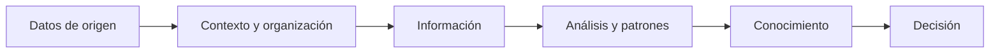
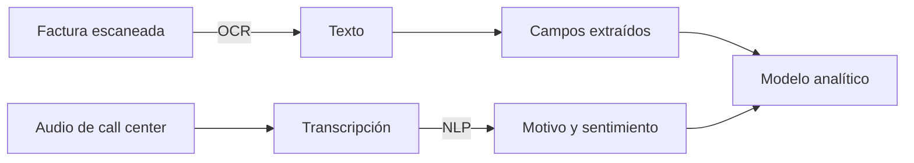
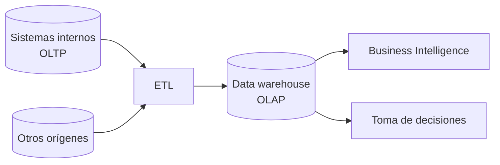
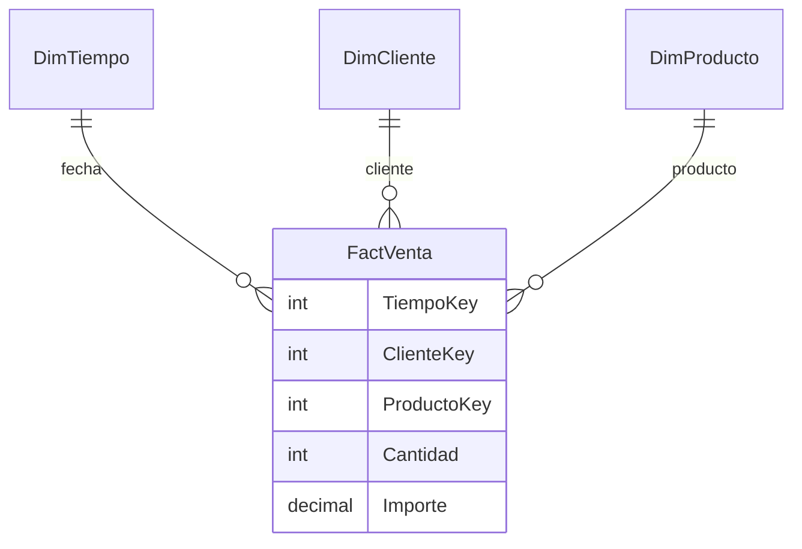
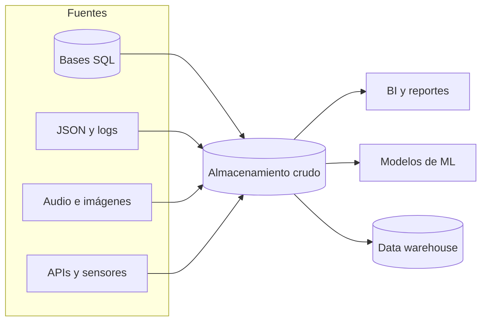
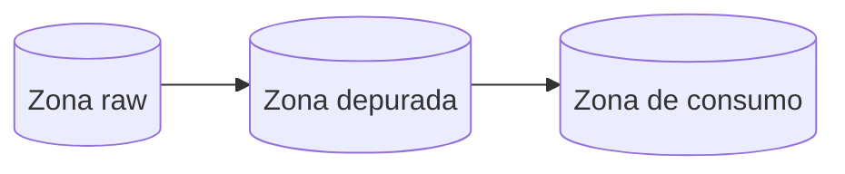
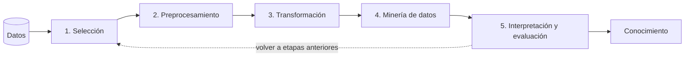

[← Unidad 4](/bbdd-aplicadas/unidad-4/teoria/)

Esta página conecta tres ideas: **qué forma tienen los datos**, **dónde se almacenan para analizarlos** (data warehouse y data lake) y **cómo se convierten en conocimiento** (el proceso KDD y la minería de datos). El programa 2024 ubica los *data lakes*, la introducción al *data mining* y KDD en la Unidad 4, y el *data warehousing* entre los contenidos mínimos. Los ejemplos con código tienen resultados obtenidos con SQL Server 2022; cada uno crea sus propias tablas, así que se reproducen en una base de práctica.

## Para qué sirve

Una empresa de internet quiere saber qué clientes están por darse de baja. Los datos están en la facturación (tablas), en los registros de navegación (JSON), en las grabaciones del call center (audio). Antes de analizarlos hay que decidir dónde se guardan, cómo se integran y qué proceso se sigue para llegar a una decisión confiable. Esta página recorre esa cadena.

## 1. Datos, información y conocimiento

- Un **dato** es una representación elemental sin interpretación suficiente: `154`, una fotografía o una llamada grabada.
- La **información** aparece al agregar contexto: `154 GB consumidos por el cliente 42 en junio`.
- El **conocimiento** surge al descubrir una regularidad útil: `clientes con caída brusca de consumo y reiterados reclamos presentan alto riesgo de baja`.



## 2. Clasificación según su estructura

| Tipo | Organización | Ejemplos | Procesamiento habitual |
|------|--------------|----------|------------------------|
| **Estructurado** | Esquema explícito, tipos y campos previsibles | Tablas SQL, fecha, importe, código de cliente | SQL, conteos, sumas, promedios |
| **Semiestructurado** | No tiene una tabla rígida, pero posee etiquetas o jerarquía | JSON, XML, HTML, e-mails con encabezados, imagen con metadatos | Parsers, consultas por rutas, motores documentales |
| **No estructurado** | No posee un modelo de campos directamente consultable | Texto libre, audio, video, llamadas, imágenes satelitales o de vigilancia | OCR, NLP, visión artificial, reconocimiento de voz |

:::note[Un formato no determina toda la clasificación]
Una fotografía es contenido no estructurado, pero puede incluir metadatos EXIF estructurados. Un documento JSON es semiestructurado porque sus claves le aportan organización, aunque distintos documentos no compartan exactamente el mismo esquema.
:::

Los datos estructurados se almacenan típicamente en bases relacionales, y los semiestructurados y no estructurados en bases NoSQL o en un *data lake*.

### Procesamiento de datos no estructurados

**OCR** (*Optical Character Recognition*) detecta símbolos en una imagen y los transforma en caracteres procesables. Por ejemplo, convierte una factura escaneada en texto del que luego se extraen CUIT, fecha y total.

**NLP** (*Natural Language Processing*) analiza lenguaje escrito o hablado: puede clasificar el motivo de un reclamo, detectar sentimiento o extraer entidades como empresas, personas y ubicaciones.



## 3. Caso integrador: predicción de abandono

Una empresa de internet quiere anticipar qué clientes podrían migrar a la competencia.

| Fuente | Posible clasificación | Señal obtenida |
|--------|-----------------------|----------------|
| Facturación, plan y consumos | Estructurada | Aumento de precio, mora, caída del uso |
| Tickets y registros de navegación | Semiestructurada | Visitas a páginas de competidores |
| Grabaciones del call center | No estructurada | Reclamos y sentimiento negativo |
| Ubicaciones aproximadas por antenas | Estructurada o semiestructurada | Permanencia en zonas con mala cobertura |

Ninguna señal aislada prueba la baja. El valor aparece al reunir, depurar y modelar las fuentes para estimar una probabilidad y decidir una acción de retención. Este caso se retoma en [KDD](#6-kdd-descubrimiento-de-conocimiento-en-bases-de-datos).

## 4. Data warehousing

:::note[Definición]
Un **data warehouse** (DWH) es una base de datos de estructura analítica (OLAP) construida sobre las bases transaccionales de una organización. Obtiene los datos de varios sistemas, los limpia, los unifica, les aplica reglas de negocio y los almacena integrados e históricos, como fuente para *Business Intelligence* y toma de decisiones.
:::

Una base **transaccional** (OLTP, *Online Transaction Processing*) está optimizada para inserciones, borrados y actualizaciones de operaciones diarias, con un diseño normalizado. Un DWH (OLAP, *Online Analytical Processing*) está optimizado para consultar grandes volúmenes agregados.



### Modelo dimensional

Un DWH suele diseñarse con un **modelo dimensional** en estrella: una tabla de **hechos** (las mediciones del negocio: cantidad e importe de cada venta) rodeada de tablas de **dimensiones** (el contexto por el cual se analiza: tiempo, cliente, producto). En el **copo de nieve**, las dimensiones se normalizan en subtablas. Las dimensiones tienen una clave sustituta propia, independiente de la clave del sistema de origen, y los hechos se declaran con un nivel de detalle fijo (el *grano*: aquí, una fila por línea de venta).



El ejemplo siguiente parte de una tabla de ventas del sistema transaccional, construye las tres dimensiones y la tabla de hechos con sentencias `INSERT ... SELECT` (la etapa de transformación y carga) y consulta las ventas por mes y categoría:

<!-- check: U4.T.DL.01 -->
```sql
CREATE SCHEMA oltp;
GO
CREATE SCHEMA dwh;
GO

-- Origen transaccional (normalizado, reducido a lo necesario)
CREATE TABLE oltp.VentaOrigen (
    VentaId    INT           NOT NULL,
    Fecha      DATE          NOT NULL,
    ClienteId  INT           NOT NULL,
    Localidad  VARCHAR(40)   NOT NULL,
    Producto   VARCHAR(40)   NOT NULL,
    Categoria  VARCHAR(40)   NOT NULL,
    Cantidad   INT           NOT NULL,
    PrecioUnit DECIMAL(10,2) NOT NULL,
    CONSTRAINT PK_VentaOrigen PRIMARY KEY CLUSTERED (VentaId)
);
INSERT INTO oltp.VentaOrigen (VentaId, Fecha, ClienteId, Localidad, Producto, Categoria, Cantidad, PrecioUnit) VALUES
    (1, '2026-03-05', 10, 'Morón',  'Teclado', 'perifericos', 2, 45.00),
    (2, '2026-03-18', 11, 'Haedo',  'Mouse',   'perifericos', 1, 20.00),
    (3, '2026-04-02', 10, 'Morón',  'Monitor', 'pantallas',   1, 300.00),
    (4, '2026-04-20', 12, 'Ramos Mejía', 'Teclado', 'perifericos', 1, 45.00),
    (5, '2026-04-21', 11, 'Haedo',  'Monitor', 'pantallas',   2, 300.00);
GO

-- Dimensiones y tabla de hechos
CREATE TABLE dwh.DimCliente (
    ClienteKey INT IDENTITY(1, 1) NOT NULL,
    ClienteId  INT                NOT NULL,
    Localidad  VARCHAR(40)        NOT NULL,
    CONSTRAINT PK_DimCliente PRIMARY KEY CLUSTERED (ClienteKey),
    CONSTRAINT UQ_DimCliente_ClienteId UNIQUE (ClienteId)
);
CREATE TABLE dwh.DimProducto (
    ProductoKey INT IDENTITY(1, 1) NOT NULL,
    Producto    VARCHAR(40)        NOT NULL,
    Categoria   VARCHAR(40)        NOT NULL,
    CONSTRAINT PK_DimProducto PRIMARY KEY CLUSTERED (ProductoKey),
    CONSTRAINT UQ_DimProducto_Producto UNIQUE (Producto)
);
CREATE TABLE dwh.DimTiempo (
    TiempoKey INT      NOT NULL,
    Fecha     DATE     NOT NULL,
    Anio      SMALLINT NOT NULL,
    Mes       TINYINT  NOT NULL,
    CONSTRAINT PK_DimTiempo PRIMARY KEY CLUSTERED (TiempoKey)
);
CREATE TABLE dwh.FactVenta (
    TiempoKey   INT           NOT NULL,
    ClienteKey  INT           NOT NULL,
    ProductoKey INT           NOT NULL,
    Cantidad    INT           NOT NULL,
    Importe     DECIMAL(12,2) NOT NULL,
    CONSTRAINT FK_FactVenta_DimTiempo   FOREIGN KEY (TiempoKey)   REFERENCES dwh.DimTiempo (TiempoKey),
    CONSTRAINT FK_FactVenta_DimCliente  FOREIGN KEY (ClienteKey)  REFERENCES dwh.DimCliente (ClienteKey),
    CONSTRAINT FK_FactVenta_DimProducto FOREIGN KEY (ProductoKey) REFERENCES dwh.DimProducto (ProductoKey)
);
GO

-- ETL: extraer del origen, transformar (claves sustitutas, fecha desglosada, importe calculado) y cargar
INSERT INTO dwh.DimCliente (ClienteId, Localidad)
SELECT DISTINCT ClienteId, Localidad FROM oltp.VentaOrigen;

INSERT INTO dwh.DimProducto (Producto, Categoria)
SELECT DISTINCT Producto, Categoria FROM oltp.VentaOrigen;

INSERT INTO dwh.DimTiempo (TiempoKey, Fecha, Anio, Mes)
SELECT DISTINCT
    YEAR(Fecha) * 10000 + MONTH(Fecha) * 100 + DAY(Fecha),
    Fecha,
    YEAR(Fecha),
    MONTH(Fecha)
FROM oltp.VentaOrigen;

INSERT INTO dwh.FactVenta (TiempoKey, ClienteKey, ProductoKey, Cantidad, Importe)
SELECT
    YEAR(v.Fecha) * 10000 + MONTH(v.Fecha) * 100 + DAY(v.Fecha),
    c.ClienteKey,
    p.ProductoKey,
    v.Cantidad,
    v.Cantidad * v.PrecioUnit
FROM oltp.VentaOrigen AS v
INNER JOIN dwh.DimCliente  AS c ON c.ClienteId = v.ClienteId
INNER JOIN dwh.DimProducto AS p ON p.Producto  = v.Producto;
GO

-- Consulta analítica: ventas por mes y categoría
SELECT
    t.Anio,
    t.Mes,
    p.Categoria,
    SUM(f.Importe)  AS ImporteTotal,
    SUM(f.Cantidad) AS Unidades
FROM dwh.FactVenta AS f
INNER JOIN dwh.DimTiempo   AS t ON t.TiempoKey   = f.TiempoKey
INNER JOIN dwh.DimProducto AS p ON p.ProductoKey = f.ProductoKey
GROUP BY t.Anio, t.Mes, p.Categoria
ORDER BY t.Anio, t.Mes, p.Categoria;
```

**Resultado esperado.**

| Anio | Mes | Categoria | ImporteTotal | Unidades |
|---:|---:|---|---:|---:|
| 2026 | 3 | perifericos | 110.00 | 3 |
| 2026 | 4 | pantallas | 900.00 | 3 |
| 2026 | 4 | perifericos | 45.00 | 1 |

La consulta no recorre tablas normalizadas del sistema operativo: agrupa los hechos por atributos de las dimensiones. En producción, la carga sería periódica y los orígenes, varios.

### ETL y ELT

- **ETL** (*Extract, Transform, Load*): proceso clásico de carga de un DWH. Los datos se extraen de las fuentes, se **transforman** (se limpian e integran) fuera del destino y se cargan ya transformados. Es lo que hace el ejemplo anterior.
- **ELT** (*Extract, Load, Transform*): variante moderna usada con data lakes. Los datos se **cargan crudos** y se transforman después, cuando se necesitan, aprovechando la capacidad de cómputo del destino.

## 5. Data lake

:::note[Definición]
Un **data lake** es un repositorio centralizado y escalable que almacena datos estructurados, semiestructurados y no estructurados, en tiempo real o no, **tal como están en el sistema de origen**, sin aplicarles una transformación previa.
:::



Como no se transforma al ingresar, el lago aplica el esquema **al leer** (*schema on read*): cada consumidor decide qué campos y tipos le interesan. Un data warehouse, en cambio, valida la estructura **al cargar** (*schema on write*). El ejemplo guarda eventos de sensores tal como llegan (con campos faltantes, un valor como texto y una línea que no es JSON) y le impone un esquema al consultarlos:

<!-- check: U4.T.DL.02 -->
```sql
CREATE SCHEMA lago;
GO

CREATE TABLE lago.EventoCrudo (
    EventoId  INT           NOT NULL,
    Contenido NVARCHAR(MAX) NOT NULL,
    CONSTRAINT PK_EventoCrudo PRIMARY KEY CLUSTERED (EventoId)
);
GO

-- Carga: se guarda lo que llega, sin validar la forma
INSERT INTO lago.EventoCrudo (EventoId, Contenido) VALUES
    (1, N'{"sensor":"S1","temp":21.5,"ts":"2026-05-01T10:00:00"}'),
    (2, N'{"sensor":"S2","temp":"19.0","ts":"2026-05-01T10:05:00","bateria":80}'),
    (3, N'{"sensor":"S1","ts":"2026-05-01T10:10:00"}'),
    (4, N'esto no es JSON');
GO

-- Esquema al leer: cada consumidor decide tipos y campos
SELECT e.EventoId, j.Sensor, j.Temp, j.Ts
FROM lago.EventoCrudo AS e
CROSS APPLY OPENJSON(e.Contenido)
    WITH (
        Sensor VARCHAR(10)   '$.sensor',
        Temp   DECIMAL(5, 1) '$.temp',
        Ts     DATETIME2(0)  '$.ts'
    ) AS j
WHERE ISJSON(e.Contenido) = 1
ORDER BY e.EventoId;
GO

-- Lo que no es JSON válido hace fallar la lectura: el control de calidad no desaparece
BEGIN TRY
    SELECT j.Sensor
    FROM lago.EventoCrudo AS e
    CROSS APPLY OPENJSON(e.Contenido) WITH (Sensor VARCHAR(10) '$.sensor') AS j
    WHERE e.EventoId = 4;
END TRY
BEGIN CATCH
    SELECT ERROR_NUMBER() AS Numero, ERROR_MESSAGE() AS Mensaje;
END CATCH;
```

**Resultado esperado.** La lectura tipada:

| EventoId | Sensor | Temp | Ts |
|---:|---|---:|---|
| 1 | S1 | 21.5 | 2026-05-01 10:00:00 |
| 2 | S2 | 19.0 | 2026-05-01 10:05:00 |
| 3 | S1 | NULL | 2026-05-01 10:10:00 |

El evento 2 trae la temperatura como texto y se convierte al leerla; el 3 no tiene temperatura y da `NULL`; el 4 se descarta con `ISJSON`. Sin ese filtro, la lectura falla con el error 13609:

| Numero | Mensaje |
|---:|---|
| 13609 | JSON text is not properly formatted. Unexpected character 'e' is found at position 0. |

La carga fue trivial (no se validó nada) y el costo se paga al consumir: cada consulta debe tratar los campos faltantes, los tipos que no coinciden y los registros dañados. Cargar crudo y transformar después es el patrón ELT.

### Data lake y data warehouse

| Criterio | Base transaccional (OLTP) | Data warehouse | Data lake |
|----------|---------------------------|----------------|-----------|
| **Datos** | Actuales, transaccionales | Históricos, integrados de varias fuentes | Crudos, de cualquier formato |
| **Estructura** | Normalizada | Desnormalizada (estrella o copo de nieve) | Sin estructura predefinida (*schema on read*) |
| **Estado al ingresar** | Validado por restricciones | Limpio, transformado y modelado | Crudo o con transformación mínima |
| **Propósito** | Operaciones diarias | Análisis y reportes repetibles | Exploración, ciencia de datos, aprendizaje automático y archivo masivo |
| **Usuarios** | Aplicaciones y usuarios finales | Analistas y herramientas de BI | Ingenieros y científicos de datos |
| **Carga** | Tiempo real | ETL periódico | ELT (se transforma después) |
| **Ejemplos** | SQL Server, MySQL | SQL Server Analysis Services, Amazon Redshift | Azure Data Lake Storage, Amazon S3 |

Similitudes: ambos son repositorios centralizados y pueden almacenar datos estructurados. Diferencias que destaca la cátedra: un data lake guarda datos no estructurados, no los transforma al ingresar y no los organiza de forma óptima para consultar. De ahí que el DWH sirva para almacenar y **analizar** datos estructurados, y el lago para almacenar datos de todo tipo, aunque no tanto para analizarlos directamente. La cátedra agrega que puede haber un DWH sin lago, pero rara vez un lago sin DWH: es habitual que el lago alimente al warehouse con conjuntos ya depurados. No son tecnologías enemigas sino complementarias.

:::note[Contenido complementario: gobierno de un data lake]
Esta sección no forma parte del programa 2024. Es un aporte de estos apuntes sobre la práctica habitual, sin fuente de cátedra.

Un lago sin gestión se vuelve un **pantano de datos** (*data swamp*): un depósito del que no se puede localizar ni confiar en nada. Para evitarlo se suele incorporar:

- **Zonas**: una zona cruda (*raw*) con los datos tal como llegan, una zona depurada con datos validados y estandarizados, y una zona de consumo con conjuntos listos para análisis.
- **Catálogo y metadatos**: qué datos existen, quién los produce y qué significan.
- **Linaje** (*lineage*): trazabilidad del origen de cada conjunto y de las transformaciones aplicadas.
- **Seguridad y control de acceso**, y reglas de **calidad** y de ciclo de vida (cuánto tiempo se conservan).


:::

## 6. KDD: descubrimiento de conocimiento en bases de datos

Con los datos almacenados e integrados, queda convertirlos en conocimiento útil. Ese camino tiene un nombre y una estructura.

:::note[Definición]
**KDD** (*Knowledge Discovery in Databases*) es, según Fayyad, Piatetsky-Shapiro y Smyth (1996), el proceso no trivial de identificar en los datos patrones **válidos, novedosos, potencialmente útiles y comprensibles**. Es un proceso **completo e iterativo**, formado por varias etapas.
:::

**KDD y data mining no son lo mismo.** KDD es el proceso completo; la **minería de datos** (*data mining*) es **una de sus etapas**: la que aplica algoritmos para buscar patrones. Aplicar un algoritmo sobre datos sin preparar ni interpretar el resultado no es KDD, y los mismos autores señalan que usar la minería sin las otras etapas puede conducir a descubrir patrones sin sentido.

### Las cinco etapas



| Etapa | Qué se hace | En el caso de abandono de clientes |
|---|---|---|
| **1. Selección** | Definir el objetivo y crear el conjunto de datos objetivo: elegir fuentes, registros y atributos relevantes | Clientes activos de los últimos doce meses, con facturación, consumos, reclamos y navegación |
| **2. Preprocesamiento** | Limpiar: tratar valores faltantes, duplicados, ruido e inconsistencias | Unificar los clientes duplicados entre sistemas; decidir qué hacer con meses sin consumo registrado |
| **3. Transformación** | Reducir y transformar: agregar, normalizar, discretizar, construir variables | Consumo promedio de los últimos tres meses, variación porcentual, cantidad de reclamos por trimestre |
| **4. Minería de datos** | Elegir la tarea y el algoritmo, y buscar los patrones | Clasificar a cada cliente como riesgo alto o bajo de baja |
| **5. Interpretación y evaluación** | Interpretar los patrones, medir su validez, descartar correlaciones espurias y consolidar el conocimiento; si no es útil, volver a una etapa anterior | Verificar que el modelo acierta con clientes que no se usaron para construirlo y convertirlo en una acción de retención |

El proceso es **iterativo**: de cualquier etapa se puede volver a una anterior. Un resultado poco útil en la etapa 5 suele indicar que faltan variables (volver a 1 o 3) o que los datos estaban sucios (volver a 2).

### Tareas de minería de datos

La etapa de minería se plantea como una tarea. Las más usuales:

| Tarea | Pregunta | Ejemplo |
|-------|----------|---------|
| **Clasificación** | ¿A qué clase conocida pertenece? | Cliente con riesgo alto o bajo de baja |
| **Regresión** | ¿Qué valor numérico se espera? | Importe de consumo del próximo mes |
| **Agrupamiento** (*clustering*) | ¿Qué grupos naturales existen? | Segmentos de clientes sin etiquetas previas |
| **Asociación** | ¿Qué eventos aparecen juntos? | Productos comprados en la misma operación |

Esta es solo una introducción: los algoritmos concretos exceden el programa de la unidad.

## Errores frecuentes

:::caution[Errores frecuentes]
- Decir que **JSON es no estructurado**. Conserva una estructura jerárquica mediante claves, objetos y arrays: es semiestructurado.
- Decir que un data lake **es una base NoSQL**. Es una arquitectura de almacenamiento; puede apoyarse en almacenamiento de objetos o en motores NoSQL, pero el concepto no designa un único producto.
- Creer que *schema on read* significa **ausencia de reglas**. Significa que la estructura se aplica al leer; siguen siendo indispensables el catálogo, la seguridad y la calidad (con el ejemplo anterior, un registro dañado igual hace fallar la lectura).
- Usar KDD y minería de datos como sinónimos. KDD es el proceso; la minería, una etapa.
- Hablar de "siete etapas" de KDD: la formulación clásica tiene cinco; las variantes con más etapas separan o agregan pasos, pero no son la de Fayyad et al.
- Cargar un data lake sin catálogo ni gobierno y esperar que sirva para analizar.
:::

## Ejercicios

### Ejercicio 44 · Clasificar datos por estructura
<!-- ejercicio: U4.44 | nivel: inicial | tipo: conceptual | verificacion: razonamiento -->

:::note[Enunciado]
Clasificá cada dato como estructurado, semiestructurado o no estructurado y justificá: (a) un archivo CSV con encabezado; (b) un documento JSON de un pedido; (c) una radiografía; (d) los metadatos EXIF de una fotografía; (e) un correo electrónico (encabezados y cuerpo).
:::

<details>
<summary>Resolución</summary>

**Estrategia.** Se pregunta si hay un esquema fijo, si hay etiquetas que dan estructura o si no hay un modelo de campos.

- **(a) Estructurado.** Tiene columnas fijas y tipos previsibles (el CSV es un formato tabular).
- **(b) Semiestructurado.** Las claves lo describen, pero cada documento puede tener campos distintos.
- **(c) No estructurado.** Es una imagen: no hay campos consultables sin procesamiento (visión artificial).
- **(d) Estructurado.** Son pares campo-valor definidos (fecha, cámara, coordenadas), aunque viajen dentro de un archivo no estructurado.
- **(e) Semiestructurado.** Los encabezados (remitente, fecha, asunto) tienen etiquetas; el cuerpo es texto libre.

</details>

### Ejercicio 47 · Ubicar las actividades en el proceso KDD
<!-- ejercicio: U4.47 | nivel: intermedio | tipo: conceptual | verificacion: razonamiento -->

:::note[Enunciado]
Una cadena de farmacias quiere descubrir qué productos se compran juntos. Ordená estas actividades en las cinco etapas de KDD y señalá cuál es la minería de datos: (1) quitar ventas duplicadas por un error del sistema; (2) agrupar los renglones de cada ticket en una lista de productos por compra; (3) elegir los tickets del último año de las sucursales de la zona oeste; (4) aplicar un algoritmo de reglas de asociación; (5) descartar las reglas que se explican por una promoción vigente y presentar las restantes al área comercial.
:::

<details>
<summary>Resolución</summary>

**Estrategia.** Se sigue el orden de Fayyad et al.: selección, preprocesamiento, transformación, minería, interpretación y evaluación.

1. Selección: (3), se define el conjunto de datos objetivo.
2. Preprocesamiento: (1), se limpian los duplicados.
3. Transformación: (2), se construye la representación adecuada para la tarea (una lista por compra).
4. **Minería de datos: (4)**, tarea de asociación.
5. Interpretación y evaluación: (5), se descartan patrones no útiles (los que explica una promoción) y se comunican los resultados.

Solo la actividad (4) es *data mining*: las otras cuatro también son KDD. Si las reglas resultaran triviales, se volvería a la selección o a la transformación (por ejemplo, excluir los productos de promoción).

</details>

### Ejercicio 48 · Esquema al leer sobre pedidos en JSON
<!-- ejercicio: U4.48 | nivel: avanzado | tipo: consulta | verificacion: motor -->

:::note[Enunciado]
En un lago hay una tabla `lago.PedidoCrudo` con un JSON por fila. Cada pedido tiene `cliente` y, a veces, un array `lineas` con objetos `prod`, `cant` y `precio` (el precio puede venir como texto). Cargá cuatro pedidos (uno sin `lineas` y uno con `precio` como texto), creá la vista `lago.PedidoLinea` con una fila por línea (conservando los pedidos sin líneas) y calculá por cliente el importe total y la cantidad de líneas.
:::

<details>
<summary>Resolución</summary>

**Estrategia.** Se carga el texto crudo, y la vista aplica el esquema al leer: un primer `OPENJSON` lee `cliente` y extrae `lineas` como JSON (`AS JSON`); un segundo `OPENJSON`, con `OUTER APPLY` para no perder los pedidos sin líneas, abre el array. `COUNT(Producto)` cuenta solo las líneas reales (no cuenta los `NULL`).

<!-- check: U4.48 -->
```sql
CREATE SCHEMA lago;
GO

CREATE TABLE lago.PedidoCrudo (
    PedidoId  INT           NOT NULL,
    Contenido NVARCHAR(MAX) NOT NULL,
    CONSTRAINT PK_PedidoCrudo PRIMARY KEY CLUSTERED (PedidoId)
);
GO

INSERT INTO lago.PedidoCrudo (PedidoId, Contenido) VALUES
    (1, N'{"cliente":"c1","lineas":[{"prod":"Teclado","cant":2,"precio":45},{"prod":"Mouse","cant":1,"precio":20}]}'),
    (2, N'{"cliente":"c2","lineas":[{"prod":"Monitor","cant":1,"precio":300}]}'),
    (3, N'{"cliente":"c1"}'),
    (4, N'{"cliente":"c1","lineas":[{"prod":"Mouse","cant":3,"precio":"20"}]}');
GO

CREATE VIEW lago.PedidoLinea
AS
SELECT
    p.PedidoId,
    c.Cliente,
    l.Producto,
    l.Cantidad,
    l.Precio
FROM lago.PedidoCrudo AS p
CROSS APPLY OPENJSON(p.Contenido)
    WITH (Cliente VARCHAR(10) '$.cliente', Lineas NVARCHAR(MAX) '$.lineas' AS JSON) AS c
OUTER APPLY OPENJSON(c.Lineas)
    WITH (
        Producto VARCHAR(40)   '$.prod',
        Cantidad INT           '$.cant',
        Precio   DECIMAL(10,2) '$.precio'
    ) AS l;
GO

SELECT Cliente, SUM(Cantidad * Precio) AS Importe, COUNT(Producto) AS Lineas
FROM lago.PedidoLinea
GROUP BY Cliente
ORDER BY Cliente;
```

**Resultado esperado.**

| Cliente | Importe | Lineas |
|---|---:|---:|
| c1 | 170.00 | 3 |
| c2 | 300.00 | 1 |

El cliente `c1` suma 2 × 45 + 1 × 20 (pedido 1) y 3 × 20 (pedido 4, cuyo precio llegó como texto y se convirtió al leerlo): 170. El pedido 3 no aporta líneas ni importe, pero sigue en la vista. Con un `CROSS APPLY` en lugar de `OUTER APPLY` el pedido 3 desaparecería de la vista.

</details>

## Autoevaluación

<details>
<summary>1. Diferenciá data lake y data warehouse según esquema, formato y usuario.</summary>

El data lake guarda datos en cualquier formato, crudos, con esquema al leer y lo usan ingenieros y científicos de datos. El data warehouse guarda datos estructurados, limpios e integrados, con esquema al cargar, y lo usan analistas y herramientas de BI.

</details>

<details>
<summary>2. ¿Qué diferencia hay entre ETL y ELT?</summary>

En ETL los datos se transforman antes de cargarlos en el destino (DWH); en ELT se cargan crudos y se transforman después, ya dentro del destino (lago).

</details>

<details>
<summary>3. Enumerá las etapas de KDD y ubicá la minería de datos.</summary>

Selección, preprocesamiento, transformación, minería de datos e interpretación/evaluación. La minería es la cuarta etapa y es una parte del proceso, no su sinónimo.

</details>

<details>
<summary>4. ¿Por qué OCR y NLP son transformaciones previas al análisis y no decisiones de negocio?</summary>

Porque convierten datos no estructurados (imágenes, audio, texto libre) en datos procesables (texto, campos, categorías) que luego alimentan el análisis. La decisión de negocio se toma después, al interpretar el resultado.

</details>

:::tip[En resumen]
- Los datos se clasifican en estructurados, semiestructurados y no estructurados; estos últimos requieren OCR o NLP antes de analizarse.
- Un **data warehouse** integra datos históricos con estructura analítica (estrella) y se carga con ETL; un **data lake** guarda datos crudos y aplica el esquema al leer, con carga ELT.
- Un lago sin gobierno se vuelve un pantano de datos; zonas, catálogo y linaje son prácticas complementarias.
- **KDD** es el proceso completo en cinco etapas (selección, preprocesamiento, transformación, minería de datos, interpretación y evaluación); la **minería de datos** es una de ellas.
:::

## Fuentes

- Programa analítico 2024 de la asignatura (Unidad 4: data lakes, introducción al data mining y KDD; contenidos mínimos: data warehousing).
- Presentación de cátedra, Unidad 4, parte 1 (datos estructurados, semiestructurados y no estructurados; OCR y NLP; caso de abandono de clientes), p. 8-10.
- Presentación de cátedra, Unidad 2: base de datos, data warehouse y data lake, p. 11-15.
- Fayyad, U., Piatetsky-Shapiro, G. y Smyth, P. (1996), "From Data Mining to Knowledge Discovery in Databases", *AI Magazine*, 17(3), 37-54.
- Microsoft Learn, *OPENJSON (Transact-SQL)* y *ISJSON (Transact-SQL)*: https://learn.microsoft.com/sql/t-sql/.
