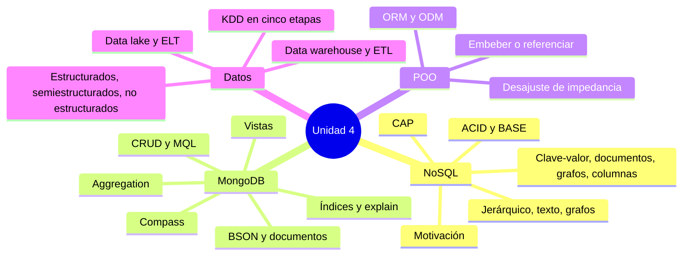
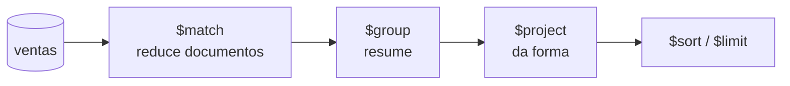

[← Unidad 4](/bbdd-aplicadas/unidad-4/teoria/)

Esta guía organiza lo que conviene poder **explicar, comparar y aplicar** de la Unidad 4. No reemplaza al [resumen integrador](/bbdd-aplicadas/unidad-4/teoria/apunte-completo/) ni a las páginas temáticas: sirve para repasar y para practicar con preguntas propias de estos apuntes.

:::note[Qué evalúa el parcial 2024 y qué material es esta guía]
Según el programa 2024, la materia tiene **un único parcial teórico-práctico sobre las unidades 1 a 4**, un TP integrador y el final. La Unidad 4 se evalúa en el mismo parcial que las unidades [1](/bbdd-aplicadas/unidad-1/teoria/), [2](/bbdd-aplicadas/unidad-2/teoria/) y [3](/bbdd-aplicadas/unidad-3/teoria/): conviene repasar también los índices y el plan de ejecución, la concurrencia y las transacciones de la Unidad 3, que se combinan con lo de MongoDB.

Las preguntas y respuestas de esta página son **material de estudio propio de estos apuntes, no oficial**: no reproducen enunciados de la cátedra ni de ningún examen.
:::

## Lo que suele pedirse

Los parciales de años anteriores, tal como los reconstruyen los estudiantes (material no oficial), vuelven sobre unos pocos ejes. Es una referencia para ordenar el estudio, no una garantía de lo que se tomará:

| Eje | Qué conviene dominar | Dónde está |
|---|---|---|
| **CAP, BASE y ACID** | Definir cada propiedad, decidir afirmaciones verdadero/falso, explicar qué pasa ante una partición y por qué la clasificación CA/CP/AP es una simplificación | [NoSQL — Conceptos y modelos](/bbdd-aplicadas/unidad-4/teoria/nosql-conceptos/) |
| **MQL** | Leer y escribir `find()` con filtros, proyección y orden; actualizar con `$set`, `$inc` y condiciones; decidir si dos consultas son equivalentes | [CRUD y consultas](/bbdd-aplicadas/unidad-4/teoria/mongodb-crud/) |
| **Agregación** | Completar o leer un pipeline con `$match` y `$group`; sumar y contar; describir la forma de los documentos tras cada etapa | [Aggregation Pipeline](/bbdd-aplicadas/unidad-4/teoria/mongodb-agregacion/) |
| **Índices** | Cuándo ayuda un índice, tipos, índice compuesto, `COLLSCAN` contra `IXSCAN`, qué muestra `explain()` | [Índices y estadísticas](/bbdd-aplicadas/unidad-4/teoria/mongodb-agregacion/) |
| **Datos, lago, KDD y POO** | Clasificar datos, diferenciar data lake y data warehouse, las etapas de KDD, embeber o referenciar | [Datos, Data Lake y KDD](/bbdd-aplicadas/unidad-4/teoria/datos-data-lake-kdd/), [POO y bases de datos](/bbdd-aplicadas/unidad-4/teoria/poo-y-bases/) |

## Mapa de la unidad



## Comparaciones que hay que dominar

| Si preguntan… | La respuesta debe incluir… |
|---------------|----------------------------|
| SQL contra NoSQL | modelo, esquema, relaciones, escala y criterio de elección; no afirmar que uno siempre reemplaza al otro |
| ACID contra BASE | garantía transaccional inmediata frente a disponibilidad, estado flexible y consistencia eventual; ambos son garantías, no productos "con" y "sin" transacciones |
| C, A y P | valor coherente, respuesta de todo nodo que funciona y continuidad ante cortes de comunicación; el compromiso aparece **ante una partición** |
| JSON contra BSON | texto interoperable frente a representación binaria con más tipos; MongoDB almacena BSON |
| colección contra tabla | analogía útil, aclarando que los documentos pueden variar de estructura y contener arrays y subdocumentos |
| `find()` contra `aggregate()` | recuperación y filtro directo frente a pipeline de transformación y análisis |
| `$match` contra `$project` | filtrar documentos frente a seleccionar, renombrar o calcular campos |
| acumulador contra operador de expresión | `$sum` o `$avg` reducen un grupo en `$group`; `$multiply` o `$round` calculan sobre un documento |
| `$lookup` contra `$unwind` | unir y producir un array frente a desplegar cada elemento del array |
| `COLLSCAN` contra `IXSCAN` | recorrido completo frente a recorrido por índice; contrastar documentos examinados y devueltos |
| embeber contra referenciar | se embebe lo acotado que se lee junto; se referencia lo compartido o ilimitado |
| ORM contra ODM | mapeo de objetos a tablas frente a mapeo de objetos a documentos |
| ETL contra ELT | transformar antes de cargar frente a cargar crudo y transformar después |
| data lake contra data warehouse | crudo y esquema al leer frente a curado y esquema al cargar |
| KDD contra data mining | proceso completo de cinco etapas frente a una de ellas, la algorítmica |

## Cómo leer una consulta MQL

Analizala en este orden:

1. **Colección y operación:** `db.ventas.find`, `updateMany` o `aggregate`.
2. **Filtro:** qué documentos participan.
3. **Operador:** comparación, lógica, actualización o etapa.
4. **Ruta:** campo simple o notación de punto (`cliente.localidad`).
5. **Tipo BSON:** una fecha no se compara igual que un texto.
6. **Salida:** proyección, orden, límite o forma final del pipeline.

<!-- check: U4.T.GP.01 -->
```javascript
db.ventas.insertMany([
  { _id: 1, fecha: ISODate("2025-02-10T00:00:00Z"), cliente: { nombre: "Ana", localidad: "Ramos Mejía" }, importe: 400 },
  { _id: 2, fecha: ISODate("2025-03-01T00:00:00Z"), cliente: { nombre: "Bruno", localidad: "Morón" }, importe: 1500 },
  { _id: 3, fecha: ISODate("2024-12-20T00:00:00Z"), cliente: { nombre: "Carla", localidad: "Haedo" }, importe: 2000 },
  { _id: 4, fecha: ISODate("2025-04-15T00:00:00Z"), cliente: { nombre: "Diego", localidad: "Morón" }, importe: 90 },
  { _id: 5, fecha: ISODate("2025-05-02T00:00:00Z"), cliente: { nombre: "Eva", localidad: "Ramos Mejía" }, importe: 1100 }
]);

db.ventas.find(
  {
    fecha: { $gte: ISODate("2025-01-01T00:00:00Z") },
    $or: [
      { "cliente.localidad": "Ramos Mejía" },
      { importe: { $gt: 1000 } }
    ]
  },
  { _id: 0, fecha: 1, "cliente.nombre": 1, importe: 1 }
).sort({ importe: -1 }).limit(2);
```

**Resultado esperado.**

| fecha | cliente.nombre | importe |
|---|---|---:|
| 2025-03-01 | Bruno | 1500 |
| 2025-05-02 | Eva | 1100 |

La lectura verbal: "de `ventas`, obtener desde 2025 las operaciones de Ramos Mejía **o** de importe superior a 1000 (cumplen Ana, Bruno y Eva; Carla es de 2024); mostrar fecha, nombre e importe sin `_id`; ordenar por importe descendente y devolver dos". Ana (400) queda fuera por el `limit`, no por el filtro.

## Cómo razonar un pipeline



Regla práctica: filtrar temprano, descomponer arrays solo cuando haga falta, agrupar después de disponer del nivel de detalle correcto y proyectar la salida final. Siempre describí **la forma de los documentos después de cada etapa**.

<!-- check: U4.T.GP.02 -->
```javascript
db.ventas.insertMany([
  { _id: 1, localidad: "Morón", estado: "pagada", importe: 400 },
  { _id: 2, localidad: "Morón", estado: "pagada", importe: 600 },
  { _id: 3, localidad: "Haedo", estado: "pagada", importe: 250 },
  { _id: 4, localidad: "Haedo", estado: "anulada", importe: 900 },
  { _id: 5, localidad: "Ramos Mejía", estado: "pagada", importe: 700 }
]);

db.ventas.aggregate([
  { $match: { estado: "pagada" } },
  { $group: { _id: "$localidad", total: { $sum: "$importe" }, cantidad: { $sum: 1 } } },
  { $project: { _id: 0, localidad: "$_id", total: 1, cantidad: 1 } },
  { $sort: { total: -1 } }
]);

// Dos consultas equivalentes: la coma equivale a $and, y $in a varios $or de igualdad
db.ventas.find({ estado: "pagada", localidad: { $in: ["Morón", "Haedo"] } }, { _id: 1 }).sort({ _id: 1 });
db.ventas.find({ $and: [{ estado: "pagada" }, { $or: [{ localidad: "Morón" }, { localidad: "Haedo" }] }] }, { _id: 1 }).sort({ _id: 1 });
```

**Resultado esperado.** El pipeline devuelve tres grupos:

| localidad | total | cantidad |
|---|---:|---:|
| Morón | 1000 | 2 |
| Ramos Mejía | 700 | 1 |
| Haedo | 250 | 1 |

La venta anulada de Haedo (900) no se cuenta porque `$match` la filtra antes de agrupar. Las dos últimas consultas devuelven los mismos `_id` (1, 2 y 3): son equivalentes.

## Preguntas de desarrollo con respuesta esperada

### 1. ¿Por qué surgió NoSQL?

Por los límites de costo y el techo de la escala vertical, los grandes volúmenes de lectura y escritura, la necesidad de baja latencia, la disponibilidad continua y los datos con estructura cambiante. No significa que SQL sea inútil: se elige otro compromiso para determinados problemas.

### 2. ¿Qué significa consistencia eventual?

Durante la propagación puede haber réplicas con versiones distintas; si cesan las actualizaciones y la comunicación funciona, convergen en un tiempo posterior. No significa inconsistencia permanente ni ausencia de reglas.

### 3. ¿Por qué CAP importa solo ante una partición?

Sin corte de comunicación es posible entregar respuestas disponibles y consistentes. Ante la partición hay que decidir entre rechazar o demorar alguna operación para preservar la consistencia, o responder aceptando posible divergencia para preservar la disponibilidad.

### 4. ¿Es correcto afirmar que MongoDB es CP?

Solo como simplificación del comportamiento por defecto (un único primario por conjunto de réplicas y elección ante fallas). Con `readPreference`, `readConcern` y `writeConcern` se mueve el equilibrio entre consistencia y disponibilidad, así que no es una propiedad fija del producto.

### 5. ¿Qué aporta el modelo documental?

Permite representar un agregado del dominio como un documento BSON con subdocumentos y arrays, leerlo como bloque y evolucionar campos sin alterar una tabla global. A cambio, hay que diseñar duplicación, tamaño y actualizaciones según los patrones de acceso.

### 6. ¿Qué costo tiene un índice?

Acelera las lecturas que coinciden con su prefijo y orden, pero ocupa espacio y cada inserción, eliminación o modificación de campos indexados debe mantenerlo. Por eso no se indexa todo.

### 7. ¿Cuál es la diferencia entre KDD y minería de datos?

KDD es el proceso completo (selección, preprocesamiento, transformación, minería de datos, interpretación y evaluación). La minería es la etapa que aplica los algoritmos para buscar patrones.

## Errores que suelen quitar puntos

- Decir que NoSQL no admite transacciones: MongoDB admite transacciones multidocumento (desde la 4.0 en conjuntos de réplicas); BASE describe un enfoque frecuente, no una prohibición universal.
- Afirmar sin matiz que "MongoDB es CP" o que "SQL es CA".
- Confundir flexibilidad de esquema con ausencia de validación.
- Usar textos para comparar un campo BSON `Date`.
- Mezclar inclusiones y exclusiones en una proyección, salvo `_id`.
- Olvidar que `$lookup` entrega un array, o usar `$unwind` sin considerar documentos con array vacío o ausente.
- Poner `$cmp` o `$round` entre los acumuladores de `$group`: son operadores de expresión.
- Crear `{ city_indx: 1 }` creyendo que `city_indx` es el nombre del índice: eso indexa un campo con ese nombre. Para nombrarlo se usa `{ name: "city_indx" }` como opción.
- Evaluar un índice solo porque existe: hay que observar `explain()`.
- Decir que JSON es no estructurado, o que KDD tiene siete etapas.

## Verdadero o falso para practicar

Decidí cada afirmación y abrí la respuesta.

<details>
<summary>1. Un sistema AP puede devolver un dato desactualizado durante una partición.</summary>

Verdadero: prioriza responder aunque la réplica no tenga la última escritura.

</details>

<details>
<summary>2. Si una base tiene un solo nodo, hay que elegir entre C y A.</summary>

Falso: sin partición posible, CAP no impone el compromiso.

</details>

<details>
<summary>3. Sumar la constante 1 por cada documento de un grupo sirve para contar sus documentos.</summary>

Verdadero: es lo que hace `{ $sum: 1 }` dentro de `$group`.

</details>

<details>
<summary>4. Un índice sobre `{ ciudad: 1, edad: 1 }` sirve para filtrar por `edad` solamente de la misma manera que para filtrar por `ciudad`.</summary>

Falso: un índice compuesto se aprovecha por su prefijo; filtrar solo por `edad` no usa el prefijo `ciudad`.

</details>

<details>
<summary>5. Un data lake aplica el esquema al cargar los datos.</summary>

Falso: lo aplica al leerlos (*schema on read*); el que valida al cargar es el data warehouse.

</details>

## Simulacro breve

Resolvelo por escrito y compará con las respuestas.

1. Definí NoSQL y enumerá cuatro motivos de su surgimiento.
2. Compará ACID y BASE con un ejemplo de negocio.
3. Explicá CAP y qué sacrifica una solución CP durante una partición.
4. Elegí un modelo NoSQL para una caché, una red social, un catálogo y la telemetría de sensores; justificá cada elección.
5. Escribí un `find()` con campo anidado, rango, proyección y orden.
6. Escribí un `updateMany()` que agregue un campo y otro que lo elimine.
7. Describí la salida de `$lookup` y la transformación de `$unwind`.
8. Diseñá un pipeline `$match`, `$group`, `$project`, `$sort`.
9. Explicá cuándo un índice compuesto puede ayudar y cuál es su costo.
10. Un pedido tiene un cliente y varias líneas: decidí qué embebés y qué referenciás.
11. Diferenciá data lake, data warehouse, KDD y minería de datos.

<details>
<summary>Respuestas esperadas y criterios de corrección</summary>

1. NoSQL ("Not only SQL"): bases no relacionales con otros modelos y consistencia configurable. Motivos: escala vertical costosa, volumen masivo, baja latencia, alta disponibilidad, esquema cambiante.
2. ACID: transferencia entre cuentas (todo o nada). BASE: contador de visitas donde una lectura levemente atrasada es tolerable. Criterio: definición, contraste y ejemplo.
3. Ante la partición se elige entre consistencia y disponibilidad; CP sacrifica la disponibilidad: puede rechazar o demorar operaciones que no pueda garantizar consistentes.
4. Caché: clave-valor. Red social: grafo. Catálogo: documentos. Telemetría: familias de columnas. Criterio: justificar con el patrón de acceso.
5. Por ejemplo, `db.ventas.find({ "cliente.localidad": "Morón", importe: { $gte: 100, $lte: 500 } }, { _id: 0, importe: 1 }).sort({ importe: -1 })`.
6. Por ejemplo, `db.ventas.updateMany({}, { $set: { revisada: false } })` y `db.ventas.updateMany({}, { $unset: { revisada: "" } })`.
7. `$lookup` agrega un array con los documentos coincidentes de la otra colección; `$unwind` genera un documento por cada elemento de ese array (descarta los que tienen array vacío salvo `preserveNullAndEmptyArrays`).
8. `$match` (filtra primero), `$group` (agrupa y acumula), `$project` (da forma), `$sort` (ordena). Criterio: describir la forma de los documentos tras cada etapa.
9. Ayuda si el filtro usa el prefijo del índice y el orden coincide; cuesta espacio y mantenimiento en cada escritura.
10. Se embeben las líneas (acotadas, se leen con el pedido) y se referencia al cliente (compartido por muchos pedidos).
11. Lago: datos crudos, esquema al leer. DWH: datos integrados y curados, esquema al cargar. KDD: proceso de cinco etapas. Minería: una de esas etapas.

Si una respuesta no incluye al menos una **definición, un contraste y un ejemplo**, todavía no está lista para un parcial de desarrollo.

</details>

:::tip[En resumen]
- Un único parcial sobre las unidades 1 a 4: la Unidad 4 se combina con índices, plan de ejecución y concurrencia de la Unidad 3.
- Los ejes que más se repiten: CAP, BASE y ACID, MQL, agregación e índices.
- Para cada concepto, practicá la tríada **definición, contraste y ejemplo**.
- Describí siempre la forma de los documentos después de cada etapa de un pipeline.
:::

## Fuentes

- Programa analítico 2024 de la asignatura (régimen de evaluación y contenidos de la Unidad 4).
- Las páginas temáticas de la unidad enlazadas arriba, con sus fuentes.
- Las preguntas y respuestas de esta guía son material de estudio propio de estos apuntes.
