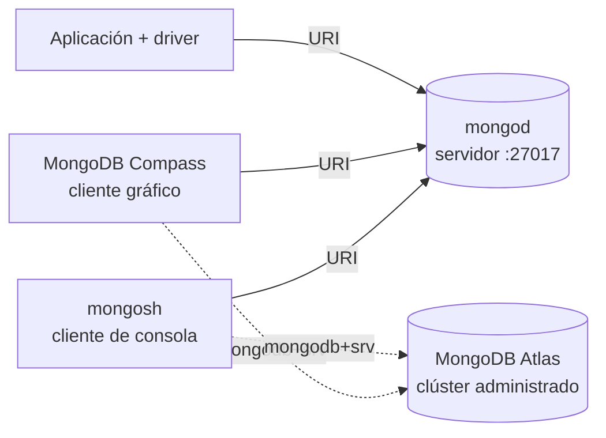

[← Unidad 4](/bbdd-aplicadas/unidad-4/teoria/)

Esta página es material de apoyo para el laboratorio: cómo tener un servidor MongoDB, conectarse con `mongosh` y con Compass, y usar un clúster gratuito de MongoDB Atlas. La instalación de un motor no es un tema evaluable del programa; sí lo es lo que se hace después, en [Introducción](/bbdd-aplicadas/unidad-4/teoria/mongodb-introduccion/), [CRUD](/bbdd-aplicadas/unidad-4/teoria/mongodb-crud/) y [Aggregation Pipeline](/bbdd-aplicadas/unidad-4/teoria/mongodb-agregacion/).

:::note[Qué se verificó y qué no]
Las instrucciones de instalación de cada sistema operativo y los pasos de la interfaz de Atlas **dependen de la versión del instalador o del sitio web** y no se ejecutan en el entorno de verificación del portal: se toman de la documentación oficial de MongoDB (https://www.mongodb.com/docs/manual/installation/) y quedan registrados como *pendientes de verificación específica*. Lo que sí se comprobó en MongoDB 7.0 es lo que se escribe en `mongosh` una vez conectado.
:::

## Para qué sirve

Para practicar hace falta un servidor donde guardar los datos. Hay dos caminos: instalar uno propio en la computadora, o usar un clúster gratuito en la nube (Atlas). La instalación tiene tres piezas que suelen confundirse: **el servidor**, **el cliente de consola** y **la interfaz gráfica**.



| Componente | Función | ¿Almacena datos? |
|---|---|:---:|
| **MongoDB Community Server (`mongod`)** | Motor que administra almacenamiento, accesos y operaciones | Sí |
| **`mongosh`** | Shell para enviar comandos MQL al servidor | No |
| **MongoDB Compass** | Cliente gráfico para administrar y consultar | No |
| **MongoDB Atlas** | Servicio de clústeres MongoDB administrados en la nube | Sí |

Instalar solamente Compass **no** crea un servidor local: Compass es un cliente.

## Instalación local

Se descarga MongoDB Community Server desde el sitio oficial (o se usa un administrador de paquetes) y, aparte, el shell `mongosh` y Compass. Los comandos exactos dependen del sistema operativo y de la versión; los de abajo corresponden a la versión 7.0 de la documentación oficial y se muestran como **plantillas**.

### Windows

1. Descargar el instalador `.msi` de MongoDB Community Server y ejecutarlo. La opción **Install MongoDB as a Service** deja a `mongod` corriendo como servicio.
2. Instalar `mongosh` y Compass (el instalador del servidor puede ofrecerlos).
3. Si el servicio se llama `MongoDB` (nombre por defecto), se inicia o se detiene desde una terminal con permisos de administrador:

<!-- sintaxis -->
```text
net start MongoDB
net stop MongoDB
```

### macOS

Con Homebrew, y según la guía oficial de la versión que se instale:

<!-- sintaxis -->
```bash
brew tap mongodb/brew
brew install mongodb-community@<versión>
brew services start mongodb/brew/mongodb-community@<versión>
```

### Linux

En las distribuciones con `systemd`, después de instalar el paquete oficial del repositorio de MongoDB:

<!-- sintaxis -->
```bash
sudo systemctl start mongod
sudo systemctl status mongod
sudo systemctl enable mongod   # inicio automático
```

### Comprobar la instalación

```bash
mongod --version
mongosh --version
```

Si `mongosh` no se reconoce como comando, el ejecutable no está instalado o su carpeta no está en el `PATH`.

## Conexión con `mongosh`

La cadena de conexión local, con los valores por defecto, es:

```text
mongodb://localhost:27017/
```

```bash
# Servidor local
mongosh "mongodb://localhost:27017/"

# Clúster Atlas: se usan las credenciales propias
mongosh "mongodb+srv://<usuario>:<contraseña>@<cluster>/<base>"
```

Para que la contraseña no quede escrita en el historial de la terminal, se puede omitir de la cadena: `mongosh` la pide al conectarse si se usa `--username <usuario>`.

Con la conexión abierta, se comprueba que todo funciona con una colección de prueba:

```text
show dbs
use laboratorio
```

<!-- check: U4.T.MI.03 -->
```javascript
db.prueba.insertOne({ mensaje: "conexión correcta", fecha: new Date() });
db.prueba.find({}, { _id: 0, mensaje: 1 })     // [ { mensaje: 'conexión correcta' } ]
db.getCollectionNames()                        // incluye 'prueba'
```

`show dbs` no muestra `laboratorio` hasta que contiene datos. Para limpiar: `db.prueba.drop()`.

## Conexión desde Compass

1. Abrir Compass y elegir **New Connection**.
2. Pegar `mongodb://localhost:27017/` para el servidor local, o la cadena que da Atlas.
3. Elegir **Connect**.
4. Crear una base y una colección con el botón correspondiente, o abrir el shell integrado y ejecutar MQL.

El detalle de la interfaz está en [MongoDB Compass](/bbdd-aplicadas/unidad-4/teoria/mongodb-compass/).

## Usuario y autenticación en un servidor local

Una instalación local nueva **no exige autenticación**: cualquiera que llegue al puerto 27017 puede leer y escribir. Para un servidor de práctica en la propia computadora, con el puerto sin exponer, es aceptable; en cualquier otro caso se activa el control de acceso. El procedimiento oficial es:

1. Crear un usuario administrador desde `mongosh`, con una contraseña pedida por el shell (no escrita en el comando):

<!-- sintaxis -->
```javascript
use admin
db.createUser({
  user: "<usuario>",
  pwd: passwordPrompt(),
  roles: [ { role: "userAdminAnyDatabase", db: "admin" } ]
})
```

2. Activar `security.authorization: enabled` en el archivo de configuración de `mongod` y reiniciar el servicio.
3. Conectarse con usuario y contraseña (`mongosh "mongodb://<usuario>@localhost:27017/?authSource=admin"`).

Este procedimiento modifica la configuración del sistema y **no se ejecutó en el entorno de verificación** (queda como pendiente de verificación específica).

## Conexión a Atlas

**MongoDB Atlas** ofrece un clúster gratuito de capacidad limitada, suficiente para practicar. Los pasos, en la interfaz web (los nombres pueden variar):

1. Crear una cuenta en Atlas y un **proyecto**.
2. Crear un clúster del nivel gratuito y elegir una región.
3. En **Database Access**, crear un **usuario de base de datos** con una contraseña generada, y un rol acorde con la tarea: `readWrite` para practicar o `read` si solo se consultan datos (por ejemplo, para un trabajo práctico que no modifica datos).
4. En **Network Access**, autorizar la dirección IP desde la que se conecta. Autorizar `0.0.0.0/0` (cualquier dirección) deja el clúster abierto al mundo y solo es aceptable en un clúster de práctica sin datos reales.
5. En **Connect**, elegir **Shell** o **Compass** y copiar la cadena `mongodb+srv://...`, reemplazando los marcadores por el usuario y la contraseña propios.
6. Cargar datos: desde Compass (importar JSON o CSV) o con `mongoimport`; el clúster también ofrece conjuntos de datos de ejemplo.

Para una conexión remota se necesita entonces: clúster activo, usuario con contraseña, IP autorizada y la cadena `mongodb+srv://<usuario>:<contraseña>@<cluster>/`.

:::danger[Credenciales]
No publiques cadenas con usuario y contraseña en apuntes, repositorios, capturas ni chats. Si una credencial quedó expuesta en algún material (por ejemplo, un documento de instalación que circula entre estudiantes), debe considerarse **comprometida**: quien la creó tiene que **rotarla** (cambiar la contraseña o eliminar el usuario). Se usan marcadores (`<usuario>`, `<contraseña>`) o variables de entorno.
:::

## Diagnóstico rápido

| Síntoma | Causa probable | Comprobación |
|---|---|---|
| `connection refused` | `mongod` no está iniciado o el puerto es incorrecto | Revisar el servicio (`net start MongoDB`, `systemctl status mongod`, `brew services list`) y el puerto 27017 |
| `Authentication failed` | Usuario, contraseña o base de autenticación incorrectos | Regenerar la URI y revisar los caracteres especiales de la contraseña (se codifican con porcentaje) |
| Atlas agota el tiempo | IP no autorizada o bloqueo de red | Revisar **Network Access** |
| `mongosh` no se reconoce | Ejecutable no instalado o fuera del `PATH` | Ejecutar `mongosh --version` |
| `show dbs` no muestra la base nueva | Aún no contiene datos | Insertar al menos un documento |

## Checklist de laboratorio

- [ ] Distingo `mongod`, `mongosh`, Compass y Atlas.
- [ ] Puedo conectarme a `mongodb://localhost:27017/` (o a mi clúster de Atlas).
- [ ] Sé que `use nombre` selecciona la base, pero que se crea al insertar datos.
- [ ] Puedo crear, consultar y eliminar una colección de prueba.
- [ ] Mi URI publicada no contiene credenciales reales.

## Autoevaluación

<details>
<summary>1. Instalé Compass y se conecta a `mongodb://localhost:27017/`, pero da `connection refused`. ¿Qué falta?</summary>

Compass es solo un cliente. Falta un servidor `mongod` corriendo en el puerto 27017: instalar MongoDB Community Server (o usar Atlas) e iniciar el servicio.

</details>

<details>
<summary>2. ¿Por qué no se publica la cadena de conexión de un clúster aunque "solo sea de práctica"?</summary>

Porque contiene el usuario y la contraseña de la base de datos; con ellos cualquiera puede leer y modificar los datos mientras su IP esté autorizada. Una credencial expuesta debe rotarse.

</details>

:::tip[En resumen]
- El servidor es `mongod`; `mongosh` y Compass son clientes, y Atlas es un servicio en la nube.
- Una instalación local nueva no exige autenticación: se activa el control de acceso fuera de un equipo de práctica.
- Atlas requiere usuario de base de datos, IP autorizada y la cadena `mongodb+srv://<usuario>:<contraseña>@<cluster>/`.
- Las credenciales no se publican; si se expusieron, se rotan.
:::

:::tip[Para seguir]
- Con el entorno listo, seguí con [CRUD y consultas](/bbdd-aplicadas/unidad-4/teoria/mongodb-crud/) y practicá con la [Práctica — Unidad 4 NoSQL / MongoDB](/bbdd-aplicadas/unidad-4/practica/ejercicios/).
:::

## Fuentes

- MongoDB Manual 7.0: *Install MongoDB Community Edition*, *Enable Access Control* y *Connection Strings*: https://www.mongodb.com/docs/manual/.
- MongoDB Atlas Documentation (*Get Started*, *Database Users*, *IP Access List*): https://www.mongodb.com/docs/atlas/.
- Presentación de cátedra, Unidad 4, parte 1 (MongoDB Atlas y Compass).
