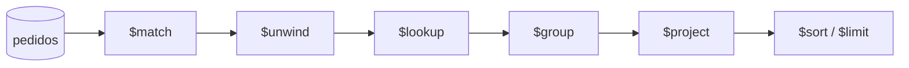

[← Unidad 4](/bbdd-aplicadas/unidad-4/teoria/)

Esta página reúne tres temas del programa: el **Aggregation Pipeline** (agrupar, calcular y combinar documentos), las **vistas** que se definen con un pipeline, y los **índices** con las **estadísticas de ejecución** que permiten saber si una consulta los aprovecha. Presupone [CRUD y consultas](/bbdd-aplicadas/unidad-4/teoria/mongodb-crud/).

Los resultados se obtuvieron en MongoDB 7.0 con `mongosh` 2.x. Los scripts completos están en `academic-sources/bbdd-aplicadas/checks/mongo/` (`U4.T.AGG.01` a `07` y `U4.T.IDX.01` a `05`).

## Para qué sirve

`find()` devuelve documentos tal como están guardados. Un informe de ventas por categoría, el total mensual o el pedido con los datos del cliente exigen **calcular y combinar**: es lo que hace el pipeline, el equivalente de `GROUP BY`, `JOIN`, `HAVING` y expresiones de `SELECT` en SQL. Y cuando la colección crece, una consulta sin índice recorre todos los documentos: los índices y `explain()` permiten medirlo y corregirlo.

## Datos de los ejemplos

Una tienda con `productos`, `clientes` y `pedidos`. Cada pedido tiene sus ítems **embebidos** en un array, y el pedido 108 referencia un cliente (`c9`) que no existe, para mostrar qué pasa con un `$lookup` sin coincidencia.

<!-- check: U4.T.AGG.01 -->
```javascript
db.productos.insertMany([
  { _id: 1, nombre: "Teclado",     categoria: "perifericos",  precio: 45,  stock: 12, etiquetas: ["usb", "oficina"] },
  { _id: 2, nombre: "Mouse",       categoria: "perifericos",  precio: 20,  stock: 30, etiquetas: ["usb"] },
  { _id: 3, nombre: "Monitor",     categoria: "pantallas",    precio: 300, stock: 5,  etiquetas: ["hdmi", "oficina"] },
  { _id: 4, nombre: "Notebook",    categoria: "computadoras", precio: 900, stock: 3,  etiquetas: ["portatil"] },
  { _id: 5, nombre: "Auriculares", categoria: "audio",        precio: 60,  stock: 0,  etiquetas: ["usb", "audio"] },
  { _id: 6, nombre: "Parlante",    categoria: "audio",        precio: 85,  stock: 8,  etiquetas: ["audio", "bluetooth"] },
  { _id: 7, nombre: "Webcam",      categoria: "perifericos",  precio: 55,  stock: 14, etiquetas: ["usb", "video"] },
  { _id: 8, nombre: "Impresora",   categoria: "impresion",    precio: 210, stock: 2,  etiquetas: ["oficina"] }
]);
db.clientes.insertMany([
  { _id: "c1", nombre: "Ana",   localidad: "Ramos Mejía" },
  { _id: "c2", nombre: "Bruno", localidad: "Morón" },
  { _id: "c3", nombre: "Carla", localidad: "Haedo" }
]);
db.pedidos.insertMany([
  { _id: 101, fecha: ISODate("2026-03-05T00:00:00Z"), estado: "entregado", clienteId: "c1", total: 110,
    items: [{ productoId: 1, cantidad: 2, precioUnitario: 45 }, { productoId: 2, cantidad: 1, precioUnitario: 20 }] },
  { _id: 102, fecha: ISODate("2026-03-18T00:00:00Z"), estado: "entregado", clienteId: "c2", total: 300,
    items: [{ productoId: 3, cantidad: 1, precioUnitario: 300 }] },
  { _id: 103, fecha: ISODate("2026-04-02T00:00:00Z"), estado: "pendiente", clienteId: "c1", total: 940,
    items: [{ productoId: 4, cantidad: 1, precioUnitario: 900 }, { productoId: 2, cantidad: 2, precioUnitario: 20 }] },
  { _id: 104, fecha: ISODate("2026-04-20T00:00:00Z"), estado: "cancelado", clienteId: "c3", total: 60,
    items: [{ productoId: 5, cantidad: 1, precioUnitario: 60 }] },
  { _id: 105, fecha: ISODate("2026-05-11T00:00:00Z"), estado: "entregado", clienteId: "c2", total: 185,
    items: [{ productoId: 1, cantidad: 1, precioUnitario: 45 }, { productoId: 7, cantidad: 1, precioUnitario: 55 }, { productoId: 6, cantidad: 1, precioUnitario: 85 }] },
  { _id: 106, fecha: ISODate("2026-05-30T00:00:00Z"), estado: "entregado", clienteId: "c3", total: 60,
    items: [{ productoId: 2, cantidad: 3, precioUnitario: 20 }] },
  { _id: 107, fecha: ISODate("2026-06-14T00:00:00Z"), estado: "pendiente", clienteId: "c1", total: 210,
    items: [{ productoId: 8, cantidad: 1, precioUnitario: 210 }] },
  { _id: 108, fecha: ISODate("2026-06-20T00:00:00Z"), estado: "entregado", clienteId: "c9", total: 40,
    items: [{ productoId: 2, cantidad: 2, precioUnitario: 20 }] }
]);
```

## Aggregation Pipeline

El **Aggregation Framework** procesa los documentos como una **tubería** de etapas: la salida de cada etapa es la entrada de la siguiente.

<!-- sintaxis -->
```javascript
db.coleccion.aggregate([
  { <etapa1> },
  { <etapa2> },
  ...
])
```



- Las etapas pueden repetirse (por ejemplo, un `$match` antes y otro después de un `$group`).
- Una consulta compleja se divide en etapas simples, que se prueban de a una.
- El resultado se puede guardar en una colección (`$out`, `$merge`) o convertirse en una vista.
- **Un `$match` temprano** reduce lo que procesan las etapas siguientes y, al comienzo del pipeline, puede aprovechar un índice.

| Categoría | Etapas |
|---|---|
| Filtrado | `$match` |
| Transformación | `$project`, `$set` / `$addFields`, `$unset`, `$replaceRoot`, `$replaceWith` |
| Unión | `$lookup` |
| Agrupación | `$group`, `$count`, `$sortByCount`, `$bucket`, `$bucketAuto` |
| Descomposición de arrays | `$unwind` |
| Orden y control | `$sort`, `$limit`, `$skip` |
| Varios pipelines | `$facet` |
| Salida | `$out`, `$merge` |

Las etapas `$graphLookup`, `$setWindowFields` y `$redact` están en la sección [Etapas complementarias](#etapas-complementarias).

### Operadores de expresión y acumuladores

Antes de las etapas conviene distinguir dos familias de operadores, que se confunden con facilidad:

- Los **operadores de expresión** calculan un valor **a partir de un documento**: `$multiply`, `$add`, `$round`, `$cmp`, `$concat`, `$size`, `$month`, `$dateDiff`, `$toString`, `$cond`. Se usan dentro de `$project`, `$addFields`, `$match` (con `$expr`) y como argumento de un acumulador.
- Los **acumuladores** combinan **los valores de varios documentos** de un grupo en uno solo: `$sum`, `$avg`, `$min`, `$max`, `$first`, `$last`, `$push`, `$addToSet`. Se usan en `$group` (y en `$bucket`, `$bucketAuto`, `$setWindowFields`).

Por eso `$multiply`, `$round` y `$cmp` **no son acumuladores**: no reducen un grupo de documentos, trabajan sobre los campos de uno. Pueden aparecer *dentro* de un acumulador (`{ $sum: { $multiply: ["$cantidad", "$precio"] } }`), que es donde se combinan.

### `$match`: filtrar

Equivale a `WHERE` (o a `HAVING` si va después de `$group`). Usa la misma sintaxis de filtro que `find()`.

<!-- check: U4.T.AGG.01 -->
```javascript
db.pedidos.aggregate([
  { $match: { estado: "entregado", total: { $gte: 100 } } },
  { $project: { _id: 0, pedido: "$_id", total: 1, cantidadItems: { $size: "$items" } } },
  { $sort: { pedido: 1 } }
])
```

**Resultado esperado.**

| pedido | total | cantidadItems |
|---:|---:|---:|
| 101 | 110 | 2 |
| 102 | 300 | 1 |
| 105 | 185 | 3 |

### `$project`: elegir y calcular campos

Equivale a la lista de columnas del `SELECT`: incluye (`1`) o excluye (`0`) campos, los renombra (`pedido: "$_id"`) y calcula campos nuevos con operadores de expresión. A diferencia de `find()`, admite expresiones.

### `$addFields` y `$set`: agregar o modificar campos

`$set` es un sinónimo de `$addFields`. Agregan campos (o reemplazan los que ya existen) sin tocar el resto. `$unset` elimina campos.

<!-- check: U4.T.AGG.01 -->
```javascript
db.pedidos.aggregate([
  { $match: { _id: { $in: [101, 105] } } },
  { $addFields: {
      mes: { $month: "$fecha" },
      etiqueta: { $concat: ["Pedido ", { $toString: "$_id" }, " (", "$estado", ")"] },
      conIva: { $round: [{ $multiply: ["$total", 1.21] }, 2] }
  } },
  { $project: { _id: 0, etiqueta: 1, mes: 1, conIva: 1 } },
  { $sort: { etiqueta: 1 } }
])
```

**Resultado esperado.**

| etiqueta | mes | conIva |
|---|---:|---:|
| Pedido 101 (entregado) | 3 | 133.1 |
| Pedido 105 (entregado) | 5 | 223.85 |

Aquí `$concat`, `$toString`, `$round` y `$multiply` son operadores de expresión. `$set` con `$add` y `$unset` por separado:

<!-- check: U4.T.AGG.01 -->
```javascript
db.pedidos.aggregate([
  { $match: { _id: 101 } },
  { $set: { total: { $add: ["$total", 10] } } },
  { $unset: ["items", "clienteId"] }
])
// { _id: 101, fecha: ISODate("2026-03-05T00:00:00.000Z"), estado: 'entregado', total: 120 }
```

### `$replaceRoot` y `$mergeObjects`: aplanar documentos

`$replaceRoot` sustituye el documento completo por el que se indica en `newRoot`; todo lo que no se incluya se pierde. `$mergeObjects` combina varios documentos en uno. Juntos aplanan estructuras anidadas: aquí cada ítem del pedido pasa a ser un documento plano con los datos del pedido.

<!-- check: U4.T.AGG.01 -->
```javascript
db.pedidos.aggregate([
  { $match: { _id: 101 } },
  { $unwind: "$items" },
  { $replaceRoot: { newRoot: { $mergeObjects: [{ pedido: "$_id", estado: "$estado" }, "$items"] } } },
  { $sort: { productoId: 1 } }
])
```

**Resultado esperado.**

| pedido | estado | productoId | cantidad | precioUnitario |
|---:|---|---:|---:|---:|
| 101 | entregado | 1 | 2 | 45 |
| 101 | entregado | 2 | 1 | 20 |

### `$lookup` y `$unwind`: combinar colecciones

`$lookup` equivale a un `LEFT OUTER JOIN`: agrega a cada documento un **array** (`as`) con los documentos de otra colección que coinciden. Si no hay coincidencia, el array queda vacío.

<!-- check: U4.T.AGG.02 -->
```javascript
db.pedidos.aggregate([
  { $match: { _id: { $in: [101, 108] } } },
  { $lookup: { from: "clientes", localField: "clienteId", foreignField: "_id", as: "cliente" } },
  { $project: { _id: 1, cliente: 1 } },
  { $sort: { _id: 1 } }
])
```

```text
{ _id: 101, cliente: [ { _id: 'c1', nombre: 'Ana', localidad: 'Ramos Mejía' } ] }
{ _id: 108, cliente: [] }
```

`$unwind` **descompone un array en un documento por elemento**. Aplicado al resultado del `$lookup`, el pedido 108 (array vacío) **desaparece**, como en un `INNER JOIN`. Con `preserveNullAndEmptyArrays: true` se conserva, como en un `LEFT JOIN`:

<!-- check: U4.T.AGG.02 -->
```javascript
db.pedidos.aggregate([
  { $match: { _id: { $in: [101, 108] } } },
  { $lookup: { from: "clientes", localField: "clienteId", foreignField: "_id", as: "cliente" } },
  { $unwind: { path: "$cliente", preserveNullAndEmptyArrays: true } },
  { $project: { _id: 1, cliente: "$cliente.nombre" } },
  { $sort: { _id: 1 } }
])
```

| _id | cliente |
|---:|---|
| 101 | Ana |
| 108 | (ausente) |

Sin la opción, el resultado tiene solo la fila del pedido 101. `$unwind` también admite `includeArrayIndex` para agregar la posición de cada elemento:

<!-- check: U4.T.AGG.02 -->
```javascript
db.pedidos.aggregate([
  { $match: { _id: 105 } },
  { $unwind: { path: "$items", includeArrayIndex: "posicion" } },
  { $project: { _id: 0, pedido: "$_id", posicion: 1, producto: "$items.productoId" } }
])
```

El pedido 105 se convierte en tres documentos, con `posicion` 0, 1 y 2 y los productos 1, 7 y 6. Un `$unwind` se usa antes de un `$group` para poder agrupar por los elementos de un array.

`$lookup` admite también una forma con `let` y `pipeline` para uniones con condiciones más complejas:

<!-- check: U4.T.AGG.02 -->
```javascript
db.clientes.aggregate([
  { $lookup: {
      from: "pedidos",
      let: { cid: "$_id" },
      pipeline: [
        { $match: { $expr: { $and: [{ $eq: ["$clienteId", "$$cid"] }, { $eq: ["$estado", "entregado"] }] } } },
        { $project: { _id: 1 } }
      ],
      as: "entregados"
  } },
  { $project: { _id: 0, nombre: 1, entregados: { $size: "$entregados" } } },
  { $sort: { nombre: 1 } }
])
// Ana: 1, Bruno: 2, Carla: 1
```

### `$group`: agrupar y acumular

Equivale a `GROUP BY`. El `_id` indica el criterio de agrupación (`"$campo"` hace referencia a un campo; `null` agrupa toda la colección) y cada campo adicional lleva un **acumulador**.

<!-- sintaxis -->
```javascript
{ $group: { _id: <expresión de agrupación>, <campo>: { <acumulador>: <expresión> } } }
```

| Acumulador | Resultado |
|---|---|
| `$sum` | Suma; con `1` cuenta los documentos |
| `$avg` | Promedio (ignora los valores no numéricos) |
| `$min`, `$max` | Mínimo y máximo |
| `$first`, `$last` | Primer y último valor del grupo, **según el orden de entrada** |
| `$push` | Array con todos los valores, con repetidos |
| `$addToSet` | Array con los valores distintos (sin orden definido) |

<!-- check: U4.T.AGG.03 -->
```javascript
db.pedidos.aggregate([
  { $group: {
      _id: "$estado",
      cantidad: { $sum: 1 },
      ingresos: { $sum: "$total" },
      promedio: { $avg: "$total" },
      minimo: { $min: "$total" },
      maximo: { $max: "$total" }
  } },
  { $sort: { _id: 1 } }
])
```

**Resultado esperado.**

| _id | cantidad | ingresos | promedio | minimo | maximo |
|---|---:|---:|---:|---:|---:|
| cancelado | 1 | 60 | 60 | 60 | 60 |
| entregado | 5 | 695 | 139 | 40 | 300 |
| pendiente | 2 | 1150 | 575 | 210 | 940 |

`$first`, `$last`, `$push` y `$addToSet` dependen del orden: por eso se ordena **antes** del `$group`. En este ejemplo, el primer y el último pedido de cada cliente y sus estados distintos:

<!-- check: U4.T.AGG.03 -->
```javascript
db.pedidos.aggregate([
  { $sort: { fecha: 1 } },
  { $group: {
      _id: "$clienteId",
      primerPedido: { $first: "$_id" },
      ultimoPedido: { $last: "$_id" },
      pedidos: { $push: "$_id" },
      estados: { $addToSet: "$estado" }
  } },
  { $addFields: { estados: { $sortArray: { input: "$estados", sortBy: 1 } } } },
  { $sort: { _id: 1 } }
])
```

| _id | primerPedido | ultimoPedido | pedidos | estados |
|---|---:|---:|---|---|
| c1 | 101 | 107 | 101, 103, 107 | entregado, pendiente |
| c2 | 102 | 105 | 102, 105 | entregado |
| c3 | 104 | 106 | 104, 106 | cancelado, entregado |
| c9 | 108 | 108 | 108 | entregado |

Otras formas del `_id`: con `null` se agrupa toda la colección (`{ $group: { _id: null, pedidos: { $sum: 1 }, total: { $sum: "$total" } } }` da 8 pedidos y 1905 de total), y con un documento se agrupa por varios criterios, por ejemplo por mes con un operador de fecha:

<!-- check: U4.T.AGG.03 -->
```javascript
db.pedidos.aggregate([
  { $group: { _id: { mes: { $month: "$fecha" } }, total: { $sum: "$total" } } },
  { $sort: { "_id.mes": 1 } }
])
// marzo: 410, abril: 1000, mayo: 245, junio: 250
```

#### Operadores de expresión dentro de `$group` y `$project`

El importe de un pedido es la suma de `cantidad * precioUnitario` de sus ítems: `$multiply` calcula cada línea (expresión) y `$sum` las acumula (acumulador). `$round` redondea el promedio por línea; `$cmp` compara dos valores y devuelve `-1`, `0` o `1`, y se usa en `$project`, no en `$group`:

<!-- check: U4.T.AGG.03 -->
```javascript
db.pedidos.aggregate([
  { $unwind: "$items" },
  { $group: {
      _id: "$estado",
      importe: { $sum: { $multiply: ["$items.cantidad", "$items.precioUnitario"] } },
      promedioItem: { $avg: { $round: [{ $multiply: ["$items.cantidad", "$items.precioUnitario"] }, 0] } }
  } },
  { $sort: { _id: 1 } }
])

db.productos.aggregate([
  { $project: { _id: 1, nombre: 1, frenteA100: { $cmp: ["$precio", 100] } } },
  { $sort: { _id: 1 } },
  { $limit: 4 }
])
```

| _id | importe | promedioItem |
|---|---:|---:|
| cancelado | 60 | 60 |
| entregado | 695 | 86.875 |
| pendiente | 1150 | 383.3333333333333 |

La segunda consulta devuelve `frenteA100` igual a `-1` para el Teclado y el Mouse (precio menor que 100) y `1` para el Monitor y la Notebook.

### Ventas por categoría: un pipeline completo

Se combinan `$match`, `$unwind`, `$lookup`, `$group`, `$sort` y `$project`:

<!-- check: U4.T.AGG.02 -->
```javascript
db.pedidos.aggregate([
  { $match: { estado: "entregado" } },                                 // 1. filtrar
  { $unwind: "$items" },                                               // 2. un documento por ítem
  { $lookup: { from: "productos", localField: "items.productoId",     // 3. buscar el producto
               foreignField: "_id", as: "producto" } },
  { $unwind: "$producto" },                                            // 4. aplanar el array del lookup
  { $group: {                                                          // 5. agrupar por categoría
      _id: "$producto.categoria",
      unidades: { $sum: "$items.cantidad" },
      ingresos: { $sum: { $multiply: ["$items.cantidad", "$items.precioUnitario"] } }
  } },
  { $sort: { ingresos: -1, _id: 1 } },                                 // 6. ordenar
  { $project: { _id: 0, categoria: "$_id", unidades: 1, ingresos: 1 } }   // 7. dar forma
])
```

**Resultado esperado.**

| categoria | unidades | ingresos |
|---|---:|---:|
| perifericos | 10 | 310 |
| pantallas | 1 | 300 |
| audio | 1 | 85 |

(El pedido 108, de un cliente inexistente, entra porque este pipeline no usa `clientes`.)

### `$sort`, `$skip`, `$limit` y `$count`

<!-- check: U4.T.AGG.04 -->
```javascript
db.pedidos.aggregate([{ $sort: { total: -1, _id: 1 } }, { $limit: 3 }, { $project: { _id: 1, total: 1 } }])
db.pedidos.aggregate([{ $sort: { total: -1, _id: 1 } }, { $skip: 3 }, { $limit: 3 }, { $project: { _id: 1, total: 1 } }])
db.pedidos.aggregate([{ $match: { estado: "entregado" } }, { $count: "totalEntregados" }])
```

La primera devuelve los pedidos 103, 102 y 107 (940, 300 y 210); la segunda, la página siguiente: 105, 101 y 104. `$count` devuelve `{ totalEntregados: 5 }`. Si ningún documento llega a `$count`, **no devuelve nada** (ni siquiera un cero).

### `$sortByCount`

Atajo de `$group` por un campo con `$sum: 1`, seguido de un `$sort` descendente por la cantidad:

<!-- check: U4.T.AGG.04 -->
```javascript
db.productos.aggregate([{ $sortByCount: "$categoria" }, { $sort: { count: -1, _id: 1 } }])
```

El resultado es `perifericos` (3), `audio` (2), y `computadoras`, `impresion` y `pantallas` con 1 cada una.

### `$bucket` y `$bucketAuto`

`$bucket` clasifica los documentos en rangos que se definen en `boundaries` (el límite inferior incluido y el superior excluido); `default` recibe los que quedan fuera. `$bucketAuto` calcula los rangos automáticamente, con una distribución lo más uniforme posible.

<!-- check: U4.T.AGG.04 -->
```javascript
db.productos.aggregate([{ $sort: { _id: 1 } }, {
  $bucket: {
    groupBy: "$precio",
    boundaries: [0, 50, 100, 300, 1000],
    default: "otros",
    output: { cantidad: { $sum: 1 }, productos: { $push: "$nombre" } }
  }
}])

db.productos.aggregate([{ $bucketAuto: { groupBy: "$precio", buckets: 3, output: { cantidad: { $sum: 1 } } } }])
```

| Rango (`$bucket`) | cantidad | productos |
|---|---:|---|
| 0 a 50 | 2 | Teclado, Mouse |
| 50 a 100 | 3 | Auriculares, Parlante, Webcam |
| 100 a 300 | 1 | Impresora |
| 300 a 1000 | 2 | Monitor, Notebook |

`$bucketAuto` con 3 grupos devuelve los rangos `20–60` (3 productos), `60–300` (3) y `300–900` (2): el último incluye el valor máximo.

### `$facet`: varios pipelines sobre la misma entrada

Ejecuta varios sub-pipelines independientes sobre los mismos documentos de entrada y devuelve **un único documento** con un array por cada uno. Sirve, por ejemplo, para una pantalla de resultados con una lista, un recuento por categoría y un resumen, en una sola consulta (en SQL harían falta varias consultas o CTE sobre la misma tabla).

<!-- check: U4.T.AGG.04 -->
```javascript
db.productos.aggregate([{
  $facet: {
    porCategoria: [
      { $group: { _id: "$categoria", cantidad: { $sum: 1 } } },
      { $sort: { cantidad: -1, _id: 1 } }
    ],
    masCaros: [
      { $sort: { precio: -1 } },
      { $limit: 2 },
      { $project: { _id: 0, nombre: 1, precio: 1 } }
    ],
    resumen: [
      { $group: { _id: null, productos: { $sum: 1 }, precioPromedio: { $avg: "$precio" } } },
      { $project: { _id: 0 } }
    ]
  }
}])
```

El documento de salida es `{ porCategoria: [ ...cinco grupos ], masCaros: [ { nombre: 'Notebook', precio: 900 }, { nombre: 'Monitor', precio: 300 } ], resumen: [ { productos: 8, precioPromedio: 209.375 } ] }`. Todos los sub-pipelines reciben los mismos documentos y el resultado completo debe caber en 16 MiB.

## Fechas en el pipeline

Las fechas deben guardarse como `Date` (ver [CRUD](/bbdd-aplicadas/unidad-4/teoria/mongodb-crud/#fechas-y-type-bracketing)). Los operadores de expresión de fecha son `$year`, `$month`, `$dayOfMonth`, `$dayOfWeek` (domingo = 1), `$dayOfYear`, `$week`, `$isoWeek`, `$isoDayOfWeek`, `$hour`, `$minute`, `$second`, `$millisecond`, `$dateToString`, `$dateFromString`, `$dateFromParts`, `$dateAdd`, `$dateSubtract`, `$dateDiff` y `$dateTrunc`.

`$dateDiff` cuenta los límites de unidad que se cruzan entre dos fechas. `$$NOW` es una variable del sistema con la fecha y hora actuales: el resultado **cambia con el reloj**, de modo que en los ejemplos reproducibles se usa una fecha fija:

<!-- check: U4.T.AGG.06 -->
```javascript
db.pedidos.aggregate([
  { $match: { _id: { $in: [101, 105] } } },
  { $project: {
      _id: 1,
      dias: { $dateDiff: { startDate: "$fecha", endDate: ISODate("2026-07-01T00:00:00Z"), unit: "day" } },
      meses: { $dateDiff: { startDate: "$fecha", endDate: ISODate("2026-07-01T00:00:00Z"), unit: "month" } },
      vence: { $dateAdd: { startDate: "$fecha", unit: "day", amount: 30 } },
      texto: { $dateToString: { format: "%d/%m/%Y", date: "$fecha" } },
      inicioMes: { $dateTrunc: { date: "$fecha", unit: "month" } },
      anio: { $year: "$fecha" },
      diaSemana: { $dayOfWeek: "$fecha" }
  } },
  { $sort: { _id: 1 } }
])
```

**Resultado esperado.**

| _id | dias | meses | vence | texto | inicioMes | anio | diaSemana |
|---:|---:|---:|---|---|---|---:|---:|
| 101 | 118 | 4 | 2026-04-04 | 05/03/2026 | 2026-03-01 | 2026 | 5 |
| 105 | 51 | 2 | 2026-06-10 | 11/05/2026 | 2026-05-01 | 2026 | 2 |

El 5 de marzo de 2026 fue jueves (`$dayOfWeek` = 5). Para convertir un texto en fecha:

<!-- check: U4.T.AGG.06 -->
```javascript
db.pedidos.aggregate([
  { $limit: 1 },
  { $project: { _id: 0, f: { $dateFromString: { dateString: "2026-03-05", format: "%Y-%m-%d" } } } }
])
// { f: ISODate("2026-03-05T00:00:00.000Z") }
```

Con `$$NOW` se escriben las consultas "relativas a hoy", por ejemplo los pedidos de más de 30 días (el resultado depende del día en que se ejecute):

<!-- check: U4.T.AGG.06 -->
```javascript
db.pedidos.aggregate([
  { $match: { _id: 101 } },
  { $project: { _id: 0, antiguedadMayorA30Dias: { $gt: [{ $dateDiff: { startDate: "$fecha", endDate: "$$NOW", unit: "day" } }, 30] } } }
])
// { antiguedadMayorA30Dias: true }   (el pedido es de marzo de 2026)
```

## Vistas

Una **vista** es una colección de **solo lectura** definida por un pipeline que se ejecuta cada vez que se la consulta. Se crea con `createView()`:

<!-- check: U4.T.AGG.05 -->
```javascript
db.createView("pedidosConCliente", "pedidos", [
  { $lookup: { from: "clientes", localField: "clienteId", foreignField: "_id", as: "cliente" } },
  { $unwind: "$cliente" },
  { $project: { _id: 1, estado: 1, total: 1, cliente: "$cliente.nombre", localidad: "$cliente.localidad" } }
]);

db.pedidosConCliente.find({ localidad: "Morón" }).sort({ _id: 1 })
```

| Etapa | Descripción |
|---|---|
| `$lookup` | Une cada pedido con el cliente; deja el resultado en un array |
| `$unwind` | Genera un documento por cada elemento del array `cliente` (aquí, uno solo). Los pedidos sin cliente quedan fuera |
| `$project` | Deja los campos que expone la vista |

La consulta devuelve los pedidos 102 y 105, de Bruno (Morón). La vista tiene 7 documentos, porque el pedido 108 no tiene cliente y `$unwind` lo descarta; si se corrige el `clienteId` del 108 en `pedidos`, la vista pasa a tener 8, ya que **refleja la colección base**. Intentar escribir en la vista falla con el código `166` (`CommandNotSupportedOnView`). La vista aparece en `show collections` con tipo `view`; `db.pedidosConCliente.drop()` elimina solo la vista, no los datos.

En Compass se arma el pipeline en la pestaña **Aggregations** y se lo guarda con **Save → Create View** (ver [Compass](/bbdd-aplicadas/unidad-4/teoria/mongodb-compass/)).

## Etapas complementarias

:::note[Contenido complementario]
Esta sección no forma parte del programa 2024. Se incluye como referencia breve de etapas que aparecen en la documentación y en consultas reales.
:::

- **`$setWindowFields`**: calcula acumulados y rankings por partición, como las *window functions* de SQL.
- **`$merge`** (y `$out`): escriben el resultado en una colección. `$merge` puede insertar, reemplazar o combinar con lo que ya existe; `$out` reemplaza toda la colección destino. Deben ser la **última etapa**.
- **`$graphLookup`**: recorre relaciones jerárquicas (categorías y subcategorías) de forma recursiva.
- `$redact` restringe documentos según una condición; es un caso especial.

<!-- check: U4.T.AGG.07 -->
```javascript
// Acumulado por cliente (equivalente a SUM() OVER (PARTITION BY ... ORDER BY ...))
db.pedidos.aggregate([
  { $setWindowFields: {
      partitionBy: "$clienteId",
      sortBy: { fecha: 1 },
      output: { acumulado: { $sum: "$total", window: { documents: ["unbounded", "current"] } } }
  } },
  { $match: { clienteId: "c1" } },
  { $project: { _id: 1, total: 1, acumulado: 1 } },
  { $sort: { _id: 1 } }
])
// 101: 110, 103: 1050, 107: 1260

// Guardar un resumen en otra colección
db.pedidos.aggregate([
  { $group: { _id: "$estado", pedidos: { $sum: 1 }, total: { $sum: "$total" } } },
  { $merge: { into: "resumenEstados", whenMatched: "replace", whenNotMatched: "insert" } }
])
// resumenEstados: cancelado (1, 60), entregado (5, 695), pendiente (2, 1150)

// Ancestros de una categoría
db.categorias.insertMany([
  { _id: "tecnologia", padre: null },
  { _id: "computadoras", padre: "tecnologia" },
  { _id: "notebooks", padre: "computadoras" }
]);
db.categorias.aggregate([
  { $match: { _id: "notebooks" } },
  { $graphLookup: { from: "categorias", startWith: "$padre", connectFromField: "padre", connectToField: "_id", as: "ancestros" } },
  { $project: { _id: 1, ancestros: { $sortArray: { input: "$ancestros._id", sortBy: 1 } } } }
])
// { _id: 'notebooks', ancestros: [ 'computadoras', 'tecnologia' ] }
```

## Índices y estadísticas de ejecución

Un **índice** es una estructura ordenada (un árbol B) sobre uno o más campos que permite encontrar documentos sin recorrer toda la colección. Sin índice, MongoDB hace un **COLLSCAN** (lee todos los documentos); con índice, un **IXSCAN** (recorre las claves del índice) y luego un `FETCH` de los documentos. Los índices aceleran las lecturas y encarecen las escrituras, porque cada inserción y actualización los mantiene, y ocupan espacio.

### `explain("executionStats")`

`explain()` muestra el plan elegido y, con `executionStats`, lo que realmente pasó al ejecutarlo. Las métricas que se leen son:

| Métrica | Dónde | Significado |
|---|---|---|
| Etapa ganadora | `queryPlanner.winningPlan.stage` (y `inputStage` anidadas) | `COLLSCAN`, `IXSCAN`, `FETCH`, `SORT`, `PROJECTION_COVERED` |
| `nReturned` | `executionStats` | Documentos devueltos |
| `totalKeysExamined` | `executionStats` | Claves de índice leídas |
| `totalDocsExamined` | `executionStats` | Documentos leídos de la colección |
| `executionTimeMillis` | `executionStats` | Tiempo (depende del equipo; no se usa para comparar ejemplos) |

La relación que importa es la de `nReturned` frente a lo examinado: una consulta eficiente examina casi lo mismo que devuelve. Una colección de 1000 órdenes (`cliente` entre `c0` y `c49`, 20 órdenes por cliente):

<!-- check: U4.T.IDX.01 -->
```javascript
db.ordenes.find({ cliente: "c7" }).explain("executionStats")      // sin índice
db.ordenes.createIndex({ cliente: 1 })
db.ordenes.find({ cliente: "c7" }).explain("executionStats")      // con índice
```

**Resultado esperado** (los valores relevantes del plan):

| Caso | Etapas | `nReturned` | `totalKeysExamined` | `totalDocsExamined` |
|---|---|---:|---:|---:|
| Sin índice | `COLLSCAN` | 20 | 0 | 1000 |
| Con `{ cliente: 1 }` | `FETCH` > `IXSCAN` | 20 | 20 | 20 |

Para un `aggregate()` se usa `db.coleccion.explain("executionStats").aggregate(<pipeline>)`: un `$match` inicial sobre `cliente` también usa el índice (`IXSCAN`, 20 documentos examinados).

### Tipos de índice

#### Índice simple, embebido y `_id`

Toda colección tiene un índice único sobre `_id`, creado junto con la colección, que no se puede eliminar. Un índice simple se crea con `createIndex()`, donde `1` es ascendente y `-1` descendente. Para campos de subdocumentos se usa la notación de punto. Crear dos veces el mismo índice no hace nada.

<!-- check: U4.T.IDX.04 -->
```javascript
db.catalogo.createIndex({ "proveedor.nombre": 1 })    // devuelve el nombre: 'proveedor.nombre_1'
db.catalogo.getIndexes()                              // _id_ y proveedor.nombre_1
db.catalogo.dropIndex({ "proveedor.nombre": 1 })      // se elimina por definición de campos (o por nombre)
```

#### Índice compuesto y regla ESR

Un índice sobre varios campos (`{ estado: 1, fecha: 1, total: 1 }`) sirve para consultas que filtran por esos campos. **El orden importa**:

- El índice sirve para consultas que usan un **prefijo** de sus campos: `{ a, b, c }` ayuda a filtrar por `a`, por `a` y `b`, o por los tres, pero no por `b` solo.
- Regla **ESR** (*Equality, Sort, Range*): primero los campos que se filtran por **igualdad**, luego los que se **ordenan** y al final los de **rango** (`$gt`, `$lt`...). Así el índice devuelve los documentos ya ordenados y no hace falta un `SORT` en memoria.

Con la consulta `estado = "entregado"`, `total >= 400`, ordenada por `fecha`:

<!-- check: U4.T.IDX.01 -->
```javascript
// Orden igualdad, rango, sort: { estado: 1, total: 1, fecha: 1 }
db.ordenes.createIndex({ estado: 1, total: 1, fecha: 1 })
db.ordenes.find({ estado: "entregado", total: { $gte: 400 } }).sort({ fecha: 1 }).explain("executionStats")

// Orden ESR: { estado: 1, fecha: 1, total: 1 }
db.ordenes.dropIndex({ estado: 1, total: 1, fecha: 1 })
db.ordenes.createIndex({ estado: 1, fecha: 1, total: 1 })
db.ordenes.find({ estado: "entregado", total: { $gte: 400 } }).sort({ fecha: 1 }).explain("executionStats")
```

| Índice | Etapas | `nReturned` | `totalKeysExamined` | `totalDocsExamined` |
|---|---|---:|---:|---:|
| `{ estado, total, fecha }` | `FETCH` > `SORT` > `IXSCAN` | 100 | 100 | 100 |
| `{ estado, fecha, total }` (ESR) | `FETCH` > `IXSCAN` | 100 | 501 | 100 |

El plan ESR **elimina el `SORT` en memoria**, pero en estos datos examina más claves (501) porque recorre las claves de `estado` en orden de `fecha` y descarta las de `total` bajo. ESR es una guía, no una ley: con colecciones grandes y resultados grandes el `SORT` bloqueante es lo que más cuesta, y con rangos muy selectivos puede convenir el otro orden. Se decide con `explain()`.

#### Índice único

Rechaza los valores duplicados con el error `E11000`. Un documento sin el campo cuenta como `null`, de modo que solo cabe **uno** sin ese campo.

<!-- check: U4.T.IDX.02 -->
```javascript
db.usuarios.createIndex({ email: 1 }, { unique: true });
db.usuarios.insertOne({ _id: 1, email: "ana@ejemplo.test" });
db.usuarios.insertOne({ _id: 2, email: "ana@ejemplo.test" });   // E11000 duplicate key error (código 11000)
db.usuarios.insertOne({ _id: 3 });                              // acepta: email ausente (null)
db.usuarios.insertOne({ _id: 4 });                              // E11000: ya hay un documento sin email
```

Un índice único puede ser compuesto (`{ nombre: 1, apellidos: 1 }`): la combinación es lo que no se repite.

#### Índice multikey (sobre arrays)

Si el campo indexado es un array, el índice tiene una entrada por cada elemento (*multikey*), y la consulta por un elemento usa el índice:

<!-- check: U4.T.IDX.02 -->
```javascript
db.articulos.insertMany([
  { _id: 1, titulo: "A", etiquetas: ["bd", "mongo"] },
  { _id: 2, titulo: "B", etiquetas: ["sql", "bd"] },
  { _id: 3, titulo: "C", etiquetas: ["redes"] }
]);
db.articulos.createIndex({ etiquetas: 1 });
db.articulos.find({ etiquetas: "bd" }).explain("executionStats")   // IXSCAN con isMultiKey: true, nReturned 2
```

Un índice compuesto puede tener **a lo sumo un campo array**.

#### Índice parcial y sparse

Un índice **parcial** solo incluye los documentos que cumplen `partialFilterExpression`: ocupa menos espacio y cuesta menos de mantener. Una consulta solo lo usa si su filtro **implica** el del índice.

<!-- check: U4.T.IDX.02 -->
```javascript
db.ventas.insertMany([
  { _id: 1, estado: "activa", total: 50 },
  { _id: 2, estado: "activa", total: 700 },
  { _id: 3, estado: "baja",   total: 900 },
  { _id: 4, estado: "activa", total: 1200 }
]);
db.ventas.createIndex({ total: 1 }, { partialFilterExpression: { estado: "activa" } });

db.ventas.find({ estado: "activa", total: { $gt: 500 } }).explain("executionStats")   // FETCH > IXSCAN
db.ventas.find({ total: { $gt: 500 } }).explain("executionStats")                      // COLLSCAN: el índice no cubre las "baja"
```

Un índice **sparse** (`{ sparse: true }`) solo incluye los documentos en los que **el campo existe** (un campo con valor `null` sí está en el índice). Los documentos sin el campo no aparecen al recorrerlo, y por eso una consulta que debe devolverlos (`{ telefono: null }`) no puede usar un índice sparse. El índice parcial es la versión más general: un sparse equivale a `partialFilterExpression: { campo: { $exists: true } }`.

<!-- check: U4.T.IDX.02 -->
```javascript
db.contactos.insertMany([
  { _id: 1, nombre: "Ana", telefono: "1111" },
  { _id: 2, nombre: "Bruno" },
  { _id: 3, nombre: "Carla", telefono: null }
]);
db.contactos.createIndex({ telefono: 1 }, { sparse: true });
db.contactos.find().hint({ telefono: 1 })     // recorre el índice: _id 1 y 3 (falta el 2)
db.contactos.find({ telefono: null })         // _id 2 y 3: la consulta correcta no usa el índice sparse
```

#### Índice TTL

Un índice **TTL** (*time to live*) borra automáticamente los documentos cuando pasa un tiempo desde el valor de un campo `Date`. Se usa para sesiones, códigos temporales y registros que caducan. Se define con `expireAfterSeconds`:

<!-- check: U4.T.IDX.03 -->
```javascript
db.sesiones.createIndex({ creada: 1 }, { expireAfterSeconds: 3600 });
db.sesiones.insertMany([
  { _id: 1, usuario: "u1", creada: new Date() },
  { _id: 2, usuario: "u2", creada: new Date(Date.now() - 2 * 3600 * 1000) }
]);
db.sesiones.getIndexes()   // el índice creada_1 muestra expireAfterSeconds: 3600
```

El proceso que borra corre cada 60 segundos aproximadamente, así que el documento vencido no desaparece de inmediato (justo después de insertar, `countDocuments()` sigue devolviendo 2). El campo debe ser de tipo `Date` o un array de fechas; un texto no expira.

#### Índice de texto

Un índice **de texto** permite buscar palabras con `$text` en uno o más campos de tipo texto, con *stemming* y sin distinguir mayúsculas. Cada colección admite **un solo** índice de texto.

<!-- check: U4.T.IDX.03 -->
```javascript
db.apuntes.insertMany([
  { _id: 1, titulo: "Indices en MongoDB", cuerpo: "Un indice evita recorrer toda la coleccion" },
  { _id: 2, titulo: "Agregacion", cuerpo: "El pipeline procesa documentos por etapas" },
  { _id: 3, titulo: "Transacciones", cuerpo: "ACID y sesiones en MongoDB" }
]);
db.apuntes.createIndex({ titulo: "text", cuerpo: "text" });

db.apuntes.find({ $text: { $search: "mongodb" } }, { _id: 1 })                  // _id 1 y 3
db.apuntes.find({ $text: { $search: "pipeline etapas" } }, { _id: 1 })          // _id 2 (cualquiera de las palabras)
db.apuntes.find({ $text: { $search: "mongodb -transacciones" } }, { _id: 1 })   // _id 1 (se excluye la palabra con -)
db.apuntes.find({ $text: { $search: "\"por etapas\"" } }, { _id: 1 })           // _id 2 (frase exacta)
```

Crear un segundo índice de texto en la misma colección falla con `IndexOptionsConflict`.

:::note[Otros tipos de índice]
También existen los **hashed** (`{ campo: "hashed" }`, para sharding por hash y búsquedas de igualdad) y los **geoespaciales** (`2dsphere`, `2d`). Se mencionan por completitud; no se desarrollan en el programa de la materia.
:::

### Consultas cubiertas (*covered queries*)

Una consulta está **cubierta** cuando el índice contiene todos los campos que filtra y todos los que devuelve: se responde solo con el índice, sin leer los documentos. En `explain()` se ve `PROJECTION_COVERED` sobre `IXSCAN` y `totalDocsExamined: 0`.

<!-- check: U4.T.IDX.04 -->
```javascript
db.catalogo.createIndex({ categoria: 1, precio: 1 });

// Pide nombre, que no está en el índice: hay que leer el documento
db.catalogo.find({ categoria: "cat3" }, { _id: 0, categoria: 1, precio: 1, nombre: 1 }).explain("executionStats")
// Cubierta: solo campos del índice y sin _id
db.catalogo.find({ categoria: "cat3" }, { _id: 0, categoria: 1, precio: 1 }).explain("executionStats")
// Incluir _id (por defecto) deja de ser cubierta
db.catalogo.find({ categoria: "cat3" }, { categoria: 1, precio: 1 }).explain("executionStats")
```

| Consulta | Etapas | `nReturned` | `totalKeysExamined` | `totalDocsExamined` |
|---|---|---:|---:|---:|
| Pide `nombre` | `PROJECTION_SIMPLE` > `FETCH` > `IXSCAN` | 50 | 50 | 50 |
| Cubierta | `PROJECTION_COVERED` > `IXSCAN` | 50 | 50 | 0 |
| Con `_id` implícito | `PROJECTION_SIMPLE` > `FETCH` > `IXSCAN` | 50 | 50 | 50 |

### `hint()`: forzar un índice

El planificador elige el índice con un plan de menor costo. `hint()` obliga a usar uno determinado (o `{ $natural: 1 }` para forzar el recorrido de la colección). Sirve para **comparar planes**, no como solución permanente:

<!-- check: U4.T.IDX.04 -->
```javascript
db.catalogo.createIndex({ precio: 1 });
db.catalogo.find({ categoria: "cat3", precio: { $gt: 100 } }).hint({ precio: 1 }).explain("executionStats")
db.catalogo.find({ categoria: "cat3", precio: { $gt: 100 } }).hint({ categoria: 1, precio: 1 }).explain("executionStats")
db.catalogo.find({ categoria: "cat3" }).hint({ $natural: 1 }).explain("executionStats")
```

| Índice forzado | `nReturned` | `totalKeysExamined` | `totalDocsExamined` |
|---|---:|---:|---:|
| `{ precio: 1 }` | 40 | 400 | 400 |
| `{ categoria: 1, precio: 1 }` | 40 | 40 | 40 |
| `$natural` (COLLSCAN) | 50 | 0 | 500 |

El índice compuesto examina solo lo que devuelve; el simple lee 400 documentos para quedarse con 40.

### Estadísticas de colecciones e índices

- `db.coleccion.stats()` informa la cantidad de documentos (`count`), los índices (`nindexes`) y los tamaños (`totalIndexSize`).
- `$collStats` (como etapa de `aggregate`) devuelve las estadísticas de almacenamiento y el recuento (`{ $collStats: { count: {} } }`).
- `$indexStats` informa, por cada índice, cuántas veces se usó (`accesses.ops`) desde que arrancó el servidor. Sirve para detectar índices que **nunca se usan** y solo cuestan escritura.

<!-- check: U4.T.IDX.05 -->
```javascript
db.catalogo.createIndex({ categoria: 1 });
db.catalogo.find({ categoria: "cat1" }).toArray();
db.catalogo.find({ categoria: "cat2" }).toArray();
db.catalogo.find({ precio: 7 }).toArray();     // sin índice: COLLSCAN

db.catalogo.aggregate([{ $collStats: { count: {} } }])                                  // count: 300
db.catalogo.aggregate([{ $indexStats: {} }, { $project: { _id: 0, name: 1, usos: "$accesses.ops" } }])
// _id_: 0 usos, categoria_1: 2 usos
```

### Listar y eliminar índices

<!-- check: U4.T.IDX.04 -->
```javascript
db.catalogo.getIndexes()                       // _id_, categoria_1_precio_1, precio_1
db.catalogo.dropIndex("precio_1")              // { nIndexesWas: 3, ok: 1 }   (por nombre)
db.catalogo.dropIndex("categoria_hashed")      // IndexNotFound: ese índice nunca se creó
db.catalogo.dropIndexes()                      // elimina todos menos _id_ ({ nIndexesWas: 2, ... })
```

Eliminar un índice que no existe falla con `IndexNotFound`; intentar eliminar `_id_` falla con `InvalidOptions`. Los nombres que se pasan a `dropIndex()` son los que se ven en `getIndexes()`: un ejemplo como `dropIndex("categoria_hashed")` solo funciona si ese índice se creó antes. `dropIndexes()` elimina todos los índices menos `_id_` e informa cuántos había (`nIndexesWas`).

:::note[`reIndex()`]
`reIndex()` elimina y reconstruye todos los índices de una colección. Es costoso y bloquea las operaciones; solo está disponible en instancias *standalone*, no en réplicas ni en servicios administrados como Atlas. No se usa como mantenimiento rutinario: cuando hace falta, se recrea solo el índice afectado.
:::

## Errores frecuentes

:::caution[Errores frecuentes]
- Llamar *acumuladores* a `$multiply`, `$round` o `$cmp`: son operadores de expresión; acumulan solo `$sum`, `$avg`, `$min`, `$max`, `$first`, `$last`, `$push` y `$addToSet`.
- Usar `$first` o `$last` sin ordenar antes: devuelven el primer o último documento **de la entrada**, que no tiene orden garantizado.
- Poner `$match` después de `$group` cuando el filtro podía ir antes: se agrupan documentos que luego se descartan, y se pierde la posibilidad de usar un índice.
- Esperar que un `$lookup` sin coincidencia elimine el documento: lo deja con un array vacío; es el `$unwind` posterior, sin `preserveNullAndEmptyArrays`, el que lo descarta.
- Armar un índice compuesto con el rango antes que el orden y sorprenderse por el `SORT` en memoria.
- Crear índices "por las dudas": cada uno agrega costo a las escrituras. `$indexStats` muestra los que no se usan.
- Consultar `{ telefono: null }` y esperar que use un índice sparse sobre `telefono`.
:::

## Autoevaluación

<details>
<summary>1. ¿Por qué el operador de redondeo no puede ir como acumulador de un group, y dónde sí se usa?</summary>

El operador es `$round`.

Porque es un operador de expresión: recibe valores de un solo documento y devuelve un valor. Los acumuladores reciben una expresión evaluada para cada documento del grupo y la combinan. `$round` se usa dentro de un acumulador, por ejemplo `{ $avg: { $round: ["$campo", 0] } }`, o en `$project` y `$addFields`.

</details>

<details>
<summary>2. Un pipeline con lookup y unwind pierde los pedidos cuyo cliente no existe. ¿Cómo se conservan?</summary>

Las etapas son `$lookup` y `$unwind`.

Con `{ $unwind: { path: "$cliente", preserveNullAndEmptyArrays: true } }`, que mantiene los documentos cuyo array está vacío o ausente (como un `LEFT JOIN`).

</details>

<details>
<summary>3. `explain("executionStats")` informa `nReturned: 20`, `totalKeysExamined: 20` y `totalDocsExamined: 1000`. ¿Qué plan fue?</summary>

No es consistente: con un `IXSCAN` y 20 claves, se leen como mucho 20 documentos. Un plan `COLLSCAN` informa `totalKeysExamined: 0` y `totalDocsExamined` igual al tamaño de la colección (1000).

</details>

<details>
<summary>4. ¿Qué hace falta para que una consulta esté cubierta por un índice?</summary>

Que los campos del filtro y los de la proyección estén todos en el índice, y que la proyección excluya `_id` (salvo que `_id` forme parte del índice). El plan muestra `PROJECTION_COVERED` y `totalDocsExamined: 0`.

</details>

:::tip[En resumen]
- El pipeline procesa los documentos etapa por etapa. Los acumuladores (`$sum`, `$avg`, `$min`, `$max`, `$first`, `$last`, `$push`, `$addToSet`) reducen grupos; los operadores de expresión (`$multiply`, `$round`, `$cmp`) calculan sobre un documento.
- `$lookup` + `$unwind` equivalen a un `JOIN`; `preserveNullAndEmptyArrays` lo vuelve un `LEFT JOIN`.
- `$$NOW` depende del reloj: para resultados reproducibles se usa una fecha fija.
- Una vista es una colección de solo lectura definida por un pipeline.
- Con `explain("executionStats")` se compara `nReturned` con las claves y documentos examinados. `COLLSCAN` recorre todo; `IXSCAN` usa el índice; una consulta cubierta no lee documentos.
- En un índice compuesto, el orden de los campos sigue la regla ESR como punto de partida y se confirma midiendo.
:::

## Fuentes

- Presentación de cátedra, Unidad 4: agregaciones (pipeline) e índices y estadísticas de ejecución.
- MongoDB Manual 7.0: *Aggregation Pipeline*, *Aggregation Operators*, *Views*, *Indexes* (*Compound*, *Unique*, *Multikey*, *Partial*, *Sparse*, *TTL*, *Text*), *ESR Rule*, *Covered Queries* y *Explain Results*: https://www.mongodb.com/docs/manual/.
