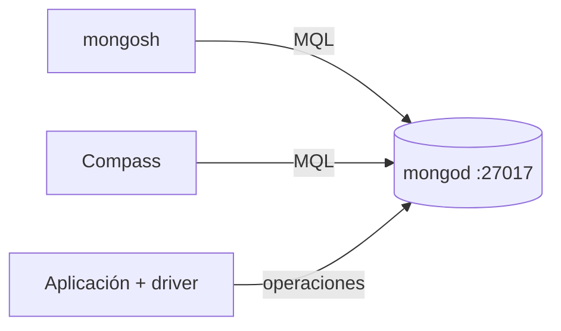

[← Unidad 4](/bbdd-aplicadas/unidad-4/teoria/)

Esta página presenta el modelo de datos de MongoDB: documentos BSON, tipos, la clave `_id` y su `ObjectId`, la correspondencia con el modelo relacional, la gestión de bases y colecciones y el shell `mongosh`. Las operaciones de lectura y escritura siguen en [CRUD y consultas](/bbdd-aplicadas/unidad-4/teoria/mongodb-crud/) y la agregación en [Aggregation Pipeline, índices y vistas](/bbdd-aplicadas/unidad-4/teoria/mongodb-agregacion/).

Todos los ejemplos se ejecutaron en MongoDB 7.0 con `mongosh` 2.x. Los nombres siguen la convención habitual: colecciones en minúsculas y plural, campos en camelCase.

## Para qué sirve

Una tienda en línea guarda un pedido con sus ítems, la dirección de envío y una lista de etiquetas. En el modelo relacional ese pedido se reparte en varias tablas y se reconstruye con `JOIN`. En MongoDB se guarda como **un documento**, con los ítems embebidos, y se lee en una sola operación. Esa es la idea central: el documento es la unidad de almacenamiento y de lectura, y su estructura puede variar de un documento a otro.

## ¿Qué es MongoDB?

MongoDB es una base de datos NoSQL orientada a **documentos**. Su nombre proviene de "hu**mongo**us" (enorme). En el modelo simplificado de la cátedra se clasifica como **CP**: durante una partición de red prioriza la consistencia de las escrituras confirmadas aunque una elección de primario pueda interrumpir temporalmente el servicio.

| Característica | Descripción |
|---|---|
| **Flexibilidad** | Los documentos de una misma colección pueden tener estructuras diferentes |
| **Escalabilidad horizontal** | Con *sharding*, los datos se distribuyen entre varios nodos |
| **Rendimiento** | Lectura por documento, índices y arquitectura distribuible según el patrón de acceso |
| **Desarrollo ágil** | Drivers para JavaScript, Python, Java y otros lenguajes |

## Comparación con el modelo relacional

| MongoDB | SQL equivalente | Diferencia relevante |
|---|---|---|
| Base de datos | Base de datos | Se crea de forma diferida, al insertar el primer documento |
| **Colección** | Tabla | No impone columnas: no hay `CREATE TABLE` obligatorio |
| **Documento** | Fila | Puede tener campos anidados y arrays |
| **Campo** (clave) | Columna | Cada documento puede tener campos distintos |
| **`_id`** | Clave primaria | Es obligatorio, único y tiene un índice automático |
| Índice | Índice | Mismo propósito; se crean con `createIndex()` |
| Documento embebido / `$lookup` | `JOIN` | Los datos que se leen juntos suelen guardarse juntos |

Que no haya esquema obligatorio no significa que no haya diseño: los campos que las consultas usan conviene mantenerlos con el mismo nombre y tipo en todos los documentos. Cuando se necesita imponer reglas, se agrega una validación (ver [Validación con JSON Schema](#validación-con-json-schema)).

## BSON

MongoDB almacena y transmite los documentos en **BSON** (*Binary JSON*):

- Es una representación **binaria**, recorrible por el motor sin interpretar texto.
- Conserva los nombres de los campos y los **tipos** de cada valor.
- Tiene **más tipos que JSON**: enteros de 32 y 64 bits, `Double`, `Decimal128`, `Date`, `ObjectId`, datos binarios y otros.
- No es necesariamente más chico que el JSON equivalente: depende de los datos.

El tamaño máximo de un documento BSON es **16 MiB**. Un archivo mayor se divide, se guarda fuera de la base o se almacena con **GridFS**. Este límite obliga a diseñar arrays que no crezcan sin control.

## Tipos de datos

<!-- check: U4.T.MI.01 -->
```javascript
db.personas.insertOne({
  _id: 1,
  nombre: "Pedro",                                   // String
  edad: 30,                                          // Int32
  altura: 1.75,                                      // Double
  grande: 3000000000,                                // Double (excede el rango de Int32)
  visitas: NumberLong("9999999999"),                 // Int64
  saldo: NumberDecimal("2500.50"),                   // Decimal128
  activo: true,                                      // Boolean
  segundoNombre: null,                               // Null
  hobbies: ["leer", "viajar"],                       // Array
  nacimiento: ISODate("1990-07-12T00:00:00Z"),       // Date
  direccion: { calle: "Avenida Siempre Viva", numero: 742 },  // Documento embebido
  ref: ObjectId("507f1f77bcf86cd799439011")          // ObjectId
});
```

Para ver el tipo BSON que MongoDB le asignó a cada valor se usa el operador `$type` de agregación:

<!-- check: U4.T.MI.01 -->
```javascript
db.personas.aggregate([{ $project: {
  _id: 0,
  nombre: { $type: "$nombre" }, edad: { $type: "$edad" }, altura: { $type: "$altura" },
  grande: { $type: "$grande" }, visitas: { $type: "$visitas" }, saldo: { $type: "$saldo" },
  hobbies: { $type: "$hobbies" }, nacimiento: { $type: "$nacimiento" }, ref: { $type: "$ref" }
} }])
```

**Resultado esperado** (parcial de la salida del check):

| Campo | `$type` |
|---|---|
| `nombre` | `string` |
| `edad` | `int` |
| `altura` | `double` |
| `grande` | `double` |
| `visitas` | `long` |
| `saldo` | `decimal` |
| `hobbies` | `array` |
| `nacimiento` | `date` |
| `ref` | `objectId` |

| Tipo | Descripción | Alias en `$type` |
|---|---|---|
| String | Cadena UTF-8 | `string` |
| Int32 | Entero de −2 147 483 648 a 2 147 483 647 | `int` |
| Int64 | Entero de 64 bits (`NumberLong`) | `long` |
| Double | Punto flotante de 64 bits; no es exacto para dinero | `double` |
| Decimal128 | Decimal de hasta 34 dígitos (`NumberDecimal`) | `decimal` |
| Boolean, Null | `true`/`false`, `null` | `bool`, `null` |
| Array | Lista ordenada de valores | `array` |
| Date | Instante en milisegundos desde el epoch Unix | `date` |
| ObjectId | Identificador de 12 bytes | `objectId` |
| Object | Documento embebido | `object` |

:::caution[Los números en mongosh]
`mongosh` guarda como **Int32** un número entero dentro del rango de 32 bits (`30` y también `30.0`) y como **Double** cualquier otro: `1.75`, o `3000000000`, que excede el rango. Para un entero de 64 bits hay que escribir `NumberLong("3000000000")`, y `Double(30)` fuerza un `Double`. En una importación desde JSON o CSV el tipo depende de la herramienta. Por eso, un validador con `bsonType: "int"` rechaza los valores que quedaron como `Double` o `Long`.
:::

### Extended JSON

El JSON común no puede representar `Date`, `ObjectId` ni `Decimal128`. Para importar y exportar, MongoDB usa **Extended JSON**, que marca el tipo con un objeto:

```json
{
  "fecha": { "$date": "2025-07-16T00:00:00Z" },
  "saldo": { "$numberDecimal": "1250.50" },
  "_id": { "$oid": "68dec97896a0c6359e5a5851" }
}
```

Importado como Extended JSON, `fecha` es un `Date` de BSON y no un `String`. Esa diferencia importa al consultar (ver [Fechas y type bracketing](/bbdd-aplicadas/unidad-4/teoria/mongodb-crud/#fechas-y-type-bracketing)).

### Fechas

<!-- check: U4.T.MI.03 -->
```javascript
new Date()                                  // instante actual
new Date("1995-12-17T03:24:00Z")            // fecha específica
ISODate("1995-12-17T03:24:00Z")             // equivalente en mongosh
```

Los operadores de fecha de agregación (`$year`, `$month`, `$dateDiff`, `$dateToString` y otros) están en la sección [Fechas en el pipeline](/bbdd-aplicadas/unidad-4/teoria/mongodb-agregacion/#fechas-en-el-pipeline).

## La clave `_id` y el ObjectId

Cada documento tiene un campo **`_id`**, único dentro de la colección, que cumple el papel de clave primaria. Si no se lo especifica, MongoDB genera un **ObjectId** de 12 bytes (24 caracteres hexadecimales):

| Bytes | Contenido |
|---|---|
| 4 | Marca de tiempo, en segundos desde el epoch Unix |
| 5 | Valor aleatorio, generado una vez por proceso |
| 3 | Contador incremental, con valor inicial aleatorio |

Un ejemplo, descompuesto con el `ObjectId` fijo `507f1f77bcf86cd799439011`:

<!-- check: U4.T.MI.01 -->
```javascript
const oid = ObjectId("507f1f77bcf86cd799439011");
oid.getTimestamp()              // ISODate("2012-10-17T21:13:27.000Z")
oid.toString().substring(0, 8)  // "507f1f77"  -> 4 bytes de tiempo
oid.toString().substring(8, 18) // "bcf86cd799" -> 5 bytes aleatorios
oid.toString().substring(18)    // "439011"    -> contador de 3 bytes
```

Como el ObjectId empieza con la marca de tiempo, los valores generados en momentos distintos tienden a ordenarse por creación y `getTimestamp()` permite saber cuándo se creó el documento. Esa fecha **no** debe reemplazar a un campo de fecha propio del negocio.

Se puede usar un `_id` propio de cualquier tipo (menos array). Repetirlo produce el error `E11000`:

<!-- check: U4.T.MI.01 -->
```javascript
db.personas.insertOne({ _id: "p-100", nombre: "Luis" });
db.personas.insertOne({ _id: "p-100", nombre: "Otro" });   // MongoServerError: E11000 duplicate key error
```

El driver devuelve el código `11000` en `e.code`; el mismo error aparece al violar un índice único.

## Reglas para los nombres de campos

- Los nombres son cadenas de texto sin bytes nulos (`\0`).
- Conviene evitar el punto (`.`), que se usa para acceder a campos anidados (`"contacto.email"`), y el `$` inicial, que se reserva para operadores.
- Distinguen mayúsculas de minúsculas: `"Nombre"` y `"nombre"` son campos distintos.
- Un documento no debería repetir un nombre de campo. BSON no lo prohíbe, pero el comportamiento depende del driver y del programa que lo escribe, así que se lo considera un error.
- El orden de los campos es parte del documento: dos subdocumentos con los mismos campos en distinto orden no son iguales al comparar.

## Esquema y validación

MongoDB no exige que los documentos de una colección tengan los mismos campos:

<!-- check: U4.T.MI.03 -->
```javascript
db.contactos.insertMany([
  { nombre: "Juan", edad: 30 },
  { nombre: "Ana", email: "ana@ejemplo.test", activo: true },
  { nombre: "Carlos", direccion: { ciudad: "Buenos Aires", calle: "Corrientes" }, telefonos: ["1111-1111", "2222-2222"] }
])
```

### Validación con JSON Schema

Cuando se quiere imponer reglas se define un **validador** al crear la colección:

<!-- check: U4.T.MI.02 -->
```javascript
db.createCollection("empleados", {
  validator: {
    $jsonSchema: {
      bsonType: "object",
      required: ["nombre", "edad"],
      properties: {
        nombre: { bsonType: "string", description: "cadena obligatoria" },
        edad: { bsonType: ["int", "long", "double"], minimum: 18, maximum: 70, description: "número entre 18 y 70" }
      }
    }
  }
});
db.empleados.insertOne({ nombre: "Ana", edad: 30 });      // acepta
db.empleados.insertOne({ nombre: "Bruno", edad: 41.0 });  // acepta (41.0 se guarda como Int32)
db.empleados.insertOne({ nombre: "Carla", edad: 15 });    // rechaza: menor que el mínimo
db.empleados.insertOne({ nombre: "Diego" });              // rechaza: falta edad
```

**Resultado esperado.** Las dos últimas instrucciones fallan con el código `121` y el mensaje `Document failed validation`. Un `edad: "treinta"` (texto) también se rechaza. Quedan 2 empleados.

El mensaje no dice qué regla se incumplió. El detalle está en `e.errInfo.details`: para `edad: 15` con `minimum: 18`, `details.schemaRulesNotSatisfied[0].propertiesNotSatisfied[0]` informa `propertyName: "edad"` y `operatorName: "minimum"` (comprobado en `U4.T.MI.03`).

:::note[`int` frente a `double`]
Con `bsonType: "int"` a secas, `30.5` se rechaza y `30` se acepta, porque es `Int32`. Si los datos llegan de una importación, el tipo `double` o `long` también debe estar permitido o hay que convertir antes. Con `["int", "long", "double"]` más `minimum` y `maximum` se controla el rango sin depender del tipo numérico.
:::

## El shell `mongosh`

El servidor es el proceso `mongod` (`mongod.exe` en Windows) y escucha en el puerto **27017** por defecto. El cliente actual es `mongosh`; `mongo` es el shell histórico y no se usa en MongoDB 7.



Se conecta con una cadena de conexión (URI). Los pasos de instalación, la conexión a un clúster Atlas y el diagnóstico están en [Instalación y conexión](/bbdd-aplicadas/unidad-4/teoria/instalacion-mongodb/). Una cadena de Atlas lleva marcadores y nunca credenciales reales:

<!-- sintaxis -->
```text
mongosh "mongodb+srv://<usuario>:<contraseña>@<cluster>/<base>"
```

### Comandos del shell

Son comandos del shell, no de JavaScript, y por eso se ven como texto:

| Comando | Descripción |
|---|---|
| `show dbs` | Lista las bases que tienen datos |
| `use <nombre>` | Selecciona la base; no la crea hasta el primer `insert` |
| `db` | Muestra la base actual |
| `show collections` | Lista las colecciones de la base actual |
| `db.stats()` | Estadísticas de la base actual |
| `db.getCollectionNames()` | Devuelve un array con los nombres de las colecciones |
| `help` | Ayuda general |
| `exit` | Sale del shell |

`mongosh` es un entorno de JavaScript: se pueden declarar variables (`const x = 1`), recorrer resultados y definir funciones.

## Bases de datos y colecciones

### Crear y eliminar una base de datos

La creación es **diferida**: la base no existe hasta que se inserta el primer documento.

```text
use tienda                                      // no crea nada todavía
db.productos.insertOne({ nombre: "Mouse" })     // ahora existe la base tienda
show dbs                                        // aparece tienda
```

```text
db.dropDatabase()    // elimina la base actual, SIN pedir confirmación
```

### Crear y eliminar una colección

Una colección se crea de forma **implícita** al insertar en ella, o de forma **explícita** con `createCollection()` cuando se necesitan opciones (un validador, una colección con tope de tamaño o *capped*):

<!-- check: U4.T.MI.02 -->
```javascript
db.nueva.insertOne({ x: 1 });                  // creación implícita
db.getCollectionNames();                       // [ 'empleados', 'nueva', 'solo_int' ]
db.nueva.drop();                               // true
db["nueva"].drop();                            // notación de corchetes, útil si el nombre tiene caracteres especiales
```

`drop()` devuelve `true` cuando la colección se elimina. En MongoDB 7.0 también devuelve `true` si la colección no existía (se comprobó en el motor), así que no sirve para saber si existía.

## Documento de ejemplo completo

<!-- check: U4.T.MI.03 -->
```javascript
db.clientes.insertOne({
  nombre: "Pedro Gómez",
  fechaNacimiento: new Date("1990-07-12T00:00:00Z"),
  activo: true,
  saldo: NumberDecimal("2500.50"),
  direccion: { calle: "Avenida Siempre Viva", numero: 742 },
  documentos: ["DNI", "Licencia"],
  fechaRegistro: new Date()
})
```

La respuesta tiene la forma `{ acknowledged: true, insertedId: ObjectId('...') }`: `acknowledged` indica que el servidor confirmó la operación, e `insertedId` es el `_id` generado.

:::caution[Errores frecuentes]
- Esperar que `use tienda` cree la base: la base aparece al insertar.
- Guardar un importe como `Double` y sumar con redondeos inesperados: para dinero se usa `Decimal128` o centavos como entero.
- Guardar una fecha como texto (`"2026-01-20"`): no es un `Date` y las consultas por rango no la encuentran (ver CRUD).
- Usar `bsonType: "int"` en un validador y recibir datos importados como `Double`.
:::

## Autoevaluación

<details>
<summary>1. ¿Qué tipo BSON tiene el valor `30.0` escrito en mongosh y por qué importa?</summary>

Es `Int32`, porque `mongosh` guarda como entero a todo número entero dentro del rango de 32 bits. Importa porque un validador `bsonType: "int"` lo acepta, pero un `Double` equivalente que llegue desde una importación se rechazaría.

</details>

<details>
<summary>2. ¿Qué información contiene un ObjectId?</summary>

Doce bytes: 4 de marca de tiempo en segundos, 5 aleatorios por proceso y 3 de un contador. Por eso `getTimestamp()` devuelve el momento de creación del documento.

</details>

<details>
<summary>3. Dos documentos de una misma colección, ¿pueden tener campos distintos? ¿Cómo se impide?</summary>

Sí, por defecto. Para impedirlo se define un validador `$jsonSchema` al crear la colección; si un documento no lo cumple, el motor responde con el error 121.

</details>

:::tip[En resumen]
- Un documento BSON agrupa datos relacionados, con tipos propios (`Date`, `ObjectId`, `Decimal128`) y campos anidados.
- Cada documento tiene un `_id` único; si no se lo da, MongoDB genera un ObjectId (4 + 5 + 3 bytes).
- Las bases y las colecciones se crean al insertar; `drop()` y `dropDatabase()` no piden confirmación.
- El esquema es flexible, y un validador `$jsonSchema` permite imponer reglas.
:::

## Fuentes

- Presentación de cátedra, Unidad 4, parte 1 (MongoDB: introducción, tipos, shell).
- MongoDB Manual, *BSON Types*, *ObjectId*, *Schema Validation* y *mongosh* (versión 7.0): https://www.mongodb.com/docs/manual/.
