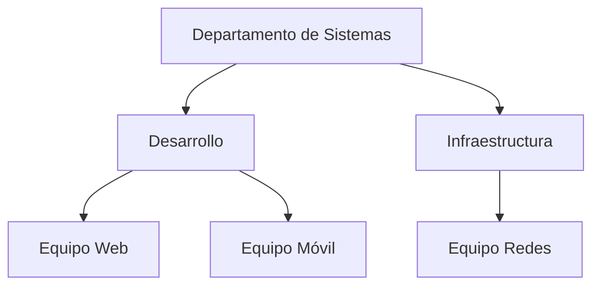
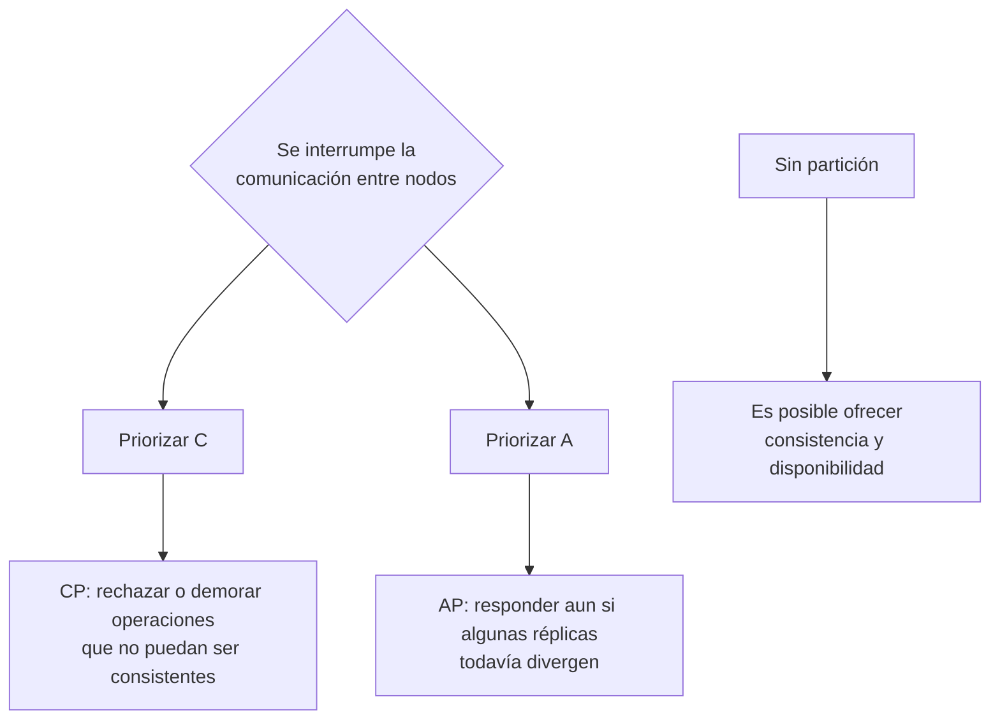
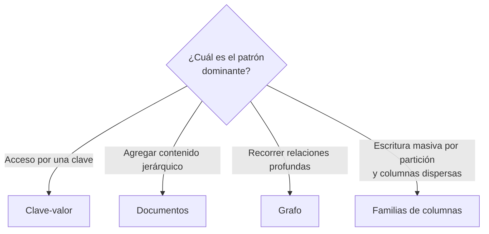

[← Unidad 4](/bbdd-aplicadas/unidad-4/teoria/)

Esta página reúne los conceptos con los que se estudia el resto de la unidad: por qué surgió NoSQL, qué tipos de datos maneja, los modelos jerárquico, de texto y de grafos, las garantías ACID y BASE, el teorema CAP con sus matices y los cuatro modelos de almacenamiento (clave-valor, documentos, grafos y columnas). Los ejemplos que se ejecutan se comprobaron en SQL Server 2022 y MongoDB 7.0 (`U4.T.NC.01` a `U4.T.NC.04`). Los de Cassandra y Neo4j son plantillas de sintaxis: el portal no tiene esos motores.

## Para qué sirve

Una aplicación web guarda sesiones, un catálogo de productos, una red de contactos y millones de lecturas de sensores. Con un único motor relacional hay que resolver todo con tablas, `JOIN` y un solo servidor que crece hacia arriba. NoSQL ofrece otros modelos de almacenamiento, cada uno optimizado para un patrón de acceso, y otros compromisos de consistencia para poder distribuir los datos en varios nodos. Elegir bien exige saber qué se gana y qué se cede con cada modelo.

## ¿Qué es NoSQL?

:::note[Definición]
**NoSQL** ("Not only SQL") es una categoría de bases de datos pensadas para casos en que el modelo relacional resulta insuficiente o costoso: volúmenes masivos, alta concurrencia, baja latencia o datos sin esquema fijo. Se caracterizan por no usar tablas como único modelo, por no tener SQL como único lenguaje de consulta y, con frecuencia, por distribuir los datos en un clúster.
:::

El nombre lo usó en 1998 Carlo Strozzi para una base relacional liviana que no empleaba SQL. En 2009 se retomó para designar a los sistemas no relacionales y distribuidos. Hoy se lo lee como "Not only SQL": puede haber varias formas de acceder a los datos, y SQL puede convivir con ellas.

### Del almacenamiento específico al modelo NoSQL

| Año | Hito | Aporte |
|-----|------|--------|
| 1960 | IDS de Charles Bachman | Primeros sistemas con acceso concurrente |
| 1966 | IMS de IBM | Modelo jerárquico usado en el programa Apolo |
| 1967 | CODASYL | Modelo de base de datos en red y extensiones para COBOL |
| 1970 | Modelo relacional de E. F. Codd | Separación lógica/física y fundamento de los RDBMS |
| Década de 1980 | SQL y productos relacionales | Consolidación del lenguaje y del modelo tabular |
| Década de 1990 | Web y sistemas masivos | Crecen volumen, concurrencia y disponibilidad requerida |
| 1998 en adelante | NoSQL | Modelos especializados y orientados a distribución |

Un RDBMS integra, como mínimo, gestión de almacenamiento y de memoria, diccionario de datos (esquemas, tablas, índices, restricciones y vistas) y un lenguaje para definir y manipular datos. NoSQL no elimina esas necesidades: cambia el modelo, las garantías y la forma de distribuirlas.

### Limitaciones del modelo relacional

- **Escala vertical costosa**: más CPU y RAM en un solo servidor tiene un techo y un precio muy alto.
- **Esquema rígido**: agregar o cambiar columnas en tablas con miles de millones de filas es lento y disruptivo.
- **Latencia**: los `JOIN` entre tablas grandes pueden ser lentos para aplicaciones de tiempo real.
- **Alta disponibilidad**: replicar y conmutar automáticamente un RDBMS tradicional es complejo.
- **Costo de las transacciones distribuidas**: cuantos más servidores participan, más cuesta confirmar una transacción en todos.

La **desnormalización** puede reducir los `JOIN` y mejorar las lecturas, pero duplica datos y arriesga anomalías. Distribuir un único RDBMS entre muchos servidores también es posible, aunque aumenta la coordinación y el costo de las transacciones globales.

## Tipos de datos según su estructura

| Tipo | Descripción | Ejemplos |
|------|-------------|----------|
| **Estructurados** | Esquema fijo y tipos definidos | Enteros, cadenas, fechas; tablas SQL |
| **Semiestructurados** | Estructura flexible y autodescriptiva (etiquetas o claves) | JSON, XML, imágenes con metadatos EXIF |
| **No estructurados** | Sin modelo de campos directamente consultable | Video, audio, texto libre, publicaciones en redes, videovigilancia |

El procesamiento cambia con el tipo. Los estructurados se cuentan, suman y promedian. Los no estructurados requieren primero técnicas como **OCR** (extraer texto de imágenes) o **NLP** (analizar lenguaje natural); la página [Datos, Data Lake y KDD](/bbdd-aplicadas/unidad-4/teoria/datos-data-lake-kdd/) las desarrolla.

## Modelos de datos heterogéneos: jerárquico, de texto y de grafos

El programa agrupa tres modelos que se salen de la tabla. Los dos primeros se tratan acá; el de grafos se desarrolla con los cuatro modelos de [más abajo](#3-grafos).

### Modelo jerárquico

Organiza los datos como un **árbol**: cada registro tiene un único padre y puede tener varios hijos, y se llega a un dato recorriendo el camino desde la raíz. Fue el modelo de IMS (1966). Hoy sobrevive en formatos como XML y JSON, y en los documentos anidados de las bases documentales.



El mismo árbol como un documento de MongoDB:

<!-- check: U4.T.NC.04 -->
```javascript
db.organigrama.insertOne({
  _id: "org",
  nombre: "Departamento de Sistemas",
  areas: [
    { nombre: "Desarrollo", equipos: [{ nombre: "Web", integrantes: 4 }, { nombre: "Móvil", integrantes: 3 }] },
    { nombre: "Infraestructura", equipos: [{ nombre: "Redes", integrantes: 2 }] }
  ]
});

db.organigrama.find({ "areas.equipos.nombre": "Redes" }, { _id: 0, nombre: 1 });

db.organigrama.aggregate([
  { $unwind: "$areas" },
  { $unwind: "$areas.equipos" },
  { $group: { _id: "$areas.nombre", integrantes: { $sum: "$areas.equipos.integrantes" } } },
  { $sort: { _id: 1 } }
]);
```

**Resultado esperado.** La búsqueda devuelve el documento raíz; el pipeline agrupa por área:

| _id | integrantes |
|---|---:|
| Desarrollo | 7 |
| Infraestructura | 2 |

La ventaja del árbol es leer un subárbol completo de una vez. La desventaja, que una relación que no es de contención (un empleado que pertenece a dos áreas) no se expresa bien sin duplicar datos o usar referencias. Para eso están los grafos.

### Modelo de texto y búsqueda de texto completo

Una base de **texto** está optimizada para buscar palabras dentro de documentos grandes y ordenar los resultados por relevancia. Lo habitual es construir un **índice invertido**: para cada término se guarda la lista de documentos donde aparece, de modo que buscar una palabra no recorre los textos.

| Término (raíz ilustrativa) | Documentos |
|---|---|
| `replic` | 1, 3 |
| `consistent` | 3 |
| `grafo` | 4 |
| `indic` | 2 |

Antes de indexar, el motor **normaliza** el texto: pasa a minúsculas, quita palabras vacías (*stop words*) y reduce cada palabra a su raíz (*stemming*). Por eso una búsqueda de "réplica" encuentra "replicación" y "réplicas". Son motores de texto Elasticsearch y Apache Solr; MongoDB ofrece índices de texto dentro de una base documental.

<!-- check: U4.T.NC.03 -->
```javascript
db.articulos.insertMany([
  { _id: 1, titulo: "Replicación en MongoDB", cuerpo: "Un conjunto de réplicas mantiene copias de los datos en varios nodos." },
  { _id: 2, titulo: "Índices compuestos", cuerpo: "El orden de los campos del índice cambia las consultas que puede resolver." },
  { _id: 3, titulo: "Consistencia eventual", cuerpo: "Las réplicas convergen cuando cesan las escrituras." },
  { _id: 4, titulo: "Grafos y recomendaciones", cuerpo: "Las relaciones entre personas se recorren sin joins." }
]);

db.articulos.createIndex({ titulo: "text", cuerpo: "text" }, { default_language: "spanish", name: "IX_articulos_texto" });

db.articulos.find({ $text: { $search: "replica" } }, { _id: 1 }).sort({ _id: 1 });
db.articulos.find({ $text: { $search: "índice recorren" } }, { _id: 1 }).sort({ _id: 1 });
db.articulos.find({ $text: { $search: "réplicas -eventual" } }, { _id: 1 }).sort({ _id: 1 });
```

**Resultado esperado.**

| Búsqueda | `_id` devueltos |
|---|---|
| `replica` | 1 y 3 |
| `índice recorren` (cualquiera de las palabras) | 2 y 4 |
| `réplicas -eventual` (excluye `eventual`) | 1 |

El índice se creó con idioma español, por eso `replica` coincide con "Replicación" y "réplicas". Una búsqueda con varias palabras devuelve los documentos que contienen **alguna** de ellas; el signo menos excluye un término. Un índice de texto es distinto de un `LIKE '%palabra%'`: no busca subcadenas sino términos normalizados.

## Propiedades de las garantías: ACID y BASE

### ACID (bases relacionales)

| Propiedad | Descripción |
|-----------|-------------|
| **A**tomicidad | La transacción entera tiene éxito o falla por completo |
| **C**onsistencia | Los datos pasan siempre de un estado válido a otro |
| **I**solamiento | Las transacciones concurrentes no se interfieren |
| **D**urabilidad | Los cambios confirmados persisten ante fallos |

### BASE (enfoque habitual en NoSQL distribuido)

| Sigla | Descripción |
|-------|-------------|
| **BA** | *Basically Available*: el sistema sigue funcionando aunque falle una parte (servidores, red) |
| **S** | *Soft State*: el estado puede cambiar con el tiempo, incluso sin nuevas entradas, mientras las réplicas se actualizan |
| **E** | *Eventually Consistent*: si cesan las actualizaciones, las réplicas convergen; puede haber lecturas atrasadas |

BASE prioriza disponibilidad y rendimiento sobre la consistencia inmediata. Eventualmente consistente **no** significa que la base quede inconsistente para siempre: significa que en un tiempo posterior las copias se actualizan.

:::caution[ACID y BASE no dividen los productos en "con" y "sin" transacciones]
Son dos conjuntos de garantías. MongoDB, por ejemplo, ofrece operaciones atómicas sobre un documento y, desde la 4.0 (conjuntos de réplicas) y la 4.2 (clústeres con particionado), transacciones multidocumento con ACID. Y un RDBMS replicado de forma asincrónica también tiene lecturas atrasadas en sus réplicas. Lo que cambia es el **valor por defecto** y el costo de pedir la garantía fuerte en un sistema distribuido.
:::

## Teorema CAP

Lo planteó Eric Brewer en el año 2000 y lo demostraron formalmente Gilbert y Lynch en 2002. Cuando hay una **partición de red** (los nodos no pueden comunicarse entre sí), un sistema distribuido no puede garantizar a la vez consistencia y disponibilidad para todas las operaciones: debe elegir una de ellas.

| Propiedad | Descripción |
|-----------|-------------|
| **C**onsistency | Cada lectura devuelve la escritura más reciente (o un error): todos los nodos ven los mismos datos |
| **A**vailability | Toda solicitud a un nodo que funciona recibe una respuesta |
| **P**artition tolerance | El sistema sigue funcionando aunque la red entre nodos falle |



### La tabla CA / CP / AP de la cátedra

La presentación de cátedra clasifica los sistemas en tres combinaciones:

| Combinación | Qué se prioriza | Ejemplos que cita la cátedra |
|-------------|-----------------|------------------------------|
| **CA** | Consistencia y disponibilidad; no tolera particiones | RDBMS (SQL Server, MySQL, PostgreSQL) |
| **CP** | Consistencia y tolerancia a particiones; puede no responder | MongoDB, HBase, Redis |
| **AP** | Disponibilidad y tolerancia a particiones; puede devolver datos atrasados | CouchDB, Cassandra, DynamoDB, Riak |

:::caution[Es una simplificación]
La clasificación sirve para estudiar, pero **no es una propiedad fija de un producto**:

- En una red real la partición **no es opcional**: puede ocurrir, y un sistema distribuido tiene que decidir qué hacer cuando ocurre. "CA" solo describe un sistema que no se distribuye (un único nodo, sin particiones posibles), donde CAP no aplica.
- Muchos motores permiten **elegir por operación**. En MongoDB, `writeConcern` (cuántos nodos deben confirmar una escritura), `readConcern` y `readPreference` (desde qué nodo se lee) mueven el sistema hacia más consistencia o más disponibilidad. En DynamoDB, la lectura es eventualmente consistente por defecto y se puede pedir una lectura fuertemente consistente. Cassandra deja elegir el nivel de consistencia por consulta.
- C y A del teorema son definiciones estrictas (lectura siempre actualizada; respuesta de **todo** nodo que funciona). Un sistema puede ser "casi" consistente y "casi" disponible, y eso no se ve en la tabla.
- CAP describe lo que ocurre **durante** una partición. Fuera de ella el compromiso es otro: latencia contra consistencia (lo formaliza el modelo PACELC, de Abadi).
:::

### MongoDB en el teorema CAP

En un conjunto de réplicas hay un único nodo **primario** que recibe todas las escrituras; los **secundarios** replican su registro de operaciones. Por defecto los clientes leen del primario, pero pueden pedir leer de los secundarios. Si el primario deja de estar disponible, los secundarios elegibles realizan una **elección** y uno pasa a ser el nuevo primario; durante ese intervalo no hay quien acepte escrituras.

Por eso la cátedra lo ubica como "CP": ante una partición, el lado que no tiene mayoría no elige primario y deja de aceptar escrituras para no divergir. Es una descripción del comportamiento **por defecto**. Con `readPreference` hacia secundarios o escrituras con confirmación débil, el sistema acepta lecturas atrasadas a cambio de disponibilidad, y por eso afirmar sin matiz que "MongoDB es CP" es incorrecto.

<!-- sintaxis -->
```javascript
// Plantillas: el nivel de garantía se elige por operación.
db.<coleccion>.insertOne(<documento>, { writeConcern: { w: "majority" } });
db.<coleccion>.find(<filtro>).readConcern("majority");
db.<coleccion>.find(<filtro>).readPref("secondaryPreferred");
```

## Arquitectura de clúster

| Tipo | Descripción | Modelo de costo |
|------|-------------|-----------------|
| **Clúster en la nube** | Servidores gestionados por un proveedor (AWS, GCP, Azure, MongoDB Atlas) | Opex: pago por uso, sin inversión inicial |
| **Clúster de servidores dedicados** | Hardware propio en un centro de datos | Capex: inversión inicial alta, costo menor a largo plazo |

La decisión considera el **costo** (Capex inicial y Opex operativo), la **complejidad** de la infraestructura y del personal, el **tiempo de implementación** y el grado de personalización. La nube suele acelerar la puesta en marcha; el hardware dedicado ofrece más control a costa de operarlo.

## Los cuatro modelos NoSQL

Cada modelo usa un almacenamiento optimizado para sus requisitos; no existe uno que sirva para todos los casos. Para cada uno se describe la **carga de trabajo** para la que fue pensado y cómo se ve **registrar un usuario con dos direcciones** (la comparación con el `INSERT` relacional).

### Referencia: el alta en el modelo relacional

<!-- check: U4.T.NC.01 -->
```sql
CREATE SCHEMA agenda;
GO

CREATE TABLE agenda.Usuario (
    UsuarioId INT         NOT NULL,
    Nombre    VARCHAR(60) NOT NULL,
    CONSTRAINT PK_Usuario PRIMARY KEY CLUSTERED (UsuarioId)
);

CREATE TABLE agenda.Direccion (
    DireccionId INT         NOT NULL,
    UsuarioId   INT         NOT NULL,
    Ciudad      VARCHAR(60) NOT NULL,
    Pais        VARCHAR(60) NOT NULL,
    CONSTRAINT PK_Direccion         PRIMARY KEY CLUSTERED (DireccionId),
    CONSTRAINT FK_Direccion_Usuario FOREIGN KEY (UsuarioId) REFERENCES agenda.Usuario (UsuarioId)
);
GO

BEGIN TRANSACTION;
INSERT INTO agenda.Usuario (UsuarioId, Nombre) VALUES (1, 'Lucía');
INSERT INTO agenda.Direccion (DireccionId, UsuarioId, Ciudad, Pais) VALUES
    (1, 1, 'Morón', 'Argentina'),
    (2, 1, 'Montevideo', 'Uruguay');
COMMIT TRANSACTION;

SELECT u.UsuarioId, u.Nombre, d.Ciudad, d.Pais
FROM agenda.Usuario AS u
INNER JOIN agenda.Direccion AS d ON d.UsuarioId = u.UsuarioId
ORDER BY d.DireccionId;
```

**Resultado esperado.**

| UsuarioId | Nombre | Ciudad | Pais |
|---:|---|---|---|
| 1 | Lucía | Morón | Argentina |
| 1 | Lucía | Montevideo | Uruguay |

Hay que definir el esquema antes, insertar en dos tablas (dentro de una transacción para que sean atómicas) y reconstruir con un `JOIN`.

### 1. Clave-valor

La estructura más simple: cada elemento es un par `{clave: valor}` y el motor no interpreta el valor, que es opaco.

| | |
|---|---|
| **Carga de trabajo** | Acceso por una sola clave, como un diccionario; sin joins, bloqueos complejos, agregaciones ni índices secundarios |
| **Datos** | Cada clave tiene un valor; sin esquema ni relaciones entre entidades |
| **Fortaleza** | Lecturas y escrituras muy rápidas por clave y escalado horizontal sencillo |
| **Límite** | No se consulta por el contenido del valor |
| **Casos de uso** | Caché de aplicación, sesiones web, perfiles y preferencias, configuración distribuida, recomendaciones |
| **Motores** | Redis, DynamoDB, Aerospike |

```text
clave         valor
usuario:1     "Lucía|Morón|Argentina;Montevideo|Uruguay"
sesion:8f3    "{...datos de la sesión...}"
```

Alta del usuario: una sola operación `SET` (o su equivalente) con la clave y el valor completo.

### 2. Documentos

Almacena documentos (JSON o BSON) autodescriptivos; cada documento de una colección puede tener una estructura distinta. Admite documentos embebidos y arrays.

| | |
|---|---|
| **Carga de trabajo** | Inserciones y actualizaciones frecuentes; cada documento se lee y escribe como un bloque; hace falta indexar varios campos |
| **Datos** | Semiestructurados, sin normalizar; campos opcionales; cada tipo de documento puede tener su esquema |
| **Fortaleza** | Se parece a los objetos del código de aplicación (ver [POO y bases de datos](/bbdd-aplicadas/unidad-4/teoria/poo-y-bases/)); consultas por cualquier campo; escalado horizontal con *sharding* |
| **Límite** | Las relaciones entre documentos hay que diseñarlas (embeber o referenciar) |
| **Casos de uso** | Catálogos de productos, gestión de contenido, perfiles de usuario, inventario, comercio electrónico |
| **Motores** | MongoDB, CouchDB, Firebase |

El mismo usuario como un documento:

<!-- check: U4.T.NC.02 -->
```javascript
db.usuarios.insertOne({
  _id: 1,
  nombre: "Lucía",
  direcciones: [
    { ciudad: "Morón", pais: "Argentina" },
    { ciudad: "Montevideo", pais: "Uruguay" }
  ]
});

db.usuarios.find({ _id: 1 });
db.usuarios.find({ "direcciones.pais": "Uruguay" }, { _id: 1, nombre: 1 });
```

**Resultado esperado.** La primera consulta devuelve el documento completo (usuario con sus dos direcciones); la segunda devuelve `{ _id: 1, nombre: "Lucía" }`, porque una de sus direcciones está en Uruguay.

Una inserción, sin `CREATE TABLE` previo ni `JOIN` para leer. A cambio, las direcciones quedan dentro del usuario: si otra entidad necesitara consultarlas por separado, convendría una colección propia.

### 3. Grafos

Almacena **vértices** (entidades) y **aristas** (relaciones), ambos con propiedades. Cada nodo mantiene referencias a sus adyacentes, lo que acelera los recorridos de muchos saltos.

| | |
|---|---|
| **Carga de trabajo** | Relaciones complejas con muchos saltos entre los datos; relaciones que cambian con el tiempo |
| **Datos** | Nodos (parecidos a filas o documentos) y relaciones con dirección y propiedades, tan importantes como los nodos y expuestas en el lenguaje de consulta. Un objeto compuesto, como una persona con varios teléfonos, tiende a partirse en nodos más pequeños unidos por relaciones |
| **Casos de uso** | Redes sociales, detección de fraude, motores de recomendaciones, organigramas, gestión de dependencias, grafos de conocimiento |
| **Motores** | Neo4j, JanusGraph |

Consulta en **Gremlin** (JanusGraph): encontrar al abuelo de Hércules.

```text
g.V().has('name', 'hercules').out('father').out('father').values('name')
==> saturn
```

- `g` es el recorrido del grafo actual y `V()` todos sus vértices.
- `has('name','hercules')` filtra el vértice con ese nombre.
- `out('father')` atraviesa la arista saliente "padre"; se aplica dos veces.
- `values('name')` obtiene el valor de la propiedad nombre.

El alta del usuario con dos direcciones, en **Cypher** (Neo4j):

<!-- sintaxis -->
```text
CREATE (u:Usuario {id: 1, nombre: 'Lucía'})
CREATE (u)-[:VIVE_EN]->(:Direccion {ciudad: 'Morón', pais: 'Argentina'})
CREATE (u)-[:VIVE_EN]->(:Direccion {ciudad: 'Montevideo', pais: 'Uruguay'});
```

Cada dirección es un nodo, y la relación `VIVE_EN` es un dato de primera clase. En Gremlin, la cátedra muestra el equivalente con `addVertex` para los vértices y `addEdge` para la arista.

### 4. Columnas y familias de columnas

Una **columna** es la unidad básica (nombre y valor). Un conjunto de columnas forma una **fila**, y las columnas relacionadas pueden agruparse en **familias de columnas**. Diferencia clave con el modelo relacional: las filas de una misma tabla pueden tener columnas distintas, y no hay un esquema fijo de columnas.

| | |
|---|---|
| **Carga de trabajo** | Escrituras muy rápidas; actualizaciones y borrados poco habituales; acceso de baja latencia a un subconjunto de campos de un registro grande; escala a gran tamaño |
| **Datos** | Tablas con una columna clave y una o varias familias de columnas; las celdas se acceden con `GET` y `PUT`, y varias filas con `SCAN` |
| **Límite** | Admite una enorme cantidad de columnas dispersas, pero con topes: en Cassandra, por ejemplo, una partición admite hasta 2 mil millones de celdas |
| **Casos de uso** | Telemetría, datos de sensores, series temporales, mensajería, análisis web y de redes sociales, personalización |
| **Motores** | Apache Cassandra, HBase |

En **CQL** (Cassandra) las tablas se definen con una clave de partición (qué nodo guarda la fila) y, opcionalmente, columnas de ordenamiento dentro de la partición:

<!-- sintaxis -->
```text
CREATE TABLE usuarios (
    userid     int PRIMARY KEY,
    name       text,
    occupation text
);

INSERT INTO usuarios (userid, name, occupation) VALUES (199, 'Lucía', 'ingeniera');
SELECT name, occupation FROM usuarios WHERE userid IN (199, 200, 207);

CREATE TABLE eventos (
    event_type text,
    time       timestamp,
    value      double,
    PRIMARY KEY ((event_type), time)
);

SELECT time, value FROM eventos
WHERE event_type = 'myEvent'
  AND time > '2011-02-03' AND time <= '2012-01-01';
```

La segunda consulta funciona porque `event_type` es la clave de partición y `time` la de ordenamiento: el modelo se diseña **a partir de las consultas**, no de las entidades.

### Comparación de los cuatro modelos

| Modelo | Estructura | Mejor para | Ejemplos |
|--------|-----------|------------|----------|
| **Clave-valor** | Par clave:valor opaco | Caché, sesiones | Redis, DynamoDB |
| **Documentos** | JSON/BSON autodescriptivos | Contenido flexible, perfiles | MongoDB, CouchDB |
| **Grafos** | Vértices y aristas | Relaciones complejas | Neo4j, JanusGraph |
| **Columnas** | Familias de columnas | Series temporales, escritura masiva | Cassandra, HBase |

Y el alta del usuario con dos direcciones en cada uno:

| Modelo | Cómo se registra |
|--------|------------------|
| Relacional | `CREATE TABLE` previo; `INSERT` en dos tablas dentro de una transacción; `JOIN` para leer |
| Clave-valor | Un `SET` con la clave y el valor completo (opaco) |
| Documentos | Un `insertOne` con las direcciones embebidas |
| Grafo | Un nodo por usuario, uno por dirección y una arista `VIVE_EN` por cada una |
| Columnas | `CREATE TABLE` pensado según la consulta y un `INSERT` por fila |

### Método de elección



No se elige por moda ni solo por volumen. Primero se identifican las consultas, las escrituras, la consistencia requerida, la distribución, la latencia y la evolución del esquema; después se adopta el modelo optimizado para esa carga.

## Errores frecuentes

:::caution[Errores frecuentes]
- Decir que NoSQL "no tiene transacciones" o "no tiene esquema". MongoDB tiene transacciones multidocumento y validación con JSON Schema; lo que cambia es el valor por defecto.
- Afirmar que "MongoDB es CP" o que "un RDBMS es CA" como si fueran etiquetas fijas. Dependen de la configuración y del modo de despliegue.
- Aplicar CAP a un único nodo: sin partición posible no hay compromiso que elegir.
- Creer que consistencia eventual significa datos incorrectos para siempre. Significa que las réplicas convergen si cesan las escrituras.
- Usar un índice de texto como si fuera un `LIKE '%texto%'`: busca términos normalizados, no subcadenas.
- Elegir el modelo por la marca del producto en lugar de por el patrón de acceso.
:::

## Ejercicios

### Ejercicio 41 · CAP en un solo nodo
<!-- ejercicio: U4.41 | nivel: inicial | tipo: verdadero-falso | verificacion: razonamiento -->

:::note[Enunciado]
Decidí si cada afirmación es verdadera o falsa y justificá en una línea.

1. Un sistema distribuido que usa un único nodo tiene que elegir entre consistencia y disponibilidad.
2. Ante una partición de red, un sistema que prioriza la disponibilidad puede devolver un dato atrasado.
3. Un sistema "CP" deja de funcionar por completo en cuanto hay una partición.
4. Si cesan las escrituras y la red funciona, un sistema eventualmente consistente converge.
:::

<details>
<summary>Resolución</summary>

**Estrategia.** Se recuerda que CAP describe el compromiso **durante una partición** y que los términos tienen definiciones precisas.

1. **Falso.** Con un solo nodo no hay particiones posibles, así que no hay compromiso que elegir.
2. **Verdadero.** Eso es lo que significa priorizar A: cada nodo que funciona responde, aunque no haya recibido la última escritura.
3. **Falso.** Deja de responder (o rechaza) las operaciones que no pueda garantizar consistentes, típicamente las del lado sin mayoría. El resto de los nodos puede seguir funcionando.
4. **Verdadero.** Es la definición de consistencia eventual: las réplicas convergen en un tiempo posterior si no hay más actualizaciones.

</details>

### Ejercicio 42 · ACID o BASE según el escenario
<!-- ejercicio: U4.42 | nivel: inicial | tipo: conceptual | verificacion: razonamiento -->

:::note[Enunciado]
Para cada situación indicá si exigiría garantías tipo ACID o toleraría un enfoque BASE, y por qué: (a) transferencia de dinero entre dos cuentas; (b) contador de "me gusta" de una publicación; (c) stock de un artículo con una sola unidad que se vende en línea.
:::

<details>
<summary>Resolución</summary>

**Estrategia.** Se evalúa el costo de una lectura atrasada o de una escritura parcial en cada caso.

- **(a) ACID.** Un débito sin su crédito es un error de negocio: hace falta atomicidad (todo o nada) y consistencia.
- **(b) BASE.** Si por unos segundos algunas réplicas muestran 120 y otras 121 "me gusta", no hay daño, y se gana disponibilidad y velocidad.
- **(c) Garantía fuerte.** Dos compradores no pueden llevarse la misma unidad: la operación "verificar y descontar" debe ser atómica y la lectura de stock debe ser actual. Puede lograrse con una operación atómica sobre un documento (por ejemplo, un `updateOne` con la condición de stock mayor que cero) o con una transacción, según el motor.

La respuesta no depende de "SQL contra NoSQL" sino del costo de la inconsistencia en el negocio.

</details>

### Ejercicio 43 · Elegir el modelo NoSQL
<!-- ejercicio: U4.43 | nivel: inicial | tipo: conceptual | verificacion: razonamiento -->

:::note[Enunciado]
Elegí el modelo NoSQL más adecuado y justificalo con la carga de trabajo: (a) caché de resultados de consultas; (b) catálogo de productos con atributos distintos por rubro; (c) "personas que quizá conozcas" en una red social; (d) lecturas de sensores de temperatura cada segundo.
:::

<details>
<summary>Resolución</summary>

**Estrategia.** Se identifica el patrón de acceso dominante de cada caso.

- **(a) Clave-valor.** Se accede por una clave (la consulta) y se necesita velocidad; no se consulta por el contenido.
- **(b) Documentos.** Cada rubro tiene sus propios campos y los documentos pueden tener estructura distinta; el producto se lee como un bloque.
- **(c) Grafo.** Hay que recorrer relaciones de varios saltos (amigos de amigos); un `JOIN` por salto sería costoso.
- **(d) Columnas.** Escritura masiva y consultas por rango de tiempo dentro de una partición (por sensor).

</details>

### Ejercicio 46 · Búsqueda de texto en tickets
<!-- ejercicio: U4.46 | nivel: intermedio | tipo: mql | verificacion: motor -->

:::note[Enunciado]
En una colección `tickets` con campos `asunto` y `detalle` hay cinco documentos. Creá un índice de texto en español sobre ambos campos y escribí las consultas que devuelvan: (a) los tickets que mencionan "factura"; (b) los que mencionan "factura" pero no "duplicada"; (c) los que contienen la frase exacta "dar de baja"; (d) los que mencionan "plan". Mostrá solo los `_id`, ordenados.
:::

<details>
<summary>Resolución</summary>

**Estrategia.** Un índice de texto con `default_language: "spanish"` normaliza y reduce a raíces, de modo que "factura" y "facturación" coinciden. El signo menos excluye un término y las comillas escapadas piden una frase.

<!-- check: U4.46 -->
```javascript
db.tickets.insertMany([
  { _id: 1, asunto: "Factura duplicada", detalle: "Me llegó dos veces la factura de marzo." },
  { _id: 2, asunto: "No puedo ingresar", detalle: "La clave no funciona desde ayer." },
  { _id: 3, asunto: "Facturación incorrecta", detalle: "El importe de la factura no coincide con el plan." },
  { _id: 4, asunto: "Baja del servicio", detalle: "Quiero dar de baja el servicio por mudanza." },
  { _id: 5, asunto: "Consulta de plan", detalle: "¿Cuál es el costo del plan básico?" }
]);

db.tickets.createIndex({ asunto: "text", detalle: "text" }, { default_language: "spanish", name: "IX_tickets_texto" });

db.tickets.find({ $text: { $search: "factura" } }, { _id: 1 }).sort({ _id: 1 });
db.tickets.find({ $text: { $search: "factura -duplicada" } }, { _id: 1 }).sort({ _id: 1 });
db.tickets.find({ $text: { $search: "\"dar de baja\"" } }, { _id: 1 }).sort({ _id: 1 });
db.tickets.find({ $text: { $search: "plan" } }, { _id: 1 }).sort({ _id: 1 });
```

**Resultado esperado.**

| Consulta | `_id` |
|---|---|
| (a) `factura` | 1 y 3 |
| (b) `factura -duplicada` | 3 |
| (c) `"dar de baja"` | 4 |
| (d) `plan` | 3 y 5 |

El ticket 3 aparece en (a) porque "Facturación" y "factura" comparten raíz, y queda en (b) porque no contiene "duplicada". En (d) el 3 coincide por su detalle ("el plan") y el 5 por su asunto.

</details>

### Ejercicio 50 · CAP y configuración
<!-- ejercicio: U4.50 | nivel: avanzado | tipo: verdadero-falso | verificacion: razonamiento -->

:::note[Enunciado]
Decidí si es verdadero o falso y justificá.

1. "Como la cátedra clasifica a MongoDB como CP, una lectura desde un secundario siempre devuelve el dato más reciente."
2. "Una base de datos relacional con una réplica de lectura asincrónica puede devolver datos atrasados desde esa réplica."
3. "CAP obliga a elegir exactamente dos de las tres propiedades en todo momento."
4. "En MongoDB se puede pedir una escritura confirmada por la mayoría de los nodos para reducir el riesgo de perderla en una conmutación."
:::

<details>
<summary>Resolución</summary>

**Estrategia.** Se separa la etiqueta didáctica de la configuración real y se recuerda que CAP habla de lo que pasa durante una partición.

1. **Falso.** La etiqueta CP describe el comportamiento por defecto ante una partición, pero una lectura desde un secundario (con `readPreference`) puede estar atrasada respecto del primario, porque replica con demora.
2. **Verdadero.** La replicación asincrónica implica una ventana en la que la réplica no tiene la última confirmación. Es el mismo fenómeno de consistencia eventual, en un motor relacional.
3. **Falso.** El compromiso aparece **ante una partición**; sin ella un sistema puede ofrecer consistencia y disponibilidad. Además, "tolerar particiones" no es opcional en una red real.
4. **Verdadero.** Con `writeConcern` `w: "majority"` la escritura se confirma cuando la mayoría la tiene, y sobrevive a la elección de un nuevo primario.

</details>

## Autoevaluación

<details>
<summary>1. ¿Qué diferencia hay entre un modelo jerárquico y uno de grafos?</summary>

El jerárquico es un árbol: cada nodo tiene un único padre y se accede desde la raíz. En un grafo, un nodo puede relacionarse con cualquier otro y las relaciones son datos con propiedades y dirección, lo que permite expresar vínculos que no son de contención.

</details>

<details>
<summary>2. ¿Qué es un índice invertido y por qué acelera la búsqueda de texto?</summary>

Es una estructura que, para cada término normalizado, guarda la lista de documentos donde aparece. Buscar una palabra consulta esa lista en lugar de recorrer todos los textos.

</details>

<details>
<summary>3. ¿Por qué CAP importa solo ante una partición?</summary>

Sin partición, todos los nodos se comunican y es posible responder de forma consistente y disponible. Ante la partición hay que elegir entre rechazar o demorar operaciones para preservar la consistencia, o responder aceptando posibles divergencias para preservar la disponibilidad.

</details>

<details>
<summary>4. ¿Por qué no se puede afirmar sin más que MongoDB es CP?</summary>

Porque es el comportamiento por defecto, que se puede modificar con `writeConcern`, `readConcern` y `readPreference`. La clasificación CA/CP/AP es una simplificación que no describe un producto en todas sus configuraciones.

</details>

:::tip[En resumen]
- NoSQL agrupa modelos (clave-valor, documentos, grafos, columnas, además de los jerárquicos y de texto) optimizados para cargas concretas, y suele distribuir los datos en un clúster.
- ACID y BASE son conjuntos de garantías, no una división entre productos con y sin transacciones.
- CAP describe el compromiso entre consistencia y disponibilidad **durante una partición**. La tabla CA/CP/AP de la cátedra es una simplificación: muchos motores permiten elegir por operación.
- El modelo de texto se apoya en índices invertidos con normalización; el jerárquico es un árbol; el de grafos trata las relaciones como datos.
- Los modelos se eligen por el patrón de acceso dominante, no por moda.
:::

## Fuentes

- Presentación de cátedra, Unidad 4, parte 1 (surgimiento de NoSQL, ACID y BASE, teorema CAP y modelos), p. 3-24, y programa analítico 2024.
- Sullivan, D., *NoSQL for Mere Mortals*, Addison-Wesley (bibliografía de la presentación de cátedra).
- Gilbert, S. y Lynch, N. (2002), "Brewer's Conjecture and the Feasibility of Consistent, Available, Partition-Tolerant Web Services", *ACM SIGACT News*, 33(2).
- MongoDB Manual 7.0: *Replication*, *Read Concern*, *Write Concern*, *Read Preference*, *Text Indexes* y *Transactions*: https://www.mongodb.com/docs/manual/.
- Apache Cassandra, *CQL* y *Data Modeling*: https://cassandra.apache.org/. JanusGraph, *Gremlin*: https://docs.janusgraph.org/. Neo4j, *Cypher Manual*: https://neo4j.com/docs/cypher-manual/.
