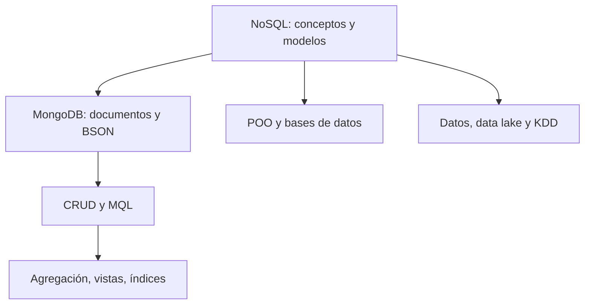

[← Unidad 4](/bbdd-aplicadas/unidad-4/teoria/)

Resumen integrador de la unidad. Cada sección condensa un tema y enlaza a la página que lo desarrolla, con sus ejemplos verificados en MongoDB 7.0 y SQL Server 2022. Para estudiar un tema en profundidad, se pasa a la página temática; esta sirve para ver el conjunto y repasar.

## Mapa de la unidad

| Tema del programa | Página que lo desarrolla |
|---|---|
| Modelos heterogéneos (jerárquico, texto, grafos), BASE y ACID, clave-valor, columnar y documentos | [NoSQL — Conceptos y modelos](/bbdd-aplicadas/unidad-4/teoria/nosql-conceptos/) |
| Documentos BSON, tipos, `_id`, esquema y shell | [MongoDB — Introducción](/bbdd-aplicadas/unidad-4/teoria/mongodb-introduccion/) |
| MQL, inserción (bulk), actualización, `upsert`, eliminación | [MongoDB — CRUD y consultas](/bbdd-aplicadas/unidad-4/teoria/mongodb-crud/) |
| Agregado, vistas, estadísticas de ejecución e índices | [MongoDB — Aggregation Pipeline, índices y vistas](/bbdd-aplicadas/unidad-4/teoria/mongodb-agregacion/) |
| Interfaz gráfica | [MongoDB Compass](/bbdd-aplicadas/unidad-4/teoria/mongodb-compass/) |
| Relación con POO | [POO y bases de datos](/bbdd-aplicadas/unidad-4/teoria/poo-y-bases/) |
| Datos estructurados y no estructurados, data lakes, data mining y KDD | [Datos, Data Lake y KDD](/bbdd-aplicadas/unidad-4/teoria/datos-data-lake-kdd/) |

## 1. NoSQL: motivación y modelos

**NoSQL** ("Not only SQL") nombra bases de datos que no usan solo el modelo tabular ni solo SQL. Surgieron por los límites del modelo relacional frente a la web: escala vertical costosa, esquema rígido, latencia de los `JOIN` y dificultad para replicar y distribuir. Manejan datos estructurados, semiestructurados y no estructurados.

| Modelo | Estructura | Se usa para | Ejemplos |
|---|---|---|---|
| Clave-valor | Par clave y valor opaco | Caché, sesiones | Redis, DynamoDB |
| Documentos | JSON/BSON autodescriptivos | Catálogos, perfiles, contenido | MongoDB, CouchDB |
| Grafos | Vértices y aristas | Redes sociales, recomendaciones, fraude | Neo4j, JanusGraph |
| Columnas | Familias de columnas | Series temporales, telemetría | Cassandra, HBase |

El programa suma los modelos **jerárquico** (árbol, como IMS, JSON o XML) y de **texto** (índices invertidos y búsqueda de texto completo). Detalle, carga de trabajo y ejemplos de cada uno en [NoSQL — Conceptos y modelos](/bbdd-aplicadas/unidad-4/teoria/nosql-conceptos/).

## 2. ACID, BASE y CAP

| | ACID | BASE |
|---|---|---|
| Idea | Transacciones que se confirman por completo o no se aplican | Disponibilidad primero; consistencia que se alcanza con el tiempo |
| Siglas | Atomicidad, Consistencia, Aislamiento, Durabilidad | *Basically Available*, *Soft state*, *Eventually consistent* |

El **teorema CAP** (Brewer, 2000) dice que **ante una partición de red** un sistema distribuido debe elegir entre consistencia y disponibilidad. Sin partición se pueden ofrecer ambas. La tabla CA/CP/AP de la cátedra es una **simplificación**: no describe un producto de una vez y para siempre. MongoDB, por ejemplo, se comporta por defecto como CP (un único primario y elección ante fallas), pero `writeConcern`, `readConcern` y `readPreference` permiten ajustar las garantías por operación. ACID y BASE no separan productos "con" y "sin" transacciones: MongoDB admite transacciones multidocumento desde la 4.0. Ver el tratamiento completo en [NoSQL — Conceptos y modelos](/bbdd-aplicadas/unidad-4/teoria/nosql-conceptos/#teorema-cap).

## 3. MongoDB: documentos y BSON

MongoDB es una base **orientada a documentos**. Guarda **BSON**, una representación binaria de JSON con más tipos de datos (entero de 32 y 64 bits, `Double`, `Decimal128`, `Date`, `ObjectId`, entre otros). Un documento puede contener subdocumentos y arrays, y tiene un tamaño máximo de 16 MiB.

| MongoDB | SQL |
|---|---|
| Base de datos | Base de datos |
| Colección | Tabla |
| Documento | Fila |
| Campo | Columna |
| `_id` | Clave primaria |

El `_id` identifica cada documento; si no se lo da, MongoDB genera un `ObjectId` de 12 bytes. El esquema es flexible, y un validador `$jsonSchema` permite imponer reglas. Las bases y colecciones se crean al insertar. Detalle de tipos, reglas de nombres y comandos de `mongosh` en [MongoDB — Introducción](/bbdd-aplicadas/unidad-4/teoria/mongodb-introduccion/).

## 4. MQL y CRUD

| Operación | Métodos | Equivalente SQL |
|---|---|---|
| Create | `insertOne()`, `insertMany()` | `INSERT` |
| Read | `find()`, `findOne()`, `countDocuments()`, `distinct()` | `SELECT` |
| Update | `updateOne()`, `updateMany()`, `replaceOne()` | `UPDATE` |
| Delete | `deleteOne()`, `deleteMany()` | `DELETE` |
| Varias a la vez | `bulkWrite()` | un lote de sentencias |

Puntos que se evalúan con frecuencia:

- `find(<filtro>, <proyección>)` combina filtro, proyección, `sort`, `skip` y `limit`. Los operadores de comparación (`$eq`, `$gt`, `$in`), lógicos (`$and`, `$or`, `$nor`, `$not`), de arrays (`$all`, `$size`, `$elemMatch`) y de evaluación (`$regex`, `$mod`, `$expr`) se combinan dentro del filtro.
- Una lista de condiciones separadas por coma equivale a `$and`.
- Las fechas deben guardarse como `Date`: los operadores de comparación solo comparan valores del mismo tipo.
- `updateOne()` y `updateMany()` usan operadores (`$set`, `$unset`, `$inc`, `$mul`, `$push`, `$addToSet`, `$pull`); con `upsert: true` insertan si no hay coincidencia.
- `insertMany()` y `bulkWrite()` son ordenadas por defecto y se detienen en el primer error; con `ordered: false` continúan. Ninguna es una transacción.
- `deleteOne()` y `deleteMany()` reemplazan al obsoleto `remove()`.

Desarrollo y resultados en [MongoDB — CRUD y consultas](/bbdd-aplicadas/unidad-4/teoria/mongodb-crud/).

## 5. Agregación y vistas

El **Aggregation Pipeline** procesa los documentos etapa por etapa: la salida de cada etapa es la entrada de la siguiente. Equivale a `GROUP BY`, `JOIN`, `HAVING` y a las expresiones del `SELECT`.

| Etapa | Qué hace | Equivalente SQL |
|---|---|---|
| `$match` | Filtra documentos | `WHERE` |
| `$group` | Agrupa y acumula | `GROUP BY` |
| `$project` | Elige, renombra y calcula campos | lista del `SELECT` |
| `$addFields` / `$set` | Agrega o modifica campos | columna calculada |
| `$lookup` | Une con otra colección (deja un array) | `JOIN` |
| `$unwind` | Genera un documento por cada elemento de un array | — |
| `$sort`, `$skip`, `$limit`, `$count` | Orden, paginación y conteo | `ORDER BY`, `OFFSET`, `TOP`, `COUNT` |
| `$bucket`, `$facet`, `$sortByCount` | Rangos, varios pipelines a la vez, conteo por valor | — |

Distinción clave: los **acumuladores** de `$group` (`$sum`, `$avg`, `$min`, `$max`, `$first`, `$last`, `$push`, `$addToSet`) reducen un grupo de documentos; los **operadores de expresión** (`$multiply`, `$round`, `$cmp`, `$ifNull`) calculan sobre un documento. Un `$lookup` más un `$unwind` equivalen a un `INNER JOIN`, y con `preserveNullAndEmptyArrays` a un `LEFT JOIN`.

Los operadores y etapas de **fecha** (extracción de partes, `$dateDiff`, `$dateAdd`, `$dateToString`, `$$NOW`) están en la sección [Fechas en el pipeline](/bbdd-aplicadas/unidad-4/teoria/mongodb-agregacion/#fechas-en-el-pipeline).

Una **vista** es una colección de solo lectura definida por un pipeline, que se ejecuta cada vez que se la consulta (`createView()`). Todo el tema, con `$lookup`, `$group`, `$bucket`, `$facet` y las etapas complementarias, está en [Aggregation Pipeline, índices y vistas](/bbdd-aplicadas/unidad-4/teoria/mongodb-agregacion/).

## 6. Índices y estadísticas de ejecución

Un índice permite llegar a los documentos sin recorrer toda la colección. Sin índice, MongoDB hace un recorrido completo (`COLLSCAN`); con índice, un recorrido por índice (`IXSCAN`). El campo `_id` tiene siempre un índice único. Los índices ocupan espacio y encarecen las escrituras: no se indexa todo.

- **Tipos**: simple, compuesto, único, de arrays (*multikey*), parcial, *sparse*, TTL y de texto.
- **Índice compuesto**: el orden de los campos importa; la regla ESR (igualdad, orden, rango) es un punto de partida que se confirma midiendo.
- **Estadísticas**: `explain("executionStats")` compara los documentos devueltos con las claves y documentos examinados, e indica el plan elegido. Una consulta **cubierta** se resuelve solo con el índice, sin leer documentos.
- **Gestión**: `createIndex()`, `getIndexes()`, `dropIndex()` y `hint()` para forzar un índice.

Detalle y mediciones en [Aggregation Pipeline, índices y vistas](/bbdd-aplicadas/unidad-4/teoria/mongodb-agregacion/).

## 7. MongoDB Compass e instalación

**Compass** es la interfaz gráfica oficial: permite explorar colecciones, filtrar con la sintaxis de `find()`, armar pipelines por etapas, gestionar índices y ver el plan de ejecución. Cada acción tiene su comando en `mongosh`. La conexión local o a Atlas (sin publicar credenciales) está en [Instalación y conexión de MongoDB](/bbdd-aplicadas/unidad-4/teoria/instalacion-mongodb/), y el uso de la interfaz en [MongoDB Compass](/bbdd-aplicadas/unidad-4/teoria/mongodb-compass/).

## 8. Relación con la programación orientada a objetos

Un modelo de objetos y un modelo relacional no encajan del todo (**desajuste de impedancia**): difieren en identidad, herencia, asociaciones y colecciones, y navegación. Un documento permite guardar un agregado de objetos (un pedido con sus líneas) como una unidad; las asociaciones se **embeben** o se **referencian** según se lean juntas y estén acotadas. **ORM** y **ODM** son las capas que traducen entre objetos y tablas o documentos. Ver [POO y bases de datos](/bbdd-aplicadas/unidad-4/teoria/poo-y-bases/).

## 9. Datos, data lake y KDD

| Idea | Resumen |
|---|---|
| Estructura de los datos | Estructurados (tablas), semiestructurados (JSON, XML) y no estructurados (texto libre, audio, imagen); estos últimos requieren OCR o NLP |
| Data warehouse | Datos históricos e integrados con estructura analítica (estrella), cargados con ETL |
| Data lake | Datos crudos de cualquier formato, con esquema al leer (*schema on read*) y carga ELT. Sin gobierno se vuelve un pantano de datos |
| KDD | Proceso completo de descubrir conocimiento válido, novedoso, útil y comprensible, en cinco etapas: selección, preprocesamiento, transformación, minería de datos e interpretación/evaluación |
| Data mining | Una etapa de KDD, no su sinónimo: aplica algoritmos (clasificación, regresión, agrupamiento, asociación) |

Desarrollo y ejemplos en [Datos, Data Lake y KDD](/bbdd-aplicadas/unidad-4/teoria/datos-data-lake-kdd/).

## Ruta de estudio recomendada

1. [NoSQL — Conceptos y modelos](/bbdd-aplicadas/unidad-4/teoria/nosql-conceptos/).
2. [MongoDB — Introducción](/bbdd-aplicadas/unidad-4/teoria/mongodb-introduccion/).
3. [CRUD y consultas](/bbdd-aplicadas/unidad-4/teoria/mongodb-crud/).
4. [Aggregation Pipeline, índices y vistas](/bbdd-aplicadas/unidad-4/teoria/mongodb-agregacion/).
5. [MongoDB Compass](/bbdd-aplicadas/unidad-4/teoria/mongodb-compass/) y [Instalación y conexión](/bbdd-aplicadas/unidad-4/teoria/instalacion-mongodb/), cuando se vaya a practicar.
6. [POO y bases de datos](/bbdd-aplicadas/unidad-4/teoria/poo-y-bases/) y [Datos, Data Lake y KDD](/bbdd-aplicadas/unidad-4/teoria/datos-data-lake-kdd/).
7. [Guía para el parcial](/bbdd-aplicadas/unidad-4/teoria/guia-parcial/) y la [práctica de la unidad](/bbdd-aplicadas/unidad-4/practica/).

:::tip[En resumen]
- NoSQL ofrece modelos de almacenamiento (clave-valor, documentos, grafos, columnas) optimizados para cargas concretas; se elige por el patrón de acceso.
- ACID y BASE son conjuntos de garantías; CAP describe el compromiso ante una partición, y la clasificación CA/CP/AP de la cátedra es una simplificación.
- MongoDB guarda documentos BSON, se consulta con MQL y se transforma con el pipeline de agregación. Los índices se evalúan con `explain()`.
- Un documento reduce el desajuste con los objetos, pero obliga a decidir qué se embebe y qué se referencia.
- Un data lake guarda datos crudos con esquema al leer; KDD es el proceso completo y la minería de datos, una de sus cinco etapas.
:::

## Fuentes

- Programa analítico 2024 de la asignatura, Unidad 4.
- Presentaciones de cátedra de la Unidad 4 (NoSQL, MongoDB, agregación, índices y estadísticas de ejecución).
- Las fuentes de cada tema están en la página que lo desarrolla.
