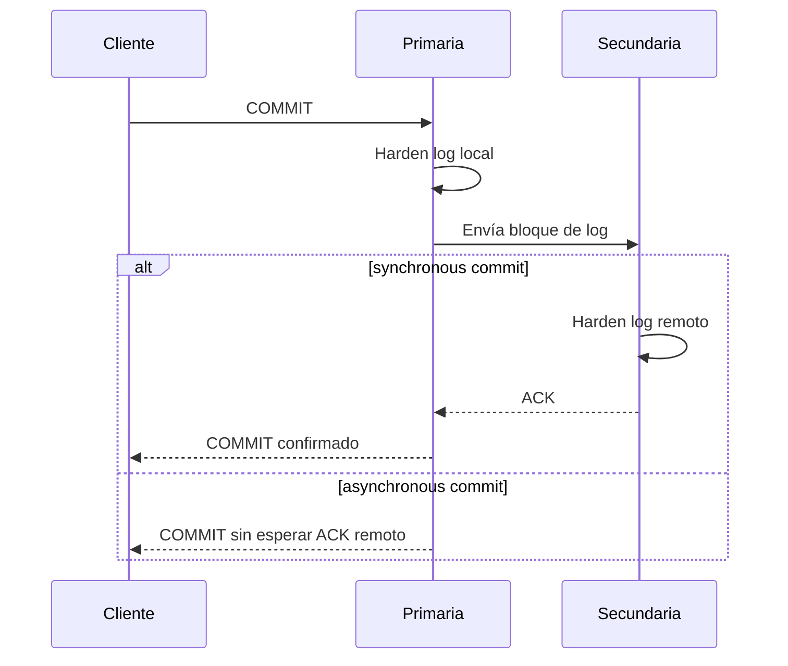
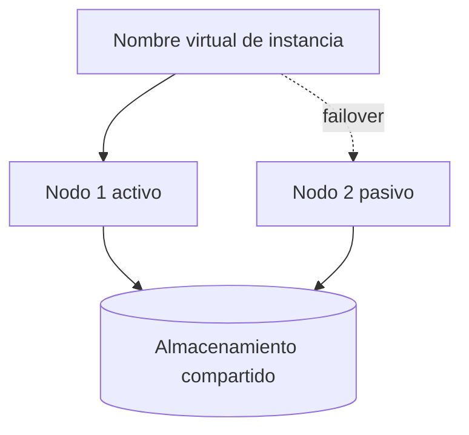
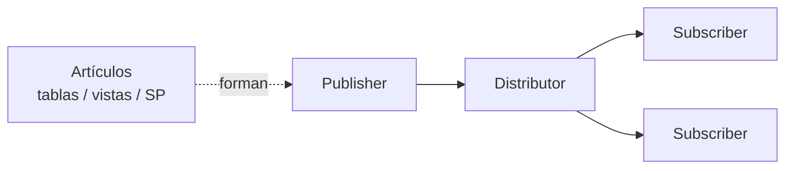
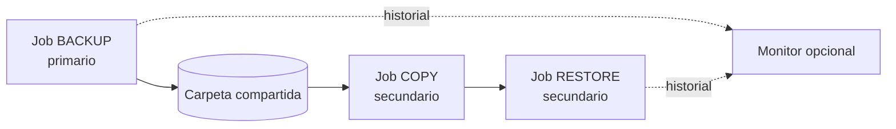

[← Unidad 5](/bbdd-aplicadas/unidad-5/teoria/)

## Para qué sirve

No todas las copias resuelven el mismo problema. La primera pregunta no es "¿qué herramienta instalamos?" sino "¿qué falla tenemos que tolerar y con qué RPO y RTO?". Un servidor que se cae a las tres de la tarde, un incendio en el centro de datos y un `DELETE` sin `WHERE` exigen respuestas distintas. Esta página presupone [backups y restauración](/bbdd-aplicadas/unidad-5/teoria/backup-restauracion/) y el [registro de transacciones](/bbdd-aplicadas/unidad-5/teoria/log-recuperacion/), porque casi todas las soluciones de HA son, por dentro, envío y aplicación de registros de log.

## HA, DR, escalabilidad y backup

:::note[Definición]
- **Alta disponibilidad** (HA, *high availability*): reducir la interrupción del servicio ante la caída de un componente (un nodo, un servicio).
- **Recuperación ante desastres** (DR, *disaster recovery*): recuperar el servicio tras una pérdida mayor (un sitio, la infraestructura, los datos).
- **RPO**: pérdida de datos admitida. **RTO**: tiempo de caída admitido.
:::

| Objetivo | Pregunta | Ejemplo de mecanismo |
|----------|----------|----------------------|
| HA | ¿Cómo reducimos una caída local? | Grupo de disponibilidad síncrono, FCI |
| DR | ¿Cómo recuperamos en otro sitio? | Grupo asíncrono, log shipping, backups externos |
| Escala de lectura | ¿Cómo descargamos los informes? | Secundaria legible, replicación |
| Recuperación histórica | ¿Cómo volvemos a antes del error? | Backup y restauración |

Una réplica sincronizada no conserva historia: reproduce enseguida un `DROP TABLE`, una corrupción lógica o un cifrado malicioso. **La alta disponibilidad no reemplaza al backup.**

## Grupos de disponibilidad (Always On)

SQL Server implementa la alta disponibilidad con **grupos de disponibilidad Always On** (*Availability Groups*, AG). Always On reemplaza a *Database Mirroring*, una función obsoleta (*deprecated*).

- Una **réplica primaria** recibe lecturas y escrituras.
- Las **réplicas secundarias** reciben los bloques de log de la primaria y los aplican a su propia copia de la base. Cada réplica tiene su propio almacenamiento.
- La réplica secundaria permanece inactiva hasta que hace falta un *failover*, que **invierte los roles**.
- Pueden operar en entornos híbridos y se pueden distribuir en varios nodos de un clúster de conmutación por error de Windows Server (WSFC).
- Una secundaria puede usarse para consultas de solo lectura (informes, ETL) y para backups, según la edición y el licenciamiento. Por defecto no permite lecturas.
- Se pueden redirigir conexiones de solo lectura a una secundaria aunque la aplicación se conecte a la primaria (*read-only routing*).



### Compromiso síncrono y asíncrono

| Aspecto | Síncrono (SC) | Asíncrono (AC) |
|---------|---------------|----------------|
| Latencia de commit | Incluye la espera remota | No espera el ACK remoto |
| Pérdida potencial | Muy baja si la secundaria está sincronizada | La cola no enviada o no rehecha puede perderse |
| Distancia típica | Cercana, baja latencia | DR remoto |
| Failover automático | Posible entre réplicas SC en modo automático | No (solo manual forzado) |

El **failover automático** solo puede producirse entre réplicas síncronas. Requiere, entre otras condiciones, réplicas en `SYNCHRONOUS_COMMIT` con `FAILOVER_MODE = AUTOMATIC`, estado sincronizado y un quórum de WSFC saludable. "Síncrono" por sí solo no lo garantiza. Las réplicas asíncronas admiten *failover* manual forzado.

#### Qué pasa si la secundaria deja de responder

Si una secundaria síncrona no responde dentro de `SESSION_TIMEOUT` (10 segundos por defecto), la primaria deja de esperarla: para esa réplica pasa temporalmente a confirmación asíncrona hasta que la comunicación se restablece y la secundaria se pone al día; entonces retoma el modo síncrono. Así una secundaria caída no bloquea los commits de la primaria. A cambio, mientras dura ese lapso la réplica **no está sincronizada** y no puede recibir un *failover* automático sin pérdida de datos. Este comportamiento es el que describe la presentación de cátedra y la documentación de Microsoft.

### Qué ofrece cada edición

El ejemplo de la cátedra usa la opción `BASIC`: un **grupo de disponibilidad básico**, disponible en la edición Standard.

| Característica | Grupo básico (Standard) | Grupo completo (Enterprise) |
|---|---|---|
| Bases por grupo | Una | Varias |
| Réplicas | Dos (una primaria y una secundaria) | Más de dos |
| Lectura en la secundaria | No | Posible (según licencia) |
| Backups en la secundaria | No | Posible |

Los límites exactos dependen de la versión; conviene consultar la documentación de la versión instalada.

### Listener y aplicaciones

El *listener* ofrece un nombre virtual para reconectar siempre a la primaria actual. Las aplicaciones necesitan *timeouts* y reintentos adecuados: un *failover* no hace que las transacciones en vuelo continúen automáticamente.

### Esqueleto DDL de un grupo básico

Una implementación real requiere WSFC, *endpoints*, permisos, instancias compatibles y una base preparada (en modelo `FULL`, con backup completo). El material muestra una definición equivalente a la de la cátedra:

<!-- sintaxis -->
```sql
CREATE AVAILABILITY GROUP BasicAG
WITH (
    AUTOMATED_BACKUP_PREFERENCE = PRIMARY,
    BASIC,
    DB_FAILOVER = OFF,
    DTC_SUPPORT = NONE,
    REQUIRED_SYNCHRONIZED_SECONDARIES_TO_COMMIT = 0
)
FOR DATABASE AdventureWorks
REPLICA ON
N'SQLVM1' WITH (
    ENDPOINT_URL = N'TCP://SQLVM1.example.test:5022',
    FAILOVER_MODE = AUTOMATIC,
    AVAILABILITY_MODE = SYNCHRONOUS_COMMIT,
    SEEDING_MODE = AUTOMATIC,
    SECONDARY_ROLE (ALLOW_CONNECTIONS = NO)
),
N'SQLVM2' WITH (
    ENDPOINT_URL = N'TCP://SQLVM2.example.test:5022',
    FAILOVER_MODE = AUTOMATIC,
    AVAILABILITY_MODE = SYNCHRONOUS_COMMIT,
    SEEDING_MODE = AUTOMATIC,
    SECONDARY_ROLE (ALLOW_CONNECTIONS = NO)
);
```

No se memoriza el script: se interpreta qué base integra el grupo, qué *endpoint* transporta el log y qué compromisos de disponibilidad y de *failover* se configuraron. Ejecutarlo exige un clúster; por eso se muestra como plantilla.

### Qué se puede comprobar en una sola instancia

Una instancia aislada no tiene grupos de disponibilidad, pero se puede consultar si la función está habilitada y qué grupos y réplicas conoce:

<!-- check: U5.T.HA.01 -->
```sql
SELECT 'IsHadrEnabled' AS Propiedad, CAST(SERVERPROPERTY('IsHadrEnabled') AS VARCHAR(10)) AS Valor
UNION ALL SELECT 'IsClustered', CAST(SERVERPROPERTY('IsClustered') AS VARCHAR(10))
UNION ALL SELECT 'Grupos en sys.availability_groups', CAST(COUNT(*) AS VARCHAR(10)) FROM sys.availability_groups
UNION ALL SELECT 'Replicas en sys.availability_replicas', CAST(COUNT(*) AS VARCHAR(10)) FROM sys.availability_replicas
ORDER BY Propiedad;
```

**Resultado esperado** (en una instancia sin Always On configurado).

| Propiedad | Valor |
|---|---|
| Grupos en sys.availability_groups | 0 |
| IsClustered | 0 |
| IsHadrEnabled | 0 |
| Replicas en sys.availability_replicas | 0 |

En un servidor con AG, `IsHadrEnabled` vale 1 y `sys.dm_hadr_availability_replica_states` informa el rol (`PRIMARY` o `SECONDARY`) y el estado de sincronización de cada réplica.

## Failover Cluster Instance (FCI)

:::note[Contenido complementario]
Las instancias de clúster de conmutación por error (FCI) no forman parte del programa 2024 ni de la presentación de cátedra, que solo menciona WSFC. Se incluyen para completar la comparación con los grupos de disponibilidad.
:::



Una FCI conmuta la **instancia completa** entre nodos de un clúster WSFC. Protege contra la caída del nodo o del servicio, pero el almacenamiento compartido es un componente único que debe diseñarse con redundancia propia.

| Criterio | FCI | Grupo de disponibilidad |
|----------|-----|-------------------------|
| Unidad protegida | Instancia | Grupo de bases |
| Almacenamiento | Compartido (o equivalente) | Una copia por réplica |
| Secundaria legible | No como copia independiente | Posible (según edición) |
| Logins y trabajos fuera de la base | Viajan con la instancia | Hay que sincronizarlos por otro medio |

## Replicación

:::note[Definición]
La **replicación** copia y sincroniza datos y objetos de una base a otra. Las bases pueden estar en la misma instancia o en instancias distintas, y se mantienen en un estado consistente.
:::

Roles:

- **Publisher** (publicador): aloja la base de origen.
- **Distributor** (distribuidor): aloja la base de distribución. Puede ser el mismo servidor que el publicador.
- **Subscriber** (suscriptor): aloja la base de destino.

Se definen **artículos** (tablas, vistas, procedimientos almacenados) que determinan qué se replica, y se pueden filtrar filas y columnas. Las tablas a replicar deben tener clave primaria.



El movimiento de datos lo hacen agentes: el *Snapshot Agent* genera la instantánea, el *Log Reader Agent* lee el log del publicador y el *Distribution Agent* entrega los cambios al suscriptor (en *push* o *pull*). En la replicación de mezcla, el *Merge Agent* sincroniza en ambos sentidos.

### Tipos

| Tipo | Qué hace | Uso típico |
|---|---|---|
| **Snapshot** (instantánea) | Genera y aplica un estado completo. Inicializa los tipos transaccional y de mezcla | Conjuntos chicos con cambios poco frecuentes |
| **Transaccional** | Un agente lee el log del publicador y distribuye los cambios con baja latencia | Reporting, data warehousing, integración desde varios sitios, descarga de lotes |
| **Merge** (mezcla) | Publicador y suscriptores pueden modificar datos; los cambios se combinan y los conflictos se detectan y resuelven | Aplicaciones móviles o distribuidas con posibles conflictos, puntos de venta, trabajo desconectado |

## Log shipping

:::note[Definición]
**Log shipping** envía automáticamente los backups del log de una base primaria a una o más bases secundarias, en instancias separadas, donde se restauran. Una tercera instancia puede actuar de monitor. Es una solución de DR; **no hace failover automático**.
:::



1. El servidor primario hace el backup del log y lo deja en una carpeta.
2. Cada secundario copia el archivo a una carpeta local.
3. Cada secundario restaura el backup.

Características: una primaria y una o más secundarias; intervalos y retardos configurables; secundarias en `NORECOVERY` o `STANDBY` (con lectura limitada a los intervalos entre restauraciones); *failover* manual; RPO aproximado igual a la frecuencia de backup más las colas de copia y restauración. El retardo configurable puede dar tiempo para reaccionar ante un borrado accidental antes de aplicarlo, aunque no sustituye a los backups históricos.

### Simulación en una instancia

Log shipping es una secuencia de backup de log, copia y `RESTORE LOG`. Eso se puede reproducir en una sola instancia con otra base como secundaria, sin los trabajos de SQL Server Agent. Se ve el estado de la secundaria en cada paso y el *failover* manual:

<!-- check: U5.T.HA.02 -->
```sql
-- Primaria: LaboratorioU5 (modelo FULL, con dbo.Pedido). Secundaria: LaboratorioU5_Sec
BACKUP DATABASE LaboratorioU5 TO DISK = 'D:\SQLBackups\LS_full.bak' WITH INIT, CHECKSUM;
RESTORE DATABASE LaboratorioU5_Sec FROM DISK = 'D:\SQLBackups\LS_full.bak'
    WITH MOVE 'LaboratorioU5' TO 'D:\SQLData\LaboratorioU5_Sec.mdf',
         MOVE 'LaboratorioU5_log' TO 'D:\SQLData\LaboratorioU5_Sec.ldf', NORECOVERY;

-- Ciclo 1
INSERT dbo.Pedido (Estado) VALUES ('A');
BACKUP LOG LaboratorioU5 TO DISK = 'D:\SQLBackups\LS_log1.trn' WITH INIT, CHECKSUM;
RESTORE LOG LaboratorioU5_Sec FROM DISK = 'D:\SQLBackups\LS_log1.trn'
    WITH STANDBY = 'D:\SQLData\LaboratorioU5_Sec.undo';
SELECT COUNT(*) FROM LaboratorioU5_Sec.dbo.Pedido;       -- la secundaria se puede consultar

-- Ciclo 2 (idéntico con otra fila) ...
-- Failover manual: se pone en línea la secundaria
RESTORE DATABASE LaboratorioU5_Sec WITH RECOVERY;
```

**Resultado esperado.** El bloque deja el ciclo 2 como comentario: para obtener esta tabla, repetí el ciclo 1 con otra fila (`'B'`, `LS_log2.trn`) y consultá `sys.databases` (columnas `state_desc` e `is_in_standby`) y el conteo de filas después de cada paso.

| Paso | Estado | EnStandby | Filas |
|---|---|---|---|
| 1 secundaria tras restaurar el full | RESTORING | 0 | NULL |
| 2 tras aplicar el log 1 con STANDBY | ONLINE | 1 | 1 |
| 3 tras aplicar el log 2 con STANDBY | ONLINE | 1 | 2 |
| 4 failover manual: RECOVERY | ONLINE | 0 | 2 |

Con `STANDBY` la secundaria es legible entre restauraciones (en `sys.databases`, `is_in_standby = 1`); al hacer `RECOVERY` deja de aceptar logs y pasa a escribible.

## Comparación para decidir

La cátedra lo resume así: la mejor herramienta **depende** de la necesidad. Para una solución completa de HA y DR, un grupo de disponibilidad; para combinar dos bases en ubicaciones distintas, replicación.

| Criterio | Grupo de disponibilidad | FCI | Replicación | Log shipping |
|----------|-------------------------|-----|-------------|--------------|
| Failover automático | Sí, bajo condiciones | Sí | No es su objetivo | No |
| Granularidad | Bases agrupadas | Instancia | Objetos, filas y columnas | Base completa |
| Copia física independiente | Sí | No necesariamente | Copia lógica | Sí, restaurada |
| Lectura en el destino | Posible (según edición) | No | Sí | Entre restauraciones con `STANDBY` |
| RPO típico | Casi cero (SC) o pequeño (AC) | Sin pérdida de datos confirmados | Depende de la latencia de los agentes | Frecuencia de backup más copia y restauración |
| RTO típico | Segundos a minutos | Minutos | Manual | Minutos a horas (manual) |
| Recuperación histórica | No | No | No | Limitada; el backup sigue siendo necesario |
| Complejidad | Alta | Alta | Media a alta | Media |

## Laboratorio guiado: grupo de disponibilidad de dos nodos

El programa 2024 prevé configurar alta disponibilidad y réplicas (semana 12). Este recorrido requiere dos instancias en máquinas o contenedores que se vean entre sí, y no se puede ejecutar en una instancia sola.

:::caution[No probado en un motor]
Este laboratorio necesita dos instancias de SQL Server conectadas en red, con Always On habilitado, por lo que no se probó en un motor. Los pasos y las consultas siguen lo que indica la documentación de Microsoft; comprobalos en tu instalación y esperá diferencias según la edición, la versión y la plataforma (Windows con WSFC o Linux con Pacemaker).
:::

1. Instalar dos instancias de SQL Server (dos máquinas virtuales o dos contenedores en una misma red), con la misma versión y edición.
2. En ambas, habilitar Always On (`SERVERPROPERTY('IsHadrEnabled')` pasa a 1 tras habilitar la función en el administrador de configuración y reiniciar el servicio). En Linux se requiere además un administrador de clúster (Pacemaker) para HA automática; sin él, el grupo se crea con `CLUSTER_TYPE = NONE`, sin *failover* automático.
3. Crear en la primaria una base de prueba en modelo `FULL` y hacer un backup completo.
4. Crear los *endpoints* de espejado de bases en ambas instancias y dar permiso al inicio de sesión de la otra.
5. Crear el grupo con la plantilla de arriba (con `BASIC` si la edición es Standard) y unir la secundaria.
6. Insertar filas en la primaria y verificar en `sys.dm_hadr_database_replica_states` que la secundaria está `SYNCHRONIZED`.
7. Detener el servicio de la primaria y observar el *failover* (automático en un clúster WSFC con réplicas síncronas; manual en otro caso).
8. Medir cuánto tardó la aplicación en reconectar con el *listener* (RTO observado) y qué se perdió (RPO observado).

Consulta de control para los pasos 6 y 7:

<!-- check: U5.T.HA.03 -->
```sql
SELECT ag.name AS Grupo,
       ar.replica_server_name AS Replica,
       rs.role_desc AS Rol,
       rs.synchronization_health_desc AS Salud,
       drs.synchronization_state_desc AS Sincronizacion
FROM sys.availability_groups AS ag
JOIN sys.availability_replicas AS ar ON ar.group_id = ag.group_id
JOIN sys.dm_hadr_availability_replica_states AS rs ON rs.replica_id = ar.replica_id
JOIN sys.dm_hadr_database_replica_states AS drs ON drs.replica_id = ar.replica_id
ORDER BY ar.replica_server_name;
```

## Escenarios de elección

**"Necesito failover automático local de una base crítica y un RPO cercano a cero."** Grupo de disponibilidad síncrono con *failover* automático, o FCI, según se proteja la base o la instancia y el almacenamiento.

**"Necesito enviar algunas tablas a sucursales que además trabajan desconectadas."** Replicación de mezcla, evaluando los conflictos.

**"Quiero un DR remoto económico y acepto *failover* manual y minutos de pérdida."** Log shipping.

**"Quiero consultar una copia para reporting."** Secundaria legible de un grupo de disponibilidad si la edición lo permite, o replicación transaccional según la consistencia y la granularidad.

**"Quiero recuperarme de un `DELETE` detectado tres días después."** Un backup histórico probado. Ninguna réplica actual sustituye ese requisito.

## Errores frecuentes

:::caution[Errores frecuentes]
- Pensar que "síncrono" garantiza el *failover* automático: hace falta modo automático, réplicas sincronizadas y quórum.
- Afirmar que toda secundaria es legible: depende de la edición y de la configuración (en un grupo básico no lo es).
- Presentar la replicación o un RAID como backup.
- Creer que el log shipping hace *failover* solo.
- Olvidar que los inicios de sesión y los trabajos viven fuera de la base y no viajan con un grupo de disponibilidad.
:::

## Autoevaluación

**1. Una secundaria síncrona queda sin red durante 30 segundos. ¿Se bloquean los commits en la primaria?**

<details>
<summary>Respuesta</summary>

No de forma indefinida. Al vencer `SESSION_TIMEOUT` (10 segundos por defecto), la primaria deja de esperar a esa réplica y confirma de forma asíncrona respecto de ella hasta que se reconecte y se ponga al día. Mientras tanto, esa réplica no está sincronizada y no sirve para un *failover* automático sin pérdida.
</details>

**2. ¿Qué RPO tiene un log shipping con backups cada 15 minutos, copia cada 5 y restauración cada 15?**

<details>
<summary>Respuesta</summary>

Del orden de 15 minutos en el mejor caso (lo que puede estar sin respaldar en la primaria) y de hasta 35 si se suman los intervalos de backup, copia y restauración en el peor caso. Por eso el RPO "aproximado" depende de las colas de los tres trabajos.
</details>

:::tip[En resumen]
- HA reduce la interrupción; DR recupera de un desastre; ninguna reemplaza al backup.
- Los grupos de disponibilidad envían el log a réplicas con su propio almacenamiento; solo entre réplicas síncronas hay *failover* automático.
- Replicación (snapshot, transaccional, merge) distribuye objetos; log shipping envía backups de log y se maneja de forma manual.
- La herramienta depende del RPO, el RTO y el alcance de lo que se protege.
:::

:::tip[Para seguir]
- Practicá con los ejercicios 24, 25, 34 y 35 del [laboratorio de backup](/bbdd-aplicadas/unidad-5/practica/laboratorio-backup/).
:::

## Fuentes

- Presentación de cátedra, Unidad 5, "Alta disponibilidad", "Réplicas de la DB", "Log Shipping" y "Réplicas vs Alta disponibilidad" (diapositivas 49 a 58).
- Microsoft Learn: *Basic availability groups*, *Overview of Always On availability groups*, *Availability modes*, *SQL Server replication*, *About log shipping* y *Always On Failover Cluster Instances*.
