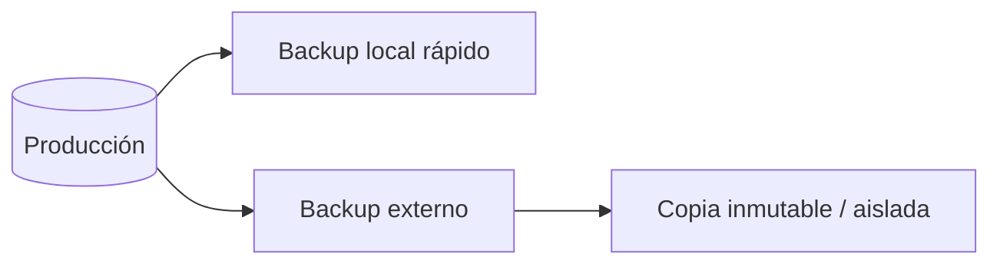

[← Unidad 5](/bbdd-aplicadas/unidad-5/teoria/)

## Para qué sirve

Una estrategia de respaldo se diseña desde la restauración que se necesita, no desde el comando `BACKUP` disponible. Un backup que nunca se restauró es una hipótesis: lo que importa es cuánto dato se puede perder (RPO), cuánto tarda el servicio en volver (RTO) y si alguien demostró que la restauración funciona.

Esta página presupone el [registro de transacciones y los modelos de recuperación](/bbdd-aplicadas/unidad-5/teoria/log-recuperacion/). Los ejemplos se ejecutan en el laboratorio: [Cadena de backup y restauración](/bbdd-aplicadas/unidad-5/practica/laboratorio-backup/).

:::note[Rutas en los ejemplos]
Los bloques muestran rutas de Windows (`D:\SQLBackups\`). En SQL Server para Linux o en un contenedor se usan rutas del tipo `/var/opt/mssql/backup/` (la cuenta del servicio debe poder escribir ahí). Con cualquiera de las dos plataformas, reemplazá en cada ejemplo la carpeta y el nombre del archivo por los tuyos. Los resultados de esta página se obtuvieron con SQL Server 2022 sobre Linux.
:::

Los ejemplos usan una [base de práctica](/bbdd-aplicadas/como-estudiar/#antes-de-ejecutar-los-ejemplos) llamada `LaboratorioU5` (`CREATE DATABASE LaboratorioU5;`), en modelo `FULL` y con una tabla `dbo.Pedido (PedidoId INT IDENTITY PRIMARY KEY, Estado VARCHAR(30))`. Las bases restauradas (`..._Restore`) se pueden borrar al terminar.

## RPO, RTO y estrategia

:::note[Definición]
- **RPO** (*Recovery Point Objective*): cantidad máxima de datos que se admite perder, medida en tiempo. Si se respalda el log cada 5 minutos, se admite un RPO de 5 minutos.
- **RTO** (*Recovery Time Objective*): tiempo máximo que se admite para volver a operar tras un incidente.
:::

| Pregunta | Decisión resultante |
|----------|---------------------|
| ¿Cuántos datos se pueden perder? | RPO y frecuencia de backups de log y de datos |
| ¿Cuánto puede estar caído el servicio? | RTO, automatización, infraestructura y tamaño |
| ¿Qué incidentes se cubren? | Copias aisladas, externas, inmutables; HA y DR |
| ¿Cuánto se retiene? | Política diaria, semanal, mensual y legal |
| ¿Cómo se demuestra? | Restauración de prueba, `CHECKSUM`, `VERIFYONLY`, `CHECKDB` |

## Tipos de backup

| Tipo | Contenido | Cadena |
|---|---|---|
| Completo (*full*) | Todas las páginas asignadas, más el log necesario para dejar la base consistente | Base de cualquier restauración |
| Diferencial | Extensiones modificadas desde el último completo (que no sea `COPY_ONLY`) | Acumulativo |
| Registro de transacciones | Registros desde el backup de log anterior | Secuencial, sin huecos |
| Tail-log | La cola del log aún no respaldada | Cierra la cadena antes de restaurar |
| Copy-only | Copia independiente de la secuencia | No altera la estrategia |

### Diferencial, acumulativo, incremental: la terminología

La presentación de cátedra titula una diapositiva "Diferencial o incremental" y dice después que el diferencial es acumulativo y que los backups de log son incrementales. Los dos términos conviven, y conviene fijar qué significa cada uno:

- **Diferencial** (término de SQL Server): guarda todo lo modificado **desde el último backup completo**. Es **acumulativo**: cada diferencial es mayor o igual que el anterior hasta el próximo completo, y para restaurar solo hace falta el último.
- **Incremental** (término general): guarda lo modificado **desde el backup anterior de cualquier tipo**. Para restaurar hacen falta todos los incrementales en orden. En SQL Server, los backups de log funcionan así: cada uno contiene lo generado desde el log anterior.

Por eso, "diferencial o incremental" es una forma coloquial de nombrar el backup de cambios; el comportamiento de `BACKUP ... WITH DIFFERENTIAL` es el acumulativo. En una respuesta escrita se dice "diferencial (acumulativo desde el último completo)". Si se usa "incremental" para el diferencial, hay que aclarar que se refiere a cambios respecto del último completo, no del backup anterior.

### Completo

Copia las páginas asignadas y el log suficiente para producir una base transaccionalmente consistente al terminar. Es la base de una secuencia de restauración: antes de cualquier otro tipo de backup debe existir un completo.

<!-- check: U5.T.BK.10 -->
```sql
BACKUP DATABASE LaboratorioU5
TO DISK = 'D:\SQLBackups\LaboratorioU5_full.bak'
WITH INIT, COMPRESSION, CHECKSUM, STATS = 10;
```

`COMPRESSION` no está disponible en todas las ediciones (por ejemplo, no en Express); `CHECKSUM` verifica las páginas al respaldar y se recomienda siempre.

### Diferencial

<!-- check: U5.T.BK.01 -->
```sql
BACKUP DATABASE LaboratorioU5
TO DISK = 'D:\SQLBackups\LaboratorioU5_diff.bak'
WITH DIFFERENTIAL, INIT, COMPRESSION, CHECKSUM;
```

Para restaurar solo interesa el diferencial más reciente compatible con el completo elegido. Se comprueba que es acumulativo: con un completo y dos diferenciales, restaurar el completo y **solo el segundo diferencial** recupera los cambios de los dos períodos, y ambos diferenciales comparten la misma base.

<!-- check: U5.T.BK.05 -->
```sql
-- Base de prueba en modelo FULL, con dbo.Pedido (PedidoId, Estado)
BACKUP DATABASE LaboratorioU5 TO DISK = 'D:\SQLBackups\U5_full.bak' WITH INIT, CHECKSUM;
INSERT dbo.Pedido (Estado) VALUES ('A_DIA1');
BACKUP DATABASE LaboratorioU5 TO DISK = 'D:\SQLBackups\U5_diff1.bak' WITH DIFFERENTIAL, INIT, CHECKSUM;
INSERT dbo.Pedido (Estado) VALUES ('B_DIA2');
BACKUP DATABASE LaboratorioU5 TO DISK = 'D:\SQLBackups\U5_diff2.bak' WITH DIFFERENTIAL, INIT, CHECKSUM;

-- Restauración: completo + SOLO el segundo diferencial
RESTORE DATABASE LaboratorioU5_Restore FROM DISK = 'D:\SQLBackups\U5_full.bak'
    WITH MOVE 'LaboratorioU5' TO 'D:\SQLData\LaboratorioU5_Restore.mdf',
         MOVE 'LaboratorioU5_log' TO 'D:\SQLData\LaboratorioU5_Restore.ldf',
         NORECOVERY;
RESTORE DATABASE LaboratorioU5_Restore FROM DISK = 'D:\SQLBackups\U5_diff2.bak' WITH RECOVERY;

SELECT COUNT(*) AS Filas FROM LaboratorioU5_Restore.dbo.Pedido;
```

**Resultado esperado.** La tabla resume dos comprobaciones: cuántas bases distintas tienen los diferenciales (`SELECT COUNT(DISTINCT differential_base_lsn) FROM msdb.dbo.backupset WHERE type = 'I'`; un `1` confirma que ambos parten del mismo completo) y cuántas filas devuelve el `SELECT` final. Esa primera consulta no figura en el bloque: agregala si querés reproducir la tabla.

| Concepto | Valor |
|---|---|
| Diferenciales con la misma base | 1 |
| Filas tras full + diff2 | 2 |

### Registro de transacciones

Contiene los registros generados desde el backup de log anterior y mantiene continua la cadena. Para restaurar a un instante hay que aplicar **todos** los logs necesarios, en orden. Un full o un diferencial intermedio no rompe la cadena de logs.

<!-- check: U5.T.BK.01 -->
```sql
BACKUP LOG LaboratorioU5
TO DISK = 'D:\SQLBackups\LaboratorioU5_log_001.trn'
WITH INIT, COMPRESSION, CHECKSUM;
```

### Tail-log

Captura la cola del log aún no respaldada antes de empezar una restauración, para no perder lo ocurrido desde el último backup de log. `NORECOVERY` deja la base en estado *restoring* (sin accesos nuevos) y lista para la secuencia de restauración. La sesión que lo ejecuta no puede estar usando esa base (conviene `USE master`).

<!-- check: U5.T.BK.06 -->
```sql
BACKUP LOG LaboratorioU5
TO DISK = 'D:\SQLBackups\LaboratorioU5_tail.trn'
WITH NORECOVERY, INIT, CHECKSUM;
```

<!-- check: U5.T.BK.06 -->
```sql
-- Completo, un cambio (A), log 1, otro cambio (B_SIN_RESPALDAR) y tail-log
BACKUP DATABASE LaboratorioU5 TO DISK = 'D:\SQLBackups\U5_full.bak' WITH INIT, CHECKSUM;
INSERT dbo.Pedido (Estado) VALUES ('A');
BACKUP LOG LaboratorioU5 TO DISK = 'D:\SQLBackups\U5_log1.trn' WITH INIT, CHECKSUM;
INSERT dbo.Pedido (Estado) VALUES ('B_SIN_RESPALDAR');

USE master;
BACKUP LOG LaboratorioU5 TO DISK = 'D:\SQLBackups\U5_tail.trn' WITH NORECOVERY, INIT, CHECKSUM;

-- Restauración a otra base: completo, log 1 y tail-log
RESTORE DATABASE LaboratorioU5_Restore FROM DISK = 'D:\SQLBackups\U5_full.bak'
    WITH MOVE 'LaboratorioU5' TO 'D:\SQLData\LaboratorioU5_Restore.mdf',
         MOVE 'LaboratorioU5_log' TO 'D:\SQLData\LaboratorioU5_Restore.ldf', NORECOVERY;
RESTORE LOG LaboratorioU5_Restore FROM DISK = 'D:\SQLBackups\U5_log1.trn' WITH NORECOVERY;
RESTORE LOG LaboratorioU5_Restore FROM DISK = 'D:\SQLBackups\U5_tail.trn' WITH RECOVERY;

SELECT PedidoId, Estado FROM LaboratorioU5_Restore.dbo.Pedido ORDER BY PedidoId;
-- La base original quedó en RESTORING: se vuelve a poner en línea
RESTORE DATABASE LaboratorioU5 WITH RECOVERY;
```

**Resultado esperado.** La tabla reúne tres comprobaciones que se consultan por separado: el estado de la base original después del `BACKUP LOG ... NORECOVERY` (con `SELECT state_desc FROM sys.databases`) y las filas de la base restaurada (el `SELECT` del bloque).

| Concepto | Valor |
|---|---|
| Base origen tras el tail-log | RESTORING |
| Fila restaurada 1 | A |
| Fila restaurada 2 | B_SIN_RESPALDAR |

Si la base está dañada o fuera de línea, la cátedra menciona que el tail-log todavía puede intentarse. Con el archivo de log accesible se usa `BACKUP LOG ... WITH NO_TRUNCATE` (en lugar de `NORECOVERY`) para capturar la cola sin necesitar que la base esté sana.

### Copy-only

Un completo `COPY_ONLY` no se convierte en la base de los diferenciales siguientes: es la herramienta para una copia extraordinaria (exportar la base a otro servidor, por ejemplo) sin alterar la estrategia programada.

<!-- check: U5.T.BK.04 -->
```sql
BACKUP DATABASE LaboratorioU5 TO DISK = 'D:\SQLBackups\U5_full.bak' WITH INIT, CHECKSUM;
INSERT dbo.Pedido (Estado) VALUES ('A');
BACKUP DATABASE LaboratorioU5 TO DISK = 'D:\SQLBackups\U5_copia.bak' WITH COPY_ONLY, INIT, CHECKSUM;
INSERT dbo.Pedido (Estado) VALUES ('B');
BACKUP DATABASE LaboratorioU5 TO DISK = 'D:\SQLBackups\U5_diff.bak' WITH DIFFERENTIAL, INIT, CHECKSUM;

SELECT ROW_NUMBER() OVER (ORDER BY b.backup_set_id) AS Orden,
       CASE WHEN b.is_copy_only = 1 THEN 'Completo copy-only'
            WHEN b.type = 'D' THEN 'Completo'
            ELSE 'Diferencial' END AS TipoBackup,
       CASE WHEN b.type = 'I' AND b.differential_base_lsn =
                 (SELECT f.checkpoint_lsn FROM msdb.dbo.backupset AS f
                  WHERE f.database_name = DB_NAME() AND f.type = 'D' AND f.is_copy_only = 0)
            THEN 'Si' WHEN b.type = 'I' THEN 'No' ELSE '-' END AS BaseEsElCompletoNormal
FROM msdb.dbo.backupset AS b
WHERE b.database_name = DB_NAME()
ORDER BY b.backup_set_id;
```

**Resultado esperado.**

| Orden | TipoBackup | BaseEsElCompletoNormal |
|---|---|---|
| 1 | Completo | - |
| 2 | Completo copy-only | - |
| 3 | Diferencial | Si |

## Una semana de backups


Ante un incidente el miércoles se usa el completo del domingo, el diferencial del miércoles y los logs posteriores a ese diferencial hasta el objetivo.

## Restauración

:::note[Definición]
**Restaurar** es recuperar una base a un estado anterior a partir de copias previamente creadas. Las operaciones necesarias dependen de la estrategia usada y del momento del incidente. La recomendación de la cátedra es: documentá todo, probá todo.
:::

### Inspeccionar sin restaurar

<!-- check: U5.T.BK.10 -->
```sql
RESTORE HEADERONLY   FROM DISK = 'D:\SQLBackups\LaboratorioU5_full.bak';
RESTORE FILELISTONLY FROM DISK = 'D:\SQLBackups\LaboratorioU5_full.bak';
RESTORE VERIFYONLY   FROM DISK = 'D:\SQLBackups\LaboratorioU5_full.bak' WITH CHECKSUM;
```

- `HEADERONLY` lista los backups del archivo: tipo (`BackupType`: 1 completo, 2 log, 5 diferencial), modelo de recuperación, LSN, si tiene sumas de verificación.
- `FILELISTONLY` devuelve los nombres lógicos y físicos de los archivos de la base (los que se usan en `MOVE`).
- `VERIFYONLY` comprueba que el backup se puede leer y su estructura, pero no sustituye una restauración real ni `DBCC CHECKDB`.

**Resultado esperado** (resumido: solo las columnas relevantes; la salida completa de `HEADERONLY` tiene unas 60 columnas que dependen de la versión, y cada comando devuelve su propio resultado). Las dos últimas filas muestran qué responde `VERIFYONLY` ante un archivo inexistente y ante el archivo del ejemplo.

| Concepto | Valor |
|---|---|
| FILELISTONLY archivos tipo D | 1 |
| FILELISTONLY archivos tipo L | 1 |
| HEADERONLY BackupType | 1 |
| HEADERONLY HasBackupChecksums | 1 |
| HEADERONLY RecoveryModel | FULL |
| VERIFYONLY de un archivo inexistente | rechazada |
| VERIFYONLY del archivo | valido |

### Restaurar con otro nombre y ruta

<!-- check: U5.T.BK.02 -->
```sql
RESTORE DATABASE LaboratorioU5_Restore
FROM DISK = 'D:\SQLBackups\LaboratorioU5_full.bak'
WITH
    MOVE 'LaboratorioU5'     TO 'D:\SQLData\LaboratorioU5_Restore.mdf',
    MOVE 'LaboratorioU5_log' TO 'D:\SQLData\LaboratorioU5_Restore.ldf',
    NORECOVERY,
    STATS = 10;
```

Los nombres lógicos de `MOVE` se obtienen con `FILELISTONLY`. Los archivos mínimos de una base son el de datos (`.mdf`) y el de log (`.ldf`).

### Estados de recuperación

| Opción | Estado final | ¿Admite más restauraciones? |
|--------|--------------|:---------------------------:|
| `NORECOVERY` | *Restoring*, no accesible | Sí |
| `STANDBY` | Solo lectura, con archivo *undo* | Sí, tras desconectar a los lectores |
| `RECOVERY` (por defecto) | En línea | No en esa secuencia |

### Orden de restauración: completo, diferencial y logs

Las piezas intermedias van con `NORECOVERY` y la última con `RECOVERY`. Si hay diferencial, los logs a aplicar son los **posteriores** al diferencial.

<!-- check: U5.T.BK.02 -->
```sql
-- Cadena: completo, log 1, diferencial, log 2 (dbo.Pedido recibe una fila antes de cada paso)
RESTORE DATABASE LaboratorioU5_Restore FROM DISK = 'D:\SQLBackups\U5_full.bak'
    WITH MOVE 'LaboratorioU5' TO 'D:\SQLData\LaboratorioU5_Restore.mdf',
         MOVE 'LaboratorioU5_log' TO 'D:\SQLData\LaboratorioU5_Restore.ldf', NORECOVERY;
RESTORE DATABASE LaboratorioU5_Restore FROM DISK = 'D:\SQLBackups\U5_diff.bak' WITH NORECOVERY;
RESTORE LOG LaboratorioU5_Restore FROM DISK = 'D:\SQLBackups\U5_log2.trn' WITH RECOVERY;

SELECT PedidoId, Estado FROM LaboratorioU5_Restore.dbo.Pedido ORDER BY PedidoId;
```

**Resultado esperado.**

| PedidoId | Estado |
|---|---|
| 1 | A_LOG1 |
| 2 | B_DIFF |
| 3 | C_LOG2 |

No hizo falta el primer log: el diferencial ya contiene su efecto. La alternativa, sin diferencial, es aplicar el completo y **todos** los logs desde ese completo:

<!-- check: U5.T.BK.03 -->
```sql
RESTORE DATABASE LaboratorioU5_Restore FROM DISK = 'D:\SQLBackups\U5_full.bak'
    WITH MOVE 'LaboratorioU5' TO 'D:\SQLData\LaboratorioU5_Restore.mdf',
         MOVE 'LaboratorioU5_log' TO 'D:\SQLData\LaboratorioU5_Restore.ldf', NORECOVERY;
RESTORE LOG LaboratorioU5_Restore FROM DISK = 'D:\SQLBackups\U5_log1.trn' WITH NORECOVERY;
SELECT state_desc FROM sys.databases WHERE name = 'LaboratorioU5_Restore';   -- RESTORING
RESTORE LOG LaboratorioU5_Restore FROM DISK = 'D:\SQLBackups\U5_log2.trn' WITH RECOVERY;
SELECT state_desc FROM sys.databases WHERE name = 'LaboratorioU5_Restore';   -- ONLINE
SELECT Estado FROM LaboratorioU5_Restore.dbo.Pedido ORDER BY PedidoId;
```

**Resultado esperado.**

| Etapa | Estado |
|---|---|
| Tras el primer log | RESTORING |
| Tras el ultimo log | ONLINE |

Las filas recuperadas son `A_LOG1` y `B_LOG2`.

### Cadena rota

Cada log tiene un rango de LSN y el motor exige que el siguiente empiece donde terminó el anterior. Saltear uno se rechaza: el motor informa que el log es demasiado reciente para aplicarse a la base y el cliente recibe además el error genérico 3013.

<!-- check: U5.T.BK.09 -->
```sql
RESTORE DATABASE LaboratorioU5_Restore FROM DISK = 'D:\SQLBackups\U5_full.bak'
    WITH MOVE 'LaboratorioU5' TO 'D:\SQLData\LaboratorioU5_Restore.mdf',
         MOVE 'LaboratorioU5_log' TO 'D:\SQLData\LaboratorioU5_Restore.ldf', NORECOVERY;

RESTORE LOG LaboratorioU5_Restore FROM DISK = 'D:\SQLBackups\U5_log2.trn' WITH NORECOVERY;  -- rechazado
RESTORE LOG LaboratorioU5_Restore FROM DISK = 'D:\SQLBackups\U5_log1.trn' WITH NORECOVERY;
RESTORE LOG LaboratorioU5_Restore FROM DISK = 'D:\SQLBackups\U5_log2.trn' WITH RECOVERY;
```

**Resultado esperado.** El segundo `RESTORE LOG` (el que salta `U5_log1.trn`) falla con error; la tabla resume qué pasó con cada intento y se armó anotando el resultado de cada uno (si ejecutás el bloque tal cual, solo verás el error y los mensajes de los demás `RESTORE`). Al final, la base tiene las 2 filas.

| Paso | Resultado |
|---|---|
| Orden correcto log1, log2 | sin error |
| Restaurar log2 sin log1 | rechazada |

### Recuperar hasta un punto: `STOPAT` y marcas

`STOPAT` detiene la restauración del log en una fecha y hora. Si el punto cae dentro del último log, evita aplicar lo posterior. La hora es la del servidor: hay que verificar la zona horaria.

<!-- check: U5.T.BK.08 -->
```sql
-- Hora del servidor justo antes del error (dos segundos de margen a cada lado)
RESTORE DATABASE LaboratorioU5_Restore FROM DISK = 'D:\SQLBackups\U5_full.bak'
    WITH MOVE 'LaboratorioU5' TO 'D:\SQLData\LaboratorioU5_Restore.mdf',
         MOVE 'LaboratorioU5_log' TO 'D:\SQLData\LaboratorioU5_Restore.ldf', NORECOVERY;
RESTORE LOG LaboratorioU5_Restore FROM DISK = 'D:\SQLBackups\U5_log1.trn'
    WITH STOPAT = '2026-07-22T14:37:00', RECOVERY;      -- reemplazar por la hora real anterior al error

SELECT Estado FROM LaboratorioU5_Restore.dbo.Pedido ORDER BY PedidoId;
```

**Resultado esperado** (la fila `B_ERROR`, insertada después del instante elegido, no está).

| Estado |
|---|
| A_ANTES |

Depender del reloj es frágil. Las **transacciones marcadas** (`WITH MARK`) dejan en el log un nombre al que se puede volver sin calcular horas. `STOPBEFOREMARK` recupera hasta justo antes de la marca; `STOPATMARK`, hasta incluir la transacción marcada. La cátedra muestra la variante por LSN (`STOPATMARK = 'lsn:...'`).

<!-- check: U5.T.BK.07 -->
```sql
INSERT dbo.Pedido (Estado) VALUES ('A_ANTES');
BEGIN TRANSACTION CargaMasiva WITH MARK 'carga mensual';
    INSERT dbo.Pedido (Estado) VALUES ('B_EN_MARCA');
COMMIT TRANSACTION;
INSERT dbo.Pedido (Estado) VALUES ('C_DESPUES');
BACKUP LOG LaboratorioU5 TO DISK = 'D:\SQLBackups\U5_log1.trn' WITH INIT, CHECKSUM;

-- Restauración 1 (el full ya fue restaurado con NORECOVERY a LaboratorioU5_Restore)
RESTORE LOG LaboratorioU5_Restore FROM DISK = 'D:\SQLBackups\U5_log1.trn'
    WITH STOPBEFOREMARK = 'CargaMasiva', RECOVERY;
-- Restauración 2 (a otra base): STOPATMARK incluye la transacción marcada
RESTORE LOG LaboratorioU5_Restore2 FROM DISK = 'D:\SQLBackups\U5_log1.trn'
    WITH STOPATMARK = 'CargaMasiva', RECOVERY;
```

**Resultado esperado.**

| Opción | Estado |
|---|---|
| STOPATMARK | A_ANTES |
| STOPATMARK | B_EN_MARCA |
| STOPBEFOREMARK | A_ANTES |

`C_DESPUES` no aparece en ninguna: ocurrió después de la marca.

## Opciones de riesgo

- `REPLACE` permite sobrescribir una base existente y omite salvaguardas: se confirma el destino y el backup dos veces.
- `KEEP_REPLICATION` conserva la configuración de replicación en los escenarios compatibles.
- `RESTRICTED_USER` recupera limitando el acceso a administradores y miembros de ciertos roles.

Sin `REPLACE`, el motor impide pisar una base existente con el backup de otra. Con `REPLACE` lo permite, y ahí está el peligro:

<!-- check: U5.T.BK.11 -->
```sql
-- LaboratorioU5_Restore2 ya existe y es otra base
RESTORE DATABASE LaboratorioU5_Restore2 FROM DISK = 'D:\SQLBackups\U5_full.bak'
    WITH MOVE 'LaboratorioU5' TO 'D:\SQLData\LaboratorioU5_Restore2.mdf',
         MOVE 'LaboratorioU5_log' TO 'D:\SQLData\LaboratorioU5_Restore2.ldf';          -- rechazado (error 3154)

RESTORE DATABASE LaboratorioU5_Restore2 FROM DISK = 'D:\SQLBackups\U5_full.bak'
    WITH REPLACE,
         MOVE 'LaboratorioU5' TO 'D:\SQLData\LaboratorioU5_Restore2.mdf',
         MOVE 'LaboratorioU5_log' TO 'D:\SQLData\LaboratorioU5_Restore2.ldf';          -- sobrescribe
```

**Resultado esperado.**

| Intento | Resultado |
|---|---|
| Con REPLACE sobre otra base | sin error |
| Sin REPLACE sobre otra base | rechazada |

## Backup cifrado

El certificado debe existir en `master` antes del backup (en una instancia nueva, también la clave maestra de `master`).

<!-- check: U5.T.BK.12 -->
```sql
USE master;
CREATE MASTER KEY ENCRYPTION BY PASSWORD = '<contraseña-larga-y-propia>';   -- solo si no existe
CREATE CERTIFICATE CertificadoBackup WITH SUBJECT = 'Cifrado de backups';

BACKUP DATABASE LaboratorioU5
TO DISK = 'D:\SQLBackups\LaboratorioU5_enc.bak'
WITH COMPRESSION,
     ENCRYPTION (ALGORITHM = AES_256, SERVER CERTIFICATE = CertificadoBackup),
     CHECKSUM;

-- Respaldo del certificado y su clave privada, guardados aparte
BACKUP CERTIFICATE CertificadoBackup
TO FILE = 'D:\Claves\CertificadoBackup.cer'
WITH PRIVATE KEY (FILE = 'D:\Claves\CertificadoBackup.pvk',
                  ENCRYPTION BY PASSWORD = '<otra-contraseña-larga>');
```

Cifrar el backup y perder el certificado equivale a perder el backup.

:::caution[No probado en un motor]
Este ejemplo crea un certificado en `master` y escribe archivos de clave, por lo que necesita permisos de administración sobre la instancia y una carpeta donde la cuenta del servicio pueda escribir. No se probó en un motor: la sintaxis y el comportamiento son los que indica la documentación de Microsoft. Probalo en una instancia de laboratorio y guardá el certificado y su clave antes de depender del backup cifrado.
:::

## 3-2-1 y ransomware

La regla **3-2-1**: tres copias de los datos, en dos tipos de medios distintos y una fuera del sitio. La cátedra pide que una de las copias esté en la nube; en general alcanza con que sea externa, aislada o inmutable.



- Las copias no comparten todas las credenciales con producción.
- La retención inmutable reduce el riesgo de que un atacante borre las copias.
- Se monitorean los fallos de trabajos y el espacio.
- Se prueban restauraciones completas con tiempos medidos.

## Diseñar desde el RPO y el RTO

Ejemplo: RPO de 15 minutos y RTO de 2 horas.

- backups de log cada 10 a 15 minutos;
- completo semanal y diferenciales diarios para acortar la restauración;
- copias externas o inmutables;
- automatización, documentación y un servidor alternativo dimensionado;
- un simulacro que demuestre una recuperación en menos de 2 horas.

Un cronograma de backups no garantiza un RTO: hay que medir la transferencia, la restauración, el REDO, `CHECKDB`, la validación funcional, DNS y conexiones y la reapertura del servicio.

## Checklist de restauración

- [ ] Confirmé la base destino y evité sobrescribir producción.
- [ ] Identifiqué el completo, el diferencial y la secuencia de logs por LSN.
- [ ] Capturé el tail-log si era posible.
- [ ] Usé `NORECOVERY` hasta la última pieza.
- [ ] Validé nombres lógicos y rutas con `FILELISTONLY`.
- [ ] Ejecuté `DBCC CHECKDB` y pruebas funcionales.
- [ ] Registré la duración para contrastarla con el RTO.
- [ ] Documenté la pérdida real para contrastarla con el RPO.

## Errores frecuentes

:::caution[Errores frecuentes]
- Restaurar el completo con `RECOVERY` y después querer aplicar logs: la base queda en línea y no admite más piezas.
- Creer que `VERIFYONLY` prueba que se puede restaurar.
- Aplicar logs anteriores al diferencial o saltear uno de la cadena.
- Usar `REPLACE` sin confirmar el destino.
- Tomar un completo ad hoc sin `COPY_ONLY` y romper la expectativa sobre la base de los diferenciales.
- Cifrar backups y no respaldar el certificado.
:::

## Autoevaluación

**1. Hay un completo del domingo, diferenciales diarios y logs cada 15 minutos. El miércoles a las 14:37 se borró una tabla. ¿Qué se restaura?**

<details>
<summary>Respuesta</summary>

Tail-log si es posible; el completo del domingo con `NORECOVERY`; el diferencial del miércoles (el último anterior al incidente) con `NORECOVERY`; los logs posteriores a ese diferencial en orden; el último con `STOPAT` a las 14:36 y `RECOVERY`. Después, `CHECKDB` y validación funcional.
</details>

**2. ¿Un diferencial es "incremental"?**

<details>
<summary>Respuesta</summary>

Depende del sentido. En SQL Server es acumulativo desde el último completo; "incremental" en sentido estricto sería respecto del backup anterior, como los de log. Se aclara siempre contra qué punto se miden los cambios.
</details>

:::tip[En resumen]
- Se diseña desde el RPO y el RTO, y se demuestra con una restauración probada.
- Completo es la base; el diferencial es acumulativo; los logs forman una cadena sin huecos.
- `NORECOVERY` en cada pieza salvo la última; `STOPAT` o marcas para el punto exacto.
- `COPY_ONLY` no altera la cadena; `REPLACE` y la pérdida del certificado son los grandes riesgos.
:::

:::tip[Para seguir]
- Con las copias claras, seguí con [Alta disponibilidad, replicación y recuperación ante desastres](/bbdd-aplicadas/unidad-5/teoria/alta-disponibilidad/): una réplica no reemplaza al backup.
:::

## Fuentes

- Presentación de cátedra, Unidad 5, "Respaldo de la base de datos" (diapositivas 35 a 45) y "Restauración de la base de datos" (46 a 48).
- Microsoft Learn: *BACKUP (Transact-SQL)*, *RESTORE (Transact-SQL)*, *Differential backups*, *Tail-log backups*, *Restore a database to a point in time* y *Marked transactions*.
