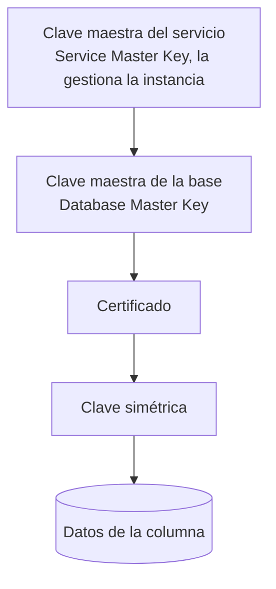
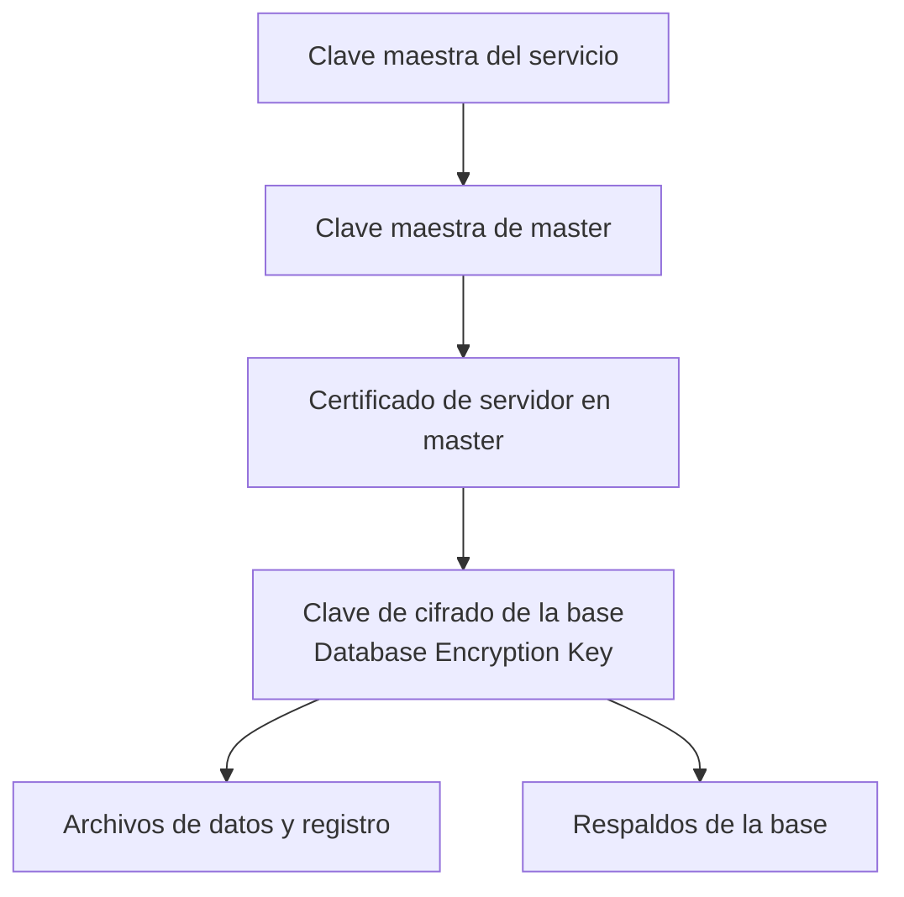
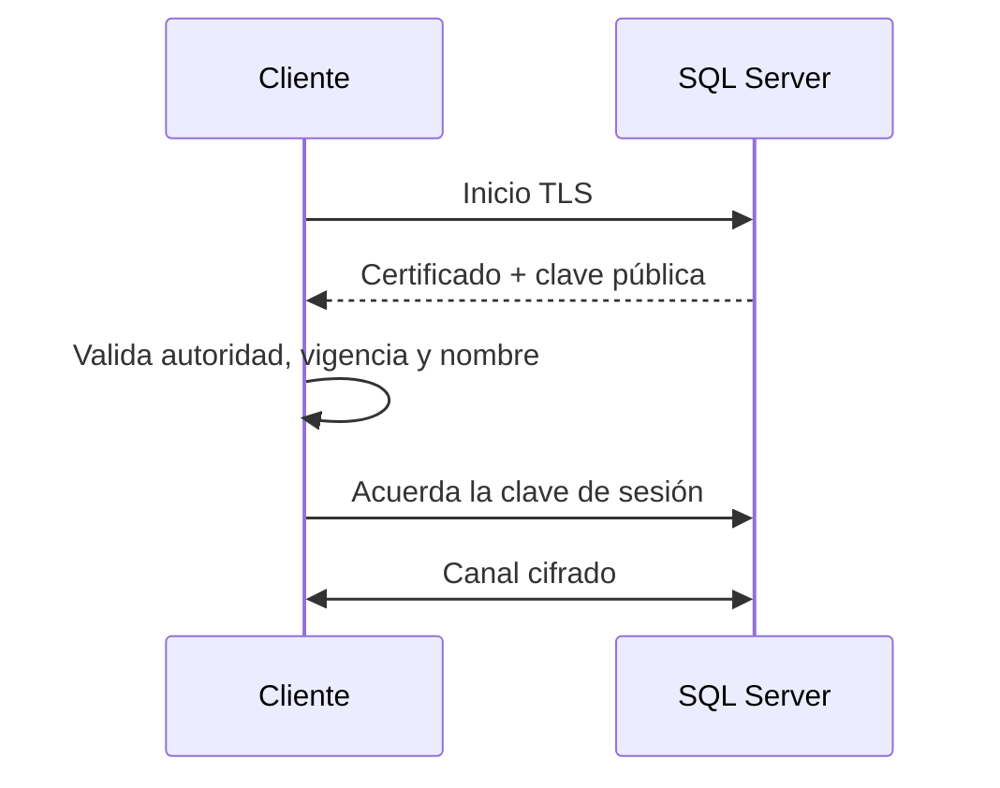

[← Unidad 5](/bbdd-aplicadas/unidad-5/teoria/)

## Para qué sirve

El cifrado reduce el valor de los datos robados, pero desplaza el problema hacia la **custodia de las claves**. No corrige permisos excesivos ni reemplaza al respaldo. La cátedra lo ubica entre las medidas de protección de un DBMS y distingue dos situaciones:

- **En reposo (at rest)**: los datos guardados en archivos, columnas o respaldos.
- **En tránsito**: los datos que viajan entre el cliente y el servidor.

Se puede cifrar desde un campo de una tabla hasta toda la base de datos.

:::note[Qué ejemplos podés reproducir tal cual]
Los resultados se obtuvieron con SQL Server 2022 (Developer) sobre Linux. Los ejemplos de **cifrado de columnas** y de **jerarquía de claves** se reproducen en una base de práctica. De TDE se probó la creación de la clave maestra, el certificado y la clave de cifrado de la base. **No se probaron en un motor** tres pasos, porque tienen efectos que conviene asumir solo en una instancia de laboratorio: respaldar el certificado (escribe archivos en disco), **activar** el cifrado (cifra también `tempdb`, que queda cifrada hasta reiniciar el servicio) y cifrar un respaldo (escribe un `.bak` y requiere el certificado en `master`). Para esos pasos, el comportamiento descrito es el que indica la documentación de Microsoft; comprobalo en tu instalación.
:::

## Modelo de amenazas

| Riesgo | Control de cifrado | Control complementario |
|--------|--------------------|------------------------|
| Robo de disco o de respaldo | TDE o cifrado de respaldo | Custodia de certificados, mínimo privilegio |
| Intercepción de red | TLS | Validación del certificado y del nombre del servidor |
| Un usuario autorizado consulta una columna sensible | Cifrado de columna o Always Encrypted | Permisos y separación de funciones |
| Inyección SQL con una cuenta privilegiada | No alcanza si el motor descifra | Parámetros y mínimo privilegio |
| Pérdida o corrupción | El cifrado no recupera datos | Respaldo y recuperación |

## Conceptos criptográficos

- **Clave simétrica**: la misma clave cifra y descifra. Es rápida, apta para volumen.
- **Clave asimétrica**: par pública y privada. Es más costosa; se usa para proteger claves e identificar.
- **Certificado**: vincula una clave pública con una identidad.
- **Hash**: función unidireccional; no es cifrado, no se revierte.
- **Salt**: valor único que se agrega antes de aplicar el hash a una contraseña, para impedir tablas precalculadas.

## Cifrado de una columna con frase de paso

`EncryptByPassPhrase` cifra con una **frase de paso** (se deriva una clave simétrica de ella) y admite un **autenticador**: un valor adicional (en la cátedra, la clave primaria de la fila) que debe repetirse al descifrar. Eso ata el texto cifrado a su fila.

La tabla de ejemplo guarda un número de tarjeta **sintético** como `NVARCHAR(30)`:

<!-- check: U5.T.CIF.01 -->
```sql
CREATE SCHEMA ventas;
GO
CREATE TABLE ventas.Tarjeta
(
    TarjetaId     INT           NOT NULL CONSTRAINT PK_Tarjeta PRIMARY KEY,
    Numero        NVARCHAR(30)  NOT NULL,
    NumeroCifrado VARBINARY(256) NULL
);
INSERT ventas.Tarjeta (TarjetaId, Numero)
VALUES (1, N'4000-0000-0000-0001'), (2, N'4000-0000-0000-0002');
GO
DECLARE @Frase NVARCHAR(128) = N'Frase-didactica-no-usar-en-produccion';

UPDATE ventas.Tarjeta
SET NumeroCifrado = EncryptByPassPhrase(@Frase, Numero, 1, CONVERT(VARBINARY(128), TarjetaId));

SELECT TarjetaId,
       CONVERT(NVARCHAR(30), DecryptByPassPhrase(@Frase, NumeroCifrado, 1, CONVERT(VARBINARY(128), TarjetaId))) AS Numero,
       CONVERT(VARCHAR(30), DecryptByPassPhrase(@Frase, NumeroCifrado, 1, CONVERT(VARBINARY(128), TarjetaId))) AS ComoVarchar,
       DecryptByPassPhrase(@Frase, NumeroCifrado, 1, CONVERT(VARBINARY(128), TarjetaId + 1)) AS AutenticadorErroneo,
       DecryptByPassPhrase(N'otra frase', NumeroCifrado, 1, CONVERT(VARBINARY(128), TarjetaId)) AS FraseErronea
FROM ventas.Tarjeta
ORDER BY TarjetaId;
```

**Resultado esperado.**

| TarjetaId | Numero | ComoVarchar | AutenticadorErroneo | FraseErronea |
|---|---|---|---|---|
| 1 | 4000-0000-0000-0001 | 4 | NULL | NULL |
| 2 | 4000-0000-0000-0002 | 4 | NULL | NULL |

Tres cosas para notar:

- `@Frase` se declara y se usa **en el mismo lote**. Una variable no existe fuera del lote que la declara, así que el `UPDATE` y el `SELECT` van juntos (o se vuelve a declarar).
- `DecryptByPassPhrase` devuelve `VARBINARY`: hay que convertirlo **al mismo tipo con el que se cifró**. El número era `NVARCHAR`, y convertirlo a `VARCHAR` interpreta los bytes de UTF-16 como si fueran de un byte: se corta en el primer carácter (`4`).
- Con una frase o un autenticador equivocados no hay error: el resultado es `NULL`.

Una frase escrita en el procedimiento o en el repositorio destruye gran parte del beneficio: debe venir de otra capa (un gestor de secretos).

### Cifrado de la definición de módulos

`CREATE PROCEDURE ... WITH ENCRYPTION` oculta la definición en los catálogos habituales. Es **ofuscación**, no una frontera criptográfica ni un control de acceso a datos, y complica el soporte si no se conserva el código fuente.

## Claves simétricas, certificados y jerarquía de claves

Para no depender de una frase, SQL Server organiza las claves en una **jerarquía**: cada nivel protege al de abajo.



<!-- check: U5.T.CIF.02 -->
```sql
CREATE MASTER KEY ENCRYPTION BY PASSWORD = 'Didactica#ClaveMaestra-2026';
CREATE CERTIFICATE CertificadoDatos WITH SUBJECT = 'Protege la clave simetrica de tarjetas';
CREATE SYMMETRIC KEY ClaveTarjeta
    WITH ALGORITHM = AES_256
    ENCRYPTION BY CERTIFICATE CertificadoDatos;
GO
OPEN SYMMETRIC KEY ClaveTarjeta DECRYPTION BY CERTIFICATE CertificadoDatos;

UPDATE ventas.Tarjeta
SET NumeroCifrado = EncryptByKey(KEY_GUID('ClaveTarjeta'), Numero, 1, CONVERT(VARBINARY(128), TarjetaId));

SELECT TarjetaId,
       CONVERT(NVARCHAR(30), DecryptByKey(NumeroCifrado, 1, CONVERT(VARBINARY(128), TarjetaId))) AS Numero
FROM ventas.Tarjeta
ORDER BY TarjetaId;

CLOSE SYMMETRIC KEY ClaveTarjeta;

SELECT TarjetaId,
       CONVERT(NVARCHAR(30), DecryptByKey(NumeroCifrado, 1, CONVERT(VARBINARY(128), TarjetaId))) AS NumeroSinAbrirLaClave
FROM ventas.Tarjeta
ORDER BY TarjetaId;
```

(La tabla `ventas.Tarjeta` es la del ejemplo anterior.)

**Resultado esperado.** Con la clave abierta:

| TarjetaId | Numero |
|---|---|
| 1 | 4000-0000-0000-0001 |
| 2 | 4000-0000-0000-0002 |

Con la clave cerrada:

| TarjetaId | NumeroSinAbrirLaClave |
|---|---|
| 1 | NULL |
| 2 | NULL |

Hay que **abrir** la clave en la sesión para cifrar y descifrar, y cerrarla al terminar. Quien no tenga permiso sobre el certificado no puede abrirla. Rotar la clave se practica en el [ejercicio 12](#ejercicio-12--rotación-de-una-clave-simétrica).

## TDE: cifrado transparente de la base

**Transparent Data Encryption** cifra los archivos de datos y el registro de transacciones al escribirlos en disco y los descifra al leerlos, sin cambiar las consultas. Es lo que la cátedra llama cifrado *at rest* de toda la base. Por eso los respaldos de una base con TDE también quedan cifrados.



La jerarquía hasta la clave de cifrado de la base se probó en un motor (sin activar el cifrado: ver más abajo). La clave maestra y el certificado viven en `master`, por lo que crearlos requiere permisos de administración sobre la instancia; en la base elegida (`Ventas` es la base de práctica del ejemplo) solo se crea la clave de cifrado. Al terminar podés eliminar la clave y el certificado de práctica:

<!-- check: U5.T.CIF.03 -->
```sql
USE master;
GO
CREATE MASTER KEY ENCRYPTION BY PASSWORD = 'Didactica#MasterTDE-2026';
CREATE CERTIFICATE CertificadoTdeU5T03 WITH SUBJECT = 'TDE didactico U5T03';
GO
USE Ventas;   -- la base a proteger
GO
CREATE DATABASE ENCRYPTION KEY
    WITH ALGORITHM = AES_256
    ENCRYPTION BY SERVER CERTIFICATE CertificadoTdeU5T03;
GO
SELECT DB_NAME(database_id) AS Base, encryption_state AS Estado, key_algorithm AS Algoritmo, key_length AS Largo
FROM sys.dm_database_encryption_keys
WHERE database_id = DB_ID();
```

**Resultado esperado.** El motor advierte que el certificado no tiene respaldo, y la clave existe con el cifrado todavía desactivado:

| Base | Estado | Algoritmo | Largo |
|---|---|---|---|
| (la base) | 1 | AES | 256 |

`encryption_state = 1` significa "sin cifrar"; `3` significa "cifrada". El estado 2 es un cifrado en curso.

**Respaldar el certificado y su clave privada es obligatorio** (sin ellos no se puede restaurar la base en otra instancia). Ese paso escribe archivos y no se probó en un motor: necesita una carpeta donde la cuenta del servicio pueda escribir (en Linux, por ejemplo `/var/opt/mssql/backup/` en lugar de `E:\Claves\`).


<!-- check: U5.T.CIF.R2 -->
```sql
BACKUP CERTIFICATE CertificadoTdeU5T03
TO FILE = 'E:\Claves\CertificadoTde.cer'
WITH PRIVATE KEY (
    FILE = 'E:\Claves\CertificadoTde.pvk',
    ENCRYPTION BY PASSWORD = 'Otra#Clave-Didactica-2026'
);
```

Esos archivos y sus contraseñas se guardan **separados** de los respaldos que protegen. Después de eso se activa el cifrado. Ejecutalo solo en una instancia de laboratorio: el motor cifra también `tempdb`, y según la documentación de Microsoft esa base queda cifrada hasta reiniciar el servicio. Por eso este paso no se probó en un motor.

<!-- check: U5.T.CIF.R1 -->
```sql
ALTER DATABASE Ventas SET ENCRYPTION ON;

SELECT DB_NAME(database_id) AS Base, encryption_state AS Estado, percent_complete AS Avance
FROM sys.dm_database_encryption_keys;
```

:::note[Edición y versión]
TDE está disponible en la edición Standard desde SQL Server 2019 (antes era solo Enterprise). Consultá la tabla de características por edición de Microsoft antes de planificar el uso.
:::

### Qué protege TDE y qué no

- Protege los archivos de datos, el registro y los respaldos en reposo (robo de disco o de copias).
- **No** protege los resultados de un `SELECT`, la memoria ni la conexión de red. Un usuario con permiso lee los datos descifrados, y un administrador también.

## Cifrado de respaldo

Aun sin TDE, un respaldo puede cifrarse con un certificado o una clave asimétrica. El certificado debe existir en `master` (por ejemplo `CertificadoBackup`, creado como en el ejemplo de TDE) y **respaldarse** como se mostró arriba. Este ejemplo no se probó en un motor: escribe un archivo `.bak` y necesita permisos de escritura en la carpeta de destino.

<!-- check: U5.T.CIF.R3 -->
```sql
BACKUP DATABASE Ventas
TO DISK = 'D:\SQLBackups\Ventas_seguro.bak'
WITH ENCRYPTION (ALGORITHM = AES_256, SERVER CERTIFICATE = CertificadoBackup),
     COMPRESSION, CHECKSUM;
```

## Cifrado en tránsito: TLS

Con TLS el cliente y el servidor acuerdan una clave de sesión y el canal queda cifrado. El servidor presenta un certificado y el cliente verifica que lo emitió una autoridad de confianza, que está vigente y que el nombre coincide.



Para que funcione bien:

1. El certificado es apto para autenticación de servidor.
2. El nombre DNS con el que se conecta el cliente figura en el certificado (CN o SAN).
3. El certificado está vigente y el servicio puede leer su clave privada.
4. Los clientes confían en la autoridad que lo emitió.
5. El cifrado se **exige** en el servidor (opción *Force Encryption*) o en la cadena de conexión.
6. Los controladores están actualizados y los protocolos débiles, deshabilitados.

En la cadena de conexión, las palabras clave dependen del controlador:

```text
Server=<servidor>;Database=<base>;Encrypt=True;TrustServerCertificate=False;
```

`TrustServerCertificate=True` cifra el canal pero **no valida** el certificado: protege de quien solo escucha y no de quien se interpone. Los controladores recientes (por ejemplo ODBC 18 y `Microsoft.Data.SqlClient` 4 o posterior) activan `Encrypt` por defecto; en otros hay que indicarlo. Verificalo para tu controlador. La configuración del servidor se describe en la documentación oficial, [Configurar el motor de base de datos de SQL Server para cifrar conexiones](https://learn.microsoft.com/es-es/sql/database-engine/configure-windows/configure-sql-server-encryption).

TLS no protege el archivo `.bak`: eso es cifrado en reposo.

:::note[Contenido complementario]
**Always Encrypted**, los módulos de seguridad de hardware (HSM) y **Azure Key Vault** no forman parte del programa 2024 ni se ejecutaron aquí. Always Encrypted cifra las columnas del lado del cliente de modo que el motor nunca ve la clave, y así protege incluso del administrador de la base. Para HSM y Key Vault, SQL Server usa la administración extensible de claves (EKM). Para profundizar, consultá la documentación oficial de Microsoft: [Always Encrypted](https://learn.microsoft.com/es-es/sql/relational-databases/security/encryption/always-encrypted-database-engine) y [EKM con Azure Key Vault](https://learn.microsoft.com/es-es/sql/relational-databases/security/encryption/extensible-key-management-using-azure-key-vault-sql-server).
:::

## Gestión de claves

- Inventariar cada clave: propietario, propósito, algoritmo y vencimiento.
- Separar las claves de datos y restringir su acceso.
- Respaldar certificados y claves privadas **antes** de necesitarlos y probar la restauración en otra instancia.
- Rotar sin perder la capacidad de leer lo histórico.
- Auditar el uso y evitar secretos en los registros.
- Tener un procedimiento de revocación y de recuperación.

:::caution[Errores frecuentes]
- **Declarar la frase en un lote y usarla en otro.** Falla con "variable no declarada" (la variable vive un solo lote).
- **Convertir el resultado al tipo equivocado.** Un texto `NVARCHAR` convertido a `VARCHAR` se corta o se corrompe sin dar error.
- **Cifrar sin respaldar el certificado.** Sin él no hay restauración posible.
- **Dejar la frase de paso en el código.**
- **Confundir TDE con control de acceso**: un `SELECT` autorizado ve los datos en claro.
- **Creer que hash y cifrado son lo mismo.** El hash no se revierte; el cifrado sí, con la clave.
:::

## Ejercicios

### Ejercicio 10 · ¿Qué control corresponde?
<!-- ejercicio: U5.10 | nivel: inicial | tipo: verdadero-falso | verificacion: razonamiento -->

:::note[Enunciado]
Decidí si cada afirmación es verdadera o falsa y justificala.

1. Con TDE activado, un usuario con `SELECT` sobre la tabla ve los datos cifrados.
2. Una conexión con `Encrypt=True` protege el archivo `.bak` que se copia a otro servidor.
3. Si se pierde el certificado de un respaldo cifrado, se puede restaurar igual con la clave maestra del servicio.
4. `DecryptByPassPhrase` con un autenticador distinto del usado al cifrar devuelve un error.
5. Guardar `HASHBYTES('SHA2_256', Clave)` de una contraseña es una forma de cifrarla para poder recuperarla.
:::

<details>
<summary>Resolución</summary>

**Estrategia.** Para cada afirmación, ubicar si el control actúa sobre los datos en reposo, en tránsito o en uso.

1. **Falsa.** TDE cifra los archivos y respaldos, no el resultado de las consultas: el motor descifra de forma transparente.
2. **Falsa.** `Encrypt=True` cifra el canal de red (tránsito). El `.bak` es un dato en reposo y necesita TDE o cifrado de respaldo.
3. **Falsa.** Sin el certificado (y su clave privada) el respaldo no se puede restaurar en otra instancia. La clave maestra del servicio no lo reemplaza.
4. **Falsa.** Devuelve `NULL`, sin error (se vio en el ejemplo de `EncryptByPassPhrase`).
5. **Falsa.** El hash es unidireccional: no se recupera la contraseña, y además una función rápida sin *salt* es débil. Las contraseñas se verifican con un algoritmo de hashing para contraseñas, no con cifrado reversible.
</details>

### Ejercicio 11 · Texto cifrado copiado a otra fila
<!-- ejercicio: U5.11 | nivel: intermedio | tipo: consulta | verificacion: motor -->

:::note[Enunciado]
La tabla `salud.Paciente (PacienteId, Documento VARCHAR(20), DocumentoCifrado VARBINARY(256))` guarda documentos sintéticos. Cifrá `Documento` con una frase de paso y **autenticador** `PacienteId`. Luego simulá que alguien copia el texto cifrado del paciente 1 sobre el paciente 2 y mostrá qué devuelve el descifrado de cada fila. Explicá qué agrega el autenticador.
:::

<details>
<summary>Resolución</summary>

**Estrategia.** Cifrar con el identificador de fila como autenticador, copiar el valor y descifrar con el identificador de **cada fila**. Como `Documento` es `VARCHAR`, se descifra con `CONVERT(VARCHAR(20), ...)`.

<!-- check: U5.11 -->
```sql
CREATE SCHEMA salud;
GO
CREATE TABLE salud.Paciente
(
    PacienteId       INT          NOT NULL CONSTRAINT PK_Paciente PRIMARY KEY,
    Documento        VARCHAR(20)  NOT NULL,
    DocumentoCifrado VARBINARY(256) NULL
);
INSERT salud.Paciente (PacienteId, Documento)
VALUES (1, '00000001'), (2, '00000002');
GO
DECLARE @Frase NVARCHAR(128) = N'Frase-didactica-U5-11';

UPDATE salud.Paciente
SET DocumentoCifrado = EncryptByPassPhrase(@Frase, Documento, 1, CONVERT(VARBINARY(128), PacienteId));

-- Alguien copia el texto cifrado del paciente 1 sobre el paciente 2.
UPDATE salud.Paciente
SET DocumentoCifrado = (SELECT DocumentoCifrado FROM salud.Paciente WHERE PacienteId = 1)
WHERE PacienteId = 2;

SELECT PacienteId,
       CONVERT(VARCHAR(20), DecryptByPassPhrase(@Frase, DocumentoCifrado, 1, CONVERT(VARBINARY(128), PacienteId))) AS DocumentoDescifrado
FROM salud.Paciente
ORDER BY PacienteId;
```

**Resultado esperado.**

| PacienteId | DocumentoDescifrado |
|---|---|
| 1 | 00000001 |
| 2 | NULL |

El paciente 1 se descifra bien. En el paciente 2 el autenticador (`2`) no coincide con el que se usó al cifrar (`1`), por lo que da `NULL`. Sin autenticador, el valor copiado se habría descifrado y mostrado el documento del paciente 1 en la fila 2: el autenticador **ata el texto cifrado a su fila** y detecta el intercambio.
</details>

### Ejercicio 12 · Rotación de una clave simétrica
<!-- ejercicio: U5.12 | nivel: avanzado | tipo: ddl | verificacion: motor -->

:::note[Enunciado]
En la base hay una clave maestra, el certificado `CertificadoDatos` y la clave simétrica `ClaveTarjetaV1` con la que se cifró `ventas.Tarjeta.NumeroCifrado`. Hacé una **rotación**: creá `ClaveTarjetaV2` protegida por el mismo certificado, recifrá todas las filas con la nueva clave sin que el número quede en claro en una columna, eliminá la clave anterior y comprobá que los dos números se leen con la nueva.
:::

<details>
<summary>Resolución</summary>

**Estrategia.** Abrir las dos claves a la vez, descifrar con la vieja y cifrar con la nueva en un solo `UPDATE` (el valor en claro solo existe en memoria), cerrarlas, y recién entonces eliminar la vieja.

<!-- check: U5.12 -->
```sql
CREATE SCHEMA ventas;
GO
CREATE TABLE ventas.Tarjeta
(
    TarjetaId     INT           NOT NULL CONSTRAINT PK_Tarjeta PRIMARY KEY,
    Numero        NVARCHAR(30)  NOT NULL,
    NumeroCifrado VARBINARY(256) NULL
);
INSERT ventas.Tarjeta (TarjetaId, Numero) VALUES (1, N'4000-0000-0000-0001'), (2, N'4000-0000-0000-0002');
GO
CREATE MASTER KEY ENCRYPTION BY PASSWORD = 'Didactica#ClaveMaestra-2026';
CREATE CERTIFICATE CertificadoDatos WITH SUBJECT = 'Protege las claves simetricas';
CREATE SYMMETRIC KEY ClaveTarjetaV1 WITH ALGORITHM = AES_256 ENCRYPTION BY CERTIFICATE CertificadoDatos;
GO
OPEN SYMMETRIC KEY ClaveTarjetaV1 DECRYPTION BY CERTIFICATE CertificadoDatos;
UPDATE ventas.Tarjeta
SET NumeroCifrado = EncryptByKey(KEY_GUID('ClaveTarjetaV1'), Numero, 1, CONVERT(VARBINARY(128), TarjetaId));
CLOSE SYMMETRIC KEY ClaveTarjetaV1;
GO
-- Rotación
CREATE SYMMETRIC KEY ClaveTarjetaV2 WITH ALGORITHM = AES_256 ENCRYPTION BY CERTIFICATE CertificadoDatos;
GO
OPEN SYMMETRIC KEY ClaveTarjetaV1 DECRYPTION BY CERTIFICATE CertificadoDatos;
OPEN SYMMETRIC KEY ClaveTarjetaV2 DECRYPTION BY CERTIFICATE CertificadoDatos;

UPDATE ventas.Tarjeta
SET NumeroCifrado = EncryptByKey(
        KEY_GUID('ClaveTarjetaV2'),
        DecryptByKey(NumeroCifrado, 1, CONVERT(VARBINARY(128), TarjetaId)),
        1,
        CONVERT(VARBINARY(128), TarjetaId));

CLOSE SYMMETRIC KEY ClaveTarjetaV1;
CLOSE SYMMETRIC KEY ClaveTarjetaV2;
GO
DROP SYMMETRIC KEY ClaveTarjetaV1;
GO
OPEN SYMMETRIC KEY ClaveTarjetaV2 DECRYPTION BY CERTIFICATE CertificadoDatos;
SELECT TarjetaId,
       CONVERT(NVARCHAR(30), DecryptByKey(NumeroCifrado, 1, CONVERT(VARBINARY(128), TarjetaId))) AS Numero
FROM ventas.Tarjeta
ORDER BY TarjetaId;
CLOSE SYMMETRIC KEY ClaveTarjetaV2;
SELECT name FROM sys.symmetric_keys WHERE name LIKE 'ClaveTarjeta%' ORDER BY name;
```

**Resultado esperado.**

| TarjetaId | Numero |
|---|---|
| 1 | 4000-0000-0000-0001 |
| 2 | 4000-0000-0000-0002 |

| name |
|---|
| ClaveTarjetaV2 |

La clave vieja se elimina **después** de recifrar: si se hubiera borrado antes, los datos habrían quedado ilegibles para siempre. En producción también se respalda el certificado y se conserva la clave anterior hasta confirmar que todo se lee con la nueva.
</details>

## Autoevaluación

<details>
<summary>1. ¿Por qué TDE no impide que un usuario con <code>SELECT</code> lea la tabla?</summary>

Porque cifra en reposo y el motor descifra al leer. Para restringir quién ve qué se usan permisos, y para ocultar una columna incluso al administrador, Always Encrypted.
</details>

<details>
<summary>2. ¿Qué diferencia hay entre cifrar con una frase de paso y con una clave simétrica protegida por certificado?</summary>

La frase de paso hay que obtenerla de algún lugar (y ese lugar pasa a ser el secreto a custodiar). Con una clave simétrica, la protección se delega en la jerarquía de claves de la base: solo quien tenga acceso al certificado puede abrirla.
</details>

<details>
<summary>3. ¿Qué protege TLS y qué no?</summary>

Protege los datos mientras viajan entre el cliente y el servidor, y autentica al servidor si se valida el certificado. No protege los datos almacenados ni los respaldos, ni a un usuario autorizado que consulta.
</details>

:::tip[En resumen]
- El cifrado traslada el riesgo a la custodia de claves: sin certificado ni frase no hay datos, y sin permisos correctos el cifrado no alcanza.
- `EncryptByPassPhrase` con autenticador ata el texto cifrado a la fila; hay que descifrar con el mismo tipo, la misma frase y el mismo autenticador.
- La jerarquía clave maestra, certificado y clave simétrica evita guardar la frase en el código.
- TDE protege archivos y respaldos en reposo, no las consultas. Se respalda el certificado antes de activarlo.
- TLS protege el tránsito; hay que validar el certificado y el nombre.
:::

:::tip[Para seguir]
- Las secciones de TDE y de cifrado de respaldo se complementan con [Backups, restauración, RPO y RTO](/bbdd-aplicadas/unidad-5/teoria/backup-restauracion/#backup-cifrado): respaldar el certificado es parte de la estrategia de copias.
:::

## Fuentes

- Presentación de cátedra, Unidad 5, "Encriptación" (UNLaM, DIIT).
- Microsoft Learn, [Cifrado de datos transparente (TDE)](https://learn.microsoft.com/es-es/sql/relational-databases/security/encryption/transparent-data-encryption), [EncryptByPassPhrase](https://learn.microsoft.com/es-es/sql/t-sql/functions/encryptbypassphrase-transact-sql), [Jerarquía de cifrado](https://learn.microsoft.com/es-es/sql/relational-databases/security/encryption/encryption-hierarchy), [Cifrado de copia de seguridad](https://learn.microsoft.com/es-es/sql/relational-databases/backup-restore/backup-encryption).
