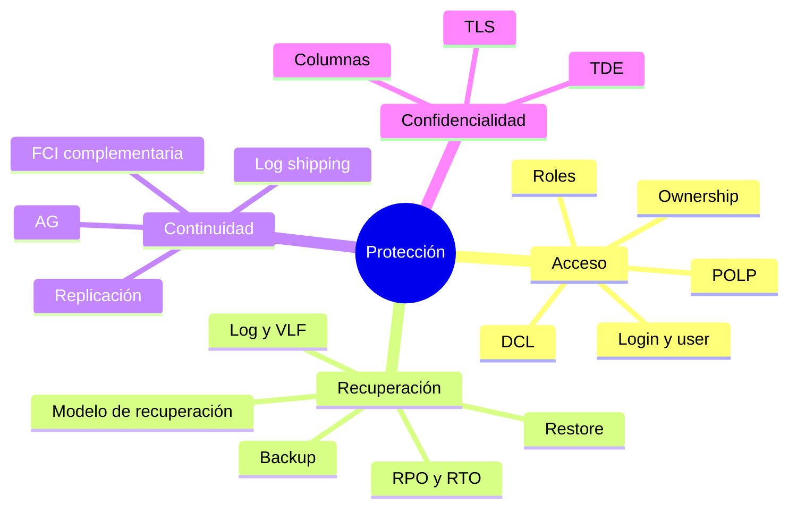

[← Unidad 5](/bbdd-aplicadas/unidad-5/teoria/)

:::note[Evaluación]
Según el programa 2024, esta unidad no integra el examen parcial: se evalúa en el trabajo práctico integrador y en el examen final. Esta guía se orienta a esos dos momentos. Las preguntas y los ejercicios son propios; no reproducen enunciados de exámenes.
:::

## Qué suele pedirse en el final

Según los exámenes finales reconstruidos por estudiantes (material no oficial y no verificado), en esta unidad se repiten dos ejes: **permisos** (decidir qué consultas pueden hacerse tras una secuencia de `GRANT`, `DENY` y `REVOKE`) y **recuperación** (ordenar los pasos de una restauración, y explicar los modelos de recuperación). Esta guía los cubre con ejercicios propios y pauta de corrección. Para entrenar con el motor, mirá los ejercicios del [Laboratorio de backup](/bbdd-aplicadas/unidad-5/practica/laboratorio-backup/).

## Mapa mental

La inyección SQL es contenido complementario de la unidad: no forma parte del programa 2024 (ver [Inyección SQL y programación segura](/bbdd-aplicadas/unidad-5/teoria/inyeccion-sql/)).

## Comparaciones obligatorias

| Comparación | Diferencia esencial |
|-------------|---------------------|
| Seguridad vs protección | Estado de riesgo frente a los mecanismos para reducirlo |
| Autenticación vs autorización | Probar la identidad frente a decidir las acciones |
| Login vs user | Instancia frente a base de datos |
| User vs role | Principal individual frente a agrupador funcional |
| Role vs schema | Agrupa principals frente a agrupar objetos |
| `REVOKE` vs `DENY` | Quita una decisión explícita frente a una negación que suele vencer lo heredado |
| Truncar vs shrink | Reutilizar espacio lógico frente a reducir el archivo físico |
| SIMPLE vs FULL | Sin backup de log ni recuperación a un instante frente a cadena de log y recuperación a un punto |
| Full vs diferencial | Toda la base frente a los cambios acumulados desde el último completo |
| Diferencial vs log | Acumulativo desde el completo frente a incremental respecto del log anterior |
| RPO vs RTO | Pérdida admisible frente a demora admisible |
| `NORECOVERY` vs `RECOVERY` | Admite más piezas frente a poner en línea y cerrar la secuencia |
| HA vs DR | Reducir la interrupción frente a recuperarse de un desastre |
| AG vs replicación | Réplica de bases para HA frente a distribución de artículos |
| Replicación vs backup | Distribución del estado actual frente a recuperación histórica |
| TDE vs TLS | Archivos en reposo frente a conexión en tránsito |
| Cifrado vs hash | Reversible con clave frente a unidireccional |

## Preguntas de desarrollo

### ¿Qué es POLP y por qué reduce el impacto?

Otorga solo los datos y las operaciones necesarios. Reduce la probabilidad de abuso y limita el daño si una cuenta se compromete.

### ¿Cómo llega un permiso hasta una tabla?

Por un `GRANT` directo, por la membresía de un rol o por un permiso superior de base o esquema. También influyen `DENY`, el encadenamiento de propiedad y los roles de servidor. Se verifica el permiso efectivo, no solo una fila de catálogo.

### ¿Por qué crece el log en FULL?

Puede faltar el backup de log (`LOG_BACKUP`), haber una transacción activa, una réplica retrasada u otro consumidor. Se consulta `log_reuse_wait_desc`; achicar sin resolver la causa no sirve.

### ¿Cómo restaurar a las 10:37?

Tail-log si es posible; completo con `NORECOVERY`; diferencial compatible con `NORECOVERY`; logs posteriores en orden; el último con `STOPAT = 10:37` y `RECOVERY`; luego integridad y validación funcional.

### ¿Un diferencial es incremental?

En SQL Server es **acumulativo desde el último completo**. La cátedra usa "diferencial o incremental" para nombrarlo; en sentido estricto, "incremental" es respecto del backup anterior, como el de log. Se contesta con la precisión: "diferencial, acumulativo desde el completo".

### ¿HA reemplaza al backup?

No. La HA reduce la caída y replica el estado, errores lógicos incluidos. El backup conserva puntos históricos y copias aisladas.

## Errores que quitan puntos

- Decir que login y user son lo mismo.
- Afirmar que `REVOKE` es una negación.
- Usar `db_owner` como rol normal de aplicación.
- Confundir el esquema por defecto con un permiso.
- Decir que el checkpoint es un backup o que truncar reduce el `.ldf`.
- Llamar "incremental" al diferencial sin aclarar que es acumulativo desde el completo.
- Restaurar el completo con `RECOVERY` antes de los logs.
- Definir el RPO como el tiempo de caída.
- Presentar la replicación o un RAID como backup.
- Afirmar que toda réplica de un AG permite lectura o *failover* automático.
- Decir que TDE evita el `SELECT` de usuarios autorizados.

## Ejercicio propio 1: ¿qué puede hacer cada usuario?

Se ejecutan, en este orden, sobre la tabla `ventas.Cliente`. `Usuario1` es miembro del rol `RolVentas`; `Usuario2` también; ninguno tiene otros permisos.

1. `GRANT SELECT, INSERT ON ventas.Cliente TO RolVentas;`
2. `GRANT UPDATE ON ventas.Cliente TO Usuario1;`
3. `REVOKE SELECT ON ventas.Cliente FROM Usuario1;`
4. `DENY INSERT ON ventas.Cliente TO Usuario1;`

Completá con SÍ o NO si puede ejecutar cada operación: `SELECT`, `INSERT`, `UPDATE`, `DELETE`, para `Usuario1` y para `Usuario2`.

Pauta

| Operación | Usuario1 | Usuario2 | Por qué |
|---|:---:|:---:|---|
| `SELECT` | SÍ | SÍ | El paso 3 solo retira lo otorgado **directamente** a `Usuario1`, que no tenía nada; el permiso del rol sigue vigente |
| `INSERT` | NO | SÍ | El `DENY` del paso 4 vence el permiso heredado del rol, solo para `Usuario1` |
| `UPDATE` | SÍ | NO | Es un `GRANT` directo a `Usuario1`; `Usuario2` no lo recibió |
| `DELETE` | NO | NO | Nadie lo otorgó |

Puntaje sugerido: 1 punto por columna correcta (2 por operación). Error típico: creer que el `REVOKE` a un usuario le quita lo que hereda de un rol.

## Ejercicio propio 2: ordenar una restauración

Hay un completo del domingo, diferenciales diarios a las 03:00 y logs cada 10 minutos. El jueves a las 11:20 un trabajo borra datos y hay que recuperar hasta las 11:19. Estos siete pasos se ofrecieron en desorden y **uno es incorrecto**: ordenalos y señalalo.

- A. Restaurar los logs posteriores al diferencial, en orden, con `NORECOVERY`, y el último con `STOPAT` a las 11:19 y `RECOVERY`.
- B. Restaurar el diferencial del jueves a las 03:00 con `NORECOVERY`.
- C. Respaldar la cola del log, si el archivo de log está accesible.
- D. Aplicar `DBCC CHECKDB` y validar con la aplicación.
- E. Restaurar el completo del domingo con `NORECOVERY` en una base nueva o con confirmación explícita del destino.
- F. Restaurar los logs desde el completo del domingo, de a uno, antes del diferencial.
- G. Poner la base en línea y registrar cuánto tardó (RTO observado).

Pauta

Orden correcto: **C, E, B, A, D, G**. El paso incorrecto es **F**: si se aplica el diferencial, los logs anteriores a él ya están incorporados y se salta directamente a los logs posteriores. Aplicarlos antes además rompería el orden (el diferencial avanza la base más que esos logs). Puntaje sugerido: 4 puntos por el orden, 2 por detectar F y justificarlo, 2 por mencionar `NORECOVERY` en todo menos el último, 2 por la validación.

## Simulacro (10 puntos)

Resolvelo sin mirar el material y corregilo con la pauta.

1. **(2 puntos)** Un sistema admite perder 10 minutos de datos y estar caído una hora. Proponé backups y decidí si alcanzan solo con backups para una base de 400 GB cuya restauración completa lleva 70 minutos.
2. **(2 puntos)** Explicá qué ocurre con el archivo de log al pasar de `SIMPLE` a `FULL` y por qué hace falta un backup completo después del cambio.
3. **(2 puntos)** Escribí el orden de restauración de un completo, un diferencial y tres logs hasta el final del tercero. Indicá qué opción lleva cada pieza.
4. **(2 puntos)** Elegí AG, FCI, replicación o log shipping para: (a) failover automático local de una base; (b) DR remoto barato con failover manual; (c) sucursales con datos filtrados y trabajo desconectado; (d) proteger toda la instancia con sus trabajos.
5. **(2 puntos)** Una secundaria síncrona queda sin red 30 segundos. ¿Se bloquean los commits? ¿Puede esa réplica recibir un failover automático sin pérdida en ese lapso?

Pauta de corrección

1. **Backups de log cada 10 minutos o menos** para el RPO (1 punto). **No alcanzan para el RTO**: 70 minutos de completo más diferencial y logs superan la hora; hace falta una réplica lista (AG) o un enfoque de restauración continua (1 punto).
2. En `FULL` el log se conserva hasta que se respalda: sin backups de log crece (`LOG_BACKUP`) (1 punto). Hace falta un completo (o diferencial) para iniciar la cadena; sin él `BACKUP LOG` se rechaza (1 punto).
3. Completo con `NORECOVERY`; diferencial con `NORECOVERY`; logs 1 y 2 con `NORECOVERY` (los posteriores al diferencial); log 3 con `RECOVERY` (o `STOPAT` más `RECOVERY`). Es 1 punto por el orden y 1 por las opciones. Aceptar también la variante sin diferencial: completo y los tres logs, con `NORECOVERY` salvo el último.
4. (a) AG síncrono con modo automático; (b) log shipping; (c) replicación de mezcla; (d) FCI. Medio punto por cada una.
5. No de forma indefinida: vencido `SESSION_TIMEOUT` (10 segundos por defecto) la primaria deja de esperar a esa réplica y confirma de forma asíncrona respecto de ella (1 punto). Mientras tanto la réplica no está sincronizada, por lo que no recibe un failover automático sin pérdida (1 punto).

## Método de respuesta

Para cada desarrollo incluí:

1. **definición precisa**;
2. **mecanismo**: cómo funciona;
3. **contraste** con el concepto vecino;
4. **ejemplo T-SQL o escenario**;
5. **limitación**: qué no resuelve.

Una respuesta que solo enumera comandos demuestra memoria; una que explica garantías y límites demuestra comprensión profesional.
