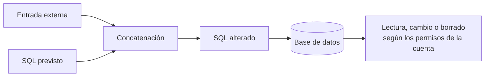
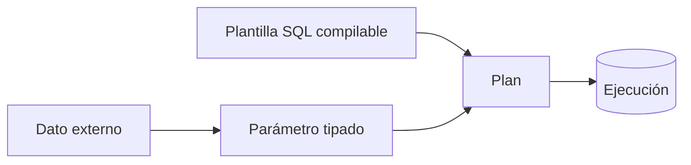
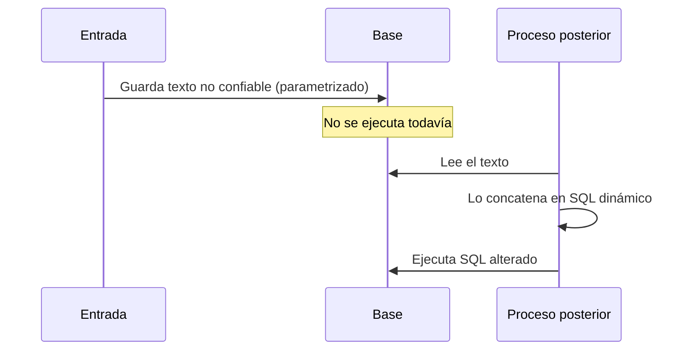

[← Unidad 5](/bbdd-aplicadas/unidad-5/teoria/)

:::note[Contenido complementario]
La inyección SQL no figura como tema del programa 2024. La cátedra la menciona como una de las "buenas prácticas de programación" entre las medidas de protección de un DBMS, y la advierte al presentar el SQL dinámico en la Unidad 1. Se conserva aquí porque completa el mínimo privilegio y porque su corrección depende de los permisos. Las guías de parcial no la incluyen.
:::

## Para qué sirve

Una inyección ocurre cuando la aplicación mezcla **estructura SQL** con **datos no confiables**. La persona que ataca no "rompe SQL Server": aprovecha una consulta construida de forma incorrecta. Conocer el mecanismo permite escribir código que no lo permita. Todo lo que sigue es **defensivo**: se muestra la falla en una base local de laboratorio y siempre la corrección. La práctica está en el [laboratorio de inyección](/bbdd-aplicadas/unidad-5/practica/laboratorio-inyeccion/).

## Anatomía



El impacto máximo lo limitan o lo amplifican los permisos de la cuenta que usa la aplicación: por eso la inyección y el [mínimo privilegio](/bbdd-aplicadas/unidad-5/teoria/seguridad-permisos/) van juntos.

## Vectores

| Vector | Ejemplo conceptual |
|--------|--------------------|
| Entrada del usuario | Búsqueda, comentario, filtro |
| URL | `?categoria=...` concatenado en un `WHERE` |
| Cookie | Valor alterado que el servidor considera confiable |
| Dato de infraestructura | Un encabezado HTTP que se guarda o se consulta |
| Herramienta automática | Prueba masiva de parámetros |
| Segundo orden | Valor almacenado que otra operación concatena después |

Validar solo el formulario visible no alcanza: toda frontera externa no es confiable.

## Concatenación vulnerable

Todos los ejemplos usan la tabla `seguridad.UsuarioDemo`, con tres filas sintéticas (`leia` y `luke` con rol `usuario`, `palpatine` con rol `admin`). La consulta pretende devolver **solo** usuarios con rol `usuario`:

<!-- check: U5.T.INY.01 -->
```sql
CREATE SCHEMA seguridad;
GO
CREATE TABLE seguridad.UsuarioDemo
(
    UsuarioId INT IDENTITY PRIMARY KEY,
    Nombre    NVARCHAR(100) NOT NULL UNIQUE,
    Rol       VARCHAR(20)   NOT NULL
);
INSERT seguridad.UsuarioDemo (Nombre, Rol)
VALUES (N'leia', 'usuario'), (N'luke', 'usuario'), (N'palpatine', 'admin');
GO
-- Incorrecto: concatena la entrada. Entrada normal.
DECLARE @Nombre NVARCHAR(100) = N'leia';
DECLARE @Sql NVARCHAR(MAX) =
    N'SELECT UsuarioId, Nombre, Rol FROM seguridad.UsuarioDemo WHERE Rol = ''usuario'' AND Nombre = ''' + @Nombre + N''';';
SELECT @Sql AS SqlGenerado;
EXEC (@Sql);
GO
-- Incorrecto: la entrada cambia la estructura del filtro.
DECLARE @Nombre NVARCHAR(100) = N''' OR Rol = ''admin''--';
DECLARE @Sql NVARCHAR(MAX) =
    N'SELECT UsuarioId, Nombre, Rol FROM seguridad.UsuarioDemo WHERE Rol = ''usuario'' AND Nombre = ''' + @Nombre + N''';';
SELECT @Sql AS SqlGenerado;
EXEC (@Sql);
GO
```

**Resultado esperado.** Con la entrada normal, una fila. Con la segunda entrada, el SQL generado es

```text
SELECT UsuarioId, Nombre, Rol FROM seguridad.UsuarioDemo WHERE Rol = 'usuario' AND Nombre = '' OR Rol = 'admin'--';
```

y devuelve la fila del rol `admin`, que el filtro original excluía:

| UsuarioId | Nombre | Rol |
|---|---|---|
| 1 | leia | usuario |

| UsuarioId | Nombre | Rol |
|---|---|---|
| 3 | palpatine | admin |

La comilla de la entrada **cerró el literal**, el `OR` agregó una condición y `--` comentó el resto. Hay que notar que el `AND` se evalúa antes que el `OR`: la condición agregada queda sola.

## Parametrización

La entrada se envía como **parámetro tipado**, separada del texto de la consulta. El motor la trata siempre como dato, nunca como sintaxis.



<!-- check: U5.T.INY.01 -->
```sql
DECLARE @Nombre NVARCHAR(100) = N''' OR Rol = ''admin''--';
DECLARE @Sql NVARCHAR(MAX) =
    N'SELECT UsuarioId, Nombre, Rol FROM seguridad.UsuarioDemo WHERE Rol = ''usuario'' AND Nombre = @PNombre;';
EXEC sys.sp_executesql @stmt = @Sql, @params = N'@PNombre NVARCHAR(100)', @PNombre = @Nombre;
```

**Resultado esperado.** Cero filas: se buscó, literalmente, un nombre que contiene comillas y espacios, y no existe.

### Cuando ni siquiera hace falta SQL dinámico

Si la estructura de la consulta es fija, un procedimiento estático con parámetros es la forma más simple y segura (ver `BuscarEstatico` en el laboratorio). Un procedimiento solo es seguro si **no vuelve a concatenar** sus entradas por dentro.

## Identificadores dinámicos

Los parámetros representan **valores**, no nombres de tabla, de columna ni la dirección `ASC` o `DESC`. Para una estructura dinámica se usa una **lista permitida** (allowlist) y `QUOTENAME`:

<!-- check: U5.T.INY.01 -->
```sql
CREATE PROCEDURE seguridad.ListarOrdenado @Columna SYSNAME
AS
BEGIN
    IF @Columna NOT IN (N'Nombre', N'Rol')
        THROW 50001, 'Columna no permitida.', 1;

    DECLARE @Sql NVARCHAR(MAX) =
        N'SELECT UsuarioId, Nombre, Rol FROM seguridad.UsuarioDemo ORDER BY ' + QUOTENAME(@Columna) + N', UsuarioId;';
    EXEC sys.sp_executesql @Sql;
END;
GO
EXEC seguridad.ListarOrdenado @Columna = N'Rol';
EXEC seguridad.ListarOrdenado @Columna = N'Rol, (SELECT 1)';
```

**Resultado esperado.** La primera llamada ordena por rol; la segunda es rechazada con el error 50001.

| UsuarioId | Nombre | Rol |
|---|---|---|
| 3 | palpatine | admin |
| 1 | leia | usuario |
| 2 | luke | usuario |

`QUOTENAME` ayuda a delimitar el identificador, pero la lista permitida expresa la regla de negocio.

## Validación frente a parametrización

| Control | Responde a | ¿Sustituye a los parámetros? |
|---------|------------|:---:|
| Tipo y longitud | ¿Tiene forma válida? | No |
| Rango | ¿Es un valor admisible? | No |
| Lista permitida | ¿Pertenece al conjunto permitido? | No |
| Parametrización | ¿Puede alterar la sintaxis? | Es el control primario |
| Escapado manual (duplicar comillas) | Intenta corregir caracteres | No: frágil, no se recomienda como defensa principal |

## ORM y procedimientos almacenados

Un ORM suele parametrizar sus operaciones habituales, pero ofrece métodos de SQL directo ("raw SQL"). Un procedimiento almacenado puede concatenar por dentro. La herramienta no garantiza la seguridad: importa **cómo se usa**.

## Mínimo privilegio y propiedad

La cuenta de la aplicación no debería:

- pertenecer a `sysadmin` ni a `db_owner`;
- crear ni eliminar objetos;
- consultar tablas sensibles sin necesidad;
- delegar permisos.

Se prefiere darle `EXECUTE` sobre procedimientos específicos. Eso funciona mientras el procedimiento y la tabla tengan el mismo propietario, por el [encadenamiento de propiedad](/bbdd-aplicadas/unidad-5/teoria/seguridad-permisos/#encadenamiento-de-propiedad). **El SQL dinámico lo rompe**: `sp_executesql` y `EXEC (...)` evalúan los permisos de quien llama. Por eso un procedimiento parametrizado y dinámico falla con el error 229 si la cuenta no tiene `SELECT`. La solución es firmar el módulo con un certificado (parte 5 del laboratorio), no darle `SELECT` a la aplicación.

## Contraseñas

No se guardan cifradas para compararlas luego con `WHERE Clave = ...`. Se almacena el resultado de un algoritmo de *hashing* de contraseñas adaptativo (Argon2id, bcrypt, scrypt o PBKDF2, según la plataforma), con *salt* único y parámetros de costo, normalmente en el servicio de identidad. Es una recomendación vigente de la práctica, no un contenido de la cátedra.

## Segundo orden

Un valor puede guardarse sin causar daño y volverse peligroso cuando otro proceso lo concatena:



Por eso se parametriza **en el punto de ejecución**, aunque el dato provenga de la propia base. Se practica en el [ejercicio U5.15](/bbdd-aplicadas/unidad-5/practica/laboratorio-inyeccion/#ejercicio-15--segundo-orden).

## Defensa en profundidad

- Parametrizar en cada capa.
- Validar tamaño, tipo y lista permitida (el tamaño también: un parámetro de longitud corta trunca la entrada).
- Usar cuentas específicas con mínimo privilegio.
- No mostrar mensajes internos ni trazas al cliente.
- Mantener motor, *framework* y controladores actualizados.
- Registrar eventos, no secretos.
- Revisar el código y probar la seguridad solo con autorización y en entornos propios.
- Un firewall de aplicaciones web es una capa adicional, no un reemplazo del código seguro.

:::caution[Errores frecuentes]
- Duplicar comillas "a mano" en lugar de parametrizar.
- Creer que un procedimiento almacenado impide la inyección por sí mismo.
- Intentar parametrizar un nombre de columna (no se puede: va con lista permitida).
- Concatenar un valor "porque viene de nuestra base".
- Darle `db_owner` a la aplicación "para que funcione".
:::

## Autoevaluación

<details>
<summary>1. ¿Por qué duplicar las comillas es una defensa frágil?</summary>

Depende de que quien lo hace conozca todos los contextos (tipos de literal, codificaciones, otros delimitadores) y no se olvide de ninguno. Con parámetros el problema no existe, porque el dato nunca se interpreta como sintaxis.
</details>

<details>
<summary>2. ¿Qué parte de una consulta se puede parametrizar y cuál necesita lista permitida?</summary>

Los valores (literales en filtros o inserciones) se parametrizan. Los identificadores y la dirección de orden necesitan una lista permitida y `QUOTENAME`.
</details>

<details>
<summary>3. ¿Por qué una cuenta con <code>db_owner</code> aumenta el impacto?</summary>

Porque una consulta alterada se ejecuta con los permisos de la cuenta: con `db_owner` puede leer y modificar toda la base. Con mínimo privilegio, el daño posible es mucho menor.
</details>

:::tip[En resumen]
- La inyección ocurre cuando una entrada no confiable se concatena con SQL y cambia su estructura.
- Se previene separando código y datos: parámetros (`sp_executesql`, procedimientos estáticos), lista permitida para identificadores y validación como capa adicional.
- Los permisos limitan el daño: mínimo privilegio, y firma de módulos cuando el SQL dinámico rompe el encadenamiento de propiedad.
- ORM y procedimientos no son seguros por sí solos; el segundo orden obliga a parametrizar en cada ejecución.
:::

:::tip[Para seguir]
- Practicá con el [Laboratorio defensivo — Inyección SQL](/bbdd-aplicadas/unidad-5/practica/laboratorio-inyeccion/) (complementario) y después seguí con [Registro de transacciones y modelos de recuperación](/bbdd-aplicadas/unidad-5/teoria/log-recuperacion/).
:::

## Fuentes

- Presentación de cátedra, Unidad 5 ("buenas prácticas de programación") y Unidad 1 (SQL dinámico).
- Microsoft Learn, [Inyección de código SQL](https://learn.microsoft.com/es-es/sql/relational-databases/security/sql-injection), [sp_executesql](https://learn.microsoft.com/es-es/sql/relational-databases/system-stored-procedures/sp-executesql-transact-sql), [QUOTENAME](https://learn.microsoft.com/es-es/sql/t-sql/functions/quotename-transact-sql).
