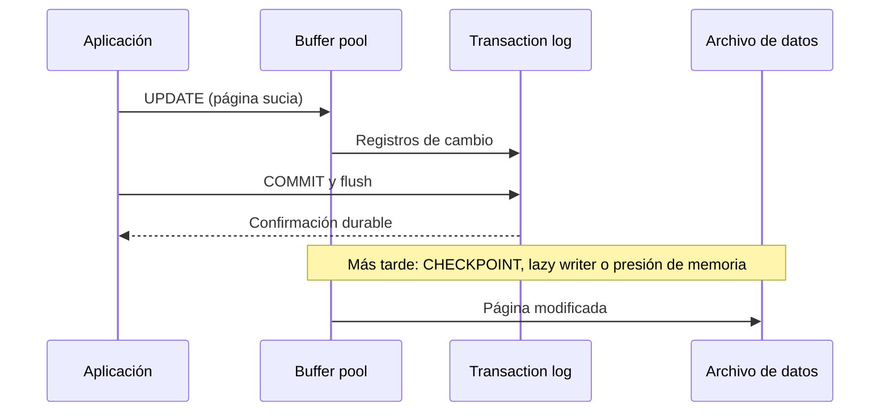
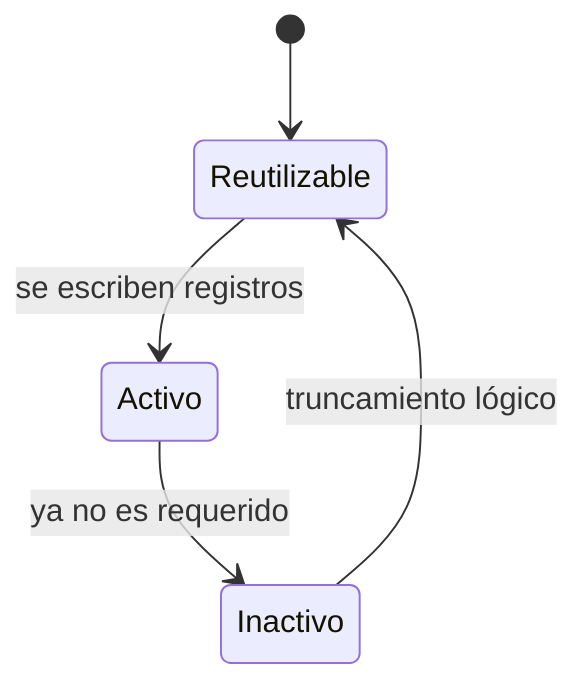

[← Unidad 5](/bbdd-aplicadas/unidad-5/teoria/)

## Para qué sirve

Cuando una aplicación confirma una venta con `COMMIT`, el motor promete que ese dato sobrevive a un corte de luz, aunque la página de datos todavía no se haya escrito en el archivo `.mdf`. Esa promesa (durabilidad), junto con la de poder deshacer una transacción incompleta (atomicidad), se sostiene con el **registro de transacciones** (*transaction log*, archivo `.ldf`). El mismo registro es la materia prima de los backups de log, de la recuperación a un punto en el tiempo y de las réplicas (grupos de disponibilidad, log shipping).

:::note[Definición]
El **registro de transacciones** guarda, en orden, la secuencia de cambios que sufrió una base. SQL Server aplica el principio de **registro previo a la escritura** (*write-ahead logging*, WAL): el registro del cambio llega a disco antes que la página de datos modificada.
:::

## De una modificación al disco

SQL Server no escribe en el `.mdf` en cada `INSERT`. Primero carga la página en el **buffer pool** (memoria), la modifica ahí y queda como **página sucia** (*dirty page*): modificada en memoria y todavía no escrita en el archivo de datos.



Al hacer `COMMIT`, el motor garantiza que el registro de confirmación esté en almacenamiento durable. No garantiza que la página de datos ya esté en el `.mdf`: puede seguir en memoria. Las páginas sucias se escriben después por tres caminos: el **checkpoint**, el *lazy writer* y el vaciado por presión de memoria.

El log guarda información suficiente para rehacer o deshacer una operación, no necesariamente el texto SQL original. Para un `INSERT` registra, por ejemplo, el inicio de la transacción, la fila insertada, los cambios en índices, los *page splits* si ocurrieron y la confirmación.

### Rehacer y deshacer (REDO y UNDO)

Al arrancar una base tras un corte, SQL Server ejecuta la **recuperación**: analiza el log desde el último checkpoint y aplica dos fases.

| Situación al momento de la caída | Qué dice el log | Acción |
|---|---|---|
| La transacción hizo `COMMIT`, pero su página no llegó al `.mdf` | Hay registro de confirmación | **REDO**: se reaplica el cambio. La fila no se pierde |
| La transacción no llegó al `COMMIT` | No hay confirmación | **UNDO**: se deshacen los cambios parciales. La fila no queda |

El mismo mecanismo de UNDO es el que ejecuta un `ROLLBACK`. Se puede ver en el motor: una transacción confirmada deja un registro `LOP_COMMIT_XACT`, y una revertida deja el `INSERT` original, la operación inversa (`LOP_DELETE_ROWS`) y un `LOP_ABORT_XACT`.

<!-- check: U5.T.LOG.05 -->
```sql
BEGIN TRANSACTION Confirmada;
    INSERT dbo.Pedido (Estado) VALUES ('se confirma');
COMMIT TRANSACTION Confirmada;

BEGIN TRANSACTION Revertida;
    INSERT dbo.Pedido (Estado) VALUES ('se revierte');
ROLLBACK TRANSACTION Revertida;

SELECT b.[Transaction Name] AS Transaccion,
       o.Operation          AS Registro,
       COUNT(*)             AS Operaciones
FROM sys.fn_dblog(NULL, NULL) AS b
JOIN sys.fn_dblog(NULL, NULL) AS o
  ON o.[Transaction ID] = b.[Transaction ID]
WHERE b.Operation = 'LOP_BEGIN_XACT'
  AND b.[Transaction Name] IN ('Confirmada', 'Revertida')
  AND o.Operation IN ('LOP_COMMIT_XACT', 'LOP_ABORT_XACT', 'LOP_INSERT_ROWS', 'LOP_DELETE_ROWS')
GROUP BY b.[Transaction Name], o.Operation
ORDER BY Transaccion, Registro;
```

**Resultado esperado.**

| Transaccion | Registro | Operaciones |
|---|---|---|
| Confirmada | LOP_COMMIT_XACT | 1 |
| Confirmada | LOP_INSERT_ROWS | 1 |
| Revertida | LOP_ABORT_XACT | 1 |
| Revertida | LOP_DELETE_ROWS | 1 |
| Revertida | LOP_INSERT_ROWS | 1 |

:::caution[Función no documentada]
`sys.fn_dblog` no está documentada oficialmente y su salida puede cambiar entre versiones. Sirve para observar el principio WAL en un laboratorio; no se usa en producción como interfaz estable.
:::

El log tampoco existe "para auditoría": es lo que da atomicidad, durabilidad, *rollback* y recuperación. Si el `.ldf` se daña, la base puede quedar inutilizable.

## Componentes

- **Archivo físico de log (`.ldf`):** se configura con tamaño inicial y crecimiento.
- **VLF** (*virtual log file*): segmentos internos creados al generar o extender el archivo.
- **LSN** (*log sequence number*): número de secuencia que ordena los registros del log. Los backups y las restauraciones se encadenan por LSN.
- **MinLSN:** comienzo de la parte activa más antigua que todavía se necesita.
- **Checkpoint:** escribe las páginas sucias al archivo de datos y fija un punto que reduce el trabajo de recuperación. No es un backup.

### Ciclo de los VLF



El diagrama simplifica los estados reales (la documentación habla de VLF no usados, activos, recuperables y reutilizables). El motor avanza circularmente y **no puede sobrescribir un VLF activo**. Si no encuentra espacio reutilizable, el archivo crece (si tiene autogrowth y hay disco); de lo contrario las escrituras fallan.

## Truncar, respaldar y achicar

| Acción | Qué hace | Qué no hace |
|--------|----------|-------------|
| Truncamiento | Marca VLF inactivos como reutilizables | No reduce el `.ldf` |
| Backup de log | Conserva los registros de la cadena y permite truncar cuando no hay otro bloqueo | No respalda las páginas de datos como un full |
| `DBCC SHRINKFILE` | Puede reducir físicamente un archivo en una intervención excepcional | No resuelve la causa del crecimiento |

El patrón *grow, shrink, grow* consume E/S, genera VLF adicionales y empeora la operación. Se dimensiona el log para su carga normal y se corrige la causa de la retención.

## Diagnóstico

La cátedra recomienda monitorear el crecimiento del log a diario, o más seguido en bases con mucho tráfico. Estas consultas filtran por la base actual:

<!-- check: U5.T.LOG.02 -->
```sql
-- Cantidad de VLF de la base actual (sys.dm_db_log_info: SQL Server 2016 SP2 o posterior)
SELECT COUNT(*) AS CantidadVlf
FROM sys.dm_db_log_info(DB_ID());

-- Espacio del log de todas las bases (la cátedra escribe SQLPREF por error: es SQLPERF)
DBCC SQLPERF(LOGSPACE);

-- Uso del log de la base actual
SELECT total_log_size_in_bytes,
       used_log_space_in_percent
FROM sys.dm_db_log_space_usage;
```

El resultado de `DBCC SQLPERF(LOGSPACE)` tiene una fila por base con `Database Name`, `Log Size (MB)`, `Log Space Used (%)` y `Status`. Los tamaños y porcentajes varían con cada instalación, por eso aquí no se fijan. Lo estable es que cada base aparece una vez y que `Status` vale 0.

Cantidad y tamaño promedio de VLF por base (la versión de la cátedra ordenaba por un alias que no existe en ese contexto, `Total_VLF_count`; acá se ordena por el alias definido en el `SELECT`):

<!-- check: U5.T.LOG.06 -->
```sql
SELECT d.name,
       COUNT(*) AS CantidadVlf,
       CONVERT(DECIMAL(12, 2), AVG(v.vlf_size_mb)) AS PromedioMb
FROM sys.databases AS d
CROSS APPLY sys.dm_db_log_info(d.database_id) AS v
GROUP BY d.name
ORDER BY CantidadVlf DESC;
```

Transacciones abiertas:

<!-- check: U5.T.LOG.07 -->
```sql
DBCC OPENTRAN;

SELECT at.transaction_id,
       at.name,
       at.transaction_begin_time,
       st.session_id
FROM sys.dm_tran_active_transactions AS at
LEFT JOIN sys.dm_tran_session_transactions AS st
  ON st.transaction_id = at.transaction_id;
```

## Cuándo puede reutilizarse un registro

Entre otras condiciones:

- la transacción correspondiente finalizó;
- las páginas requeridas alcanzaron un checkpoint;
- ningún backup necesita ese rango;
- replicación, grupos de disponibilidad, CDC u otro consumidor ya lo procesó.

La columna `log_reuse_wait_desc` de `sys.databases` indica la causa dominante: `LOG_BACKUP`, `ACTIVE_TRANSACTION`, `AVAILABILITY_REPLICA`, `REPLICATION`, `CHECKPOINT`, `NOTHING`, etc.

### Ejemplo: el log que no se libera

Una base en modelo `FULL` con un backup completo hecho acumula registros hasta que alguien respalda el log. Para ver `LOG_BACKUP` hace falta que el log ocupe más de un VLF (el VLF activo no se puede truncar), por eso el ejemplo inserta 20 000 filas.

<!-- check: U5.T.LOG.01 -->
```sql
-- Base de prueba con la tabla dbo.Pedido (PedidoId, Estado)
ALTER DATABASE CURRENT SET RECOVERY FULL;

SELECT recovery_model_desc, log_reuse_wait_desc          -- 1: antes del primer full
FROM sys.databases WHERE database_id = DB_ID();

BACKUP DATABASE LaboratorioU5 TO DISK = 'D:\SQLBackups\LaboratorioU5_full.bak' WITH INIT, CHECKSUM;

INSERT dbo.Pedido (Estado)
SELECT TOP (20000) 'masivo' FROM sys.all_objects AS a CROSS JOIN sys.all_objects AS b;
CHECKPOINT;

SELECT recovery_model_desc, log_reuse_wait_desc          -- 2: tras el full y los cambios
FROM sys.databases WHERE database_id = DB_ID();

BACKUP LOG LaboratorioU5 TO DISK = 'D:\SQLBackups\LaboratorioU5_log1.trn' WITH INIT, CHECKSUM;
CHECKPOINT;

SELECT recovery_model_desc, log_reuse_wait_desc          -- 3: tras el backup de log
FROM sys.databases WHERE database_id = DB_ID();
```

**Resultado esperado** (una fila por cada `SELECT`).

| Momento | Modelo | log_reuse_wait_desc |
|---|---|---|
| FULL sin ningún backup completo | FULL | NOTHING |
| Tras el full y un cambio | FULL | LOG_BACKUP |
| Tras el backup de log | FULL | NOTHING |

Antes del primer backup completo, una base en `FULL` se comporta como `SIMPLE`: todavía no hay cadena de log que proteger.

Una transacción abierta también retiene el log. En `SIMPLE` se ve sin backups de por medio: mientras la transacción no termina, el `CHECKPOINT` no puede liberar el espacio.

<!-- check: U5.T.LOG.04 -->
```sql
ALTER DATABASE CURRENT SET RECOVERY SIMPLE;

BEGIN TRANSACTION;
    INSERT dbo.Pedido (Estado)
    SELECT TOP (20000) 'masivo' FROM sys.all_objects AS a CROSS JOIN sys.all_objects AS b;
    CHECKPOINT;
    SELECT log_reuse_wait_desc FROM sys.databases WHERE database_id = DB_ID();   -- ACTIVE_TRANSACTION
COMMIT TRANSACTION;

CHECKPOINT;
SELECT log_reuse_wait_desc FROM sys.databases WHERE database_id = DB_ID();       -- NOTHING
```

**Resultado esperado.**

| Momento | Espera |
|---|---|
| Transacción abierta y CHECKPOINT | ACTIVE_TRANSACTION |
| Tras el COMMIT y otro CHECKPOINT | NOTHING |

## Modelos de recuperación

| Modelo | Backup de log | Recuperación a un punto en el tiempo | Truncamiento |
|---|:---:|:---:|---|
| `SIMPLE` | No | No (solo al momento de cada backup de datos) | Automático en cada checkpoint |
| `FULL` | Sí (obligatorio para truncar) | Sí | Solo con backup de log |
| `BULK_LOGGED` | Sí | Con restricciones | Solo con backup de log |

### SIMPLE

El checkpoint puede truncar las partes inactivas. No se permiten backups del log y no hay recuperación a un instante entre backups de datos.


### FULL

Mantiene la cadena de log mediante backups regulares y permite la recuperación a un punto en el tiempo. Si no se hacen backups de log, el archivo crece, porque `LOG_BACKUP` impide la reutilización.


### BULK_LOGGED

Registra de forma mínima ciertas operaciones masivas (por ejemplo, `BULK INSERT` o `CREATE INDEX` en las condiciones documentadas). Requiere backup de log, pero un backup de log que contiene una operación mínimamente registrada no permite detenerse en un punto interno y debe incluir las extensiones de datos modificadas.

No es "FULL más rápido" para dejar de forma permanente: se usa en ventanas planificadas y se evalúa su impacto sobre el RPO.

### Qué permite cada modelo

El motor rechaza lo que el modelo no soporta. Se puede comprobar:

<!-- check: U5.T.LOG.03 -->
```sql
ALTER DATABASE LaboratorioU5 SET RECOVERY SIMPLE;
BACKUP LOG LaboratorioU5 TO DISK = 'D:\SQLBackups\a.trn' WITH INIT;   -- error 4208

ALTER DATABASE LaboratorioU5 SET RECOVERY FULL;
BACKUP LOG LaboratorioU5 TO DISK = 'D:\SQLBackups\b.trn' WITH INIT;   -- error 4214: falta un full previo

BACKUP DATABASE LaboratorioU5 TO DISK = 'D:\SQLBackups\base.bak' WITH INIT;
BACKUP LOG LaboratorioU5 TO DISK = 'D:\SQLBackups\c.trn' WITH INIT;   -- correcto

ALTER DATABASE LaboratorioU5 SET RECOVERY BULK_LOGGED;
```

**Resultado esperado** (en el verificador cada `BACKUP LOG` está en un `TRY`/`CATCH`).

| Situación | Resultado |
|---|---|
| BACKUP LOG en SIMPLE | rechazado |
| BACKUP LOG en FULL sin backup completo previo | rechazado |
| BACKUP LOG en FULL con backup completo previo | permitido |
| Modelo tras ALTER DATABASE ... BULK_LOGGED | BULK_LOGGED |

## Cambios de modelo

<!-- check: U5.T.BK.01 -->
```sql
ALTER DATABASE Ventas SET RECOVERY FULL;
GO
BACKUP DATABASE Ventas
TO DISK = 'D:\SQLBackups\Ventas_base.bak'
WITH INIT, CHECKSUM;
GO
BACKUP LOG Ventas
TO DISK = 'D:\SQLBackups\Ventas_001.trn'
WITH INIT, CHECKSUM;
```

Al pasar de `SIMPLE` a `FULL` o `BULK_LOGGED` se hace un backup completo o diferencial para iniciar la cadena. Al pasar a `SIMPLE`, la cadena se interrumpe. En Linux las rutas son del tipo `/var/opt/mssql/data/Ventas_base.bak`.

## Errores frecuentes

:::caution[Errores frecuentes]
- "El checkpoint vacía el log": no. Escribe páginas sucias y puede habilitar el truncamiento según el modelo.
- "Truncar achica el archivo": no. Vuelve reutilizable el espacio interno; el `.ldf` mantiene su tamaño.
- "`FULL` hace backup solo": no. Es una política que exige un trabajo de backup de log. Sin él, el archivo crece.
- "Más archivos de log mejoran el rendimiento": normalmente no. El log se escribe de forma secuencial, no en paralelo como los archivos de datos.
- "Un full reemplaza a los backups de log": no. Un full no rompe ni sustituye la cadena de log.
- "El `COMMIT` escribe en el `.mdf`": no. Escribe en el log; el dato llega al `.mdf` más tarde.
:::

## Autoevaluación

**1. Una transacción hizo `COMMIT` y el servidor se cayó antes de escribir su página en el `.mdf`. ¿Se pierde el dato?**

<details>
<summary>Respuesta</summary>

No. El registro de confirmación ya estaba en el log. Al arrancar, la recuperación hace REDO y reaplica el cambio.
</details>

**2. Una base `FULL` no deja de crecer y `log_reuse_wait_desc` dice `LOG_BACKUP`. ¿Qué corresponde?**

<details>
<summary>Respuesta</summary>

Hacer backups de log periódicos (con una frecuencia acorde al RPO). Achicar el archivo sin resolver la causa no sirve.
</details>

:::tip[En resumen]
- El log se escribe antes que los datos (WAL): eso da durabilidad, rollback y recuperación (REDO/UNDO).
- Truncar libera espacio lógico; achicar reduce el archivo. No son lo mismo.
- `log_reuse_wait_desc` dice por qué no se reutiliza el log.
- `SIMPLE` no admite backup de log; `FULL` lo exige y permite recuperar a un instante; `BULK_LOGGED` es una variante para ventanas masivas.
:::

:::tip[Para seguir]
- Seguí con [Backups, restauración, RPO y RTO](/bbdd-aplicadas/unidad-5/teoria/backup-restauracion/); los ejercicios 21, 23 y 37 del [laboratorio de backup](/bbdd-aplicadas/unidad-5/practica/laboratorio-backup/) trabajan el log.
:::

## Fuentes

- Presentación de cátedra, Unidad 5, "Registro de transacciones" y "Modelos de recuperación" (diapositivas 24 a 35). Se corrigen dos errores de la presentación: el alias inexistente en el `ORDER BY` de la consulta de VLF y el nombre del comando (`DBCC SQLPERF`).
- Microsoft Learn: *The transaction log (SQL Server)*, *Recovery models (SQL Server)*, *sys.dm_db_log_info* y *sys.databases* (`log_reuse_wait_desc`).
