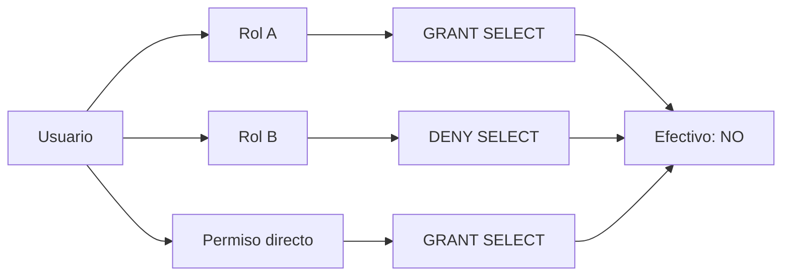

[← Unidad 5](/bbdd-aplicadas/unidad-5/teoria/)

Esta lección cubre cuatro temas del programa 2024: el **principio del mínimo privilegio** y la clasificación de usuarios, la **autenticación y las directivas de contraseñas**, la **estructura de permisos y el DCL**, y la **configuración mediante propietarios y roles**. Se practica en el [laboratorio de seguridad](/bbdd-aplicadas/unidad-5/practica/laboratorio-seguridad/).

:::note[Qué se verificó]
Todos los ejemplos se ejecutaron en SQL Server 2022 (16.0.4325, edición Developer) sobre **Linux**. Los pasos que requieren un dominio de Windows o permisos de configuración de la instancia se marcan como no ejecutados.
:::

## Para qué sirve

Una base de datos guarda información que alguien podría leer, alterar o borrar sin autorización. La cátedra distingue dos ideas:

- **Seguridad**: ausencia de un riesgo (accesos no autorizados, manipulación de datos o de la configuración).
- **Protección**: los mecanismos que se usan para lograrla (permisos, respaldos, cifrado, replicación, buenas prácticas de programación).

La protección sola no alcanza: un permiso bien puesto no evita un ataque de ransomware, y un respaldo no evita una fuga de datos. Por eso se combinan capas (defensa en profundidad) y se securiza también el sistema operativo, el firewall y el software del motor.

### Principio del mínimo privilegio (POLP)

:::note[Definición]
**Principio del mínimo privilegio**: a los usuarios y a las aplicaciones se les otorga acceso únicamente a los datos y las operaciones que necesitan para realizar su trabajo, y solo mientras los necesitan.
:::

Lo acompañan dos ideas:

- **Reducción de la superficie expuesta**: se detienen o deshabilitan los componentes que no se usan, y los servicios corren con los privilegios mínimos. Menos puntos de acceso son menos oportunidades de ataque.
- **Separación de funciones**: quien administra los usuarios no es quien consulta los datos de negocio, y quien audita no modifica.

### Clasificación de usuarios

Clasificar las cuentas antes de crearlas evita otorgar permisos "hasta que funcione":

| Clase de usuario | Ejemplos | Acceso típico |
|---|---|---|
| Administradores del motor | DBA de la instancia | Roles de servidor, pocas personas, cuentas nominales |
| Administradores de una base | Responsable de un sistema | `db_owner` o permisos de esquema en esa base |
| Desarrolladores | Equipo de desarrollo | Permisos de definición (DDL) solo en desarrollo |
| Aplicaciones y servicios | Aplicación web, trabajos programados | `EXECUTE` sobre procedimientos; nunca `sysadmin` ni `db_owner` |
| Usuarios finales | Vendedores, analistas | Lectura o escritura mediante roles funcionales |
| Auditores | Control interno | Solo lectura, sin modificar |

Una **matriz de autorización** convierte esa clasificación en requisitos concretos:

| Rol funcional | Leer pedidos | Crear pedidos | Cambiar estado | Ver costo | Administrar usuarios |
|---------------|:---:|:---:|:---:|:---:|:---:|
| Vendedor | Sí | Sí | Solo propios | No | No |
| Supervisor | Sí | Sí | Sí | Sí | No |
| Auditor | Sí | No | No | Sí | No |
| DBA de seguridad | Según necesidad | No | No | No | Sí |

El flujo recomendado es **persona o aplicación → login → usuario → rol funcional → permiso sobre esquema u objeto**.

## Conceptos: principals y securables

- **Entidades de seguridad (principals)**: individuos, grupos y procesos que pueden solicitar recursos. Existen a nivel de Windows, de servidor (logins, roles de servidor) y de base de datos (usuarios, roles de base).
- **Elementos protegibles (securables)**: el servidor, las bases, los esquemas y los objetos que contienen. Cada uno tiene su conjunto de permisos.
- **`sa`**: el login de administración con rol `sysadmin`. Puede deshabilitarse (`ALTER LOGIN sa DISABLE;`), y se recomienda hacerlo cuando hay otras cuentas administrativas nominales. Esa sentencia no se ejecuta en el verificador porque afectaría a la instancia compartida.

## Autenticación

La **autenticación** responde "¿quién sos?" y la **autorización**, "¿qué podés hacer?". SQL Server ofrece dos modos, que se eligen al instalar o desde la configuración del servidor (requiere reiniciar el servicio):

| Modo | Quién valida la identidad | Cuándo se usa |
|---|---|---|
| Autenticación de Windows | El sistema operativo o el dominio (Kerberos) | Personas de una organización con dominio. Es la opción preferida |
| Modo mixto | Windows **o** el propio SQL Server (logins con contraseña) | Aplicaciones o clientes que no están en el dominio. Habilita `sa` |

<!-- check: U5.T.SEG.01 -->
```sql
SELECT SERVERPROPERTY('IsIntegratedSecurityOnly') AS SoloWindows;
```

**Resultado esperado.** La instancia de verificación está en modo mixto.

| SoloWindows |
|---|
| 0 |

`1` indicaría que solo se admite autenticación de Windows.

### Directivas de contraseñas

Para los logins de SQL Server, la cátedra enumera estas reglas:

- Las contraseñas **distinguen mayúsculas y minúsculas**.
- **Complejidad** (`CHECK_POLICY`): largo mínimo y al menos **tres de las cuatro categorías** (mayúsculas, minúsculas, dígitos, símbolos no alfanuméricos).
- **Vencimiento** (`CHECK_EXPIRATION`).
- Se puede **forzar el cambio** en el siguiente inicio de sesión (`MUST_CHANGE`).
- Si la autenticación se apoya en el sistema operativo, rigen las directivas de ese sistema.
- Con ODBC hay que tener cuidado con los caracteres especiales de la contraseña dentro de la cadena de conexión.

Se probaron en el motor (todos los logins de lo que sigue se eliminan al final):

<!-- check: U5.T.SEG.01 -->
```sql
-- 1. Demasiado corta con la política activada
CREATE LOGIN LoginU5T01Corta WITH PASSWORD = 'Ab1!', CHECK_POLICY = ON;
-- 2. Largo suficiente, pero con una sola categoría
CREATE LOGIN LoginU5T01Simple WITH PASSWORD = 'abcdefgh', CHECK_POLICY = ON;
-- 3. Cumple la política; debe cambiarse en el primer inicio de sesión
CREATE LOGIN LoginU5T01Ana WITH PASSWORD = 'Didactica#2026a' MUST_CHANGE,
    CHECK_EXPIRATION = ON, CHECK_POLICY = ON;
-- 4. Política desactivada (solo didáctico)
CREATE LOGIN LoginU5T01Libre WITH PASSWORD = 'abc', CHECK_POLICY = OFF;
-- 5. Vencimiento sin política
CREATE LOGIN LoginU5T01Venc WITH PASSWORD = 'Didactica#2026b', CHECK_EXPIRATION = ON, CHECK_POLICY = OFF;
-- 6. Cambio obligatorio sin vencimiento
CREATE LOGIN LoginU5T01Cambio WITH PASSWORD = 'Didactica#2026e' MUST_CHANGE, CHECK_POLICY = ON;
-- 7. Con vencimiento, sin cambio obligatorio
CREATE LOGIN LoginU5T01Venc3 WITH PASSWORD = 'Didactica#2026f', CHECK_EXPIRATION = ON, CHECK_POLICY = ON;
-- 8. Valores por defecto
CREATE LOGIN LoginU5T01Def WITH PASSWORD = 'Didactica#2026c';
```

**Resultado esperado.**

| Intento | Resultado | Motivo |
|---|---|---|
| 1 | Error 33062 | Menos de 8 caracteres |
| 2 | Error 33064 | Menos de tres categorías |
| 3 | Creado | Cumple la política |
| 4 | Creado | Sin `CHECK_POLICY` no se valida nada |
| 5 | Error 15122 | `CHECK_EXPIRATION` exige `CHECK_POLICY = ON` |
| 6 | Error 15099 | `MUST_CHANGE` exige `CHECK_EXPIRATION = ON` |
| 7 | Creado | |
| 8 | Creado | Por defecto `CHECK_POLICY` queda en `ON` y `CHECK_EXPIRATION` en `OFF` |

Las banderas resultantes:

<!-- check: U5.T.SEG.01 -->
```sql
SELECT name, is_policy_checked AS Politica, is_expiration_checked AS Vencimiento,
       LOGINPROPERTY(name, 'IsMustChange') AS DebeCambiar
FROM sys.sql_logins
WHERE name LIKE 'LoginU5T01%'
ORDER BY name;
```

| name | Politica | Vencimiento | DebeCambiar |
|---|---|---|---|
| LoginU5T01Ana | 1 | 1 | 1 |
| LoginU5T01Def | 1 | 0 | 0 |
| LoginU5T01Libre | 0 | 0 | 0 |
| LoginU5T01Venc3 | 1 | 1 | 0 |

Sensibilidad a mayúsculas y minúsculas, y baja de una cuenta sin eliminarla:

<!-- check: U5.T.SEG.01 -->
```sql
SELECT PWDCOMPARE(N'Didactica#2026c', password_hash) AS Exacta,
       PWDCOMPARE(N'didactica#2026c', password_hash) AS OtraCapitalizacion
FROM sys.sql_logins
WHERE name = 'LoginU5T01Def';

ALTER LOGIN LoginU5T01Def DISABLE;
SELECT name, is_disabled FROM sys.sql_logins WHERE name = 'LoginU5T01Def';
```

| Exacta | OtraCapitalizacion |
|---|---|
| 1 | 0 |

| name | is_disabled |
|---|---|
| LoginU5T01Def | 1 |

:::caution[Qué depende del sistema operativo]
En la instancia de verificación (Linux) el **largo mínimo y la complejidad los aplica el propio motor**: los errores 33062 y 33064 se obtuvieron sin dominio. `LOGINPROPERTY(..., 'DaysUntilExpiration')` devolvió **90** para un login con vencimiento.

No se verificó el **bloqueo por intentos fallidos** ni el historial de contraseñas, que en Windows provienen de la directiva del sistema operativo; en Linux no hay que darlos por supuestos. En un login de Windows las contraseñas las gobierna el dominio, no `CHECK_POLICY`.
:::

### Formas de crear usuarios

Un **login** permite entrar al servidor pero, por sí mismo, no da permisos en ninguna base. Dentro de cada base se crea un **usuario**, que puede llamarse distinto al login, pero **un login tiene un solo usuario por base**. La cátedra presenta seis formas:

| # | Forma | Autentica | Sentencia |
|---|---|---|---|
| 1 | Usuario o grupo de Windows con login | Windows | `CREATE LOGIN [DOM\x] FROM WINDOWS` + `CREATE USER ... FOR LOGIN` |
| 2 | Usuario de SQL con login | SQL Server (en `master`) | `CREATE LOGIN ... WITH PASSWORD` + `CREATE USER ... FOR LOGIN` |
| 3 | Usuario o grupo de Windows **contenido** | Windows (en la base) | `CREATE USER [DOM\x]` en una base contenida |
| 4 | Usuario de SQL **con contraseña** (contenido) | La propia base | `CREATE USER ... WITH PASSWORD` en una base contenida |
| 5 | Usuario **sin login** | No puede conectarse | `CREATE USER ... WITHOUT LOGIN` |
| 6 | Usuario de **certificado** o **clave asimétrica** | No puede conectarse | `CREATE USER ... FROM CERTIFICATE` / `FROM ASYMMETRIC KEY` |

Los usuarios del tipo 5 y 6 sirven para ser propietarios de objetos, para probar permisos con `EXECUTE AS` y para la firma de módulos. Las formas 2, 5 y 6 se verificaron:

<!-- check: U5.T.SEG.02 -->
```sql
CREATE LOGIN LoginU5T02 WITH PASSWORD = 'Didactica#2026d', CHECK_POLICY = ON;

CREATE USER UsuarioLogin FOR LOGIN LoginU5T02;
CREATE USER UsuarioSinLogin WITHOUT LOGIN;
CREATE CERTIFICATE CertU5T02 ENCRYPTION BY PASSWORD = 'Didactica#Cert-2026'
    WITH SUBJECT = 'Certificado didactico';
CREATE USER UsuarioCertificado FROM CERTIFICATE CertU5T02;
CREATE ASYMMETRIC KEY ClaveU5T02 WITH ALGORITHM = RSA_2048
    ENCRYPTION BY PASSWORD = 'Didactica#Clave-2026';
CREATE USER UsuarioClave FROM ASYMMETRIC KEY ClaveU5T02;

-- Un segundo usuario para el mismo login falla con el error 15063.
CREATE USER OtroUsuario FOR LOGIN LoginU5T02;

SELECT name, type_desc, authentication_type_desc
FROM sys.database_principals
WHERE name IN ('UsuarioLogin', 'UsuarioSinLogin', 'UsuarioCertificado', 'UsuarioClave', 'OtroUsuario')
ORDER BY name;
```

**Resultado esperado.** El `CREATE USER OtroUsuario` falla con el error **15063** y la consulta devuelve cuatro usuarios:

| name | type_desc | authentication_type_desc |
|---|---|---|
| UsuarioCertificado | CERTIFICATE_MAPPED_USER | NONE |
| UsuarioClave | ASYMMETRIC_KEY_MAPPED_USER | NONE |
| UsuarioLogin | SQL_USER | INSTANCE |
| UsuarioSinLogin | SQL_USER | NONE |

Las formas 1, 3 y 4 no se pueden ejecutar en el verificador: la primera necesita un dominio de Windows (sin Active Directory el motor responde el error 15401) y las contenidas requieren `CONTAINMENT = PARTIAL` y activar `contained database authentication` con `sp_configure`, que modifica la instancia compartida. Son pendientes de verificación específica.

<!-- check: U5.T.SEG.R1 -->
```sql
-- Los nombres de dominio son ilustrativos.
CREATE LOGIN [EMPRESA\Vendedores] FROM WINDOWS;
CREATE USER [EMPRESA\Vendedores] FOR LOGIN [EMPRESA\Vendedores];

-- Base contenida: el usuario se autentica con una contraseña guardada en la propia base.
CREATE USER UsuarioContenido WITH PASSWORD = 'Didactica#Contenido-2026';
```

## Permisos y DCL

El **DCL** (Data Control Language) son tres sentencias:

| Sentencia | Efecto |
|---|---|
| `GRANT` | Concede un permiso. Con `WITH GRANT OPTION`, además permite al receptor concederlo a otros |
| `DENY` | Deniega el permiso de modo que **no se herede** desde otra ruta |
| `REVOKE` | Quita un permiso concedido **o denegado**. Lo que se hereda de otro rol sigue vigente |

### Jerarquía de securables

Los permisos se pueden otorgar en cada nivel de la jerarquía **servidor → base → esquema → objeto (→ columna)**, y bajan por ella:

- `SELECT` sobre la base incluye todos los esquemas.
- `SELECT` sobre un esquema incluye todas las tablas y vistas del esquema, **también las que se creen después**.
- `CONTROL` sobre un objeto equivale, en la práctica, a todos los permisos sobre él.

Con tres tablas (`ventas.Cliente`, `ventas.Pedido`, `compras.Proveedor`) y un usuario sin permisos, se otorgó `SELECT` de seis maneras (cada una se revocó antes de la siguiente):

<!-- check: U5.T.SEG.03 -->
```sql
GRANT SELECT  ON OBJECT::ventas.Cliente TO usr_aza;
GRANT CONTROL ON OBJECT::ventas.Cliente TO usr_aza;
GRANT SELECT  ON SCHEMA::ventas         TO usr_aza;
GRANT CONTROL ON SCHEMA::ventas         TO usr_aza;
GRANT SELECT  ON DATABASE::Ventas       TO usr_aza;   -- el nombre de la base del ejemplo
GRANT CONTROL ON DATABASE::Ventas       TO usr_aza;
```

**Resultado esperado.** `HAS_PERMS_BY_NAME` evaluado como `usr_aza`:

| Concesión | `ventas.Cliente` | `ventas.Pedido` | `compras.Proveedor` |
|---|:---:|:---:|:---:|
| Ninguna | NO | NO | NO |
| `SELECT` en la tabla | SI | NO | NO |
| `CONTROL` en la tabla | SI | NO | NO |
| `SELECT` en el esquema `ventas` | SI | SI | NO |
| `CONTROL` en el esquema `ventas` | SI | SI | NO |
| `SELECT` en la base | SI | SI | SI |
| `CONTROL` en la base | SI | SI | SI |

:::tip[Esquemas como unidad de permisos]
Si los objetos que necesitan los mismos permisos viven en el mismo esquema, un único `GRANT` sobre el esquema los cubre, incluidos los futuros. A cambio, hay que gobernar quién crea objetos dentro de él.
:::

También se puede conceder sobre **columnas**: `GRANT SELECT (ClienteId, Nombre) ON OBJECT::ventas.Cliente TO ...`. Se trabaja en el [ejercicio U5.04](/bbdd-aplicadas/unidad-5/practica/laboratorio-seguridad/#ejercicio-4--permisos-de-columna).

### Precedencia: `DENY`, `GRANT` y `REVOKE`

Un usuario recibe permisos por varias rutas: directos, por cada rol al que pertenece, y por niveles superiores de la jerarquía. La regla es que **un `DENY` gana sobre cualquier `GRANT`**, aunque el `GRANT` sea más específico o más directo. `REVOKE` solo quita la fila de permiso del principal indicado.



Se verificó una secuencia con un rol `rol_ventas` y su miembro `usr_ana`, y tablas `ventas.Cliente` y `ventas.Pedido`:

<!-- check: U5.T.SEG.04 -->
```sql
GRANT SELECT ON SCHEMA::ventas TO rol_ventas;            -- paso 1
DENY  SELECT ON OBJECT::ventas.Cliente TO rol_ventas;    -- paso 2
GRANT SELECT ON OBJECT::ventas.Cliente TO usr_ana;       -- paso 3
REVOKE SELECT ON OBJECT::ventas.Cliente FROM rol_ventas; -- paso 4
DENY  SELECT ON SCHEMA::ventas TO usr_ana;               -- paso 5
REVOKE SELECT ON SCHEMA::ventas FROM usr_ana;            -- paso 6
```

**Resultado esperado.** `usr_ana` puede hacer `SELECT` sobre…

| Después del paso | `ventas.Cliente` | `ventas.Pedido` | Por qué |
|---|:---:|:---:|---|
| 1 | SI | SI | El rol tiene `SELECT` sobre el esquema |
| 2 | NO | SI | El `DENY` del rol, más específico, gana sobre el `GRANT` del esquema |
| 3 | NO | SI | El `GRANT` directo no vence al `DENY` que llega por el rol |
| 4 | SI | SI | `REVOKE` quitó el `DENY` del rol; ahora vale el `GRANT` directo y el del esquema |
| 5 | NO | NO | El `DENY` de esquema a `usr_ana` gana sobre los `GRANT` de objeto y de rol |
| 6 | SI | SI | `REVOKE` quitó el `DENY` y vuelven los `GRANT` |

Una consecuencia práctica: **un `REVOKE` sobre la ruta directa no elimina lo que el usuario hereda de un rol**. Y al revés, la única manera de impedir de forma firme un acceso heredado es un `DENY`, que conviene usar con cuidado porque es difícil de rastrear.

Un `DENY` sobre un objeto también alcanza a un miembro de `db_owner` (el `SELECT` real devolvió el error 229). En cambio, no se puede denegar al propietario de la entidad ni a `dbo` (ver la sección de propietarios).

### Permisos efectivos

Para analizar un incidente no alcanza con leer `sys.database_permissions`: hay que sumar membresías de roles, jerarquía, propietarios y roles de servidor. Dos funciones evalúan el resultado final en el contexto actual:

- `fn_my_permissions(securable, clase)`: lista los permisos del contexto actual sobre el securable.
- `HAS_PERMS_BY_NAME(securable, clase, permiso)`: devuelve 1 o 0.

`EXECUTE AS USER` cambia de contexto (y `REVERT` lo cierra). Un usuario `usr_ana` que pertenece a `rol_ventas` (`SELECT`, `INSERT`, `DELETE` sobre `ventas.Pedido`) y a `rol_auditoria` (`SELECT` sobre el esquema `compras` y `DENY DELETE` sobre `ventas.Pedido`):

<!-- check: U5.T.SEG.05 -->
```sql
EXECUTE AS USER = 'usr_ana';
SELECT entity_name, subentity_name, permission_name
FROM fn_my_permissions('ventas.Pedido', 'OBJECT')
ORDER BY permission_name, subentity_name;
SELECT HAS_PERMS_BY_NAME('ventas.Pedido', 'OBJECT', 'SELECT') AS PuedeSelect,
       HAS_PERMS_BY_NAME('ventas.Pedido', 'OBJECT', 'DELETE') AS PuedeDelete,
       HAS_PERMS_BY_NAME('compras.Proveedor', 'OBJECT', 'SELECT') AS PuedeLeerProveedor;
REVERT;
```

**Resultado esperado.**

| entity_name | subentity_name | permission_name |
|---|---|---|
| ventas.Pedido | | INSERT |
| ventas.Pedido | | SELECT |
| ventas.Pedido | Importe | SELECT |
| ventas.Pedido | PedidoId | SELECT |

| PuedeSelect | PuedeDelete | PuedeLeerProveedor |
|:---:|:---:|:---:|
| 1 | 0 | 1 |

`DELETE` desaparece porque el `DENY` de `rol_auditoria` pesa más que el `GRANT` de `rol_ventas`. `fn_my_permissions` incluye una fila por cada columna con `SELECT`.

### `WITH GRANT OPTION` y `CASCADE`

Con `WITH GRANT OPTION` el receptor puede conceder a su vez el permiso. Si después se revoca, hay que decidir qué pasa con lo que delegó:

<!-- check: U5.T.SEG.06 -->
```sql
GRANT SELECT ON OBJECT::ventas.Pedido TO usr_supervisor WITH GRANT OPTION;
-- usr_supervisor ejecuta: GRANT SELECT ON OBJECT::ventas.Pedido TO usr_ana;

REVOKE SELECT ON OBJECT::ventas.Pedido FROM usr_supervisor;            -- error 4611
REVOKE GRANT OPTION FOR SELECT ON OBJECT::ventas.Pedido
    FROM usr_supervisor CASCADE;                                       -- ok
```

**Resultado esperado.**

| Paso | Resultado |
|---|---|
| `usr_supervisor` delega en `usr_ana` | Permitido; `usr_ana` lee `ventas.Pedido` |
| `REVOKE` sin `CASCADE` | Error **4611**: el permiso es delegable, hay que indicar `CASCADE` |
| `REVOKE GRANT OPTION FOR ... CASCADE` | `usr_ana` pierde el permiso; `usr_supervisor` **conserva** `SELECT` pero ya no puede delegar |
| `usr_supervisor` intenta delegar de nuevo | Error **15151** |

`REVOKE ... CASCADE` sin `GRANT OPTION FOR` quita el permiso al receptor y a todos los que recibieron de él. Antes de ejecutarlo hay que saber a quién va a afectar.

## Roles

Un **rol** agrupa entidades de seguridad: los permisos se otorgan al rol y todos sus miembros los heredan. Es una buena práctica otorgar permisos a roles y no a usuarios.

### Roles de servidor

Son fijos y no se pueden modificar. Su ámbito es toda la instancia, y los miembros los heredan en cada base a la que puedan conectarse. Se agrega un login con `ALTER SERVER ROLE rol ADD MEMBER login`.

| Rol | Alcance (resumen) |
|---|---|
| `sysadmin` | `CONTROL SERVER`: todos los permisos del servidor |
| `securityadmin` | Administra logins (`ALTER ANY LOGIN`). Se trata como equivalente a `sysadmin` |
| `serveradmin` | Opciones de configuración y apagado del servidor |
| `setupadmin` | Servidores vinculados |
| `processadmin` | Termina procesos en ejecución |
| `diskadmin` | Archivos de disco |
| `dbcreator` | Crea y modifica bases |
| `bulkadmin` | Ejecuta `BULK INSERT` |
| `public` | Todos los logins; solo permisos mínimos (`VIEW ANY DATABASE`, `CONNECT`) |

Desde SQL Server 2012 se pueden crear **roles de servidor definidos por el usuario**, y SQL Server 2022 agrega roles fijos con nombre `##MS_...##` de privilegios granulares (por ejemplo, para leer el estado del servidor sin ser administrador). Se consultaron en el motor:

<!-- check: U5.T.SEG.07 -->
```sql
SELECT name
FROM sys.server_principals
WHERE type = 'R' AND is_fixed_role = 1 AND name LIKE '##MS[_]%'
ORDER BY name;
```

**Resultado esperado.** Diez roles:

| name |
|---|
| \#\#MS_DatabaseConnector\#\# |
| \#\#MS_DatabaseManager\#\# |
| \#\#MS_DefinitionReader\#\# |
| \#\#MS_LoginManager\#\# |
| \#\#MS_PerformanceDefinitionReader\#\# |
| \#\#MS_SecurityDefinitionReader\#\# |
| \#\#MS_ServerPerformanceStateReader\#\# |
| \#\#MS_ServerSecurityStateReader\#\# |
| \#\#MS_ServerStateManager\#\# |
| \#\#MS_ServerStateReader\#\# |

Un rol de servidor propio con un permiso granular (el `GRANT` de servidor se ejecuta en `master`; el verificador lo borra después):

<!-- check: U5.T.SEG.07 -->
```sql
CREATE SERVER ROLE RolServidorU5T07;
GRANT VIEW SERVER STATE TO RolServidorU5T07;
```

### Roles de base de datos

Los nueve roles fijos de base (`sys.database_principals` con `is_fixed_role = 1`) son: `db_accessadmin`, `db_backupoperator`, `db_datareader`, `db_datawriter`, `db_ddladmin`, `db_denydatareader`, `db_denydatawriter`, `db_owner` y `db_securityadmin`. Además existe `public`, al que pertenece todo usuario.

Los **roles definidos por el usuario** se crean con `CREATE ROLE`; los miembros se agregan y quitan con `ALTER ROLE ... ADD MEMBER` y `DROP MEMBER`. Los roles pueden **anidarse** (con cuidado: el permiso efectivo es la suma de varias capas):

<!-- check: U5.T.SEG.07 -->
```sql
CREATE ROLE rol_lectura;
CREATE ROLE rol_analistas;
ALTER ROLE rol_lectura ADD MEMBER rol_analistas;   -- rol_analistas hereda de rol_lectura
ALTER ROLE rol_analistas ADD MEMBER usr_ana;
GRANT SELECT ON OBJECT::dbo.Dato TO rol_lectura;
ALTER ROLE db_datareader ADD MEMBER usr_lector;
ALTER ROLE db_denydatareader ADD MEMBER usr_lector; -- el DENY del rol fijo gana
```

**Resultado esperado.** `SELECT` sobre `dbo.Dato`:

| Caso | Puede leer |
|---|:---:|
| `usr_ana` hereda de `rol_lectura` por `rol_analistas` | SI |
| `usr_lector` en `db_datareader` | SI |
| `usr_lector` también en `db_denydatareader` | NO |

## Propietarios

Todo objeto y todo esquema tiene un **propietario**.

- El propietario tiene permisos **irrevocables** sobre lo que posee: no se le pueden quitar ni denegar. El motor lo avisa con el mensaje "Cannot grant, deny, or revoke permissions to sa, dbo, entity owner...", y el propietario sigue leyendo su tabla.
- **No se puede eliminar** un usuario que posee un esquema u objetos (error **15138**).
- Un esquema puede pertenecer a cualquier principal, y un principal puede tener varios esquemas.
- La propiedad se cambia con `ALTER AUTHORIZATION`.
- `dbo` es el usuario propietario de la base, con permisos implícitos para todo.

Evitá que los propietarios sean cuentas personales que puedan desaparecer.

### Encadenamiento de propiedad

Cuando una vista o un procedimiento accede a otro objeto con el **mismo propietario**, SQL Server **no vuelve a comprobar** los permisos sobre el objeto subyacente: basta con tener permiso sobre la vista o el procedimiento. Así se evita que los usuarios interactúen directamente con las tablas.

La cadena se rompe si cambia el propietario o si el acceso se hace con **SQL dinámico**. Se verificó con un esquema `tesoreria` de otro propietario:

<!-- check: U5.T.SEG.08 -->
```sql
CREATE SCHEMA ventas AUTHORIZATION dbo;
CREATE SCHEMA finanzas AUTHORIZATION usr_fin;
-- Tabla finanzas.Cuenta; vista y procedimientos en el esquema ventas (propietario dbo).
GRANT SELECT  ON OBJECT::ventas.CuentaVisible        TO usr_ana;
GRANT EXECUTE ON OBJECT::ventas.ListarCuentaEstatico TO usr_ana;
GRANT EXECUTE ON OBJECT::ventas.ListarCuentaDinamico TO usr_ana;

ALTER AUTHORIZATION ON SCHEMA::finanzas TO dbo;
```

**Resultado esperado.** `usr_ana` solo tiene permisos sobre la vista y los procedimientos:

| Prueba | Resultado |
|---|---|
| Vista de `dbo` sobre una tabla de `usr_fin` | NO (error 229): propietarios distintos |
| Procedimiento estático, propietarios distintos | NO (error 229) |
| Vista, tras `ALTER AUTHORIZATION ... TO dbo` | SI |
| Procedimiento estático, mismo propietario | SI |
| Procedimiento con `EXEC (@sql)`, mismo propietario | NO (error 229): el SQL dinámico corta la cadena |
| `SELECT` directo sobre la tabla | NO (error 229) |
| `DROP USER` del propietario de un esquema | Error 15138 |
| `DENY SELECT` al propietario | Ignorado; el propietario lee su tabla |

El SQL dinámico (`sp_executesql`, `EXEC`) se evalúa con los permisos de quien llama. La solución no es dar `SELECT` al usuario sino **firmar el módulo** con un certificado, como se muestra en el [laboratorio de inyección](/bbdd-aplicadas/unidad-5/practica/laboratorio-inyeccion/#parte-5--mínimo-privilegio).

<!-- sintaxis -->
```sql
ALTER AUTHORIZATION ON SCHEMA::<esquema> TO <principal>;
ALTER AUTHORIZATION ON OBJECT::<esquema>.<objeto> TO <principal>;
```

## Auditoría

Consultas para revisar quién puede qué:

<!-- sintaxis -->
```sql
-- Membresías de roles de servidor
SELECT rol.name AS Rol, miembro.name AS Miembro
FROM sys.server_role_members AS rm
JOIN sys.server_principals AS rol ON rol.principal_id = rm.role_principal_id
JOIN sys.server_principals AS miembro ON miembro.principal_id = rm.member_principal_id;
-- Membresías de roles de base: sys.database_role_members con sys.database_principals
-- Permisos explícitos: sys.database_permissions (clases DATABASE, SCHEMA y OBJECT_OR_COLUMN)
-- Propietarios: sys.schemas (principal_id) y sys.databases (owner_sid)
```

La consulta completa de permisos por clase se desarrolla y verifica en el [laboratorio](/bbdd-aplicadas/unidad-5/practica/laboratorio-seguridad/#parte-6--auditoría).

## Checklist de mínimo privilegio

- [ ] Aplicaciones y personas usan cuentas separadas.
- [ ] No se usan `sa`, `sysadmin` ni `db_owner` por defecto.
- [ ] Los permisos se asignan a roles funcionales.
- [ ] Se prefiere esquema, vista o procedimiento antes que permisos masivos.
- [ ] No hay contraseñas en scripts ni en repositorios.
- [ ] Los roles anidados y `WITH GRANT OPTION` están justificados.
- [ ] Los propietarios son cuentas estables.
- [ ] Los permisos efectivos se prueban con `EXECUTE AS` y los catálogos.
- [ ] Los servicios y las características innecesarias están deshabilitados.

:::caution[Errores frecuentes]
- **Crear un login y esperar que lea datos.** Sin usuario en la base y sin permisos, el acceso falla. `DEFAULT_DATABASE` y `DEFAULT_SCHEMA` no otorgan nada.
- **Usar `REVOKE` para "bloquear".** `REVOKE` quita una fila de permiso; si el usuario hereda el acceso de un rol, sigue entrando (pasos 3 y 4 de la tabla de precedencia).
- **Abusar de `DENY`.** Gana siempre; un `DENY` a un rol grande es difícil de rastrear.
- **Olvidar `REVERT`** después de `EXECUTE AS`: las sentencias siguientes se ejecutan con el contexto equivocado.
- **Asumir que el SQL dinámico hereda la cadena de propiedad.**
:::

## Autoevaluación

<details>
<summary>1. ¿Por qué un login recién creado no puede consultar ninguna tabla?</summary>

Porque el login solo permite conectarse a la instancia. Hace falta un usuario en la base y permisos (directos o por rol) sobre los objetos.
</details>

<details>
<summary>2. Un usuario tiene <code>GRANT SELECT</code> directo y pertenece a un rol con <code>DENY SELECT</code> sobre la misma tabla. ¿Puede leerla?</summary>

No. El `DENY` prevalece sobre cualquier `GRANT`, sin importar la ruta. Para devolver el acceso hay que hacer `REVOKE` del `DENY` (paso 4 de la tabla de precedencia).
</details>

<details>
<summary>3. ¿Cuándo un permiso de esquema es más mantenible y cuándo más riesgoso?</summary>

Más mantenible porque cubre las tablas existentes y las futuras con una sola sentencia. Más riesgoso porque alcanza a cualquier objeto nuevo que se cree dentro del esquema, aunque contenga datos sensibles.
</details>

<details>
<summary>4. ¿Cómo comprobarías el acceso efectivo de un usuario que pertenece a tres roles?</summary>

Con `EXECUTE AS USER` y `HAS_PERMS_BY_NAME` o `fn_my_permissions`, y con una consulta que una `sys.database_role_members` con `sys.database_permissions` para ver desde qué rol llega cada `GRANT` o `DENY` (ejercicio U5.06).
</details>

:::tip[En resumen]
- El mínimo privilegio otorga solo lo necesario; se apoya en clasificar las cuentas y en separar funciones.
- Los logins de SQL se rigen por `CHECK_POLICY` (complejidad: 8 caracteres y tres de cuatro categorías), `CHECK_EXPIRATION` y `MUST_CHANGE`; las contraseñas distinguen mayúsculas.
- Los usuarios de base tienen seis formas; un login tiene un solo usuario por base.
- `DENY` gana sobre `GRANT`; `REVOKE` solo quita una fila. Los permisos bajan por la jerarquía servidor, base, esquema, objeto.
- Los roles y los esquemas simplifican la administración; los propietarios tienen permisos irrevocables.
- El encadenamiento de propiedad se corta con propietarios distintos o con SQL dinámico.
:::

:::tip[Para seguir]
- Practicá con el [Laboratorio — Seguridad, roles y permisos](/bbdd-aplicadas/unidad-5/practica/laboratorio-seguridad/) y después seguí con [Cifrado en reposo y en tránsito](/bbdd-aplicadas/unidad-5/teoria/cifrado/).
:::

## Fuentes

- Presentación de cátedra, Unidad 5, "Permisos, usuarios y roles" y "Seguridad vs protección" (UNLaM, DIIT).
- Microsoft Learn, [Seguridad de SQL Server](https://learn.microsoft.com/es-es/sql/relational-databases/security/securing-sql-server), [CREATE LOGIN](https://learn.microsoft.com/es-es/sql/t-sql/statements/create-login-transact-sql), [Roles de nivel de servidor](https://learn.microsoft.com/es-es/sql/relational-databases/security/authentication-access/server-level-roles), [Roles de nivel de base de datos](https://learn.microsoft.com/es-es/sql/relational-databases/security/authentication-access/database-level-roles), [Propiedad y separación de esquemas](https://learn.microsoft.com/es-es/sql/relational-databases/security/authentication-access/ownership-and-user-schema-separation), [ALTER AUTHORIZATION](https://learn.microsoft.com/es-es/sql/t-sql/statements/alter-authorization-transact-sql).
- Microsoft Tech Community, "Security: the principle of least privilege (POLP)".
