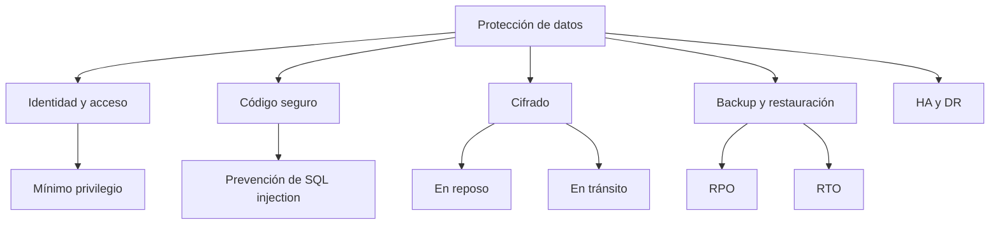

[← Unidad 5](/bbdd-aplicadas/unidad-5/teoria/)

Esta página es un **resumen integrador**: ubica cada tema de la unidad, dice qué problema resuelve y lleva a la página que lo desarrolla. No repite el desarrollo; para el detalle, los ejemplos con resultados y los ejercicios, seguí los enlaces.

:::tip[Cómo usar este resumen]
- **Antes de estudiar:** leelo de corrido para tener el mapa de la unidad (seguridad, recuperación y disponibilidad).
- **Después de estudiar:** usalo para repasar y conectar los temas.
- **Antes del trabajo práctico integrador o del final:** identificá los temas principales, volvé a la lección de cada uno y completá el repaso con la [guía de repaso](/bbdd-aplicadas/unidad-5/teoria/guia-parcial/).

No reemplaza a las lecciones: cada sección enlaza a la página donde el tema se desarrolla en profundidad.
:::

La protección de los datos no se logra con una única herramienta: requiere controles preventivos, detectivos y correctivos que cubran identidades, permisos, programación, cifrado, respaldo, recuperación y continuidad.

## Mapa de la unidad

| Tema | Pregunta que responde | Página |
|---|---|---|
| Seguridad y protección, mínimo privilegio | ¿Qué se protege y cuánto acceso hace falta realmente? | [Seguridad, usuarios y permisos](/bbdd-aplicadas/unidad-5/teoria/seguridad-permisos/) |
| Autenticación, login y usuario, roles, DCL, propietarios | ¿Quién es, qué puede hacer y por qué camino llega a una tabla? | [Seguridad, usuarios y permisos](/bbdd-aplicadas/unidad-5/teoria/seguridad-permisos/) |
| Registro de transacciones y modelos de recuperación | ¿Cómo sobrevive un dato a una caída y por qué crece el log? | [Registro de transacciones y modelos de recuperación](/bbdd-aplicadas/unidad-5/teoria/log-recuperacion/) |
| Backups, restauración, RPO y RTO | ¿Cómo se vuelve a un estado anterior y se demuestra? | [Backups, restauración, RPO y RTO](/bbdd-aplicadas/unidad-5/teoria/backup-restauracion/) |
| Alta disponibilidad, replicación, log shipping | ¿Cómo se reduce la caída y se tolera un desastre? | [Alta disponibilidad, replicación y recuperación ante desastres](/bbdd-aplicadas/unidad-5/teoria/alta-disponibilidad/) |
| Cifrado en reposo y en tránsito | ¿Cómo se protegen los datos que no se pueden leer sin la clave? | [Cifrado en reposo y en tránsito](/bbdd-aplicadas/unidad-5/teoria/cifrado/) |
| Inyección SQL (complementario) | ¿Cómo evitamos que un dato se ejecute como código? | [Inyección SQL y programación segura](/bbdd-aplicadas/unidad-5/teoria/inyeccion-sql/) |

## 1. Acceso: seguridad, permisos y roles

La **seguridad** es el estado de riesgo bajo control; la **protección** es el conjunto de mecanismos que lo logra. El principio rector es el **mínimo privilegio**: cada principal recibe solo los datos y las operaciones que necesita, de modo que un error o una cuenta comprometida tengan poco alcance.

En SQL Server el login vive en la instancia y el usuario en la base; los roles agrupan principals y los esquemas agrupan objetos. Los permisos se otorgan con `GRANT`, se niegan con `DENY` y se retiran con `REVOKE`; `DENY` suele vencer a lo heredado. Las vistas y los procedimientos permiten exponer datos sin dar acceso a las tablas gracias al encadenamiento de propiedad. Detalle, jerarquía y laboratorio: [Seguridad, usuarios y permisos](/bbdd-aplicadas/unidad-5/teoria/seguridad-permisos/) y [Laboratorio de seguridad](/bbdd-aplicadas/unidad-5/practica/laboratorio-seguridad/).

## 2. El registro de transacciones

El log se escribe antes que los datos (registro previo a la escritura). Esa regla da durabilidad y atomicidad: tras una caída, la recuperación rehace (REDO) lo confirmado y deshace (UNDO) lo incompleto. El log se divide en VLF, se ordena por LSN y se libera por **truncamiento**, que no reduce el archivo. La columna `log_reuse_wait_desc` explica por qué no se reutiliza.

Los **modelos de recuperación** definen qué se puede recuperar: `SIMPLE` (sin backup de log), `FULL` (cadena de log y recuperación a un instante) y `BULK_LOGGED` (variante para ventanas masivas). Ver [Registro de transacciones y modelos de recuperación](/bbdd-aplicadas/unidad-5/teoria/log-recuperacion/).

## 3. Backups y restauración

Una estrategia se diseña desde el **RPO** (pérdida admitida) y el **RTO** (caída admitida). Los tipos son completo, diferencial (acumulativo desde el último completo), log (cadena sin huecos), tail-log y `COPY_ONLY`. La restauración deja las piezas abiertas con `NORECOVERY` y cierra con `RECOVERY`; `STOPAT` y las marcas permiten detenerse en un punto. La regla 3-2-1 y la prueba periódica de restauración completan la estrategia. Ver [Backups, restauración, RPO y RTO](/bbdd-aplicadas/unidad-5/teoria/backup-restauracion/) y el [Laboratorio de backup](/bbdd-aplicadas/unidad-5/practica/laboratorio-backup/), con 17 ejercicios resueltos.

## 4. Alta disponibilidad y recuperación ante desastres

**HA** reduce la interrupción; **DR** recupera de un desastre; ninguna reemplaza al backup, porque una réplica reproduce también los errores lógicos. Los grupos de disponibilidad Always On envían el log a réplicas con su propio almacenamiento. Solo entre réplicas síncronas hay *failover* automático.

Si una secundaria síncrona no responde dentro de `SESSION_TIMEOUT` (10 segundos por defecto), la primaria deja de esperarla y confirma de forma asíncrona respecto de esa réplica hasta que se reconecta y se pone al día; mientras tanto la réplica no está sincronizada y no sirve para un *failover* automático sin pérdida.

La replicación (snapshot, transaccional, merge) distribuye objetos; el log shipping envía y restaura backups de log, con *failover* manual; una FCI (complementaria) conmuta la instancia entera. Ver [Alta disponibilidad, replicación y recuperación ante desastres](/bbdd-aplicadas/unidad-5/teoria/alta-disponibilidad/).

## 5. Cifrado

El **cifrado en reposo** (TDE, cifrado de columnas y de backups) protege los archivos y las copias; el **cifrado en tránsito** (TLS) protege la conexión. Ninguno reemplaza al mínimo privilegio: un usuario autorizado sigue leyendo en claro. Y la pérdida de la clave equivale a la pérdida del dato. Ver [Cifrado en reposo y en tránsito](/bbdd-aplicadas/unidad-5/teoria/cifrado/).

## 6. Código seguro (complementario)

La defensa principal contra la inyección SQL es **parametrizar**, complementada con validación y mínimo privilegio. No forma parte del programa 2024, pero completa la protección. Ver [Inyección SQL y programación segura](/bbdd-aplicadas/unidad-5/teoria/inyeccion-sql/) y el [Laboratorio defensivo](/bbdd-aplicadas/unidad-5/practica/laboratorio-inyeccion/).

## Síntesis

- Autenticación prueba identidad; autorización decide operaciones.
- Login vive en el servidor, usuario en la base, rol agrupa y esquema organiza.
- `REVOKE` quita una decisión explícita; `DENY` niega y suele vencer lo heredado.
- Truncar el log reutiliza espacio; no achica el archivo.
- Completo, diferencial y logs forman una estrategia; solo una restauración probada demuestra que se puede recuperar.
- RPO es pérdida tolerable; RTO es tiempo de recuperación.
- HA reduce caída, DR recupera de un desastre y el backup recupera estados históricos.
- TDE protege archivos en reposo, TLS protege conexiones, y ninguno reemplaza al mínimo privilegio.

Para repasar, seguí con la [Guía de repaso](/bbdd-aplicadas/unidad-5/teoria/guia-parcial/). La ruta de estudio con las prácticas de cada bloque está en la [presentación de la unidad](/bbdd-aplicadas/unidad-5/teoria/).
