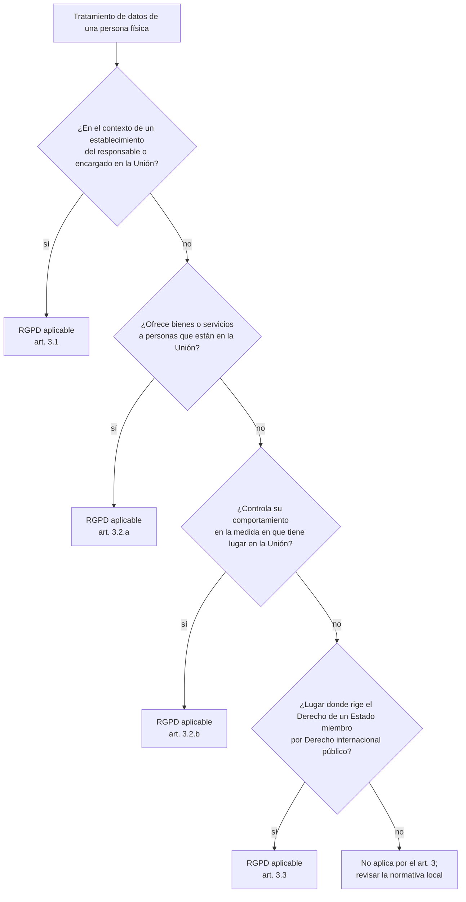
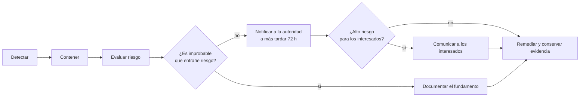

[← Unidad 6](/bbdd-aplicadas/unidad-6/teoria/)

:::note[Fuente de este apunte]
Reglamento (UE) 2016/679, de 27 de abril de 2016, DOUE L 119 de 4.5.2016, versión en español consultada en EUR-Lex el 2026-11-17. Los artículos y considerandos se citan por número; las frases entre comillas son citas textuales breves. Material académico: no sustituye asesoramiento jurídico.
:::

## Para qué sirve

Una empresa argentina que vende a clientes en Europa, o que mide su comportamiento en línea, puede quedar bajo el RGPD aunque no tenga oficinas allí. Antes de diseñar una base de datos conviene saber si el Reglamento aplica, con qué base se trata cada dato y qué derechos hay que poder atender.

El Reglamento es aplicable desde el 25 de mayo de 2018 (art. 99.2).

## Ámbito de aplicación

### Material (artículo 2)

Se aplica al tratamiento total o parcialmente automatizado, y al no automatizado de datos contenidos o destinados a un fichero. **No** se aplica, entre otros casos, a:

- actividades que no entran en el ámbito del Derecho de la Unión (art. 2.2.a);
- tratamientos efectuados por una persona física "en el ejercicio de actividades exclusivamente personales o domésticas" (art. 2.2.c);
- tratamientos de autoridades competentes con fines penales o de seguridad pública (art. 2.2.d).

### Personas protegidas

- Protege a personas físicas "con independencia de su nacionalidad o de su lugar de residencia" y no regula los datos de personas jurídicas (considerando 14).
- No se aplica a datos de personas fallecidas, aunque los Estados miembros pueden dictar normas propias (considerando 27).
- Tampoco rige para información anónima, es decir, la que no guarda relación con una persona identificada o identificable, ni para datos que se anonimizaron de modo que el titular ya no sea identificable (considerando 26). Los datos seudonimizados, en cambio, siguen siendo información sobre una persona física identificable (considerando 26).

### Territorial (artículo 3)

El art. 3.2 de la versión en español se refiere a interesados residentes en la Unión; en este apunte se resume como "personas que están en la Unión". La ciudadanía europea del titular no es el criterio: importan el establecimiento, la oferta dirigida y el control del comportamiento. Para saber si hay oferta dirigida, el considerando 23 indica que la mera accesibilidad de un sitio web no basta; sí pueden indicarlo factores como el uso de una lengua o moneda habituales en los Estados miembros o la mención de clientes que están en la Unión.

:::note[Diferencia con la fórmula de las clases]
Un apunte de estudio puede resumir "el GDPR alcanza a cualquier empresa que procese datos de europeos". La formulación precisa del art. 3 es la del diagrama anterior; si en un examen se pide la fórmula de la cátedra, conviene decirla y agregar el criterio del art. 3.
:::

## Datos personales y categorías especiales

- Los datos personales son "toda información sobre una persona física identificada o identificable" (art. 4.1).
- La seudonimización es el tratamiento que impide atribuir los datos a una persona sin información adicional, que debe mantenerse por separado con medidas técnicas y organizativas (art. 4.5).
- Las categorías especiales del art. 9.1 son: origen étnico o racial, opiniones políticas, convicciones religiosas o filosóficas, afiliación sindical, datos genéticos, datos biométricos dirigidos a identificar de manera unívoca a una persona, datos de salud y datos relativos a la vida sexual u orientación sexual. Su tratamiento está prohibido, salvo que se dé alguna de las excepciones del art. 9.2 (por ejemplo, consentimiento explícito, obligaciones laborales o de seguridad social, intereses vitales, datos manifiestamente públicos, reclamaciones, interés público esencial, asistencia sanitaria, salud pública o investigación).
- El dato biométrico es especial cuando se trata para identificar unívocamente, no por cualquier uso.

## Principios (artículo 5)

| Principio | Pregunta práctica |
|---|---|
| Licitud, lealtad y transparencia (5.1.a) | ¿Hay base y se explica con claridad? |
| Limitación de la finalidad (5.1.b) | ¿El nuevo uso es compatible con los fines declarados? |
| Minimización (5.1.c) | ¿Cada campo es adecuado, pertinente y necesario? |
| Exactitud (5.1.d) | ¿Se corrigen o suprimen sin dilación los datos inexactos? |
| Limitación del plazo de conservación (5.1.e) | ¿Hay plazo y borrado efectivo? |
| Integridad y confidencialidad (5.1.f) | ¿La seguridad es adecuada frente a tratamientos no autorizados o pérdida? |
| Responsabilidad proactiva (5.2) | ¿Podemos demostrar que cumplimos? |

## Bases de licitud (artículo 6.1)

El tratamiento solo es lícito si se cumple al menos una de estas condiciones:

1. el interesado dio su consentimiento para uno o varios fines específicos;
2. es necesario para ejecutar un contrato en el que el interesado es parte, o para aplicar medidas precontractuales a su petición;
3. es necesario para cumplir una obligación legal del responsable;
4. es necesario para proteger intereses vitales del interesado o de otra persona física;
5. es necesario para una misión de interés público o para el ejercicio de poderes públicos;
6. es necesario para intereses legítimos del responsable o de un tercero, "siempre que no prevalezcan" los derechos y libertades del interesado (especialmente si es un niño). Esta base no se aplica al tratamiento que realizan las autoridades públicas en el ejercicio de sus funciones.

Consentimiento (art. 7): el responsable debe poder demostrarlo; si se pide dentro de una declaración que trata otros asuntos, debe distinguirse claramente; "será tan fácil retirar el consentimiento como darlo"; y al evaluar si es libre se tiene en cuenta si el contrato se condiciona a datos que no son necesarios para ejecutarlo.

Para categorías especiales hace falta, además de una base del art. 6, que se cumpla una condición del art. 9.2.

## Responsable, encargado y DPO

- Responsable: quien "determine los fines y medios del tratamiento" (art. 4.7). Encargado: quien trata datos "por cuenta del responsable" (art. 4.8).
- El contrato con el encargado (art. 28.3) debe fijar objeto, duración, naturaleza, finalidad, tipo de datos y categorías de interesados, y obligar al encargado a: tratar solo según instrucciones documentadas, garantizar la confidencialidad de su personal, aplicar las medidas del art. 32, respetar las condiciones para subcontratar, asistir al responsable en derechos y obligaciones (arts. 32 a 36), suprimir o devolver los datos al terminar y permitir auditorías.
- Registro de actividades (art. 30): obligación con una exención para organizaciones de menos de 250 personas, salvo riesgo, tratamiento no ocasional o datos especiales o penales.
- Delegado de protección de datos (art. 37.1): obligatorio cuando el tratamiento lo realiza una autoridad u organismo público (salvo tribunales en ejercicio de su función judicial); cuando las actividades principales consisten en una observación habitual y sistemática a gran escala; o en el tratamiento a gran escala de categorías especiales o datos penales. No recibe instrucciones sobre el ejercicio de sus funciones y no puede ser destituido por desempeñarlas (art. 38); sus tareas incluyen informar, supervisar el cumplimiento, asesorar sobre la evaluación de impacto y cooperar con la autoridad (art. 39).

## Derechos del interesado (artículos 15 a 22)

| Artículo | Derecho | En una frase |
|---|---|---|
| 15 | Acceso | Confirmación del tratamiento, acceso a los datos e información sobre fines, destinatarios, plazos y origen |
| 16 | Rectificación | Corregir datos inexactos y completar los incompletos |
| 17 | Supresión | En los supuestos del art. 17.1 (por ejemplo, ya no son necesarios, retiro del consentimiento sin otra base, oposición, tratamiento ilícito, obligación legal) |
| 18 | Limitación | Restringir el tratamiento en los casos previstos, por ejemplo mientras se verifica la exactitud |
| 19 | Notificación | El responsable comunica a los destinatarios las rectificaciones, supresiones o limitaciones |
| 20 | Portabilidad | Recibir los datos en formato estructurado y de uso común, cuando el tratamiento se basa en consentimiento o contrato y es automatizado |
| 21 | Oposición | Por motivos de situación particular y, en todo momento, frente a la mercadotecnia directa |
| 22 | Decisiones automatizadas | No ser objeto de decisiones basadas únicamente en tratamiento automatizado con efectos jurídicos o similares, con excepciones |

**Plazo (art. 12.3):** el responsable informa de las actuaciones "en el plazo de un mes a partir de la recepción de la solicitud"; puede prorrogarse otros dos meses según la complejidad y el número de solicitudes, informando al interesado de la prórroga y sus motivos dentro del primer mes.

## Privacidad desde el diseño, seguridad y evaluación de impacto

- Art. 25: el responsable aplica medidas técnicas y organizativas (por ejemplo, seudonimización y minimización) y, por defecto, solo se tratan los datos necesarios para cada fin.
- Art. 32.1: seguridad apropiada al riesgo; menciona la seudonimización y el cifrado, la capacidad de garantizar confidencialidad, integridad, disponibilidad y resiliencia, de restaurar los datos con rapidez y de verificar periódicamente la eficacia de las medidas.
- Art. 35: cuando el tratamiento pueda entrañar un alto riesgo, el responsable realiza "antes del tratamiento" una evaluación de impacto (DPIA). Es obligatoria, en particular, ante (art. 35.3): evaluación sistemática y exhaustiva de aspectos personales basada en tratamiento automatizado con efectos jurídicos o similares; tratamiento a gran escala de categorías especiales o datos penales; observación sistemática a gran escala de zonas de acceso público. Si el riesgo alto no puede mitigarse, corresponde consultar antes a la autoridad de control (art. 36).

## Violaciones de seguridad

- Definición (art. 4.12): violación de la seguridad que ocasiona la destrucción, pérdida o alteración accidental o ilícita, o la comunicación o acceso no autorizados a datos personales.
- Art. 33: el responsable notifica a la autoridad de control "a más tardar 72 horas después" de que haya tenido constancia de la violación, salvo que sea improbable que constituya un riesgo; si se demora, debe justificarse. El encargado notifica al responsable sin dilación indebida.
- Art. 34: se comunica a los interesados, sin dilación indebida y en lenguaje claro, cuando hay alto riesgo; no es necesaria si los datos estaban cifrados de forma que resulten ininteligibles, si el riesgo ya no es probable o si supone un esfuerzo desproporcionado (en cuyo caso cabe una comunicación pública).

## Transferencias internacionales (capítulo V)

Orden de análisis:

1. ¿Hay transferencia a un tercer país u organización internacional?
2. ¿Existe una decisión de adecuación de la Comisión (art. 45)?
3. Si no, ¿hay garantías adecuadas (art. 46): cláusulas tipo, normas corporativas vinculantes (art. 47), códigos de conducta o certificación, con derechos exigibles?
4. Solo de manera residual, ¿aplica una excepción del art. 49 (consentimiento explícito informado, ejecución de contrato, reclamaciones, intereses vitales, interés público, entre otras)?

El art. 48 aclara que una sentencia o decisión administrativa de un tercer país solo se reconoce si se basa en un acuerdo internacional vigente.

## Multas (artículo 83)

| Escalón | Máximo | Infracciones (resumen) |
|---|---|---|
| Art. 83.4 | 10 000 000 EUR o 2 % del volumen de negocio anual global, el mayor | Obligaciones del responsable y encargado (arts. 8, 11, 25 a 39, 42 y 43), de organismos de certificación y de la entidad de supervisión de códigos |
| Art. 83.5 | 20 000 000 EUR o 4 % del volumen de negocio anual global, el mayor | Principios básicos y consentimiento (arts. 5, 6, 7 y 9), derechos (arts. 12 a 22), transferencias (arts. 44 a 49) y otras infracciones del apartado |

El art. 83.2 enumera los criterios para fijar el monto: naturaleza, gravedad y duración, intencionalidad o negligencia, medidas para paliar daños, grado de responsabilidad, infracciones anteriores, cooperación, categorías de datos, adhesión a códigos y otros factores. No toda infracción recibe el máximo.

## Comparación con la Ley 25.326

| Tema | [Ley 25.326](/bbdd-aplicadas/unidad-6/teoria/ley-25326/) | RGPD |
|---|---|---|
| Titulares | Personas físicas y de existencia ideal (art. 2) | Solo personas físicas (considerando 14) |
| Fallecidos | Acceso por sucesores universales (art. 14) | Fuera del ámbito (considerando 27) |
| Alcance territorial | La ley no tiene una regla equivalente al art. 3; regula transferencias (art. 12) | Test del art. 3 |
| Habilitación | Consentimiento con excepciones (art. 5) | Seis bases (art. 6) |
| Plazos de derechos | 10 días corridos (acceso) y 5 días hábiles (rectificación, supresión) | Un mes, prorrogable dos meses (art. 12.3) |
| Brecha de seguridad | Deber de seguridad (art. 9), sin plazo de notificación en el texto de la ley | Notificación a la autoridad en 72 h (art. 33) |
| Sanciones | Multa de 1.000 a 100.000 pesos, entre otras (art. 31) | Hasta 20 M EUR o 4 % (art. 83.5) |

## Errores frecuentes

:::caution[Errores frecuentes]
- Decir que el consentimiento es la única base: son seis (art. 6.1).
- Usar la nacionalidad como único criterio territorial.
- Olvidar la condición del art. 9.2 para categorías especiales.
- Afirmar que cifrar los datos hace lícito el tratamiento: el art. 32 es seguridad, no base de licitud.
- Citar solo "20 millones": son dos escalones, con el mayor entre el monto fijo y el porcentaje.
:::

## Autoevaluación

1. ¿Qué tres supuestos activan el art. 3.1 y 3.2?

Establecimiento del responsable o encargado en la Unión (3.1); oferta de bienes o servicios a personas que están en la Unión (3.2.a); control de su comportamiento en la Unión (3.2.b). El art. 3.3 agrega los lugares donde rige el Derecho de un Estado miembro por Derecho internacional público.

2. ¿Desde cuándo corren las 72 horas?

Desde que el responsable "ha tenido constancia" de la violación (art. 33.1), no desde que termina la investigación.

## En resumen

:::tip[En resumen]
- Ámbito: art. 2 (exclusiones, entre ellas uso personal o doméstico) y art. 3 (territorial); excluye personas jurídicas y fallecidos (considerandos 14 y 27).
- Principios (art. 5), seis bases (art. 6), categorías especiales (art. 9), derechos (arts. 15 a 22), respuesta en un mes (art. 12.3).
- Diseño (art. 25), seguridad (art. 32), DPIA (art. 35), brecha en 72 h (art. 33), DPO (arts. 37 a 39).
- Transferencias (arts. 44 a 49) y multas de 10 M EUR o 2 % y 20 M EUR o 4 % (art. 83).
:::

## Ejercicios

### Ejercicio 6 · ¿Aplica el RGPD?
<!-- ejercicio: U6.06 | nivel: inicial | tipo: conceptual | verificacion: razonamiento -->

:::note[Enunciado]
Decidí si el RGPD aplica y con qué apartado del art. 3 o exclusión del art. 2: (a) una tienda argentina cuyo sitio solo está en español, cobra en pesos y envía solo dentro del país; (b) una empresa argentina que anuncia en francés, cobra en euros y envía a Francia; (c) una persona que guarda la agenda de contactos de su familia en su celular; (d) una consultora argentina que, desde Buenos Aires, mide con cookies el comportamiento de visitantes ubicados en España.
:::

Resolución

**Estrategia.** Aplicar en orden el art. 2 (exclusiones) y el art. 3.

- (a) No aplica por el art. 3: no hay establecimiento en la Unión, ni oferta dirigida a personas que están en la Unión (idioma y moneda locales; la mera accesibilidad no basta, considerando 23), ni control de su comportamiento.
- (b) Aplica por el art. 3.2.a: oferta de bienes a personas en la Unión; idioma, moneda y envíos lo indican (considerando 23).
- (c) No aplica: actividad exclusivamente personal o doméstica (art. 2.2.c).
- (d) Aplica por el art. 3.2.b: control del comportamiento de personas ubicadas en la Unión.

### Ejercicio 7 · Base de licitud
<!-- ejercicio: U6.07 | nivel: inicial | tipo: conceptual | verificacion: razonamiento -->

:::note[Enunciado]
Indicá la base del art. 6.1 más adecuada: (a) guardar el domicilio de entrega de un pedido; (b) conservar facturas para cumplir normas contables; (c) enviar un boletín promocional a quien se suscribió expresamente; (d) un hospital que atiende a un paciente inconsciente.
:::

Resolución

**Estrategia.** Buscar la necesidad que justifica el tratamiento.

- (a) Contrato (art. 6.1.b): es necesario para ejecutarlo.
- (b) Obligación legal (art. 6.1.c).
- (c) Consentimiento (art. 6.1.a), que debe poder demostrarse y retirarse con facilidad (art. 7).
- (d) Intereses vitales (art. 6.1.d); como los datos son de salud, además se necesita una condición del art. 9.2 (por ejemplo, intereses vitales cuando el interesado no puede consentir, o asistencia sanitaria).

### Ejercicio 8 · Plazo de un derecho de acceso
<!-- ejercicio: U6.08 | nivel: intermedio | tipo: conceptual | verificacion: razonamiento -->

:::note[Enunciado]
Un responsable recibe el 10 de marzo de 2026 una solicitud de acceso. Calculá el plazo base y el máximo con prórroga, y decí qué debe hacer si necesita prorrogar.
:::

Resolución

**Estrategia.** Aplicar el art. 12.3.

- Plazo base: un mes desde la recepción, es decir, hasta el 10 de abril de 2026.
- Con prórroga de dos meses más: hasta el 10 de junio de 2026.
- Para prorrogar, debe informar al interesado de la prórroga y de los motivos dentro del primer mes, es decir, antes del 10 de abril.
- Comparación: en la Ley 25.326 el acceso es de 10 días corridos (art. 14).

### Ejercicio 9 · Violación de seguridad
<!-- ejercicio: U6.09 | nivel: intermedio | tipo: conceptual | verificacion: razonamiento -->

:::note[Enunciado]
El lunes 9 de marzo de 2026 a las 10:00 un responsable europeo confirma que una copia de su tabla de clientes (con contraseñas en texto plano) quedó expuesta públicamente. (a) ¿Hasta cuándo debe notificar a la autoridad? (b) ¿Debe avisar a los clientes? (c) ¿Cambiaría algo si los datos estuvieran cifrados con una clave no comprometida?
:::

Resolución

**Estrategia.** Art. 33 para la autoridad; art. 34 para los interesados.

- (a) A más tardar 72 horas después de tener constancia: el jueves 12 de marzo de 2026 a las 10:00 (art. 33.1). Si se demora, debe justificar la dilación.
- (b) Sí: contraseñas en claro implican probablemente alto riesgo, por lo que corresponde comunicarlo sin dilación indebida y en lenguaje claro (art. 34).
- (c) Sí: el art. 34 exime de comunicar a los interesados si los datos estaban cifrados de forma que sean ininteligibles para quien accede sin autorización. La notificación a la autoridad sigue el art. 33 (salvo que sea improbable que haya riesgo).

### Ejercicio 10 · Caso integral y multa
<!-- ejercicio: U6.10 | nivel: avanzado | tipo: diseno | verificacion: razonamiento -->

:::note[Enunciado]
Una plataforma argentina vende tests genéticos con sitio en español e inglés, anuncios dirigidos a Francia y precios en euros. Guarda muestras y resultados sin plazo y los envía a un laboratorio en un tercer país sin contrato. (a) ¿Aplica el RGPD? (b) ¿Qué categoría de datos y qué condición se necesita? (c) ¿Qué falla respecto del proveedor y de la transferencia? (d) Si la infracción es del art. 5 y la facturación mundial anual es de 600 millones de euros, ¿cuál es el máximo teórico de multa? ¿Y si fuera de 100 millones?
:::

Resolución

**Estrategia.** Art. 3, art. 9, art. 28, cap. V y art. 83.5.

- (a) Sí, por el art. 3.2.a: oferta de servicios a personas en la Unión (anuncios, moneda).
- (b) Datos genéticos: categoría especial (art. 9.1). Se necesita una base del art. 6 y una condición del art. 9.2, típicamente el consentimiento explícito; probablemente también una DPIA por gran escala de categorías especiales (art. 35.3.b) y DPO (art. 37.1).
- (c) Falta el contrato con el encargado (art. 28.3), y la transferencia a un tercer país exige adecuación o garantías del art. 46 (cap. V). Conservar sin plazo infringe la limitación de conservación (art. 5.1.e).
- (d) Infracción del art. 5: escalón del art. 83.5, el mayor entre 20 M EUR y el 4 % de la facturación. Con 600 M EUR: 4 % = 24 M EUR, mayor que 20 M, por lo que el máximo teórico es 24 M EUR. Con 100 M EUR: 4 % = 4 M EUR; el mayor es 20 M EUR. Es un tope; la multa efectiva se gradúa con los criterios del art. 83.2.

:::tip[Para seguir]
- Seguí con [ISO/IEC 25012](/bbdd-aplicadas/unidad-6/teoria/iso-25012/). Los derechos y la minimización se practican en el [laboratorio de privacidad](/bbdd-aplicadas/unidad-6/practica/laboratorio-privacidad/).
:::

## Fuentes

- Reglamento (UE) 2016/679 (RGPD), DOUE L 119 de 4.5.2016: [EUR-Lex, versión en español](https://eur-lex.europa.eu/legal-content/ES/TXT/?uri=CELEX:32016R0679). Consultado el 2026-11-17 (texto leído directamente en EUR-Lex; no fue necesaria la reproducción del BOE).
- Comparación con la Ley 25.326: [InfoLEG](https://servicios.infoleg.gob.ar/infolegInternet/anexos/60000-64999/64790/texact.htm), consultada el 2026-11-17.
