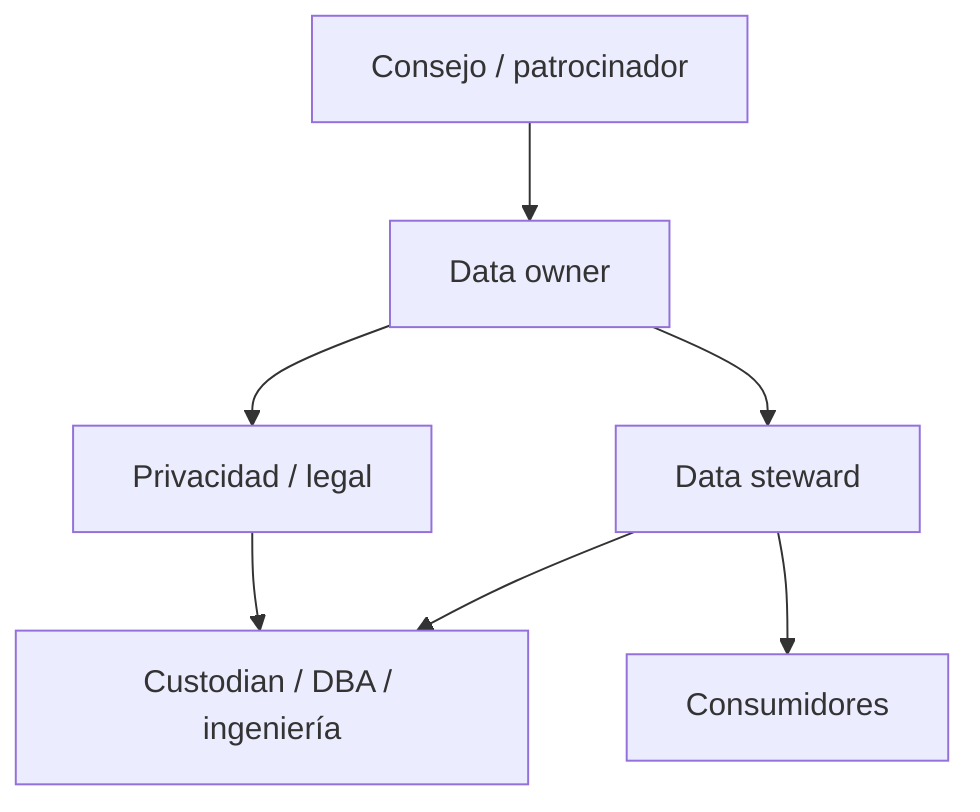

[← Unidad 6](/bbdd-aplicadas/unidad-6/teoria/)

:::note[Contenido complementario]
Esta página no forma parte del programa 2024 de la materia (Ley 25.326, GDPR e ISO/IEC 25012). Reúne prácticas de gobierno de datos útiles para aplicar esas normas. Los roles, la matriz RACI, los niveles de clasificación y la tabla de retención son **elaboración propia** y orientativa: ni la [Ley 25.326](/bbdd-aplicadas/unidad-6/teoria/ley-25326/) ni el [GDPR](/bbdd-aplicadas/unidad-6/teoria/gdpr/) ni [ISO/IEC 25012](/bbdd-aplicadas/unidad-6/teoria/iso-25012/) los prescriben. Las referencias normativas se indican con su artículo.
:::

## Gobierno no es administración técnica

Administrar una base asegura la operación del motor. Gobernar define quién decide significado, finalidad, calidad, acceso, conservación y resolución de conflictos a lo largo de varias aplicaciones.

### RACI simplificada (elaboración propia)

| Decisión | Owner | Steward | Custodian | Privacidad |
|----------|-------|---------|-----------|------------|
| Definir “cliente activo” | A/R | C | I | C |
| Mantener catálogo y reglas | A | R | C | C |
| Implementar permisos | A | C | R | C |
| Aprobar nueva finalidad | A | C | C | R/C |
| Atender defecto | A | R | R | I |
| Evaluar retención | A | C | C | R |

`R` ejecuta, `A` responde finalmente, `C` es consultado e `I` informado. Debe existir un solo accountable claro por decisión.

## Inventario y clasificación

No se protege lo que no se conoce. El inventario registra sistema, dataset, finalidad, base jurídica, owner, encargado, ubicación, destinatarios, transferencia, retención y controles. La clasificación puede usar niveles público, interno, confidencial y restringido (una convención habitual, no una exigencia legal), con etiquetas adicionales que sí se apoyan en las normas: dato personal (Ley art. 2; RGPD art. 4.1), sensible (Ley art. 2 y 7) o categoría especial (RGPD art. 9.1). Un ejercicio práctico está en el [laboratorio de privacidad](/bbdd-aplicadas/unidad-6/practica/laboratorio-privacidad/).

Clasificar por columna no siempre basta: tres atributos no sensibles aislados pueden reidentificar al combinarse. También se inventarían archivos, logs, colas, exports, notebooks y backups.

## Catálogo, glosario y linaje

- **Glosario:** términos de negocio, definición y owner.
- **Diccionario:** tablas, columnas, tipos, dominios y relaciones.
- **Catálogo:** búsqueda, clasificación, ownership, políticas y contexto.
- **Linaje:** origen, transformaciones, movimientos y consumos.

El linaje permite responder qué reportes cambian al corregir un origen, dónde localizar datos ante un derecho y qué transformación introdujo una inconsistencia.

## Privacidad desde el diseño

El RGPD exige aplicar protección de datos desde el diseño y por defecto (art. 25) y seguridad apropiada al riesgo (art. 32). La Ley 25.326 exige medidas técnicas y organizativas de seguridad (art. 9). Los ocho pasos siguientes son una forma propia de organizar ese trabajo. Antes de recolectar:

1. definir finalidad y base;
2. minimizar atributos y resolución;
3. separar identificadores de datos analíticos;
4. limitar accesos por rol y propósito;
5. fijar retención y borrado;
6. asegurar transferencias y encargados;
7. diseñar atención de derechos e incidentes;
8. medir calidad y conservar evidencia.

**Por defecto** significa que, sin acción adicional del usuario, la configuración expone la menor cantidad necesaria: perfil privado, ubicación desactivada, retención corta y acceso restringido, cuando el contexto lo permite.

## Retención y eliminación

Una política se define por categoría y evento disparador, no con “guardar para siempre por si acaso”: los datos deben destruirse cuando dejan de ser necesarios (Ley art. 4, inciso 7) y conservarse solo el tiempo necesario para los fines (RGPD art. 5.1.e). Los plazos concretos los fijan la finalidad y la normativa sectorial. Ejemplo de estructura (los plazos quedan sin completar a propósito):

| Categoría | Disparador | Plazo | Acción | Excepción |
|-----------|------------|-------|--------|-----------|
| Cuenta operativa | cierre | plazo acordado/legal | borrar o anonimizar | litigio vigente |
| Log de auditoría | creación | plazo de seguridad | eliminación segura | investigación |
| Backup | creación | rotación | vencer copia | preservación formal |

El borrado debe alcanzar réplicas y derivados razonables. En backups inmutables se puede impedir el uso ordinario, vencer las copias según su ciclo y reaplicar las supresiones si se restaura: es una **buena práctica** propuesta aquí, no una obligación legal expresa. Se documenta la limitación en lugar de prometer un borrado físicamente imposible e inmediato. Un ejemplo ejecutable está en el [caso 5](/bbdd-aplicadas/unidad-6/practica/casos-integradores/).

## Calidad y derechos

La rectificación (Ley art. 16; RGPD art. 16) revela por qué trazabilidad y consistencia importan: corregir la tabla maestra sin propagar a data warehouse, buscador o proveedor deja versiones contradictorias. El workflow requiere identidad, búsqueda, decisión, propagación, validación y evidencia.

La supresión también necesita calidad de identidad. Un emparejamiento débil puede borrar datos de otra persona; uno demasiado estricto puede omitir datos del solicitante.

## Antipatrones

- recopilar “por si algún día sirve”;
- dar `db_owner` para resolver demoras;
- exportar planillas fuera del inventario;
- aceptar toda solicitud sin verificar identidad;
- considerar anonimizado un hash reversible por diccionario (ejercicio 24 del laboratorio de privacidad);
- medir solo nulos y declarar “calidad total”;
- corregir en el dashboard sin reparar el origen;
- conservar backups sin restauraciones probadas;
- delegar responsabilidad completa al proveedor cloud.

## Checklist de un nuevo dataset

- [ ] finalidad y usuarios definidos;
- [ ] base jurídica y transparencia revisadas;
- [ ] atributos mínimos y categorías sensibles identificados;
- [ ] owner, steward y custodian asignados;
- [ ] fuente, linaje y diccionario documentados;
- [ ] reglas ISO relevantes y umbrales acordados;
- [ ] roles, cifrado, logs y backups diseñados;
- [ ] terceros y transferencias evaluados;
- [ ] retención, borrado, derechos e incidentes probados;
- [ ] monitoreo y revisión periódica activos.

## Autoevaluación

**1. ¿Qué diferencia hay entre administrar y gobernar una base de datos?**

Respuesta

Administrar asegura la operación del motor (disponibilidad, rendimiento, copias). Gobernar define quién decide el significado, la finalidad, la calidad, el acceso y la conservación de los datos entre varias aplicaciones. Un DBA puede administrar perfectamente un dato cuya finalidad nadie definió.

**2. ¿Por qué un backup con un dato suprimido es un problema de gobierno y no solo técnico?**

Respuesta

Porque la supresión es una decisión de negocio y legal (Ley art. 16; RGPD art. 17) que debe sobrevivir a las operaciones técnicas. Si al restaurar el dato reaparece, falla la consistencia entre el estado jurídico y el estado de los datos. Hace falta un registro mínimo de supresiones y un procedimiento posterior a la restauración.

:::tip[En resumen]
- Gobernar es asignar decisiones (significado, finalidad, calidad, acceso, retención) con un responsable claro por cada una.
- Inventario, clasificación, catálogo y linaje permiten ubicar los datos para aplicar las normas.
- Los roles, niveles y plazos de esta página son propuestas; las obligaciones están en los artículos citados.
:::

## Fuentes

- Ley 25.326 (arts. 2, 4, 7, 9 y 16): [InfoLEG](https://servicios.infoleg.gob.ar/infolegInternet/anexos/60000-64999/64790/texact.htm), consultada el 2026-11-17.
- Reglamento (UE) 2016/679 (arts. 4, 5, 9, 16, 17, 25 y 32): [EUR-Lex](https://eur-lex.europa.eu/legal-content/ES/TXT/?uri=CELEX:32016R0679), consultado el 2026-11-17.
- Resumen público de ISO/IEC 25012: [iso25000.com](https://iso25000.com/index.php/normas-iso-25000/iso-25012).
- Los roles (owner, steward, custodian), la matriz RACI y el inventario son prácticas generales de gobierno de datos, presentadas como elaboración propia sin una fuente normativa.
