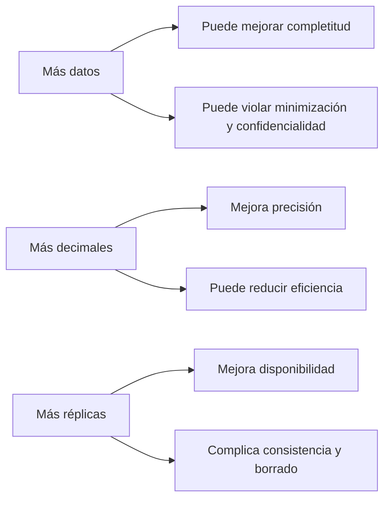

[← Unidad 6](/bbdd-aplicadas/unidad-6/teoria/)

:::note[Fuente y alcance de este apunte]
ISO/IEC 25012 es una norma paga y su texto no se reproduce aquí. Las definiciones de cada característica son **propias** (redactadas por el autor del apunte). Lo que se atribuye a la norma proviene del resumen público de [iso25000.com](https://iso25000.com/index.php/normas-iso-25000/iso-25012) (fuente secundaria, consultada el 2026-11-17): el modelo define 15 características para evaluar un producto de datos y distingue calidad de datos **inherente** y **dependiente del sistema**. El resumen presenta además la lista completa de las 15 características en una figura; la clasificación en tres grupos (5 + 7 + 3) que usa este apunte es la que se atribuye a la norma en esa figura. No se pudo contrastar con el texto de la norma ni con la ficha oficial de iso.org (el sitio respondió 403 a la consulta automatizada), por lo que, ante duda, hay que consultar la norma.
:::

## Para qué sirve

Cuando alguien dice "los datos están mal", el modelo ayuda a precisar de qué manera: ¿faltan valores, se contradicen, están viejos, no se entienden, no se pueden restaurar? Ofrece un vocabulario común para definir requisitos, evaluar y priorizar mejoras. No prescribe una única fórmula ni un umbral: cada organización define cómo medir cada característica según su contexto.

## Las 15 características en tres grupos

Según el resumen público de iso25000.com, la calidad de datos **inherente** depende de los propios datos (sus valores y dominios, las relaciones entre valores como la consistencia y los metadatos), y la **dependiente del sistema** se alcanza a través de los componentes tecnológicos que los manejan (hardware y software; por ejemplo, un software de respaldo contribuye a la recuperabilidad y una herramienta de migración a la portabilidad).

| Grupo | Características |
|---|---|
| Inherentes (5) | exactitud, completitud, consistencia, credibilidad, actualidad |
| Inherentes y dependientes del sistema (7) | accesibilidad, conformidad, confidencialidad, eficiencia, precisión, trazabilidad, comprensibilidad |
| Dependientes del sistema (3) | disponibilidad, portabilidad, recuperabilidad |

Regla mnemotécnica propia: **5 + 7 + 3 = 15**.

Para exactitud, completitud y consistencia el resumen público las ubica explícitamente como inherentes y las describe así: exactitud, grado en que los datos representan correctamente el valor real del atributo, con un aspecto sintáctico y otro semántico; completitud, grado en que los datos tienen valores para todos los atributos esperados; consistencia, ausencia de contradicciones y coherencia con otros datos.

## Definiciones propias

### Inherentes

- **Exactitud.** Qué tan bien el dato representa la realidad. Aspecto *sintáctico*: forma y dominio válidos (una fecha que se puede interpretar como fecha). Aspecto *semántico*: coincide con el hecho real (la fecha de nacimiento verdadera). Hay que declarar fuente de referencia, momento y tolerancia.
- **Completitud.** Están presentes los valores que el uso requiere, por atributo, por registro o por población. `NULL` puede significar desconocido, no aplicable o no capturado todavía; mezclar esos significados distorsiona la métrica.
- **Consistencia.** Los datos no se contradicen entre sí ni con las reglas: el total coincide con la suma de los ítems, la fecha de baja no es anterior a la de alta.
- **Credibilidad.** Qué tan confiables resultan los datos para quienes los usan, por su fuente y proceso. No es lo mismo que exactitud: una fuente creíble puede equivocarse (interpretación propia).
- **Actualidad.** Si la antigüedad del dato es adecuada para el uso: segundos en una detección de fraude, meses en un domicilio. Conviene distinguir cuándo ocurrió el hecho de cuándo se cargó.

### Inherentes y dependientes del sistema

- **Accesibilidad.** Se puede obtener el dato en el contexto de uso previsto, por quien está autorizado. No significa "acceso para todos".
- **Conformidad.** El dato respeta estándares, convenciones o reglas aplicables: un formato de fecha, un catálogo, un contrato de API o una norma de privacidad.
- **Confidencialidad.** Solo acceden o interpretan el dato quienes están autorizados; depende de la sensibilidad del dato y de los controles (permisos, cifrado, enmascaramiento, auditoría).
- **Eficiencia.** El dato se procesa con rendimiento y recursos aceptables; un modelo innecesariamente ancho puede degradarla.
- **Precisión.** Nivel de detalle con que se guarda el dato. Guardar la temperatura como entero no satisface un requisito de décimas. `20,123456` puede ser muy preciso y completamente falso.
- **Trazabilidad.** Se puede seguir el origen, los cambios y, según el contexto, los accesos del dato; requiere identificadores, versiones y registros protegidos.
- **Comprensibilidad.** Datos y metadatos pueden leerse e interpretarse correctamente. `IMPORTE = 100` no se entiende sin moneda y definición.

### Dependientes del sistema

- **Disponibilidad.** Los usuarios autorizados pueden recuperar el dato cuando lo necesitan; no dice nada sobre si es correcto.
- **Portabilidad.** Los datos se pueden mover o reemplazar entre sistemas preservando significado y calidad. Exportar a CSV no la garantiza si se pierden tipos, codificación o zona horaria.
- **Recuperabilidad.** Después de una falla se pueden recuperar los datos y mantener la integridad; requiere copias, procedimientos y pruebas de restauración.

## Relaciones y tensiones



La solución no es maximizar todas las características sino acordar niveles apropiados al uso y al riesgo. La completitud tiene un límite legal: la [Ley 25.326](/bbdd-aplicadas/unidad-6/teoria/ley-25326/) (art. 4) exige datos pertinentes y no excesivos y el [RGPD](/bbdd-aplicadas/unidad-6/teoria/gdpr/) (art. 5.1.c) la minimización.

## Matriz de diagnóstico (elaboración propia)

| Síntoma | Característica primaria | Posibles relacionadas |
|---|---|---|
| 12 % de correos vacíos | Completitud | Conformidad |
| DNI con formato válido pero de otra persona | Exactitud semántica | Credibilidad |
| Dos saldos distintos para la misma cuenta | Consistencia | Trazabilidad, actualidad |
| Stock de ayer usado hoy | Actualidad | Exactitud para el uso actual |
| Solo el DBA entiende los códigos | Comprensibilidad | Accesibilidad |
| Una consulta tarda 40 minutos | Eficiencia | Disponibilidad percibida |
| Nunca se probó restaurar el backup | Recuperabilidad | Disponibilidad |
| El CSV pierde tildes y zona horaria | Portabilidad | Exactitud, comprensibilidad |
| Un analista ve diagnósticos sin necesidad | Confidencialidad | Conformidad |

## Confusiones típicas

:::caution[Errores frecuentes]
- Exactitud no es precisión: cercanía a la realidad frente a nivel de detalle.
- Actualidad no es disponibilidad: vigencia del dato frente a acceso al sistema.
- Completitud no es llenar todo: solo lo necesario; inventar valores empeora la exactitud.
- Un backup existente no demuestra recuperabilidad: hay que poder restaurar y validar.
- La unicidad (sin filas duplicadas) es una regla útil, pero no figura entre las 15 características listadas.
:::

## Autoevaluación

<details>
<summary>1. ¿Cuántas características hay en cada grupo?</summary>

5 inherentes, 7 inherentes y dependientes del sistema, 3 dependientes del sistema (según el resumen público de iso25000.com).
</details>

<details>
<summary>2. Un dato `2001-02-10` pasa el tipo `DATE` pero el hecho real es 1991. ¿Qué característica falla?</summary>

Exactitud semántica; la sintáctica se cumple.
</details>

## En resumen

:::tip[En resumen]
- 15 características: 5 inherentes, 7 mixtas y 3 dependientes del sistema.
- Las definiciones de este apunte son propias; la norma es paga y no se reproduce.
- Diagnosticar es relacionar un síntoma con una característica y una regla medible.
:::

## Ejercicios

### Ejercicio 11 · Clasificar las 15 características
<!-- ejercicio: U6.11 | nivel: inicial | tipo: conceptual | verificacion: razonamiento -->

:::note[Enunciado]
Sin mirar el apunte, ubicá en su grupo (inherente, inherente y dependiente del sistema, dependiente del sistema) estas seis características: actualidad, trazabilidad, recuperabilidad, credibilidad, eficiencia, portabilidad.
:::

<details>
<summary>Resolución</summary>

**Estrategia.** Recordar que los grupos extremos son los más chicos (5 y 3).

- Inherentes: actualidad, credibilidad.
- Inherentes y dependientes del sistema: trazabilidad, eficiencia.
- Dependientes del sistema: recuperabilidad, portabilidad.

Clasificación según el resumen público de iso25000.com.
</details>

### Ejercicio 12 · Defecto y característica
<!-- ejercicio: U6.12 | nivel: inicial | tipo: diagnostico | verificacion: razonamiento -->

:::note[Enunciado]
Indicá la característica principal afectada: (a) el 8 % de las filas de una tabla de pedidos no tiene fecha de entrega; (b) la fecha de baja es anterior a la fecha de alta; (c) el informe de ayer se usa para decidir stock de hoy; (d) la base está en producción pero nadie puede entender qué significa el código `EST`.
:::

<details>
<summary>Resolución</summary>

**Estrategia.** Preguntar qué requisito no se cumple.

- (a) Completitud: faltan valores esperados.
- (b) Consistencia: dos datos se contradicen.
- (c) Actualidad: la edad del dato no es adecuada para el uso.
- (d) Comprensibilidad: faltan metadatos o glosario para interpretar el dato.
</details>

### Ejercicio 13 · Exactitud y precisión
<!-- ejercicio: U6.13 | nivel: intermedio | tipo: conceptual | verificacion: razonamiento -->

:::note[Enunciado]
Un sensor guarda `37,482913` °C cuando la temperatura real es 36,5 °C, y otro guarda `37` cuando la real es 37,1. Comparalos en exactitud y precisión y explicá por qué validar el tipo de dato no alcanza.
:::

<details>
<summary>Resolución</summary>

**Estrategia.** Separar cercanía a la realidad de nivel de detalle.

- Primer sensor: muy preciso (seis decimales) pero poco exacto (error de casi 1 °C).
- Segundo sensor: poco preciso (entero) pero cercano a la realidad en esa lectura.
- Validar el tipo de dato solo comprueba la forma (exactitud sintáctica); la exactitud semántica requiere contrastar con una fuente de referencia y declarar la tolerancia.
</details>

### Ejercicio 14 · Tensión entre calidad y privacidad
<!-- ejercicio: U6.14 | nivel: avanzado | tipo: diseno | verificacion: razonamiento -->

:::note[Enunciado]
Un equipo propone completar el 100 % de los campos de un formulario (DNI, religión, diagnóstico) "para mejorar la completitud". Evaluá la propuesta con el modelo ISO/IEC 25012 y con los principios de la Ley 25.326 y el RGPD, y proponé una alternativa.
:::

<details>
<summary>Resolución</summary>

**Estrategia.** Una característica de calidad se mide contra requisitos, no contra "todos los campos posibles".

- Completitud significa tener los datos que el uso necesita, no todos los posibles.
- Ley 25.326: los datos deben ser pertinentes y no excesivos (art. 4); religión y salud son sensibles (art. 2) y nadie puede ser obligado a darlos (art. 7).
- RGPD: minimización (art. 5.1.c); religión y salud son categorías especiales con prohibición salvo condición del art. 9.2.
- Completar con valores inventados dañaría la exactitud.
- Alternativa: definir los campos requeridos por finalidad, marcar opcionales los demás, medir la completitud solo sobre los requeridos y registrar el motivo del `NULL` (no aplica, desconocido, no capturado).
</details>

### Ejercicio 15 · Perfilar completitud con SQL
<!-- ejercicio: U6.15 | nivel: intermedio | tipo: consulta | verificacion: motor -->

:::note[Enunciado]
Una tabla de 10 contactos tiene correos `NULL`, vacíos y con solo espacios. Calculá cuántos contactos tienen un correo con valor real y el porcentaje de completitud, y mostrá por qué contar solo los no nulos sobreestima el resultado.
:::

<details>
<summary>Resolución</summary>

**Estrategia.** Normalizar el texto con `LTRIM`, `RTRIM` y `NULLIF` para tratar vacío como ausente, y dividir por el total evaluado (denominador explícito). El bloque crea el esquema `calidad` y los 10 contactos de ejemplo: ejecutalo completo en una [base de práctica](/bbdd-aplicadas/como-estudiar/#antes-de-ejecutar-los-ejemplos) nueva, distinta de la del laboratorio de calidad, que también define un esquema `calidad`.

<!-- check: U6.15 -->
```sql
CREATE SCHEMA calidad;
GO

CREATE TABLE calidad.Contacto (
    ContactoId INT IDENTITY(1, 1) NOT NULL,
    Nombre     VARCHAR(40)        NOT NULL,
    Email      VARCHAR(80)        NULL,
    Telefono   VARCHAR(20)        NULL,
    CONSTRAINT PK_Contacto PRIMARY KEY CLUSTERED (ContactoId)
);

INSERT INTO calidad.Contacto (Nombre, Email, Telefono)
VALUES
    ('Contacto A', 'a@ejemplo.test', '11-5550-0001'),
    ('Contacto B', NULL, '11-5550-0002'),
    ('Contacto C', '', NULL),
    ('Contacto D', 'd@ejemplo.test', NULL),
    ('Contacto E', '   ', '11-5550-0005'),
    ('Contacto F', 'f@ejemplo.test', '11-5550-0006'),
    ('Contacto G', NULL, NULL),
    ('Contacto H', 'h@ejemplo.test', '11-5550-0008'),
    ('Contacto I', 'i@ejemplo.test', '11-5550-0009'),
    ('Contacto J', 'j@ejemplo.test', '11-5550-0010');
GO

SELECT
    COUNT(*)                                                         AS Evaluados,
    COUNT(Email)                                                     AS EmailNoNulo,
    SUM(CASE WHEN NULLIF(LTRIM(RTRIM(Email)), '') IS NOT NULL
             THEN 1 ELSE 0 END)                                      AS EmailConValor,
    CAST(100.0 * SUM(CASE WHEN NULLIF(LTRIM(RTRIM(Email)), '') IS NOT NULL
                          THEN 1 ELSE 0 END) / COUNT(*) AS DECIMAL(5, 1)) AS PctCompletitudEmail
FROM calidad.Contacto;
```

**Resultado esperado.**

| Evaluados | EmailNoNulo | EmailConValor | PctCompletitudEmail |
|---:|---:|---:|---:|
| 10 | 8 | 6 | 60.0 |

`COUNT(Email)` cuenta 8 porque ignora solo los `NULL`; las cadenas vacías y de espacios no son valores reales. El porcentaje correcto es 60,0 %, no 80 %.
</details>

:::tip[Para seguir]
- Seguí con [Medición y mejora de la calidad](/bbdd-aplicadas/unidad-6/teoria/medicion-calidad/) (complementario) y practicá con el [laboratorio de perfilado](/bbdd-aplicadas/unidad-6/practica/laboratorio-calidad/).
:::

## Fuentes

- Resumen público de ISO/IEC 25012 (fuente secundaria): [iso25000.com](https://iso25000.com/index.php/normas-iso-25000/iso-25012), consultado el 2026-11-17.
- Ficha de la norma en ISO: [iso.org/standard/35736.html](https://www.iso.org/standard/35736.html). No se pudo leer desde el entorno automatizado (error 403) el 2026-11-17; no se cita año de publicación ni texto de la norma.
- Ley 25.326, art. 4: [InfoLEG](https://servicios.infoleg.gob.ar/infolegInternet/anexos/60000-64999/64790/texact.htm), consultada el 2026-11-17.
- RGPD, art. 5: [EUR-Lex](https://eur-lex.europa.eu/legal-content/ES/TXT/?uri=CELEX:32016R0679), consultado el 2026-11-17.
