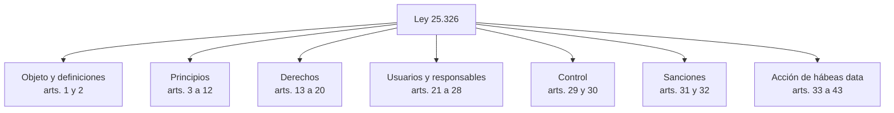
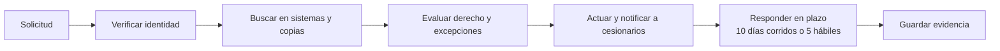

[← Unidad 6](/bbdd-aplicadas/unidad-6/teoria/)

:::note[Fuente de este apunte]
Todo lo que sigue se contrastó con el texto de la Ley 25.326 (sancionada el 4 de octubre de 2000 y promulgada parcialmente el 30 de octubre de 2000) y con el Decreto Reglamentario 1558/2001 en InfoLEG, consultados el 2026-11-17. No hay material de cátedra para esta unidad. Los artículos se citan con su número; las frases entre comillas son citas textuales breves. Material académico: no sustituye asesoramiento jurídico.
:::

## Para qué sirve

Cualquier sistema que guarde clientes, pacientes, alumnos o empleados maneja datos personales. La ley fija qué se puede recolectar, con qué permiso, cómo se protege y qué derechos tiene la persona sobre su información. Es la parte "legal" de la calidad de datos: un dato puede ser exacto y, aun así, estar tratado de forma ilícita.

## Mapa de estudio

El artículo 1 declara como objeto la protección de los datos personales asentados en archivos, registros y bancos de datos públicos o privados destinados a dar informes, para garantizar el honor, la intimidad y el acceso a la información que sobre las personas se registre. Sus disposiciones también rigen, "en cuanto resulte pertinente", para las personas de existencia ideal (personas jurídicas).

## Definiciones (artículo 2)

:::note[Definición]
**Dato personal:** "información de cualquier tipo referida a personas físicas o de existencia ideal determinadas o determinables" (art. 2). Es decir, la ley argentina alcanza también a personas jurídicas; el RGPD, en cambio, solo a personas físicas ([GDPR](/bbdd-aplicadas/unidad-6/teoria/gdpr/)).
:::

| Concepto | Qué dice el artículo 2 (paráfrasis) | Ejemplo propio |
|---|---|---|
| Datos sensibles | Origen racial y étnico, opiniones políticas, convicciones religiosas, filosóficas o morales, afiliación sindical, información referente a la salud o a la vida sexual | Diagnóstico, afiliación a un gremio |
| Archivo, registro, base o banco de datos | Conjunto organizado de datos personales sometidos a tratamiento, electrónico o no, cualquiera sea la modalidad de su formación, almacenamiento u organización | Un CRM, un legajo en papel ordenado |
| Tratamiento de datos | Operaciones y procedimientos sistemáticos, electrónicos o no, de recolección, conservación, ordenación, almacenamiento, modificación, relacionamiento, evaluación, bloqueo, destrucción y, en general, procesamiento; incluye la cesión a terceros | Cruzar clientes con una base externa |
| Responsable del archivo | Persona física o de existencia ideal, pública o privada, titular de un archivo, registro, base o banco de datos | La empresa dueña del CRM |
| Titular de los datos | Persona cuyos datos son objeto del tratamiento (la ley la define como física o de existencia ideal con domicilio legal o delegaciones en el país) | El cliente |
| Usuario de datos | Quien realiza el tratamiento de datos a su arbitrio, en archivos propios o mediante conexión con los mismos | Un analista autorizado |
| Disociación de datos | Todo tratamiento de datos de manera que la información obtenida no pueda asociarse a persona determinada o determinable | Estadística realmente anónima |

El artículo 2 no define "persona de existencia ideal": solo la nombra dentro de otras definiciones. Que un dato sea público no significa que pueda reutilizarse sin límites: sigue sujeto a los principios que siguen.

## Principios

### Licitud (artículo 3)

Un archivo es lícito cuando está debidamente inscripto y cumple lo dispuesto por la ley; sus finalidades no pueden ser contrarias a las leyes ni a la moral pública.

### Calidad de los datos (artículo 4)

El artículo 4 enumera siete exigencias:

1. veracidad, adecuación, pertinencia y que no sean excesivos en relación con el ámbito y finalidad para los que se obtuvieron;
2. no pueden recolectarse por medios desleales, fraudulentos o contrarios a la ley;
3. no pueden usarse para finalidades distintas o incompatibles con las que motivaron su obtención;
4. deben ser exactos y actualizarse cuando sea necesario;
5. si son inexactos o incompletos, deben suprimirse, sustituirse o completarse por el responsable al tomar conocimiento del error, sin perjuicio de los derechos del artículo 16;
6. deben almacenarse de modo que permitan el ejercicio del derecho de acceso;
7. deben destruirse cuando hayan dejado de ser necesarios o pertinentes.

La calidad legal excede la validación técnica: un campo puede cumplir tipo y formato y, aun así, ser excesivo para el propósito (inciso 1). Esta es la conexión directa con las características de [ISO/IEC 25012](/bbdd-aplicadas/unidad-6/teoria/iso-25012/).

### Consentimiento (artículo 5)

La regla (art. 5.1): el tratamiento es ilícito cuando el titular no hubiere prestado su "consentimiento libre, expreso e informado", que debe constar por escrito o por otro medio que se le equipare. No hace falta consentimiento (art. 5.2) cuando los datos:

- a) se obtienen de fuentes de acceso público irrestricto;
- b) se recaban para el ejercicio de funciones propias de los poderes del Estado o en virtud de una obligación legal;
- c) se limitan a nombre, DNI, identificación tributaria o previsional, ocupación, fecha de nacimiento y domicilio;
- d) derivan de una relación contractual, científica o profesional del titular y son necesarios para su desarrollo o cumplimiento;
- e) corresponden a operaciones que realizan las entidades financieras (art. 39 de la Ley 21.526).

El Decreto 1558/2001 (art. 5) agrega que el consentimiento es informado cuando se le explicó al titular la información del artículo 6 en forma adecuada a su nivel social y cultural, y que puede revocarse en cualquier momento, sin efectos retroactivos. Siempre hay que identificar qué inciso concreto se invoca: una casilla premarcada o una aceptación genérica no son, por sí solas, un consentimiento "informado" (esto es una consecuencia de los términos del art. 5.1 y del art. 6, no una frase de la ley).

### Información previa (artículo 6)

Al recabar datos hay que informar previamente, en forma expresa y clara: a) la finalidad y quiénes pueden ser sus destinatarios; b) la existencia del archivo y la identidad y domicilio del responsable; c) el carácter obligatorio o facultativo de las respuestas; d) las consecuencias de proporcionar los datos, de negarse a hacerlo o de su inexactitud; e) la posibilidad de ejercer los derechos de acceso, rectificación y supresión. Informar (art. 6) y obtener consentimiento (art. 5) son deberes distintos.

### Datos sensibles (artículo 7) y de salud (artículo 8)

- Nadie puede ser obligado a proporcionar datos sensibles (art. 7.1).
- Solo pueden tratarse cuando medien razones de interés general autorizadas por ley, o con finalidades estadísticas o científicas cuando los titulares no puedan ser identificados (art. 7.2).
- Está prohibida la formación de archivos que revelen datos sensibles de modo directo o indirecto; la ley exceptúa a la Iglesia Católica, las asociaciones religiosas y las organizaciones políticas y sindicales respecto de sus miembros (art. 7.3).
- Los antecedentes penales o contravencionales solo pueden ser tratados por las autoridades públicas competentes (art. 7.4).
- Los establecimientos sanitarios y los profesionales de la salud pueden recolectar y tratar los datos de sus pacientes, "respetando los principios del secreto profesional" (art. 8).

### Seguridad (artículo 9) y confidencialidad (artículo 10)

- Art. 9.1: el responsable o usuario debe adoptar las medidas técnicas y organizativas necesarias para garantizar la seguridad y confidencialidad de los datos, evitar su adulteración, pérdida, consulta o tratamiento no autorizado, y detectar desviaciones, intencionales o no.
- Art. 9.2: se prohíbe registrar datos personales en archivos que no reúnan condiciones técnicas de integridad y seguridad.
- Art. 10.1: el responsable y quienes intervengan en cualquier fase del tratamiento deben guardar secreto profesional, obligación que subsiste después de finalizada la relación con el titular del archivo.
- Art. 10.2: el deber de secreto puede relevarse por resolución judicial o por razones fundadas de seguridad pública, defensa nacional o salud pública.

La Resolución 47/2018 de la Agencia de Acceso a la Información Pública (23/07/2018) aprobó "medidas de seguridad recomendadas" para el tratamiento de datos personales en medios informatizados (Anexo I) y no informatizados (Anexo II): son recomendaciones, no un listado obligatorio de controles.

### Cesión y transferencia internacional (artículos 11 y 12)

- Art. 11: los datos solo pueden cederse para el cumplimiento de fines directamente relacionados con el interés legítimo de cedente y cesionario, con el previo consentimiento del titular, a quien se debe informar la finalidad y la identificación del cesionario. El consentimiento es revocable. No es necesario cuando una ley lo disponga, en los supuestos del art. 5.2, en cesiones directas entre dependencias del Estado, en datos de salud por razones de salud pública, emergencia o estudios epidemiológicos con disociación, o si se aplicó un procedimiento de disociación (art. 11.3).
- Art. 12: se prohíbe transferir datos personales a países u organismos internacionales que no proporcionen niveles de protección adecuados, con excepciones (por ejemplo, colaboración judicial internacional, transferencias bancarias o bursátiles y tratados internacionales).

## Derechos del titular (artículos 13 a 20)

| Derecho | Qué permite | Plazo o condición (texto de la ley) |
|---|---|---|
| Información (art. 13) | Consultar al organismo de control sobre la existencia de bancos de datos, sus finalidades y sus responsables | El registro es de consulta pública y gratuita |
| Acceso (art. 14) | Solicitar y obtener información de los propios datos en bancos públicos o privados destinados a dar informes, previa acreditación de identidad | **10 días corridos** de haber sido intimado fehacientemente; gratuito, a intervalos no inferiores a seis meses salvo interés legítimo |
| Rectificación, actualización, supresión y confidencialidad (art. 16) | Exigir que los datos sean rectificados, actualizados y, cuando corresponda, suprimidos o sometidos a confidencialidad | **5 días hábiles** desde el reclamo o desde que el responsable advierta el error; gratuito (art. 19) |

Detalles que se evalúan:

- La información debe ser clara, sin codificaciones, y abarcar la totalidad del registro del titular (art. 15). Nunca puede revelar datos de terceros.
- Si el plazo del art. 14 vence sin respuesta o la información es insuficiente, queda habilitada la acción de hábeas data (art. 14).
- Ante el fallecimiento del titular, el derecho de acceso corresponde a sus sucesores universales (art. 14). Es una diferencia con el RGPD, que no se aplica a personas fallecidas (considerando 27).
- Si hubo cesión, la rectificación o supresión debe notificarse al cesionario dentro de los **5 días hábiles** (art. 16).
- La supresión no procede cuando pudiese causar perjuicios a derechos o intereses legítimos de terceros, o cuando exista una obligación legal de conservar los datos (art. 16). Durante la verificación se debe bloquear el archivo o consignar que el dato está en revisión (art. 16).
- Los responsables de bancos públicos pueden denegar estos derechos por resolución fundada por defensa de la Nación, orden o seguridad públicos o protección de derechos de terceros (art. 17).
- Art. 20: las decisiones judiciales o actos administrativos que impliquen apreciación o valoración de conductas humanas no pueden basarse únicamente en el resultado del tratamiento informatizado de datos que defina el perfil o personalidad del afectado.

## Usuarios y responsables: registro y supuestos especiales (artículos 21 a 28)

- Art. 21: los archivos, registros, bases o bancos de datos públicos y los privados destinados a dar informes deben inscribirse en el registro que habilite el organismo de control. La inscripción incluye, entre otros datos: responsable, finalidad, naturaleza de los datos, cesiones previstas, medidas de seguridad y tiempo de conservación. El usuario no puede poseer datos de naturaleza distinta a la declarada.
- Art. 25: quien presta servicios de tratamiento por cuenta de terceros no puede aplicar los datos a un fin distinto del contrato ni cederlos; cumplido el contrato, los datos deben destruirse, salvo autorización expresa, y por un máximo de dos años.
- Art. 28: la ley no se aplica a encuestas, estadísticas o investigaciones cuando los datos no pueden atribuirse a una persona determinada o determinable; si el anonimato no es posible, se debe usar disociación.

La inscripción no "legaliza" cualquier tratamiento: es una obligación adicional.

## Control (artículos 29 y 30) y autoridad actual

El artículo 29 de la ley prevé un "órgano de control" sin nombrarlo; sus funciones incluyen asesorar, dictar normas, mantener el registro, controlar la seguridad, imponer sanciones y querellar. El Decreto 1558/2001 (art. 29) creó para esa función la Dirección Nacional de Protección de Datos Personales, en el ámbito del Ministerio de Justicia y Derechos Humanos.

Según la Resolución AAIP 332/2020 (Boletín Oficial, 31/12/2020), el Decreto 746/2017 atribuyó a la **Agencia de Acceso a la Información Pública (AAIP)** la facultad de actuar como autoridad de aplicación de la Ley 25.326, y el Decreto 899/2017 le asignó la función de órgano de control que antes ejercía la Dirección Nacional. El texto de la ley y del Decreto 1558/2001 no mencionan a la AAIP: por eso, en una respuesta conviene decir "órgano de control (hoy, la AAIP)".

## Sanciones (artículos 31 y 32)

- **Administrativas (art. 31):** apercibimiento, suspensión, multa de **1.000 a 100.000 pesos** (importes nominales del texto de la ley; el apunte no verificó actualizaciones posteriores), clausura o cancelación del archivo, graduadas según la gravedad y el perjuicio, con debido proceso. El Decreto 1558/2001 (art. 31) agrega criterios de graduación como volumen de tratamientos, beneficio obtenido, intencionalidad y reincidencia.
- **Penales (art. 32):** el artículo incorpora al Código Penal el art. 117 bis (insertar a sabiendas datos falsos en un archivo de datos personales; proporcionar a un tercero información falsa contenida en un archivo) y el art. 157 bis (acceder de cualquier forma, a sabiendas y sin autorización, a un banco de datos personales; revelar información registrada cuyo secreto esté obligado a preservar).

No toda falla de calidad es un delito: el tipo penal exige la conducta descripta y que se realice "a sabiendas".

## Acción de hábeas data (artículos 33 a 43)

Procede (art. 33) para tomar conocimiento de los datos personales almacenados y de su finalidad, y para exigir su rectificación, supresión, confidencialidad o actualización cuando se presuma falsedad, inexactitud o desactualización, o el tratamiento de datos cuyo registro se prohíbe. Tramita por la vía del amparo (art. 37).

## Ejemplo guiado

Una librería en línea pide a cada visitante DNI, domicilio, afiliación gremial y un diagnóstico médico "para personalizar ofertas", con un único botón "Acepto".

1. DNI y domicilio son datos personales (art. 2); afiliación gremial y salud son sensibles (art. 2).
2. Los sensibles no son pertinentes para ofertas: viola el art. 4.1, y el art. 7.1 impide obligar a darlos.
3. Un único "Acepto" no informa finalidad, destinatarios ni consecuencias: falla el art. 6, y debilita el consentimiento "informado" del art. 5.1.
4. Corrección: recolectar solo lo necesario, informar los incisos del art. 6, definir la habilitación (art. 5.2 o consentimiento), conservar por tiempo limitado (art. 4.7) y proteger los datos (art. 9).
5. Proteger mejor los datos sensibles no corrige la falta de legitimidad para recolectarlos.

## Errores frecuentes

:::caution[Errores frecuentes]
- Decir que "público" equivale a "libre de uso": el art. 5.2.a) exime del consentimiento, pero los demás principios siguen vigentes.
- Confundir dato sensible con dato confidencial: sensible es una categoría enumerada en el art. 2; confidencial es una propiedad de seguridad (art. 9 y 10).
- Contar 5 días corridos o 10 hábiles: acceso = 10 días corridos (art. 14); rectificación, actualización o supresión = 5 días hábiles (art. 16).
- Citar a la Dirección Nacional de Protección de Datos Personales como si fuera la autoridad actual, sin mencionar a la AAIP.
- Decir que cifrar vuelve lícito un tratamiento: la seguridad (art. 9) no reemplaza a la legitimación (arts. 5 a 7).
:::

## Autoevaluación

1. ¿Por qué un dato válido en tipo y formato puede violar el artículo 4?

Porque el art. 4.1 exige que sea pertinente y no excesivo para la finalidad: un campo bien formado, pero innecesario, incumple el principio.

2. ¿Qué diferencia hay entre informar (art. 6) y pedir consentimiento (art. 5)?

El art. 6 obliga a dar al titular información previa (finalidad, destinatarios, responsable, obligatoriedad, consecuencias y derechos). El art. 5 exige el consentimiento libre, expreso e informado, salvo las excepciones del art. 5.2. Una cosa no reemplaza a la otra.

3. ¿Qué debe ocurrir con los cesionarios tras una rectificación?

Debe notificárseles dentro de los 5 días hábiles (art. 16).

## En resumen

:::tip[En resumen]
- Dato personal: persona física o de existencia ideal determinada o determinable (art. 2).
- Calidad (art. 4), consentimiento (art. 5), información (art. 6), sensibles (art. 7), seguridad (art. 9) y secreto (art. 10) son los artículos que más se evalúan.
- Plazos: acceso 10 días corridos (art. 14); rectificación, actualización o supresión 5 días hábiles (art. 16).
- Sanciones administrativas (art. 31) y penales (art. 32); hábeas data (arts. 33 a 43).
:::

## Ejercicios

### Ejercicio 1 · Clasificar datos
<!-- ejercicio: U6.01 | nivel: inicial | tipo: conceptual | verificacion: razonamiento -->

:::note[Enunciado]
Clasificá cada dato de una ficha de socios de un club como "personal", "sensible" o "ninguno" según el artículo 2 de la Ley 25.326: (a) apellido y DNI; (b) afiliación a un sindicato; (c) promedio de edad de todos los socios; (d) grupo sanguíneo; (e) razón social de una empresa socia; (f) fotografía en la que se identifica al socio.
:::

Resolución

**Estrategia.** Primero decidir si la información refiere a una persona determinada o determinable (art. 2, "dato personal"); luego, si cae en una categoría enumerada como sensible.

- (a) Personal: identifica a una persona física.
- (b) Sensible: afiliación sindical figura en la lista del art. 2.
- (c) Ninguno: es un agregado que no permite determinar a ninguna persona (si el grupo fuera de un solo socio, volvería a ser personal).
- (d) Sensible: es "información referente a la salud" según la categoría del art. 2 (decisión de interpretación razonable; si se duda, conviene tratarlo como sensible).
- (e) Personal: la ley incluye a las personas de existencia ideal en el concepto de dato personal (art. 2).
- (f) Personal; no es sensible por sí sola, salvo que revele alguna categoría del art. 2.

### Ejercicio 2 · Plazos de respuesta
<!-- ejercicio: U6.02 | nivel: inicial | tipo: conceptual | verificacion: razonamiento -->

:::note[Enunciado]
Una empresa recibe el lunes 2 de marzo de 2026 (a) una intimación fehaciente para informar los datos de un cliente y (b) un reclamo para rectificar un domicilio erróneo. Indicá el plazo legal de cada una y la última fecha de cumplimiento, suponiendo que no hay feriados ni se cuenta el día de recepción.
:::

Resolución

**Estrategia.** Distinguir el tipo de plazo por derecho.

- (a) Acceso: 10 días corridos desde la intimación (art. 14). Contando desde el 3 de marzo, vence el jueves 12 de marzo de 2026.
- (b) Rectificación: 5 días hábiles desde el reclamo (art. 16). Contando 3, 4, 5, 6 y 9 de marzo, vence el lunes 9 de marzo de 2026.
- Si hubo cesión del dato, la notificación al cesionario tiene otros 5 días hábiles (art. 16).

La regla de cómputo del día inicial no es objeto de este ejercicio.

### Ejercicio 3 · ¿Hace falta consentimiento?
<!-- ejercicio: U6.03 | nivel: intermedio | tipo: conceptual | verificacion: razonamiento -->

:::note[Enunciado]
Para cada situación decidí si hace falta consentimiento y citá el inciso del artículo 5: (a) una tienda guarda nombre y domicilio de un comprador para entregarle el pedido; (b) un estudio contable arma una lista de contactos solo con nombre, DNI y domicilio; (c) una app toma la ubicación de un usuario para vender sus recorridos a un tercero; (d) un banco registra las operaciones de sus clientes.
:::

Resolución

**Estrategia.** Buscar primero si encaja alguna excepción del art. 5.2; si no, rige la regla del art. 5.1.

- (a) No hace falta: deriva de una relación contractual y es necesario para cumplirla (art. 5.2.d).
- (b) No hace falta para ese listado: está limitado a los campos del art. 5.2.c); si se suman otros datos, deja de aplicar.
- (c) Sí hace falta: no hay excepción aplicable; además la cesión a un tercero requiere consentimiento previo informado (art. 11) y la finalidad debe informarse (art. 6).
- (d) No hace falta para operaciones de entidades financieras (art. 5.2.e), pero los demás principios (seguridad, calidad) siguen rigiendo.

### Ejercicio 4 · Verdadero o falso
<!-- ejercicio: U6.04 | nivel: intermedio | tipo: verdadero-falso | verificacion: razonamiento -->

:::note[Enunciado]
Decidí si cada afirmación es verdadera o falsa y justificá con el artículo: (a) la Ley 25.326 solo protege a personas humanas; (b) el responsable puede cobrar por cada pedido de acceso; (c) el deber de secreto termina al finalizar la relación con el titular; (d) la supresión siempre procede; (e) cualquier dato inexacto es delito.
:::

Resolución

**Estrategia.** Contrastar con el texto de cada artículo.

- (a) Falso. El art. 2 define dato personal sobre personas físicas o de existencia ideal.
- (b) Falso. El acceso es gratuito a intervalos no inferiores a seis meses, salvo interés legítimo (art. 14); si no se cumple el intervalo, la gratuidad no está garantizada.
- (c) Falso. Subsiste después de finalizada la relación (art. 10.1).
- (d) Falso. No procede si perjudica derechos de terceros o hay obligación legal de conservar (art. 16).
- (e) Falso. La corrección es un deber (art. 4.5); el delito del art. 117 bis requiere insertar o proporcionar datos falsos a sabiendas.

### Ejercicio 5 · Caso integral de una clínica
<!-- ejercicio: U6.05 | nivel: avanzado | tipo: diseno | verificacion: razonamiento -->

:::note[Enunciado]
Una clínica comparte por correo sin cifrar una planilla de pacientes (nombre, DNI, diagnóstico) con un proveedor de facturación, sin contrato. Un empleado desvinculado conserva una copia. Identificá los artículos comprometidos y proponé correcciones.
:::

Resolución

**Estrategia.** Clasificar los datos, luego mapear cada hecho a un artículo.

1. Diagnóstico = dato sensible (art. 2); la clínica puede tratar datos de sus pacientes respetando el secreto profesional (art. 8); el envío a un tercero es cesión o servicio por cuenta de terceros.
2. Sin contrato: el proveedor que trata por cuenta de terceros no puede usar los datos para otro fin ni cederlos y debe destruirlos al terminar (art. 25); el Decreto 1558/2001 exige que los contratos incluyan los niveles de seguridad.
3. Correo sin cifrar: falla la seguridad y confidencialidad (art. 9.1).
4. Copia del empleado: el secreto subsiste tras terminar la relación (art. 10.1); acceder sin autorización a un banco de datos puede configurar el art. 157 bis del Código Penal (art. 32).
5. Correcciones: contrato con el proveedor, minimizar la planilla (solo los campos necesarios, art. 4.1), canal cifrado, gestión de accesos y bajas, revisión del incidente y, de corresponder, comunicación a las partes afectadas. Las medidas concretas pueden tomarse de las recomendaciones de la Resolución 47/2018.

## Fuentes

- Ley 25.326, texto actualizado: [InfoLEG](https://servicios.infoleg.gob.ar/infolegInternet/anexos/60000-64999/64790/texact.htm). Consultada el 2026-11-17.
- Decreto 1558/2001, reglamentario de la ley: [InfoLEG](https://servicios.infoleg.gob.ar/infolegInternet/anexos/70000-74999/70368/norma.htm). Consultado el 2026-11-17.
- Resolución AAIP 47/2018, medidas de seguridad recomendadas: [InfoLEG](https://servicios.infoleg.gob.ar/infolegInternet/anexos/310000-314999/312662/norma.htm). Consultada el 2026-11-17.
- Resolución AAIP 332/2020 (autoridad de aplicación y órgano de control): [Boletín Oficial](https://www.boletinoficial.gob.ar/detalleAviso/primera/239452/20201231). Consultada el 2026-11-17.
- Registro Nacional de Bases de Datos: [argentina.gob.ar/aaip/datospersonales](https://www.argentina.gob.ar/aaip/datospersonales). Consultado el 2026-11-17.
