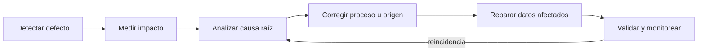

[← Unidad 6](/bbdd-aplicadas/unidad-6/teoria/)

:::note[Contenido complementario]
Esta página no forma parte del programa 2024 de la materia, que para la Unidad 6 indica la Ley 25.326, el GDPR y el modelo ISO/IEC 25012. Se conserva como complemento práctico: cómo convertir una característica de [ISO/IEC 25012](/bbdd-aplicadas/unidad-6/teoria/iso-25012/) en una regla medible. Las fichas, los umbrales, los indicadores de proceso y los pasos de evaluación son **elaboración propia**; ISO/IEC 25012 define las características de calidad de los datos, no cómo medirlas ni qué umbral exigir (la medición se trata en otra norma de la familia, ISO/IEC 25024, que no se desarrolla aquí).
:::

## Para qué sirve

Decir "los datos tienen mala calidad" no permite decidir nada. Una regla medible indica qué condición se evalúa, sobre qué población, con qué fórmula y qué se hace cuando falla. Las consultas siguientes usan las tablas del [laboratorio de calidad](/bbdd-aplicadas/unidad-6/practica/laboratorio-calidad/); ejecutá primero su script de preparación (9 clientes sintéticos con defectos sembrados).

## Ficha de una regla bien definida

| Elemento | Pregunta |
|----------|----------|
| Identificador y nombre | ¿Cómo se referencia sin ambigüedad? |
| Dato crítico | ¿Qué tabla, campo o concepto evalúa? |
| Descripción | ¿Qué condición de negocio debe cumplir? |
| Característica ISO | ¿Qué característica de ISO/IEC 25012 representa? |
| Alcance | ¿Qué filas, fecha, país o producto incluye? |
| Fórmula | ¿Cuál es el numerador y cuál el denominador? |
| Umbral | ¿Qué valor dispara una advertencia o un rechazo? |
| Frecuencia | ¿En captura, cada hora, diario? |
| Owner / steward | ¿Quién decide y quién opera? |
| Acción | ¿Qué se hace ante un defecto? |
| Evidencia | ¿Dónde queda el resultado y la excepción? |

Una métrica sin denominador, alcance o instante no es reproducible. Un promedio general puede ocultar que una sucursal está muy por debajo: conviene segmentar por fuente, período y criticidad.

## Perfilado con SQL Server

El perfilado describe los datos antes de fijar reglas: volumen, completitud, cardinalidad y rango. Con los datos del laboratorio:

<!-- check: U6.P.M01 -->
```sql
SELECT
    COUNT_BIG(*) AS Filas,
    SUM(CASE WHEN Email IS NULL OR LTRIM(RTRIM(Email)) = '' THEN 1 ELSE 0 END) AS EmailFaltante,
    COUNT(DISTINCT PaisCodigo) AS PaisesDistintos,
    MIN(FechaActualizacion) AS ActualizacionMasAntigua,
    MAX(FechaActualizacion) AS ActualizacionMasReciente
FROM calidad.Cliente;
```

**Resultado esperado.**

| Filas | EmailFaltante | PaisesDistintos | ActualizacionMasAntigua | ActualizacionMasReciente |
|---:|---:|---:|---|---|
| 9 | 3 | 5 | 2024-11-02 | 2026-06-29 |

Son 5 países "distintos" aunque el catálogo tiene 3 valores: `AR ` y `ZZZ` son defectos. La cardinalidad inesperada es una pista de falta de **conformidad**.

Para encontrar posibles duplicados, primero se normaliza una clave de comparación (mayúsculas, espacios):

<!-- check: U6.P.M02 -->
```sql
SELECT LOWER(LTRIM(RTRIM(Email))) AS EmailNormalizado, COUNT(*) AS Cantidad
FROM calidad.Cliente
WHERE NULLIF(LTRIM(RTRIM(Email)), '') IS NOT NULL
GROUP BY LOWER(LTRIM(RTRIM(Email)))
HAVING COUNT(*) > 1
ORDER BY EmailNormalizado;
```

**Resultado esperado.**

| EmailNormalizado | Cantidad |
|---|---:|
| cliente01@ejemplo.test | 2 |

Los clientes 1 y 9 tienen el mismo correo salvo por las mayúsculas. Es una sospecha de duplicado (**consistencia**), no una prueba: hay que confrontar con la fuente.

La validez de una fecha textual se prueba con `TRY_CONVERT`, que devuelve `NULL` si no se puede interpretar. Prueba la **exactitud sintáctica**, no que el hecho sea verdadero:

<!-- check: U6.P.M03 -->
```sql
SELECT ClienteId, FechaNacimientoTexto
FROM calidad.Cliente
WHERE FechaNacimientoTexto IS NOT NULL
  AND TRY_CONVERT(DATE, FechaNacimientoTexto, 23) IS NULL
ORDER BY ClienteId;
```

**Resultado esperado.**

| ClienteId | FechaNacimientoTexto |
|---:|---|
| 3 | 31/02/1995 |

## Cálculo porcentual seguro

<!-- check: U6.P.M04 -->
```sql
SELECT CAST(
         100.0 * SUM(CASE WHEN Email IS NOT NULL
                           AND LTRIM(RTRIM(Email)) <> '' THEN 1 ELSE 0 END)
         / NULLIF(COUNT_BIG(*), 0)
       AS DECIMAL(6, 2)) AS CompletitudEmailPct
FROM calidad.Cliente
WHERE Activo = 1;
```

**Resultado esperado.**

| CompletitudEmailPct |
|---:|
| 62.50 |

El `100.0` evita la división entera y `NULLIF` evita la división por cero. Hay que aclarar si "no aplicable" entra en el denominador: acá se evalúan los 8 clientes activos y 5 tienen correo con valor.

## Controles preventivos, detectivos y correctivos

| Tipo | Objetivo | Ejemplos |
|------|----------|----------|
| Preventivo | Evitar que nazca el defecto | tipo de dato, `NOT NULL`, `FOREIGN KEY`, catálogo, formulario |
| Detectivo | Encontrarlo rápidamente | perfilado, reconciliación, alerta, auditoría |
| Correctivo | Restaurar y evitar la recurrencia | subsanar con la fuente, reprocesar, corregir el origen |

Intentar activar las reglas sobre datos heredados falla mientras haya defectos. El script captura el error para mostrarlo:

<!-- check: U6.P.M05 -->
```sql
DECLARE @Bitacora TABLE (Paso INT NOT NULL, Control VARCHAR(40) NOT NULL, Resultado VARCHAR(20) NOT NULL);

BEGIN TRY
    ALTER TABLE calidad.Cliente WITH CHECK
        ADD CONSTRAINT CK_Cliente_Pais CHECK (PaisCodigo IN ('ARG', 'BRA', 'URY'));
    INSERT INTO @Bitacora VALUES (1, 'CHECK de país', 'OK');
END TRY
BEGIN CATCH
    INSERT INTO @Bitacora VALUES (1, 'CHECK de país', CONCAT('Error ', ERROR_NUMBER()));
END CATCH;

BEGIN TRY
    CREATE UNIQUE INDEX UQ_Cliente_Dni ON calidad.Cliente (Dni) WHERE Dni IS NOT NULL;
    INSERT INTO @Bitacora VALUES (2, 'Índice único filtrado sobre DNI', 'OK');
END TRY
BEGIN CATCH
    INSERT INTO @Bitacora VALUES (2, 'Índice único filtrado sobre DNI', CONCAT('Error ', ERROR_NUMBER()));
END CATCH;

SELECT Paso, Control, Resultado
FROM @Bitacora
ORDER BY Paso;
```

**Resultado esperado.**

| Paso | Control | Resultado |
|---:|---|---|
| 1 | CHECK de país | Error 547 |
| 2 | Índice único filtrado sobre DNI | Error 1505 |

El plan correcto es perfilar, poner las excepciones en cuarentena, corregir con evidencia y recién entonces hacer cumplir la regla (se desarrolla en el ejercicio 20 del laboratorio). Usar `WITH NOCHECK` indefinidamente crea una confianza falsa.

## Causa raíz y mejora continua



Causas frecuentes: definición ambigua, campo opcional por error, interfaz sin catálogo, integración que trunca, zonas horarias distintas, fuente no autorizada, operación manual, demora de carga o incentivos contrapuestos.

Para cada defecto se documenta impacto, datos afectados, causa, owner, remediación, fecha y prueba posterior. "Actualizar con cero" rara vez es una corrección: puede borrar la diferencia entre desconocido y valor real cero.

## Indicadores de proceso (propuesta)

Además del porcentaje conforme, conviene medir:

- cantidad y severidad de incidencias abiertas;
- tiempo medio hasta la detección y la resolución;
- tasa de reincidencia;
- fuentes que originan defectos;
- cobertura de reglas sobre los datos críticos;
- excepciones vencidas;
- porcentaje de controles automatizados.

Un tablero sirve para decidir. Los colores no reemplazan al owner ni a la acción; un 99 % puede ser inaceptable si el 1 % restante son alergias médicas o cuentas de alto riesgo.

## Diseño de una evaluación (propuesta)

1. Seleccionar el proceso y los datos críticos.
2. Definir el significado con negocio y metadatos.
3. Elegir las características relevantes.
4. Perfilar y establecer una línea base.
5. Formular reglas y métricas.
6. Acordar umbrales según el riesgo.
7. Automatizar controles cerca del origen.
8. Gestionar excepciones sin ocultarlas.
9. Corregir la causa y los datos.
10. Monitorear la tendencia y revisar las reglas.

## Autoevaluación

**1. "El 8 % de los clientes no tiene teléfono: ¿la calidad es 92 %?"**

<details>
<summary>Respuesta</summary>

No. Solo puede afirmarse que la **completitud** del teléfono, para la población y el criterio definidos, es 92 %. No describe exactitud, actualidad ni calidad global. Si el teléfono es opcional para ciertos clientes, se los excluye justificadamente del denominador; si hay valores falsos como `0000`, la simple presencia sobreestima la calidad.
</details>

**2. ¿Por qué `COUNT(Email)` no alcanza para medir la completitud del correo?**

<details>
<summary>Respuesta</summary>

Porque cuenta los valores no nulos y no distingue la cadena vacía ni los espacios. En el laboratorio, 3 correos son `NULL`, vacío o espacios: hay que normalizar con `NULLIF(LTRIM(RTRIM(...)), '')` antes de contar.
</details>

:::tip[En resumen]
- Una regla de calidad se define con alcance, fórmula (numerador y denominador), instante, umbral, owner y acción.
- SQL prueba que los datos cumplen reglas expresadas en SQL, no que sean verdaderos: mide sobre todo completitud, conformidad y consistencia.
- Los controles se activan después de perfilar, aislar excepciones y corregir con evidencia.
- Los umbrales y los indicadores de esta página son propuestas, no requisitos de la norma.
:::

## Fuentes

- Resumen público de ISO/IEC 25012: [iso25000.com](https://iso25000.com/index.php/normas-iso-25000/iso-25012), consultado el 2026-11-17. Las fichas, umbrales e indicadores son elaboración propia.
- Funciones `TRY_CONVERT`, `NULLIF`, `COUNT_BIG` y restricciones: documentación de [SQL Server en Microsoft Learn](https://learn.microsoft.com/es-es/sql/t-sql/).
