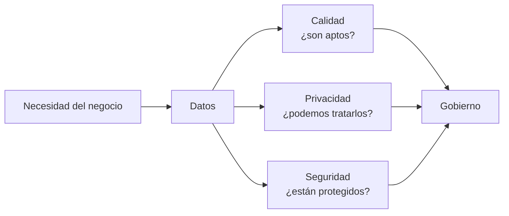

[← Unidad 6](/bbdd-aplicadas/unidad-6/teoria/)

Esta página es el **resumen integrador** de la unidad: ubica cada tema, da las ideas centrales y remite al apunte que lo desarrolla. No repite el detalle de las páginas temáticas.

:::tip[Cómo usar este resumen]
- **Antes de estudiar:** leelo de corrido para tener el mapa de la unidad (de la Ley 25.326 y el RGPD a ISO/IEC 25012).
- **Después de estudiar:** usalo para repasar y conectar los temas.
- **Antes del trabajo práctico integrador o del final:** identificá los temas principales, volvé a la lección de cada uno y completá el repaso con la [guía de repaso](/bbdd-aplicadas/unidad-6/teoria/guia-parcial/).

No reemplaza a las lecciones: cada sección enlaza a la página donde el tema se desarrolla en profundidad.
:::

:::note[Fuentes de la unidad]
No hay material de cátedra para esta unidad. Se sustenta en fuentes primarias: la Ley 25.326 y el Decreto 1558/2001 (InfoLEG), el Reglamento (UE) 2016/679 (EUR-Lex) y el resumen público de ISO/IEC 25012. Cada página temática cita artículos y enlaces. Material académico; no sustituye asesoramiento jurídico.
:::

Una base puede responder rápido y producir decisiones equivocadas porque sus datos son incompletos o falsos. También puede contener datos correctos y tratarlos de forma ilícita. La unidad estudia las dos preguntas:

1. **¿Los datos sirven para el propósito previsto?** Calidad de datos, [ISO/IEC 25012](/bbdd-aplicadas/unidad-6/teoria/iso-25012/) y [medición](/bbdd-aplicadas/unidad-6/teoria/medicion-calidad/).
2. **¿Es legítimo y seguro tratarlos?** [Ley 25.326](/bbdd-aplicadas/unidad-6/teoria/ley-25326/), [GDPR](/bbdd-aplicadas/unidad-6/teoria/gdpr/) y [gobierno y privacidad](/bbdd-aplicadas/unidad-6/teoria/gobierno-privacidad/).

Calidad, privacidad y seguridad se relacionan, pero no son lo mismo: cifrar protege la confidencialidad y no corrige una fecha falsa; una restricción `CHECK` mejora la consistencia y no vuelve lícita una recolección sin habilitación.

## Mapa de la unidad

| Tema | Idea central | Dónde se desarrolla |
|---|---|---|
| Calidad de datos | No hay calidad absoluta: se evalúa contra un uso, una fuente de referencia, un momento y un umbral | [ISO/IEC 25012](/bbdd-aplicadas/unidad-6/teoria/iso-25012/) |
| Ley 25.326 | Dato personal y sensible, principios (arts. 4 a 12), derechos (arts. 13 a 20), sanciones (arts. 31 y 32) | [Ley 25.326](/bbdd-aplicadas/unidad-6/teoria/ley-25326/) |
| RGPD | Alcance (arts. 2 y 3), principios, bases de licitud, derechos, brechas, transferencias y multas | [GDPR](/bbdd-aplicadas/unidad-6/teoria/gdpr/) |
| Medición | De la característica a una regla, una métrica y un umbral | [Medición y mejora](/bbdd-aplicadas/unidad-6/teoria/medicion-calidad/) |
| Gobierno | Roles, inventario, linaje, retención, privacidad desde el diseño | [Gobierno y privacidad](/bbdd-aplicadas/unidad-6/teoria/gobierno-privacidad/) |
| Repaso | Comparaciones, preguntas y casos | [Guía de repaso](/bbdd-aplicadas/unidad-6/teoria/guia-parcial/) |

:::note[Conocimientos previos]
Se reutilizan conceptos de la unidad anterior: mínimo privilegio, roles y permisos (`GRANT`, `DENY`, `REVOKE`), porque materializan la confidencialidad y la seguridad que exigen las normas.
:::

## Resumen por marco

### Calidad: ISO/IEC 25012

Según el resumen público de iso25000.com, el modelo define 15 características agrupadas en inherentes (5), inherentes y dependientes del sistema (7) y dependientes del sistema (3). Dato, información y metadato se distinguen así: el dato representa un hecho (`2026-07-20`), la información es el dato interpretado en contexto y el metadato describe al dato (significado, origen, regla). Detalle y definiciones propias: [ISO/IEC 25012](/bbdd-aplicadas/unidad-6/teoria/iso-25012/).

### Ley 25.326

Protege los datos personales de personas físicas y de existencia ideal (art. 2) asentados en archivos públicos o privados destinados a dar informes (art. 1). Para recordar: calidad (art. 4), consentimiento (art. 5), información (art. 6), datos sensibles (art. 7), seguridad (art. 9) y secreto (art. 10); acceso en 10 días corridos (art. 14) y rectificación, actualización o supresión en 5 días hábiles (art. 16). El órgano de control es hoy la Agencia de Acceso a la Información Pública. Detalle: [Ley 25.326](/bbdd-aplicadas/unidad-6/teoria/ley-25326/).

### RGPD

Reglamento (UE) 2016/679, aplicable desde el 25 de mayo de 2018. Alcanza por establecimiento en la Unión o por oferta de bienes o servicios o control del comportamiento de personas en la Unión (art. 3); excluye, entre otros, el uso personal o doméstico (art. 2.2.c), a las personas jurídicas y a los fallecidos (considerandos 14 y 27). Siete principios (art. 5), seis bases (art. 6), derechos de los arts. 15 a 22 con respuesta en un mes (art. 12.3), brecha en 72 horas (art. 33) y multas de hasta 10 M EUR o 2 % y 20 M EUR o 4 % (art. 83). Detalle: [GDPR](/bbdd-aplicadas/unidad-6/teoria/gdpr/).

### Medición y gobierno (contenido complementario)

Convertir una característica en una métrica exige definir población, denominador, fuente de verdad, momento y umbral; el gobierno asigna responsables y controles durante todo el ciclo de vida. Ambos temas amplían la unidad pero no figuran como fuentes normativas: ver [Medición y mejora](/bbdd-aplicadas/unidad-6/teoria/medicion-calidad/) y [Gobierno y privacidad](/bbdd-aplicadas/unidad-6/teoria/gobierno-privacidad/).

## Cómo se relacionan los marcos

| Pregunta | Ley 25.326 / GDPR | ISO/IEC 25012 | Técnica y gobierno |
|---|---|---|---|
| ¿Debemos recolectarlo? | Finalidad, habilitación, información, minimización | Conformidad | Inventario y aprobación |
| ¿Es correcto? | Exactitud y rectificación (arts. 4 y 16 / art. 5.1.d y 16) | Exactitud, completitud, consistencia | Reglas y fuente maestra |
| ¿Quién lo ve? | Seguridad y confidencialidad (arts. 9 y 10 / art. 32) | Confidencialidad, accesibilidad | Roles, permisos y auditoría |
| ¿De dónde vino? | Información y derechos | Trazabilidad, credibilidad | Linaje y registros |
| ¿Cuánto se conserva? | Destrucción cuando deja de ser necesario (art. 4.7 / art. 5.1.e) | Actualidad | Política de retención |
| ¿Sobrevive a una falla? | Seguridad apropiada (art. 9 / art. 32) | Disponibilidad, recuperabilidad | Copias de seguridad y pruebas de restauración |

Cumplir la ley no certifica alta calidad, e ISO/IEC 25012 no prueba licitud: un diseño responsable necesita ambos análisis.

## Método para resolver un caso

1. **Datos y actores:** personal o sensible, titular, responsable, encargado.
2. **Finalidad y jurisdicción:** qué se pretende; Ley 25.326; test territorial del art. 3 del RGPD.
3. **Problemas:** principio, artículo o característica afectada; no basta decir "mala calidad".
4. **Controles:** preventivo, detectivo y correctivo, con responsable.
5. **Medición:** numerador, denominador, alcance, frecuencia y umbral.
6. **Cierre:** derechos, destinatarios, conservación y evidencia.

Para practicar: [Guía de repaso](/bbdd-aplicadas/unidad-6/teoria/guia-parcial/) y [práctica de la unidad](/bbdd-aplicadas/unidad-6/practica/). La ruta de estudio está en la [presentación de la unidad](/bbdd-aplicadas/unidad-6/teoria/).

## En resumen

:::tip[En resumen]
- La unidad pregunta dos cosas: ¿los datos sirven? y ¿es legítimo y seguro tratarlos?
- Normas: Ley 25.326 (Argentina) y RGPD (Unión Europea); modelo de calidad: ISO/IEC 25012.
- Calidad, privacidad y seguridad son relacionadas pero distintas.
:::

## Fuentes

- Ley 25.326: [InfoLEG](https://servicios.infoleg.gob.ar/infolegInternet/anexos/60000-64999/64790/texact.htm). Consultada el 2026-11-17.
- Decreto 1558/2001: [InfoLEG](https://servicios.infoleg.gob.ar/infolegInternet/anexos/70000-74999/70368/norma.htm). Consultado el 2026-11-17.
- Reglamento (UE) 2016/679: [EUR-Lex](https://eur-lex.europa.eu/legal-content/ES/TXT/?uri=CELEX:32016R0679). Consultado el 2026-11-17.
- Resumen público de ISO/IEC 25012: [iso25000.com](https://iso25000.com/index.php/normas-iso-25000/iso-25012). Consultado el 2026-11-17.
- Autoridad de control (AAIP): [Resolución AAIP 332/2020, Boletín Oficial](https://www.boletinoficial.gob.ar/detalleAviso/primera/239452/20201231). Consultada el 2026-11-17.
